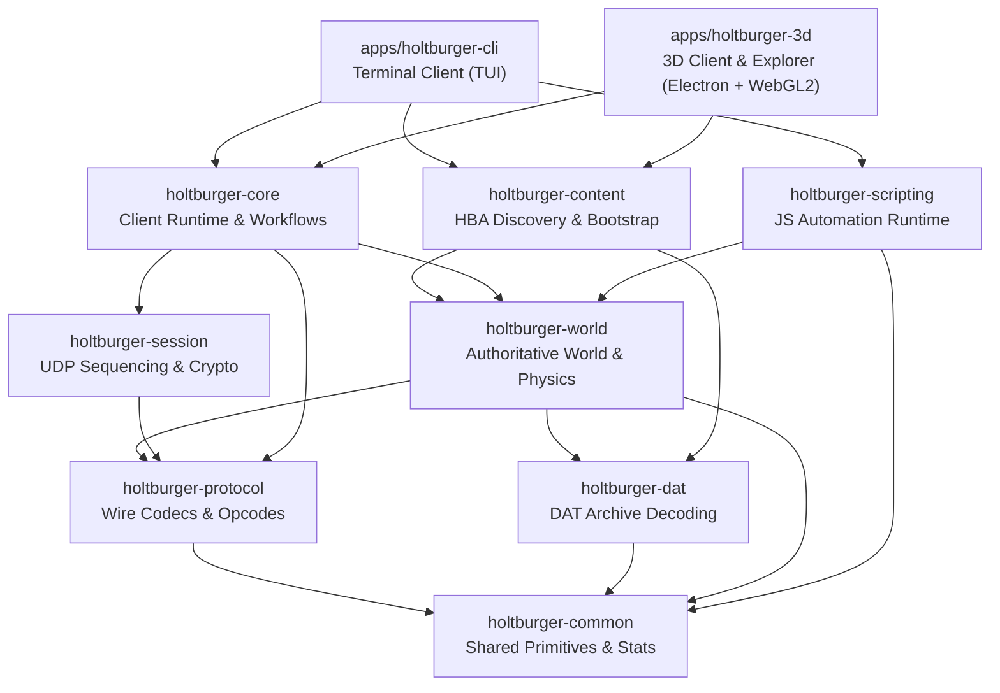
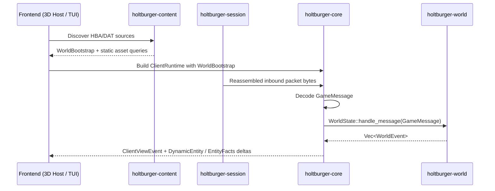

# Holtburger Architecture Overview

Holtburger is a multi-crate Asheron's Call client stack built around strict ownership boundaries: wire serialization stays separate from transport, transport stays separate from authoritative world state, shared orchestration stays separate from static archive discovery, and frontend UX policy stays inside each frontend application.

## Architectural Principles

1. **Coherent Ownership**: `session` owns UDP transport and cryptography, `content` owns archive discovery and bootstrap assembly, `world` owns authoritative gameplay and canonical runtime body state, `core` owns session-to-world orchestration and reusable client workflows, and each frontend owns presentation and UX control policy.
2. **One Fact, One Channel**: Shared domain semantics are derived once at their owning authority (`world` or `core`) and published over typed snapshots and semantic delta streams rather than re-derived from raw bitmasks or parallel side-events in frontends.
3. **Mirrored Read Projections**: Frontends and scripts consume `ClientViewEvent` deltas, entity snapshots, and static content queries without holding shared mutable locks over `WorldState` or running a second movement/physics authority.

---

## Workspace Dependency Graph

---

## Crates and Applications

### 1. [`holtburger-common`](crates/holtburger-common/ARCHITECTURE.md)
Dependency-free bedrock primitives shared across the stack: `Guid`, coordinates and math types, property enums, stat/skill/magic-school taxonomies (`MagicSchool`, `SpellSchool`), and binary codec traits.

### 2. [`holtburger-protocol`](crates/holtburger-protocol/ARCHITECTURE.md)
Deterministic wire-level packet definitions, opcodes, and binary `pack`/`unpack` implementations matching the Asheron's Call network protocol with zero gameplay state.

### 3. [`holtburger-dat`](crates/holtburger-dat/ARCHITECTURE.md)
Static client `.dat` archive access and binary record decoders for setups, animations, physics scripts, environments, landblocks, textures, sounds, and tables.

### 4. [`holtburger-content`](crates/holtburger-content/ARCHITECTURE.md)
Runtime content discovery over mounted HBA/DAT sources, parsed `WorldBootstrap` assembly for `world`/`core`, and static reference-data queries consumed by frontends.

### 5. [`holtburger-session`](crates/holtburger-session/ARCHITECTURE.md)
UDP socket management, packet sequencing, fragment reassembly, checksums, and stream encryption/decryption, independent of gameplay state.

### 6. [`holtburger-world`](crates/holtburger-world/ARCHITECTURE.md)
Authoritative in-memory world model (`WorldState` and `PlayerState`), entity hydration and retention lifecycle, canonical `SpatialScene` / `CollisionScene` / `MotionRuntimeRegistry` simulation state, semantic entity facts and inspection, and pure `WorldContext` queries.

### 7. [`holtburger-core`](crates/holtburger-core/ARCHITECTURE.md)
Client runtime orchestrator (`ClientRuntime` and `ClientRuntimeBuilder`) binding `session` and `world` together. Owns connection/character/portal session lifetimes, fixed-tick simulation and movement execution, guarded multi-step client workflows (inventory, equipment, vendor, trade, salvage, housing), reusable camera collision (`KinematicBoomController`), and the `ClientViewEvent` stream.

### 8. `holtburger-scripting`
Embedded V8/Deno JavaScript runtime exposing read-only projections (`ScriptClientView`) and typed automation intents (`ScriptIntent`) for scripted workflows without coupling scripts to engine internals.

### 9. [`apps/holtburger-cli`](apps/holtburger-cli/ARCHITECTURE.md)
Interactive `ratatui` terminal client serving as a fast proving ground over `holtburger-core`, owning TUI-local layout, keybindings, navigation policy, and script hosting.

### 10. `apps/holtburger-3d`
Full 3D desktop client and content Explorer built with Electron, Svelte 5, WebGL2, and a mode-specific Rust host sidecar (`apps/holtburger-3d/host`) keeping live Client authority separate from offline Explorer authority.

---

## End-to-End Runtime Flow

