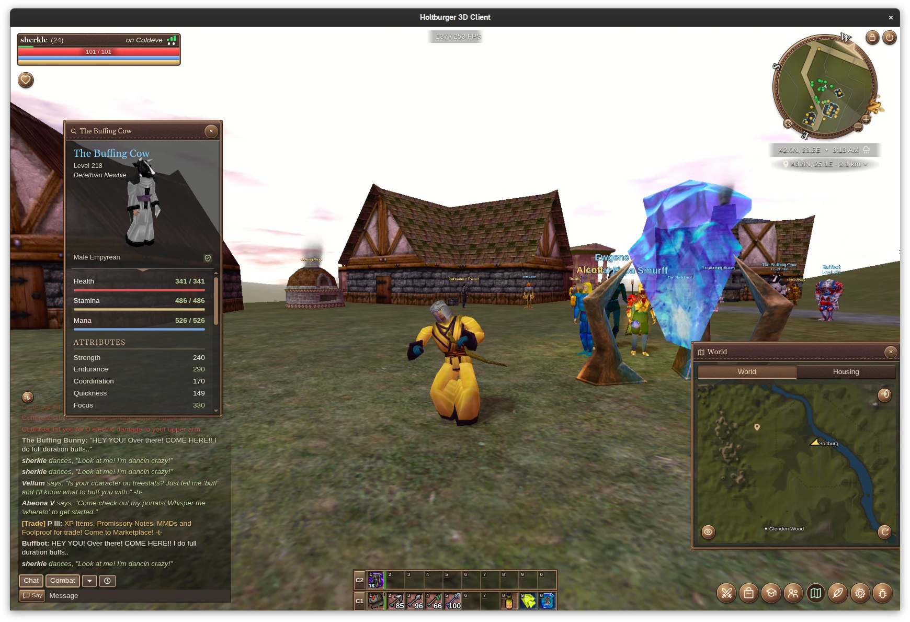
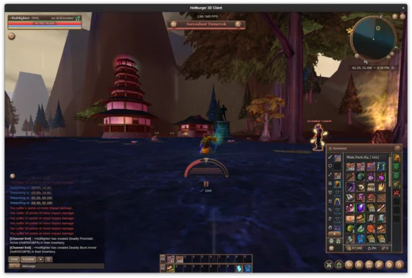
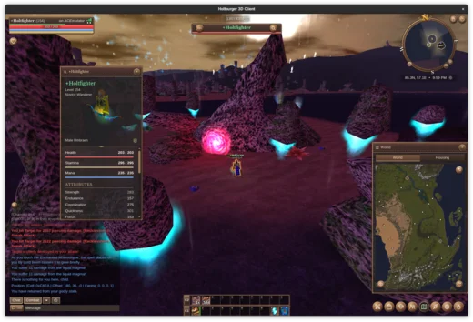
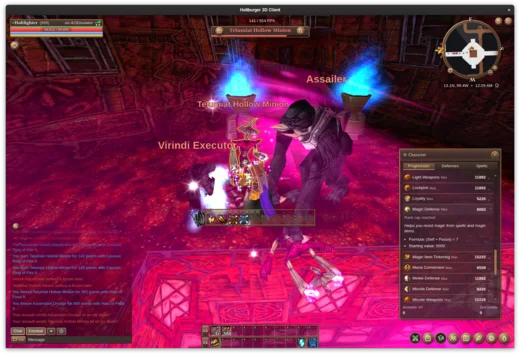
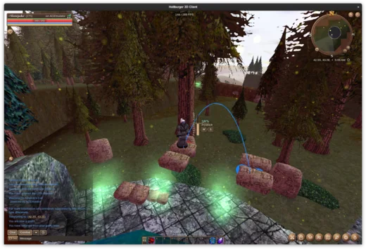
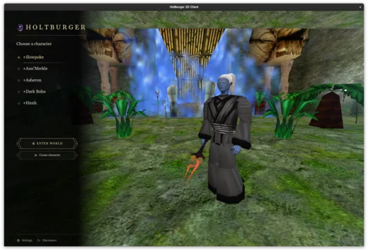
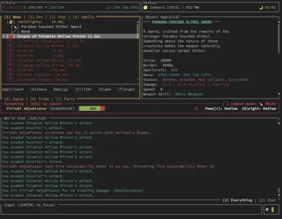

<h1></h1>

**The Asheron's Call client, reengineered.**

Built from the protocol up: a Rust core, a 3D Electron interface, and a scriptable terminal client.

[](assets/screenshots/3d-holtburg.webp)

<p align="center">
  <a href="assets/screenshots/3d-outdoors.webp"></a>
  <a href="assets/screenshots/3d-world-map.webp"></a>
  <a href="assets/screenshots/3d-combat.webp"></a>
  <a href="assets/screenshots/3d-precise-jump.webp"></a>
  <a href="assets/screenshots/3d-character-selection.webp"></a>
  <a href="assets/screenshots/tui.webp"></a>
</p>

*3D gameplay, precise jump aiming, character selection, and the terminal client. Click an image to view it at full size.*

Visit the [website](https://merklejerk.github.io/holtburger/) for [The Game HUD](https://merklejerk.github.io/holtburger/3d/), [Coming from retail?](https://merklejerk.github.io/holtburger/coming-from-retail/), and the [gallery](https://merklejerk.github.io/holtburger/gallery/).

Holtburger is an independently designed, open-source client for Asheron's Call.
It began as a terminal client built against [ACEmulator (ACE)](https://github.com/ACEmulator/ACE),
establishing the shared Rust systems that now power both clients.

## Clients

- **Holtburger 3D:** an Electron desktop app with a Svelte interface and WebGL2
  renderer, backed by the Rust client runtime. Designed for active play, with a
  compact HUD and integrated tools that keep routine setup short. Bring your own
  Asheron's Call game files.
- **Terminal client (TUI):** gameplay and JavaScript scripting through Deno Core,
  without rendering a 3D world. The preferred form factor for automation and bots.
  Release bundles include prepared reference/navigation data and fighter/mage scripts.

h3d has no plugin system yet. Plugins and scripting are planned, including
support for automation. Existing Decal plugins and profiles cannot be imported.

## Download and connect

Get the beta for Windows, macOS, and Linux from
[GitHub Releases](https://github.com/merklejerk/holtburger/releases/latest), or use
the [installation guides](https://merklejerk.github.io/holtburger/start/).
Each bundle includes a self-contained `QUICKSTART.md` with installation,
connection, and troubleshooting instructions.

| Platform | 3D client | Terminal client |
| --- | --- | --- |
| Windows x86-64 | [Setup or ZIP](https://merklejerk.github.io/holtburger/start/3d/windows/) | [ZIP](https://merklejerk.github.io/holtburger/tui/install/windows/) |
| macOS Apple Silicon | [DMG or ZIP](https://merklejerk.github.io/holtburger/start/3d/macos/) | [ZIP](https://merklejerk.github.io/holtburger/tui/install/macos/) |
| Linux x86-64 | [Flatpak or tar.gz](https://merklejerk.github.io/holtburger/start/3d/linux/) | [Flatpak or tar.gz](https://merklejerk.github.io/holtburger/tui/install/linux/) |

Beta and nightly builds share the same installation and settings; installing one
replaces the other.

## Design and compatibility

Holtburger's systems and interfaces are designed from the ground up. Retail
research provides targeted corrections to asset formats, presentation and physics
where compatibility requires them. The goal is to work with the existing game
and content while leaving room to rethink the client experience.

UX, rendering and physics intentionally take their own direction. Expect
differences in movement, management and interaction. The terminal client uses
simplified movement and physics; feature coverage differs between the clients.
Both are under active development, with substantial AI coding assistance.

> [!IMPORTANT]
> Holtburger is developed against ACE. GDLE compatibility is unverified and may be unstable.

## Architecture and tools

The [architecture overview](ARCHITECTURE.md) describes the shared crates and their
boundaries. The main layers are:

| Layer | Responsibility |
| --- | --- |
| [`protocol`](crates/holtburger-protocol) and [`session`](crates/holtburger-session) | Wire formats, UDP transport, sequencing, fragmentation, and encryption |
| [`dat`](crates/holtburger-dat) and [`content`](crates/holtburger-content) | Asset decoding, content discovery, and static reference data |
| [`world`](crates/holtburger-world) and [`core`](crates/holtburger-core) | World state, simulation, client lifecycle, and reusable gameplay behavior |
| [`scripting`](crates/holtburger-scripting) | JavaScript runtime and typed script integration boundaries |
| [`3D`](apps/holtburger-3d) and [`CLI`](apps/holtburger-cli) | Frontend presentation, input, and interaction policy |

The 3D app also includes an offline Explorer for inspecting environments, assets,
and simulation behavior. [Command-line tools](apps/holtburger-tools) and the
[debug harness](crates/holtburger-debug-harness) support asset conversion, protocol
investigation, and focused diagnostics.

For terminal scripting, see [your first script](https://merklejerk.github.io/holtburger/tui/scripting/)
and the bundled [example scripts](apps/holtburger-cli/scripts).

## Development

Website authoring and local preview are covered in [site/AUTHORING.md](site/AUTHORING.md).

Install a current stable Rust toolchain. The 3D client also requires Node.js 22.12
or newer and npm. Start by cloning the repository:

```bash
git clone https://github.com/merklejerk/holtburger.git
cd holtburger
```

### Repository automation

Repository automation uses Node.js 24.13.1 and npm 11.8.0. Install its dependencies
with `npm ci` at the repository root. Use `npm run check:tooling`,
`npm run test:tooling`, and `npm run check:branding` for repository checks;
`npm run generate:branding` refreshes the checked-in app/docs icons.

The root package delegates frontend commands to independent h3d and website
packages. Install their dependencies in their own directories; there are no npm
workspaces. Root commands such as `npm run build:3d` and `npm run check:site` do
not install application dependencies. Cargo owns the TUI build. Its bundled game
scripts and mage's nested npm compiler belong to `apps/holtburger-cli/scripts/`;
see the [TUI script build instructions](apps/holtburger-cli/scripts/src/mage/README.md).

Release, content, notices, and update-feed commands also live at the root; see
[release maintenance](release/RELEASING.md). General automation runs as typed
TypeScript directly in Node. Python remains app-local for LIEF binary inspection,
Windows installer API checks, and the optional font fixture generator.

### 3D client

From the repository root:

```bash
cd apps/holtburger-3d
npm ci
npm run dev:client
```

This builds the Rust host, starts Vite, and opens the Electron launcher. Add your
server and credentials there. When prompted for content, choose your retail game
folder containing `client_portal.dat`, `client_cell_1.dat`, and
`client_local_English.dat`; `client_highres.dat` is optional. A full HBA archive
is also supported.

Use `npm run dev:client:release` for an optimized Rust host. For launch arguments,
renderer diagnostics, and offline Explorer development, see the
[3D development guide](apps/holtburger-3d/README.md#development).

### Terminal client

Source builds require generated reference and navigation data. Place
`navigation.hnav` and either `bootstrap.hba` or `assets.hba` in `local/content/`.
Retail DATs or a full HBA alone do not replace the CLI navigation data. See the
[CLI content configuration](apps/holtburger-cli/README.md#data-file-configuration)
for discovery rules and local provisioning guidance.

From the repository root:

```bash
./apps/holtburger-cli/dev.sh --help
./apps/holtburger-cli/dev.sh --host SERVER --port 9000 --account ACCOUNT --password PASSWORD
```

Replace SERVER, ACCOUNT, and PASSWORD with your server address and credentials.
Pass `--release` first for an optimized build. The runner uses `local/scripts/`
for personal scripts and preferences, alongside the bundled scripts in
`apps/holtburger-cli/scripts/`.

See the [CLI development guide](apps/holtburger-cli/README.md) for scripting paths,
manual Windows launches, and supervised bot runs.

### Shared Rust crates

Work on protocol, content, world state, and reusable client behavior in the
[shared crates](#architecture-and-tools). A plain `cargo build` builds the default
workspace member, the CLI; it does not build the graphical application.
Use explicit package selection when working on a shared crate, for example:

```bash
cargo test -p holtburger-protocol
cargo clippy -p holtburger-protocol --all-targets -- -D warnings
```

## Contributing

Issues are encouraged. External pull requests, including documentation and typo
fixes, are not being accepted while the codebase matures. See
[Contributing](CONTRIBUTING.md) for the policy and client-specific reporting guidance.

## License

Holtburger is licensed under the [GNU Affero General Public License v3.0](LICENSE.md).
