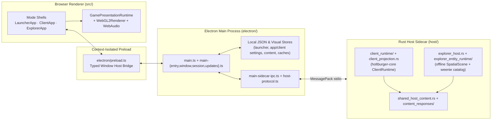

# Holtburger 3D Architecture (`apps/holtburger-3d`)

`apps/holtburger-3d` is the desktop 3D client and offline content Explorer for Asheron's Call. It
runs a sandboxed Svelte 5 + WebGL2 browser frontend inside Electron alongside a mode-specific Rust
sidecar (`holtburger-3d-host`) communicating over length-delimited MessagePack on stdio.

For launch flags, asset setup, diagnostics, and packaging commands, see [`README.md`](README.md).
For CSS layers and theme authoring, see [`UI_STYLE_GUIDE.md`](UI_STYLE_GUIDE.md) and
[`ITEM_UI_THEMING.md`](ITEM_UI_THEMING.md).

---

## Process & Boundary Topology

### Physical Mode Separation & Electron Contract Isolation

1. **Mode-Specific Rust Sidecar (`host/src/`)**: A sidecar process runs in either `client` or
   `explorer` mode, never both. [`host/src/shared_host_content.rs`](host/src/shared_host_content.rs)
   and [`host/src/content_responses/`](host/src/content_responses) serve static HBA/DAT assets, UI
   icons, spell references, and world-map tiles to both modes. Live network/gameplay authority lives
   exclusively in [`host/src/client_runtime/`](host/src/client_runtime) and
   [`host/src/client_projection.rs`](host/src/client_projection.rs); offline entity spawning,
   possession, and `weenies.hwc` indexing live exclusively in
   [`host/src/explorer_host.rs`](host/src/explorer_host.rs),
   [`host/src/explorer_entity_runtime/`](host/src/explorer_entity_runtime), and
   [`host/src/explorer_entity_wire.rs`](host/src/explorer_entity_wire.rs).
2. **Electron Node ESM Boundary (`electron/` $\leftrightarrow$ `src/`)**: `tsconfig.electron-build.json`
   compiles `electron/**/*.ts` and its runtime-imported `*-contract.ts` schemas into `dist-electron/`
   for Node ESM execution without bundling UI frameworks. Modules reached at runtime from `electron/`
   must remain pure TypeScript/Zod (no `.svelte` or browser DOM globals) and use `.js` relative
   specifiers; `import type` references (such as in [`src/lib/host/host-transport.ts`](src/lib/host/host-transport.ts))
   are erased at compile time.
3. **Attempt & Security Lifecycle**: Electron owns one product window (with `nodeIntegration: false`,
   `contextIsolation: true`, `sandbox: true`, and strict frame/origin guards in
   [`electron/main-ipc-guard.ts`](electron/main-ipc-guard.ts)) and at most one active game sidecar.
   Returning to the launcher drains renderer cleanup, flushes pending settings and character-visual
   cache writes, and terminates the sidecar before admitting another session.

---

## Source Tree Map

| Directory                       | Responsibility                                                                                                                                                                                                                                                                                                                                                                                                                                                                                                                                                      |
| :------------------------------ | :------------------------------------------------------------------------------------------------------------------------------------------------------------------------------------------------------------------------------------------------------------------------------------------------------------------------------------------------------------------------------------------------------------------------------------------------------------------------------------------------------------------------------------------------------------------ |
| [`electron/`](electron)         | Electron main/preload entrypoints (`main.ts`, `main-entry.ts`, `main-window.ts`, `main-sidecar-ipc.ts`, `main-session.ts`, `main-updates.ts`, `preload.ts`), MessagePack framing (`host-protocol.ts`), and atomic user-data stores (`launcher-store.ts`, `app-settings.ts`, `client-settings-store.ts`, `content-preference-store.ts`, `client-visual-cache-store.ts`, `client-equipment-cache-store.ts`).                                                                                                                                                          |
| [`host/src/`](host/src)         | Rust `holtburger-3d-host` sidecar: narrow protocol (`protocol.rs`, `lib.rs`), shared content (`shared_host_content.rs`, `content_responses/`, `ui_icons/`, `world_map/`), Client authority (`client_runtime/{mod,commands,dispatch}.rs`, `client_projection.rs`, `client_*.rs`), and Explorer authority (`explorer_host.rs`, `explorer_entity_runtime/{mod,types,registry,possession}.rs`, `explorer_entity_wire.rs`).                                                                                                                                              |
| [`src/launcher/`](src/launcher) | Server/profile launcher UI (`LauncherApp.svelte`), encrypted credential presets, and TreeStats public server directory browser.                                                                                                                                                                                                                                                                                                                                                                                                                                     |
| [`src/app/`](src/app)           | Shared cross-mode app shell (`mount.ts`, `base.css`, `ui-base.css`, `ui-fonts.css`) partitioned into 5 subdirectories: [`desktop/`](src/app/desktop) (Electron IPC contracts, startup/update flows, window settings), [`ui/`](src/app/ui) (game-agnostic Svelte primitives, dialogs, tabs, tooltips, resize/gesture helpers), [`theme/`](src/app/theme) (CSS themes, `ui-theme.ts`, `ui-scale.ts`), [`minimap/`](src/app/minimap) (shared Client/Explorer minimap), and [`performance/`](src/app/performance) (frame profiler panel, native telemetry, frame loop). |
| [`src/client/`](src/client)     | Live 3D client root (`main.ts`, `ClientApp.svelte`, `client-app-lifecycle.ts`, `fixtures/`) partitioned into 12 domain subdirectories (see below).                                                                                                                                                                                                                                                                                                                                                                                                                  |
| [`src/explorer/`](src/explorer) | Offline Explorer shell (`main.ts`, `ExplorerApp.svelte`, `ExplorerTools.svelte`, `explorer-tools-surfaces.ts`, `explorer-tuning*.ts`) partitioned into [`camera/`](src/explorer/camera), [`entities/`](src/explorer/entities), [`world/`](src/explorer/world), and [`panels/`](src/explorer/panels).                                                                                                                                                                                                                                                                |
| [`src/lib/`](src/lib)           | Host transport (`lib/host/`), keyboard & viewport input routing (`lib/input/`), DAT/audio decoders (`lib/assets/`), shared tuning (`frontend-tuning.ts`), and the 3D presentation engine (`lib/game/`).                                                                                                                                                                                                                                                                                                                                                             |
| [`src/harness/`](src/harness)   | Reusable headless Chrome & Vite diagnostic harnesses (`BrowserHarnessApp.svelte`, `UiShowcase.svelte`, `PerformanceSurfaceHarness.svelte`, `webgl2-fixtures/`).                                                                                                                                                                                                                                                                                                                                                                                                     |

### Client Domain Subdirectories (`src/client/`)

| Subfolder                            | Scope                                                                                                                                                                                                                                                                                                                                                 |
| :----------------------------------- | :---------------------------------------------------------------------------------------------------------------------------------------------------------------------------------------------------------------------------------------------------------------------------------------------------------------------------------------------------- |
| [`session/`](src/client/session)     | `ClientLifecycleSession` (`ActiveClientSession` + `CharacterSessionData`), `ClientGameplayPresentation` + its 4 scene/camera/combat/environment collaborators, `ClientPresentationRoot`, `ClientGameplayView.svelte` + 7 getter-backed surfaces (`gameplay-surfaces.ts`), `host-contract.ts`, viewport pointer/mouse controllers, and slash commands. |
| [`pregame/`](src/client/pregame)     | `ClientLoadingPage`, `ClientCharacterSelect`, `ClientCharacterCreator`, `pregame-scene.ts` staging camera/lighting, `pregame-character.ts` local scene model handles, and title music.                                                                                                                                                                |
| [`hud/`](src/client/hud)             | `ClientHudWindow`, `ClientShortcutDock`, `ClientActionBars`, `ClientSelectedEntityHud`, `ClientLogopolisWindow`, `ClientToastOverlay`, logical-unit `hud-layout.ts` / `hud-snapping.ts`, `hud-attention.ts`, and `ui-defaults.ts`.                                                                                                                    |
| [`widgets/`](src/client/widgets)     | Reusable client gameplay UI widgets shared across domains: item cells (`ItemGridCell`, `ItemCellVisual`, `ItemGridStrip`, `ItemQueueCell`, `RemovableItemCell`), cantrip borders & cooldowns (`item-cantrips.ts`, `item-cooldowns.svelte.ts`), item capacity/structure models, and DAT icon loading (`UiIcon.svelte`, `ui-icon-repository.ts`).       |
| [`inventory/`](src/client/inventory) | `ClientInventoryPanel`, `ClientInspectionWindow` (shared per-GUID `appraisals` router), `ClientVendorWindow`, `ClientTradeWindow`, `ClientSalvageWindow`, `ClientWorldContainerWindow`, `ClientLocksWindow`, `ClientBookWindow`, `ClientLoadoutBuilder`, and `ActiveDragPhase`-driven `item-drag.ts`.                                                 |
| [`combat/`](src/client/combat)       | `ClientCombatBar`, `ClientJumpPowerBar` (`precise-jump-session.ts`), target acquisition & indicators, rest-posture controller, summon leash/flicker presentation, death commands, and vital warnings.                                                                                                                                                 |
| [`magic/`](src/client/magic)         | `ClientSpellsPanel`, `ClientSpellBar`, `ClientSpellInspection`, `ClientEnchantmentsPanel`, spell search, formula readiness, and casting state.                                                                                                                                                                                                        |
| [`character/`](src/client/character) | `ClientCharacterHud`, `ClientCharacterSheetPanel`, `ClientBarberWindow`, isolated WebGL2 `ClientModelPreview` (`object-preview-service.ts`), stat artwork, XP feedback, and player-visual capture forwarding.                                                                                                                                         |
| [`social/`](src/client/social)       | `ClientChat` + `chat-composer.svelte.ts`, `ClientSocialPanel` & `ClientPartyHud`, `ClientEmoteWheel`, fellowship, allegiance, friends, squelch, and soul emotes.                                                                                                                                                                                      |
| [`housing/`](src/client/housing)     | `ClientHousingTab`, `ClientHousingManagement`, `ClientHouseCrystalWindow`, maintenance payment quotes, HAR checkbox reconciliation, and landscape housing map overlays.                                                                                                                                                                               |
| [`world/`](src/client/world)         | `ClientWorldPanel`, `ClientJournalPanel` (contracts tracker & map pins), `ClientNearbyPanel`, replicated `entity-mirror.ts`, Tab cycle selection, and selected-entity health/overlay tracking.                                                                                                                                                        |
| [`settings/`](src/client/settings)   | `ClientSettingsPanel` (Graphics, Display, UI, Audio, Input, Gameplay, Environment), keybinding editor, pack affinities, settings normalization/persistence, and `tuning.ts`.                                                                                                                                                                          |

---

## 3D Engine & WebGL2 Renderer (`src/lib/game/`)

### `runtime/` — `GamePresentationRuntime`

[`game-presentation-runtime.ts`](src/lib/game/runtime/game-presentation-runtime.ts) bridges async
worker commits, `SceneGraph` topology, asset residency, and frame rendering through 6 collaborators:

- **`StaticSceneStreamingCoordinator`** (`runtime-static-streaming.ts`): Scene interest radii,
  terrain/static-object/EnvCell layer realization, ocean backdrop tiles outside landblocks `0..=254`,
  map geometry, and scene activation readiness.
- **`SpawnedEntityLifecycleCoordinator`** (`runtime-spawned-entities.ts`): Authoritative dynamic
  entity mirror, scope-gated realization and deferral, visual overrides, attachment visibility, and
  pregame `LocalSceneModelHandle` groups.
- **`BehaviorCueAndEffectsCoordinator`** (`runtime-behavior-effects.ts`): Animation sampling and
  distance cadence, physics/sky scripts, particle emitters, server script/sound cues, and combat
  floating-text/effect adapters.
- **`SpatialAudioAndAmbientCoordinator`** (`runtime-spatial-audio.ts`): Listener placement, sound
  tables, and cell-cached terrain ambient sound bakes.
- **`FramePresentationCoordinator`** (`runtime-frame-presentation.ts`): Primary camera/view extent,
  environment lighting/fog, entity overlay resolution, summon leashes, and portal-transition tunnel
  presentation.
- **`RuntimeTelemetryAndLifecycle`** (`runtime-telemetry-lifecycle.ts`): Async continuation/failure
  tracking, opt-in `PresentationProfiler`, runtime diagnostics, and reverse-order
  `PresentationTeardownStack` shutdown.

### `commit/`, `behavior/`, `systems/` & `renderer/`

- **Binary Layer Streaming & Failure-Atomic Realization** ([`commit/`](src/lib/game/commit/),
  [`systems/env-cell-system.ts`](src/lib/game/systems/env-cell-system.ts)): Streams compact host
  binary payloads (`HBLB` terrain/static objects, `HBEC` v6 EnvCells, `HBAN` animation/motion/script
  tables) and commits static and interior scene layers atomically under revision fences so stale or
  canceled loads never leak partial geometry or portal topology.
- **Dual Behavior Clocks & Stateless Event Routing** ([`systems/animation-system.ts`](src/lib/game/systems/animation-system.ts),
  [`systems/physics-script-system.ts`](src/lib/game/systems/physics-script-system.ts),
  [`behavior/behavior-event-router.ts`](src/lib/game/behavior/behavior-event-router.ts)): Advances
  30 Hz skeletal animation timelines and wall-clock physics-script timelines into precompiled
  `PreparedBehaviorCommand` sequences routed statelessly to particle, sound, and visual overrides.
- **`DynamicEntitySystem`** ([`systems/dynamic-entity-system.ts`](src/lib/game/systems/dynamic-entity-system.ts)):
  Coordinates generation-fenced async visual/animation/script/motion staging
  (`dynamic-owner-staging.ts`), part attachment frames (`dynamic-scene-attachments.ts`), in-place
  `sourceToLandblock` matrix composition and particle-expanded culling bounds
  (`dynamic-presentation-bounds.ts`), and diagnostics (`dynamic-entity-diagnostics.ts`).
- **`WebGL2Renderer`** ([`renderer/webgl2/webgl2-renderer.ts`](src/lib/game/renderer/webgl2/webgl2-renderer.ts)):
  Organizes rendering across 5 subdirectories (`webgl2/`, `portal/`, `passes/`, `shadows/`,
  `overlays/`) alongside root `Renderer` / `RenderWorld` contracts:
  1. **`webgl2/`**: `WebGL2Device` (`runDiagnostic` hook, context-loss guard), `WebGL2Renderer`
     schedule orchestrator, `WebGL2DeviceAndTargetPool`, `SceneContributionCompilerAndSelector`,
     `ObjectAndShadowPassExecutor`, `TerrainPassExecutor`, `SkyParticleOverlayAndSelectionPasses`,
     and `RendererFrameDiagnosticsAndProfiler`.
  2. **`portal/`**: Packed portal scope-atlas visibility traversal, window clipping, and tile
     compositor.
  3. **`shadows/`**: Outdoor cascaded PSSM shadow maps, indoor entity grounding, and directional
     analytic shadows.
  4. **`passes/`**: Celestial sky & after-landscape weather, GPU particle record store & billboards,
     screen-space ambient occlusion (SAO), fog, lighting, and color grading.
  5. **`overlays/`**: Cached nameplate & icon atlases, health bars, depth-independent entity
     selection outlines, summon chains, and world/trajectory markers.

---

## Core Frontend & Rendering Invariants

1. **Cold Svelte Reactivity vs. Hot Imperative Pulls**: `$state`, `$derived`, and `$effect` hold
   only cold UI state (open panels, settings, modal flags, active tabs). Frame-rate, cursor-rate,
   and network-tick data stay in imperative owners (`ClientGameplayPresentation`,
   `GamePresentationRuntime`, domain `*State` classes); `.read()` getters are strictly pure and
   preserve object reference identity where UI pollers (`startUiIconDisplay`) short-circuit idle DOM
   updates. Multi-prop component bundles (`gameplay-surfaces.ts`, `explorer-tools-surfaces.ts`) use
   plain getter literals rather than `$derived({ ... })`.
2. **Persistent World Device Across Pregame & Gameplay**: `ClientPresentationRoot` retains a single
   canvas, `WebGL2Device`, `GamePresentationRuntime`, worker pool, and audio context from pregame
   character staging through in-world gameplay and back to character selection; isolated item/creature
   previews (`ClientModelPreview`) use a separate lightweight preview renderer sharing CPU
   `HostPresentationAssets`.
3. **Branded Coordinate Frames**: Retained and cross-system positions carry compile-time brands
   (`AcVector3` authored Z-up, `LandblockVec3` landblock-local, `SceneVector3`/`SceneVec3` canonical
   world, and ephemeral camera-anchor-relative `RenderVector3`). Never store `RenderVector3` across
   frames or cast away frame brands inside consumers.
4. **Zero-Allocation Hot Paths & Explicit GPU Teardown**: Renderer and presentation passes reuse
   preallocated `Float32Array`, `Vec3`, `AABB3`, and instance-arena scratch buffers in place, keep
   `WebGL2FrameProfiler` `null` when disabled, guard public GL entrypoints with `assertDeviceReady()`,
   and release GPU programs/FBOs/samplers/queries through `WebGL2Renderer.destroy()` before
   `WebGL2Device` context retirement.
