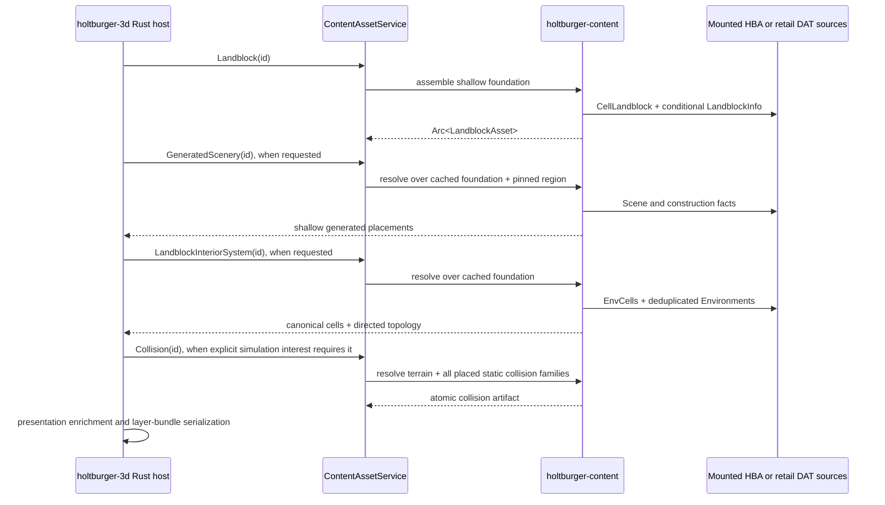

# Content Pipeline Architecture

The library crate responsible for runtime content discovery, decoded static-data reuse, and
canonical DAT-derived queries.

## Core Principles

- **Interpret content, not presentation**: this crate may decode, join, normalize, and derive
  source-domain facts. Authored collision polygons, terrain obstruction triangles, and conservative
  collision bounds are source-domain geometry because host behavior consumes them. Renderer
  coordinates, presentation triangulation, aperture meshes, batching, culling structures, and
  frontend LoD policy remain outside this crate.
- **Cheap foundations, explicit fanout**: a complete shallow landblock load is safe at a wide
  interest radius. Generated scenery and interiors are separate resolutions because they open
  materially larger dependency graphs.
- **Preserve authored uncertainty**: unsupported DIDs, directed nonreciprocal portal selectors,
  and outside endpoints remain domain state. Missing or corrupt required records fail with
  context; successful assets do not carry diagnostic ledgers.
- **Share immutable decoded graphs**: `ContentDecodeCache` retains decoded records through `Arc`.
  Repeated landblock derivations do not clone heavy Environment, Scene, SetupModel, or GfxObj
  graphs.
- **One resource contract across archive formats**: explicit selections mount namespaced HBA
  bundles or retail DATs through the same `holtburger-dat` source composition. Directories prefer
  HBA content by default. Consumer admission can select retail DATs instead when readable
  HBAs are unsuitable; corrupt archives remain errors and families never mix. Required assets are resolved when
  consumed rather than through an exhaustive startup audit.

## Key Components

### Repository Surface ([src/repository.rs](src/repository.rs))

`ContentRepository` owns archive mounting, mounted-source precedence, raw resource
access, and focused material/texture queries. Repository construction remains frontend or tool
policy; shared orchestration receives an already constructed repository.

`ResolvedContent::open` opens an exact archive or selected directory without environment overrides
or sibling-extension probing, returning a repository and canonical selection identity together.
`ResolvedContent::open_preferred` applies a frontend admission predicate to the preferred HBA
installation before trying the same directory's DAT installation; the frontend still validates
the returned repository and reports its missing resource. Exact files never switch sources.
`ResolvedContent::discover` uses this preference when trying an app-supplied portable directory followed by the shared platform
data directory. Missing locations and directories without archives are skipped; invalid selected
archives fail explicitly. Legacy `ContentRepository::discover` retains HBA/environment discovery
for tooling consumers; h3d uses the explicit selection APIs and TUI owns its HBA/HNAV selection in the frontend.

Retail role identification uses header dataset/subset, allowing one base portal, optional highres
portal, cell, and language archive per installation. Highres shares `eor/portal` and takes precedence
when it contains the requested resource, matching retail `CLCache::GetDiskController`
(`acclient.c:282498`). Duplicate roles are errors. HBA and DAT resources are not silently mixed.
HBA ordering remains namespace breadth followed by path, with full records preferred over pruned
records by the existing layered resolver.

Both formats provide an entry census and opened-handle filesystem revisions for cache identity.
The census describes physical entries; motion projection resolves each logical resource key once.
DAT entry sizes describe stored bytes, while HBA entry sizes describe decoded bytes. Inventory
building does not decompress all resources to normalize those sizes.

`ContentResourceError` preserves the namespace, file ID, source description, and original cause for
read/decode failures. Necessity belongs to the consuming operation; missing optional content does
not become a required-content failure merely because a lookup was attempted. Application setup,
remembered locations, and recovery UI remain outside this crate.

### Shared Decode Cache ([src/decode_cache.rs](src/decode_cache.rs))

`ContentDecodeCache` provides bounded immutable reuse for decoded CellLandblocks, LandblockInfo,
EnvCells, Environments, RegionDesc, Scenes, SetupModels, GfxObjs, palettes, and other recurring
records. Cache hits return the same `Arc` allocation.

### Landblock Foundation ([src/landblock.rs](src/landblock.rs))

`LandblockAsset` is the complete filter-free shallow projection of one CellLandblock, its
conditionally required LandblockInfo, and the pinned active RegionDesc:

- authored terrain samples and height indices plus resolved heights;
- every explicit object and building placement, including unsupported DID families;
- building portal metadata;
- the contiguous EnvCell reference range; and
- restriction-table entries.

`CellLandblock.has_objects` is the LandblockInfo presence contract. A missing CellLandblock is a
valid absent result. If `has_objects` is zero, the foundation does not read LandblockInfo; if it is
nonzero, missing or corrupt LandblockInfo is an error.

### Generated Scenery ([src/generated_scenery.rs](src/generated_scenery.rs))

`GeneratedSceneryAssetAssembler` resolves retail scenery population over an existing
`LandblockAsset`. It reads the pinned RegionDesc scene tables plus referenced Scene and object
construction facts needed for retail boundary acceptance. The output remains shallow: stable
provenance, source DID/family, placement, and scale.

Scenery samples height and slope from the authored terrain triangle selected by the foundation's
diagonal topology, independently of collision-only water immersion. That polygon's normal owns
both slope acceptance and downhill heading. Frame construction matches retail's heading convention
and template pitch handling; the terrain height replaces template Z before unscaled boundary
acceptance. Scale is applied only after acceptance.

### Interior System ([src/interior.rs](src/interior.rs))

`LandblockInteriorSystemAssembler` resolves every EnvCell referenced by the foundation and retains
one shared Environment per DID. CellStructs remain embedded in their owning Environment and are
referenced by `(Environment DID, local selector)`.

Topology preserves one directed record per authored EnvCell portal. Raw target selectors always
survive. In-range reciprocal internal links additionally receive a validated cross-link; outside
links may be enriched by one matching LandblockInfo building portal. No GfxObj aperture geometry,
CellStruct triangulation, render bounds, or BVH is produced.

### Static Collision Assembly

[`src/terrain_topology.rs`](src/terrain_topology.rs) owns retail's deterministic terrain-cell
diagonal rule. The diagonal grid travels with `LandblockTerrain`; both host obstruction triangles
and the frontend stride-one mesh consume it rather than maintaining separate hashes.

[`src/object_collision.rs`](src/object_collision.rs) resolves each placement's retail collision
representation for explicit objects, generated scenery, building shells, EnvCell structures, and
indoor statics: per-part physics BSPs with polygons when any part carries one, otherwise the
setup's authored cylsphere volumes, otherwise its collision spheres
(`CPhysicsObj::find_obj_collisions` precedence). Shapes remain shared through the resolved-asset
cache while placements retain component-wise SetupModel part scales; volume shapes require the
uniform whole-object scale retail applies to them. Every placed collider carries a landblock-space
axis-aligned bounds box for broad-phase rejection and cell-shadow registration, and each placed
part retains a stable authored-placement identity and its pre-collapse placed box corners so the
resident world can reproduce retail's multipart static-shadow traversal without cloning geometry.
Interior containment volumes derive from the distinct cell BSP, retain portal neighbors, and
preserve the matched building index/origin on outside portals. `LandblockColliders` is the atomic
merge unit for placed shapes and volumes.

These artifacts deliberately contain no grounding, walkability, step, edge, movement-response, or
residency policy. They also do not bake cross-cell memberships: that fact depends on the complete
resident scene because shipped outdoor placements can enter a neighbor-owned building. The world
derives those shadow references transactionally from independently assembled landblock artifacts.
`ContentAssetService::resolve_collision` in `holtburger-core` is the sole complete product
composition path.

### Character Generation ([src/character_gen.rs](src/character_gen.rs))

Content owns the static character-generation catalog, dependent appearance validation, starting
area queries, and creation appearance composition in `character_gen/appearance.rs`. The resolver
preserves ordered ObjDesc substitutions and applies base, body style, face/hair, skin, and starter
clothing data using the same material/clothing queries as other content consumers. Garment colors
are actual offered palette-template keys, not UI ordinals. The result supplies identity-free visual
facts, the authored creation idle, scale, and heritage background identity;
frontend layout and draft navigation stay in h3d.

Raw `SkillBase` specialization cost includes training. Catalog cost interpretation normalizes
that to a specialization **upgrade** cost, while heritage primary-cost overrides already express
the upgrade. `CharacterGenSkillCosts` carries this distinction explicitly, including unavailable
skills, so core validation and frontends consume one interpretation rather than charging training
twice. General template support remains available to other clients; h3d's Custom-only choice is
frontend policy.

### Motion Contract ([src/motion_sequence.rs](src/motion_sequence.rs))

`MotionSequenceCatalog` projects the raw motion representation — motion tables, animations, and
setup models — into the shape runtime consumers actually need. It is a projection, not an asset:
nothing about motion is baked into the archive, and the catalog is rebuilt in memory from the same
records the archive carries in every profile.

A `MotionSequence` resolves one motion-table entry into ordered `MotionClip`s. Each clip binds an
animation to an inclusive traversal window and a signed rate, with retail's window normalization
already applied — `-1` means the last frame, bounds clamp to the animation, and an inverted pair
raises the high bound rather than playing backwards. Consumers therefore never re-derive a window,
and a clip is unrepresentable without the animation it indexes.

Each animation carries only its *simulation facts*: a `RootMotionTrack` of per-frame authored root
offsets and a `MotionHookTrack` of the hooks that affect simulation. Articulated part frames are
deliberately absent — they are presentation, and a frontend loads them separately through the asset
pipeline. `Animation::read_simulation_facts` seeks past them rather than materialising them, which
is what keeps catalog construction from allocating tens of megabytes it would immediately discard.

`reachable_animation_ids` spans cycles, modifiers, and links, and is the closure a frontend stages
before an entity animating from a table may activate.

## Ownership Boundary

### What Belongs Here

- HBA/DAT selection, mount ordering, and typed source access
- decoded-record caching and source-domain joins
- canonical terrain, object, building, restriction, generated-scenery, and interior facts
- retail-derived generated-scenery population semantics
- portal topology and stable source references required for later enrichment
- authored collision BSPs/polygons, conservative bounds, terrain obstruction triangles, and cell
  containment volumes
- reusable material, appearance, and texture-data queries

### What Does Not Belong Here

- runtime world mutation or gameplay rules
- app interest radii, requested-layer selection, or retry policy
- render-coordinate conversion and polygon-side expansion
- GfxObj/SetupModel presentation closure, presentation triangulation, or render bounds
- aperture meshes, draw ranges, batching, atlases, culling trees, or portal traversal policy
- durable success diagnostics, source-attempt ledgers, or renderer snapshots

`apps/holtburger-3d/src-tauri` owns presentation enrichment and binary landblock layer-bundle
production. The browser owns final baked/instanced draw units, runtime visibility, committed
bounds, and spatial structures.

## Runtime Data Flow

`ContentAssetService` in `holtburger-core` is the active composition root. It constructs without
reading RegionDesc, lazily pins one `Arc<ActiveRegionData>` for region-scoped operations, caches
the shallow foundation by normalized landblock ID, and exposes generated and interior ID requests
that reacquire that exact foundation. Region-independent asset requests remain available without
RegionDesc. Generated and interior results are not separately cached without measurements
demonstrating a need.

## Prepared navigation content

TUI selection lives in its frontend. The content layer exposes `SceneContentSource` for owner classification/collision products
and `SetupContentSource` for authored setup facts. Scene sourcing is independent of movement
and body preparation policy.
`PreparedNavigationSource` composes an already opened reference repository and
`NavigationSceneSource`; it neither discovers paths nor chooses a storage/profile fallback.
The HBA may be reduced or full, while scene geometry always comes from HNAV.

Bootstrap reads expose parsed catalogs and authored setup dimensions without model preparation.
`read_motion_reference_data` returns `MotionReferenceData`, projecting motion defaults and
interaction dimensions from one setup decode pass. Frontends retain those parsed facts for
their own content lifetime; client bootstrap does not scan setups again.
The same indexed repository supplies complete character-generation choices and motion data.
`SetupDimensionCatalog` carries authored radius/height; world applies current entity scale and
canonical placement when deriving interaction ranges.

`NavigationSceneSource` reads independently compressed owner blocks and shared Environment
structures, then projects the existing cell/terrain/collision products. It retains immutable
shared geometry through `Arc`. Generation uses `LandblockRoomShellAssembler` over the same
shallow foundation/interior products used by physical assembly; the TUI does not perform that
projection at runtime. Prepared navigation does not read furniture, scenery, or visual models.

The output contains room containment planes, physics shells, portal apertures/connections,
resolved terrain, and building transition metadata. These are static products: movement intent,
simulation policy, authoritative placement, and packet timing belong to core/world. The prepared
format does not select how a client traverses cells. h3d retains its full-content asset service.

See [navigation format](../../docs/navigation_format.md) for framing and version ownership.
`cli-content` in `holtburger-tools` generates and inspects the approved distributable pair locally;
release tooling validates its pinned ZIP and component identities. Runtime performs focused
codec validation rather than bootstrap hashing or a source-corpus census.

## Dependencies

- **`holtburger-dat`**: HBA/DAT resource composition and low-level file parsers.
- **`holtburger-common`**: shared math and source-domain primitives.
- **`binrw`**: binary decoding support for focused content queries.

## Optional Explorer server snapshot

`WeenieCatalogContent` resolves the caller-selected `weenies.hwc` path, reports missing
or invalid content explicitly, and owns the catalog reader. Explorer owns discovery
and uses the snapshot for template search and preparation; offline tools can also
query it. The snapshot describes one server database and is not authoritative for
live entities. It is never included in world bootstrap or opened by the live client.
Environment variables remain host inputs; Explorer fuzzy search remains app-local.
Live classification, usability, and inventory ordering use received state.
The standard housing-storage identity is resolved separately from the client DAT's
WCLASSID mapper during bootstrap. Core uses it to suppress inferred locked notices
for housing storage, whose permission-denial sound is shared with locked objects.

### Contract catalog ([src/contracts.rs](src/contracts.rs))

`ContentRepository::read_contract_catalog` loads portal `0x0E00001D` through the
ordinary typed resource path. The catalog preserves each complete definition and
parses authored progress text once into literal text or one integer substitution.
Unsupported formatting fails bootstrap with the contract ID and format text.
World uses this immutable lookup to interpret server trackers; no per-row host
content fetch or app-owned duplicate catalog is needed.

Standard lockpick WCID bonuses live in `lockpick.rs`. Inventory, inspection, and chance
estimates consume this small reference table without loading a server-template snapshot.
Unknown WCIDs remain absent; world and frontend policy explicitly assume zero where needed.
