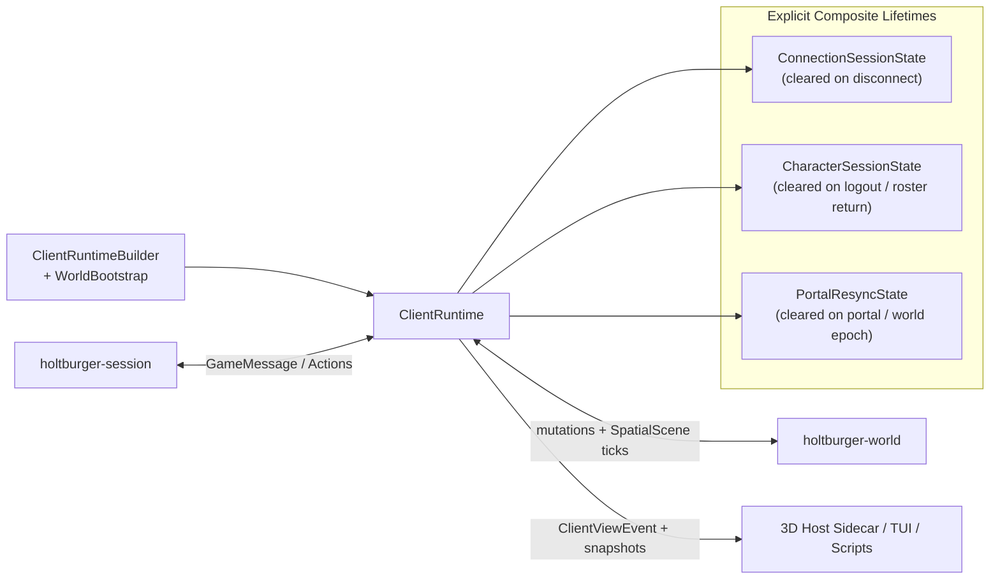

# Core Engine Architecture (`holtburger-core`)

`holtburger-core` orchestrates `holtburger-session` (transport) and `holtburger-world`
(authoritative state) into a reusable client runtime. It drives authentication and world entry, runs
the fixed-tick movement and simulation loop, executes guarded multi-step gameplay workflows, hosts
shared spatial and camera utilities, and publishes semantic deltas (`ClientViewEvent`) plus
recovery snapshots to frontends and scripts.

## Core Design Rules

- **Explicit Session Lifetimes**: `ClientRuntime` partitions mutable state by exact lifecycle scope
  (`ConnectionSessionState`, `CharacterSessionState`, and `PortalResyncState`) so disconnect,
  character logout, and portal transitions reset atomically without per-field state leaks.
- **Honest Observation vs. Transition Boundaries**: Status and view emitters (such as
  `send_status_event(&self)`) are strictly read-only; state retirement happens only inside explicit
  lifecycle transitions (`retire_portal_epoch`, `retire_character_state`,
  `retire_character_session`, `finish_disconnect`).
- **Producer-Only Event Stream**: `ClientRuntime` translates `GameMessage`s and `WorldEvent`s
  synchronously into `ClientViewEvent`s and entity/presentation updates. It never subscribes to its
  own broadcast channel.
- **Reusable Engine Capabilities, Frontend-Owned UX**: `core` owns protocol sequencing,
  busy/admission guards, and reusable controllers (`KinematicBoomController`, character motion/jump
  resolvers), while keybindings, HUD layout, camera gestures, and target-selection UX stay in
  `apps/holtburger-cli` and `apps/holtburger-3d`.

---

## Module Map

### Crate Root (`crates/holtburger-core/src/`)

| Module | Responsibility |
| :--- | :--- |
| [`src/client/`](src/client) | `ClientRuntime` orchestrator and its 9 domain submodules (detailed below). |
| `src/dynamic_entity.rs`, `src/dynamic_entity_view.rs` | Source-neutral `DynamicEntityDefinition` validation, DAT setup/physics preparation, stateless `SpatialScene` body installation, and `DynamicEntityView` projection shared by live Client and offline Explorer hosts. |
| `src/kinematic_boom.rs` | Reusable collision-safe third-person camera boom controller (`KinematicBoomController`) operating over immutable world collision snapshots. |
| `src/simulation_scene.rs`, `src/content_assets.rs` | Scene residency/interest coordination and `ContentAssetService` runtime asset loading from `holtburger-content`. |
| `src/character_gen/` | Character-creation validation, heritage/skill/attribute point budgets, and appearance assembly. |

### Client Runtime Submodules (`crates/holtburger-core/src/client/`)

| Submodule | Responsibility |
| :--- | :--- |
| [`client/mod.rs`](src/client/mod.rs) | `ClientRuntime` root, `ConnectionSessionState`, `CharacterSessionState`, `PortalResyncState`, retirement transitions, and `WorldEvent` $\rightarrow$ `ClientViewEvent` projection. |
| [`client/session/`](src/client/session) | `ClientRuntimeBuilder`, `ClientRuntimeHandle` & `ControlSource` (`control.rs`), GLS/world handshake (`connection.rs`, `lifecycle.rs`), inbound `messages.rs`, outbound `commands.rs`, `busy_operation.rs`, fixed-tick `simulation.rs`, `event_ordering.rs`, and public `ClientCommand` / `ClientViewEvent` (`types.rs`). |
| [`client/motion/`](src/client/motion) | 30ms `MovementSystem` (`movement/`), shared core local steering (`steering.rs`), `PlayerDriveIntent` & `CharacterDrive` (`movement_types.rs`), clock-free `character_motion.rs` & `character_jump.rs`, `character_kinematics.rs`, reduced `navigation_body.rs`, `collision.rs` demand coordinator, `precise_jump*.rs`, and `rest_posture.rs`. |
| [`client/camera/`](src/client/camera) | Dedicated worker service (`camera_service.rs`) and client camera runtime (`runtime.rs`) driving `KinematicBoomController` off the simulation lock. |
| [`client/entities/`](src/client/entities) | Replicated `ClientEntitySnapshot` / `ClientEntityDelta` + `PlayerEntitySummary` (`entity_facts.rs`), dynamic-entity feed adapter (`dynamic_entity_view.rs`), script/sound `entity_cues.rs`, and `selection_query.rs`. |
| [`client/combat/`](src/client/combat) | `combat_runtime.rs`, `combat_engagement.rs`, `combat_attribution.rs`, `combat_feedback.rs`, and server combat text parsing. |
| [`client/character/`](src/client/character) | Character roster/creation reconciliation (`character_selection.rs`), `character_sheet.rs`, `progression.rs`, `player_visual.rs` & `object_preview.rs` captures, `barber.rs`, `contracts.rs`, and `spell_inspection.rs`. |
| [`client/inventory/`](src/client/inventory) | Unified `SubmitInventory` planning & execution (`inventory_plan.rs`, `inventory_storage.rs`, `inventory_runtime.rs`), multi-step `equipment_plan.rs` / `equipment_runtime.rs`, `salvage.rs` (`SalvageApproval` revision token), `vendor_transaction.rs` (`VendorTrade`), `trade.rs`, `item_use.rs`, `appraisal.rs`, `corpse.rs`, `world_container.rs`, and `lock_feedback.rs`. |
| [`client/social/`](src/client/social) | Fellowship (`party.rs`), `allegiance.rs`, `friends.rs`, and `squelch.rs` command/query flows. |
| [`client/world_nav/`](src/client/world_nav) | Housing home/crystal queries, quotes, payment, and coalesced HAR management (`housing*.rs`), `recall.rs`, and `map_teleport.rs`. |

---

## Lifetime & Data Flow

---

## Key Architectural Seams

### 1. Physical vs. Navigation Movement Compositions
`ClientRuntimeBuilder` configures `MovementSystem` (`client/motion/movement/`) with one of two
compositions over the same authoritative `WorldState`, `MotionRuntimeRegistry`, and packet
publisher:
- **Physical composition** (`physical_movement_source` + `ClientBodySource`): Full swept
  static/dynamic collision, grounded support, local jump execution (`character_jump.rs`), and crowd
  contact solving for the 3D client and physics harnesses.
- **Navigation composition** (`navigation_movement_source` + `SetupContentSource`): Point-valid
  containment and room-shell/terrain remote prediction for reduced clients (such as the TUI),
  delegating physical-only eligibility gates to the server without inventing invalid positions or
  weakening `holtburger-world`'s physical solver.

Shared local steering (`client/motion/steering.rs`: `MoveTo`, `Approach`, `Follow`, `FaceHeading`,
`FaceEntity`) runs inside `MovementSystem` over the same `MotionOrder` directed-motion reducer used
by server-directed movement, so both Physical (3D collision) and Navigation (position-only)
compositions share identical steering semantics, stuck detection, and terminal `Stop` sync.

### 2. Control Attribution & Read-Only Query Handle (`control.rs`)
`ClientRuntimeHandle` is the single boundary for frontends and `holtburger-live-api`:
- Commands are tagged with `ControlSource::User` or `ControlSource::Automation` (`send_user`,
  `submit_user`, `send_automation`) and return structured `CommandAdmission` (`Accepted` with
  optional correlation ID, or `Rejected(CommandRejection)`).
- `User` movement interrupts active `Automation` steering (`InterruptedByUser`). Pausing automation
  (`set_automation_paused(true)`) cancels active automation movement and combat immediately and
  rejects subsequent `Automation` commands with `AutomationPaused`.
- `ClientRuntimeHandle::read(|ctx: &ClientReadContext| ...)` executes read-only projections on the
  runtime loop with zero mutex contention over `WorldState`.

### 3. Snapshot + Delta Replication & Dynamic Entity Feed
- **Application & Entity Snapshots**: Reconnects and webview remounts hydrate from
  `ClientApplicationSnapshot` (character sheet, enchantments, vendor, trade, barber, housing,
  social, character preferences) plus `ClientEntitySnapshot` (`PlayerEntitySummary` + per-entity
  `ClientEntityFacts`), then stay synchronized via single-channel semantic deltas.
- **Source-Neutral Dynamic Entities & Camera**: `dynamic_entity_view.rs` projects `WorldState`
  entities and `SpatialScene` routes (`DynamicEntityPlacedPath`, `CorrectionSnap`, stationary
  membership refreshes) into the same `DynamicEntityView` shape used by the Explorer host.
  `camera_service.rs` advances `KinematicBoomController` on a dedicated worker against immutable
  collision snapshots without contending on the world simulation lock.

### 4. Guarded Workflow Pattern
Stateful client workflows (`SubmitInventory`, equipment swaps, `VendorTrade`, `Trade`,
`SalvageSubmit` via `SalvageApproval` revision tokens, and housing payment/management) follow a
strict three-way split:
1. **World** computes pure eligibility, capacity, pricing, and workmanship quotes over
   authoritative state.
2. **Core** owns admission (`busy_operation.rs`, `inventory_runtime.rs`, `equipment_runtime.rs`),
   multi-step request sequencing, authority-held revision tokens, and timeout/uncertainty receipts
   without optimistic rollback hacks.
3. **Frontends** own draft UI state, confirmations, sorting, and drag/drop gestures, reconciling
   views from replicated snapshots and terminal receipts.

---

## Developer Onboarding

1. **Adding a server message flow**: Decode in `holtburger-protocol` $\rightarrow$ mutate and emit
   a `WorldEvent` in `holtburger-world` $\rightarrow$ handle runtime/workflow consequences in
   `client/session/messages.rs` $\rightarrow$ project semantic deltas in
   `emit_world_view_projection` (`client/mod.rs`) and include persistent character state on
   `ClientApplicationSnapshot`.
2. **Adding a client command**: Add a typed `ClientCommand` variant in `client/session/types.rs`
   $\rightarrow$ validate lifecycle/busy admission in `client/session/commands.rs` or its domain
   submodule $\rightarrow$ store any transient tracking inside `CharacterSessionState` or
   `PortalResyncState` so retirement resets it automatically.
3. **Documenting edge cases**: Place protocol, timing, and retail quirks directly on the enforcing
   Rust types and functions rather than appending PR-level transcripts to this overview.

## Dependencies

- **`holtburger-session`**: Encrypted UDP transport and packet framing.
- **`holtburger-world`**: Authoritative entity graph, player model, and canonical `SpatialScene`.
- **`holtburger-protocol`**: Wire message and game-action codecs.
- **`holtburger-dat`** & **`holtburger-common`**: Static asset codecs and shared primitives.
