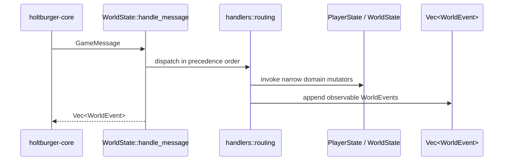
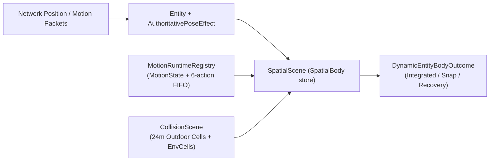

# World State Architecture (`holtburger-world`)

`holtburger-world` is the client's authoritative in-memory gameplay and spatial model. It owns
hydrated entities, local-player session state, entity retention and visibility lifecycles, canonical
`SpatialBody` physics and authored motion state, and pure domain queries consumed by
`holtburger-core`, `holtburger-scripting`, and frontend applications.

## Core Design Rules

- **Handlers orchestrate, models mutate**: Decoded `GameMessage`s enter through
  `WorldState::handle_message()`, which delegates to feature handlers under
  [`src/handlers/`](src/handlers) in an explicit precedence order; state invariants live on
  `WorldState` and `PlayerState` mutation helpers rather than open-coded inside handlers.
- **No transport or disk-path ownership**: `holtburger-world` consumes decoded protocol structs and
  pre-parsed `WorldBootstrap` data; it owns neither UDP sockets nor HBA/DAT filesystem policy.
- **Single entity and spatial authority**: The local player's world object lives in
  `WorldState.entities` alongside all other hydrated entities, and `SpatialScene` owns the sole
  canonical runtime `SpatialBody` set. Higher layers hold read-only projections, never a second
  advancing physics or dead-reckoning store.
- **Upstream semantic derivation**: Domain classifications (`EntityClass`, `VendorCategory`,
  `EntityDescription`, `ObjectInspection`, `FellowshipCapabilities`, `SalvagePreview`,
  `AllegianceMember`, `ProjectileSupply`) are computed once here so downstream crates never
  re-parse raw protocol bitmasks or property keys.

---

## Module Map

| Area | Location | Responsibility |
| :--- | :--- | :--- |
| **Protocol Routing** | [`src/handlers/`](src/handlers) | Deterministic dispatch (`routing.rs`: player-first, world-second, event-last) across `player`, `movement`, `inventory`, `properties`, `trade`, `fellowship`, `allegiance`, `friends`, `squelch`, `contracts`, `housing`, and `system` handlers. |
| **Authoritative Graph** | [`src/state/`](src/state) | `WorldState` root, narrow domain mutators (`state/mutations/{runtime_bodies,movement,properties,inventory}.rs`), `state/trade.rs`, `state/liveness.rs`, `state/visibility.rs`, `state/fellowship.rs`, `state/allegiance.rs`, `state/contracts.rs`, and container/storage tracking. |
| **Local Player Overlay** | [`src/player/`](src/player) | `PlayerState` attributes, vitals, skills, spellbook, active enchantments, character options, sequence counters, and `PlayerPropertyRetention` provenance for private login properties. |
| **Entities & Semantics** | `src/entity*.rs`, [`src/inspection/`](src/inspection) | `Entity` hydration (`hydration.rs`), replicated `ClientEntityFacts` (`entity_facts.rs`), `EntityClass` (`entity_classification.rs`), typed item/creature inspection (`inspection/{types,item,item_details,creature}.rs`), `summon.rs`, and `projectile_supply.rs`. |
| **Spatial & Collision** | [`src/spatial/`](src/spatial), `src/spatial.rs` | `SpatialScene` runtime bodies, `CollisionScene` 24m-cell/EnvCell static & dynamic collision queries, swept grounded/free-flight contact solving, mobile crowd separation (`mobile_contact.rs`), pose reconciliation (`pose_reconciliation.rs`), and `settle_free_sphere`. |
| **Authored Motion** | [`src/motion/`](src/motion) | Retail motion-table state machine (`MotionState`, `MotionOrder`), clip/hook advancement (`MotionSequenceRuntime`), per-body `MotionRuntimeRegistry`, compatibility locomotion rates (`rates.rs`), and observed gait selection. |
| **Domain Subsystems** | `src/vendor.rs`, [`src/crafting/`](src/crafting), [`src/housing/`](src/housing), `src/book.rs` | Vendor catalog/quote evaluation and `VendorCategory`, Ust salvage admission and workmanship rules (`crafting/salvage.rs`), housing maintenance/crystal/access models (`housing/`), and sanitized book payloads. |
| **Query Surface** | [`src/context.rs`](src/context.rs) | Pure read-only `WorldContext` / `WorldContextExt` query traits decoupling callers from internal storage layout. |

---

## Dispatch Flow

1. `holtburger-core` decodes an inbound `GameMessage` and calls `WorldState::handle_message()`.
2. [`src/handlers/routing.rs`](src/handlers/routing.rs) dispatches across feature handlers in an
   explicit precedence order (`player` before `world` before final event emission).
3. Feature handlers invoke narrow mutators on `PlayerState` (`src/player/`) and `WorldState`
   (`src/state/mutations/`, `src/state/trade.rs`, etc.).
4. Mutators update entity retention, spatial/attachment membership, and derived indices atomically,
   returning observable `WorldEvent`s to `holtburger-core`.

---

## Spatial, Collision & Motion Architecture

- **Scene vs. Collision Ownership**: `SpatialScene` owns every world-placed entity's canonical
  `SpatialBody` (pose, optional physical spheres/response policy, and derived landblock/shadow
  membership). Attached entities (`EntityPlacement::Attached`) delegate world placement and
  collision authority to their parent rather than acting as independent movers.
- **Content-Independent Collision Queries**: `CollisionScene` indexes prepared terrain, outdoor
  colliders, building shells, and EnvCell geometry into 24m outdoor buckets and per-cell indoor
  references. Typed query families report coverage, swept obstruction, lower-sphere support, cell
  transit, and free-sphere settlement (`settle_free_sphere`); missing landblock/cell coverage is an
  explicit query outcome rather than a silent miss.
- **Explicit Anchor-Local Integration**: Passive ticks never run hidden collision solves. Fixed-tick
  simulation solves swept grounded, sledding, and free-flight motion in anchor-landblock local
  coordinates, resolves directed entity contact eligibility (`PlayerCollisionStatus` and
  `EntityDynamicCollisionPolicy`) plus bounded mobile crowd separation, and commits one
  `DynamicEntityBodyOutcome` per body.
- **Unified Motion-Table Pipeline**: Local player drive, server-directed `MoveTo`/`TurnTo`, sticky
  pursuit, and remote network orders all reduce into `MotionOrder` values executed by
  `MotionRuntimeRegistry`, sharing link/modifier selection, simulation hooks, and single-source
  motion-table fallback (`effective_motion_table_id_for_guid`).

---

## Core Architectural Invariants

1. **Player Authority & Private Provenance**: Physical placement and public properties of the local
   player live on the player `Entity` inside `WorldState.entities`; `PlayerState` holds
   session-local stats, spellbooks, options, and sequence counters. `PlayerPropertyRetention`
   tracks private properties supplied by `PlayerDescription` so later public `ObjectDescription`
   recreations preserve private values (such as coin balances) without a shadow entity cache.
2. **Centralized Entity Retention**: Visibility in the world graph is governed by
   `state/liveness.rs` and `state/visibility.rs`, reconciling landblock residency,
   parent/container/wielder chains, open container and trade previews, explicit instance deletion,
   and the retail inventory-removal cleanup grace window.
3. **Separated Authority vs. Runtime Pose**: Network position updates establish
   `AuthoritativePoseEffect`s (confirmation, observation, proportional return reconciliation, or
   discontinuity) without blindly overwriting locally integrated player kinematics or active
   trajectories.
4. **Observable `WorldEvent` Boundary**: `WorldEvent` reports completed state transitions and
   packet-scoped outcomes (`PlayerSpellsChanged`, `PlayerInfo(Box<Entity>)`,
   `DerivedStatsRecalculated`, `EntitySpawned`, `TradeUpdated`, `ContractMembershipChanged`) rather
   than acting as an internal command bus or carrying duplicate raw wire collections.

---

## Adding Functionality

1. **Choose the owner**: Place local-player session state on `PlayerState` and world-object,
   spatial, or shared interaction state on `WorldState` or a focused domain module.
2. **Encode invariants in mutators**: Add narrow mutation methods under `src/player/` or
   `src/state/mutations/` and pure read queries on `WorldContext` / domain helpers before wiring
   protocol handlers.
3. **Route in `src/handlers/`**: Dispatch the decoded `GameMessage` in `handlers/routing.rs`
   preserving player-before-world ordering, and emit minimal `WorldEvent`s for downstream
   observers.
4. **Keep micro-invariants on code**: Document protocol edge cases, retail compatibility markers
   (`RETAIL QUIRK:` / `RETAIL DIVERGENCE:`), and numerical thresholds directly on the enforcing
   Rust types and functions.

## Dependencies

- **`holtburger-common`**: `Guid`, math/position primitives, property keys, and shared stat/magic
  enums.
- **`holtburger-protocol`**: Decoded `GameMessage` and `GameEvent` wire structures.
- **`holtburger-dat`**: Static motion tables, setup bounds, physics scripts, landblock collision
  data, and XP/skill/spell tables.
