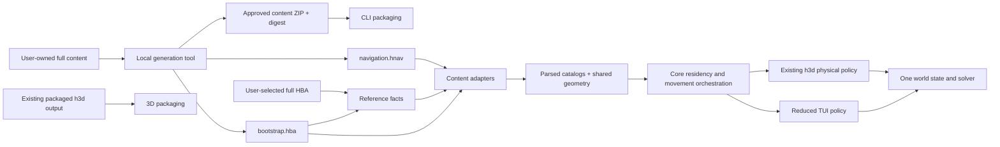
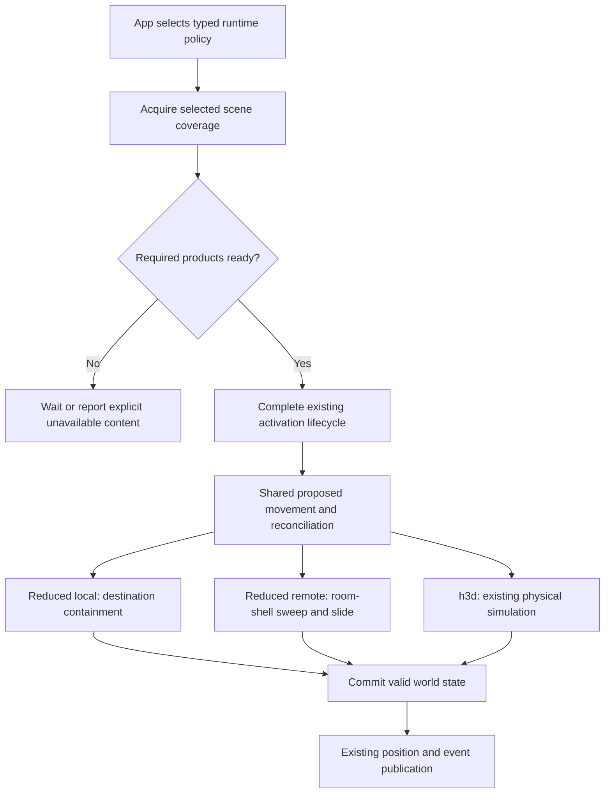

# CLI navigation content and separate alpha distributions

Status: the simplified TUI content path and accepted ownership/admission follow-up are
implemented and locally verified.
The approved format-2 input is uploaded, pinned locally, and verified through a fresh download.
Commit/push to `claude` and `3d-next` is explicitly authorized.
Next: selection of the next application candidate; no candidate dispatch is authorized yet.
Alpha.5 remains frozen and unpublished; it does not contain this follow-up.
Updated: 2026-10-28.

## Current steer — One TUI source contract, simple discovery

This section owns the next steps. It supersedes alpha.5's dual-storage selection, bootstrap
checksum binding, and discovery contracts recorded later in this plan. Movement behavior,
crate ownership of simulation, product separation, and supported targets remain unchanged.

Accepted direction:

- TUI always reads bootstrap/reference facts from an HBA and geometry from HNAV. A reduced
  or full HBA is interchangeable for reference facts when it contains the required resources;
  there is no profile inference or runtime HBA-to-navigation fallback.
- TUI owns selection: `--content`, then `HOLTBURGER_CONTENT`, then working-directory `dats/`,
  then executable-adjacent `content/`. No platform-data or extra working-directory search.
- `--content` and `HOLTBURGER_CONTENT` accept directories only. A directory uses
  `bootstrap.hba` when present, otherwise `assets.hba`, plus `navigation.hnav`. Individual
  HBA paths are rejected; malformed selections fail.
- Content owns decoding and static queries. Core consumes `SceneContentSource` for owner
  classification/geometry and `SetupContentSource` for reduced body facts; it does not choose
  filenames/formats. Frontends explicitly select movement/body behavior independently of the
  scene provider. World/solver ownership and h3d's physical behavior stay unchanged.
- Remove the runtime bootstrap checksum requirement entirely. HNAV format 2 has a 24-byte
  header with no bootstrap digest. Retain format/bounds validation and release ZIP/component
  integrity. Do not replace the removed binding with another compatibility handshake.

Implementation and review tracking:

| Work | State and evidence |
| --- | --- |
| Delete full-HBA navigation fork and shared TUI selection wrapper | Done locally: removed `NavigationContent`/`NavigationStorage` and their obsolete selection tests |
| Make core consume static queries | Done locally: both builder modes take an independent `SceneContentSource`; reduced bodies read `SetupContentSource`, full bodies use `ClientBodySource`; format-specific selection stays outside core |
| Remove exact-bootstrap checksum gate | Done locally: removed header field, reader/writer binding API, and binding tests; updated generator, inspector, and release validator to format 2 |
| Simplify discovery and dev layout | Done locally: frontend resolver implements the order above; either real HBA works with the same HNAV; new files installed in ignored `dats/` without changing the full HBA |
| Allow fetching into existing dev directories | Done locally: unrelated files such as `assets.hba` survive; existing managed inputs are never overwritten |
| Remove stale machinery and instructions | Done locally: removed the one-off room-shell diagnostic; corrected README/quickstarts/architecture docs; moved the CLI bootstrap probe into the CLI package without adding TUI dependencies to the generic harness |
| Preserve ordinary dev launch | Verified Cargo metadata still selects `tui` by default; the headless bootstrap binary is private to verification |
| Validate the change | Done locally: 1,245 affected library tests, 48 release-tool tests, three generator tests, discovery tests, warnings-denied lint, host compilation, formatting/actionlint, and notice freshness pass |

Real-data evidence before the directory-only cutover: default dev discovery and an explicit
full-HBA override both passed the production headless bootstrap with the same HNAV: 13 heritage groups and 568 cells/room
shells. This is not interactive TUI acceptance. The general movement implementation and
physical-policy regressions remain covered by the affected core tests.

### Accepted architecture steer — execution order

The user accepted this direction on 2026-10-28 and requested it be incorporated into the plan.
The remaining work is a bounded simplification, not a new discovery framework or a change
in movement fidelity. These tasks precede a new application candidate.

#### 1. Directory-only TUI selection

- [x] Make TUI `--content` and `HOLTBURGER_CONTENT` directory-only; remove the implicit
  sibling-HNAV file override. Keep the two supported reference filenames and existing precedence.
- [x] Update help, quickstart, dev instructions, and architecture notes. Three focused discovery
  tests and formatting pass, including rejection of an individual HBA path.

#### 2. Separate environment sourcing from movement behavior

Ground truth: `client/builder.rs`, `client/collision.rs`, `client/navigation_body.rs`, and
`client/simulation.rs` in core; `navigation_source.rs` and `navigation_scene.rs` in content;
the TUI bootstrap and h3d host `client_runtime.rs` are the frontend composition sites.

- [x] Unify the existing scene-classification/geometry query seam consumed by the coordinator
  where this removes duplicate interfaces or dispatch. Full and reduced providers already
  produce `LandblockCollisionAsset`; retain this shared product. Do not add a capability
  registry, archive-profile negotiation, or a second scene lifecycle.
- [x] Keep movement/body behavior explicitly selected by the frontend at client construction.
  Core owns orchestration and reusable movement/body preparation; world owns placement and
  solving; content supplies static products and decoding. A scene provider must not implicitly
  change movement behavior based on available files or missing resources.
- [x] Preserve semantics: our player remains point-validated, interpolating XYZ without local
  gravity/jumping/stair handling. Eligible remote entities retain setup-based physical bodies,
  shell/terrain solving, and gravity according to their physics state. h3d retains its full
  physical body and collision behavior. Adding a simulated local TUI body is not part of this work.
- [x] Preserve unavailable/error versus deliberately omitted geometry. A loaded reduced room
  has no furniture colliders; missing room coverage is not permission to move through empty space.
- [x] Preserve existing worker ownership, caches, activation readiness, and generation checks.
  Teleports/logout must retire stale work under the existing lifecycle; changing geometry
  representation must not introduce runtime mode switching.

Acceptance: focused synthetic tests prove both providers enter the same scene-loading path,
reduced scenes retain containment/portals without furniture, missing coverage stays unavailable,
and existing local-navigation/remote-physics/full-physical regressions pass. Prefer existing
fixtures and tests; do not add retail-asset-dependent tests or repeat the full platform matrix.

#### 3. Admit h3d candidates before committing to an archive family

Ground truth: `apps/holtburger-3d/host/src/content_selection.rs` and
`crates/holtburger-content/src/repository/mounting.rs`. The visual sentinel currently checks
an already mounted repository; directory mounting has already excluded DATs whenever any HBA
exists. Naming the TUI archive `bootstrap.hba` does not fix this ordering.

- [x] Let h3d try a directory's HBA installation and apply its existing visual sentinel rule.
  If readable HBAs lack that asset, allow the retail DAT installation in the same directory.
  Prefer an admitted HBA installation when both families qualify. Do not combine families.
- [x] Keep visual admission in h3d; shared content handles archive opening and deterministic
  precedence. Reuse the existing sentinel, with no new metadata or completeness scan.
- [x] Apply the same directory policy to explicit directories and automatic/saved locations.
  An explicit archive file remains exact and never selects a sibling or another family.
- [x] Keep malformed/unreadable selected archives as visible errors. Only a readable but
  visually unsuitable HBA installation permits trying DATs; do not hide corruption behind fallback.
- [x] Cover a full HBA plus bootstrap HBA; bootstrap HBA plus retail DATs; bootstrap-only;
  DAT-only; both suitable families; corrupt HBA plus DATs; and explicit bootstrap-file rejection.
  Use focused synthetic fixtures and existing mounting helpers.

Acceptance: bootstrap content cannot exclude otherwise valid retail DATs, admitted HBAs keep
precedence, and exact-file/error behavior remains deterministic. Run affected content/host tests
and warnings-denied lint; leave visual acceptance to the user.

#### 4. Cleanup and distribution handoff

- [x] Remove superseded source interfaces, dispatch branches, names, and obsolete tests in the
  same change. Update the architecture docs to describe actual layer ownership.
- [x] Review the diff for unnecessary abstraction/line growth and behavior drift. If separating
  the seams requires a broader solver redesign, stop and re-scope before implementing it.
- [x] Update this plan with focused validation evidence, then follow the distribution steps below.
  These changes do not themselves require regenerating the already prepared format-2 data.

Local implementation evidence (2026-10-28):

- Scene classification/loading now calls the coordinator's single `SceneContentSource` directly;
  `ClientBodyPolicy` only selects movement and body preparation/filtering. Builder composition
  stores the two sources together, avoiding independent optional configuration. Existing worker
  and residency lifecycle code is retained.
- Deleted the old combined `NavigationContentSource` and `ClientCollisionSource` interfaces and
  policy-based scene dispatch. Updated all application/harness consumers and required-failure
  reporting. The concrete full provider is `ContentClientPhysicsSource`, implementing both
  independent scene and body contracts over the existing service/repository.
- h3d uses `ResolvedContent::open_preferred` plus its existing sentinel admission; automatic
  discovery uses the same preference. Generic opening retains deterministic archive mounting.
  Shared synthetic tests exercise the directory-family matrix; host tests exercise the actual
  sentinel, explicit/automatic directory entry points, and exact bootstrap-file rejection.
- Passed: 158 content library tests; 662 core client tests plus the new independent-provider
  test; two host admission tests; three TUI discovery tests. Core socket fixtures passed with
  local loopback permission. Existing tests cover stale completions, teleport/disconnect,
  readiness, shell sliding/doorways, and unavailable coverage.
- Warnings-denied clippy passes for content/core/CLI/host libraries and tests, and all diagnostic
  binaries including `runtime-fixture`. The feature-gated fixture capture binary also had an
  already-stale character-selection pattern updated to ignore the unrelated `max_slots` field.
  Notice freshness, formatting, and diff checks pass.
- Current-code headless bootstrap passes for ordinary `dats/` discovery and a temporary directory
  containing only a full `assets.hba` plus the same `navigation.hnav`: 13 heritage groups,
  568 cells, 568 shells in each. No interactive TUI, visual acceptance, new upload, commit/push,
  candidate build, or release publication was performed.

Handoff audit: traced the current TUI selector/provider/builder/coordinator path, h3d
admission and required-failure adapter, native bootstrap invocation, and Flatpak content
location. Corrected the release operator guide's stale probe package and bootstrap-binding
claim. No further source changes were identified in these seams. This audit does not prove
new candidate packaging or manual acceptance; those remain below.

### Remaining work for this steer

- [x] Obtain explicit approval to publicly upload `cli-content-bc8933cd905326fa.zip` to the
  existing `content-alpha-df24573f24e4ca46` content prerelease, preserving its existing assets.
- [x] Upload the approved bytes, pin the returned asset URL and digest, then verify a production
  fetch/bootstrap round trip. Current descriptor selects format-2 GitHub asset `685856679`;
  the downloaded ZIP matches the approved local bytes exactly and staged components validate.
  The current-code bootstrap reports 13 heritage groups and 568 cells/room shells.
- [x] Obtain explicit go-ahead to commit/push this follow-up to `claude` and `3d-next`.
  User authorized this step after the upload round trip; candidate dispatch remains separate.
- [ ] Select the next candidate/version explicitly, then perform one intentional candidate run
  after the compatible input pin and reviewed source are available. Keep alpha.5's assets intact.
- [ ] Verify/freeze the new candidate and collect user acceptance for the changed TUI path;
  record exactly which native/Flatpak products and targets were tested.
- [ ] Publish only with separate authorization, reusing the accepted candidate bytes.

The regenerated ZIP is ready locally at `.holtburger-local/cli-content-v2/cli-content.zip`:
31,237,845 bytes; SHA-256
`bc8933cd905326fa231f584fb1280d21f8eed5c218f0795b30068aadc13e0dc4`.

The initial automatic approval rejection was resolved by the user's explicit “go ahead”
authorization for this exact asset and destination. Uploaded as a new asset, without replacing
existing inputs. GitHub reports the expected size/digest; production fetch output is retained
locally in `.holtburger-local/content-pin-v2-roundtrip/`. Re-read alpha.5's draft and compared
all 11 asset IDs, sizes, and digests against its frozen receipt: unchanged. Remote `claude` and
`3d-next` still match local base `97ae69d2847a920141296a629e23a626b1cce41d`; no additional
rebase is currently required. No commit/push, application candidate dispatch, or publication
was performed in this handoff.

### Frozen baseline

Alpha.5 (`alpha-20261028-97ae69d28`, source `97ae69d2847a920141296a629e23a626b1cce41d`)
passed candidate run `40718199141` in 13m 21s. Its 11 assets were downloaded/verified and
remain frozen in an unpublished draft. Its input ZIP remains unchanged. The user reported
that h3d looks good; target/package details were not specified, so this is not blanket native
acceptance. Exact baseline asset identities are recorded in
[evidence](evidence/cli-navigation-alpha5-candidate.json).

## Goal and boundaries

Ship independently downloadable CLI and 3D alpha bundles, with compact prepared navigation content and deliberately reduced movement for TUI, while preserving h3d's physical behavior.

This plan supersedes the combined-suite packaging scope in `holtburger-alpha-release-plan.md`. The [investigation](tui-content-profile-investigation.md) records experiments and measured evidence; this document owns the remaining implementation sequence. Existing draft assets remain unchanged until a new candidate is intentionally built.

In scope:

- A versioned prepared-navigation format, local generator/inspection tooling, and content-layer loading.
- Shared world/solver geometry, distinct explicit TUI versus h3d runtime policies, and correct creation/bootstrap loading.
- Separate CLI and 3D native archives and Flatpaks, one version convention and release workflow, pinned locally generated CLI content, updated documentation, and final acceptance.
- A clean cutover from broken bundled micro to the new CLI content, including release inventory and probe updates.

Out of scope:

- A launcher, new login UI, pathfinding, accurate object collision in TUI, or new rendering features.
- Local TUI gravity, jumping, falling, stair navigation, and obstacle avoidance.
- Shipping full retail content, modifying the retail decompile, or regenerating retail-derived content in CI.
- A new release/promotion service, runner fleet, graphical Linux distribution, container-image project, additional platform targets, or full tests on every platform.
- A hard 64 MB gate, compression contests, zero-copy geometry, additional paging, or content-hash geometry deduplication without evidence.

## Accepted product contracts

### Movement

| Concern | Reduced TUI | h3d client |
| --- | --- | --- |
| World state, motion sources, reconciliation, packet sequencing | Shared existing ownership | Shared existing ownership |
| Local locomotion | Interpolate full X/Y/Z toward a known destination; resolve a valid endpoint cell before publication | Existing physical movement |
| Intermediate local portal path | Not required initially; A → C may skip B | Existing traversable/contact path |
| Remote prediction | Existing motion prediction constrained by empty-room physics shells, with sliding and passable portal transitions | Existing full physical policy |
| Object/creature obstacles | Omit | Preserve |
| Local gravity/jump/stairs | Defer; unsupported actions must have an honest capability/result | Preserve |
| Corrections and teleports | Authoritative placement/reset, not ordinary swept movement | Preserve existing handling |

The user explicitly accepted destination-height movement. This is not permission to emit an invalid cell/position, bypass ACE movement validation, fabricate contact flags, or modify authoritative physics facts to disguise the reduced mode.

"Empty rooms" retains authored room-shell barriers, including barriers across visible openings. Visibility portals do not necessarily mean physical passage. Exterior building models and their obstacles are omitted initially; retain building transition metadata and test entry/exit separately.

Accepted gap behavior: local interpolation continues advancing toward the target through candidate points proven outside every cell. Keep the canonical committed pose at the last valid point, and publish only that pose, until a later candidate resolves to a valid cell; then commit it and preserve the ordinary cell-change report trigger. Candidate progress belongs to the current movement intent, not a second authoritative world position. Do not restart interpolation from the held committed pose each tick, which would trap movement at the gap.

This concession applies to known geometry, not missing/pending coverage. An unresolved endpoint does not authorize a guessed cell or arbitrary nearest-room placement. Cell overlap selection should prefer a valid retained domain, then destination/server evidence; ambiguous cases need a documented outcome.

### Downloads

| Contents | CLI bundle | 3D bundle |
| --- | --- | --- |
| Executables | `holtburger-cli`, previously approved `dat2hba` and `dat-tool` | h3d client/Explorer and its private version-matched host |
| Content | Prepared navigation and bootstrap data | User-supplied full DAT/HBA content; required app/render resources only |
| Scripts | `fighter.js`, `mage.js`, `mage.data.json`, `mage.data.bin` | No TUI scripting payload |
| Runtime | CLI's actual dependencies | Required Electron/host dependencies |
| Common metadata | Version/source identity, license/notices, product quickstart | Same conventions, product-specific inventory |

Native targets remain Linux x86-64, Windows x86-64, and macOS Apple Silicon. Native names become `holtburger-cli-<version>-<target>` and `holtburger-3d-<version>-<target>`, with the existing platform archive conventions. No combined-suite archive remains after cutover.

Keep the CLI Flatpak ID `io.github.merklejerk.holtburger-cli`. **Keep the existing alpha Flatpak ID `io.github.merklejerk.holtburger-alpha` for 3D-only**, preserving its settings; update its display name, description, installed inventory, and download name to 3D. No app-ID or settings migration. The earlier suggestion of a new 3D ID was explicitly withdrawn.

Both products retain the workspace/app version convention and existing `release_version.py` operation. The navigation format version is independent: an app version bump does not itself require content regeneration.

64 MB is size guidance, not acceptance or CI enforcement. Report actual complete content size so growth is visible.

## Ground truth and evidence

Read these implementations before altering their contracts:

| Reference | What it establishes |
| --- | --- |
| `crates/holtburger-content/src/object_collision.rs` | Prepared shapes, cell volumes, room-shell assembler, and full collider ordering |
| `crates/holtburger-content/src/interior.rs`, `landblock.rs`, `terrain_topology.rs` | Owned Environments, portal topology, outdoor classification, heights, and triangulation |
| `crates/holtburger-content/src/repository.rs`, `character_gen.rs` | Discovery, bootstrap resource access, complete creation catalog requirements |
| `crates/holtburger-core/src/client/collision.rs`, `simulation_scene.rs` | Existing injectable source, asynchronous demand/currentness, body preparation and residency |
| `crates/holtburger-core/src/client/builder.rs`, `mod.rs`, `runtime.rs`, `simulation.rs` | Bootstrap, activation, simulation selection, and publication order |
| `crates/holtburger-core/src/client/movement/`, `dynamic_entity.rs` | Local movement/reconciliation and the current raw-content preparation coupling |
| `crates/holtburger-core/src/client/movement/position_publication.rs`, `common.rs`, `system.rs` | Cell-change report trigger, contact-bit encoding, and immediate arrival/facing/stop packet paths |
| `crates/holtburger-world/src/spatial/body_movement.rs` | Existing sticky pursuit deliberately flattens Z; do not reuse it unchanged for reduced full-XYZ travel |
| `crates/holtburger-world/src/spatial/collision.rs`, `bsp_query.rs`, `mobile_contact/step.rs`, `dead_reckoning.rs` | In-memory geometry, containment/traversal, shared sweep/slide, and pose prediction |
| `apps/holtburger-cli/src/bin/tui.rs`, `installation.rs`, `navigation.rs`, `pages/selection/creation.rs` | TUI assembly, discovery, approach/follow, and direct catalog use |
| `apps/holtburger-3d/host/src/client_runtime.rs`, `client_host.rs` | Explicit physical configuration to preserve |
| `ACE/Source/ACE.Server/WorldObjects/Player_Tick.cs` | `UpdatePlayerPosition`, `ValidateMovement`, speed/height/cross-owner checks |
| `ACE/Source/ACE.Server/Physics/PhysicsObj.cs` | `set_request_pos`, `UpdateObjectInternalServer`, both server update paths and force-position behavior |
| `acclient-eor-source/acclient.c`, ACE physics, ACViewer | Authority for disputed geometry/motion behavior; do not modify retail decompile |
| `.github/scripts/alpha_release.py`, `fetch_cli_content.py`, `alpha_changes.py`, `release_version.py` | Existing combined inventory, approved input acquisition, selectors, and version ownership |
| `.github/workflows/alpha-{checks,native,release}.yml` | Current validation/build/package/staging boundaries |
| `.github/flatpak/`, `apps/holtburger-cli/dist/` | Both existing Flatpak recipes, installed layout, wrappers, metadata, and environment |

Verified evidence, not final integration:

- Current micro is incomplete for creation and shared physics. Creation requires clothing tables omitted by the old probe.
- The solver reads prepared geometry, not DAT/HBA files. It still uses `BspNode` from `holtburger-dat` as an in-memory type; moving every type is unnecessary for storage independence.
- `ClientCollisionSource` already injects static geometry and entity preparation, but combines those responsibilities. Simply replacing the static loader does not fix activation/body demands.
- Grouped/pruned complete HBA candidate: 32,671,417 bytes. Standalone prepared-navigation prototype: 30,180,806 bytes, including unchanged bootstrap content.
- All 734,976 native cell instances match retained source fields; 3,145 shared structures and 65,025 terrain blocks roundtrip. Geometry agrees on 568-cell and 4,213-cell owners. Doorway/sliding probes pass directly from the custom file.
- Debug/warm-filesystem preparation improved substantially in the prototype; release-build and cold-storage performance remain unproven. Largest raw cell chunk is 314,324 bytes; extra chunking is not justified by current measurements.
- ACE does invoke transition/physics work and movement validation. Its force-position behavior means collision processing alone does not prove endpoint shortcuts are rejected. Trace the complete result, not just the presence of a collision call.

Temporary prototype sources/data live in `/tmp/holtburger-nav-experiment/` and `/tmp/holtburger-tui-size-experiment/`. They may disappear. Production code and durable synthetic fixtures must not depend on those paths or unchecked external assets.

## North stars

1. One authoritative world, motion timeline, reconciliation path, and position publication owner. No TUI shadow world or independently ticking cache.
2. Storage adapters produce shared typed products. Neither world state nor the solver knows filenames, codecs, or frontend names.
3. Geometry source and movement policy are separate choices. Selecting full-HBA content for TUI does not silently enable h3d physics.
4. Keep h3d on its existing complete physical policy. A reduced TUI must not weaken shared representation or disable h3d checks globally.
5. Reuse existing contact/sliding and residency/currentness machinery; add only the policy separation demonstrated necessary.
6. Generate expensive derived content locally. CI downloads verified inputs and packages existing outputs.
7. Small, independently verifiable phases. No repeated full release run as a debugging technique.
8. Cut over decisively. Remove obsolete micro/suite mechanisms and vocabulary once their consumers are replaced.

## End-to-end shape

The h3d path continues using its existing full-content adapters, not the reduced navigation product. The diagram's shared products/world indicate common contracts, not identical geometry inventories or one shared live session.

### Content and storage contracts

- Initially distribute **two adjacent files**: `content/bootstrap.hba` and `content/navigation.hnav`. Bootstrap keeps existing table/catalog readers; do not introduce nested-HBA extraction, a temporary cache, or a new bootstrap schema merely to obtain one file.
- One local generation command produces the pair and a ZIP suitable for the existing pinned-input mechanism. Record their identities together in generator/release metadata. Size reports count both files and metadata.
- The navigation reader/writer and explicit versioned wire schema belong in `holtburger-content`, colocated with navigation products. Do not put a world-dependent physical-body type in content and create a dependency cycle.
- Prefer the measured per-owner/per-Environment chunking with shared templates. File header/directory and typed serialized sections are explicit contracts, not an unversioned dump of arbitrary Rust structs.
- Minimum structural checks: supported magic/version, in-file ranges/counts, ordered/unique directory keys, and missing required references failing clearly when consumed. No full archive hash/geometry census on every startup.
- Source provenance and checksums are inspection/release metadata, not a requirement for every content generation to match the current app commit. A compatible approved content version can serve multiple app builds.
- Return existing `LandblockSceneClass` / `LandblockCollisionAsset` and shared catalogs where sufficient. Cache immutable shared shapes by template identity; keep placement and mutable body state separate.
- Retain authoritative cell IDs and coordinates; they are protocol/world identity, not an accidental file-layout detail.

### Runtime contracts

Use an explicit sum type/configuration for the two supported policies, avoiding independently nullable flags that admit contradictory readiness/body states. Policy configuration lives in core; TUI/h3d choose it at composition. Geometry primitives remain in world/content. Preserve asynchronous generation/identity checks through login, teleport, character changes, and stale worker completion.

## Alpha.5 implementation record

The phase checklists below record the frozen baseline. Completed baseline tasks are not
proof that the current follow-up has been distributed or accepted; use the current steer
and remaining-work list above for that status.

The user authorized implementation, with an explicit stop for major gaps/blockers or required user review. All tasks below are pending unless marked otherwise. No new authorization to commit/push is implied. Keep intermediate phases compilable and covered by ordinary checks; do not tag a new candidate until the Phase 7 workflow/package/input contracts have cut over together.

### Phase 0 — Settle movement prerequisites and ACE compatibility

Deliverables: decisions in this plan and bounded diagnostics in `holtburger-debug-harness` or temporary local fixtures.

- [x] Trace normal and FastTick ACE position handling through validation, transition results, forced placement, contact/Z checks, and update publication. Both attempt forced placement after acceptance checks, but the legacy transition can rewrite `RequestPos.ObjCellID` through `enter_cell_server`; this can leave gameplay and physics cells different despite acceptance. A blocked/null transition alone is not rejection. Some same-owner shortcuts and adjacent outdoor owners passed live checks; normal cross-owner indoor travel is rejected. See [recorded evidence](evidence/cli-navigation-phase0.json).
- [x] Recheck the apparent one-shot endpoint blocker using the agreed interpolated policy. The same 20.206 m route reached `EC0E010B` correctly with 102 bounded samples, both when sending every sample and with 13 reports using existing cell-change/2 m/one-second thresholds. Preserve the original policy; a one-report jump was not a representative test. [Recorded paced evidence](evidence/cli-navigation-interpolated-ace.json).
- [x] Complete ordinary ground-level exterior doorway coverage: the production runtime crossed `A9B4001E → A9B40102`, with a 1m raised sill and matching ACE gameplay/physics endpoint. [Recorded doorway evidence](evidence/cli-navigation-runtime-doorway-ace.json). Production headless navigation now passes the original paced route and a 14.142m dungeon gap (`86020101 → 86020104`), with matching ACE gameplay/physics endpoint cells and coordinates. The gap initially stalled because simulation ticks without frontend pulses reset progress; corrected and regression tested without reusing travel. A synthetic newer-force-sequence position packet verifies reset even at the same coordinates. Live rejection correction remains distinct from teleport and has not been induced. Adjacent outdoor owners and sampled valid shortcircuits already passed. Do not launch TUI or alter server acceptance to force a pass. See [production runtime evidence](evidence/cli-navigation-runtime-ace.json) and [gap evidence](evidence/cli-navigation-runtime-gap-ace.json).
- [x] Audit early position sends and remove the unsafe arrival setter: `ClientDirectedCommand::Settle` is now a payload-free stop at the committed pose. Removed the TUI target-cell/Z relabeling helper, pending-arrival state, and core pre-simulation arrival setter. Facing changes rotation only; stop/motion/routine position messages capture the committed world pose.
- [x] Wire reduced translation admission so every newly committed local position is containment-validated before any early or routine packet can read it. Authoritative server placements retain their existing reset semantics.
- [x] Preserve existing wire contact precedence for reduced local motion: explicit packet metadata, known body contact, last server contact, then the existing `true` fallback before any sample. ACE also initializes `Player.LastContact = true`; existing tests cover unresolved contact and server/body precedence. Do not manufacture a grounded physical body or replace server contact with an always-grounded mode.
- [x] Product decision: continue local interpolation across known invalid-cell gaps while holding the last valid committed/reported pose; resume commits when a later candidate enters a valid cell.
- [x] Specify the intent-progress mechanics for that decision: advance with ordinary admitted time/speed, distinguish invalid containment from unavailable geometry, and reset/rebase progress on cancellation, retargeting, server correction, teleport, and character generation changes. Do not bank elapsed pause time or declare arrival solely because uncommitted progress reached the goal. Test A → invalid samples → C without repeatedly restarting at A.
- [x] TUI `navigation_drive_delta` now normalizes the full XYZ vector against the admitted speed/time budget, without overshoot. Approach/follow arrival uses full distance. Tests cover vertical/near-vertical bounds, a close target with distant height, and the final short step. h3d physical planar pursuit is unchanged.
- [x] Choose the existing `resolve_setup_physical_spheres` resolver, reading only retained setup facts and applying runtime scale. Census: 5,935 setups, 3,000 authored single, 610 authored pair, 2,325 existing retail dummy, zero invalid at scale one. Reuse `RETAIL_DUMMY_MOTION_SPHERE` for empty authored sets; a missing setup or invalid scale is a preparation failure/pending fact, not a guessed radius. No GfxObjs are read. Added `navigation_envelope_census` as the explicit local diagnostic.
- [x] Specify coverage absence versus asynchronous pending: wait while loading; suspend constrained movement on unavailable data and surface the existing failure/status mechanism. Never treat absence as open space.
- [x] Specify remote entity admission, attached objects, missiles, server-authoritative corrections, and zero-duration ticks. Preserve existing authoritative facts; document deliberate prediction approximations.

Acceptance: written decisions and focused evidence establish a coherent first-pass policy. Source-extracted C# fixtures passed 66 guard/forced-placement cases with geometry/update internals stubbed. One-shot live tests exposed a cell-entry side effect missed by the stub; subsequent paced replays of that route reached the correct destination with ordinary publication thresholds. Cell-ID equality at every intermediate root-position sample is not a universal correctness invariant: ACE selects physics residency using the primary sphere center (`ObjCell.find_cell_list`), while this diagnostic resolves the reported root point. Preserve valid committed-position publication and authoritative correction semantics; do not substitute that identity comparison for the actual movement contract. The final runtime audit below closes the gap/lifecycle checks with focused fixtures. If ACE rejects an essential shortcut or the shape/failure rules require a material concession, resolve it with the user before implementing runtime behavior.

### Phase 1 — Production navigation codec and local content generation

Deliverables: a focused navigation module under `crates/holtburger-content/src/`, a local `cli-content` command in `apps/holtburger-tools`, synthetic format tests, and reproducible generation instructions.

- [x] Define the version-1 directory/chunk/wire contracts from the successful prototype, preserving float precision and referenced geometry sharing.
- [x] Implement the bounded, positioned-read navigation container in `navigation_bundle.rs`, with supported version and companion bootstrap digest, sorted typed block directory, compressed/raw blocks, and deterministic streaming writer. The container and typed-product tests pass with warnings denied.
- [x] Complete typed product encoding/decoding and inspection of coverage, format, component sizes, and provenance. Keep file I/O/codec types out of solver APIs. The runtime reader must satisfy the existing `Send + Sync` source boundary: use the existing positioned-read pattern (`holtburger_dat::utils::FileExtPolyfill`) rather than share the prototype's mutable seek cursor across workers. Reuse the coordinator's worker scheduling; do not add another executor/thread pool.
- [x] Generate from a full HBA initially; users with retail DATs can use existing `dat2hba` locally. Direct DAT generation is unnecessary unless existing adapters make it trivial.
- [x] Generate bootstrap HBA with all current startup/motion tables, retained setup facts needed by Phase 0, title content, and the complete creation catalog's clothing closure. Use the whole small clothing family unless data proves otherwise.
- [x] Generate navigation through existing content projections, sorted deterministically. Keep runtime selection flags and visibility-only omissions explicit; do not copy temporary diagnostic algorithms into production unchecked.
- [x] Emit the adjacent content pair, content identity metadata consumed by inspection/packaging, and one approved-input ZIP. Bind the pair with the expected bootstrap digest in the navigation header; the CLI resolver verifies that small bootstrap file once when opening the pair. This catches accidentally mixed generations without walking or hashing all world geometry at startup. Write into a staging directory and expose a complete pair only after generation succeeds. No timestamps/absolute workstation paths in deterministic payloads.
- [x] Test roundtrip, unsupported version, truncated/out-of-range directory, duplicate identity, and a missing referenced structure using checked-in synthetic data. Each validation has a reaching input; avoid exhaustive retail-content tests in the repository.

Acceptance: two identical generations from fixed input produce identical payloads; synthetic roundtrip and failures pass; full local generation reproduces world coverage and a reasonable complete size. No strict size gate or added deduplication project.

Execution evidence (2026-10-27):

- `cli-content generate --source dats/assets.hba --output /tmp/holtburger-cli-content-worldwide` completed: 65,025 owners, 734,976 cells, 3,145 referenced room structures. Bootstrap: 3,255,862 bytes; navigation: 27,981,202 bytes; metadata: 473 bytes. ZIP: 31,237,877 bytes. Identities are in [Phase 1 evidence](evidence/cli-navigation-phase1.json).
- Two generations from the model-free 568-cell fixture produced byte-identical bootstrap, navigation, metadata, and ZIP. This checks deterministic generation; the worldwide source was generated once.
- `cli-content info --content <generated>/content` checks component identities and companion binding without a geometry census. Runtime pair selection only needs the small bootstrap digest, not the full navigation hash.
- `NavigationSceneSource` projects typed blocks into existing `LandblockCollisionAsset`/`CellVolume` products and shares immutable Environment geometry. Synthetic tests cover missing structures/apertures/targets, absent versus inconsistent coverage, and building claims.
- The existing explicit room-shell probe now accepts a prepared directory. The worldwide generated pair passes internal doorway traversal and wall sliding through the production loader; this is geometry evidence, not live ACE/session evidence.

### Phase 2 — Content adapters and frontend bootstrap cutover

Deliverables: prepared navigation source in content, narrow core adapter wiring, and TUI catalog/discovery updates.

- [x] Implement `NavigationContent` as an exact selected bootstrap plus scene source. Its prepared reader and HBA projection both return existing collision/containment products; the HBA path invokes room-shell assembly without models/scenery. The explicit room-shell probe uses this boundary for both sources.
- [x] Wire this boundary into core composition with explicit local/remote movement policy. Builder `navigation_content` selects the reduced source/policy; `physical_movement_source` preserves the existing full path. h3d and full-physics diagnostics explicitly select physical movement; the TUI now selects navigation movement. Both policies reuse coordinator/residency/currentness contracts; archive representation does not select behavior.
- [x] `NavigationContent::open` opens exactly a prepared pair or explicit HBA, with typed incomplete-pair/unsupported-location errors and indexed bootstrap. Synthetic selection tests cover sibling archives, mixed generations, and partial pairs. No global discovery is performed by this API.
- [x] Adopt exact selection in TUI bootstrap. `installation::navigation_content` selects a prepared pair or exact full HBA; `bootstrap_once` passes the same source to `ClientRuntimeBuilder::navigation_content` and reads bootstrap/catalog data from its indexed repository. The TUI no longer constructs the full `ContentAssetService`/physical source.
- [x] Load `WorldBootstrap` through the existing core builder from the selected indexed bootstrap. The headless `content_bootstrap` diagnostic now exercises that builder, the complete creation catalog, and a representative interior navigation owner through the same selected source. It passes on the worldwide generated pair and the model-free HBA fixture: 13 heritages, 568 cells, and 568 room shells. No socket or interactive TUI is started; content does not import world.
- [x] Load the complete character-generation catalog during bootstrap and pass parsed catalog data to creation state instead of making creation screens depend on source-file discovery. Thread it through `BootstrappedClient`, `finalize_bootstrap_outcome`, `AppState`, and selection reconstruction in `update/world.rs`. Remove the frontend's raw repository field once its last catalog consumer is replaced; update reconnect and synthetic AppState constructors together.
- [x] Resolve explicit `--content`, then `HOLTBURGER_CONTENT`, then automatic `./content`, executable-adjacent `content`, and platform-data `content`. Explicit inputs open directly. The content layer tries app-ordered automatic candidates and skips only absent paths, preserving malformed/incomplete-source errors. Synthetic content tests cover discovery and companion failures; an app test loads a portable pair from an unrelated directory and proves the working-directory override wins.
- [x] Cut over TUI flags/environment to `--content` / `HOLTBURGER_CONTENT`, with no competing DAT aliases. No in-repository CLI launch scripts pass `--dats`. The CLI Flatpak recipe now installs the verified native payload under `/app/lib/holtburger`, including `content/`, and supplies the new variable. Native/Flatpak staging, pinned fetch input, receipts, and shared nightly consumers use the new pair; the approved remote content URL is now pinned. h3d's own content options are unchanged.
- [x] The `NavigationContent` HBA branch supplies reduced room/terrain products and the exact bootstrap repository through existing assemblers. The model-free HBA fixture and generated pair both load all 13 creation heritages and pass doorway/slide/endpoint checks. Raw retail DAT input is rejected by this boundary. Core policy selection is independent from the storage branch.
- [x] Preserve typed selection/companion/format failures through app startup; no new login/recovery UI or retail-install scanner.

Acceptance: bootstrap/creation and prepared-scene loading work from either supported TUI source, including from an unrelated working directory. A production probe can open the generated pair without model assets. h3d's existing content source is unchanged.

### Phase 3 — Explicit core policy and reduced world movement

Deliverables: typed policy in `client/builder.rs`, readiness/coordinator changes in `client/collision.rs` / `mod.rs`, and shared movement changes in `runtime.rs`, `simulation.rs`, and relevant world spatial helpers.

- [x] TUI selects `navigation_content` explicitly and h3d retains `physical_movement_source`. The same world, coordinator, motion, reconciliation, and packet-publication owners remain in use.
- [x] Split scene acquisition from model-body facts: `ClientSceneTarget` carries only player identity/position; `body_target_from_world` separately captures full body demand. Missing Setup/WCID retires only local body preparation, leaving static coverage and its workers intact. Regression proves scene residency survives missing facts and later body hydration without a reload; all 26 coordinator tests pass.
- [x] Add `CollisionScene::point_placement` over existing products: unique/overlapping/outside/unavailable outcomes, authored-owner lookup before geographic reanchoring, and finite/non-null validation. Six synthetic tests cover negative dungeon coordinates, gaps versus missing coverage, overlaps, outdoor seams, and world bounds. The room-shell probe compares an accepted doorway endpoint with this query. Overlap preference belongs to core; the query never chooses by arbitrary record order.
- [x] Make reduced local activation depend on valid destination containment/coverage, not a fake physical body marked ready. Preserve inventory/reveal/sequence prerequisites. The implementation selects point readiness for navigation and retains physical body readiness for h3d. A synthetic prepared-pair test covers initial entry and teleport destination activation: wait for coverage, enter without WCID/setup/model body, preserve the destination-phase barrier, and expose no physical-body readiness claim. Existing physical reveal/currentness tests remain green.
- [x] Implement local full-XYZ proposed motion using existing controllers, speed/timing, motion sources, and reconciliation, followed by Phase 0's endpoint acceptance. The TUI helper now bounds 3D travel and checks vertical arrival. Core's client-directed navigation branch consumes that travel budget, scales it to the admitted simulation interval, commits only valid endpoints, and publishes endpoint simulation outcomes; relative facing changes preserve committed translation. Server command reduction now explicitly selects `DirectedMotionSupport::PositionOnly` for reduced local movement; physical callers keep their original support rules. The reducer returns its sampled target/direction with the authored command, so reduced travel spends the authored tick's scaled budget along full XYZ without re-resolving the target. Manual/gesture root offsets use the same containment gate. A synthetic server-directed test reaches a strictly vertical destination and completes with no physical body, unchanged physics flags, and unknown actual contact. Sticky following now samples canonical targets before physical collection, reuses authored clearance and rate limits, retains full XYZ for the reduced player, and uses the same endpoint gate. The final packet/lifecycle and consumer audit is recorded below. Keep h3d's grounded actuation/sticky pursuit unchanged; A → C does not invoke remote sweep rules.
- [x] Maintain client-directed intent progress through known invalid-cell gaps while holding the last committed pose. `NavigationProgress` advances through known voids, waits without banking travel for missing/ambiguous geometry, prefers retained then destination cell in overlaps, and clamps full-XYZ movement to the admitted budget/destination. Only accepted poses enter canonical world state. Focused tests include faster-simulation/idle-pulse gap retention, server-gesture source retirement, production correction packet resets, runtime commitment/publication, simulation translation/facing without a physical body, malformed proposals, remote waiting without unconstrained fallback, authored target budgets/MoveAway coincidence, vertical server-directed travel, sticky following, and authoritative integration exclusion. The gap/settlement runtime test supplies an unrelated authored displacement and proves it cannot become a second translation owner. Acquisition, settlement, release, manual/server takeover, death, epoch retirement, and authoritative placement resets discard progress; ordinary canonical corrections independently rebase it.
- [x] Commit one valid world pose and use the existing autonomous-position publication path. **Preserve `PositionPublicationReason::Cell`: an accepted cell change triggers a report at the next publication opportunity rather than waiting for heartbeat/distance.** Retries retain the last successful-send baseline. A → C need not manufacture a packet for B when B was never a committed sample. Candidate progress is controller state, not a second authoritative pose or packet-only correction cache.
- [x] Remove pose-changing settlement entirely. TUI was its only production producer; arrival now emits a typed stop with no position payload. Deleted the pending-arrival lifecycle field and early position setter, and rewrote the former snap tests around real 3D arrival/retained committed pose.
- [x] Cover reduced translation admission, facing-only, stop, motion, and routine packets with the same valid-pose/sequence contract. A new session-capture fixture decodes actual `MoveToState` and `AutonomousPosition` bytes: motion/facing/stop/heartbeat reports during a gap retain the valid committed pose and authority sequences; reacquisition resets progress; the next accepted cell is reported before heartbeat. No intermediate cell is fabricated. Position proposals remain in simulation.
- [x] Prepare reduced remote envelopes without GfxObj/model/default-script/collision-animation preparation. `NavigationClientSource` reads only the authored setup and uses shared movement-definition selection, including two-sphere grounded and empty-setup fixed-position behavior. Five body/source tests cover absent model/script links, missing setup failure, WCID-independent capture, coordinator installation/state changes preserving peer exclusion, and bodyless activation. Three additional fixtures write a synthetic prepared pair with actual shell BSP polygons and a passable aperture, load it through the production adapter/coordinator, and run ordinary core simulation ticks. They prove doorway crossing, wall sliding outside the opening, and holding through unavailable setup content followed by hydration/resumption without catch-up travel. Typed preparation operations keep captured facts paired with their compatible source. These fixtures require no retail assets in CI; production-data runtime validation remains at checkpoint A.
- [x] Preserve server velocities, rotations, corrections, attachment ownership, and motion timeline semantics. Each tick has one translation owner: do not apply both the TUI target-directed delta and authored root displacement. Keep server-directed takeover and input release semantics explicit. Do not globally rewrite physics flags to obtain the reduced behavior.
- [x] Audit approach/follow/scoot, combat approach, interaction range/line queries, and capability consumers against the reduced source. `combat_static_path` queries the coordinator snapshot independently of local body preparation: preserve meaningful shell-based queries and unavailable coverage outcomes. `SetupDimensionCatalog` now carries authored radius/height through bootstrap independently of model/collision preparation; `WorldState::cylinder_distance` preserves existing prepared-body semantics and resolves pose-only bodies from that catalog, effective scale, and canonical poses. Synthetic tests cover missing facts, live scale, committed-versus-network placement, and the server-directed target consumer. Existing content already retains intact setups; this adds no archive metadata or generated payload. Sticky target facts are shared by physical and pose-only samplers; reduced local following no longer requires physical actor preparation. Core-tick tests cover canonical target movement, clearance, a competing authored root, and cancellation; existing physical sticky conformance remains green. Empty-room prediction is not permission to bypass server gameplay/LOS rules.
- [x] Disable/report unsupported local jump/gravity/stair capabilities through existing command capability/result mechanisms. Navigation returns the existing `Unsupported` jump outcome and advertises no jump-charge capabilities, even with complete character/motion facts; physical capability advertisement remains unchanged. Local integration uses no grounded body/gravity/stair solver and obeys authoritative integration exclusion. Focused tests cover the result, advertised capability, and frozen/reenabled local travel. No full physical fallback is installed.
- [x] Cover initial entry, same/different-owner travel, teleport, stale completions, unavailable coverage, remote shell contact, and correction reset with focused synthetic/runtime fixtures.

Acceptance: reduced TUI movement meets Phase 0 decisions; invalid cells are never published; direct endpoint shortcuts and constrained remote movement are distinguishable in tests. Existing h3d physical tests pass with its unchanged geometry inventory/policy.

### Runtime consumer policy — Server-owned eligibility

Accepted by the user: when reduced TUI simulation cannot meaningfully evaluate a gameplay
eligibility condition, submit the request and let ACE accept or reject it. Keep meaningful
shared checks (target availability, ownership, busy state, static reference/scene queries)
and preserve h3d's physical checks. Do not invent physical facts to satisfy a shared gate.
This does not relax valid position publication, missing-coverage behavior, or the explicitly
deferred local jump/gravity/stair capabilities.

Applied to missile admission: core's `missile_request_ready` allows navigation requests
without a solved ground-contact result; physical mode still requires grounded contact.
ACE independently checks jumping before execution. The policy matrix covers unknown,
airborne, sliding, and grounded support in both compositions. All 22 focused combat tests
pass, including send-failure/busy/feedback behavior. Four existing send-failure tests require
loopback socket creation; their first sandbox run was denied, then the same tests passed
with socket access enabled. No live combat action was performed.

### Final local runtime audit

The remaining Phase 0/3 checks were reconciled against the actual owners: world point
placement and canonical pose, core movement-source lifecycle and packet capture, coordinator
coverage/currentness and remote preparation, and TUI approach/follow/scoot steering.
`execute_snap_facing` changes only rotation; newly predicted navigation translation enters
world through `advance_navigation` after containment. Teleport/force resets discard progress
at packet admission, including identical-pose force updates; activation/logout retire the
movement epoch. Zero-duration simulation returns before actuation. Remote attachments retain
parent ownership, unsupported/missing facts hold, and physical remotes continue through the
existing solver with authored velocities/rotation and reconciliation rather than flag rewriting.
Synthetic prepared-room fixtures cover portal passage, wall sliding, and missing-setup recovery;
coordinator tests cover pending/terminal coverage, stale completion, and owner replacement.
The existing missile policy fix resolves the identified physical-only gameplay gate; jump
remains explicitly unsupported and range/static-scene queries remain shared.

This audit found one additional lifecycle defect: manual release and pulse expiry left an
uncommitted gap candidate available to replacement authored movement. A synthetic regression
first reproduced the incorrect commitment from x=0 directly to x=10 after only 2m of new
travel. Both source-retirement branches now reset progress. All 99 movement tests, including
both release/expiry cases, pass; formatting and warnings-denied core library/test clippy pass.
This fix belongs to the final follow-up commit. The Linux package identities above/below
refer to the preceding clean commit and must not be represented as containing this subsequent fix.

### Steering checkpoint A — Prove the vertical slice

- [x] Load locally generated content through production APIs, create a character catalog, activate a session/fixture, move locally, predict a remote doorway/slide, and handle a teleport/correction. Worldwide bootstrap and live production local routes pass; synthetic prepared-content remote doorway/slide fixtures and a production-handler correction packet cover the remaining parts. The production ground-level exterior doorway route also passed. This does not claim live TUI controller acceptance or live rejection-induced correction coverage.
- [x] Measure a release-build representative load and scene memory when needed to confirm the prototype's direction; do not build a permanent benchmark dashboard. The extracted Linux CLI package's worldwide content passes the production headless bootstrap (13 heritage groups, 568 cells, 568 room shells) from an unrelated working directory in 0.194 seconds with 37,392 KiB peak process RSS. This is a one-shot bootstrap/representative-scene measurement, not a whole-world residency estimate or cold-cache benchmark.
- [x] Review remaining work against actual code. Reuse any additional existing primitives discovered; remove temporary adapters that no longer have consumers.
- [x] Resolve user-visible concessions before packaging. Do not compensate for a runtime gap with another data format or CI job.

Acceptance: one coherent, reviewable runtime slice works. Rest of plan is adjusted before release work begins.

### Integration checkpoint — Rebase onto current `3d-next`

Local review before integration found and repaired a stale installed-I/O probe that still
invoked CLI utilities through the former combined alpha app. CLI now exercises converter/
export grants in its own sandbox; 3D exercises its own document portal without those tools.
Two focused routing regressions pass. Full actual installed-bundle verification remains
pending; mocked routing tests do not establish sandbox permission behavior. The four changed
shared libraries passed 2,271 tests on the pre-rebase source, with three existing ignored tests.

The user authorized a local checkpoint and rebase. Checkpoint `4964359e6` protects the
implementation before integration. Fetched/pinned `origin/3d-next` at
`09f8cc2d61449a9fb242cbe4c8f3c8f7b6e2f5a6`; it selects application version
`0.1.0-alpha.5`. Rebase conflict resolution retains that version and upstream application,
transport, label, Windows packaging, and manual candidate changes. Final post-rebase
validation remains the acceptance gate below.

- [x] Protect all tracked and untracked implementation work before changing the base. Creating
  a checkpoint commit, staging, or running the rebase requires the user's explicit go-ahead;
  the user subsequently supplied that go-ahead. The checkpoint includes source/evidence, and the generated input remains under `/tmp/holtburger-cli-content-worldwide/`. No remote writes are authorized.
- [x] Refresh and record the exact current `origin/3d-next` head when integration begins, then
  rebase this branch onto it. Do not assume an earlier observed head or next version remains
  current while upstream development continues.
- [x] Resolve conflicts against upstream behavior rather than replacing its workflow with the
  older baseline. Preserve manual full-candidate dispatch, commit-date-derived immutable tags,
  clean-source/branch guards, same-run draft staging, and non-cancelling candidate concurrency.
  Keep publication of a draft as a separate explicitly authorized action.
- [x] Adapt the CLI/3D product and target selection to that retained flow. Narrow diagnostic runs
  must not create candidate tags or stage drafts; full candidate runs still require both products
  on every supported target. Dispatch defaults to upstream-compatible `purpose=candidate`, `product=both`, `target=all`. Explicit `purpose=diagnostic` enables selections and returns no candidate tag; tag creation and draft staging consume that same plan result.
- [x] Preserve the upstream Windows packaging setup/tests and host/application changes. Resolve
  shared manifest/lockfile/version and runtime API changes without dropping upstream features.
- [x] Rerun affected content/world/core/TUI tests, targeted host/tool checks, formatting, lint,
  release-tooling tests, and actionlint on the integrated tree. Recheck both product inventories
  and source identities. Do not duplicate shared correctness across native platforms.

Post-rebase evidence: 2,668 library tests pass (393 host, 327 CLI, 165 content, 759 core,
1,024 world), with three existing ignored world tests. Warnings-denied clippy passes for
those affected libraries/tests; target CLI/generator/bootstrap/live-probe/3D-host compilation,
formatting, three focused generator tests, 48 release-tooling tests, and actionlint pass. Upstream immutable-tag tests and
new diagnostic/partial-candidate regressions are included. Regenerated local notices change
only workspace package labels from alpha.3 to upstream alpha.5; freshness passes. The exact
approved content ZIP digest remains unchanged. Production `content_bootstrap` also passes on the worldwide pair and model-free HBA fixture after the rebase (13 heritages, 568 cells/shells each).

Subsequent local packaging proof uses clean source commit
`397742c01facf5de9553fd2954b57f68bada5896`, based on that recorded upstream head.
Fresh Linux release builds and product assembly/extraction checks pass for both products:

| Local artifact | Bytes | SHA-256 |
| --- | ---: | --- |
| CLI Linux archive | 53,870,118 | `4952cac3a06c01e32340dd6bb34d933139ed781b14b45c3988623526a5e09eb2` |
| 3D Linux archive | 134,410,204 | `17302fbfba749e079996fd9ced169588a5693df0e3ac798b1fcbbe76e057dda0` |
| CLI Flatpak | 42,978,528 | `a2cbcbb5159bcbc1b796f4fdc3a3916cc1a27aa4066ba84b12f74a9bea43c884` |
| 3D Flatpak | 97,358,856 | `54b8ae99e399e56b9dc70d55b8abff9007b054197b77d22b90ad1c5bb615e202` |

The CLI Flatpak reuses the verified native output and builds with downloads disabled using
the existing Freedesktop 26.08 SDK. Its finished payload passes native inventory/byte/link
equality, executable-entry, application-ID, and runtime checks. The production content
bootstrap and both utility help commands pass under the Platform runtime using the local
build directory. The separate 3D Flatpak also builds from its existing native output, preserving
the alpha app ID. Its finished payload passes native byte/link/inventory equality, executable
entry points, helper architecture/licenses, and runtime checks. The existing private-host smoke
probe passes all four client/Explorer × HBA/DAT synthetic modes under the Platform runtime,
with clean shutdown and no ACE connection or Electron launch. These checks do not install an
app or launch the interactive TUI; installed permissions/document-portal probes, graphical
acceptance, and Windows/macOS packages remain pending. Local outputs are under
`.holtburger-local/cli-bundle-proof-g51gb9wm/artifacts/`; no upload or release action occurred.

Acceptance: the implementation is based on the recorded current `3d-next` head, conflicts are
resolved, upstream publish-flow behavior remains supported, and affected checks pass on that
integrated source. No push, upload, workflow dispatch, release tag, draft staging, or publication
is performed by this checkpoint; those need the later explicit go-ahead.

### Phase 4 — Generation tooling, approved input, and version identity

Deliverables: finalized generator/inspection commands, pinned CLI content descriptor/fetcher, complete production content probe, and checked-in notice updates if dependencies changed.

- [x] Keep `cli-content` generation/inspection as developer tooling; do not add it to shipped bundles merely because it exists. Existing `dat-tool` continues inspecting HBA, not pretending native navigation is an HBA.
- [x] Generate and inspect the approved pair locally. Production `cli-content info`/bootstrap and release-input checks verify the 31,237,877-byte ZIP. Provenance records source/generator and independent format identity. The concrete bytes are under `/tmp/holtburger-cli-content-worldwide/`; approved remote storage and pinning are recorded below.
- [x] Finish the remote asset pin. `.github/cli-content.json` pins GitHub asset `685438455` and the approved generated ZIP digest. After explicit user authorization, uploaded `cli-content-08167e0347ccd19f.zip` to the existing public `content-alpha-df24573f24e4ca46` prerelease. GitHub reports the expected 31,237,877 bytes and SHA-256; the production fetcher successfully downloads and verifies the pair, and the headless bootstrap passes 13 heritage groups plus 568 cells/room shells from that download. `fetch_cli_content.py` preserves repository-scoped authenticated fetching. `cli_content_input.py` verifies exact ZIP inventory, companion binding, component identities, and staged-byte equality. Nine synthetic input/fetch tests and the actual worldwide ZIP pass. Native/Flatpak/nightly callers use this same input contract; removed the former alpha micro descriptor/fetcher. No source-corpus validation scans or size gate were added at runtime.
- [x] Supply a concrete generated ZIP for approved asset storage using the existing repository mechanism. The new asset contains both regenerated bootstrap and navigation companions with provenance; the legacy `micro-hba.zip` remains unchanged for older consumers. CI receives only the approved distributable pair, not source DATs/full HBA.
- [x] Replace startup-only `content_bootstrap` with actual selected-source bootstrap, complete creation catalog, and representative navigation loading. Headless probes pass on both supported CLI storage branches; h3d probes remain separate.
- [x] Keep `release_version.py` as version owner for both products; document format compatibility. Refresh notices locally only when needed, retaining checked-in notice generation policy.

Acceptance: a clean checkout can fetch pinned content and run the production noninteractive probe without source retail assets or a graphical environment. No micro ZIP/path expectations survive in the new CLI-content path.

### Phase 5 — Separate native package assembly

Deliverables: product-specific assembly/inspection in `.github/scripts/alpha_release.py` and its tests; product metadata/manifests and quickstart staging.

- [x] Replace combined native assembly with two explicit inventories selected by `assemble --product cli|3d`. Target/archive/source/architecture helpers remain shared; no new packaging framework. Workflow callers and Flatpak aggregation now use product-specific contracts. Remote input pinning is complete; actual candidate checks remain pending.
- [x] CLI assembler stages terminal client, two approved utilities, scripts/sidecars, content pair, metadata, license/notices, and `ALPHA_CLI_QUICKSTART.md`. Synthetic assembly/extraction verifies exact inventory and content substitution refusal; actual Linux release assembly/extraction and extracted-content bootstrap also pass (see local proof above).
- [x] 3D assembler stages the existing packaged h3d client/Explorer, private host/runtime/resources, metadata, license/notices, and `ALPHA_3D_QUICKSTART.md`. Exact root inventory excludes TUI/content/scripts. Synthetic assembly/extraction passes; actual packaged host/renderer verification remains in the assembler and must run on native build outputs.
- [x] Validate actual native required payload and source/architecture identity. Actual Linux CLI and 3D release assembly/extraction now pass, including fresh host/renderer identity, architecture, linkage, and payload checks. Two positive product assembly/extraction contracts are also covered by synthetic tooling tests, sharing architecture/archive checks. All release tooling tests pass (48 tests across the current scripts). The full candidate now also passes Windows/macOS build/package/probe jobs; only user native acceptance remains pending.
- [x] CLI assembly and extracted inspection run without npm, Electron, an h3d package, or a host binary. 3D assembly runs with CLI content, tools, scripts, and the CLI-content descriptor absent. Positive assembler tests construct only the selected product inputs; CLI asserts no Node invocation. Linkage and the 3D Node verifier are mocked for synthetic headers, so this is input-independence evidence, not native executable acceptance.
- [x] Release manifest requires both products on all three targets and both product Flatpaks, with product/target records, common source/version/notices, matching CLI companion identities, and exact archives. Removed old fixed asset-count and standalone-micro requirements. 3D app ID remains distinct from artifact filename. Synthetic aggregation tests reject partial/mismatched/substituted records.

Acceptance: both native layouts extract and pass their own launch/resource checks; each assembler works with the other product's inputs absent. CLI content lookup works outside the extraction directory.

### Phase 6 — Separate Flatpak payloads

Deliverables: both manifests/wrappers, desktop/AppStream metadata, installed probes, and alpha packaging staging.

- [x] CLI Flatpak recipe packages the complete CLI-native inventory with utilities/content/scripts and common documents. Entry points link into that payload; it has network access without graphical sockets or Electron. No new graphical dependency was added for CLI. Actual installed probes still need a built candidate.
- [x] 3D Flatpak keeps `io.github.merklejerk.holtburger-alpha` and settings. Payload/display/artifact naming is 3D-only; obsolete TUI content/script environment variables and tool links are removed. Required graphics/network/Zypak support and wrapper remain.
- [x] `prepare-flatpak --product cli|3d` consumes each product’s verified Linux archive and source receipt. Both reuse the existing alpha runtime/SDK generation, with no rebuilt binaries or duplicate content fetch. Separate builder state remains cached. Both actual recipes materialize successfully through `flatpak-builder --show-manifest`, and every resolved local source exists in a focused materialization probe.
- [x] Inspect each installed inventory and run focused probes. Both installed Flatpak inventory/byte/runtime and focused probe sets pass in candidate run `40718199141`. Do not add an interactive TUI invocation; graphical acceptance belongs to the user.
- [x] Migrate the shared CLI recipe’s nightly consumer to the same pinned CLI input and native assembler. Nightly selects only shipped CLI binaries with Cargo cache and reuses Linux output for Flatpak instead of compiling again. Remove separate nightly micro publication. Existing main/dev DAT-test micro fetching remains outside the CLI release path. Nightly still runs only on main after this branch reaches it.

Acceptance: two Flatpaks contain their intended product, with correct commands/data/permissions. Installing the 3D-only replacement uses the existing alpha ID; no settings migration machinery or combined third package exists.

### Steering checkpoint B — Release shape and cost

- [x] Review exact asset inventory and dependency/setup costs. Confirm CLI-only selection skips Node/Electron and 3D-only selection skips CLI data fetching.
- [x] Keep one release workflow and shared native outputs where both are requested. Avoid an unconditional product × platform job multiplication.
- [x] Confirm there is no unresolved runtime concession being hidden by packaging or documentation.

Acceptance: package inputs, job selection, and final native acceptance scope are concrete before triggering a candidate.

### Phase 7 — CI cutover and bounded validation

Deliverables: `.github/workflows/alpha-{checks,native,release}.yml`, change selectors, packaging tests, and release manifest aggregation.

Prerequisite: complete post-rebase validation. Workflow conflicts now preserve upstream manual candidate/tag/staging behavior and add explicit diagnostic selection. The earlier diagnostic-only manual-dispatch proposal is superseded; it did not authorize removing the upstream full-candidate entry point.

- [x] Cut over the content descriptor/fetcher, native assemblers, Flatpak staging, manifest aggregation, and their tests to the same generated pair in one coherent change. Remove old micro pin/ZIP expectations at that point.
- [x] Keep validation Linux-only with product-selected CLI/tool/host/frontend work and shared library correctness once. Add content generator tests/lint and world-library coverage for topology/range semantics. Shipped product quickstarts are build inputs. Manual dispatch is handled by the change selector without assuming a push-event base commit.
- [x] Candidate targets remain Linux x86-64, Windows x86-64, and macOS arm64. Native jobs build/package/smoke selected products; shared correctness runs on Linux. Manual full candidates retain the upstream flow; explicit diagnostic product/target selection creates no tag or draft. Candidates/tags require the complete set. Plan selection regressions and actionlint pass.
- [x] Add product selection to the existing reusable native workflow and assembly commands. Keep alpha tags as complete CLI+3D releases. The existing `workflow_dispatch` supports upstream full candidates and explicit `purpose=diagnostic` product/target selection; diagnostic runs upload only declared artifacts and never enter tag creation or draft staging. This avoids forcing the full-matrix aggregator to accept partial releases or introducing another workflow. Local assembler selection must work independently regardless.
- [x] Thread selected product/target expectations through identity records, `manifest()`, downloaded artifact names, Flatpak records, and stage prerequisites. Aggregation now requires explicit product/target records, with CLI content identities only on CLI records. Keep the alpha app ID distinct from the new 3D artifact filename—do not derive one from the other. Handle skipped optional jobs without letting a real failed required job pass.
- [x] Build shared Rust dependencies once per selected target where practical. Upload/inspect products independently; do not make CLI-only success depend on Electron.
- [x] Retain the combined Linux Flatpak job's shared setup where both are selected. Fetch CLI data only for CLI work. Reuse Linux outputs, checked-in notices, and existing caches.
- [x] Preserve source/checksum/host identities and required full-product aggregation. Notice review remains cheap/advisory; no size gate, source retail corpus in CI, or all-platform shared test duplication. Installed Flatpak equality binds verified native bytes; only install-specific entry points/runtime/modes/helper checks are repeated.
- [x] Current local release tooling tests pass (48), all four touched workflows pass actionlint, both actual Flatpak recipes materialize with existing absolute sources, XML/shell syntax checks pass, and diff whitespace checks pass. These local tooling checks are now supplemented by the successful full candidate and installed Flatpak probes recorded in Phase 9. Diagnose individual failures before another candidate attempt.

Acceptance: local workflow/tooling checks pass; selected products have correct prerequisites and expected inventories. One intentional end-to-end candidate run follows, rather than repeated blind full runs.

### Phase 8 — Cleanup and durable documentation

- [x] Remove temporary runtime adapters and superseded micro/combined-suite branches, names, validators, and metadata assumptions. Keep useful diagnostics only when they have a named ongoing scenario.
- [x] Replace asset-dependent diagnostic examples with checked-in synthetic regression fixtures where they protect behavior. Do not retain automated tests requiring uncommitted retail assets.
- [x] Update content/core/world/TUI architecture notes for exact content selection, prepared product ownership, canonical commitment versus intent progress, reduced envelopes/dimensions, and server-owned eligibility. Add `docs/navigation_format.md` with framing/schema/version ownership and generation/release contracts. Existing DAT geometry types remain in place.
- [x] Update release quickstart index, separate product quickstarts, release notes/operator guide, and Flatpak metadata for split products, navigation content, supported movement concessions, CLI overrides, source identity, and final acceptance. The operator guide records the verified remote input pin and keeps the actual candidate run pending.
- [x] Regenerate notices locally with the existing pinned cargo-about binary and checksum-verified upstream originals. The current dependency ownership changes were already covered by the same notice texts: generated HTML is byte-identical, and only the freshness input fingerprint changed. Real freshness check passes. CI remains advisory and performs no generation. No per-product notice minimization was added.
- [x] Remove remaining claims of a strict 64 MB requirement from active future scope. Preserve historical measurement values as evidence.

Cleanup evidence: removed stale core architecture references to deleted controller paths,
`MovementCommand`, `MotionState`, and `NavigationAutomation`; the guide now names the actual
frontend/core/world ownership and physical versus position-only support. Kept the explicit
room-shell and setup-envelope diagnostics for regenerated-content/changed-corpus checks,
with their ongoing scenarios documented in `docs/navigation_format.md`. Automated topology
regressions use synthetic prepared content. The new release path has no former combined
alpha/micro-content inventory or fetcher references; the separate main/dev DAT-test helper
remains outside this cutover.

Acceptance: user-facing instructions match actual artifacts and supported behavior; touched code is formatted, warnings-free, and has no obsolete competing path. Inventory/probe documentation identifies limitations honestly.

### Phase 9 — Stage, freeze, and final native handoff

The user authorized the content ZIP upload/pin, final follow-up commit/push, fast-forward
of `3d-next`, and full candidate dispatch. Commit `97ae69d2847a920141296a629e23a626b1cce41d`
is pushed to both branches. Full candidate run `40718199141` succeeded on its first attempt in
13m 21s and staged `alpha-20261028-97ae69d28` (release ID `426875956`, version
`0.1.0-alpha.5`). Six native archives, both Flatpaks, notices, manifest, and checksums are
uploaded. All 11 files were downloaded once and verified against GitHub digests and
`SHA256SUMS`; all native build identities and CLI companions match the manifest/approved pin.
The CI-built headless bootstrap passes against the extracted release content (13 heritage
groups, 568 cells/room shells). Manifest SHA-256:
`fa8beb388c1283c88ec2e600ab087b05ce85f025d0cad894c88eed99ce2f9415`.

The draft notes contain build evidence and one short manual acceptance checklist. Exact
asset IDs/sizes/digests and verification status are recorded in
[evidence](evidence/cli-navigation-alpha5-candidate.json). These bytes are frozen; no rebuild
or asset replacement is authorized by acceptance/publication. User native/visual acceptance
of every new split product remains pending; earlier combined-alpha acceptance does not carry
over. The draft is still unpublished. Publication needs its separate go-ahead.

- [x] Obtain explicit go-ahead before any push, content upload, candidate tag/dispatch, draft
  staging, or publication. Implementing and locally verifying this plan does not authorize
  those release actions. Native/visual acceptance remains at the end.
- [x] Use the existing version command for the next selected candidate; stage a new draft with the split products, checksums, manifest, and appropriate notes. Do not silently rebuild or replace earlier frozen draft assets.
- [x] Verify fetched/extracted release bytes against the recorded identities once and freeze the concrete candidate.
- [x] Provide one short acceptance checklist covering CLI creation and approach/follow/portal/correction behavior, 3D unchanged launch/client/Explorer/content behavior, and the two Flatpaks. Record which target checks actually ran.
- [ ] User native verification occurs at the end, as requested. It is not a prerequisite for generating a draft. Distinguish tested Flatpak behavior from unverified native targets.
- [ ] Publish the frozen artifacts through the existing release mechanism after the agreed final handoff; publication must not rebuild packages. No new approval/promotion orchestration.

Acceptance: reviewed split artifacts are available as GitHub release assets with accurate validation status, and no packaging/content regeneration occurs during publication.

## Verification split

| When | Checks |
| --- | --- |
| Codec/content development | Focused synthetic unit/roundtrip/failure tests; deterministic local generation; local full-data census only when format changes justify it |
| Core/world development | Endpoint versus swept movement, publication validity, activation/teleport/correction/currentness, reduced-body envelope, selected existing h3d physical regressions |
| Ordinary Linux CI | Affected Rust checks/tests with warnings denied, selected frontend checks only when relevant, version and release-tool checks |
| Native candidate platforms | Build/package, executable/host identity, content/bootstrap/version smoke, native linkage/resource checks as applicable; no repeated full shared suite |
| Linux Flatpak | Reused native outputs, product inventory/resource probes, selected installed/sandbox startup checks |
| Final user acceptance | Interactive TUI, actual native/Flatpak user experience and h3d regression checks; not agent visual acceptance |

No protocol behavior claim is accepted solely because a local geometry test passed. No new-format production claim is accepted solely because the temporary prototype was fast in debug mode.

## Risks and mitigations

| Risk | Mitigation |
| --- | --- |
| ACE accepts less than endpoint-only reasoning assumes | Phase 0 traces both update paths and checks representative server behavior before core integration |
| Invalid interpolation points stall or leak into packets | Explicit Phase 0 progress policy; validate immediate arrival/stop/motion sends as well as routine publication |
| Planar arrival math produces vertical snaps | Bound reduced motion in 3D and test equal-X/Y, different-Z targets before removing the old arrival relabeling path |
| Source reader races or repeatedly rebuilds shared geometry | Positioned I/O, shared immutable directory/templates, and existing coordinator workers; no shared mutable seek cursor |
| Missing setup shape facts reintroduce model loading | Census and explicit reduced envelope decision; adapter cannot call full entity geometry preparation |
| Storage selection silently changes movement semantics | Explicit app-selected policy independent of full-HBA versus prepared source |
| New codec doubles runtime geometry types or creates crate cycles | Wire DTOs stay in content; decode into existing products; world-dependent body policy stays in core |
| Versioned schema drifts with internal Rust refactors | Explicit wire contract/version and stable synthetic fixtures, without generalized migration machinery |
| Two data files get mixed | Generate/package atomically; native header binds the bootstrap digest, resolved once at open; pin the generated ZIP for CI |
| Prototype timings overstate benefits | Release-build representative validation at steering checkpoint; distinguish heap, decode, and filesystem effects |
| Package split repeats the previous CI marathon | Product-specific inputs, shared outputs/setup, Linux-only shared tests, focused diagnosis before a new candidate |
| Existing alpha settings break despite unchanged ID | Preserve settings paths/content selection semantics, remove only obsolete payload environments, verify the update path |
| Main/nightly shared recipe becomes inconsistent | Audit actual shared consumers in Phase 6; choose one clean merged content path, not stale branch-specific fallbacks |

## Decisions and open questions

Accepted:

- [x] Local TUI can interpolate destination X/Y/Z; defer local gravity/jumping/stairs.
- [x] Continue intent progress through known invalid-cell gaps, holding the last valid committed/reported position until a later candidate enters a valid cell.
- [x] Remote prediction constrains against empty-room shells and portal openings; reuse sliding.
- [x] Separate CLI and 3D bundles; utilities/scripts/data belong only with CLI.
- [x] Keep existing alpha Flatpak ID for 3D; the proposed new identity was withdrawn.
- [x] Compact custom storage is allowed; 64 MB is guidance, not a gate.
- [x] Local generated/pinned content, checked-in notices, one release workflow, three existing native targets.

Resolve during Phase 0 or the named phase, not by silent implementation assumptions:

- [x] Keep the agreed interpolated local policy after the representative paced replays passed. The one-shot failure does not justify mandatory portal traversal. The running server build/FastTick mode was not identified; no all-configuration claim or server modification is implied.
- [x] Resolve overlapping containing cells and owner-transition restrictions consistently with the accepted continue-progress/hold-commit gap policy. Overlap preference, outdoor-owner containment, synthetic reset coverage, and the live paced/gap/doorway evidence establish the accepted first-pass policy; no universal ACE-configuration claim is made.
- [x] Confirm bounded 3D speed/arrival semantics for near-vertical targets against ACE height/contact validation. Full-XYZ budget/arrival tests, the paced elevated live route, and the production raised-doorway replay pass; local gravity/stair/jump simulation remains deferred.
- [x] Reduced remotes reuse authored setup motion spheres and the existing retail dummy/fixed-position rule for an empty setup. A missing setup identity/resource holds constrained prediction; it never authorizes a guessed radius or unconstrained fallback. Admission requires authoritative placement, unattached ownership, supported/eligible physics, and positive work (character identity, gravity, missile, motion projection, or reconciliation). Model/WCID hydration is unnecessary. The setup census and focused source/runtime tests support this choice; synthetic prepared-room/core-tick fixtures now also prove doorway passage, sliding, and missing-setup recovery.
- [x] Before a server contact sample exists, preserve the existing explicit-metadata/body/server/default-true contract; this matches ACE's initial LastContact default. Do not add a physical-body readiness dependency just to supply this bit.
- [x] Confirm the clean TUI `--content`/environment naming cutover against actual scripts and automation before changing it.
- [x] Choose final codec/file magic and command naming during Phase 1; these are implementation decisions, not reasons to invent another framework.

## Alpha.5 baseline completion record

- [x] Production generated content loads through content adapters without retail navigation decoding or model/texture dependencies.
- [x] Character creation uses the complete catalog; startup probes cover the actual loading path that previously failed.
- [x] Reduced local/remote movement, valid position publication across every position-bearing packet path, cell-change-triggered reports, coverage failures, and lifecycle resets satisfy the accepted decisions and focused tests.
- [x] h3d retains its full physical behavior and required resources, with selected regression evidence.
- [x] CLI and 3D native/Flatpak inventories are separate and correct; no obsolete combined bundle or broken micro payload remains in the new release path.
- [x] Generation is reproducible and local; CI packages pinned content with shared, scoped validation.
- [x] Formatting, relevant builds/tests, warnings-denied linting, version checks, and packaging checks pass.
- [x] Durable docs and notices match the implementation; temporary investigation dependencies are removed or deliberately retained as diagnostics.
- [x] New candidate is staged, frozen, accurately documented, and handed off for final native acceptance without rebuilding at publication.
