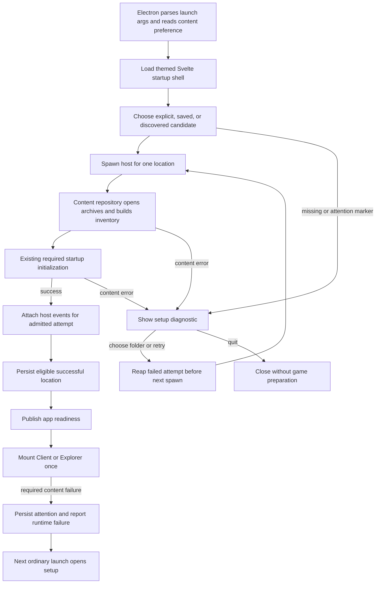

# h3d content discovery and startup recovery

Status: implemented and verified. Initial asset initialization and session/scene progress use the loading page; asset setup has its own component within the shared pregame shell. Visual acceptance remains with the user.

## Context and boundaries

Goal: launch h3d with either HBA or retail DAT content, preserve the app's visual identity during setup, and recover clearly when necessary assets cannot be loaded.

Confirmed scope:

- Direct retail DAT support through the same content APIs used for HBAs, including resource inventories and cache provenance.
- A launch-only `--content <path>` override in both Client and Explorer.
- Prefer HBA content, then fall back to DAT when no HBA installation is present. Keep archive precedence deterministic and explicit.
- Automatic discovery, followed by a styled Svelte setup flow when assets cannot be found or opened.
- A native folder picker launched from that Svelte flow; explanatory UI, errors, and controls retain h3d styling.
- Persist the last successful location. A required asset failure marks that saved location as needing attention so the next ordinary launch opens setup.
- Surface-level startup checks. Load necessary content normally and fail loudly at the consumer that requires it.
- Both desktop modes share startup policy; browser diagnostics remain non-interactive.

Out of scope:

- Exhaustive compatibility audits, archive-wide dependency scans, startup material census, or promises that every asset is valid.
- Conversion to HBA, downloads, copying user assets, archive repair, or modifying source archives.
- Live content replacement during gameplay, reconnect/resume after replacing content, or remounting an active game runtime.
- New login/account UX, broad registry/install-location searches, arbitrary cross-installation overlays, and changes to retail data formats.
- TUI setup UX. Shared content-loader changes must preserve crate boundaries and have their other consumers checked.

Concessions:

- An installation can pass startup and fail later when a required resource is first used. That failure must be visible and persist recovery state when it concerns the saved installation.
- Optional content remains optional. Missing offline weenie catalogs, legitimately absent cells, and other expected absences must not invalidate an installation merely because a lookup fails.
- A malformed or incomplete HBA does not silently select a different content family. Show the error and let the user repair/select content. DAT fallback applies when HBA content is absent, not as an error-hiding mechanism.
- During an active game, a required asset failure is terminal/actionable for the affected operation or session; it does not switch archives. Setup is guaranteed on the next launch, not by rebuilding a live game in place.

## Ground truth and existing patterns

Read these before implementing, and verify any changed assumptions against code:

| Source | Evidence / responsibility |
| --- | --- |
| `crates/holtburger-dat/src/lib.rs` | `DatDatabase` loads directory entries into `files`, identifies retail namespace from header metadata, and implements `ResourceSource`. That trait does not enumerate resources. |
| `crates/holtburger-dat/src/file_type/mod.rs` | `DatFileType::from_namespaced_id` classifies entries without confusing portal, cell, and language IDs. |
| `apps/holtburger-tools/src/dat2hba.rs` | Conversion derives namespace and type information from DAT inputs; full archives do not supply a separate h3d asset representation. |
| `crates/holtburger-content/src/repository.rs` | Discovery currently uses `HOLTBURGER_DATS`, `./dats`, and a project-data directory; filesystem mounting is HBA-only. `from_mounts` lacks inventory/provenance. Directory discovery can return an empty repository. |
| `crates/holtburger-content/src/decode_cache.rs`, `source_reader.rs`, `material_capabilities.rs` | Existing decode/cache consumers and material diagnostics. The deep material report is not the proposed startup gate. |
| `apps/holtburger-3d/host/src/shared_host_content.rs` | Content initialization builds motion data; client bootstrap tables are lazy. Character titles require language data through `read_character_title_catalog`. |
| `apps/holtburger-3d/host/src/runtime.rs`, `host_mode.rs`, `bin/holtburger-3d-host.rs` | Mode-specific composition and strict host arguments; currently only `--mode=...` is accepted. |
| `apps/holtburger-3d/host/src/protocol.rs` | Runtime construction precedes handshake. Startup errors currently escape to stderr. `ProtocolError` contains code/message and `application_error` flattens errors. |
| `apps/holtburger-3d/host/src/world_map/mod.rs` | World-map cache identity requires mounted source paths, lengths, and modification times. |
| `crates/holtburger-core/src/content_assets.rs` | The service and async asset loader live in core, not content. `ContentAssetRuntime::load_exact` currently reconstructs an `anyhow` error from formatted text, erasing typed causes before host code sees them. |
| `crates/holtburger-core/src/client/collision.rs`, `apps/holtburger-3d/host/src/host_simulation_runtime.rs` | Background collision loads have injectable source traits returning `Result<Option<_>>`; later worker completion converts failures to text. Report required resource failures at app-local source adapters before this conversion. |
| `crates/holtburger-content/src/landblock.rs` | Missing CellLandblock is an intentional `Ok(None)`. LandblockInfo is required only when the parent record says objects exist. These are concrete optional/required classification cases. |
| `apps/holtburger-3d/electron/main.ts`, `host-ready.ts`, `host-protocol.ts` | Renderer entry loads after host connection; readiness is one-shot; handshake timeout is 15 seconds; failed attempts need explicit process cleanup. Pre-handshake application traffic is rejected. |
| `apps/holtburger-3d/electron/client-window-close.ts`, `preload.cts` | Client close currently waits for renderer preparation. Setup must close without waiting for an unmounted client. |
| `apps/holtburger-3d/electron/client-launch.ts`, `scripts/entry-paths.mjs`, `scripts/electron-dev-entry.mjs` | Existing argument ownership and forwarding. Unknown Explorer flags can become URL parameters; consume content arguments before URL construction. |
| `apps/holtburger-3d/electron/client-settings-store.ts`, `client-user-data.ts`, `replace-local-file.ts` | Client settings load only in Client mode. Reuse the atomic replacement helper for a small application-level content preference. |
| `apps/holtburger-3d/src/client/main.ts`, `src/explorer/main.ts`, `src/app/mount.ts` | Entry mounting and client settings bootstrap must move behind the startup gate without mounting game resources early. |
| `apps/holtburger-3d/src/app/ui-base.css`, `UiDialog.svelte`, `UiTabs.svelte`, `ui-theme.ts` | Reuse established theme/control primitives; do not introduce a parallel setup design system. |
| `apps/holtburger-3d/forge.config.cjs`, `scripts/verify-electron-package.mjs` | Packaged resources contain the host executable; portable content discovery must be independent of process working directory. |
| `apps/holtburger-3d/scripts/sidecar-smoke.mjs`, `browser-harness.mjs`, `live-client-probe.mjs` | Current launchers use environment selection. Sidecar smoke deliberately accepts empty content; update that assumption with suitable fixtures. |

`dats/README.md` still describes HBA-only startup and a derived core asset. The current h3d path projects motion data from retail records; reconcile this documentation during cleanup rather than treating it as a new runtime requirement.

For uncertain DAT behavior, inspect ACE/ACViewer and, for client behavior, the retail decompile. Do not modify the retail decompile or guess format rules. No game wire-protocol change is expected; the app-local stdio protocol does change and needs matching Rust/TypeScript versioning and fixtures.

## North stars

1. User-owned retail data is a first-class source, not a conversion prerequisite.
2. Compute archive selection once in the content layer; every consumer uses that resolved repository.
3. App startup and recovery policy belong to h3d, not shared game-state crates.
4. Surface checks establish that loading can start; actual consumers establish which resources are necessary.
5. Required content failures remain typed and actionable across boundaries. Ordinary application failures must not poison asset preferences.
6. One host process owns one selected installation. Retry uses a fresh process before game activation.
7. Persist user intent and a recovery reason, not resource inventories or a second cache of compatibility facts.
8. Prefer small stateless selection functions and existing UI/persistence helpers. No generic launcher framework or universal host dispatcher.

## Selection and persistence contracts

### Candidate order

| Launch condition | Behavior |
| --- | --- |
| Explicit `--content` | Try exactly that path. Do not silently substitute a saved/discovered installation. A failure appears in styled setup with the override identified. |
| No override; saved location needs attention | Open setup immediately with the prior failure and location. Require an explicit retry or replacement; do not bypass the marker through discovery. |
| No override; healthy saved location | Try it first. A nonexistent location can fall through to bounded automatic discovery. An existing selection that fails archive opening or a necessary load enters setup immediately and is marked for attention; do not hide the failure by choosing another installation. |
| No saved location | Try bounded automatic discovery, then setup. |
| Folder chosen / Retry clicked | Attempt that selection; remain in setup on failure. Canceling the OS picker leaves setup unchanged; Quit closes cleanly. |

Initial automatic locations: the existing workspace `dats` in development, executable-adjacent `dats` for packaged portable use, then the existing platform project-data content directory. Do not rely on packaged process cwd, recursively search disks, or invent retail installation directories. Deduplicate candidate paths. A saved-location preference outranks development defaults.

Treat nonexistent paths and directories with no recognized archives as discovery misses. Once a candidate contains selected archives, an open/header/necessary-load failure is actionable and stops automatic fallback. For a user-selected or explicit path, even an empty directory is an actionable setup error. Electron selects explicit versus automatic startup, but Rust owns filesystem discovery: pass either an explicit path or an automatic-discovery configuration containing the app-resolved portable/workspace directory. The content crate appends its existing `ProjectDirs` candidate. Return the resolved location with startup success and attempted paths with discovery failure. Do not reimplement Rust platform paths in Node or add a separate preflight process that loads content twice.

Parse the content option before interpreting the optional entry name. Both `holtburger-3d --content <path>` (existing default Explorer) and `holtburger-3d client --content <path> --account ...` must work. This feature does not change the existing default entry or remove Client's account requirement. For npm wrappers, resolve paths against `INIT_CWD` before changing cwd, as already done for `--settings-file`; direct Electron launch resolves against its invocation cwd.

`--content` accepts a directory or an explicit archive path. The UI initially selects a directory containing DATs/HBAs. An explicit file means that file, not a sibling archive with another extension. A lone DAT must report missing companion content when necessary; it must not guess another directory. Remove extension probing that silently changes an explicit selection in the h3d path.

For a selected directory:

- Recognize archive extensions case-insensitively, then identify contents using archive/header metadata.
- Preserve deterministic existing HBA ordering initially; expose duplicate/overlap behavior in tests and documentation. Do not add DATs underneath HBA mounts as hidden repairs.
- If no HBA exists, mount the retail DAT namespace set. Allow the recognized base portal/highres roles in their shared namespace; reject duplicate roles rather than choose by filename.
- Build the same repository inventory/provenance for either family. Derive DAT entry types with `from_namespaced_id`; retail entries are unpruned. Keep inventory order deterministic.
- Fail explicitly on empty content and selected archive open/header failures. Avoid warning-and-skipping all invalid files into an apparently valid empty installation.

Archive opening is not a requirement that portal, cell, and language all exist before any mode can start. Recognize namespaces and nonempty content, then let actual necessary consumers require their assets. In particular, do not force language-dependent client bootstrap into Explorer startup. Existing motion projection remains normal initialization, not a new validation scan.

Inventory rows describe archive entries; resolver precedence still prefers the first full record over pruned records, then the first pruned record. Do not reinterpret every pruned record as unusable: motion/simulation facts can remain valid. Require visual detail only at a consumer that needs it. Test overlapping HBA sources against this existing precedence without adding another resolver. `RepositoryResource.source_description` currently identifies the selection rather than the winning file: promise the selected location in errors, and include the actual archive only when the resolver can identify it honestly.

DAT entry size can describe stored compressed bytes, while HBA entry size describes original payload size. Keep size semantics explicit and do not decompress every DAT resource to manufacture inventory equality. Parity checks compare decoded payloads, keys, type classification, and behavior, not an unsupported assumption that all metadata sizes are identical. Add DAT source metadata access from its opened handle, matching HBA, rather than taking an unrelated filesystem snapshot.

### Persisted preference (illustrative shape)

```ts
// Electron-owned application preference, shared by Client and Explorer.
type SavedContent =
  | { kind: "unselected" }
  | { kind: "selected"; location: string; health:
      | { kind: "ready" }
      | { kind: "needs_attention"; failure: ContentFailure }
    };
```

Version the file and validate it on read. Keep it separate from character/server settings and the renderer's `--ignore-config` behavior. Reuse `replaceLocalFile`; do not build a general preference service. Corrupt preference data must produce an explicit setup diagnostic and allow replacement.

- Save a canonical location only after the ordinary required startup loads succeed. Do not save picker selections that fail to initialize.
- If an already saved selection fails during a startup attempt, write its attention marker before offering retry/exit. A never-successful new folder remains an unsaved UI attempt; it does not replace the last successful location.
- Surface validation must not force all client bootstrap/optional catalogs to load early just to clear the marker. Later necessary reads can fail and mark it again.
- A successful explicit retry clears attention after initialization, even if a resource used later can still fail. The UI must not imply exhaustive validation.
- An override launch and any replacement selected during that launch are temporary and never rewrite the saved preference. Explain the temporary selection in setup.
- Failure recording uses the actual resolved location, not the latest picker value. Update attention only for the matching saved location and active attempt; unrelated late failures cannot poison a replacement selection.
- Serialize writes so a delayed success write cannot clear a later required failure. Repeated failures in an attention state do not cause repeated disk writes or replace the first actionable reason.
- Persistence failure is visible and never reported as success or ignored. Do not mislabel a disk-write failure as an asset failure.

Electron owns the attempt-to-location binding. Obtain canonical successful selection identity once through the resolved host contract and use that identity for saving and matching; do not independently lowercase paths or compare differently normalized Rust/Node Windows paths. Before a location can be canonicalized, report the attempted path without claiming a resolved archive. Override mode is a property of the launch, not equality with the saved path, so even an override pointing at that path remains non-persistent.

### Required versus optional failures

The content layer owns typed read/decode failure facts: resource key, source when known, and cause (missing, unreadable, unusable/pruned, decode failure). A low-level lookup does not know whether the caller can proceed without it.

At the consuming operation, preserve the existing necessary/optional decision and wrap only necessary failures with an explicit required-content error. Do not add a global `required` flag to every resource or mark every failed host command as content failure. Resolve expected-absence behavior before changing a call site.

The app host projects these facts into one typed native-facing content-failure notification, usable both during startup and for background/runtime operations. It must not depend on Svelte catching a rejected request. Preserve ordinary command error results as well. Keep the reporting seam app-local and narrowly scoped to content failures; do not unify Client/Explorer authority or expand core/world with UI recovery policy.

Preserve cause identity through `ContentAssetRuntime` first: replace its formatted-text reconstruction with an error wrapper/contract that retains the shared underlying cause across coalesced loads. This is a justified small core-layer change with no recovery settings or UI policy. Test through the real async loader, including multiple waiters and a worker-join failure, rather than testing only `read_resource`.

Use app-local wrappers around `ClientCollisionSource` and Explorer `CollisionSource` to report classified required resource errors before shared workers stringify them; preserve `Ok(None)` as absence. Wrap the other injected content source traits actually used by Client (including selection-envelope preparation) where the same gap exists. Request-based asset preparation and deferred `client_world_bootstrap` report at their app-host operation boundary before `application_error` or `ClientExitRequested` loses structure. Projection/serialization failures after a successful load remain application errors. Record the covered routes explicitly rather than claiming all background errors are handled by changing one dispatcher.

Use a dedicated stdio content-failure frame, not the renderer's mode-specific world event inventory. For a failed startup it is terminal and carries protocol version plus the typed selection/resource diagnostic. During an admitted runtime it reports the necessary failure without becoming a transport failure. Decode/register this native reporting channel when constructing `SidecarHostClient`, before waiting for handshake, and validate pre-handshake version/schema. Startup failure must flush/drain the writer before exiting; native code must retain that diagnostic when process exit follows. Do not rely on an event listener attached only after `connect()` because a handshake and failure can arrive in one stdout chunk.

Electron consumes the notification to persist attention and publish the diagnostic to the startup shell or existing runtime failure UI. Include namespace/file ID when applicable, selected source/location, and a useful cause. Do not match message text or treat socket/protocol/renderer/internal failures as content failures. A decoder defect can produce the same symptom as bad data: explain inability to load the resource, not that the user's DATs are definitively corrupt.

## Startup and layer illustrations



| Layer | Owns |
| --- | --- |
| `holtburger-dat` | Archive reading and namespace/type facts; enumeration primitive only if both real adapters benefit. |
| `holtburger-content` | Selected-directory composition, inventory, provenance, resource read/decode facts. |
| h3d Rust host | Necessary-operation classification, typed failure projection, one selected repository per process. |
| Electron main | Launch precedence, attempt ownership, preference writes, picker, persistence and close policy. |
| Preload | Narrow validated startup API and subscriptions without exposing filesystem/process access. |
| Svelte startup shell | Native startup snapshots projected into the existing pregame loading page; asset setup actions, mount/input/close ownership, and mounting the chosen app after readiness. |
| Existing game apps | Existing runtime lifecycle and fatal/error presentation after activation. |

Suggested startup-state union: `loading` (candidate and stage), `needs_assets` (last diagnostic and location), `persistence_failed` (write diagnostic and retryable write), `ready`, and `fatal`. These are cold lifecycle facts, not a Svelte event bus for host traffic. Represent picker activity only if controls consume it. Persistence errors offer Retry saving and Quit; keep the initialized host owned while waiting, and do not respawn it to retry a disk write. A temporary-continuation feature is unnecessary for the initial scope.

Avoid snapshot/subscription races: subscribe before obtaining the current main-owned startup snapshot, with an ordering contract that prevents older snapshots overwriting newer state. A single coherent subscription with initial delivery is also acceptable. Main owns retry admission; concurrent picker/retry actions cannot spawn concurrent hosts.

Implement snapshot delivery with one main-owned monotonic startup revision and ignore older snapshots in the renderer. Install the preload event listener before requesting the snapshot. The revision has one named consumer: preventing initial snapshot delivery from rolling UI state backwards. If a necessary failure arrives after handshake but before preference save/ready, latch it on the attempt, prevent readiness, and preserve attention even if an earlier success write was already queued. Native ready and game-mounted are different lifecycle milestones.

During setup, host-dependent IPC rejects as unavailable rather than waiting forever. Electron reads the startup coordinator's admitted host directly. During setup, unavailable game commands reject immediately; no unresolved readiness promise survives recoverable attempts. No client start, game asset fetch, renderer resource creation, or client settings bootstrap with game side effects happens before ready. Existing host event subscriptions must be installed before readiness and the Client app still installs its listeners before `startClient`.

Closing setup/loading cancels admissions, terminates/reaps an in-flight host, and flushes admitted preference writes. It does not wait for an OS folder picker that may only resolve when the app exits; late picker results cannot spawn a host. It does not wait for `ClientApp` close acknowledgement. After activation, existing prepared-close behavior applies. Do not create a second browser navigation merely to move from setup to game; mount beneath a stable shell so no host is orphaned by navigation.

`SidecarHostClient.shutdown()` currently resolves on acknowledgement and returns immediately after a prior failure; neither proves process exit. Track process completion independently, including spawn failure and stdout drainage. Pre-handshake cancellation kills/reaps the process instead of sending shutdown before `handshake_ack`. Active shutdown requests an acknowledgement, then waits for exit under a bound and terminates if necessary. Discarded attempts do not retain the global fatal-exit listener. Test with a fake whose acknowledgement/kill and eventual exit happen at different times.

The stable startup shell registers the sole preload close-preparation handler in Client mode. Extend the app-local close helper with synchronous delegate registration: ClientApp supplies its existing cleanup callback rather than registering a second preload handler. The shell owns an idempotent game-bootstrap/mount task; close before game admission prevents that task from starting, while close during mounting joins it and invokes any installed cleanup delegate (or reports mount failure). Mount completion must include installation of ClientApp's cleanup delegate, not just return from Svelte `mount`; propagate a failed mount without waiting forever for registration. A game cleanup delegate must not be awaited by the mount task itself. Both the Client entry's async settings load and its default-settings write move inside this owned task with cancellation checks before mounting. This covers the interval between host readiness and ClientApp's `onMount`; checking only host-ready is insufficient.

The existing client settings file can still fail before window construction; changing all settings recovery is out of scope. If moved behind the shell as part of mounting, report it as an application failure and never mark assets. Setup progress must not make theme loading or entry-bootstrap failures look like missing content.

## Phased implementation

### Phase 1: Complete the shared HBA/DAT content path

Deliverables: `holtburger-content/src/repository.rs`, a focused selection/mount module if it reduces complexity, and small `holtburger-dat` changes only where an archive primitive is missing.

- [x] Add an explicit selected-path API with honest file semantics and directory family preference.
- [x] Add retail DAT mounts with namespace-aware inventory and provenance; unify mount bookkeeping rather than duplicate repository construction.
- [x] Add DAT opened-handle metadata access and document stored-versus-decoded size semantics. Preserve existing full-over-pruned resolver behavior.
- [x] Reject empty selections and ambiguous DAT sets. Keep HBA precedence deterministic and report invalid selected archives.
- [x] Keep surface checks limited to opening archives and identifying the required content scope. Identify the minimum namespaces by tracing actual consumers; retain lazy loading beyond that scope.
- [x] Add synthetic DAT/HBA fixtures testing equivalent known-resource reads, inventory types/order, provenance, mixed-directory preference, uppercase extensions, missing/duplicate namespaces, and malformed/empty selections.
- [x] Check shared discovery consumers, including TUI and diagnostic binaries, before changing shared APIs.

Acceptance: either format supplies equivalent content-layer contracts for equivalent fixtures; world-map identity has real provenance; directory failures are explicit; no deep validation scan is introduced.

Decision record: HBA preferred; DAT only when HBA absent; no implicit cross-family overlays. Record any actual overlapping-HBA correction with evidence before broadening precedence work.

Phase 1 evidence (2026-10-25): 123 content library tests passed; the new synthetic DAT/HBA tests exercise portal/cell/language identity, multi-sector payloads, mixed-directory preference, duplicate DAT roles (including the corrected portal/highres composition), full-over-pruned resolution, malformed/empty selections, and archive provenance. Scoped DAT/content clippy passed with warnings denied. Existing override-bearing shared discovery remains for TUI/Flatpak; h3d's explicit selection uses a separate environment-free path. No global namespace completeness scan was added.

Phase 1 acceptance correction: the synthetic tests and basic mounting implementation do not establish valid retail directory composition. ACE identifies both `client_portal.dat` and `client_highres.dat` as dataset 1, and ACViewer intentionally reads texture resources from both. The planned one-DAT-per-namespace rule incorrectly treats the standard portal/highres combination as ambiguity. The user-approved correction below reopens and then satisfies that composition requirement with role-based mounting and retail precedence.

### Phase 2: Explicit launch selection and typed host failure reporting

Deliverables: `electron/client-launch.ts`, `scripts/entry-paths.mjs`, `scripts/electron-dev-entry.mjs`, `electron/main.ts`, host `host_mode.rs`/entry point/composition, `protocol.rs`, `electron/host-protocol.ts`, `crates/holtburger-core/src/content_assets.rs`, and focused content error types/required consumers. App-local reporting source adapters may be colocated in a focused host module.

- [x] Parse shared `--content path` and `--content=path` before mode-specific/render arguments, supporting spaces and absolute resolution. Reject duplicates/empty values.
- [x] Update the development wrapper's partitioning and `INIT_CWD` path resolution in this phase, not after main parsing is implemented. The current wrapper empirically rejects separated `--content ./AC data` as a positional renderer argument and turns inline `--content=./AC data` into a URL parameter. Cover omitted entry name and both modes in pure parser tests.
- [x] Pass selected content to host composition explicitly; no hidden environment choice after Electron resolves a candidate.
- [x] Model host selection as explicit path or automatic discovery with a supplied portable root; return resolved location/attempted paths in the startup contract. Remove h3d environment injection in the same cutover and migrate affected direct launchers immediately so each phase remains usable. Retain the shared environment discovery API for its named TUI/Flatpak consumers unless explicitly migrating those consumers; h3d desktop composition and browser/live launchers must not call that override-bearing API. Standalone offline Rust diagnostics retain their existing shared discovery contract.
- [x] Add a typed startup content-failure frame/outcome and handle it before handshake. Preserve genuine protocol violations as fatal.
- [x] Version the stdio schema and update Rust/TypeScript fixtures together. Register failure reception before `connect`, including same-chunk handshake/failure and terminal failure followed by process exit. Flush/join the startup writer before exit; retain the structured diagnostic while native stdout drains.
- [x] Preserve typed causes across core's shared asset future; test coalesced requests through `ContentAssetRuntime::load`, distinct from infrastructure worker failures.
- [x] Carry required runtime content failures through the native-facing reporting seam, including background operations; retain ordinary command errors.
- [x] Trace and annotate necessary consumers for startup motion, active region/terrain, required scene/model resources, client bootstrap, and character creation. Preserve legitimate optional outcomes. Inventory this bounded sweep in the phase decision record.
- [x] Keep internal/transport failures out of the asset-recovery path. Preserve rich error chains until projection rather than flattening them early.
- [x] Test typed failures before/after handshake, optional absence, delayed failures, and non-content failures. Include the actual host/native notification path, not only error constructors.

Acceptance: a caller can select DAT/HBA content explicitly; native code receives actionable typed failures without stderr parsing; a necessary background read can mark the installation; optional reads cannot do so.

Decision record: measure actual DAT startup against the existing 15-second handshake budget. Change timeout/progress behavior only with evidence; do not add a full separate preflight process that opens and projects all content twice.

### Phase 3: Steering checkpoint

- [x] Reassess the exact required/optional sweep and whether error classification stayed narrow.
- [x] Walk startup failure, deferred client bootstrap failure, background scene failure, and successful startup through the actual code.
- [x] Confirm the remaining UI contract does not require eager bootstrap or live remounting.
- [x] Record line-count/abstraction growth and delete duplicate mounting/error paths before proceeding.
- [x] Subdivide later phases if host reporting or close ownership changed materially. Escalate any need for broad authority redesign rather than hiding it in this feature.

Acceptance: the remaining startup/persistence flow can be implemented without guessing about failure source, attempt ownership, or readiness.

### Phase 4: Electron startup coordinator and content preference

Deliverables: focused proposed `electron/content-startup.ts` and `electron/content-preference-store.ts`, shared app-local startup contracts, existing `main.ts`/close/readiness integration.

- [x] Implement explicit/saved/discovered candidate ordering and a bounded attempt loop.
- [x] Separate candidate location from resolved source provenance, and bind every success/failure to its attempt.
- [x] Reap each failed host before retry; attach exit listeners that cannot report a discarded attempt as the active host crashing.
- [x] Add a separate process-completion contract beyond shutdown acknowledgement. Exercise delayed exit, failure-before-handshake, kill-before-exit, spawn failure without an exit event, and quitting with queued stdout diagnostics.
- [x] Persist the tagged selection/attention state with validated versioning and serialized atomic writes.
- [x] Force setup for a flagged saved selection; permit explicit Retry without automatically clearing attention.
- [x] Keep override launches temporary, including after picking a replacement. Expose this fact to UI.
- [x] Separate host-connected from app-ready: register failure reporting at process creation, attach ordinary event forwarding, settle the eligible preference write, then publish ready only if the attempt has no latched required failure. Persistence failure enters `persistence_failed` with Retry saving / Quit; do not respawn the host or silently continue unsaved.
- [x] Install frame-authenticated startup IPC in both modes. Folder cancellation, busy admission, shutdown, and failed persistence have explicit outcomes.
- [x] Split setup close from active-client prepared close; settle pending attempts without orphaned promises/processes.
- [x] Add focused coordinator tests with controlled host/picker/store dependencies for candidate order, failure-to-retry, marker persistence, override isolation, late notifications, write ordering, and quit during initialization.

Acceptance: only one host attempt exists; a saved required failure forces setup on the next launch; optional/general failures never mark it; temporary overrides do not alter saved preference; setup can close immediately and cleanly.

Decision record: preference is application-wide for both modes; renderer `--ignore-config` does not bypass recovery. Choose a concise filename under Electron userData and document it.

### Phase 5: Styled Svelte startup shell

Deliverables: proposed `src/app/ContentStartup.svelte`, startup transport/contract files, `preload.cts`, `src/client/main.ts`, `src/explorer/main.ts`, and mounting helpers as needed.

- [x] Load the existing theme before showing startup UI; reuse `ClientLoadingPage` and `ClientPregameScreen`, including the pregame stylesheet, portal animation, controls, and footer.
- [x] Render loading, missing/failed assets, selected location, relevant resource diagnostic, Retry, Choose folder, and Quit. Provide a clear restart instruction for required failures after game activation through existing failure presentation.
- [x] Keep filesystem access and folder-picker ownership in Electron main.
- [x] Mount Client/Explorer only after ready; defer existing entry bootstrap accordingly. Preserve listener-before-client-start ordering.
- [x] Keep the shell mounted once and ensure setup callbacks cannot trigger extra game mounts or duplicate client starts.
- [x] Keep one preload preparation handler in the shell and delegate active-game cleanup through the app-local close helper. Track the owned mounting task and cleanup registration; test close before ready, during client settings IPC, during mount before `onMount`, and after cleanup delegation. Do not treat host-connected as game-mounted.
- [x] Install startup IPC before loading the entry; load the shell before awaiting host initialization. Use a startup revision to prevent stale snapshot delivery from undoing ready/error state. Import/initialize shared codecs with Node-resolvable `.js` specifiers and extend the emitted-runtime import check for the new store/coordinator contract graph.
- [x] Add machine-verifiable component/startup tests for state transitions, disabled admission while busy, picker cancellation, initial-state delivery, and absence of game construction before readiness.

Acceptance: both modes show app-styled setup without a host; retry activates the chosen app once; no fatal blank startup or waiting for an unmounted client on close. Visual acceptance belongs to the user.

### Phase 6: Integration and representative runtime verification

- [x] Update development entry, browser/live probes, and direct host launchers to use explicit content selection. Non-interactive harnesses fail with diagnostics instead of opening setup.
- [x] Replace the empty-repository smoke assumption with purpose-built checked-in/generated synthetic fixtures that satisfy the new surface contract.
- [ ] Exercise fresh startup, no content, saved success, moved folder, attention marker, retry/replacement, override, malformed HBA, retail DAT-only folder, mixed HBA/DAT directory, and quit during loading in both modes.
- [x] Exercise a required failure after successful activation and restart the app to prove the persisted recovery path. Also prove an optional failure does not force setup.
- [x] Run machine-verifiable Electron lifecycle coverage in addition to browser tests; a browser-only harness cannot prove native persistence, picker IPC, or process cleanup.
- [ ] With local retail data, verify representative outdoor/interior loads, textures, animation, UI data, client bootstrap, and world-map generation/cache reuse through existing non-interactive tools. Compare equivalent HBA input where available.
- [x] Record actual startup timings and check the handshake budget. Do not retain tests that depend on untracked retail assets; if local assets/platforms are unavailable, state the precise validation gap.

Acceptance: evidence covers the desktop startup/recovery lifecycle and both archive families, not just compilation or mocked resource reads. Do not run the TUI or perform unsolicited visual acceptance checks.

### Phase 7: Cleanup and durable documentation

- [x] Verify the Phase 2 h3d override cutover removed every shadow environment path from desktop composition and browser/live launchers. The TUI Flatpak manifest at `apps/holtburger-cli/dist/io.github.merklejerk.holtburger-cli.yaml` explicitly uses `HOLTBURGER_DATS`; keeping that named shared-discovery consumer is intentional and does not authorize a TUI packaging migration. Document the h3d-specific CLI contract accurately.
- [x] Remove renamed HBA-only vocabulary from generalized APIs, diagnostics, and active architecture docs. Preserve genuinely HBA-specific constructors where they still have a named consumer.
- [x] Update `apps/holtburger-3d/README.md`, `crates/holtburger-content/ARCHITECTURE.md`, and `dats/README.md` for supported sources, CLI, precedence, portable paths, attention marker, optional content, and setup behavior. Inspect release/Flatpak references before changing their claims; do not expand into a packaging overhaul.
- [x] Remove temporary diagnostics and dead startup/error paths; consolidate duplicate bookkeeping and avoid tests that preserve obsolete architecture.
- [x] Run scoped Rust tests and `cargo clippy` with warnings denied for touched crates/targets; run h3d's package scripts for check, TS tests, lint, formatting, Electron runtime/build validation, and affected package checks.
- [x] Record validation evidence, unresolved limitations, user visual acceptance status, and decisions in this plan. Do not stage or commit unless asked.

Acceptance: one h3d user-facing explicit override mechanism, accurate durable documentation, no stale h3d startup path, and relevant checks pass.

## Risks and mitigations

| Risk | Mitigation |
| --- | --- |
| Blanket failure handling marks optional absence as bad content | Classify at necessary consumers; test expected absence and background failures explicitly. |
| Delayed successful writes clear a new failure marker | One serialized preference owner with attempt/location checks and ordered success/failure transitions. |
| Retry leaves child processes or stale events | Reap before respawn; detach attempt listeners; publish readiness only for the admitted active host. |
| A handshake and required failure arrive together | Subscribe at client construction, latch failure before save/ready, and retain diagnostics through stdout drainage. |
| Setup close waits for ClientApp | Native coordinator distinguishes pre-activation close from active renderer preparation. |
| Closing during settings bootstrap or Svelte mount loses cleanup | Stable shell owns a joinable mounting task and one preparation handler; client cleanup installs as a delegate before mount admission completes. |
| Core async loading destroys typed failure causes | Preserve the shared error source and prove classification through coalesced async loads. |
| Existing handshake readiness overstated as compatibility | Document shallow admission; retain deferred required failures and next-launch recovery. |
| Slow DAT startup looks like a protocol hang | Measure before changing timeout; keep waiting UI and cancellation responsive. |
| HBA/DAT mixing hides incomplete installations | Select one family per directory; fail incomplete HBA selections explicitly. |
| Shared repository changes affect TUI/tools | Inventory callers and adapt shared APIs without moving app UX into shared crates. |
| User repeatedly selects files that fail due to a parser bug | Show precise resource/cause details without blaming corruption; allow retry, retain loud diagnostics. |
| Preference writes fail | Surface the persistence failure; do not promise next-launch recovery that was not saved. |

## Definition of done

- [x] Client and Explorer load retail DAT or HBA selections through one coherent content contract.
- [x] HBA-first directory preference and DAT fallback are deterministic and documented.
- [x] `--content` overrides saved/discovered paths without rewriting saved state.
- [x] Styled Svelte setup and progress appear before game mount; native UI is limited to folder browsing.
- [x] Startup validation remains surface-level; necessary resource failures remain loud and identifiable.
- [x] Last successful location persists; a matching required failure forces the next ordinary launch into setup.
- [x] Optional assets, server errors, protocol errors, and renderer failures do not poison saved asset state.
- [x] Retry, cancellation, close, subscriptions, and process ownership are verified across both modes.
- [ ] Inventory and source provenance work for DATs, including world-map cache reuse/invalidation.
- [x] Focused tests, required lint/build/check scripts, and representative runtime verification pass, with unavailable-platform/asset gaps explicitly recorded.
- [x] User visual acceptance is requested separately at handoff; no unrequested screenshots or visual judgments substitute for it.
- [x] Durable docs reflect final behavior; obsolete override vocabulary and dead paths are removed.

## Open questions and decision log

### Resolved portal/highres scope correction

The plan's blanket duplicate-DAT-namespace rejection cannot describe a standard installation containing `client_portal.dat` plus `client_highres.dat`:

- `ACE/Source/ACE.DatLoader/DatDatabaseType.cs:5` explicitly identifies both files as dataset 1.
- `ACE/Source/ACE.DatLoader/DatManager.cs:64` deliberately opens optional high-resolution content alongside portal content.
- `ACViewer/ACViewer/Render/TextureCache.cs:74` first reads a texture from portal and then checks highres if source data is unavailable.
- `acclient-eor-source/acclient.c:283570` begins `CLCache::LoadHighResDat`; retail identity and lookup precedence must be proved there before choosing the final mounting contract.

Recommended scope correction: model the recognized portal/highres combination as a valid retail installation, retaining clear rejection for genuinely ambiguous duplicate installations. Prove how archive roles are identified, how collisions are ordered, and how optional highres absence interacts with the existing texture source-level selection. Do not silently ignore highres, guess its header/subset values, or broaden this into arbitrary user-configured overlays.

Implementation stopped for this gap as requested; the user approved the recommended correction and resumed work. Retail proof now establishes dataset 1 / subset `0x69466948` for highres (`CLCache::LoadHighResDat`, `acclient.c:283607`, and `DiskConInitInfo` field mapping at `281271`). Base portal initializes dataset 1 / subset 0 in `CLCache::Init`. `CLCache::GetDiskController` at `282498` checks highres membership first, then selects base portal; `DiskConBase_vtbl` in `acclient.h:21914` identifies the membership slot. ACViewer's portal-first fallback differs, so the implementation follows retail precedence.

Header role recognition, not filename matching, admits the pair. One archive per role remains required. Synthetic tests cover highres absence, same-key precedence, distinct-key lookup, renamed files, duplicate highres roles, and one motion projection per resolved key despite physical inventory overlap. The reader uses the header sector size after checking it can hold a link and payload; role identity no longer depends on an assumed fixed sector size. No arbitrary overlay configuration was added.

Evidence already collected before stopping:

- 123 content library tests passed before the additional discovery case; all six new mounting/discovery tests subsequently passed.
- 14 focused core asset-loader tests passed, including preservation of resource identity through coalesced async failures and distinction from worker admission failure.
- Scoped all-target Rust clippy passed with warnings denied before the latest typed retail-result cleanup; current host all-target check passed before that last cleanup. Re-run after resuming.
- Full frontend suite: 398 files, 3,591 tests passed; Svelte/TypeScript checks passed.
- Electron main/preload build and emitted-runtime checks passed.
- Real sidecar smoke passed in both modes with the checked-in synthetic palette archive and optional weenie catalog absent.
- `npm run probe:content` passed on Linux using isolated temporary profiles: a necessary runtime asset failure persists attention, the next launch shows themed setup without constructing the game, temporary overrides preserve saved state, and setup-only closes exit successfully in both modes. Client's existing retirement propagates an intentional construction failure as exit code 1; the probe distinguishes that expected failed run from successful setup closes rather than suppressing it.
- Frontend lint initially found three unused symbols; those were corrected, but lint must be rerun.
- Actual local HBA content is available; no local raw retail DAT set has been verified. No visual acceptance checks were performed.

Subsequent integration corrections: typed resource availability replaces material error-message matching; material parse errors retain resource identity, including exhausted texture source levels. The Svelte startup shell owns the existing keyboard/viewport policy and passes its context into the lazily mounted app, so recovery cancels held world input and blocks invisible game interaction. The obsolete ready-promise mechanism and unused environment-discovery composition roots were removed. These are bounded completions of the original error/lifecycle scope, not a new compatibility scan.

Durable documentation and process-exit/snapshot race coverage are updated. Final evidence follows. No files have been staged or committed.

The final record resolves or bounds these evidence questions:

- Exact minimum namespace/header admission for each mode, without converting that check into deep validation.
- Complete required-consumer sweep using the specified loader-preservation and app-local reporting seam, including failures outside request handlers.
- Actual DAT initialization cost versus the existing handshake timeout.
- Any real overlap ambiguity in existing multi-HBA compositions that prevents preserving their current deterministic precedence.

Recorded course corrections before the stop: discovery occurs in Rust with an app-supplied portable root; CLI/development wrapper migration is atomic in Phase 2; core async errors need preservation; background source adapters report before worker stringification; process completion is distinct from acknowledgement; close ownership spans the mounting interval; no temporary continuation is introduced for preference write errors; TUI/Flatpak environment discovery remains outside the h3d cutover.

Proposed defaults needing attention during review: invalid explicit CLI paths show styled setup without substitution; override sessions never update saved preferences; corrupted preferences enter setup; a required failure after activation requests restart rather than live replacement. These do not expand asset validation beyond the agreed surface checks.

Execution decisions, course corrections, debt, and validation evidence should be recorded under the relevant phase as work proceeds.

### Final implementation and verification record (2026-10-25)

The host opens one selected installation per process. Native startup owns the candidate order,
attempt retirement, preference writes, and admission. The Svelte shell owns explicitly deferred game construction,
the keyboard/viewport gate, and Client close delegation. The stdio protocol is version 2; terminal
startup diagnostics are drained before process completion is observed. No deep admission scan or
live content replacement was introduced.

The bounded necessary-consumer sweep covers startup motion projection; active region, terrain,
scene/model, texture, sky, animation and motion closure requests; character creation; deferred
Client bootstrap; and background collision, selection-envelope, and dynamic-script sources.
App-local adapters report background failures before worker diagnostics become strings. Typed
resource errors retain missing/pruned/invalid distinctions and decode identity through the shared
core asset future. Material source-level lookup can skip missing/pruned alternatives, but retains
errors from malformed present records. Expected absent cells, optional weenie metadata, audio,
particle presentation, UI icons, and diagnostic world-map requests retain their existing outcomes.
Generic application, transport, worker-admission, and user-input errors do not mark assets.

The quality audit traced archive/header selection through repository inventory and provenance;
read/decode failures through shared asset futures and host reporting; terminal/runtime stdio frames
through native admission and persistence; and snapshot delivery through readiness-gated mounting and close.
It removed the obsolete one-shot ready promise and unused h3d environment-discovery composition
roots. It also fixed publication of a host that exits during preference saving, with a regression
test. Moving input/close ownership to the startup shell required migrating the production-client
browser harness to provide those same owners; its real lifecycle probe subsequently passed.

This is a substantial startup-lifecycle feature: about 3,940 net text lines before this final
record, including the plan, synthetic fixtures, regression tests and diagnostic tooling. Before this record, roughly 2,051 lines were runtime code, 1,400 tests/diagnostics, and 489 documentation. The
production additions pay for typed archive provenance/error preservation and independent native
and renderer lifetimes. No generic preference service, launcher framework, or compatibility scanner
was added. The shared legacy discovery API remains for the named TUI/Flatpak consumers and standalone offline Rust diagnostics (`inspect_world_map`, `portal_trace_archive`, `inspect_coplanar_apertures`, and the inventory-icon example). None is in the desktop or browser/live startup path.

Verification evidence:

- Scoped library suites for DAT, content, core, and the h3d host passed. All-target clippy passed
  for those four packages with warnings denied; Rust formatting and diff whitespace checks passed.
- Full frontend suite: 398 files, 3,595 tests passed. Svelte/TypeScript checks reported no errors
  or warnings; ESLint, Knip and Prettier passed. The latest harness adaptation received another
  app check/lint/format run.
- Electron main/preload compilation and emitted-runtime imports passed. Linux x64 Forge packaging,
  package payload validation, and real sidecar smoke passed. Smoke opens equivalent checked-in
  synthetic HBA and DAT palettes in both modes and waits for clean shutdown. Missing optional
  `weenies.hwc` does not prevent admission.
- Development and packaged Electron probes passed in both modes using isolated temporary profiles:
  required runtime failure writes attention; the next launch opens setup without game construction;
  explicit invalid overrides stay temporary and leave saved recovery state untouched; setup closes
  exit successfully. Client's existing failed-construction retirement returns exit code 1 for the
  deliberately incomplete fixture, which the probe checks explicitly.
- Real local HBA content passed non-interactive outdoor (`0xda55ffff`) and interior
  (`0x01f50247`) loads, pregame preview, production Client selection/creator/gameplay/return/close,
  and world-map generation/reopen/error/retry/disposal probes, with no browser errors. Existing
  portal-junction refusal warnings remain visible. No screenshots or visual judgments were made.
- The release sidecar completed real HBA handshakes in 550 ms (Explorer) and 541 ms (Client) on this
  machine. The existing 15-second handshake budget remains unchanged.

The integration checks span synthetic archive tests, coordinator/process tests, real native
recovery, and browser execution. They do not claim every scenario was manually exercised through
the OS folder picker. Picker cancellation, retry/replacement, moved saved locations, corrupt
preferences, write failure/retry, and close during initialization have controlled automated coverage.

Remaining acceptance limitations:

- No raw retail DAT installation is available in the inspected workspace/main-repository content
  directories. Real retail DAT outdoor/interior/Client bootstrap parity and full-size DAT handshake
  timing remain unverified. Synthetic coverage proves header roles, sector chains, namespace reads,
  base/highres membership precedence, duplicate-role rejection, inventory/provenance, and real host
  admission; it does not substitute for a complete retail installation.
- DAT world-map cache reuse/invalidation has repository provenance and shared service test coverage,
  but has not been exercised against a complete retail DAT set. The real HBA map probe passed.
- Native runtime evidence is Linux x64 only. Windows/macOS folder-picker and lifecycle behavior
  require platform verification. Visual acceptance of the themed setup/progress/recovery UI is
  reserved for the user.
- The existing production build emits its large-chunk advisory. This work does not change the
  renderer's chunking policy.

No files were staged or committed. Durable behavior is documented in the h3d README, content
architecture document, and `dats/README.md`; this plan remains temporary working evidence.


### User-approved steering: one pregame loading presentation

The first implementation used generic UI primitives but bypassed `ClientPregameScreen`, its
pregame stylesheet, and `ClientLoadingPage`. User review rejected that visual split. The loading
page's SVG/CSS are bundled and require no DAT/HBA resources; its placement inside deferred
`ClientApp` created the apparent dependency. Reuse its presentation before native admission.

- [x] Decouple `ClientLoadingPage` from native Quit/session controls: callers supply footer and
  action snippets. Keep status, portal animation, diagnostic disclosure, and pregame styling there.
- [x] Colocate its presentation contract outside the session lifecycle implementation and add an
  explicit asset-initialization activity. Preserve session/scene/return/disconnect behavior.
- [x] Adapt the startup shell to monitor native snapshots through that same loading page. Show
  Provide assets on missing/failed/flagged content; preserve retry, temporary override notices,
  persistence recovery, terminal diagnostics, and restart-only behavior after game activation.
- [x] Remove the startup panel/branding/control styling. Retain only shell mount/input/close
  ownership and overlay positioning; keep asset policy in Electron and session policy in ClientApp.
- [x] Verify real Electron setup without game construction and the existing Client presentation
  lifecycle in machine probes. Run frontend checks/tests/lint/build. Leave visual acceptance to user.
- [x] Reconcile durable docs and record results here.

The steering does not defer required motion initialization, add asset scans, merge native asset
startup with the server session state machine, or promise shorter startup. Measured local native
handshakes were 5,749 ms in debug and 546 ms in release; these totals do not isolate individual
initialization stages. One presentation component can observe both owners without combining them.


Steering results:

- `ClientLoadingPage` no longer imports the Electron close bridge or owns session controls.
  Both callers supply footer/action snippets. Its display-only contract lives in
  `client-loading-page.ts`; session retry admission remains in `client-app-lifecycle.ts`.
- `ContentStartup` uses that page for initial asset preparation, required-asset recovery,
  persistence errors, and terminal/restart outcomes. The independent startup card, branding,
  background, and button styling are removed. The existing Client loading flow follows content
  admission using the same component. Asset startup retains real status text rather than
  connection/scene quips, and underlying game input stays blocked while recovery covers it.
- Loading headings have per-instance IDs because a recovery page can cover a still-mounted
  session loading page. Original diagnostics remain available in the existing Details disclosure;
  selected paths appear when recovery needs them, and temporary override guidance remains visible.
- Full frontend suite passed: 398 files / 3,595 tests. Svelte/TypeScript check, ESLint, Knip,
  Prettier, Electron runtime imports, production build, Linux x64 packaging and package validation
  passed. The existing large-chunk build advisory remains.
- Development and packaged Electron probes passed in both modes, proving shared pregame recovery
  without a game canvas, actual rendered asset retry, override isolation, persisted attention,
  and bounded close. Probes use isolated temporary profiles and take no screenshots.
- The real-content Client presentation browser probe passed with no browser errors, covering
  selection, creator, gameplay, return/reentry, connection failure, scene loading gates, capture
  drainage and quit during pregame loading. Existing portal-junction warnings remain visible.
- Native initialization and its measured debug/release costs are unchanged. Real retail DAT and
  non-Linux validation limitations from the preceding record still apply. Visual review remains
  with the user; no files were staged or committed.


### Static module imports; explicit runtime admission

User review removed the speculative dynamic imports of `ClientApp` and `ExplorerApp`.
Both entries import their component normally and defer only settings bootstrap, component
mounting, and runtime construction until content readiness. The redundant cancellation check
around Client's removed import is deleted; cancellation checks around actual asynchronous settings
work remain. Explorer retains the shared promise-returning startup callback contract.

The measured multi-second debug startup cost belongs to native asset initialization. No renderer
profile established a need to defer JavaScript module loading. This change introduces no new
bundle-splitting or worker policy. Verification: Svelte/TypeScript checks, six focused entry/lifecycle tests, production bundling, and real development Electron recovery probes in both modes passed. Native probes confirm setup without game construction, rendered retry, saved-marker recovery, temporary override isolation, and orderly setup close. The existing large-chunk build advisory remains; it is not evidence that lazy entry loading is required.


### Asset source visibility

Loading pages show the selected asset path whenever known. Before host readiness, explicit/saved
selections are candidates; automatic discovery has no reported location until native resolution.
The renderer never substitutes the portable search root or the saved preference for an unknown
active source. Once ready, the canonical location from the host handshake is passed through the
startup callback into ClientApp and reused for session loading and the local `/assets` command.
Injected browser diagnostics explicitly supply null when filesystem provenance is unavailable.

`/assets` and `@assets` append a system line to in-game chat without sending anything to the game
server. The command participates in the existing help/completion catalog. It prints the current
launch selection, including CLI overrides, and cannot change sources. Missing diagnostic
provenance is reported explicitly. Verification passed: 70 focused command/help/completion/entry tests; Svelte/TypeScript checks, ESLint, Knip, Prettier and production build; real Electron source-display/recovery probes in both modes; and the real-content Client presentation browser probe, including submitting `/assets` through the actual chat form and observing its local system output. No browser errors or screenshots. The build retains its existing large-chunk advisory.


### Independent launch controls for discovery and saved selection

User requested two orthogonal flags. `--no-content-search` disables automatic/default discovery
for the entire launch, including retry and fallback after a missing saved source, while allowing
saved or explicit sources and picker choices. `--clear-content` atomically replaces the saved
selection/attention marker with `unselected` before ordinary selection policy. Without the search
flag, clearing can rediscover default content. Both flags together open setup without a host.

The explicit clear is honored even alongside a temporary `--content` override; that override still
never saves a replacement preference. Clear errors use the existing persistence-failed/retry flow,
preventing startup from pretending that saved state was forgotten. No other settings or archives
are removed. Native startup computes `canRetry` for setup; the renderer hides search retry when
no selection exists and automatic discovery is disabled. Native retry independently preserves the
search restriction. These flags are consumed before entry/renderer parsing, forwarded by desktop
wrappers, rejected by non-desktop diagnostics, and remain launch-only policy.

Verification passed: 65 focused parser/coordinator/transport tests and the full frontend suite (399 files / 3,613 tests); Svelte/TypeScript, ESLint, Knip, Prettier and production build checks; Linux package validation; and development/packaged Electron probes in both modes. Native probes verify persisted clearing, setup without a game canvas, hidden discovery retry, enforced no-search behavior even through direct retry IPC, and clean close. Coordinator tests additionally cover saved sources, missing saved paths, explicit overrides, picker choices, corrupt preferences, and failed-clear write retry. The temporary-selection notice now promises only that the active selection will not be saved, allowing an explicitly requested clear to remain truthful. No screenshots, staging, or commits.


### Setup UI cleanup after user review

Ordinary missing/unselected assets were incorrectly projected as a failed loading page. This
applied the generic boxed error treatment to an expected setup choice. Native setup now carries a
nullable diagnostic: null means ordinary setup (including disabled search or exhausted automatic
discovery); explicit selection errors, unreadable preferences, and saved required failures retain
their diagnostics. No error-string matching or renderer-side failure classification is introduced.

The first cleanup introduced a display-only prompt variant in the loading component; that approach is superseded by the dedicated asset form below. Normal setup uses neutral text,
no warning icon, no error frame/strip, and no empty or procedural Details disclosure. Its title,
wrapped guidance and primary folder action use the existing pregame fonts/palette and spacing.
Related actions sit together and wrap on narrow windows. Actual failures retain a Details
section and alert semantics; their icon/text use color without the generic error box on each item.
Runtime asset selection, persistence, input blocking, and retry policy are unchanged.

Verification passed: 49 focused startup/session/transport tests; Svelte/TypeScript, ESLint and Prettier checks; production build; and real Electron probes in both modes. Native probes assert ordinary setup has prompt semantics without warning/alert/diagnostic disclosure, while saved required failures retain their diagnostic Details. Explicit missing paths and exhausted automatic discovery have distinct coordinator tests. Existing build chunk-size advisory remains. Visual acceptance remains with the user; no screenshots were taken.


### Dedicated asset form and folder-browser lifecycle

User review identified an incorrect presentation boundary: asset selection was specialized styling
inside the loading page. `AssetSetup.svelte` now owns its own markup, left-aligned typography,
inline warning heading/cause, precise end-of-retail DAT/full-profile HBA guidance, location display,
and controls. It shares only `ClientPregameScreen` and the existing theme/control primitives with
loading. The loading page's asset-prompt variant, asset-form CSS and diagnostic-format switch are
removed; ordinary session diagnostics retain their existing disclosure presentation.

Native `needs_assets` now includes `choosing`, consumed by the form's busy state and disabled
controls. Opening the OS folder browser keeps the same setup state/component visible. Cancellation
restores its previous state; only a returned folder starts archive initialization and loading.
Native operation admission still rejects duplicate actions, and close does not wait on the picker.
No second renderer-owned busy flag or live content switch was added.

Verification passed: 50 focused startup/session/transport tests, Svelte/TypeScript checks, ESLint,
Knip, Prettier, production build, and real Electron setup/recovery probes in both modes. Controlled
picker tests prove no host is launched while browsing, cancellation restores setup, overlapping
retry is rejected, and loading starts after a path is supplied. Native probes verify the dedicated
form, inline failure cause/heading icon, required-file guidance, and ordinary setup without error
presentation. The real OS picker is left for user/platform acceptance. No screenshots, staging,
or commits. Existing chunk-size build advisory remains.


### Loading-page asset location in footer

User chose a persistent footer location rather than a status update or a permanent line in the
loading content. `ClientLoadingPage` now composes the selected location beside its existing footer
actions and build information. Muted footer text truncates long paths with the full path available
on hover; `/assets` still prints the active location. The asset setup form retains its selected
path where it helps retry/replacement. No selection, mounting, or persistence policy changes.

Verification passed: Svelte/TypeScript checks, ESLint, Prettier, and real Electron probes in both modes, including the asset location rendered inside the loading footer. No screenshots, staging, or commits.


### Final accumulated code-quality review

Verdict: ready within the reviewed scope; no blocking correctness or design findings.
Reviewed against HEAD, including new files, removed readiness machinery, immediate callers,
tests, launch scripts, synthetic fixtures, and current documentation.

Seam coverage:

- DAT header identification → content mounting → repository inventory, layered reads, motion
  projection, and existing cache provenance consumers. Archive role/precedence belongs to content;
  DAT parsing remains in dat. Stored DAT sizes intentionally differ from decoded HBA sizes.
- Repository read/decode errors → coalesced core asset futures → host command and background-source
  reporters → stdio frames → Electron startup coordinator and preference writes. Optional-content
  command paths retain their separate policy; ordinary failures do not acquire content identity.
- CLI extraction and desktop wrappers → Electron launch → Rust host arguments and handshake.
  Explicit selections remain exact and temporary. Saved selection, automatic search restriction,
  and explicit clearing retain independent meanings.
- Coordinator snapshots → preload → revision-checked renderer transport → startup shell and
  dedicated asset form. Traced readiness, retry, picker cancellation, late snapshots, required
  runtime failure, failed preference writes, and close during handshake/settings/mount work.
- Canonical admitted location → Client loading footer and local `/assets` routing, help and
  completion; injected browser hosts explicitly lack filesystem provenance. Input and close owners
  were checked with both desktop entries and the production-Client browser adapter.

Consolidation review retained the existing layered resolver, atomic file replacement, pregame
shell, theme controls, and input policy. The standalone asset form and display-only loading page
have distinct responsibilities; recombining them would restore presentation coupling. Legacy
HBA/environment discovery still has real TUI/tooling callers and is explicitly outside the desktop
cutover. No speculative shared startup framework or archive compatibility cache is warranted.

Fresh verification: all 399 frontend test files / 3,616 tests, scoped DAT/content/core/host Rust
library tests, Svelte/TypeScript checks, ESLint, Knip, Prettier, Cargo formatting, all-target scoped
Clippy with warnings denied, production bundling, and real Linux Electron startup/recovery probes
in both modes passed. The existing large-chunk build advisory remains. Prior real-content browser
and Linux package evidence is recorded above; this review did not repeat visual acceptance,
operate the OS folder picker, test Windows/macOS, or establish full retail-DAT runtime parity.
Synthetic DAT evidence does not substitute for that last integration check.
