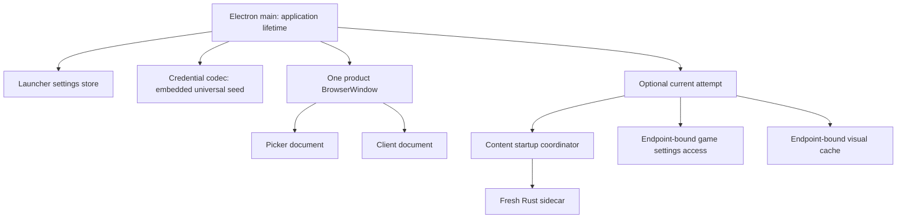
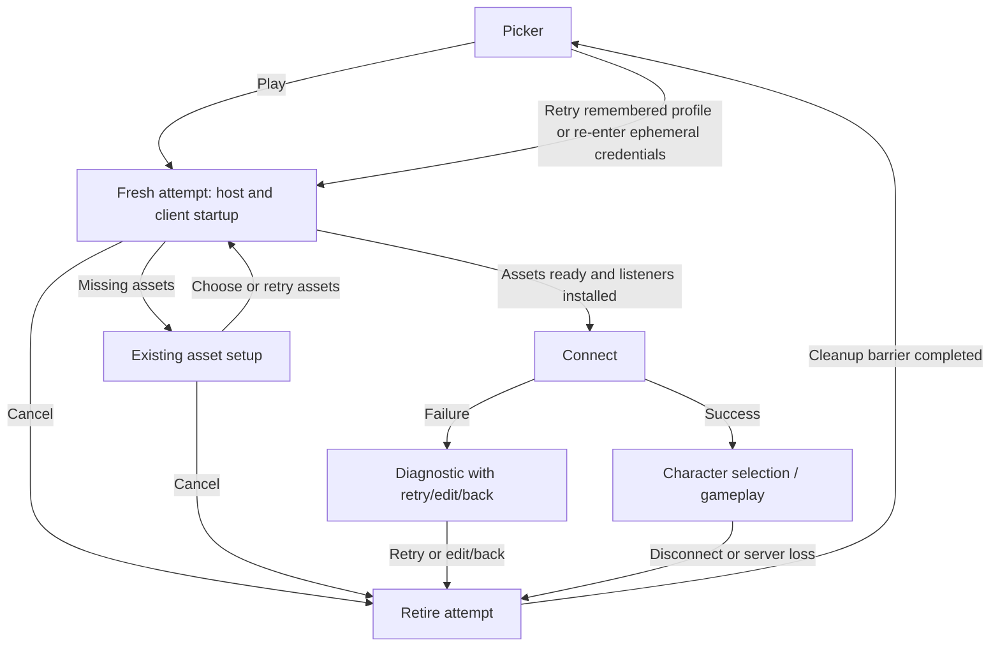

# H3D integrated launcher

Status: implementation and automated Linux verification complete. User visual acceptance is pending.

## Context and boundaries

**Goal:** start H3D in a lightweight server/profile picker and run successive isolated game sessions inside the same product window.

Agreed product decisions:

- One installation, Electron main process, and product window. Picker, asset setup/loading, character selection, and gameplay occupy that same window in sequence.
- Highlighting a server/profile does not start the Rust sidecar. Pressing Play admits an attempt, starts its sidecar, resolves/loads assets, and then connects after the client listeners are ready.
- Disconnect ends the attempt and returns to the picker. Character logout returns to character selection on the existing connection. Quit exits the application.
- Launcher settings have a separate file and persistence lifecycle from game settings.
- Remembered credentials live encrypted inside that launcher file. Derive a deterministic key from a universal seed embedded in application code. No key file, OS keychain, or per-install key.
- The launcher belongs to the pregame visual family. It does not load the game world to produce its background.
- “Launch another session after disconnect” means picker → Play again. There is no separate in-game switch-server action or seamless connection transfer.

In scope:

- Saved servers and named connection profiles; create/edit/delete/select; remember last selection.
- Optional saved credential presets, with explicit Save new profile/Overwrite profile actions and profile-free Play.
- Lightweight picker entry, explicit attempt admission, fresh client document and Rust sidecar per attempt.
- Asset recovery, connection failures, retry, cancellation, disconnect-to-picker, and application shutdown.
- Endpoint-bound settings/cache lifetime, independent launcher/game window geometry, direct CLI launch, packaging/probe updates.
- Focused unit tests and automated behavioral/resource probes. Visual acceptance belongs to the user.

Out of scope:

- Updater, installation repair, client version management, automatic server discovery/synchronization, status polling, multibox manager, tray application, additional product windows. Explicit TreeStats browsing/import was authorized as a follow-up below.
- Warm content retention between attempts, reusable/resettable Rust game authority, and seamless server transfer.
- Per-profile graphics/input/HUD settings or per-server asset locations. Existing user/character game settings and global content-location policy remain the model.
- Automatic renderer-crash recovery. Preserve an explicit fatal diagnostic and native cleanup; a failed host is recoverable through attempt retirement.
- Changes to AC wire behavior or shared crate responsibilities.

## Ground truth

All paths below are relative to `apps/holtburger-3d/` unless explicitly prefixed.

| Responsibility               | References and current evidence                                                                                                                                                                                                                                 |
| ---------------------------- | --------------------------------------------------------------------------------------------------------------------------------------------------------------------------------------------------------------------------------------------------------------- |
| Native composition and IPC   | `electron/main.ts`: startup configuration is process-bound; `client:start` memoizes one attempt; settings and visual-cache handlers capture the original endpoint; content starts after entry loading                                                           |
| Launch arguments             | `electron/client-launch.ts`, `scripts/entry-paths.mjs`: client startup requires an account today; launch credentials are kept out of renderer URLs                                                                                                              |
| Host lifetime                | `electron/content-startup.ts`, `electron/host-protocol.ts`: content coordinator owns host admission/recovery; host shutdown is bounded at the process boundary; `startClient` releases its retained password                                                    |
| Rust authority               | `host/src/client_runtime.rs`: `start` admits exactly one attempt; retirement permanently closes launch admission                                                                                                                                                |
| Client construction          | `src/client/main.ts`, `src/app/ContentStartup.svelte`, `src/app/startup-game-lifecycle.ts`: static game import, content-gated mounting, one-shot construction and close preparation                                                                             |
| Game retirement              | `src/client/client-app-lifecycle.ts`, `ClientApp.svelte`, `client-lifecycle-session.ts`: logout/disconnect/quit are distinct; resource preparation includes settings/captures and presentation retirement                                                       |
| Native/preload close         | `electron/client-retirement.ts`, `electron/preload.cts`, `src/lib/host/electron-host-transport.ts`: preparation keeps renderer requests admitted until the cutoff; close and preload preparation are currently terminal                                         |
| Game persistence             | `electron/client-settings-store.ts`, `client-profile-key.ts`, `client-visual-cache-store.ts`, `client-user-data.ts`: endpoint/GUID character identity and endpoint-bound visual cache                                                                           |
| File replacement             | `electron/replace-local-file.ts`: private sibling write, sync, atomic replacement, temporary-file cleanup                                                                                                                                                       |
| Asset preferences            | `electron/content-preference-store.ts`, `src/app/AssetSetup.svelte`, `src/app/content-startup-contract.ts`                                                                                                                                                      |
| Pregame styling              | `src/app/themes/holtburger-pregame.css`, `src/client/client-pregame.css`, `ClientCharacterSelect.svelte`, `ClientLoadingPage.svelte`: pregame appearance is independently scoped from the active in-game theme                                                  |
| Entry and distribution       | `vite.config.ts`, `forge.config.cjs`, `scripts/verify-electron-package.mjs`, `scripts/verify-electron-archive.mjs`, `package.json`                                                                                                                              |
| Development/probe launch     | `scripts/electron-dev-entry.mjs`, `scripts/client-settings-startup-probe.mjs`, `scripts/content-startup-probe.mjs`: development currently resolves a client entry before Electron starts; probes have existing endpoint, page-target, and user-data assumptions |
| Previous lifecycle rationale | `docs/plans/holtburger-3d-app-lifecycle-coordination-plan.md` at repository root; historical context only, verify against current code                                                                                                                          |

For encryption, use Node's built-in `node:crypto`: [official crypto API](https://nodejs.org/api/crypto.html). No new dependency is expected. This work does not require protocol archaeology; consult ACE/retail sources if implementation unexpectedly changes game behavior.

The integration walkthrough traced no-argument startup, direct launch, missing assets, failed settings load, disconnect/relaunch, Quit during replacement, geometry restoration, and packaged/development entry selection against these sources. It exposed these concrete changes beyond adding a picker:

- `entryArguments()` currently maps entry names directly to Rust `HostMode`, while preload capabilities are gated on `--holtburger-mode=client`. Picker/client document role must be distinct from client/Explorer host mode; adding a launcher must not accidentally select Explorer authority or omit client close capabilities.
- `installWindowSettings()` installs permanent listeners, immediately writes the current bounds, and returns only a flush callback. A disposable geometry observer is required before restoring another surface's dimensions; merely using two stores would still cross-write bounds.
- Game settings load and `settings:load-user` call the global `reportFatalError()`, which latches `fatalReported` and quits. These must become attempt failures to make return-to-picker real. The fatal path remains for application/renderer failures.
- `ContentStartup` applies `clearContent` on every `start()`. Recreating it per attempt must not repeat an application-launch destructive action. Consume `--clear-content` once, before the first attempt's selection, while preserving ordinary explicit path/search policy for subsequent attempts.
- Unexpected host termination publishes a fatal content snapshot and terminal content failure can publish `restart_required`. Route those through attempt failure/retirement policy; do not leave a dead coordinator as the active game or globally quit a recoverable application.
- Development readiness checks resolve an entry URL before spawning Electron; packaged verifiers enumerate required entries. Both need the launcher entry, without introducing another Vite server or Electron installation.

## North stars and concessions

1. Preserve one-shot game owners. Replace their enclosing attempt instead of adding reset branches throughout game code.
2. Keep app policy in the app: Electron owns native/session lifetime; Svelte owns presentation; Rust owns content and the connection. No launcher contracts in shared crates.
3. Compute launch admission once in Electron main. Consumers receive a discriminated state and allowed actions rather than re-deriving readiness.
4. Reuse asset selection, atomic writes, game retirement, UI controls, and pregame styling. Extract concrete shared parts; do not build a general application framework.
5. Keep the picker inexpensive: no sidecar, DAT access, WebGL context, scene workers, game loop, or static import chain reaching the game composition.
6. Treat plaintext credentials as transient. The universal seed provides the agreed obfuscation against casual scraping, not confidentiality from someone inspecting the application.
7. Retain diagnostics and attempt every independent cleanup. Never silently reset malformed persistence or report failed writes as saved.

Accepted costs: reloading game code/assets on another Play; one active attempt per app instance; no guarantee of total shutdown duration when filesystem I/O hangs. Existing renderer and host shutdown deadlines retain their specific meanings. Multiple concurrent application instances editing the same launcher file are not given a new merge protocol in this scope; document that limitation rather than inventing cross-process synchronization.

Expected implementation size: several new focused launcher modules plus changes across existing entry, close, persistence, and packaging boundaries. Lifecycle refactoring is the largest part. Record actual production line impact during implementation; question wrappers that merely forward calls and delete obsolete process-bound paths in the same change.

## Ownership, disk contracts, and credentials

### Lifetimes



Picker/client are alternate documents, not concurrent windows. Fresh documents clear per-document preload listeners and renderer state; Electron main persists. Explorer remains a separate existing entry with its current policy.

| Disk artifact                                        | Owner and lifetime                                                     | Data                                                                                                                     |
| ---------------------------------------------------- | ---------------------------------------------------------------------- | ------------------------------------------------------------------------------------------------------------------------ |
| `launcher-settings.json`                             | Launcher store, loaded before picker; lives until app quit             | Version, servers, profiles, last server/optional profile selection, picker window bounds/maximized state, encrypted credential envelopes |
| `client-settings.json` or explicit existing override | Game settings owner, initialized for game use; session-scoped adapters | Existing user/character settings and game window geometry                                                                |
| `content-selection.json`                             | Existing content preference policy                                     | Global asset location and health                                                                                         |
| `character-visuals/`                                 | Attempt-scoped visual-cache owner                                      | Existing endpoint/GUID captures                                                                                          |

The launcher store has its own schema, read/write queue, diagnostics, and flush. Share the low-level file replacement helper, not the game settings collection format or game reset policy. Initialize game settings after Play, so an invalid game file cannot prevent opening the picker. Preserve the existing development/packaged user-data separation.

Proposed disk shape, to implement with precise validated types and comments:

```text
LauncherSettingsV2
  version
  servers: Server[] { id, name, endpoint: { host, port } }
  profiles: Profile[] { id, name, serverId, credentials }
  lastSelection: { serverId, profileId: ProfileId | null } | null
  window: { normalBounds, maximized }

credentials = encrypted envelope (absent only in incomplete legacy profiles)
envelope = { version, nonce, ciphertext, authenticationTag }
encrypted plaintext = { account, password }
```

IDs serve references and selection, never endpoint/GUID cache identity. Validate server references at the owning boundary. Server deletion explicitly removes its profiles in one confirmed user action; profile deletion removes its credential envelope. Neither operation deletes game settings or visual captures. Per the user's subsequent refinement, Add and Edit reject an endpoint already used by a different saved server, using the same normalized host/port identity as directory imports. Editing a server, including its endpoint, preserves dependent profiles and their remembered credentials. The duplicate check runs inside the serialized write, excluding the edited server's own ID. The former endpoint-change credential clearing and its UI warning are removed.

Use AES-256-GCM through `node:crypto`, a deterministic 32-byte key derived from the embedded stable seed with SHA-256, a fresh cryptographically random 12-byte nonce per encryption, and a 16-byte tag. The codec owns these constants and validates envelope lengths/version. Authenticate the profile ID as associated data to reject accidentally transplanted envelopes. Keep the seed stable across builds/platforms; changing it requires an explicit credential migration decision. No key file or release-generated random seed.

Renderer catalog projections contain display metadata and credentialStatus, never passwords or ciphertext. Selecting a preset calls a typed picker-only native credential command to populate editable account/password fields, with the password masked. This supersedes the former account-only read-back and keep/replace/remove contract. No credentials enter URLs, sidecar command-line arguments, logs, or diagnostic snapshots.

Saving a preset is explicit and always encrypts both account and password; there is no Remember checkbox. Save new profile creates a preset and Overwrite profile replaces the selected preset's name and credentials. Play always uses supplied current form values, supports no profile, and never creates or overwrites presets. An intentionally empty password remains valid; an account is required. Retired unsaved passwords are not retained for another attempt. Version 1 files upgrade at the load boundary to version 2's server/optional-profile selection without changing IDs or encrypted envelopes; incomplete legacy presets can be completed by overwriting them. Selecting no preset does not require creating one before Play.


Serialize explicit saves and acknowledge after atomic replacement. Persist the selected server and optional profile when Play is admitted. Flush picker geometry before leaving it. On persistence failure, retain the previous valid disk document, show a diagnostic and retry action, and do not claim the attempted edit succeeded. Missing files produce first-run defaults; malformed/unsupported files require explicit recovery before replacement. A credential decryption failure affects that profile's credentials, not the whole catalog.

### App and IPC contracts

Introduce a focused Electron `ClientApplication` owner and an attempt record. Names are proposed; avoid retaining parallel coordinators with overlapping responsibility.

- App state is a discriminated union: picker, starting, session, retiring, quitting. Starting/session/retiring carry the attempt identity and its resources; picker carries no active host.
- Keep host mode (`client`/`explorer`), document role (`picker`/`client`/`explorer`), and initial launch intent (`picker`/direct connection) separate typed facts. Launcher is a client-app surface, not a third Rust host mode. The same client preload can expose role-appropriate narrow capabilities, with main enforcing admission.
- Each document receives a main-issued identity through an authenticated boot handshake. Session IPC carries/binds to that identity; main validates the current application frame, expected document role, and attempt before acting. A frame check alone does not distinguish successive documents in the same window.
- Register main IPC handlers once. Resolve operations through the active owner; remove closures permanently capturing the first endpoint/coordinator/cache.
- Picker commands cover catalog edits, Play, and Quit. Client commands retain existing game operations and add return-to-picker. A picker cannot invoke an active game's host commands.
- During retirement the renderer coordinator withdraws gameplay intent producers and drains scheduled work. Keep the retiring document's host/content/stop/flush RPC admitted until preparation acknowledges or times out; the cancellation signal alone is not the IPC cutoff. Then close its IPC admission before native stores flush and before any next attempt exists.
- Detach old host event forwarding before replacement. Late old-host events, preparation acknowledgements, or startup completions cannot affect a new document/attempt.
- Return and Quit share one idempotent attempt retirement. Quit is terminal and supersedes pending picker navigation. Do not reset `ClientRetirement` or duplicate native cleanup in a second path.
- Existing close preparation should become usable as session retirement preparation; keep names honest after changing its responsibility. A fresh document receives a fresh one-shot preparation owner.

Consume one-time launch actions once at the application layer. In particular, `--clear-content` must finish through the existing preference store before the first attempted selection, not at idle picker startup and not on each Play. Persistent launch restrictions/overrides such as `--content`, `--no-content-search`, `--settings-file`, and the renderer config bypass retain their documented scope across attempts. Do not persist CLI overrides into launcher profiles implicitly.

Geometry observation needs an explicit suspend/dispose/flush contract. Before leaving a surface: stop its listeners/timer, capture and await its final geometry write, then restore the destination's minimum size/bounds/maximized state while neither observer can capture the transition. Install the destination observer only after restoration. The existing game minimum dimensions must not force a game-sized picker. Quit during a transition joins the current geometry operation and does not install another observer. Do not rely on renderer document teardown to dispose Electron window listeners.

Separate application-fatal reporting from attempt failure before wiring retry. Settings initialization/repair failures, connection rejection, and host termination must retain a main-owned diagnostic and reach retirement without setting `quitting`, `fatalReported`, or the final application exit code merely because one attempt failed. A failed host is no longer allowed game IPC even while its diagnostic is displayed. Renderer loss still follows the explicitly scoped application-fatal path.

## Scenario illustrations and ordering

### Normal launch, character logout, disconnect, and another Play

```mermaid
sequenceDiagram
    participant U as Player
    participant M as Electron main
    participant L as Launcher store
    participant W as One product window
    participant H as Attempt sidecar
    M->>L: Load settings
    M->>W: Show picker with picker geometry
    U->>W: Highlight profile
    Note over M,H: No sidecar exists
    U->>W: Play
    W->>M: Submit server, optional profile, and current credentials
    M->>M: Validate and admit attempt
    M->>L: Persist selection and picker geometry
    M->>W: Navigate to client startup document
    M->>H: Launch host; resolve/load assets
    Note over W,H: Existing asset setup/recovery when needed
    M->>W: Content ready; mount game with game geometry
    W->>M: Listeners ready; request connection
    M->>H: Private start_client with credentials
    H-->>W: Character selection then gameplay
    U->>W: Character logout
    H-->>W: Character selection on same connection
    U->>W: Disconnect
    W->>M: Return to picker
    M->>W: Prepare session retirement
    W-->>M: Resources retired; final writes submitted
    M->>M: Close old IPC admission; flush native stores
    M->>H: Shutdown and await exit
    M->>W: Fresh picker document; restore picker geometry
    Note over M,L: Launcher store remains alive
    U->>W: Select any profile and Play again
    Note over M,H: New attempt, fresh sidecar and client document
```

Navigation and content startup may overlap only after the attempt is admitted. Publish a coherent snapshot so early host readiness/failure is visible to a late document subscriber. Never wait for a Play IPC response that can only settle after its calling document has navigated away: acknowledge admission separately from long-running attempt progress.

### Asset recovery, connection failure, retry, and cancellation



Retry runs through the same attempt replacement path; it never calls `start` twice on a Rust runtime. Retry can be carried as main-owned intent across retirement, but must resolve credentials again and must not briefly open a second attempt. Edit/back shows the picker. On server loss, return to picker with its diagnostic after retirement; do not silently reconnect. A host crash follows native retirement and surfaces the crash diagnostic. Asset failures keep the existing recovery semantics, including health persistence and explicit restart-required cases; a new game attempt is the restart boundary where safe.

### Quit during startup or retirement

```mermaid
sequenceDiagram
    participant W as Current document
    participant M as Electron main
    participant H as Optional sidecar
    participant D as Persistence owners
    W->>M: Quit / native window close
    M->>M: Mark terminal quitting; reject Play/navigation
    M->>W: Prepare current document, if available
    alt Renderer responds
        W-->>M: Prepared or explicit failure
    else Renderer unavailable or deadline expires
        M->>M: Retain preparation failure
    end
    M->>M: Close renderer request admission
    M->>H: Join existing retirement or shut down host
    M->>D: Attempt independent pending flushes
    Note over M,D: Report failures; do not skip remaining releases
    M->>M: Exit once; never navigate back to picker
```

Picker Quit requires only launcher persistence and window cleanup. During an attempt, flush game persistence too. Native close and product Quit use the same app operation. Intentional document navigation happens only after preparation and must not be interpreted as unexpected renderer loss by the old close owner. Unexpected renderer loss retains the existing fatal path and still attempts native cleanup.

### Failure and concurrency decisions

| Input                                                          | Required outcome                                                                                        |
| -------------------------------------------------------------- | ------------------------------------------------------------------------------------------------------- |
| Double Play                                                    | Exactly one admitted attempt; second request receives an explicit busy result                           |
| Cancel before spawn completes                                  | No later completion may connect; any spawned host is retired                                            |
| Native folder picker finishes after cancel/quit                | Ignore its late selection for the retired attempt                                                       |
| Disconnect while character logout/world entry is pending       | Existing game withdrawal barriers complete; no second authority retirement                              |
| Quit while returning to picker                                 | Join retirement, flush launcher, exit; no picker navigation                                             |
| Old document save arrives after cutoff                         | Reject by document/attempt identity; never write into a later endpoint                                  |
| Host has exited but renderer cleanup fails                     | Attempt independent flushes; surface failure on picker if native ownership is settled                   |
| Host termination or a required native flush remains unresolved | No new Play; expose failure/recovery/Quit rather than claim isolation                                   |
| Malformed game settings                                        | Attempt startup reports the error and can return to the functioning picker                              |
| Direct CLI launch                                              | Bypass initial picker, use same attempt owner, keep credentials ephemeral; disconnect returns to picker |

## Phased implementation

### Phase 1: App-owned attempt lifetime

Deliverables: `electron/main.ts`, focused app/attempt owner, `client-retirement.ts` and tests, `content-startup.ts`/IPC registration, `host-protocol.ts` forwarding ownership.

- [x] Separate attempt retirement from application exit; keep existing direct launch working through the new owner.
- [x] Register handlers once and scope host/settings/cache access to the current attempt and document.
- [x] Separate document role, host mode, and initial launch intent; preserve client preload close registration for both picker and game documents.
- [x] Preserve renderer-preparation IPC admission and cutoff ordering; make Quit terminal.
- [x] Keep Rust runtime one-shot. Instantiate a fresh content coordinator/sidecar per attempt.
- [x] Remove application-fatal reporting from recoverable game settings/host failure paths; preserve explicit renderer/app fatal handling.
- [x] Consume `--clear-content` once before the first attempt selection, using the existing content preference owner; test a second Play does not clear a newly selected location.
- [x] Unit-test duplicate admission, cancel-before-readiness, return/quit collision, late completion, and retirement failure.

Acceptance: existing direct launch/close behavior still works; owner tests prove at most one attempt and no re-admission before retirement settles; no reset mechanism is added to shared or Rust game authority.

### Phase 2: Launcher persistence and credential codec

Deliverables: app-local `src/launcher/launcher-contract.ts`, Electron launcher store/credential codec with colocated tests, narrow preload/renderer transport, launcher path in `client-user-data.ts`.

- [x] Implement versioned disk schema and explicit references/deletion rules.
- [x] Implement deterministic seed-derived key and versioned AES-GCM envelopes; keep seed out of renderer exports.
- [x] Implement explicit preset create/overwrite semantics, profile-free Play, and profile-local decryption diagnostics.
- [x] Reuse atomic file replacement; serialize writes and expose save failures/retry.
- [x] Separate picker geometry from game geometry and independent flush/reset behavior.
- [x] Replace permanent game geometry listeners with a disposable observer; test pending timers and restoration cannot write destination bounds into the previous store.
- [x] Test round-trip, unique nonces, wrong tag/profile association, empty password, edits/deletions, and write failure preservation.

Acceptance: launcher store operates with no host/game settings initialization; remembered credentials survive reopening; serialized output contains no plaintext account/password; failed saves are not acknowledged as successful; no key file is created.

### Steering checkpoint

- [x] Re-read the actual app/close integration and pressure-test the scenario table before building UI.
- [x] Verify that no handlers capture first-attempt resources and no imported launcher module pulls in game construction.
- [x] Reassess line impact and remove forwarding-only abstractions. Split remaining phases only if a newly demonstrated boundary deserves it.
- [x] Record deviations below. Escalate product-scope changes; resolve ordinary implementation details autonomously once implementation is authorized.

### Phase 3: Pregame-inspired picker and default entry

Deliverables: `launcher/index.html`, `src/launcher/main.ts`, `LauncherApp.svelte` and focused form/state modules; `vite.config.ts`, `scripts/entry-paths.mjs`, `electron/client-launch.ts`, existing shared UI/pregame styles.

- [x] Inspect immediate consumers before extracting shared pregame palette/control/branding rules. Keep feature layout separate.
- [x] Add server/profile create/edit/delete/select, remember control, credential replacement, explicit Play, save errors, and empty-catalog onboarding.
- [x] Open picker on no-argument startup. Complete explicit connection CLI input preserves direct launch; partial explicit CLI launches fail clearly rather than accidentally connecting to defaults.
- [x] Treat non-connection flags alone (`--debug`, `--content`, `--settings-file`, config/cache flags) as picker launch options; endpoint/account/password flags invoke direct-launch validation. Preserve the existing account-required/default-endpoint direct-launch semantics rather than requiring an explicit endpoint as a new compatibility rule.
- [x] Update development readiness URL selection to match initial launch intent while serving picker and client from the same Vite origin. Keep runtime document navigation owned by Electron main.
- [x] Play snapshots a validated endpoint/profile and acknowledges admission independently of later navigation.
- [x] Keep picker free of game imports, sidecar startup, DAT reads, WebGL, and game loops.
- [x] Capture/restore picker and game bounds through their respective owners; avoid resize events persisting one mode's geometry into the other's file.

Acceptance: same BrowserWindow changes from picker to client; highlighting profiles never starts a host; no-argument packaged launch reaches picker; in-game theme selection does not alter pregame appearance. User performs visual acceptance.

### Phase 4: Return, cancellation, and another session

Deliverables: `src/client/main.ts`, `ContentStartup.svelte`, `startup-game-lifecycle.ts`, client lifecycle/loading UI and close preparation; Electron app owner and preload document handshake.

- [x] Reuse game resource preparation, await final renderer writes, close old admission, flush stores, and await sidecar retirement before navigation.
- [x] Add Cancel/Back/Retry actions for appropriate startup/failure states. Preserve actionable diagnostics across document replacement using main-owned state.
- [x] Keep character logout on its existing connection; route explicit disconnect to retirement and picker.
- [x] Detach old host subscriptions and reject old document IPC before the next attempt.
- [x] Retain command-line launch credentials only for their attempt; do not implicitly save them.
- [x] Test profile A → disconnect → profile B, including equal GUIDs on different endpoints, pending captures/settings writes, and cancelled listener installation.

Acceptance: repeated attempts work in one window without stale hosts, listeners, profile writes, or terminal close state leaking into the next document; retry always creates fresh authority; Quit works at every stage.

### Phase 5: Cleanup, packaging, and verification

Deliverables: obsolete startup assumptions removed; README and existing probes/verifiers updated; focused Electron launcher lifecycle probe using temporary profiles/fixtures.

- [x] Sweep comments, symbols, diagnostics, tests, and docs that claim one connection per application or mandatory CLI account at default startup.
- [x] Preserve one connection per attempt and existing Explorer behavior; replace brittle old tests rather than retaining dead architecture.
- [x] Include launcher output in package/archive verification. Adapt sidecar smoke, content startup, settings startup, and live client probes to the new owner as needed.
- [x] Isolate launcher settings, content preferences, Chromium state, and caches under temporary user-data roots in probes. An existing `--settings-file` override alone does not isolate the new launcher file. Reacquire CDP document targets/contexts after navigation rather than assuming the original client context survives.
- [x] Verify picker startup, cancel, failure, disconnect, repeat Play, and Quit using automated Electron probes. Browser-only checks cannot prove sidecar/window ownership.
- [x] Verify game-settings load failure returns to a usable picker, host crash retires the attempt, one-time content clear remains one-time, and delayed window events cannot contaminate either geometry file.
- [x] Capture picker idle and return-to-picker process/resource evidence, including sidecar absence and stopped game activity; record machine/platform/workload. Do not assert memory values or instantaneous RSS reclamation without measurements.
- [x] Record validation evidence, remaining limitations, and actual line impact below.

Acceptance: checks pass, production build includes both entries, packaged smoke proves one product window and repeat sessions, no runtime-asset-dependent tests are retained, and no unsupported total-shutdown or resource claims are made.

## Verification and definition of done

From `apps/holtburger-3d`, use existing manifest scripts:

- `npm run test:ts`, `npm run check`, `npm run lint`, `npm run format:check`, `npm run build`, and `npm run build:electron:main`.
- `npm run check:rust` and `npm run lint:rust` for the host boundary; run focused Rust tests if Rust changes are actually needed.
- Build/package through `npm run package`, then run `npm run check:package` with the artifact arguments its script requires. Exercise archive verification when producing an archive; do not assume packaging implies an installer exists.
- Run the adapted automated Electron probe for lifecycle behavior, startup/return resource evidence, and existing direct-launch/Explorer regressions. Use synthetic fixtures for reproducible cancellation and write ordering; temporary real assets may support diagnostics but must not become checked-in test prerequisites.

Done means all phase acceptance criteria and the scenario table are satisfied; one window is used throughout; Play is the sidecar admission boundary; launcher storage is independent and credentials use the embedded deterministic key; first-run and saved-profile flows work; teardown isolates successive endpoints; failures remain visible; and user visual acceptance is explicitly recorded as pending or complete. Implementation authorization is separate from this planning request. Do not stage or commit without instruction.

## Risks and mitigations

| Risk/friction                                        | Mitigation                                                                                                                       |
| ---------------------------------------------------- | -------------------------------------------------------------------------------------------------------------------------------- |
| Terminal shutdown owners accidentally reused         | Fresh client document, fresh attempt, one terminal app Quit; refactor shared preparation instead of resetting closed owners      |
| Same window lets late IPC target the next server     | Document/attempt identity, admission cutoff, old forwarding detach, endpoint capture owned by attempt                            |
| Navigation races with prepare-close or Play response | Prepare first, acknowledge Play admission before asynchronous navigation, distinguish intentional replacement from renderer loss |
| Picker loads game dependency graph                   | Separate Vite entry and production import inspection plus behavioral resource probe                                              |
| Reconnect reload cost                                | Accepted first-release concession; measure before considering warm shared content                                                |
| Universal seed changes across releases               | Stable codec seed/version, deterministic derivation, round-trip fixture; explicit migration for future changes                   |
| Invalid credentials or catalog blocks unrelated use  | Profile-local credential failure; explicit catalog recovery; retain valid server definitions and diagnostics                     |
| Persistence cleanup fails                            | Continue independent releases, retain errors, block another Play while native ownership is unresolved                            |
| Shared pregame CSS imports gameplay                  | Extract only concrete presentation dependencies, inspect immediate consumers and built entry imports                             |

## Open questions and execution decisions

No unresolved product decision blocks this plan. One window, Play-triggered sidecar, embedded universal seed, separate launcher persistence, and pregame styling are settled. Exact form layout/default picker dimensions remain implementation choices subject to user visual acceptance.

During execution, record meaningful deviations, new evidence, completed validation, resource measurements, and remaining debt here. Do not broaden this into automatic updates/discovery or in-game server switching without a new scope decision.

## Implementation evidence and remaining acceptance

Implemented decisions and course corrections:

- The app owner uses a discriminated state with attempt ownership; partial native setup uses a resource-stage union so incomplete initialization still has an honest flush owner.
- Client content is read from the current attempt, and document role is read from the document admission owner. Removed parallel native aliases that would otherwise need synchronization during navigation.
- `ClientRetirement` replaces the old application-exit-specific close policy. It returns renderer preparation diagnostics and rejects native cleanup failures directly; removed the no-op completion callback and duplicated native-failure side channel.
- Window geometry and terminal exit schemas were extracted into small app-consumable modules. Importing the entire game event codec into Node failed at runtime because its renderer dependencies have extensionless imports; native code now imports only the narrow terminal contract.
- The existing `ClientPregameScreen` already contains the required asset-independent branding, controls, styles, and input scope. Reused it directly rather than introducing another shared shell or palette.
- Existing packaged theme diagnostics replace a setup-only document. Document boot explicitly grants a new identity for the known client/theme-harness paths only while client content is not admitted; live game replacement is not granted this exception. The standalone diagnostic host was updated for the same preload identity envelope.
- The old settings startup probe assumed missing theme selection meant Base. HEAD already defaults to Traveler's Kit; the probe now reads the runtime default rather than preserving that stale expectation. Its user-data directories are isolated as well as its game settings override.
- Knip declares the existing external `python` build tool rather than treating it as a missing npm binary. No application dependency was added.

Verification already observed on Linux x64:

| Evidence                                | Result / scope                                                                                                                                                                                                                                                                        |
| --------------------------------------- | ------------------------------------------------------------------------------------------------------------------------------------------------------------------------------------------------------------------------------------------------------------------------------------- |
| TypeScript suite                        | 425 files, 3,972 tests passed (`npm run test:ts -- --maxWorkers=4`), including optional credential presets                                                                                                                                                                                                                        |
| App type checks                         | Svelte: zero errors/warnings; app/node/test/Electron/preload TypeScript checks passed                                                                                                                                                                                                 |
| Rust checks                             | `check:rust` and `lint:rust` passed; no Rust authority or shared crate code changed                                                                                                                                                                                                   |
| Lifecycle probe, empty temporary assets | Actual server/profile dialogs, Remember control and Play, one window, no initial sidecar/canvas/game composition, repeated attempts, isolated equal-GUID settings/captures, independent geometry, first-Play-only content clearing, invalid game settings recovery, clean picker Quit |
| Lifecycle probe, local full assets      | Game construction, cancellation, real connection timeout with retained diagnostic, host crash recovery, Quit during startup; one window and no surviving sidecar after return                                                                                                         |
| Existing content startup probe          | Explorer and client: required-resource failure persisted, next launch asset recovery, temporary override isolation, disabled-discovery retry, orderly setup close                                                                                                                     |
| Existing settings startup probe         | Persisted typography/scale, repair, unknown-section preservation and writes through the real preload passed                                                                                                                                                                           |
| Existing theme probe                    | Development and built-file entries: theme reload, failed/cancelled reads, settings restore, and bundled assets passed                                                                                                                                                                 |
| Forge package and package verifier      | Final Linux x64 package produced; launcher entry included; package verifier passed (revision `9ee9a2ef`, modified sources)                                                                                                                                                     |
| Packaged launcher probe                 | Final executable passed one-window startup, repeated attempts, real connection timeout, host crash recovery, settings/capture isolation, one-time content clear, invalid game settings, and Quit during startup                                                                                                                            |

Probe reports include native memory/CPU/process snapshots from software-rendered Electron with isolated profiles. They establish sidecar/canvas/resource lifetime, not a hardware-independent RAM budget or immediate RSS reclamation. Full-content runs used local diagnostic assets; checked-in tests do not depend on those assets. No screenshots were taken or visual acceptance judgments made.

Measured source impact: approximately +1,574 production lines, +346 unit-test lines, and +681 diagnostic-script lines, net of removed code. Most production additions are the picker/forms and independent persistence/credential store; lifecycle machinery reuses existing content and retirement paths. No second runtime or GUI framework was added.

Final type checks, lint (including dead-code analysis and Clippy), formatting, package verification, and expanded packaged lifecycle probe passed. Packaged content recovery and bundled-theme asset probes passed for Explorer and client. User review is needed for picker layout, pregame visual treatment, form clarity, and window sizing. Successful live-server authentication/gameplay and cross-platform native execution are not claimed from these Linux failure/cancellation scenarios. No commit has been staged or created.

- Final packaged cancellation exposed a premature host-RPC filter: asset requests needed to settle presentation construction were being rejected before renderer preparation completed. Removed that filter and retained the existing acknowledgement-based document cutoff. Renderer-owned input withdrawal prevents new gameplay intents; native private connection startup remains rejected after attempt cancellation. Return-to-picker combines page and cleanup diagnostics rather than dropping either outcome.

- Interrupting real presentation construction exposed an inherited cancellation mismatch: the owner created an `Error` named `AbortError`, while root retirement accepted only `DOMException`. Construction now uses the signal's native `throwIfAborted`; root retirement uses the existing `isAbortError` contract, with both accepted error shapes covered. Cancellation remains distinct from genuine construction/cleanup failure.
- Startup Cancel/Back actions live in existing pregame footers (including asset setup), so they inherit pregame appearance and input behavior rather than creating an unscoped overlay control.

- Removed the now-unreachable pre-construction window-restoration branch; both client surfaces restore through their current geometry owner. Preserved unsupported-window-section diagnostics and native notifications for geometry-save failures, with one notification per failure burst and a rejecting final flush.

## Authorized follow-up: TreeStats server import

The user authorized an explicit directory browser, then refined the UI to use pregame expandable
rows, category filters, plain metadata labels, and immediate per-row icon Add actions. No batch-selection flow remains.
This extends manual server creation without changing server → profile → credential ownership.

- Ground truth: `https://treestats.net/servers.json`, checked directly on 2026-10-29. The live response contains `host` and string `port`, unlike the older combined `address` example at `https://treestats.net/api`. It also supplies name, description, PvE/PvP type, software family, and optional timestamped player reports. The observed directory had 49 entries; this is evidence, not a hardcoded expected count.
- Electron owns the fixed-URL fetch, ten-second timeout, schema validation, native key lookup, and in-memory cache. Opening loads once; Refresh explicitly replaces cached directory metadata. Invalid/duplicate rows are omitted with a visible count; failures retain the previous successful catalog. Rust is uninvolved and no sidecar starts during browsing or Add.
- The existing character creator's skill row was extracted into `ClientPregameExpandableRow.svelte`, shared by creator and TreeStats. Native details/summary starts collapsed, with independent adjacent controls and shared pregame theme treatment. The initial general Settings/Housing reference was superseded by this closer pregame prior art. Creator diagnostic selectors follow the shared action/content wrappers.
- Collapsed labels show name plus type/software as plain muted text, distinct from interactive pills. Expanded details separate labelled host, port, reported players, and report timestamp from a titled Description section. Type/software filters sit behind the Journal/Spells collapsed Filters disclosure, with an active selection count, and reuse `ui-filter-pill` behavior: additive selections with All clearing a category, OR within each category and AND across categories, combined with text search.
- Each row has an Add icon button using the existing `ui-icon-actions`/`ui-icon-button` treatment and plus SVG, disabled with an Added accessible label/tooltip when its endpoint is already saved. Add resolves one key against validated native data, then atomically saves a local name/endpoint with a new native UUID. The browser remains open, the row updates to Added, and the picker refreshes/selects the new server behind the dialog. Refresh and Done occupy the bottom action row; Done closes the browser. Accounts are created separately.
- Duplicate detection runs against current saved endpoints after fetch and again within the serialized write. It reuses `clientServerScope` without equating DNS aliases or interpreting a matching name as an endpoint change. Existing IDs, labels, profiles, and credential envelopes are preserved. No provenance fields, automatic synchronization, or settings-file migration are needed.
- The former multi-selection state, checkboxes, batch action, and batch native contract were removed. The explanatory disclaimer was removed at the user's request. Visual checks belong to the user; no further screenshots or visual acceptance checks are performed without request.
- Focused parser/cache/failure/import unit tests and the opt-in packaged `probe:launcher -- --tree-stats` path verify the feature. Ordinary tests/probes do not depend on the public service. The probe verifies filters, independent disclosure, immediate Add with the browser retained, Added disabled across reopen, explicit Refresh, and no profile/sidecar creation before exercising existing launcher lifecycles.
- The full client presentation regression probe passed after extracting the shared row. It also exposed stale pre-launcher diagnostic assumptions: its client-only fixture now records native Back handoffs and asserts Back plus Quit actions instead of assuming Quit is the only terminal action. No product fallback was added for missing launcher authority.

Final immediate-Add verification: 425 files / 3,967 tests passed, with zero Svelte
errors/warnings, app/native type checks, lint/dead-code/Clippy, formatting, renderer/native
builds, and Linux package verification passing. The actual packaged live-directory probe
passed search, intersecting type/software pill filters, expansion without adding,
immediate per-row Add with the browser retained, disabled Added state across reopen,
Refresh, and the existing launcher lifecycle/isolation scenarios. No new screenshots
or visual acceptance judgments were made after the user reserved visual checks.

The subsequent layout refinement passed app/native type checks, lint/dead-code/Clippy,
formatting, renderer build, package verification, and the packaged live-directory/lifecycle
probe. The probe additionally verifies initially hidden Filters controls, an active-count
summary retained while collapsed, structured metadata and separate Description content,
icon Add controls, and Refresh in the bottom action row. Visual acceptance remains with
the user; this refinement was verified without screenshots.

The server editor now rejects duplicate normalized host/port endpoints for both Add and
Edit, excluding the edited server's own ID. Editing a server preserves its profiles and
encrypted credentials, including endpoint edits; the former clearing behavior and warning
were removed at the user's request. Validation runs within the serialized save operation,
so concurrent requests cannot bypass uniqueness. Expected validation rejections propagate
to the editor without becoming persistence faults; disk-write failures still surface and
cause final flush to reject. Tests cover duplicate Add/Edit, concurrent adds, preserved
credential envelopes and successful decryption after reopening an edited endpoint, and
clean flush after rejected duplicates. The packaged launcher probe exercises the visible
duplicate-Add editor error and confirms the saved server is retained.

Server-editor validation results: all 3,969 tests passed, along with app/native type checks, lint/dead-code/Clippy, formatting, renderer/native builds, Linux package verification, and the packaged duplicate-Add/lifecycle probe. The UI showed the duplicate endpoint error and retained the original server. No visual acceptance checks or screenshots were performed.

A dev-startup investigation reproduced a hidden native window using the user's saved
launcher bounds (1860×980 at 22,19): the launcher document was loaded and mounted,
but BrowserWindow.isVisible() remained false while startup waited for ready-to-show.
With the same bounds in an isolated profile, showing after the initial did-finish-load
made the native window visible. The initial show now follows document load rather than
first paint; subsequent document navigation retains the same window. The launcher probe
now explicitly checks native visibility, rather than treating a mounted DOM as proof of
a shown window. This fix does not change the geometry persistence schema or policy.
Temporary diagnostic windows were closed by their own probes; the user's existing dev
process was not targeted. No screenshots or visual acceptance judgments were performed.

The TreeStats dialog now opts into a stable 34rem width, capped by the viewport, via
UiDialog's CSS width override. Its previous fit-content sizing could grow when a server
row expanded. Other dialog consumers retain their existing sizing. Visual review remains
with the user; no additional windows or screenshots were opened for this CSS refinement.

The TreeStats browser now has a compact cycling sort button beside Filters, using the existing
sort icon and current/next-mode tooltip pattern. It defaults to Name and cycles to
Population: descending reported count, with unreported populations below reported zero
and alphabetical tie-breaking. Sorting runs after search/category filtering on a new
array, retains its mode through Refresh/Add, and remains local to the open browser.
The opt-in directory probe checks both population order and the cycle back to names.

The sort control was moved beside Filters with a compact icon/current-mode label. The
server results reserve a stable scrollbar gutter and add inline-end padding so row Add
controls do not sit against the scrollbar. No screenshots or visual acceptance checks
were performed for this refinement.

The first fully visible Wayland regression run exposed an overly broad geometry assertion:
expected and actual picker sizes were both 900×650, but the OS changed x/y. The probe
now checks independent surface dimensions rather than requiring global window placement
to remain identical. Electron documents the Wayland placement restriction at
https://www.electronjs.org/docs/latest/api/browser-window#wingetbounds. The app's geometry
persistence policy was not changed as part of this diagnostic correction.

Final sort/layout verification passed app/native type checks, lint/dead-code/Clippy,
formatting, renderer build, package verification, and the full packaged TreeStats plus
launcher lifecycle probe. Population ordering and the return-to-name cycle passed;
the corrected dimension-isolation assertion also passed with visible native windows.

The main launcher now groups the Choose your world heading, server list, and add/import
actions in the left column. The profile column starts at the same top edge, names the
selected server, and has a divider separating the two areas (horizontal when stacked
on narrow viewports). Server selection uses the existing pregame diamond asset, an
accent edge, and highlighted text. Each server has its own Edit/Delete icon controls,
revealed on hover or focus within the row and available without hover on touch devices.
Controls are sibling buttons, not nested interactive elements, and reserve their space
to avoid row-width changes on hover. Editing/deleting an inactive row preserves active
selection and credential drafts; creation still selects the new server. The editor's
add/edit intent is explicit. The behavioral probe covers inactive-row actions and state
preservation; visual acceptance remains with the user.

Main-layout verification passed app/native type checks, lint/dead-code/Clippy, formatting,
renderer build, package verification, and the packaged launcher lifecycle probe. The new
behavioral scenario edited and deleted an unselected server through its per-row icon
controls while preserving the active server/profile and typed account/password. No
screenshots or visual alignment/appearance acceptance checks were performed.

## Optional credential presets follow-up

The user removed the requirement to create a profile before launching. Launch options now remain
visible regardless of profile selection. The form has an optional profile selector, account/password,
and profile name. Save new profile and Overwrite profile are explicit durable actions; both encrypt
credentials. Play supplies current values directly and never implicitly saves/clears a preset. The
old Remember/Use remembered/Forget controls and separate profile Add/Rename dialog were removed.
The native profile-credential read is gated to the current picker document; saved passwords now
fill the masked field rather than requiring placeholder/keep-secret branching.

Selection metadata is a composite serverId/profileId pair in launcher file version 2, allowing
profile-free launches to remember their server. Version 1 decoding validates references and upgrades
in memory, preserving IDs, encrypted envelopes, and incomplete legacy presets. Every subsequent
write uses version 2. Deleting a profile preserves the selected server; deleting that server clears
the selection. Tests cover migration, explicit overwrite (including empty passwords), profile-free
launches, unpersisted current credentials, and mismatched profile/server rejection.

Optional-preset verification passed all 3,972 tests, app/native type checks, lint/dead-code/Clippy,
formatting, renderer/native builds, package verification, and the isolated packaged behavior probe.
The probe exercised explicit save/overwrite and an actual profile-free attempt, verified that
unsaved Play preserved existing encrypted presets without persisting entered credentials, and
returned to a profile-free picker. The same run covered existing server actions, settings/capture
isolation, one-time content clearing, invalid-game-settings recovery, and clean Quit. No screenshots
or visual appearance/alignment checks were performed. Native IPC/storage changes require restarting
dev:client; frontend hot reload alone cannot update the already-running main process.

## Pregame keyboard navigation follow-up

Pregame previously declared a native-control scope, but the shared keyboard router still suppressed
Tab before any control acquired focus. Its gameplay pointer policy also prevented button focus.
The shared pregame shell now registers a mounted native-page context: browser focus navigation is
available from the first Tab, pointer focus remains native, and gameplay commands cannot activate
until the page retires. Ordinary in-game scopes and their Tab suppression retain their behavior.
Entering a native page cancels held gameplay input; overlapping page lifetimes retain the boundary.

Verification passed all 3,975 tests, type checks, lint/Clippy, renderer build, and changed-file
formatting. Real browser gameplay probes retained Tab suppression, movement, chat activation,
modal restoration, and held-key cancellation. The isolated packaged launcher probe verified first
Tab, Shift+Tab, dialog traversal, pointer focus, and focus-revealed server actions, then passed its
existing lifecycle scenarios. No visual acceptance checks or screenshots were performed.

## Final accumulated code-quality review (2026-10-30)

Verdict: ready within the reviewed scope after the two bounded fixes below. Baseline is
`3d-next` / `7f54f4e6`; the review includes the entire tracked and untracked launcher change,
its deleted window-close/position mechanisms, immediate consumers, probes, and current docs.

Confirmed findings and fixes:

- **P2 — diagnostic policy in native admission.** `electron/main.ts` recognized the packaged
  theme harness during `document:boot`, replacing the current document identity when no host
  existed. The real package probe needed this navigation, but production admission should not
  know its harness paths or timing. Removed the exception. The isolated package probe now installs
  and restores its own admission setup through the native debugger. Acceptance: packaged theme
  resource/settings checks pass without a production harness-path exception.
- **P3 — contradictory persistence documentation.** The README described a version-2 write
  after an older catalog load, while `LauncherStore` writes version 4. Updated that current
  guidance. Historical implementation notes above remain historical.

Ownership and seam coverage:

- Traced launcher form → typed preload → role/document admission → serialized store → private
  connection configuration. Checked endpoint duplicate rejection, credential-owner binding,
  optional presets, profile-free persistence, failed writes, recovery, MRU, and per-server memory.
  Encryption with a public embedded seed remains the explicitly accepted obfuscation concession.
- Traced Play → attempt construction → settings/cache/content initialization → client listener
  admission → host start. Traced cancellation, failed initialization, disconnect, return, renderer
  loss, and Quit through renderer preparation, IPC cutoff, native close, final writes, and document
  replacement. Attempt cancellation and renderer retirement remain distinct: teardown RPC must
  stay admitted until the renderer acknowledgement, while new private connections are rejected.
- Inspected TreeStats fetch/validation/cache → native selection → serialized import → browser
  refresh. Native code owns endpoint membership and imported metadata. Search/filter/sort and
  expandable row state remain renderer policy; no Rust connection starts during browsing.
- Inspected geometry producer/store/schema and the removal of position restoration; shared
  keyboard policy, pregame shell and launcher/character callers; presentation cancellation;
  pregame theme/HTML layer ordering; emitted Electron imports, dev argument routing and package
  entry verification. No shared Rust crate behavior changed.

Consolidation decisions:

- Keep the extracted pregame disclosure row and vertical button-navigation helper: each replaces
  equivalent behavior in the existing character UI and the launcher. Feature selection stays local.
- Keep independent launcher/game settings and attempt-local settings/cache owners: they have
  different reset and shutdown lifetimes. Unifying them would recreate cross-surface invalidation.
- Keep validated older launcher-file decoding because the iterative feature has already written
  user catalogs; dropping it would force avoidable recovery and loss of saved selections. Only
  the read boundary accepts those formats; every mutation writes the current format.
- Keep CSS-owned readiness animation: no additional reactive animation state or reset path is needed.
  Style appearance belongs in the pregame theme layer, while component CSS owns layout.

Maintenance dry-run: adding/editing another server preserves preset ownership and unrelated drafts;
returning during incomplete startup retains partial native resources until cleanup; a later Play
gets fresh document/host identities. These operations do not require resetting one-shot game owners.

Verification covers Linux native execution and automated behavior, not visual acceptance or successful
live-server authentication. Cross-platform native execution remains unreviewed empirically. Visual
acceptance was performed by the user. No screenshots or assistant visual acceptance checks were used.

Final verification: 425 TypeScript test files / 4,067 tests passed; Svelte reported zero errors or
warnings; app/node/test/Electron/preload type checks, ESLint, Knip, Clippy with warnings denied,
formatting and whitespace checks passed. Renderer/native builds, all five built CSS layer-order
checks, Forge Linux packaging and package verification passed. The isolated packaged launcher probe
with live TreeStats passed, including loading/refresh, sorting/filtering, duplicate handling,
credentials/preset behavior, keyboard/form submission, repeated attempts and persistence isolation.
Packaged Explorer/client content recovery and full bundled/custom theme checks passed after moving
harness admission into the probe. The native debugger must disconnect before requesting app exit;
the probe explicitly owns that shutdown ordering. The full-content browser presentation regression
passed selection, creation, gameplay and return with no browser errors.
