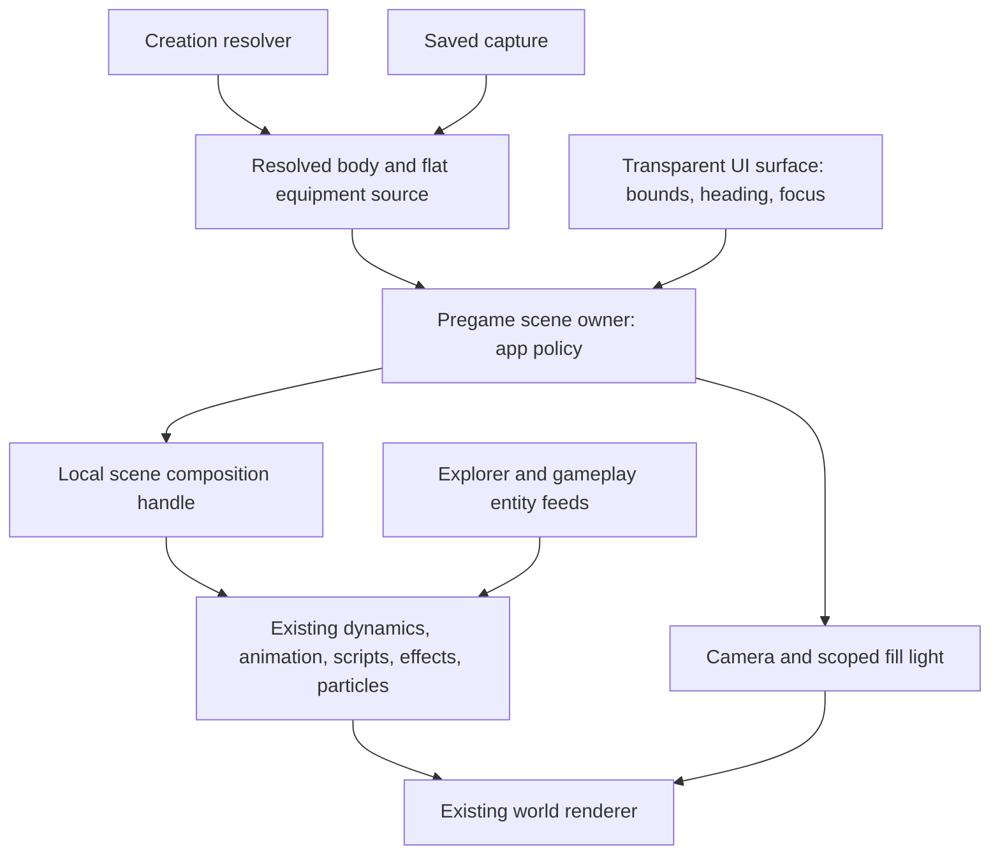

# h3d pregame character in the world scene

Status: complete. Implementation and automated verification through Phases 0–5 are complete; the user accepted the running result ("looks pretty good!"). No commits or staging were performed.

## Goal and boundaries

Render the selected or edited character inside the existing pregame world scene, with camera-based UI framing and a scene fill light, using the dynamic presentation systems already exercised by Explorer.

Accepted product decisions:

- Camera movement naturally recomposes the background, including when entering face mode.
- Characters retain their actual source scale. Framing changes camera placement, never model scale.
- Keep the overall selection/creation page layouts, allowing narrow responsive adjustments to preserve usable character space at tight heights (user approved during execution).
- Add a neutral fill light using ordinary scene lighting. It may illuminate nearby scenery. Character-only lighting overrides are not required.
- Use one fixed staging location with authored standing placement. The existing backdrop camera pose is a starting reference, not evidence of a valid standing position.
- Preserve silent character-preview playback. Environmental ambience and ordinary scenery audio continue through the existing pregame scene audio path.

In scope:

- A locally owned body and flat equipment composition in the ordinary browser scene graph, renderer, animation, effects, and particle systems.
- Existing creation and saved-character sources, including explicit idle sequences, source scale/translucency, named holding locations, and child placement poses.
- Source replacement, rotation, body/face framing, responsive camera composition, cold status reporting, and serialized pregame/gameplay retirement.
- A pregame-owned point light and complete cleanup of its lifetime.
- Focused unit tests and machine-checked browser-harness evidence; visual acceptance by the user.

Out of scope:

- Explorer catalog spawning, possession, physical simulation, server entities, or a new host scheduler.
- Protocol, cache-format, capture semantics, or character-creation rules changes.
- A new renderer, arbitrary model hierarchy, general scene editor, or simultaneous roster characters.
- Character-only lighting modes, custom projection/frustum changes, camera collision solving, cinematic transitions, or a page redesign.
- Migrating inspection to the world renderer. Its isolated canvas remains justified by its independent viewport.
- Updating completed historical plans or modifying the retail decompile.

## Ground truth and evidence

Paths below are relative to the repository root. In subsequent sections, `src/` means `apps/holtburger-3d/src/`.

| Concern                                                          | Source to inspect before changing it                                                                                                                                                     |
| ---------------------------------------------------------------- | ---------------------------------------------------------------------------------------------------------------------------------------------------------------------------------------- |
| Persistent world and serialized mode ownership                   | `apps/holtburger-3d/src/client/client-presentation-root.ts`, `ClientApp.svelte`, `client-app-lifecycle.ts`                                                                               |
| Current pregame scene demand, environment, camera, and audio     | `apps/holtburger-3d/src/client/client-pregame-backdrop.ts` and its tests                                                                                                                 |
| Selection identity withdrawal and cache reads                    | `apps/holtburger-3d/src/client/ClientCharacterSelect.svelte`, `client-character-preview.ts`, `client-visual-cache-transport.ts`                                                          |
| Creation source, face policy, and coalesced appearance requests  | `apps/holtburger-3d/src/client/ClientCharacterCreator.svelte`, `client-character-creation.ts`                                                                                            |
| Saved visual meaning and equipment capture                       | `crates/holtburger-core/src/client/object_preview.rs`, `player_visual.rs`; `apps/holtburger-3d/src/client/client-object-preview-contract.ts`                                             |
| Authored creation idle and alternate bodies                      | `crates/holtburger-content/src/character_gen/appearance.rs`; `apps/holtburger-3d/host/src/character_creation.rs`                                                                         |
| Existing local Explorer entity path                              | `apps/holtburger-3d/src/explorer/ExplorerApp.svelte`; `apps/holtburger-3d/host/src/explorer_entity_driver.rs`, `explorer_entity_runtime.rs`, `host_simulation_runtime.rs`                |
| Source-neutral dynamics, replacement, and attachments            | `apps/holtburger-3d/src/lib/game/systems/dynamic-presentation-source.ts`, `dynamic-entity-system.ts`                                                                                     |
| Scene installation, scripts, visibility feedback, and retirement | `apps/holtburger-3d/src/lib/game/runtime/game-presentation-runtime.ts`, `owner-ids.ts`, `animation-presentation-scheduler.ts`                                                            |
| Current preview playback and preparation                         | `apps/holtburger-3d/src/lib/game/preview/object-preview-{assets,composition,model-presentation,presentation,controller}.ts`                                                              |
| Scene animation and hook execution                               | `apps/holtburger-3d/src/lib/game/systems/animation-system.ts`; `animation/animation-{playback,hook-dispatch,sequence}.ts`                                                                |
| Stable fit and camera calculation                                | `apps/holtburger-3d/src/lib/game/geometry/model-fit.ts`; `renderer/object-preview-camera.ts`; `math/camera-orientation.ts`                                                               |
| Scene placement, inherited membership, and typed coordinates     | `apps/holtburger-3d/src/lib/game/scene/index.ts`, `scene-graph.ts`; `assets/ac-frame.ts`                                                                                                 |
| Point lights and scene lighting                                  | `apps/holtburger-3d/src/lib/game/environment/runtime-lights.ts`, `scene-lighting.ts`, `viewer-light.ts`; `renderer/webgl2-renderer.ts`                                                   |
| Existing diagnostic entry points                                 | `apps/holtburger-3d/src/harness/browser/PregamePreviewHarness.svelte`, `pregame-equipment-probe.ts`, `pregame-world-lifetime-probe.ts`; `apps/holtburger-3d/scripts/browser-harness.mjs` |
| Retail creation/face semantics                                   | `acclient-eor-source/acclient.c` references already recorded beside `resolve_character_gen_visual` and `creationFaceFraming`; verify those references before changing semantic behavior  |

Confirmed from source during planning (implementation changes are recorded in the phase notes):

- Explorer already renders local characters through the normal world presentation runtime, including clothing, held children, effects, and appearance replacement.
- Explorer's `PoseOnly` still installs a canonical host body and participates in its entity registry and motion tick. It is not a presentation-only model loader.
- Creation supplies one body, no separate held objects, and one UI-authored looping clip. Olthoi variants select different authored animation sets; using a setup's default motion-table idle would change behavior.
- Selection captures one body with flat direct attachments and a resolved idle prefix/cyclic tail, or setup pose. Captures omit the original motion-table identity and full entity definition.
- The browser cache bridge returns these captures directly. Sending them back to a host entity registry would add a transport/lifecycle path without a demonstrated game requirement.
- The scene runtime already has private source-neutral preparation and retirement, but public entity APIs carry authority contracts. Local admission must reuse the former without fabricating the latter.
- `AnimationSystem.stageOwner` currently stages a whole animation. The explicit captured sequence requires real preparation/playback support, not substituting its first clip.
- `DynamicEntitySystem.attachEntity` currently looks up published entities. A staged composition needs validation/linking that works before publication; invoking this after replacing the old owner would not provide failure-preserving replacement.
- `SceneGraph.destroyNode` rejects non-leaves, while dynamic owner teardown currently iterates models in input order. A linked body/child group requires child-first teardown in active retirement and every staged rollback path; merely grouping the existing calls is insufficient.
- Runtime particles and animation cadence depend on renderer-selected scene node IDs. New local nodes must participate in those ordinary feedback paths.
- Point-light shader support already exists. The runtime currently gathers object lights, and the renderer adds the viewer light separately. A pregame fill light needs a scoped input, not a shader or material mode.
- The isolated model presentation currently declines both direct-sound and sound-table hooks. The scene runtime executes both. Reusing scene effects without an explicit local-owner audio rule would change preview behavior.
- Electron currently declares a minimum outer window size of 1100 by 700 in `electron/main.ts`; this is not a guarantee of the same canvas/content dimensions. Creator/picker browser-responsive layouts and the text-scale bounds in `src/client/client-settings-values.ts` (`CLIENT_TEXT_SCALE`) also affect the available character rectangle. Positive width/height alone does not prove camera feasibility.

These are contract observations, not a census of live assets or a performance measurement. Do not invent attachment limits, body dimensions, light settings, or staging coordinates from them.

## Constraints, concessions, and north stars

1. Preserve lossless source visuals. Character and equipment scales remain independent; geometry scale must not leak into a holding frame.
2. Share scene systems with Explorer/gameplay. There is one world frame loop, effect clock, particle pipeline, visibility selection, and renderer for pregame.
3. Keep authoritative entity feeds and local presentation ownership separate. Local models do not acquire radar, map, nameplate, selection, or host-body metadata merely to satisfy an existing broad input.
4. Keep pregame policy in `src/client/`. Lower browser presentation layers own asset preparation, playback, placement, and retirement, not face-button or page-layout policy. No shared Rust crate needs frontend policy.
5. Derive prepared clips, hook dependencies, bounds, and attachment links once at their owning preparation layer. The camera consumes the installed composition's fit, not a second asset acquisition.
6. Reuse the sequence traversal already implemented by previews. Move/rename its reusable portion into the animation layer and migrate the existing preview consumer if it becomes shared; do not copy it or preserve duplicate traversal implementations.
7. Only current work publishes. Subject identity changes withdraw immediately. Same-subject appearance edits retain the last good composition until a complete current replacement is ready.
8. Root mode selection owns the resource handoff. No hot camera/heading/pose payload becomes a Svelte lifecycle dependency.
9. Fixed staging is an accepted limit. Choose and prove one standing location and its camera envelope; no collision or arbitrary placement framework is needed.
10. Missing cached appearances and failed asset loads remain explicit UI outcomes. Zero-size/hidden layout suspends subject presentation and clears stale layout demand; it does not invent a fallback rectangle.
11. No exact preservation of the old background view, fixed screen size, preview clipping planes, or neutral preview lighting is required.
12. Keep tunables together and tests independent of their current values. No claimed speedup without measurements.
13. Preserve silent local character playback at the behavior/audio boundary. Do not mute the shared audio device, modify audio preferences, or disable visual hooks to obtain silence.
14. Full character framing is guaranteed only within the proven staging/camera envelope and supported layout/source cases below. Outside it, report a local framing limitation rather than intersecting geometry, clipping the character silently, or scaling it down.

## Ownership and contracts



The runtime exposes a narrow local-composition lifetime, provisionally `LocalSceneModelHandle`. Names may change during implementation; responsibilities may not:

- Input is a body plus direct attachments, explicit root placement, and explicit source identity/revision from the pregame owner. No optional backdrop is accepted at this seam. Reuse/narrow the existing visual source type; do not clone its fields into a second wire contract.
- A handle admits replacement, immediate subject withdrawal, root placement/heading updates, suspension, and asynchronous retirement. Keep these under one owner rather than requiring the caller to synchronize several runtime setters.
- Cold status distinguishes empty/loading/ready/current failure and can retain a same-subject last-good model with a replacement diagnostic. Superseded completion is not success or a user-visible failure.
- A ready installation exposes one immutable fit in subject coordinates for the camera. Pose, transforms, device resources, and preparation leases stay private.
- Keep background-scene readiness in the existing root frame status. Character readiness/diagnostics belong to the surface handle; they never feed back into `ClientAppLifecycle` scene admission. Otherwise mounting selection would depend on a character whose source is only published after selection mounts.
- Use a typed local resource-owner identity disjoint from landblock and live entity owners. Scene-node identity, asset-generation identity, source revision, and roster GUID remain different concepts.
- Introduce explicit resolved playback at the dynamic preparation boundary. A closed policy distinguishes existing source-owned playback from an explicit sequence/setup pose. Explicit playback is exclusive: do not also activate setup default animation or a motion table. Retain setup scripts and other supported visual hooks.
- Stage every explicit clip, its frame/rate window, reachable script/emitter closure, particle meshes, setup pose, translucency, and conservative bounds before commit. Unsupported hooks fail explicitly with the same source semantics as the preview.
- The reusable sequence owns clip traversal and pose sampling; scene animation owns advancement and hook routing. No independent `ObjectPreviewModelPresentation` effect/particle runtime is embedded in the world scene.
- The local visual-composition lifetime is silent. Suppress direct-sound and sound-table hooks at the runtime's existing behavior/audio seam before starting a voice, using typed local ownership for body, children, and part targets. Treat this as deliberate suppression, not an unprepared asset or swallowed failure. Preserve normal scenery, sky, Explorer, gameplay, and environmental audio. Keep the audio subsystem free of pregame/page names; no general audio-policy framework or serialized per-model flag is needed for this display contract.
- Prepare direct attachment links against the staged body's actual holding locations and the child's placement pose. Publish the complete linked group synchronously only after validation. Existing entity attachment and local group attachment reuse the same holding/scale calculations.
- Retire all linked children before body holding-frame/visual/root nodes, for replacement, failure rollback, withdrawal, and shutdown. Resource/behavior retirement must cover every child even if earlier cleanup fails. Do not weaken the scene graph's leaf-only destruction invariant.
- Attachment entries carry no persistent item identity. Preserve a group's attachment state only when the ordered attachment source facts and holding frames are compatible; changed equipment replaces the group. Do not infer durable equipment identity from array indices or add fake GUIDs.
- The normal runtime frame performs semantic advancement, sampling, dynamic pose publication, particle submission, and draw. Preserve the existing scheduling/visibility feedback protocol.
- The pregame owner supplies one scoped fill-light list, initially empty. The runtime merges it with ordinary dynamic lights before the existing renderer budget. It is not gated by the gameplay viewer-light preference and does not change that preference.
- A suspended surface hides its body/children and their routed particles through normal presentation/visibility state while retaining prepared resources. It does not pause the world's semantic clock or introduce a preview-specific tick. Whole-app visibility continues to use the existing frame scheduler.

### Replacement and handoff

```text
same subject, appearance edit:
  keep current -> prepare all dependencies -> validate pose/links -> currentness check
  -> commit complete replacement -> retire old resources
  failure: keep last good, publish current diagnostic; retry remains possible

different subject / enter creator / begin world entry:
  synchronously invalidate and withdraw previous subject
  -> load/prepare current subject only when this page still owns it

pregame -> gameplay / retry / shutdown:
  revoke pregame surface ownership and source revision
  -> clear fill-light input and withdraw local composition
  -> join pending preparation and release staged/live local resources
  -> retire pregame scene demand using the existing root barrier
  -> install next world driver on the same renderer
```

Appearance replacement preserves phase only when source sequence identities/windows/rates and compatible setup layout permit it. Changed body/setup/sequence starts a new playback lifetime. Selection identity gating remains stricter than appearance continuity.

### Camera and UI seam

- Keep the existing grid cells and replace their canvases with a shared app-local interaction surface. Reuse current drag, pointer capture/cancellation, rotation accessibility, and keyboard-ownership behavior.
- Publish the character area's rectangle relative to the actual world canvas; do not assume viewport origin, render scale, or device pixel ratio. Observe position changes as well as size changes, including responsive reflow, text scaling, and any scrolling that can move the surface. Keep layout observation bounded and outside render-rate Svelte state.
- App policy combines the installed fit, source heading, body/face focus, full-canvas aspect/FOV, and reserved rectangle into one camera pose. Fit constraints are evaluated in the full canvas's projection, not a fictitious subcanvas.
- With symmetric perspective, solve distance and lateral camera translation so support points project into the reserved rectangle. This permits off-center UI composition without changing the projection or character scale. Unit tests independently project support points to prove containment and focus placement.
- Concrete fit construction: express support points as camera-basis offsets `(x, y, z)` from the focus, with positive `z` forward. Let the rectangle's NDC bounds be `(l, r, b, t)`, center `(cx, cy)`, and half-FOV tangents `H` and `V`. Place the camera at focus minus `forward*d + right*(cx*d*H) + up*(cy*d*V)`. Then point NDC is `((x/H + cx*d)/(d+z), (y/V + cy*d)/(d+z))`. Solve the four linear bounds for the minimum positive `d`, also enforcing `d+z >= near+clearance` for all fitted points. Apply authored margins before solving. A calculation using synthetic right-column, middle-column, and portrait rectangles confirmed containment without changing source scale; this establishes mathematical feasibility only. Production tests must use the actual projection/rotation matrices, face focus, render extent, and clipping contract.
- Reuse the existing stable body/equipment fit and heritage-specific face focus. Extract shared fit helpers only where both scene and isolated preview consume them. Fit is stable over idle playback; do not make the camera follow every animated pose.
- Recompute on installed source, heading, focus, layout, or relevant cold camera tuning changes. Fit/transform work is not repeated merely because another frame is drawn.
- Retain a world-appropriate near/far range covering the environment. Preview subject-tight clipping planes are unsuitable for the backdrop. Update camera cell membership correctly if any permitted camera position crosses a cell; preferably choose a proven envelope wholly inside the authored staging cell.
- Explicit standing placement includes legitimate spatial membership. Prove the body/equipment envelope fits its assigned staging domain, or derive the needed scopes through the existing topology queries. Copying the camera's cell onto an unrelated standing point or bypassing culling is not an acceptable shortcut.
- Place the fill light above/in front of the fixed staging spot using explicit scene coordinates. Character heading changes do not swing the light around the body. Range/intensity/color/offset belong to pregame tuning and can affect nearby surfaces.

### Supported framing domain and explicit limits

- Record the actual world-canvas and reserved-character rectangles at Electron's minimum window size, initial window size, and a wide layout, including the supported text-scale extremes from `CLIENT_TEXT_SCALE`. Derive test expectations from their owners rather than copying tunable values. Do not equate outer-window dimensions with content dimensions.
- Exercise both sides of the existing creator/picker responsive breakpoints in browser-only layouts. Existing controls remain available; character framing is supported wherever the fit is inside the proven camera envelope. There is no promise that an arbitrarily narrow positive rectangle can be framed inside a finite room.
- Define a bounded, content-validated camera envelope for the standing location, including near-plane clearance and correct cell membership. Body mode guarantees body/equipment containment; face mode guarantees the intended face-focus volume. Geometry outside the face-focus region is intentionally outside its framing guarantee; unintended near-plane cuts through the face are not accepted.
- Preflight every selectable creation body/setup and authored scale/idle, with heritage-specific face focus across full subject rotation. Include the harness's saved-capture equipment fixtures. Other saved scales or unusually large equipment remain possible: runtime fitting checks their actual support against the same domain instead of treating fixtures as an exhaustive census.
- Return a complete camera outcome: a feasible pose with validated staging residency, or a specific framing limitation. Never clamp distance to a room bound and claim containment. The app-local camera owner performs pose calculation and envelope validation together.
- When a visible surface cannot be framed safely, retain prepared resources but hide the local character group, retain a known valid environment camera, and show an explicit local message such as “Character cannot be framed in the available space.” This does not block roster actions, appearance editing, world entry, or background readiness. Re-evaluate on layout/source/heading/focus changes and recover automatically. Zero-size/hidden surfaces suspend without this message.
- All normal Electron layout/text-scale cases and selectable creation bodies must pass preflight. Failure is a scope issue to report before the runtime refactor, not an accepted fallback. Seek user steering if resolving it changes location, page layout, supported settings, or another agreed boundary. Browser-only layouts outside the proven envelope and exceptional saved captures may use the explicit limitation outcome.

## Phased implementation

### Phase 0: Prove staging and framing feasibility

Deliverables: focused camera calculations and harness diagnostics using existing source preparation, fit helpers, page layouts, and cell geometry; recorded domain/envelope evidence in this plan. No scene playback or local-composition API refactor is needed to inspect source fits and calculate proposed camera poses.

- [x] Measure the layout matrix above using actual selection/creator components and the existing Electron minimum/initial dimensions and supported text-scale bounds. Record measured content sizes.
- [x] Enumerate creation bodies/setups and resolve production visuals, scales, idles, and face focus. Inspect equipment fixtures and explicit source-scale cases without guessed asset IDs.
- [x] Choose a standing position from real geometry, calculate supported focus/layout/heading poses, and validate camera/near-plane clearance and body/equipment residency against the room. Use the expanded-domain candidate recorded below.
- [x] Expand the layout matrix to the independently supported icon-scale range in `CLIENT_ICON_SCALE`, including combinations with text scale and responsive control wrapping. This was missing from the original plan.
- [x] Prove the complete feasible/limited camera outcome in focused tests/diagnostics. Retain camera work only where it serves the final implementation; no standalone camera framework.
- [x] Record browser-only cases that fit or intentionally report a limitation. Exercise shrinking, re-expanding, and replacing an oversized source without silently rescaling or clipping the character.

Acceptance: normal Electron layout/text-scale cases and all selectable creation bodies have valid framing, or execution stops here with a concrete scope issue for user steering. Browser-only/exceptional-capture limitations are explicit and recoverable. Evidence makes Phase 3's staging choices concrete before shared presentation changes.

Execution evidence (2026-10-25):

- Added `client-pregame-camera.ts`, a pure full-canvas translation solver with explicit ready/limited/suspended results and near-plane envelope checks. Its focused tests use the actual view/projection matrices, including offset/portrait rectangles, clipping to the visible canvas, room/far-plane limitations, recovery, and near-plane corners. This is calculator support; no production scene admission has changed yet.
- The existing `--pregame-preview --brief` baseline initially failed because the creator probe still expected a removed Skin shade slider and Name label. Updated it to exercise the current Skin color palette and Character name field. The complete baseline then passed with zero browser errors, including 26 prepared creation bodies, two equipment attachments, 12 visual replacements, creator workflow, handoffs, and resource retirement.
- Measured the actual Electron window with its existing options: this Linux session enforces a minimum content extent of 1100 × 700 (reported outer 1100 × 766). The requested initial content extent remains 1440 × 900; this desktop clamps its actual initial width to 1100. Browser measurements separately covered 1440 × 900, 1920 × 1080, and both sides of the 850 px creator breakpoint. Used actual production creator/picker components, removed only showcase wrapper constraints, and applied text scales 0.75, 1, and 2 from `CLIENT_TEXT_SCALE`.
- At 1100 × 700 and text scale 2, the creator's reserved rectangle is `(left=254.796875, top=322.84375, width=438.203125, height=128.65625)`. At 1440 × 900 and scale 1 it is `(340.421875, 245.828125, 590.4375, 510.671875)`. These are observations, not constants to copy into runtime code.
- Resolved every catalog heritage/gender through production creation requests and prepared its real scale, setup, authored idle, and default outfit. OlthoiAcid is the largest case: source scale 0.6, stable support approximately 3.60 m wide and 3.25 m tall. The saved-capture-shaped Short Sword/Round Shield fixture was included separately. This does not census every hairstyle/garment or arbitrary saved capture.
- Decoded production cell `0x01380180`: structure `cell-struct:0d0000d8/0000`, six axis-aligned containment planes, a complete flat floor, and no resident objects. Its canonical scene box is approximately `x=[227,237], y=[-6,0], z=[-10477,-10467]`; the landblock-local box is `x=[35,45], y=[-6,0], z=[275,285]`. The local-to-canonical offset must still use the runtime's existing coordinate helpers when installed.
- Candidate tuning: vertical FOV 100°, yaw 330°, pitch 0°, 12 CSS px inset, and root near `(229.15,-5.82,-10474.85)`. This leaves a 0.1 m inset camera envelope inside that cell. The root's provisional 0.18 m floor offset keeps the conservative animated support above the floor; actual in-scene ground registration and composition remain tuning/visual-acceptance work, not an established appearance result. The original 75° view failed the sampled largest-body/minimum-window case even without an inset; diagonal framing at 100° passed.
- At default icon size, a production-geometry diagnostic covered 27,594 body/face/layout/heading cases including the equipment fixture. It bounded camera displacement between heading samples using the maximum derivative of the fit inequalities (1° steps for OlthoiAcid, 30° for the smaller bodies), included the complete near plane, and required a shared stage for both pages. Required relative extent was approximately `x=[-1.857,7.489], y=[-0.171,3.082], z=[-1.857,7.529]`, fitting the candidate box. A circular rotation envelope was also tried and rejected as too conservative: it combines extremal heights/widths that the actual parts never occupy together. No geometry, scale, or layout was changed to make these calculations pass.
- Browser execution of the new calculator returned ready for the candidate, suspended for a hidden surface, a limitation for a narrow surface and a 10× source, then ready again after restoring the original input. This verifies calculator recovery; surface status/visibility recovery still belongs to Phases 3–4.
- Temporary diagnostic scripts and raw output are under `/tmp/h3d-pregame-*`; these are asset-dependent investigation artifacts, not retained unit fixtures. `npm run check` passed with zero Svelte errors/warnings; focused TypeScript ESLint passed. No visual acceptance or performance claim has been made.

The original layout failed the full Phase 0 gate. A subsequent measurement included the independently supported icon size: at 1100 × 700 with text scale 2 and icon scale 2, the creator rectangle is `(254.796875,322.84375,438.203125,43.15625)`. The focus controls grow/wrap and consume the remaining character height. At 1440 × 900 the same settings leave 196.609375 px; at 1920 × 1080 they leave 452.71875 px. The original matrix missed this combination, so the restricted result above must not be read as a guarantee for all supported desktop settings.

Steering resolved: the user approved relaxing the layout constraint. `ClientCharacterCreator.svelte` now uses compact controls at desktop widths above 850 px and heights up to 900 px: hide the drag hint and decorative Body/Face/Back icons while retaining the scaled text labels and actions. At 1100 × 700 with both scales maximal, this increases character height from 43.15625 px to 199.15625 px.

The expanded Phase 0 gate now passes: measured both production pages at 1100 × 700, 1440 × 700, 1920 × 700, 1440 × 900, 1920 × 1080, and both sides of the compact-height breakpoint (1100 × 900/901). Crossed text scales 0.75/1/2 with icon scales 0.75/1/2. A 193,158-case production-fit calculation, including face focus, equipment, near-plane corners, and between-heading displacement bounds, fits with FOV 100°, yaw 335°, pitch 0°, 12 CSS px inset, and stage near `(229.03,-5.82,-10474.85)`. The relative required extent is approximately `x=[-1.857,7.820], y=[-0.171,4.778], z=[-1.857,7.310]`, inside the same cell with the 0.1 m camera inset. The narrower 85° candidate did not cover short-wide windows and was discarded. Diagnostic convex-hull reduction retained equivalent support for the linear framing constraints; it is temporary tooling, not a new runtime dependency.

Preserve these expanded scenarios in the scene harness and verify ground registration/composition with the installed model in Phase 3. The provisional floor offset and camera tuning still need user visual acceptance.

### Phase 1: Add explicit sequence playback to scene presentation

Deliverables: `src/lib/game/animation/`, `systems/animation-system.ts`, `systems/dynamic-entity-system.ts`, `systems/dynamic-presentation-source.ts`, touched source adapters, and preview sequence consumers/tests.

- [x] Add the closed playback policy and prepared result needed for explicit sequence/setup pose without changing existing authority or authored-scenery meaning.
- [x] Acquire explicit sequence assets, script/emitter dependencies, and playback/culling bounds through the existing repositories and preparation lifetimes.
- [x] Extract and reuse sequence traversal; adapt scene playback while preserving existing host-track and setup-animation behavior.
- [x] Carry complete initial pose samples through the existing staged activation gate. Extend its prepared-result classification honestly for sequences; do not pretend a sequence is a whole default animation.
- [x] Preserve crossed hooks, signed/zero rates, partial-part pose overlay, prefix/cyclic tail, authored root transforms, and compatible replacement phase.

Acceptance: focused tests independently cover prefix-to-loop transitions, multiple crossed clips, setup-pose policy, effect dependencies, and phase replacement; existing scene animation and isolated preview tests pass. One explicit sequence is sampled through normal scene animation without a private effect runtime.

Decision: source policy overrides playback only. Keep setup behavior provenance truthful; do not patch a fake animation DID into it or acquire an unrelated motion closure.

Execution notes: shared traversal is now `animation/animation-sequence.ts`; immutable fit preparation is `geometry/model-fit.ts`, with both isolated preview and scene preparation migrated to those implementations. `ResolvedModelPose` owns the shared source pose shape. `PlacedDynamicPresentationSource.playback` explicitly chooses source-owned playback or a resolved pose. Default scene/host producers retain source-owned behavior; explicit sequences do not load the setup's default animation or motion table and retain truthful setup behavior metadata.

`PreparedDynamicAnimation` classifies explicit sequences separately, with bound clips, stable fit, and conservative scene-culling bounds. The normal dynamic preparation retains all selected animation windows, animation-reachable script closures, emitter dependencies, and the setup's default script/sound-table context before publication. `AnimationSystem.stageOwner` accepts default animations or exclusive sequences; they share its semantic clock, hook router, effects, selection proof, and render sampling. Fractional sequence sampling does not mutate the semantic cursor or dispatch hooks. Host motion cannot mutate an explicit sequence. Existing seam-hook exclusions remain unchanged.

Fixed a related staging rollback defect: resource leases transfer to model records only after all effect-state installation succeeds, and failed installation drops the committed template owner. The failure test exercises the real two-model preparation path, preserving the original failure and releasing all references once. Linked child-first retirement is still Phase 2 work.

Validation: the latest focused run passed all 101 tests across scene playback, dynamic preparation, animation bounds, shared traversal/fit, isolated preview camera, and pregame camera. New cases cover explicit setup pose/idle admission without motion-table acquisition, initial full-pose publication through the normal scene path, script closure retention, failed emitter rollback, unsupported-hook replacement preserving the current owner, and multi-model installation failure. `npm run check` passed with zero Svelte errors/warnings; `npm run lint:ts` passed. `npm run harness:browser -- --pregame-preview --brief` passed with zero browser errors, 26 prepared bodies, two equipment placements, and zero remaining setup leases/creator GPU resources. This browser baseline verifies existing paths after the refactor; production local-scene admission is not claimed until Phase 2.

### Phase 2: Install and retire a complete local scene composition

Deliverables: `runtime/game-presentation-runtime.ts`, `runtime/owner-ids.ts`, a cohesive local-composition implementation under `src/lib/game/`, `systems/dynamic-entity-system.ts`, scene attachment helpers as needed, and focused tests/harness probe.

- [x] Add the typed local owner and narrow handle; the runtime retains/retire handles with its own shutdown.
- [x] Prepare the body and children together, resolving holding locations and child placement before publishing. Share the existing attachment math; staged lookup is distinct from published lookup.
- [x] Return prepared stable fit from the same resources used for rendering, including equipment and sequence coverage.
- [x] Implement latest-request replacement, immediate identity withdrawal, compatible appearance update, suspension, and joined retirement. Coalesce appearance preparation to one active/latest pending source using existing project patterns.
- [x] Make linked-group cleanup child-first in active teardown and staged rollback; audit every path that currently loops `owner.entities` or staged entities. Test the real scene graph's leaf-only invariant rather than using a mock that silently permits parent-first destruction.
- [x] Reuse visual replacement when layout/behavior are compatible. Validate children against replacement holding frames; replace the whole group when topology or attachment compatibility requires it.
- [x] Route nodes through ordinary scene visibility, animation scheduling, particle ownership, spatial membership, and lighting. Attached children inherit root scene membership.
- [x] Suppress direct-sound and sound-table hooks for typed local owners, including child/part targets, at the runtime behavior/audio seam. Test that visual hooks still execute and nonlocal owners still reach audio normally.
- [x] Prove with the browser harness that a production character with held equipment animates in the existing world scene, and that cancellation/replacement removes all local resources.

Acceptance: failed preparation or invalid holding location leaves the previous same-subject group intact; no partially linked group is drawn; late completion after withdrawal cannot reinstall; runtime shutdown joins staging. Synthetic tests cover a child failure, source supersession, setup change, independent body/child scales, suspension, and rollback/retirement of a linked group against the real scene graph. Sound-bearing fixtures prove zero local-character voices for both hook forms while visual hooks and nonlocal audio remain active. Browser evidence covers scene membership, selected nodes, advancing playback/effects, and equipment transforms.

Implementation evidence: `LocalSceneModelHandle` coalesces source work, distinguishes subject switches from same-subject edits, and joins retirement. `GamePresentationRuntime.createLocalSceneModel` owns typed local resources without host entities. Body and equipment prepare together; staged links resolve through the existing live attachment math before publication. Composition support consumes the prepared render templates and resolved holding frames. Compatible body appearance changes retain scene nodes and playback; changed playback, scales, equipment, holding frames, or topology use full group replacement. All active and staged dynamic group retirement orders actual scene leaves first and attempts all releases after a reported failure.

The runtime audio seam suppresses direct-wave and sound-table hooks by typed local ownership, including lookup through requested part frames. The inverse audio-policy index retains only local roots; normal world entities do not acquire another ownership map entry. Particles retain the ordinary scene clock, renderer feedback, and visibility policy. Runtime integration fixtures verify local silence with an audible listener, continuing texture hooks, part-attached particle submission, immediate hidden-particle suppression/resume, normal world sounds, and local cleanup leaving a world entity/emitter alive. A separate integration case proves runtime shutdown waits for an outstanding setup load and prevents late installation.

Validation: focused runtime, scene, animation, local source/lifecycle, and audio tests pass (166 tests before the final type-contract tightening). `npm run check` passed with zero Svelte warnings/errors; `npm run lint:ts` passed. The browser run in `/tmp/h3d-pregame-phase2-harness.log` passed with zero browser errors: three production models (body, sword, shield) reached the world renderer in the expected EnvCell, rendered part matrices advanced, compatible appearance retained node identities, failed preparation retained the current composition, hide/resume worked, and retirement returned scene/playback ownership to baseline. Diagnostic snapshots must follow their normal frame cadence; retirement itself is synchronous for the local scene group. This is numeric/runtime verification, not visual acceptance.

### Steering checkpoint A: Review integration before page work

- [x] Confirm Phases 1–2 use the existing scene systems, with no second particle/effect clock or invented host entity metadata.
- [x] Compare added and removed code, including preview extraction. Net additions must be explained by new scene admission and framing responsibilities rather than duplicate preparation/bookkeeping.
- [x] Walk a replacement during frame advancement and a mode switch during preparation. Recheck every retained lease and currentness guard.
- [x] Revisit the remaining scope if staging cannot preserve failure-safe group replacement or if host changes appear necessary. Resolve implementation choices from evidence; seek user input only for a changed product requirement or major scope expansion.

Checkpoint A review: scene admission, animation, setup scripts, effects, renderer selection, spatial inheritance, and particle routing use their existing subsystem owners. No new host metadata or private particle/effect clock was introduced. Replacement during playback retains body/child roots for compatible appearances; a mode exit invalidates the source request, immediately withdraws the installed group, and joins preparation before shared repositories retire. CPU setup leases transfer only after synchronous scene publication; stale preparation releases its leases and cannot publish.

The accumulated frontend diff currently adds approximately 1,520 net production lines before page cleanup, plus tests and harness evidence (renamed shared sequence/fit code included). The principal additions are explicit sequence support in ordinary dynamics, complete linked-group staging/retirement, a local model lifetime/controller, and rectangle-aware camera fitting. These are distinct missing responsibilities, not a second renderer. Keep the remaining cutover narrow; the final cleanup must reassess the total cost and remove obsolete pregame preview wiring.

Remaining-phase dry run: the persistent presentation root can lend its runtime to the pregame owner without rebuilding the device. Character status must remain separate from scene readiness to avoid gating the page that supplies its own rectangle. Before connecting the camera, replace its provisional unbranded scene-position contract with producer-branded scene coordinates. Surface ownership tokens must revoke stale page callbacks before a new surface publishes. Fill-light input must be cleared by the pregame lifetime before gameplay takes ownership. No changed product requirement or host-side expansion is needed.

### Phase 3: Compose the pregame scene, camera, and fill light

Deliverables: rename `src/client/client-pregame-backdrop.ts` and its tests to `client-pregame-scene.*`; update `client-presentation-root.ts` and immediate status consumers; add a focused app-local camera helper and pregame tuning; extend the runtime light input.

- [x] Preserve current environment, scene-demand, audio-listener, readiness, error/retry, and world-resource ownership behavior while admitting the local model handle.
- [x] Adopt the standing placement and camera envelope proved in Phase 0; recheck them with the installed scene composition. Do not derive a floor from the old camera height.
- [x] Implement full-canvas rectangle-aware camera fitting with source scale unchanged. Preserve face policy and world clipping planes.
- [x] Add a scoped point-light input, merge it into existing dynamic candidates, and clear it on all retirement/failure paths. The controller owns its tuning; renderer budget/selection remains unchanged.
- [x] Thread source/surface state through the root without making either a mode identity. Retain desired cold inputs during world construction so a mounted page cannot lose its initial source publication.
- [x] Preserve a backdrop-only scene when there is no available character. Model failures report at the character surface without unnecessarily tearing down a ready environment; world-scene failures retain existing root recovery behavior.
- [x] Keep the existing root world-ready status distinct from the local character status. Test initial loading/missing/failed character states while selection remains admitted and the world keeps rendering.
- [x] Wire the complete framing outcome: unsafe positive rectangles or source extents hide only the character and show the explicit limitation; restoring a feasible rectangle/source recovers automatically. Retain the valid environment camera while the character is hidden.

Acceptance: projection tests cover the Phase 0 domain, off-center selection and creator layouts, portrait/narrow outcomes, equipment extent, source scales, heading, face focus, and zero-size suspension. Supported cases fit inside the validated camera envelope; unsupported cases report a local limitation and recover without blocking controls or scene admission. Tuning-only edits do not require test changes. Harness evidence proves unchanged model scale, one world device, real depth participation, fill-light contribution, preserved environmental audio, silent character hooks, and cleared light input after leaving pregame. User judges composition and lighting visually later.

Implementation evidence: `ClientPregameScene` replaces the backdrop-only driver. Its model handle, camera, visibility, and point-light input retire before the persistent root admits gameplay. `ClientPregameCharacterService` retains the active page's source/view across world construction and driver replacement; outgoing surface tokens cannot mutate or clear a newer surface. World readiness remains separate from empty/loading/failed/limited character status. The scene calculates camera changes imperatively when source/layout/heading changes and publishes only changed cold status.

The camera contract now carries object-local `ModelFit` separately from a producer-branded canonical scene position and upright heading. It projects source support directly without allocating a transformed support array for every drag. It validates complete body/equipment geometry against the measured room even in face mode, then validates camera/near-plane containment in the inset camera envelope. Face framing uses a bounded focus volume with depth, preserving the intended heritage-specific center/height and world clipping planes. Unsafe requests hide the character, clear its fill light, explain the distinct limitation, and retain the last valid environment camera until automatic recovery.

The fill is an ordinary `RuntimeLight` supplied through a scene-driver input and merged with entity lights before existing renderer budgeting/selection. It does not change material lighting, audio settings, the viewer headlamp preference, or the renderer's light-selection policy. Unit coverage proves this input still reaches the renderer when the viewer headlamp is disabled.

Validation: 107 focused pregame camera/service/scene/root and runtime tests pass. The scene/root fixtures exercise initial source publication during world construction, world readiness with missing/loading/failed character assets, body/face/heading updates without source re-preparation, limitation/hidden recovery, a pending model replacement joined before gameplay starts, and immediate model/light withdrawal on a world-render failure. A temporary diagnostic rechecked 257,040 cases against 27 measured production body/equipment fits and 126 measured layouts, including both pages, all recorded text/icon scales, all supported creation bodies, face volumes, and heading sweeps. All returned ready with the implemented tuning. The temporary asset-dependent test was removed; its numeric result is `/tmp/h3d-pregame-phase3-domain.json`.

`npm run harness:browser -- --pregame-preview --brief` passed with zero browser errors; `/tmp/h3d-pregame-phase3-harness.log` records actual scene composition and lifecycle evidence. The declared production cell contains both stage and camera. Source scales remain unchanged. Frozen-time fill-light on/off readback changed 89,156 pixels; restoring the light reproduced the original image with zero differing pixels. Body/face camera movement preserved world clipping planes, tiny-layout and oversized-source limitations recovered, exact local roots and light input retired on mode handoff, and retained page intent reinstalled after pregame driver replacement. World/static residents also retire on idle, so the probe checks exact local-node ownership instead of comparing a global resident count across different scene demand.

No visual acceptance was performed. The provisional standing offset, wide-angle composition, and fill appearance still require the user's eyes after the page cutover. Phase 4 must connect surface revocation to immediate pointer-capture cancellation and layout-observer teardown, and must migrate the creator/picker showcase routes to a real world canvas rather than leaving them with a scene-only foreground.

### Phase 4: Cut selection and creation over to scene presentation

Deliverables: `src/client/ClientApp.svelte`, `ClientCharacterSelect.svelte`, `ClientCharacterCreator.svelte`, an app-local shared scene-character interaction surface, affected source/focus helpers, tests, and the existing `PregameCreatorHarness.svelte`, `PregamePreviewHarness.svelte`, and root lifetime probe consumers.

- [x] Replace both `ClientModelPreview` uses with the scene interaction surface in the existing layout cells. Keep `ClientModelPreview` for inspection.
- [x] Give each mounted surface an ownership token/handle so outgoing-page cleanup cannot withdraw the next page's character. Revoking a surface also cancels pointer capture and layout observation.
- [x] Preserve selection GUID gating, missing-cache wording, creation last-good/error behavior, request coalescing, face-mode headgear policy, and existing submit/back semantics.
- [x] Remove `previewService` prerequisites from pregame rendering/creation eligibility and props once no pregame consumer uses them. Preserve inspection's service lifetime.
- [x] Migrate the synthetic creator workflow's preview-service stub to the new surface capability, and provide a real pregame world owner in creator/picker showcase routes. Those pages currently work without a world canvas; changing component props alone would leave their user-review surfaces blank.
- [x] Route pointer-rate heading directly to the imperative pregame owner. Publish only cold controls/status through Svelte; no frame-hot camera or fit notifications.
- [x] Exercise selection -> creator -> back, selection A -> B, body -> face, rapid appearance edits, entry pending, canceled entry, retry, and shutdown.

Implementation evidence: both pages now use `ClientPregameCharacter`; pregame props and creation eligibility no longer depend on the isolated preview service. The component publishes source/focus changes as cold controls and keeps heading, pointer capture, rectangle measurement, and layout callbacks imperative. A revocation callback releases capture and observers immediately. Shared rotation input and surface/status styles now serve both pregame and isolated inspection; the unrelated window-level pointer tracker remains separate because it owns window dragging rather than captured model rotation and keyboard/ARIA policy.

The creator/cache workflow now exercises the surface capability with synthetic server/cache results, rather than allocating diagnostic preview devices. Separate real-world probes mount the production Svelte surface against `ClientPresentationRoot`, verify resize limitation/recovery, revoke an outgoing observer while a newer surface is active, unmount the outgoing page, and verify that the newer subject remains installed. The creator and picker showcase routes now construct a real persistent world canvas.

Acceptance: pages use only the world canvas for their characters; background/camera naturally recompose; no stale identity or surface can overwrite/clear the active one; original grid layouts and keyboard ownership remain intact. Focus/heading survive same-surface appearance edits without rebuilding the world owner.

### Steering checkpoint B: Verify lifecycle and UX contracts

- [x] Review ready/reveal behavior with `client-app-lifecycle.ts`: character preparation must not become a new requirement for revealing an otherwise ready selection page or entering the game.
- [x] Confirm world entry retires local models and fill lights before gameplay presentation publishes, even if pregame setup or an appearance request is still pending.
- [x] Confirm resizing/reflow changes only composition inputs, not renderer, controller, or asset-provider lifetime.
- [x] Present the running result for user visual acceptance when implementation is ready. Do not perform agent-owned visual acceptance checks.

Checkpoint B evidence: `client-app-lifecycle.ts` continues admitting selection from scene/authority readiness without a character-model barrier. The production ClientApp browser probe passed selection, creation, world reveal, and return with one world canvas and one context. The root tests prove pending source work retires before gameplay; the mounted browser surface proves resize/reflow changes composition while retaining the world owner. The user subsequently accepted the running result: "looks pretty good!" No further visual changes were requested.

### Phase 5: Cleanup and final verification

- [x] Sweep obsolete backdrop-controller symbols, tests, comments, and status names. Retain the word backdrop where it still accurately describes CSS/environment presentation.
- [x] Remove pregame-only preview wiring and dead imports/helpers. Preserve actual inspector consumers and useful independent-preview harness cases.
- [x] Update affected current architecture documentation; do not rewrite completed historical plans.
- [x] Review the final producer/consumer seams for duplicated playback, fit derivation, lifecycle state, or light policy.
- [x] Record the final diff/line impact and explain justified additions. No commits or staging unless separately requested.
- [x] Run the verification below and record exact commands/results, including missing prerequisites or remaining failures.

Acceptance: the final shape has one scene character path for pregame, existing isolated inspection still works, relevant checks pass, and any visual acceptance still pending is clearly reported.

Final verification: all 404 TypeScript test files pass (3,663 tests), `npm run check` reports zero Svelte warnings/errors, TypeScript lint and dead-code checks pass, and the production build succeeds. The build reports its chunk-size advisory; no performance claim is made. Prettier checks pass across touched frontend files. No Rust or host contracts changed, so host/clippy execution is outside this frontend-only change.

The final pregame browser run (`/tmp/h3d-pregame-phase4-harness.log`) reports zero browser errors, all 26 creation bodies admitted in body/face modes through the actual scene, 12 actual palette replacements preserving body/equipment roots, mounted production-surface resize/revocation checks, one persistent world device, and complete model/light/GPU retirement. The ClientApp run (`/tmp/h3d-pregame-client-presentation.log`) passes its production selection/creation/entry/return flow with one world canvas/context. Numeric review-route checks at 1100×700 pass at normal and maximum text/icon scales, with one context per page and no browser exceptions (`/tmp/h3d-pregame-review-evidence.json`). Those checks do not constitute visual acceptance.

The final seam review covers resolved creation/cache sources into page capabilities, surface revocation into DOM teardown, local model preparation into dynamic staging and holding frames, same-subject replacement into template/sequence preservation, scene transforms into camera projection, scene lights into ordinary renderer candidates, and root retirement into gameplay admission. Camera fitting now consumes the actual drawing-buffer aspect, including render-scale rounding, instead of re-deriving projection from CSS size. CSS size and drawing aspect share one retained invalidation snapshot. Independent projection and owner tests cover a resolution change without a source or UI-size change.

Audio evidence is deliberately attributed to its owners: the actual runtime integration fixture proves silent local body/equipment hooks, continuing visual/part-particle effects, and normal nonlocal sound. Real scene-part ownership and the audio-adapter boundary are tested independently; authored sound commands address the whole behavior target and carry no part selector. Browser runs prove normal scene execution and retained environmental audio. No nonexistent part-specific authored sound hook or artificial browser producer is claimed.

The accumulated frontend diff adds approximately 2,250 net production physical lines, 2,200 test lines, and 700 harness lines (including renamed-file accounting). The production increase pays for explicit sequence admission in ordinary dynamics, linked-group staging/retirement, local visual ownership, safe camera/framing outcomes, and page/world lifetime coordination. Shared traversal/fit and UI rotation/style extraction remove duplicate implementations; neither a second pregame renderer nor a private scene effects/particle clock remains. Shared CPU asset repositories and the isolated inspector device remain separate because their consumers/lifetimes are real. README architecture guidance is updated; historical completed plans are untouched.

Running user-review routes borrow read-only local content at port 37987 and Vite at port 45529. Creator: `http://127.0.0.1:45529/harness/browser/?pregame-preview=1&creator-showcase=1&contentHost=http%3A%2F%2F127.0.0.1%3A37987`. Picker: the same URL with `picker-showcase=1`. User review should assess standing/grounding, wide-angle composition, fill appearance, body/face focus, and drag rotation. The provisional floor offset and lighting are not visually accepted by the agent.

## Verification strategy

Run package scripts from `apps/holtburger-3d`:

- `npm run test:ts -- <focused test paths>` for sequence playback, dynamic composition/attachments, camera projection, root handoff, and pregame ownership; run the complete TypeScript suite once after the integrated change.
- `npm run check`, `npm run lint:ts`, `npm run lint:dead`, and `npm run build` after integration. Check formatting with the existing Prettier dependency against touched files; do not format unrelated files. Follow any additional required repository checks. If Rust changes become necessary after steering, include host check and clippy with warnings as errors.
- Extend `npm run harness:browser -- --pregame-preview --brief` to cover the new production scene path while retaining independent inspection proofs. Add fixture/probe cases rather than assuming the current flag already verifies this feature. Use existing viewport flags for representative wide and narrow compositions.
- Browser evidence must include actual rendered scene membership, equipment frame checks, playback progression, light on/off contribution, stale-work rejection, and teardown/resource baselines across repeated transitions. Include sound-bearing local body/child runtime fixtures beside a nonlocal audio fixture, independent real-part ownership/audio-adapter checks, and layout/source cases on both sides of the camera envelope with automatic recovery. Use machine diagnostics/readbacks; screenshots may be captured for the user's visual review, not treated as agent acceptance.
- Cover actual creation source production, multiple supported body shapes including the explicit Olthoi variants, a saved-capture-shaped source with equipment, missing capture, and synthetic malformed/canceled requests. Keep asset-dependent experiments in the harness; do not retain unit tests requiring untracked runtime assets.
- A source-level walkthrough is not runtime proof. No TUI diagnostics, real character creation, live-server mutation, or performance claims are needed for this plan.

## Risks and mitigations

| Risk                                                                      | Mitigation and evidence required                                                                                                                      |
| ------------------------------------------------------------------------- | ----------------------------------------------------------------------------------------------------------------------------------------------------- |
| Whole-animation substitution loses creation or captured idle semantics    | Explicit playback policy, prepared sequence results, independent clip traversal tests, and production-source harness coverage                         |
| Reusing broad host entity contracts adds unnecessary simulation/transport | Keep admission at browser presentation layer; no WCID/radar/physical defaults invented for display                                                    |
| Equipment links fail after the old model has retired                      | Resolve/validate staged links and complete dependencies before publication; failure test preserves old same-subject group                             |
| Group cleanup destroys a parent with attached children                    | Child-first teardown and rollback against the real leaf-only scene graph, including partially staged failure                                          |
| Sequence clips reference effects absent from the prepared closure         | Traverse all explicit clip hook dependencies through existing repositories before commit; effect-bearing fixture                                      |
| Appearance replacement preserves stale holding frames or playback         | Test setup-compatible edits and incompatible body/attachment changes; group replacement when compatibility cannot be proved                           |
| Owner retirement leaves particles or late setup work                      | Typed owner generation, normal particle routing, immediate invalidation, joined staging, repeated handoff baseline                                    |
| Camera fit uses subcanvas math or preview clipping                        | Independent full-canvas projection tests; world near/far range; no model scaling                                                                      |
| Camera leaves its cell or hits room geometry                              | Prove the fixed stage/camera envelope against content; use correct cell identity if a permitted pose crosses it; do not mask with visibility bypasses |
| Layout moves without a resize event                                       | Surface observation covers position changes/reflow/scroll as well as dimensions; resize/reflow harness case                                           |
| Page teardown clears the next page's character                            | Surface ownership token and stale-cleanup tests; root revocation at handoff                                                                           |
| Character readiness blocks mounting the page that supplies its source     | Keep scene admission and character status separate; test missing/failed/initial character with a visible selection page                               |
| Fill light disappears with viewer-light settings or leaks into gameplay   | Separate scoped local input, unchanged budget policy, on/off and retirement proofs                                                                    |
| Scene lighting is less readable than neutral inspection lighting          | Tunable fixed fill light and user visual acceptance; no unrequested character-only lighting mode                                                      |

Additional risks from the quality review:

- Scene audio routing could introduce previously silent character sounds. Suppress typed local-owner sound hooks at the existing runtime seam, proving both hook forms and unchanged nonlocal/environmental audio.
- A small positive rectangle or exceptional capture can require a camera outside the room. Prove the domain/envelope in Phase 0, before runtime changes; use a complete feasible/limited result, explicit local limitation, and automatic recovery.

## Definition of done

- [x] Selection and creation characters occupy the real pregame scene and normal depth/lighting path.
- [x] Model scale equals the source scale; supported cases frame body/equipment or intended face focus within the live UI rectangle using a projection-compatible camera pose. Unsupported cases show an explicit recoverable limitation.
- [x] Character direct-sound and sound-table hooks remain silent, including attachments/parts. Follow-up policy silences all pregame world audio while ordinary gameplay/explorer scene audio retains its behavior.
- [x] Equipment, idle clips, hooks/effects, appearance continuity, errors, and missing captures preserve the required behavior.
- [x] One scoped scene light improves readability and retires with pregame. Contribution/retirement are verified; the user accepted the running appearance.
- [x] Existing Explorer/gameplay presentation and isolated inspection retain their contracts.
- [x] Mode/page changes, failures, superseded requests, and shutdown cannot leak or resurrect a local model/light.
- [x] Tests, type checks, lint, build, and browser evidence are recorded; no unsupported performance assertions.
- [x] Obsolete pregame preview/controller wiring and vocabulary are removed.
- [x] User visual acceptance is recorded separately from automated verification: "looks pretty good!"

## Open questions and execution notes

The user accepted the running result: "looks pretty good!" The responsive creator adjustment, staging location, camera solver, scoped fill, and page cutover are implemented; automated evidence and user visual feedback are recorded separately. Constrained browser-only layouts and exceptional saved captures keep the explicit recoverable framing-limitation concession. No real server character was created or modified, and no live-server diagnostic/TUI client was run.

## Follow-up: camera preferences and silent pregame world

User feedback requested a higher body camera, independently tuned face height, and independent distance adjustments for both modes. `CLIENT_PREGAME_CAMERA_TUNING` in the client presentation layer now supplies metre offsets per focus: body height +0.6 m, face height +0.1 m, both distance offsets zero initially. Fitting recomputes camera retreat after shifting the focus; extra distance moves the camera rather than scaling the character or changing projection. Negative distance offsets stop at the minimum safe fit. Requested translations are reduced against the room/near-plane envelope and far plane, preserving supported compositions when the full preference cannot fit.

The user also clarified that all pregame world audio should be silent. This supersedes the original environmental-audio preservation decision above. The pregame scene withdraws the runtime audio listener immediately on construction and never installs one while framing or rendering; normal gameplay/explorer listener ownership remains unchanged. Existing local-model sound-hook suppression remains useful for local models outside this particular driver.

Focused camera/scene/runtime tests pass. A temporary asset-dependent diagnostic checked 257,040 body/face, heading, and measured responsive-layout compositions against retained production hulls; it passed and was removed. The real WebGL browser pregame suite passed with `pregameWorldAudioSilent: true`, normal outdoor audio playback, successful mode handoffs, and no browser errors. Type checks and TypeScript lint passed; dead-export validation was corrected by giving the offset contract a named tuning consumer. Appearance remains subject to user review; no agent visual acceptance was performed.

## Follow-up: trust authored scene locations

The user supplies deliberately safe character and camera placements. This supersedes the room-envelope requirements and camera-offset clipping policy recorded above. Removed staging/camera clearance boxes, full-body room admission checks, near-plane room checks, room-related limitation messages, and the baseline/preferred-pose interpolation mechanism. Height offsets now participate directly in a single framing pass. Extra retreat is constrained only by the normal world far plane; hidden/undersized surfaces and near/far projection checks remain. Source scale, local model lifetime, page observation, fill lighting, and audio policy remain owned by their existing layers.

Removed tests and browser assertions that preserved room-clearance policy, including the artificial tenfold-scale rejection fixture. Focused camera/scene/root tests pass (37 tests). Full app/test/Electron type checks, TypeScript lint, and formatting passed. The real WebGL pregame suite passed with all 26 creation bodies, silent pregame world audio, lighting readbacks, mode handoffs, and no browser errors. The multiple-location array and launch-time scene selection remain subsequent work; no location coordinates or camera orientation policy were changed in this cleanup.

## Follow-up: multiple authored pregame locations

Added the two user-supplied compositions to `CLIENT_PREGAME_SCENE_TUNING.locations`, preserving the exact player AC frames and scene camera poses. The client app chooses one uniformly at component startup and passes it explicitly to the presentation root. All pregame driver replacements reuse that entry, including page changes, retries, and gameplay returns. There is no persistence across app launches.

Each entry owns a landblock, a character cell/AC frame, and a separate camera cell/scene pose. The scene resolves standing position and upright heading once through the existing AC frame conversion. Camera framing retains the entry's normalized camera rotation instead of replacing it with global yaw/pitch. Removed the old provisional standing lift and fixed yaw/pitch tuning. Shared FOV, offsets, fill light, and calendar policy remain shared. Authored locations remain responsible for environmental clearance.

The browser harness accepts `--pregame-location <index>` and standalone review URLs accept `&pregame-location=<index>`; these select a deterministic fixture without changing production random selection. Local-model probes use the selected location instead of hardcoded first-room coordinates. Focused tests pass (44), including random draw boundaries, AC-to-scene placement, separate character/camera cells, and location retention through gameplay and retry. Type checks and TypeScript lint pass; the first location passed the complete browser suite. The second initially exposed stale camera visibility membership: its 512×512 fitted camera at approximately `(18469.343, 1.773, -12951.594)` was contained in cell `0x5f4401a3` while still declaring `0x5f4401a4`. The existing scene candidate query now updates the fitted camera to a unique containing cell; ambiguous/missing topology retains the explicit authored cell. This does not constrain motion or restore room-clearance checks. The corrected second-location suite passed: all 26 creation bodies, body/face framing, reproducible fill-light contribution (38,671 changed pixels), silent pregame world audio, normal outdoor audio, mode handoffs, and no browser errors. Both authored locations passed the full browser suite. No agent visual acceptance was performed.

## Follow-up: camera-relative preview facing

The user reported that characters began facing away from the camera. Location support had used the authored player quaternion as the base heading, replacing the earlier camera-relative presentation policy. AC characters face local +Y (scene -Z); the supplied near-identity player rotations therefore faced away from the supplied cameras. Preview heading now derives from the normalized scene camera's horizontal forward direction, with the configured initial preview yaw and user drag applied on top. This restores the intended front/three-quarter presentation while preserving the scene camera pose and standing position.

Removed player quaternion fields from location tuning rather than retaining ignored configuration. Character location entries now contain a cell ID and branded AC position; camera entries still contain their scene orientation. Focused tests verify model forward against the camera viewing side for both configured locations, and that drag remains relative to that base. All 44 focused tests pass. Full app/test/Electron type checks and TypeScript lint passed. The real WebGL suite for the second location passed all 26 creation bodies, framing, fill-light readback, audio, and mode handoffs with no browser errors. No agent visual acceptance was performed.

## Follow-up: face the actual fitted camera

The user screenshot showed that the previous fix still produced a side view. Aligning to the camera's optical axis ignored the lateral translation introduced by an off-center UI rectangle; reusing the inspector's initial yaw added a further 0.65 radian turn. The earlier axis-based assertions were insufficient to establish facing toward the actual camera position.

The camera solver now owns the complete composition decision. It derives the character's heading from the reserved rectangle's camera ray, then uses that same ray for camera placement. The horizontal camera-to-focus direction is independent of fit distance, so this remains one pass. Its ready result carries the resolved heading; scene placement reads that fact instead of deriving another heading. Removed the installation-time base-heading state. Drag remains a relative yaw offset. Pregame now owns a separate `initialYawRadians` tuning value, initially zero; isolated inspection retains its existing preset.

Projection tests now include the returned model transform, and off-center layout cases independently compare model forward against the actual camera-to-focus direction. Scene integration tests perform the same check for both locations and retain relative drag coverage. The browser harness checks the applied model placement for centered, off-center, and face compositions and verifies the mounted surface consumes the pregame initial-yaw tuning. Focused tests pass (44), along with full app/test/Electron type checks, TypeScript/dead-code lint, and formatting. Both concurrent browser runs reached the harness 120-second deadline without an assertion failure. Both locations passed when rerun separately, each reporting `cameraFacingVerified: true`, all 26 creation bodies, and no browser errors. Visual acceptance remains with the user.
