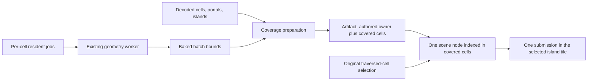

# h3d staircase disappearance and static batch cell coverage

2026-10-27. **Complete: correction implemented, automated verification passed, and user visual acceptance received.**
The staircase extends outside its owning cell. Conservative coverage of existing
baked batches now registers it in neighboring cells before scene publication.
The failing pose adds one submitted draw and 218 triangles over owner-only
selection, instead of admitting the whole island's static decoration.

This working document tracks the diagnosis, implementation, evidence, decisions,
and acceptance. Historical experiments remain in the evidence ledger;
the progress table and DoD describe the current implementation.

## Goal and boundaries

Keep the reported staircase selectable when its owning cell's doorway is behind
the camera, while limiting added submissions to geometrically relevant batches.

In scope:

- The two reported Facility Hub camera poses and static residents spanning cells
  within a proven depth-continuous render island.
- Conservative, camera-independent render coverage of existing baked batches.
- h3d preparation, artifact contracts, scene indexing, and static tile routing.
- Submitted draw and triangle accounting, focused tests, and browser-harness proof.
- Removal of the island-wide admission experiment after its replacement is proven.

Out of scope:

- Exact gameplay/collision membership, movement, camera collision, and server policy.
- Shared-crate refactors, HBEC format changes, or a new per-object wire contract.
- Coverage across topology boundaries, exterior transitions, or different landblocks.
- Splitting batches or introducing a new geometry strategy without submitted-work
  evidence that the existing batch is too coarse.
- Shader changes, UI controls, timing benchmarks, and agent-owned visual acceptance.

The user authorized the investigation, implementation, cleanup, final quality
review, and commit, and requested a tracking document with a plan and DoD.
The pre-existing modified `ACE` submodule is outside this feature's changes.
Do not run the TUI or modify the retail decompile.

## Progress

| Work                                                       | Status                                 | Evidence / next action      |
| ---------------------------------------------------------- | -------------------------------------- | --------------------------- |
| Diagnose ownership and cell selection                      | Complete                               | E1–E3                       |
| Measure island-wide experiment                             | Complete; production expansion removed | E4–E5                       |
| Survey content and define coverage                         | Complete for five selected landblocks  | E6, E8                      |
| Publish required batch coverage and restore cell selection | Complete                               | E9; Phases 1–2              |
| Attribute submissions and probe camera transitions         | Complete                               | E10; Phase 3                |
| Tests, type checks, lint, and cleanup                      | Complete                               | E11; Phase 4                |
| Visual acceptance                                          | Complete, user-confirmed               | User response: “looks good” |

## Reproduction and coordinate conventions

The player is unchanged between the reported frames:

```text
Player(AC) cell=0x8a0201c8 pos=(60.715, -71.719, 1.355) quat(wxyz)=(0.9998, 0, 0, -0.0202)
```

Disappearing staircase:

```text
Camera(scene) lb=0x8a02ffff cell=0x8a0201c8 pos=(26556.624, 2.634, -310.044) quat(wxyz)=(0.9997, 0.016, -0.0202, 0.0003)
```

Visible staircase:

```text
Camera(scene) lb=0x8a02ffff cell=0x8a0201c9 pos=(26556.553, 5.208, -308.627) quat(wxyz)=(0.9551, -0.2954, -0.0212, -0.0066)
```

AC coordinates are Z-up. Canonical scene coordinates are Y-up with inverted AC Y
on scene Z. EnvCell resident frames are landblock-local placements; the owning
EnvCell does not provide an additional parent transform.

The corrected harness captures use scene positions and approximate angle
conversions of the supplied, rounded quaternions:

| Pose         | Harness yaw | Harness pitch | Cell         |
| ------------ | ----------: | ------------: | ------------ |
| Disappearing |     +2.315° |       +1.834° | `0x8a0201c8` |
| Visible      |     +2.543° |      −34.376° | `0x8a0201c9` |

`createCameraRotationRadians` uses the inverse mathematical quaternion Y-axis sign
for positive renderer yaw. Earlier captures used negative yaw; they are excluded
from the accepted work-count comparison below.

The saved captures use the harness projection: **1280×720, 90° vertical FOV,
near 0.5, far 2000, render scale 1**. These are not proof of the user's projection
settings. The current client defaults are 75° FOV and near 0.1. E10 also verifies the client-default projection and records its actual inputs.

## Ground truth and architectural neighborhood

| Layer                     | Source / symbol                                                                                                 | Relevance                                                                                                           |
| ------------------------- | --------------------------------------------------------------------------------------------------------------- | ------------------------------------------------------------------------------------------------------------------- |
| Retail behavior reference | `acclient-eor-source/acclient.c:333837`, `CEnvCell::init_static_objects`                                        | Static objects calculate cross-cell reach.                                                                          |
| Retail behavior reference | `acclient.c:310527`, `CPhysicsObj::calc_cross_cells_static`                                                     | Selects cylinder or part-bound traversal and installs cell shadows.                                                 |
| Retail behavior reference | `acclient.c:306606`, `CPhysicsObj::find_bbox_cell_list`                                                         | Expands the touched-cell list through placed parts.                                                                 |
| Retail behavior reference | `acclient.c:334302`, `CEnvCell::find_transit_cells` part overload                                               | Portal-side and target-cell intersection tests.                                                                     |
| Shared content            | `crates/holtburger-content/src/interior.rs`, `LandblockEnvCell`, `LandblockIndoorObject`                        | Authored ownership, cell placements, and static source references.                                                  |
| Shared spatial semantics  | `crates/holtburger-world/src/spatial/collision.rs`, `part_box_membership`, `static_reached_cells`               | Existing retail-inspired traversal to consult; collision-shaped inputs are not a complete render-coverage contract. |
| h3d host adapter          | `apps/holtburger-3d/host/src/env_cell_source.rs`                                                                | Projects cell geometry, portals, residents, and island facts into HBEC.                                             |
| h3d decode/preparation    | `src/lib/assets/decode-env-cell-record.ts`, `src/lib/game/commit/env-cell-materialization.ts`                   | Existing decoded bounds, topology, and per-cell resident jobs.                                                      |
| h3d geometry preparation  | `src/lib/game/commit/static-object-geometry-worker.ts`                                                          | Bakes each current EnvCell resident job into an independently bounded batch.                                        |
| h3d realization           | `src/lib/game/runtime/env-cell-realization.ts`, `EnvCellGeometryPreparer.prepare`                               | Has the complete plan and completed resident artifacts together before publication.                                 |
| h3d artifact/installation | `src/lib/game/commit/artifacts.ts`, `static-object-artifact.ts`, `src/lib/game/systems/static-object-system.ts` | Typed placement, immutable resources, and scene-root creation.                                                      |
| h3d scene index           | `src/lib/game/scene/scene-graph.ts`, `SceneSpatialMembership`                                                   | Already indexes a node under several cells and deduplicates query results.                                          |
| h3d renderer              | `src/lib/game/renderer/portal-scope-window-culler.ts`, `portal-scope-atlas-planner.ts`, `webgl2-renderer.ts`    | Traversed cells, selected islands, tile lookup, and final submissions.                                              |

Paths beginning `src/` above are relative to `apps/holtburger-3d/`.
Retail is the client-behavior reference; ACE remains the project's server/protocol
ground truth. The proposed batch query is a conservative rendering approximation,
not a claim to reproduce complete retail object membership.

## Evidence ledger

### E1. A separate mesh spans the cell boundary

The local archive identifies staircase setup `0x02000623`, containing one mesh
`0x0100189e`. The reported instance belongs to `0x8a0201c9`, placed at AC
`(60, -80, 0.005)` with approximately 180° yaw.

Its transformed AC bounds are approximately:

```text
X = [55, 65]
Y = [-85, -69.6]
Z = [0.005, 6.005]
```

The boundary with `0x8a0201c8` is AC Y = −75. The staircase extends about **5.4 m**
into that neighbor. Both cells list each other as potentially visible.

### E2. Portal traversal can legitimately omit the owner

In the disappearing pose, the doorway to `…1c9` is behind the camera while part of
the stairs is in front and underneath it. CPU replay omitted `…1c9`; using `…1c9`
as the camera root retained it. The cells share a proven render island.

The failure is the assumption that all static geometry owned by an untraversed
cell can be omitted. This is not evidence of a malformed PVS entry or a shader
failure.

### E3. Ownership is baked into the current publication path

`planEnvCellMaterialization` creates a resident job per owning cell.
`prepareStaticObjectGeometry` merges that job's static residents into a batch.
`assembleStaticObjectArtifact` assigns the owning EnvCell to its placement.
The scene query previously enumerated only traversed cells.

The renderer also cached the authored owner as the batch's render scope. Scene
admission and tile lookup both need to accommodate an owner whose same-island
geometry is admitted through another cell.

### E4. Island experiment and course corrections

The historical experiment added a topology-owned index of island members and a
reused frame buffer enumerating complete selected islands. Tile lookup resolves
any member of a selected island, even when that cell is absent from traversal.

An initial expansion admitted room shells and actors too. It was narrowed with
`renderPortalCullingGroupFilter` so only `env-cell-static-residents` receive island
expansion; shells and actors retain traversed-cell admission.

The experiment restores admission but adds many unrelated decoration batches.
Its island enumeration and special group-filter plumbing have been removed from
production. After visual acceptance, historical policy replay was also removed
from the harness; its comparison evidence remains preserved in this document.

Early runtime attempts also exposed a harness setup requirement: Facility Hub
scene interest must be rooted at its interior cell. Using the outdoor landblock
target did not establish the required dungeon root for the probe.

Timing runs were performed during exploration. The user explicitly redirected
verification to **work submitted**. Timing values and repeated timing samples
are excluded from the acceptance evidence and future plan.

### E5. Corrected same-pose submitted-work comparison

Preserved evidence: [submitted-work.json](evidence/h3d-static-cell-coverage/submitted-work.json).
Each historical comparison switched the harness scene query between traversed-cell
admission and the island experiment at one unchanged pose. This replayed the earlier
admission policy in the investigation build; it was not a separate old-binary capture.

| Pose         | Policy           | Static draws | Static triangles | Resident draws | Shell draws | Dynamic draws | Portal propagation draws |
| ------------ | ---------------- | -----------: | ---------------: | -------------: | ----------: | ------------: | -----------------------: |
| Disappearing | Traversed cells  |           27 |              746 |              8 |          19 |             8 |                        1 |
| Disappearing | Island residents |          119 |            3,682 |            100 |          19 |             8 |                        1 |
| Visible      | Traversed cells  |           35 |              928 |              8 |          27 |             8 |                        0 |
| Visible      | Island residents |          129 |            3,782 |            102 |          27 |             8 |                        0 |

The staircase owner's static node is absent before and present after in the
disappearing pose; it is present under both policies in the visible pose. Both
poses keep 11 visible cell shells and 4 visible dynamic entities. Browser errors
were empty. These are admission/submission results, not visual acceptance.

### E6. Sparse conservative crossing candidates

Preserved evidence: [preliminary-census.json](evidence/h3d-static-cell-coverage/preliminary-census.json).
This historical export used an older prebuilt diagnostic binary and included
279 Facility Hub cells. The current rebuilt exporter includes 568 cells; see E8.
Production decoding and materialization were used for the original subset.
The batch pass also executed the production static geometry preparer.

| Quantity                                       | Count |
| ---------------------------------------------- | ----: |
| Static residents after behavior classification |   188 |
| Residents without bounds                       |     0 |
| Resident bounds flagged by the candidate test  |     9 |
| Nonempty existing baked batches                |    69 |
| Batch bounds flagged by the candidate test     |    10 |

The test checks an AABB against the accepted side of an owning-cell portal plane,
then checks overlap with the immediate target's AABB, using tolerance 0.0002.
It does not perform recursive traversal or exact target-hull intersection.
It excludes exterior targets. These counts establish local candidate sparsity;
they do not establish archive-wide frequency or exact membership.

The staircase batch in `…1c9` contains **7 static residents, 4 draw ranges, and
218 baked triangles**. Its first-hop candidates are `…1c8` and `…0211`. The
staircase mesh alone has 146 source triangles. Range counts are not necessarily
final draw-call counts after renderer compilation.

Batch bounds also flag an extra candidate owner (`…015e`) beyond the resident
candidate owners. This is a concrete reason to track conservative over-admission
when choosing the batch as the visibility unit.

### E7. Historical checks for the island experiment

- `npm run test:ts -- src/lib/game/renderer src/lib/game/scene`: 92 files,
  **732 tests passed**.
- `npm run check`: passed; Svelte reported zero errors and warnings.
- `npm run lint:ts -- --no-cache`: passed.
- `npm run lint:dead`: passed.
- Scoped formatting and `git diff --check`: passed.

These results apply to the island experiment. E11 records replacement checks.
No visual acceptance has been performed or claimed.

### E8. Current production coverage census

Preserved evidence: [coverage-census.json](evidence/h3d-static-cell-coverage/coverage-census.json).
The current worktree exporter and production geometry preparation/query ran on
five deliberately selected landblocks. These are sample counts, not archive-wide
frequency or percentile claims.

| Landblock                 | Cells | Batches | Batches covering neighbors | Maximum covered cells |
| ------------------------- | ----: | ------: | -------------------------: | --------------------: |
| Facility Hub `8a02`       |   568 |     145 |                         30 |                     7 |
| Seam sample `d599`        |    78 |      15 |                          7 |                     6 |
| Seam sample `d699`        |    44 |       2 |                          2 |                     5 |
| Building interiors `da55` |   251 |      87 |                         27 |                     6 |
| Dense interior `00d1`     | 4,213 |   1,853 |                        525 |                     9 |

Facility has 351 rotated cells and 14 cells whose point-containment hull is null;
all 14 have shell bounds for the explicit conservative fallback. No sampled cell
has empty containment planes or missing shell bounds. Other samples have no null
point hulls. Where containment planes exist, those planes take precedence over
shell bounds: rendered shell extents are not necessarily containment-hull bounds.

The staircase batch covers `…1c9`, `…0211`, `…1c8`, `…0210`, and `…0214`.
Its seven residents, four source ranges, and 218 source triangles remain one
existing batch. Larger reach is bounded in this sample and does not justify
splitting batches given E10's actual submission attribution.

The E6 denominator changed because its older prebuilt exporter predates the
current loader's inclusion of archived cells beyond the LandblockInfo-declared
range (`crates/holtburger-content/src/landblock.rs`). The archive hash is unchanged.
The evidence records this provenance difference; E6 is not the final census.

### E9. Implemented preparation and publication contract

`commit/static-batch-cell-coverage.ts` owns a reusable topology index and resolves
each finalized batch independently. It transforms the batch bounds once, retains
the owner, and traverses only ordinary depth-continuous neighbors in the same
landblock and proven island. Portal-side support and target containment-plane
separation tests conservatively admit bounds; traversal is cycle-safe. This is
conservative half-space rejection, not an exact polyhedron intersection solver.
`PORTAL_QUERY_EPSILON` admits boundary contact. Null point hulls use explicit shell
bounds; malformed or missing required inputs fail loudly.

`StaticObjectArtifact.placement` requires `SceneSpatialPlacement`. The generic
assembler records known owner membership; `EnvCellGeometryPreparer.prepare`
enriches it with final coverage after geometry preparation and before publication.
`StaticObjectSystem` already forwards the composite placement. One node is indexed
under covered cells with existing query deduplication; ownership, resources, and
revision lifetime remain unchanged.

Production queries again enumerate traversed cells. Complete-island enumeration,
its buffers/member index, and the special group-filter contract are removed.
Tile lookup retains the necessary correction: an untraversed owner can resolve
to its selected island's tile, while an unselected island cannot. Shared crates,
physics membership, Rust, HBEC, and batch geometry strategy are unchanged.

### E10. Final submitted-work and transition proof

Preserved evidence: [batch-submitted-work.json](evidence/h3d-static-cell-coverage/batch-submitted-work.json).
Each historical row compares three policies at one unchanged camera pose, viewport,
and projection. The replay code was removed after acceptance; the preserved results
remain the record of that comparison. Static counts include shells and residents, as in E5.

| Projection             | Pose         | Owner-only draws / triangles | Island draws / triangles | Batch draws / triangles |
| ---------------------- | ------------ | ---------------------------: | -----------------------: | ----------------------: |
| Harness 90° / near 0.5 | Disappearing |                     27 / 746 |              119 / 3,682 |            **28 / 964** |
| Harness 90° / near 0.5 | Visible      |                     35 / 928 |              129 / 3,782 |            **35 / 928** |
| Client 75° / near 0.1  | Disappearing |                     26 / 744 |              100 / 3,150 |            **27 / 962** |
| Client 75° / near 0.1  | Visible      |                     33 / 850 |              119 / 3,455 |            **33 / 850** |

At each disappearing pose, the sole additional owner is `0x8a0201c9`:
**one submitted draw and 218 triangles**. Four source ranges compile to that one
additional draw; source ranges and final submissions are distinct quantities.
The visible poses submit no additional work over owner-only selection. Shell,
dynamic, and portal work is identical within each paired comparison. Browser
errors and lost reference traversal scopes are empty.

The probe derives yaw/pitch from the supplied rounded quaternions and checks
reconstruction against normalized inputs. Maximum component errors are
`2.33e-5` and `4.31e-5`, below its `1e-4` rounding tolerance.
Nine forward/reverse interpolated camera positions at client defaults cross
between `…1c8` and `…1c9`; all admit the staircase with no lost reference scopes.
This proves admission and submissions, not rendered appearance.

Reproduce from the repository root (requires the local archive):

```sh
HOLTBURGER_DATS=/home/cluracan/code/holtburger/dats/assets.hba cargo run -q -p holtburger-3d-host --bin portal_trace_archive -- 0x8a02ffff 0xd599ffff 0xd699ffff 0xda55ffff 0x00d1ffff > /tmp/h3d-static-cell-coverage-trace.json
```

Then from `apps/holtburger-3d`:

```sh
npm run probe:static-cell-coverage -- /tmp/h3d-static-cell-coverage-trace.json
HOLTBURGER_PROBE_PORTAL_TRAVERSAL=1 HOLTBURGER_PROBE_PORTAL_GEOMETRY=1 npm run harness:browser -- --content /home/cluracan/code/holtburger/dats/assets.hba --landblock 0x8a0201c8 --env-cell-camera 0x8a0201c8 --env-cell-position 26556.624,2.634,-310.044 --camera-yaw 2.315 --camera-pitch 1.834 --frame-mode portal --gpu --settle-ms 2500 --render-scale 1 --brief
```

The retained geometry probe runs production selection at both projections, both
poses, and the transition sequence. It checks staircase admission and reference
portal retention, records submitted-work counters, and restores the initial camera.
It no longer recreates the rejected owner-only or whole-island policies.
The `--gpu` flag requests the WebGL renderer; no timing benchmark is involved.

### E11. Replacement checks

- Relevant preparation, runtime, systems, renderer, and scene tests: **138 files,
  1,353 tests passed**.
- `npm run check`: passed, with zero Svelte errors or warnings.
- `npm run lint:ts`: passed.
- `npm run lint:dead`: passed. Scoped formatting and `git diff --check`: passed.
- Synthetic coverage tests include recursion/cycles, boundary contact, independent
  queries, rotated hulls, AC axes, nonidentity placement, coarse batch bounds,
  null-hull fallback, topology exclusions, and invalid contracts.
- Scene lifecycle regression covers neighbor admission, deduplication, replacement,
  stale eviction, and complete removal. Runtime-asset probes remain diagnostics.

### E12. Post-acceptance experiment cleanup

Removed the owner-only and whole-island replay branches, their policy state and
report field, and the comparison-specific assertions. The retained probe observes
production selection, asserts staircase admission and reference scope retention
for every capture, and records submitted work. The coverage unit tests, census,
and historical evidence remain intact. Production rendering behavior is unchanged.

[cleanup-regression.json](evidence/h3d-static-cell-coverage/cleanup-regression.json)
records four pose/projection cases and nine transition positions from the simplified
probe. All pass, with no browser errors. Submitted static work matches E10's batch
policy in all four cases. Type checking, TypeScript lint, dead-code lint, scoped
formatting, and `git diff --check` pass after cleanup.

### E13. Final code quality review

**Verdict: ready within the reviewed scope.** Review baseline is the feature's
accumulated diff against `d64f31c7ef476805da4582d93ffca6eeb89bc270`, including new
files, test changes, harness entry points, and all investigation evidence. The
unrelated ACE submodule revision is excluded. No unresolved production ownership,
contract, or lifecycle findings remain.

One bounded diagnostic defect was corrected: `runStaticCellCoverageProbe` allowed
an outdoor starting camera even though its cleanup could only restore an EnvCell
camera. It now requires an interior Facility Hub camera before making changes and
always restores that accepted camera in `finally`. The client projection is also
named directly rather than recovered through an asserted array index.

| Inspected seam                                       | Producer guarantee and consumer use                                                                                                                                                                    |
| ---------------------------------------------------- | ------------------------------------------------------------------------------------------------------------------------------------------------------------------------------------------------------ |
| Geometry worker → static artifact assembler          | Independently bounded baked objects retain authored ownership; root placement is identity because vertices are already landblock-local. Outdoor artifacts receive explicit outdoor membership.         |
| EnvCell preparer → runtime publication               | Final bounds and complete topology meet before publication; resolved coverage stays on the composite placement. Existing geometry and texture namespaces remain revision-owned.                        |
| Runtime realizer → environment/static systems        | Currentness checks reject stale async results; environment replacement rolls back if static staging fails. Exact removal and eviction continue to own cleanup.                                         |
| Static system → SceneGraph → RenderWorld             | Installation forwards membership; the scene copies/validates it, indexes one node under covered cells, deduplicates queries, and removes all entries on replacement/removal.                           |
| Portal visibility → atlas/static and dynamic routing | Cell traversal controls admission; a selected island provides tile lookup for any member. Unselected islands return null; atlas retreat and deferred-view reuse tests cover invalidation.              |
| Harness command → camera/probe → report              | Dynamic entry points remain harness-local. Camera projection is explicit, capture checks staircase admission and reference scope retention, and reports distinguish source ranges from submitted work. |

Consolidation review retained the existing plural scene membership and node
lifetime rather than introducing another index or owner. The new batch-bound
query remains in h3d preparation: point containment has different guarantees,
and testing whether any corner is inside would miss real box/hull intersections.
Frustum rejection also has a different coordinate and tolerance contract; sharing
an abstraction would add adapters without consolidating an owned decision.

Accepted concessions remain conservative batch bounds and coverage restricted to
proven same-island seams. The five-landblock census is not archive-wide assurance.
No visual acceptance was repeated by the agent; the user's prior acceptance
stands. The retail decompile, shared physics, and unrelated UI/runtime subsystems
were not changed or reviewed wholesale.

Final verification after the review fix: 138 relevant test files / 1,353 tests pass;
`npm run check`, `npm run lint:ts`, `npm run lint:dead`, scoped Prettier checks, and
`git diff --check` pass. The browser probe again passes four pose/projection cases
and nine transition positions with no browser errors or lost reference scopes.
Static submissions match E10's batch results and the starting camera is restored.

## Constraints, concessions, and guiding decisions

1. **Ownership and visibility are separate facts.** The authored cell continues
   to own the batch and its resource lifetime. Coverage adds scene-index entries.
2. **Compute coverage once before publication.** Camera updates consume the stored
   scopes. The scene query and validators do not repeat geometric traversal.
3. **Keep render coverage in h3d preparation.** The input is baked render geometry
   and decoded h3d topology. Shared world collision membership remains authoritative
   for its own consumers and is not changed by this approximation.
4. **Preserve current batches initially.** A batch's siblings may accompany its
   staircase. This conservative over-admission is the proposed concession to test;
   splitting is a later decision supported by submitted-work attribution.
5. **Stay within proven render islands.** Boundary, exterior, and cross-landblock
   coverage are not silently inferred. Keep the owner and document such limits.
6. **Never expand portal traversal to admit geometry.** Additional batch coverage
   does not add crossings, raise traversal limits, or grow atlas frontiers.
7. **Deduplicate by the existing scene and island mechanisms.** A batch reached
   through two selected cells in one island is submitted once.
8. **Use submitted work as the acceptance signal.** Report draws, triangles,
   candidate batches, and their identities. Do not use GPU time as a decision gate.

## Flow and contracts



`EnvCellGeometryPreparer.prepare` holds completed batch artifacts and the complete
materialization plan. It invokes the app-local `commit` coverage helper before
merging/publication; the worker's geometry algorithm remains intact.

Inputs share the **landblock render frame**. Worker-baked interior positions and
bounds already use that frame; their static artifacts use an identity placement.
The helper applies the artifact placement once. A synthetic nonidentity-placement
case protects against accidental double transformation.

The query starts at the owner, visits eligible same-island neighbors, and returns
a deduplicated coverage set. E9 specifies the containment-plane and null-hull
rules. The final `SceneSpatialPlacement` carries complete coverage into the scene
index through the existing installation path; it is a required contract, not an
optional field with an implicit ownership fallback.

## Phased plan

### Phase 0 — Diagnosis and exploratory evidence: complete

- [x] Prove the separate staircase mesh, authored owner, and cross-cell extent.
- [x] Trace owner omission through CPU cell selection and static publication.
- [x] Implement and test the island experiment.
- [x] Correct harness scene interest and yaw, then capture submitted work.
- [x] Record preliminary resident and batch candidate distributions.
- [x] Preserve compact evidence and current limitations in this document.

### Phase 1 — Define and prove conservative batch coverage: complete

Deliverables: a pure h3d preparation helper with synthetic tests, a reproducible
candidate/coverage diagnostic, and a settled artifact attachment contract.

- [x] Define owner, batch bounds, same-island adjacency, target hull, and output
      coverage inputs without dependencies on a running collision scene or camera.
- [x] Specify portal-side signs, transformed bounds, tolerance, and the treatment
      of missing or portal-less containment hulls from actual content and references.
- [x] Include the owner, deduplicate cycles, and stop at island/exterior boundaries.
- [x] Test contained, protruding, recursive three-cell, cyclic, rotated/oblique,
      and boundary cases. Include conservative batch over-admission as a named case.
- [x] Re-run Facility Hub coverage on all 145 currently exported nonempty batches. Preserve batch ids,
      reached cells, and source/range triangle counts separately from GPU submissions.
- [x] Add a small, explicitly chosen sample of varied interiors where the helper's
      assumptions need proof. State the sample denominator; make no p99 claim.
- [x] Settle the producer and required final artifact type before wiring consumers.

Acceptance: synthetic cases pass; the `…1c9` staircase batch covers `…1c8`;
contained batches retain owner-only coverage; recursive traversal terminates;
no boundary crossing is silently treated as ordinary same-island coverage.

### Steering checkpoint — Review coverage quality before integration

- [x] Compare the recursive result with the preliminary first-hop candidates.
- [x] Investigate unexpectedly large coverage sets and added batches by identity.
- [x] Confirm existing batches are an adequate unit. If their false positives are
      still excessive, revise the remaining plan around measured offenders before
      introducing per-resident partitions or a shared spatial abstraction.
- [x] Check the chosen types against the generic static preparation path and
      asynchronous revision ownership; remove unnecessary plumbing from Phase 2.

### Phase 2 — Publish coverage and replace island-wide admission: complete

Primary touch points: `runtime/env-cell-realization.ts`, `commit/artifacts.ts`,
`commit/static-object-artifact.ts`, and the existing scene membership contract.
Change installation only if the chosen composite placement cannot flow through
its existing spread. Renderer changes should mostly remove experiment code.

- [x] Attach final coverage after batch geometry preparation and before publication.
- [x] Preserve authored owner, geometry identity, texture/resource leases, and
      revision-scoped replacement/eviction behavior.
- [x] Register one node under its covered cells through the existing scene index.
- [x] Restore traversed-cell enumeration for the scene query.
- [x] Remove `selectedRenderScopeCount`, `selectedRenderScope`, complete-island
      enumeration storage, and the associated member index if they have no consumer.
- [x] Retain the narrowly necessary tile lookup correction for admitted geometry
      owned by an untraversed member of the same selected island.
- [x] Remove `renderPortalCullingGroupFilter` and the scoped group-filter signature
      expansion if they are no longer needed by a real consumer.
- [x] Update contract comments so conservative static render coverage is not
      described as host-derived authoritative collision membership.
- [x] Test dual-cell admission, one submission per island, and exact resource
      replacement/eviction without stale membership or duplicate nodes.

Acceptance: the failing camera selects the staircase batch through `…1c8` while
`…1c9` can remain absent from portal traversal. Selection does not require complete
island enumeration or a second geometry strategy. Shell and actor policy is intact.

### Phase 3 — Verify submitted work and projection coverage: complete

- [x] Keep the raw reported poses; verify quaternion-to-angle conversion or add a
      direct quaternion probe. Clearly label any conversion from rounded inputs.
- [x] Re-run the saved harness projection for direct comparison with E5.
- [x] Run both poses with client-default projection settings derived from current
      runtime constants. Record any user-provided projection settings separately.
- [x] Add a short camera/cell transition around the doorway and staircase landing;
      verify retained batch membership as the camera changes root cell.
- [x] Attribute each additional batch, draw, and triangle set to its coverage.
      Distinguish source draw ranges from final compiled submissions.
- [x] Preserve the owner-only, island-experiment, and batch-coverage work counts in
      compact evidence. Historical replay was confined to diagnostics and removed
      after acceptance.
- [x] Confirm shell, dynamic, and portal submission work stays unchanged for the
      paired same-pose comparison, or explain a concrete causal difference.
- [x] Verify the batch correction submits fewer static draws and triangles than
      the island experiment at both saved poses. Do not assume an exact final count
      from the staircase's four source draw ranges.
- [x] Record zero browser errors and compare portal traversal with the reference.

Acceptance: both poses admit the intended staircase batch; the visible pose
retains it; every increase over owner-only selection is attributable to a covered
batch. Other same-island decorations are not admitted solely by island membership.

### Phase 4 — Cleanup and final checks: complete

- [x] Sweep experiment vocabulary and now-unused symbols, metrics, tests, and
      type signatures. Replace tests that preserve the rejected whole-island policy.
- [x] Remove historical policy replay after acceptance. Retain a production-policy
      browser regression probe that restores the initial camera even if capture fails.
- [x] Retain lightweight synthetic regression tests. Real-content probes must
      not become asset-dependent repository tests.
- [x] Run `npm run check`, `npm run lint:ts`, `npm run lint:dead`, relevant renderer,
      scene and preparation tests, scoped formatting, and `git diff --check`.
- [x] Update this document with the implemented contract, final work attribution,
      remaining limitations, and user acceptance status.

## Risks and mitigations

| Risk                                                         | Mitigation                                                                                                        |
| ------------------------------------------------------------ | ----------------------------------------------------------------------------------------------------------------- |
| Batch AABBs include empty space between residents            | Track admitted batch identities and work; split only demonstrated offenders.                                      |
| Portal-side sign or coordinate-frame mistakes                | Derive conventions from existing projection/reference code and test rotated cells and nonidentity inputs.         |
| A first-hop heuristic misses a batch spanning several cells  | Use cycle-safe recursive traversal; test a three-cell protrusion.                                                 |
| Coverage grows through an inappropriate topology boundary    | Restrict the initial query to a proven island; record excluded boundary cases explicitly.                         |
| Cell hull data is absent or unsuitable                       | Classify actual cases in Phase 1 and define an explicit conservative rule rather than silently dropping coverage. |
| Untraversed owner has no tile under the original lookup      | Retain the same-island lookup correction and test the original failing configuration.                             |
| Duplicate cell indexing multiplies draws or leaks resources  | Use existing scene deduplication and revision ownership; test replacement and eviction.                           |
| A stale timing or wrong-orientation capture becomes a target | Use the preserved corrected work-count evidence and record pose/projection inputs for every comparison.           |

## Definition of done

Automated completion:

- [x] Coverage is derived once from finalized batch bounds and existing topology,
      then carried in a required, documented artifact contract.
- [x] The staircase batch is admitted through a reached neighboring cell even
      when its owner is outside camera portal traversal.
- [x] Both saved poses and the client-default projection pass admission checks.
- [x] A multi-cell/cyclic synthetic case proves coverage completeness within the
      stated conservative contract and termination of traversal.
- [x] Same-island multi-cell membership produces one scene node and one submission
      per applicable render domain; owner/resource lifetime remains unchanged.
- [x] Added submitted work is itemized by covered batch and is below the island
      experiment at both saved poses. No GPU timing criterion is used.
- [x] Shell, actor, and portal selection are unchanged by static coverage.
- [x] No per-frame coverage geometry walk, complete-island admission fallback,
      or unsupported authoritative-membership claim remains.
- [x] Type checks, lint, focused tests, formatting, browser diagnostics, and cleanup
      pass; no runtime-asset-dependent regression test is retained.
- [x] The evidence and progress ledger describe the final implementation rather
      than only the exploratory experiment.

User acceptance:

- [x] User visual acceptance received after requesting checks of both reported
      poses and the landing transition: “looks good”.

## Open questions and next decision

1. **Visual acceptance:** complete. The user responded “looks good” to the requested
   check of both reported poses and the landing transition.
2. **Original projection:** the user's exact FOV/near-plane settings are unknown.
   Both saved harness settings and current client defaults pass automated probes.
3. **Broader content:** irregular/rotated hulls are covered by synthetic cases and
   a five-landblock sample, not an archive-wide guarantee. Cross-island spans remain
   outside this correction and require separate evidence if observed.

Resolved decisions: coverage belongs in h3d preparation; the required composite
placement flows through existing installation; current batches are adequate for
the reported defect. No batch splitting or shared spatial abstraction is needed.
All planned completion gates are satisfied. The feature commit excludes the
pre-existing ACE submodule change.
