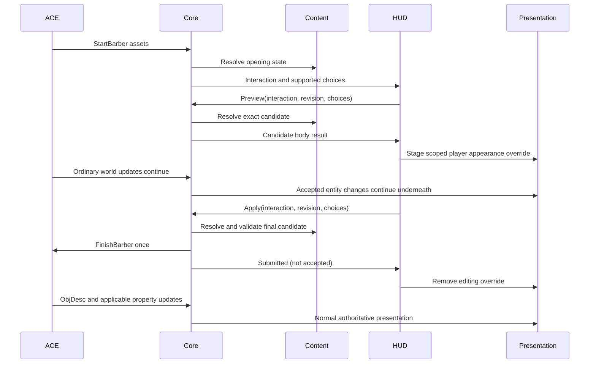

# H3d barbershop implementation plan

Status: Phases 1–6 implemented. Automated validation passes apart from two independently reproduced pre-existing selection-shortcut failures. Live NPC/appearance acceptance awaits the user.
Date: 2026-10-31

## Goal and boundaries

Provide a server-opened barbershop HUD that previews edits on the local player's live model and submits the complete appearance once on Apply, while reusing character-creation appearance rules and controls.

### In scope

- Hair/body styles, eye/nose/mouth styles, hair color and shade, eye color, skin shade, and heritage-specific control availability.
- Empyrean earthbound/levitating, Undead flame/no-flame with skeleton/zombie preservation, and Umbraen/Penumbraen crown/no-crown, for both sexes.
- A HUD window, immediate local presentation edits on the bare character model, Apply, and Cancel. Hide equipment locally while editing; preserve normal game camera controls with no automatic camera takeover.
- Disable unsupported Gearknight/Olthoi body-style editing while retaining supported palette edits; collapse identical Acid Olthoi style entries. Preserve the original body style throughout the interaction.
- Commit Empyrean motion changes through ACE's private MotionTable property update, accepting the server round-trip delay instead of predicting a movement-table change.
- Shared body/face choices, option catalogs, swatches, validation, inverse asset lookup, and forward resolution used by creation and barber.
- Exact start/finish protocol support, core interaction lifetime, host/browser contracts, and production renderer integration.
- Source-backed local racial behavior on Apply, independent of the temporary editing preview.
- Synthetic tests, production-path browser verification, cleanup, and a concise durable protocol description.

### Out of scope

- Implementing a TUI barber screen, changing NPC access/payment/content, changing ACE, or repairing observer synchronization in ACE.
- Changing heritage, sex, name, attributes, skills, equipment, or persistent character options through the barber.
- Incremental game-protocol edits, invented acceptance messages, distance checks, or session timeouts.
- A general customization framework, a second local player simulation, or rewriting the creator layout.
- Equipment reconstruction, clothing-layer extraction, and outfit previews during editing. ACE recomposes the actual equipped outfit after Apply.
- Agent visual acceptance. The user judges the final appearance; automated browser checks establish state, resource, and lifecycle behavior.

The user authorized implementation of this plan, with a stop on major blockers, gaps, or decisions requiring visual review. The approved scope includes bare-body local preview, disabled unsupported nonhuman body-style edits, and authoritative Empyrean motion updates. No ACE/protocol extension is authorized.

## Ground truth and existing seams

Paths below are repository-relative. Line numbers identify inspected source anchors and may move.

| Concern | Reference and evidence |
| --- | --- |
| Start payload | `ACE/Source/ACE.Server/Network/GameEvent/Events/GameEventStartBarber.cs`: sixteen words containing appearance assets, setup, and two options; no NPC identity, range, or expiry |
| Admission and validation | `ACE/Source/ACE.Server/WorldObjects/Player_Character.cs:398-650`: `BarberActive` gates finish, assets are checked against existing heritage/sex, valid and invalid submissions clear the flag |
| Opening | `ACE/Source/ACE.Server/WorldObjects/Managers/EmoteManager.cs`, `StartBarber` case; NPC/content access requirements precede this operation |
| Lifecycle | `ACE/Source/ACE.Server/WorldObjects/Player_Networking.cs:39`: login clears the flag; retail Cancel only hides the UI (`acclient.c:260337`) |
| Retail controls and Apply | `acclient-eor-source/acclient.c:259612-261435`, `gmBarberUI`; racial setup/motion/script changes occur during Apply before the finish message |
| Inverse lookups | `acclient.c:471281-471603`, `ACCharGenData::Get*FromID`; bald styles and Undead texture variants affect lookup; palette shades are quantized |
| Finish serialization | `acclient.c:664607`, `CM_Character::Event_FinishBarber`; opcode `0x0311`, sixteen words following action framing |
| Racial asset identities | Retail `gmBarberUI` and its UI enum/DID mappings, ACE `ValidHeritageSetups`, and `ACE/Source/ACE.Entity/Enum/SetupConst.cs`; resolve decompiler globals through their initialization rather than guessing numeric identities |
| Observer limitation | `Player_Character.cs:581`: ordinary ObjDesc broadcast remains enabled, full object refresh is disabled with a movement-desynchronization caveat |
| Protocol integration | `crates/holtburger-protocol/src/opcodes.rs`, `messages/game_event.rs`, `messages/game_action.rs`, and `messages/character/`; both barber opcodes currently commented out |
| Content reuse | `crates/holtburger-content/src/character_gen.rs`, `character_gen/appearance.rs`; current resolver couples body choices to starter clothing, backdrop, and creation idle |
| Palette quantization | `crates/holtburger-dat/src/file_type/material.rs:155`, `PaletteSet::palette_id_for_shade`; inverse shades must round-trip through this function |
| Core integration | `crates/holtburger-core/src/client/{mod.rs,types.rs,messages.rs,commands.rs,trade.rs}`; `ClientCurrentState`, commands, view events, and session ownership |
| Composition wiring | `crates/holtburger-core/src/client/builder.rs` and `apps/holtburger-3d/host/src/client_runtime.rs:731`; configure the content worker through the existing runtime builder |
| Send uncertainty | `crates/holtburger-session/src/session/send.rs:369`: `send_action` prepares reliable packet ownership and commits the action sequence before awaiting `flush_outbound`; a returned error does not prove the action was never queued |
| Existing content work | `crates/holtburger-core/src/content_assets.rs`, `client/{selection_envelope.rs,dynamic_script.rs}`; parsed content and off-turn work, without disk policy in client logic |
| Accepted appearance | `crates/holtburger-world/src/state/liveness.rs:174`, `apply_object_visual_description`; sequence checks publish `EntityAppearanceUpdated` |
| Live visual facts | `crates/holtburger-core/src/client/{entity_visual_facts.rs,dynamic_entity_view.rs,player_visual.rs,object_preview.rs}`; captured visuals already include painted clothing |
| Host integration | `apps/holtburger-3d/host/src/{client_runtime.rs,client_host.rs,client_projection.rs,protocol.rs,shared_host_content.rs,character_creation.rs}` |
| Clothing precedent | `apps/holtburger-3d/host/src/weenie_appearance.rs:527`, `resolve_worn_equipment`; Explorer has raw server/template inputs, unlike the live client |
| Clothing authority | `ACE/Source/ACE.Server/WorldObjects/Creature_Networking.cs`, `CalculateObjDesc`, plus `AddBaseModelData` implementations; includes alternate-setup mapping, coverage, fallback setup clothing, and palette ordering |
| Missing live inputs | `ACE/Source/ACE.Entity/Enum/Properties/{PropertyDataId.cs,PropertyInt.cs,PropertyFloat.cs}`: `ClothingBase`, `PaletteTemplate`, `ClothingPriority`, and `Shade` lack ordinary login/appraisal attributes. Do not assume live entities carry them |
| Browser integration | `apps/holtburger-3d/src/client/{ClientApp.svelte,ClientGameplayView.svelte,client-gameplay-presentation.ts,client-host-contract.ts}` and `src/lib/host/host-transport.ts`; Electron transport uses this typed command/event seam |
| Creator controls | `src/client/{ClientCharacterCreator.svelte,client-character-creation.ts,client-character-creation-contract.ts}`; swatches, style controls, and body-aware labels |
| Live replacement | `src/lib/game/runtime/game-presentation-runtime.ts:2739`, `#realizeDynamicEntity`; uses `DynamicEntitySystem.stageVisualReplacement` for compatible bodies and owner replacement otherwise |
| Replacement constraints | `src/lib/game/systems/dynamic-entity-system.ts:561`: a changed setup or part-index set requires owner replacement, not an in-place material patch |
| Local preview precedent | `src/lib/game/runtime/local-scene-model.ts`; useful request-coalescing/lifetime precedent, but not a drop-in replacement for a live authoritative entity |

## Phase 0 findings and evidence

Investigation completed 2026-10-30 using the checked-out ACE/retail sources, production Rust content readers, a temporary debug-harness probe, `/home/cluracan/code/holtburger/dats/assets.hba`, and read-only inspection of `/home/cluracan/code/ac-re/ac-bins/acclient.exe`. No server connection or visual acceptance run was performed. These are source/content and synthetic codec results, not observed live-server behavior.

### Equipment: raw order survives, general reconstruction does not

`SerializeModelData` (`WorldObject_Networking.cs:223`) writes ACE's ordered lists without flattening. The production `ModelData` codec (`crates/holtburger-protocol/src/messages/object/types.rs:361`) and conversion into `EntityAppearance` preserve that order and duplicate part indices. The probe packed and decoded two different model replacements for part 16 and asserted their original order survived. This corrects the concern that the retained world appearance already loses all source rows through retail normalization: normalization happens later, when composing/rendering DAT-shaped appearance.

However, ACE's construction has already discarded provenance before serialization. `ACE/Source/ACE.Entity/ObjDesc.cs:28` removes an identical `(part index, model)` pair before appending it. A minimal counterexample under that actual rule is:

```text
Original body head = H0
Outfit A contributes no painted head              -> wire head rows [H0]
Outfit B paints that same H0 over the original head -> wire head rows [H0]

After changing the underlying head to H1:
Outfit A's correct rows = [H1]
Outfit B's correct rows = [H1, H0] (equipment still paints H0)
```

The synthetic diagnostic executed these cases and asserted equal original descriptions but unequal correct edited descriptions. This is a contract counterexample, not a claim that a particular shipped helmet has this shape. Inventory identity does not supply the missing per-instance clothing properties. Therefore a general exact inverse from the composed description is impossible; it is not merely an unimplemented parser. An equivalent loss exists when exact texture triples are deduplicated by `AddTextureChange`.

Other constraints established:

- `AddBaseModelData` (`WorldObject_Networking.cs:978`) precedes clothing, so matching an expected body prefix can support restricted cases. It does not recover removed contributions, garment identities, or the correct mapping on a different setup.
- The clothing corpus contains **1,917** decoded tables; **801** have at least one authored nonempty palette range intersecting colors `[0, 320)`, the body skin/hair/eye region. Examples include `0x1000005A` and `0x1000005B`. This is a table-level corpus count, not a census of equipped player items. It disproves a universal disjoint-palette assumption, but does not prove every overlapping table is player-wearable.
- `CalculateObjDesc` has setup-specific clothing mapping, armor ordering, naked-part completion, setup-as-clothing fallback, and optional Biota overrides. Extracting rows by palette range or assuming one row per part is unsound.
- Hiding one headwear item exactly requires its contribution and any covered layers. Retaining all raw rows alone does not identify those layers.

**Gate result: the original equipment-preserving preview contract failed; the user resolved this by selecting a bare-body local preview.** Do not implement a residual/subtraction heuristic. Render the resolved body directly without equipment contributions while editing. Authoritative equipment, gameplay effects, and other players' views remain unchanged.

### Racial effects: exact local operations and asset matrix

Retail Apply (`acclient.c:260111-260334`) does not call `SetSetupID`/`InitNullObject` on the live player. It computes the requested setup for the outgoing message and applies these local operations:

1. Empyrean: select motion table and call `CPhysicsObj::SetMotionTableID`.
2. Undead/Umbraen/Penumbraen: destroy the live particle manager, then play the selected script if its DID is nonzero.
3. Submit the complete payload and hide the UI. These local operations precede submission and are not conditioned on server acceptance.

The data constants at `acclient.c:44180-44216`, named entries in `statics.txt:10899-10935`, and decoded setup defaults agree on the following matrix. Values in each cell are male / female.

| Choice | Requested setup DID | Local script DID after particle reset |
| --- | --- | --- |
| Undead skeleton, flame | `02001A9C / 02001AA0` | `330012D4 / 330012D5` |
| Undead skeleton, no flame | `02001A9E / 02001A9F` | `0 / 0` |
| Undead zombie, flame | `02001A9D / 02001AA1` | `330012D3 / 330012D6` |
| Undead zombie, no flame | `02001A96 / 02001AA2` | `0 / 0` |
| Umbraen crown | `0200196F / 02001970` | `33001256 / 33001257` |
| Umbraen no crown | `02001A5F / 02001A5E` | `330012BB / 330012BA` |
| Penumbraen crown | `0200196E / 0200196D` | `33001255 / 33001254` |
| Penumbraen no crown | `02001A5D / 02001A5C` | `0 / 0` |

The six uninitialized no-flame/Penumbraen-no-crown globals at `0x8415DC..0x8415F0` lie in the PE's zero-filled virtual data tail; the decompile shows no writes to them. They are not missing nonzero script identities to invent. `play_script_internal` (`acclient.c:306388`) explicitly returns without scheduling work for DID zero. Content inspection independently found no default script on the corresponding six setups.

All ten nonzero scripts decoded successfully. They contain only time-zero `CreateParticle` hooks: five per Undead script, five per Umbraen crown script, one per Umbraen no-crown script, and four per Penumbraen crown script. None replaces geometry or switches setup. All eight flame/crown versus no-flame/no-crown setup pairs have identical part lists. The setup choice controls default effects at later object creation; it is not necessary to swap live geometry just to toggle these effects.

**Effect ownership decision:** core produces a player-instance-qualified local Apply consequence, and the frontend replaces the player's live particle effects exactly once before playing the optional script. Preserve this committed effect state independently of the editing override. Ordinary ObjDesc receipts only apply model substitutions (`acclient.c:138209`, `ACCObjectMaint::SetVisualDesc` at `373468`) and must not reset these effects. A subsequent Apply replaces them again; actual object destruction/recreation discards the old instance and initializes effects from the new setup. During an h3d renderer-only owner replacement within the same authoritative instance, carry the committed effect selection forward, preventing old setup defaults from restoring a removed crown/flame. Do not persist this state across character/object instances or synthesize observer changes.

Retail clears the entire particle manager, including effects unrelated to barber. A narrower h3d effect reset would be a deliberate behavior change requiring evidence/markers under the project convention; do not silently describe it as retail parity. Also do not replay one-shot effects merely because the same state appears in a recovery snapshot.

Empyrean motion tables are `0900020B / 0900020A` for floating and `0900020E / 0900020D` for earthbound. `SetMotionTableID` (`acclient.c:307996`) replaces the motion manager and recreates the movement manager; this is not a cosmetic animation-only operation. ACE sends a private MotionTable DID update when the value changes. Existing world motion-table resolution is shared by playback and physics (`state/motion_resolution.rs:1171`), so a browser-only committed motion override would split the authorities.

**Approved motion integration:** use ACE's private MotionTable property receipt as the committed transition point. Movement and animation consume the same authoritative table; do not add a speculative motion-table transition. The user accepted the possible server round-trip delay. If the submitted option already matches the current table, ACE need not send an update and no wait or acknowledgment state is required. Preview remains simulation-free; do not install a speculative setup/property to support it.

### Nonhuman styles: confirmed ACE limitation

The full character table decoded **26 heritage/sex records**. Relevant results:

| Body | Authored styles | Distinction | Barber persistence in current ACE |
| --- | --- | --- | --- |
| Gearknight, each sex | 7 | Same 17 models; different body textures | Not expressible by retail finish fields: all seven produce `(head=0, hair=0, default hair=0, same setup)` |
| Olthoi, each sex | 2 | Different 25-part models; first model `010045F9` versus `01004602` | Finish distinguishes first model, but ACE does not update the persisted style |
| Olthoi Acid, each sex | 2 | Identical decoded ObjDesc for both entries; 31 parts | No distinct appearance to expose for the two entries |

`GenerateBaseAppearanceData` (`acclient.c:471090`) supplies a zero head for Gearknight, and barber Apply suppresses both hair texture words for all three nonhuman heritages. `PlayerFactory.cs:66-88` stores `PropertyInt.Hairstyle` when the selected style has multiple model changes. `AddBaseModelData` reads that stored ordinal to paint the whole body. `HandleActionFinishBarber` does not update it. For Olthoi, changing `HeadObjectDID` does not bypass that branch while a persisted `HairStyle` exists.

**Gate result: persistent Gearknight/Olthoi body-style editing is unsupported by current ACE; the user approved disabling those edits.** Retain supported palette editing and preserve the original body style. Explain the disabled capability in the UI and enforce it at the shared validation/submission boundary, not just through a disabled browser control. Collapse the identical Acid Olthoi entries rather than offering a meaningless style change. No server fix/extension is in scope.

### Inverse mapping and zero-field rules

- The bald sentinel is `0x050010B7`, proven from the retail initialized constant. Use it with the head and hair texture information; head ID alone is insufficient.
- Head-plus-bald lookup aliases all seven Gearknight styles, all eight Lugian styles per sex, and both Olthoi Acid entries. The opening resolver must consider the full meaningful texture/setup signature, not copy retail's first-head-match fallback. Where full signatures remain identical, choose a deterministic equivalent representative only after proving identical resolved output; where they differ, surface the ambiguity.
- For nonhuman opening, the accepted ordered body texture/model rows can identify more than the zero-head start fields. Equipment or custom descriptions can still make that inference unavailable; do not infer an ordinal from WCID alone.
- Nonhuman eye/nose/mouth lists contain duplicate dummy substitutions, rather than empty lists. The observed dummy texture DID is `0x050016D7`; Olthoi dummy rows address part 1, while ACE's base facial path writes part 16. Suppressed controls and inert-face validation must be explicit, not implemented by testing list emptiness.
- Zero head and zero hair/default-hair words are explicitly accepted for Gearknight/Olthoi/Olthoi Acid in ACE's validators. They are not generally valid for ordinary faces. ACE's successful finish handler only assigns asset fields that are positive, so a zero in these positions is an inapplicable/no-assignment word rather than a universal clearing operation.
- Palette resolution was exercised for every entry of every referenced skin/hair palette set in all 26 records. `(index + 0.5) / count` selected the original DID through the production `palette_id_for_shade` function in every case. Choose canonical equivalent ordinals for duplicate DIDs; do not require recovery of the original continuous slider value.
- Unknown custom head/texture/palette/setup signatures must produce an explicit unavailable diagnostic naming the offending field and DID. No randomization or fallback to style zero. Reserved option 2 remains decoded losslessly but is submitted as retail's zero.

### Submission boundary and reproducibility

`Session::send_action` (`session/send.rs:369`) commits action sequence and prepared reliable packet ownership before awaiting the final flush. Only failures before calling it are definitely unsent with the current API. A returned send error is conservatively uncertain and must not cause a second finish action.

The temporary probe ran with:

```sh
cargo run -p holtburger-debug-harness --bin barber_phase0_probe
```

It used production `ContentRepository`, CharGen, SetupModel, PhysicsScript, ClothingTable, palette, and ModelData codecs. Output is retained for this investigation at `/tmp/holtburger-barber-phase0-probe.txt`, with the temporary source copied to `/tmp/holtburger-barber-phase0-probe.rs` before removing the asset-dependent binary from the repository. The synthetic composition counterexample is an explicitly modeled ACE rule, not an execution of the C# server. The final probe completed successfully with all assertions passing.

**Phase 0 disposition:** investigation complete. The user resolved all three scope decisions: bare-body editing preview, disabled unsupported nonhuman body-style edits, and authoritative Empyrean motion transitions. Racial particle behavior is resolved. No Phase 0 scope decisions remain open.

## North stars

1. Resolve each appearance decision once. Preview and submission consume the same resolved result.
2. Share body/face interpretation, not creator workflow or starter clothing requirements.
3. Maintain one world entity, one movement authority, and one displayed player model.
4. Preview is app-local presentation state. It cannot change authoritative properties, collision, targeting geometry, or network motion.
5. Keep authoritative updates flowing underneath preview. Cancellation exposes the latest state, never an old captured entity.
6. Treat Submit as sent, not accepted. Ordinary appearance updates cannot acknowledge a request by timing alone.
7. Prefer the existing live staging path. Add only a scoped presentation override, not a parallel rendering pipeline.
8. Preview the resolved bare body directly. Equipment hiding is explicit local UX, never an equipment command or a guessed clothing decomposition.

## Contracts and ownership

Names below describe intended new contracts, not existing APIs.

### Protocol

Add a shared wire payload used by start and finish wrappers. Keep all fields as lossless words at this layer; interpret them above protocol.

| Word | Value |
| --- | --- |
| 0 | Base palette DID |
| 1 | Head object DID |
| 2-3 | Hair current/default texture DIDs |
| 4-5 | Eyes current/default texture DIDs |
| 6-7 | Nose current/default texture DIDs |
| 8-9 | Mouth current/default texture DIDs |
| 10-12 | Skin, hair, eye palette DIDs |
| 13 | Setup DID |
| 14-15 | Option words 1 and 2 |

The payload alone is 64 bytes. Opcode and existing action/event envelopes are separate; ACE's allocation-size argument is not the payload-length definition. Preserve received reserved values when decoding. Retail sends zero for option 2; do not expose it as a user control or blindly echo unknown semantics on submission.

### Content

- Introduce `BodyAppearanceChoices` and a corresponding body option catalog. Compose creation choices from body choices plus creation garments. Keep externally fixed character-creation protocol layout unchanged through adapters.
- Define `BarberRacialChoice` as a heritage-appropriate tagged value: standard, Empyrean earthbound choice, Undead flame choice, or shadow crown choice. Undead body style remains coupled to the selected style/setup family, not an independently contradictory boolean.
- Introduce a resolved body result containing ordered substitutions and concrete head/current-default-texture/palette assets. The finish adapter consumes these identities directly; it must not reverse-engineer the preview ObjDesc.
- Resolve racial setup and motion identities once into the result. Consumers do not independently switch on heritage or sex.
- Separate static body resolution from creation backdrop/idle and starter garment composition. A barber request must not read creator backdrop or starter outfit assets.
- Inverse lookup consumes the start assets plus the established player heritage/sex. Accept only a proven mapping. Shared-head models need the bald discriminator; Undead variants need the setup family. Round-trip resolved assets, not floating-point shade equality.
- Use a canonical shade representative proven to select the original palette through `palette_id_for_shade`; cover first/last entries and singleton sets. Preserve legitimate zero/inapplicable fields without inventing assets.
- Host-facing swatches and control capabilities are resolved once. Disabled or absent facial controls follow the nonhuman body rules, rather than browser inference from empty arrays.
- Publish nonhuman body-style editability with an explanation, preserve the resolved original style, and reject a candidate that changes a disabled style while allowing supported palette changes. Creation retains its authored body-style selection; the restriction belongs to barber capability/validation, not the common creator controls or DAT decoder.
- Do not depend on `holtburger-world` from `content`. Content products use DAT-shaped `ObjDesc` or content-owned types; core adapts to `EntityAppearance`.

### Core

Add a focused `client/barber.rs` owner, integrated into the existing runtime:

```text
BarberInteraction = Closed | Open {
    local interaction id,
    player GUID + object instance,
    original server appearance,
    established heritage/sex
}

BarberRequest = Preview { interaction, revision, choices }
             | Apply   { interaction, revision, choices }
             | Cancel  { interaction }
```

The frontend owns the editable draft. Core owns interaction admission and retains enough opening state for inverse resolution and stale-command checks. A local interaction counter continues across closes; reusing a player GUID is insufficient. Include the interaction in the current-state recovery snapshot, not only an opening event.

Provide a narrow, concrete barber content worker configured by the client composition, following existing off-turn content coordinator patterns. It loads through the content service and calls the shared content resolver; core consumes parsed products, not archive paths. Opening, previews, and Apply use this same resolver. Content work runs outside the authority turn; completions carry interaction/revision/instance identity and are checked before publication or sending.

Do not send browser-supplied DIDs as an unchecked finish payload. Apply resolves the submitted choices afresh or consumes an exact retained resolved revision; it never uses whichever preview happened to complete last. A stale preview revision may finish without becoming current. Duplicate Apply is rejected once the single submission has started.

Validation/resolution failures before calling `Session::send_action` are definitively unsent and retain editing. The inspected send implementation commits prepared reliable packet ownership before its final asynchronous flush. Treat an error returned from `send_action` conservatively as submission-uncertain: retire the interaction and never automatically resend. The current error type does not identify whether failure happened before or after preparation; this feature does not require a transport API redesign to make that distinction.

### Host and frontend

- Add `host/src/client_barber.rs` for app-specific request/result projection only. Static reusable content operations remain in content, not an alternate host rules engine.
- Extend `ClientHostCommand`, command-name admission, `ClientHostEvent`, `HostEvent`, current-state projection, browser transport types, and browser decoders together. Follow the actual Electron/sidecar seam; do not add a speculative Tauri command path.
- Add `client-barber-contract.ts`, `client-barber-state.ts`, and `ClientBarberWindow.svelte`.
- Extract reusable body style/color controls and schemas from the creator; migrate both consumers in the same change. Keep creation-only fields and layout with the creator.
- Use `ClientHudWindow`, existing controls/styles, and `KeyboardInputPolicy`. Close and Cancel share the same callback. A retained hidden component does not preserve a canceled server interaction or active preview resources.
- Keep the current camera usable. Do not rotate the authoritative character to inspect a haircut. Any later automatic framing/orbit feature is a separate app-local UX decision.

## Bare-body editing preview: approved presentation

Resolve the edited body directly from body choices and racial options. Do not merge the accepted dressed appearance into that result. No clothing tables, equipment residuals, palette subtraction, or Explorer clothing-emulation extraction are required for this feature.

Stage the body override and local equipment hiding as one presentation transition. Clothing/armor painted into the body is absent because the body source has no garment layers. Suppress separately rendered equipment attached to the local player through app-local presentation visibility, without changing authoritative attachment or equipment state. Keep those entities receiving updates while hidden. This also avoids needing a separate headgear visibility control.

Display the explanation "Equipment hidden while editing." The user cannot evaluate the new appearance with the outfit until Apply; this is the accepted trade-off. Other clients continue to see the normal server appearance until the submitted changes are applied.

On Cancel, submission, or editor retirement, remove the body override and equipment visibility suppression together. Restore the latest authoritative appearance and current equipment/attachment state, never the opening snapshot. ACE owns recomposition with actual clothing, armor, dyes, and other instance data after Apply. No unequip command or persistent show-helm/show-cloak option change is sent.

The Phase 0 information-loss evidence remains relevant background, but equipment reconstruction is no longer an implementation gate. Explorer template selection, clothing composition, catalog policy, and spawn emulation stay app-local and untouched by this feature.

## Presentation and lifecycle



### Live renderer seam

Add a scoped override capability at `game-presentation-runtime.ts`, wrapped by `client-gameplay-presentation.ts`. Keep the authority mirror unchanged. Store accepted entity facts and effective visual facts distinctly; override inputs must participate in visual cache keys and asynchronous currentness checks without manufacturing a new world generation.

The override is keyed to player GUID, object instance, interaction, and candidate revision. Build an effective visual descriptor from the accepted entity plus the resolved candidate. Placement, visibility, translucency, scale, and live motion remain accepted inputs. No creator idle replaces live motion. Preview motion changes may alter visual playback only; no movement controller or collision state changes.

Reuse `#realizeDynamicEntity` and `stageVisualReplacement` for compatible changes. Changed setups/part sets require the existing full owner replacement path, including attachment rebinding, behavior lifetimes, bounds, and current motion restoration. Reuse the staging machinery rather than copying `LocalSceneModelHandle` into a competing live owner.

Keep last-good visuals while candidate assets load. Coalesce requests so obsolete slider work cannot accumulate an unbounded preparation queue. Failed resolution or preparation reports a feature error and retains the last-good view; Apply cannot silently submit a revision that failed validation. No candidate installs after cancellation, replacement opening, player replacement, or resource retirement.

The bare-body override and local equipment suppression share one lifetime. During initial loading or replacement failure, retain a coherent last-good composition; do not expose a mix of the dressed body and partially hidden equipment. No persistent visibility option or equipment command participates.

### Transition decisions

| Trigger | Core behavior | Frontend/presentation behavior |
| --- | --- | --- |
| Start | Replace old interaction, allocate new local identity | Cancel old work, initialize new draft; no randomization of body choices |
| Edit | Resolve and publish only current interaction/revision | Stage latest candidate; no game-protocol messages |
| Cancel/window close | Retire local interaction; send no finish | Remove override and reveal latest accepted appearance |
| Apply | Validate exact choices; send once; consume interaction on successful send | Disable duplicate Apply; remove editing override on submitted result |
| Definitively unsent failure | Preserve interaction and report reason | Retain draft, show actionable error |
| Uncertain send | Retire interaction and report uncertainty | Remove override, do not automatically retry |
| Server appearance/equipment while editing | Accept normally and retain current authoritative state | Keep bare-body preview; update hidden equipment normally so exit exposes the latest outfit |
| Logout/disconnect/player replacement | Retire interaction and asynchronous work | Release override and window resources |
| Same-character portal transition | Preserve editing interaction absent contrary source evidence | Suspend installation while scene is unavailable; resume only against the new live instance/readiness |
| Movement/combat/death | No invented server restriction or cancellation | Normal gameplay presentation remains active; death alone does not claim the server canceled barber |

The successful-send policy can briefly reveal the previous appearance before the ObjDesc arrives. This is an explicit concession. Do not wait indefinitely for an uncorrelated appearance update or label the operation accepted.

### Racial Apply behavior is separate from editing

Removing the preview on submission must not discard retail's persistent local racial changes. Conversely, retaining the entire draft indefinitely would hide server rejection.

Phase 0 traced retail's Apply branches (`acclient.c:260111-260334`): particle reset/script selection are local effects, Empyrean changes its actual movement/motion manager, and this handler does not replace the live setup. Use the exact matrix and ownership findings above. Do not infer a persistent setup mutation merely from a setup DID in the outgoing payload.

Represent the proven local Apply consequences as a narrow core-produced result consumed through existing motion/script presentation seams. Committed visual-only racial state, if required, has player-instance lifetime and yields to an explicit authoritative replacement. It must be distinct from a draft preview and must not write fabricated server properties or collision geometry. Cover both option directions and repeated Apply so emitters cannot accumulate.

Committed Empyrean motion changes use the existing authoritative property-update path; no speculative table or movement-manager transition is added. Crown/flame options retain the proven local effect behavior. Unsupported nonhuman body-style edits are explicitly disabled under the approved scope; supported palette editing remains available.

## Phased implementation

### Phase 0 — Prove the two difficult contracts

Deliverables: update this working plan with exact composition and racial state-transition findings; prepare small synthetic evidence in the relevant test modules when implementation is authorized.

- [x] Trace `AddBaseModelData` and ACE ObjDesc part/texture/palette mutation and serialization semantics.
- [x] Evaluate equipment preservation from transmitted facts: disproved the general inverse by counterexample, measured palette overlap, and identified missing setup-dependent/per-instance information. Do not assume Explorer inputs exist live.
- [x] Enumerate racial setup/motion/script identities and transitions for both sexes from retail mappings, decoded content, and ACE.
- [x] Define post-Apply effect ownership/reset behavior and identify Empyrean's simulation consequence; prove the conservative uncertain-send rule for errors from `send_action`.
- [x] Enumerate legitimate zero fields, ambiguous inverse mappings, nonhuman persisted-style behavior, and the expected diagnostic for unmappable custom appearance.

Acceptance: every supported edit has a deterministic preview/submission path; equipment and local racial behavior have explicit producers and lifetimes. If proof fails, report the specific product/contract decision before dependent implementation. Do not silently drop racial features or equipment preservation.

Result: investigation complete. All scope decisions are resolved and downstream tasks reflect them. The original equipment-preserving/full-nonhuman-style contract was replaced by the approved narrower contract; it is not claimed to have passed. Phase 1 has subsequently been implemented.

### Phase 1 — Wire contracts and shared appearance kernel

Deliverables: protocol character payload and codec variants; content body/racial choices and resolved assets; creator adapters migrated to the shared kernel.

- [x] Enable start/finish opcodes and add strict payload decode/encode tests with distinct values in every word and truncation cases.
- [x] Split body choices/validation/resolution from starter clothing and creator animation/backdrop loading.
- [x] Implement inverse lookups, canonical palette shades, racial mapping, nonhuman capabilities, and one resolved source for preview/submission.
- [x] Enforce the barber-specific disabled nonhuman style capability while preserving creator selection and supported palette edits.
- [x] Preserve creation wire layout and creator composition order; remove duplicated body interpretation.

Acceptance: synthetic forward/inverse asset round trips pass, including bald and nonhuman cases; creator output remains correct; no content-to-world dependency. Zero and reserved protocol values have explicit tests and semantics.

### Phase 2 — Core interaction and complete host contract

Deliverables: `client/barber.rs`, worker/composition wiring, command/event/current-state additions, and typed host/browser schemas.

- [x] Handle start after normal character-bound event ordering, bind the established player instance, and publish recoverable interaction state.
- [x] Configure the content worker from the client composition without requiring barber assets during disconnected/pre-game operation.
- [x] Add Preview/Apply/Cancel admission and exact revision validation; discard late completions.
- [x] Send one finish action; distinguish validation, definitely unsent, submitted, and uncertain outcomes.
- [x] Update host projection, protocol event conversion, command admission, browser decoding, and contract fixtures together.
- [x] Integrate logout, disconnect, character replacement, and same-character scene transition behavior.

Acceptance: an integration test traverses start decode → core interaction → projected snapshot → semantic Apply → captured finish bytes. Cancel sends none; stale commands and duplicate Apply send none; recovery snapshots do not reopen canceled interactions.

### Steering checkpoint — Confirm the vertical contract before renderer work

- [x] Revisit scope, line-count growth, shared boundaries, remaining evidence gaps, and the approved bare-body preview lifetime.
- [x] Walk an opening, canceled in-flight preview, successful Apply, and uncertain send through all adapters.
- [x] Confirm every field has a consumer and no raw browser DID submission or second rules engine was introduced.
- [x] Reorder or split remaining work if setup replacement or racial state requires a larger transaction than anticipated.

Acceptance: no unresolved authority or lifecycle decision is handed to the renderer implementation.

### Phase 3 — Live bare-body appearance override

Deliverables: scoped live body override, app-local equipment visibility suppression, and renderer tests/probes.

- [x] Use the resolved bare body directly; stage equipment visibility suppression with the override, without clothing reconstruction.
- [x] Extend desired/effective visual selection and cache keys without modifying the dynamic authority mirror.
- [x] Reuse staged same-setup replacement and full owner replacement for incompatible setups.
- [x] Preserve current animation/placement and authoritative attachment ownership, keep rendered equipment hidden locally during editing, and manage racial preview effects without duplicating the player.
- [x] Add coalescing, late-result rejection, cancellation restore, and accepted-appearance invalidation.

Acceptance: delayed A/B candidate responses install only B; cancellation cannot be undone by A; equipment updates received while hidden appear correctly on exit; changed setups retain attachment ownership and live motion; preview leaves authoritative equipment/movement/collision/targeting state unchanged. Repeat open/edit/cancel cycles return resource ownership to baseline.

### Phase 4 — HUD and creator control reuse

Deliverables: barber state/window and shared body style/swatch controls, wired through `ClientApp` and gameplay presentation.

- [x] Extract demonstrated shared controls/schema helpers and migrate the creator in the same change.
- [x] Add body-aware labels, supported facial controls, swatches/shades, racial toggle, the equipment-hidden explanation, Apply, and Cancel.
- [x] Show loading/resolution/submission errors; block duplicate submissions and stale results.
- [x] Use HUD window and keyboard ownership primitives; keep camera/gameplay controls available.

Acceptance: synthetic HUD interaction tests exercise both creation and barber consumers; changing a control changes local presentation but sends no game action; closing cancels; no feature resources poll or render while retired.

### Phase 5 — Racial Apply integration and production-path verification

Deliverables: proven core local-Apply consequences, browser probes, and focused headless ACE evidence where needed.

- [x] Implement both directions of every racial option and Undead skeleton/zombie combinations.
- [x] Verify motion-table receipt, script/effect replacement, repeated submissions, and resets against Phase 0 findings.
- [x] Verify Empyrean Apply leaves committed motion unchanged until ACE's property update; an already-matching table requires neither an update nor a pending acknowledgment.
- [x] Exercise actual host contracts and production presentation using the browser harness; synthetic network/content fixtures must traverse production code.
- [x] Use the debug harness rather than the TUI for any live ACE validation. Keep live asset-dependent experiments temporary.
- [x] Verify observer ObjDesc behavior and record the existing ACE setup propagation limitation without claiming it is repaired.

Acceptance: ordinary edits and all racial options meet protocol/presentation assertions; no emitter duplication, stale ownership, or movement side effects from editing. Production-asset framing and visual correctness are handed to the user for acceptance.

### Phase 6 — Cleanup and final checks

- [x] Delete superseded creator body paths, duplicate labels/schema branches, unused adapters, and temporary asset-dependent tests.
- [x] Keep Explorer-only appearance emulation in the app; extract only mechanisms justified by actual consumers.
- [x] Document the payload and cancellation/submission limitations in existing protocol documentation, with source citations.
- [x] Apply retail defect markers only for proven quirks/divergences, with citations, consequence, and census required by `AGENTS.md`; a different HUD layout alone is not a retail defect.
- [x] Review the final diff for boundary erosion, unexplained fallback, assertions, silent errors, and unjustified line-count growth.

Acceptance: required checks pass; no staging/commits without a separate request; all material limitations are stated in the delivery report.

## Validation plan

These commands are for implementation, not evidence that implementation has already been tested. Run from the repository root unless stated otherwise; use narrower test filters while iterating.

```sh
cargo fmt --all -- --check
cargo test -p holtburger-protocol -p holtburger-content -p holtburger-core -p holtburger-3d-host
cargo clippy -p holtburger-protocol -p holtburger-content -p holtburger-core -p holtburger-3d-host --all-targets -- -D warnings
```

Add `holtburger-world` tests/clippy if its production logic changes. From `apps/holtburger-3d`:

```sh
npm run test:ts -- <affected-test-files>
npm run check
npm run lint:ts
npm run lint:dead
npm run format:check
npm run build
npm run harness:browser -- <barber-probe-options-added-with-the-probe>
```

Do not invent currently supported barber probe flags. Add the focused probe through `scripts/browser-harness.mjs` and existing `src/harness/browser/` conventions, then record the exact command and resulting assertions. Browser execution verifies runtime state and resources; it does not replace user visual acceptance. No screenshot review is required from the agent.

Mandatory scenarios:

| Scenario | Required evidence |
| --- | --- |
| Unchanged Apply | Original meaningful asset identities survive open/inverse/resolve/submit; inapplicable zero fields stay legitimate |
| Palette endpoints | First/last/singleton palette and duplicate-palette cases resolve deterministically without floating-point drift |
| Bald transition | Eye texture variant and hair/head submission stay coherent in both directions |
| Nonhuman bodies | Gearknight/Olthoi style controls are disabled and changed-style requests are rejected; supported palette edits preserve original body style; identical Acid Olthoi entries collapse; creator style selection remains available |
| Empyrean Apply | Committed movement and animation switch together on ACE's MotionTable update; no speculative table change or wait for an update when the value already matches |
| Racial matrix | Both sexes; levitation toggle; both shadow heritages; skeleton/zombie × flames on/off |
| Equipment | Bare preview hides painted gear and rendered equipment; dyed/randomized garments, cloak/held attachments, and gear changes received while editing return from latest authoritative state on exit; no equipment commands are sent |
| Races in asynchronous work | A/B reordering, close while loading, reopening for the same player, replacement instance, and a snapshot resubscription |
| Network behavior | No finish before Apply; one finish on Apply; none on Cancel; no inferred acceptance or automatic uncertain retry |
| Gameplay continuity | Movement/camera continue; portal suspension/resumption works; preview does not change simulation facts |
| Resource lifetime | No late reinstall, duplicate model/effects, or retained resources after repeated cycles |

## Risks and concessions

| Risk | Mitigation / accepted limit |
| --- | --- |
| Equipment visibility leaks or stale restoration | Stage bare body and local suppression together; restore latest authoritative state and current attachments on every exit path |
| Racial local behavior is not equivalent to a finish payload | Trace retail and encode the actual local consequences separately from preview |
| No acceptance/rejection acknowledgment | Report submitted; resume accepted appearance; tolerate a brief visual reversion; do not invent timeout success |
| Custom server assets cannot map to retail choices | Surface unavailable with the offending identity; preserve server appearance and do not guess a default |
| Alternate setup changes invalidate parts/attachments | Full staged owner replacement and exact-currentness checks |
| Overly broad reuse increases dependencies and code | Extract body/kernel primitives and real shared controls only; review additions and deletions at steering/cleanup |
| ACE observer setup limitation persists | Document it; no speculative client messages or ACE edits in this feature |

## Definition of done

- [ ] User acceptance: open the editor at a live barber NPC and inspect ordinary and racial previews, equipment restoration, and final server appearance. The decoded server-opening → core → submission contract is covered automatically; no live NPC acceptance is claimed.
- [x] Creation and barber share body interpretation and demonstrated UI controls without sharing unrelated workflows.
- [x] Opening preserves body choices and authoritative state. Canonical appearances round-trip concrete assets; ACE's authored Undead face aliases normalize without changing logical choices.
- [x] Bare-body preview and equipment hiding are local only; every exit restores current server presentation without outfit reconstruction or equipment commands.
- [x] Local preview affects only presentation and survives ordinary accepted world updates safely.
- [x] Apply sends exactly one complete validated payload; Cancel sends none; no false acceptance state exists.
- [x] Racial local Apply behavior and effects have explicit source-backed ownership, supersession, and teardown.
- [x] Replay/recovery, portal, player replacement, loading failure, and cancellation races are covered.
- [x] Relevant Rust/TypeScript checks, lint, production build, and browser runtime evidence pass.
- [x] Permanent tests use checked-in synthetic fixtures; temporary live-asset tests are removed.
- [x] User visual acceptance and the known ACE observer limitation are reported accurately.

## Approved scope decisions

Phase 0 completed the requested investigation. The user approved all three resulting scope decisions:

1. **Preview presentation — approved:** render the bare character model locally while editing and explain that equipment is hidden. Equipment remains equipped and effective; other clients retain normal server presentation. Exit restores the latest server-composed outfit. Remove clothing reconstruction and the separate headgear toggle from implementation scope.
2. **Persistent nonhuman styles — approved:** retain supported palette edits but disable unsupported Gearknight/Olthoi body-style edits with an explanation. Preserve the original style, enforce the restriction during submission validation, and collapse identical Acid Olthoi style entries. Creator body-style selection remains unchanged; no server fix/extension is included.
3. **Empyrean Apply timing — approved:** switch committed motion on ACE's private MotionTable update, reusing the single authoritative motion path. Accept the possible server round-trip delay; add no speculative movement-table override or acknowledgment wait.

No scope decisions remain open. Implementation was subsequently authorized; no ACE modification or protocol extension is included.

The source walkthrough's other corrections stand: use the existing live renderer replacement path rather than a local-model duplicate; handle changed setups through owner replacement; and update current-state recovery plus the actual Electron/sidecar transport, not just opening events or a hypothetical Tauri boundary.

## Execution notes

- Phase 1: protocol codec tests, shared content/creator tests, and full protocol/content/core suites pass. A temporary installed-content probe verified 869 authored body-style round trips across 26 heritage/gender records, then was removed.
- Phase 2: core tests cover decoded opening, no-send preview, cancellation, stale/duplicate commands, exact finish bytes, and uncertain transport failure. Host/browser current-state and lifecycle contracts compile. The Rust/browser fixture, host event projection, lifecycle recovery, and browser editor tests pass.
- Preview resolution consumes already-parsed rules synchronously; only opening/catalog loading needs the blocking content worker. No archive reads occur on edits. The host reuses shared typed serde requests directly instead of adding an adapter file with no translation responsibility.

- Steering checkpoint: retained accepted and effective visuals separately, reused the live staged/full-owner replacement paths, and kept equipment visibility and racial Apply state app-local. Shared crates contain semantic choices and validated content only; no second player simulation or clothing inverse was added.
- Renderer: body override currentness rejects late preparations, keeps live placement/motion, and restores the newest accepted appearance. Equipment suppression covers attached meshes and particles and follows the installed bare body's lifetime. Committed racial effects hold one replaceable closure per owner; they survive renderer-only re-realization and reset on actual instance replacement.
- HUD: creation and barber share body schemas, palette controls, shade indexing, and `UiRange`. Semantic edits coalesce while preparation is outstanding; a superseding edit immediately withdraws the obsolete preparation to the last installed view. Recovery before gameplay readiness requests the current draft again once the driver exists. Earthbound movement explicitly takes effect after Apply; editing does not predict movement.
- Validation: all 1,661 affected Rust tests pass, including the Empyrean test proving private MotionTable receipt and unchanged-table completion. Browser suite: 4,202 pass, two pre-existing Ctrl+V selection failures reproduced against untouched HEAD in `/tmp/holtburger-barber-baseline`. No unrelated shortcut implementation was changed. Type checks, clippy with warnings denied, ESLint, dead-code checks, production build, and CSS-layer checks pass; final formatting/probes are recorded below.
- Installed content: all 26 barber catalogs/swatches load; the temporary probe was removed and retained only at `/tmp/holtburger-barber-catalog-probe.rs`. Earlier 869 style round trips remain valid evidence. Permanent tests use synthetic checked-in data.
- Browser evidence: `npm run harness:browser -- --brief --client-barber` verifies actual pointer editing, preview admission, one Apply, Cancel, and disabled nonhuman styles. `npm run harness:browser -- --nameplate-workload occlusion-open --probe-dynamic-appearance --screenshot /tmp/holtburger-barber-renderer.png` exercises three local override/authoritative-update/restore cycles through WebGL. `npm run harness:browser -- --brief --content /home/cluracan/code/holtburger/dats/assets.hba --client-presentation` passes production creator/gameplay/return, recovery, teardown, and browser-error assertions. These are mechanical checks; no agent visual acceptance was performed.
- Durable payload/lifecycle documentation is in `docs/messages.md`. ACE observer setup propagation remains unchanged. User visual/live-NPC acceptance is the remaining handoff.

- Final checks: full affected Rust suites (1,661), clippy, CLI compilation (without running it), TypeScript/Svelte, ESLint, dead-code analysis, Prettier, production build, and all three browser probes pass. The complete browser suite has 4,202 passing tests and the same two baseline selection failures. Final probe reports are `/tmp/holtburger-barber-final-{hud,renderer,production}-probe.txt`; no files were staged or committed.

- Live acceptance correction: an ACE-created skeleton supplied Undead eye style 8 as `0x05003074 / 0x05003044`, the first (zombie) substitution. The original inverse incorrectly required the skeleton substitution. ACE's `PlayerFactory` and `SexCG` facial getters prove this producer behavior. Opening now matches either complete authored Undead facial pair and canonicalizes only those same-choice eye/nose/mouth aliases for submission; unknown pairs remain errors. A synthetic regression covers both sexes, skeleton/zombie setups, flame options, bald variants, nondefault face choices, and invalid original IDs. A temporary installed-content probe passed all 98 Undead body/sex cases and was removed; evidence is in `/tmp/holtburger-barber-ace-face-after.txt`. Earlier self-generated round trips did not cover this independent ACE initialization path.

## Final code-quality review

Boundary: the accumulated feature against `4b04ce52c8f97044b88975ccdb3eb572429c1c42`, including all new files, creator migrations, host adapters, renderer changes, fixtures, and protocol documentation. No unrelated production changes were identified. The user accepted the HUD refinements and requested this review and a commit; this does not establish an exhaustive live racial acceptance matrix.

Verdict: ready within the reviewed scope after the recovery corrections below. No remaining demonstrated ownership or lifecycle blocker was found. ACE's observer setup limitation and lack of a finish acknowledgment remain explicit product constraints.

### Findings corrected before commit

- **P2 — A recovery snapshot could leave the editor waiting forever for a lost preview event.** `ClientBarberState.#receive` previously accepted the retained opening without releasing the outstanding preview slot. Preview events are deliberately transient, so preserving their pending identity across event loss cannot recover them. Current-state recovery now supersedes the request, preserves the local draft, and immediately invalidates obsolete renderer preparation. Apply remains one-shot. The production lifecycle/editor test covers both a missing reply and recovery during presentation preparation, and rejects an old response.
- **P2 — Editor recreation erased core's revision guarantee.** `BarberRuntime::resolve` retains the highest observed draft and rejects older revisions, but the editing snapshot previously exposed only original choices and catalog. A recreated editor would start below that retained revision. `BarberPhase::Editing` now carries the revision through the unchanged host projection and strict browser schema; initialization starts above it. Core still owns revision admission. Rust snapshot coverage and a browser test with a nonzero recovered revision verify the seam. This adds one consumed scalar rather than a reset command or a second editor identity.
- **P2 — Failed command delivery and disposal did not complete preview coalescing consistently.** A command rejection cleared the pending slot without dispatching a newer queued edit. A renderer completion could also dispatch queued work after destruction. One `#finishPreview` path now completes both command failures and preview replies; preview admission checks retirement. Regressions cover both cases. There is no automatic retry of an unchanged failed request, and no submission retry.

The first two preview-flow regressions were observed failing before their fixes. Smaller corrections restore displaced API comments and document the initial core revision accurately. The immediate producers, consumers, and error paths of the changed recovery contract were re-reviewed after editing.

### Ownership and seam coverage

| Boundary inspected | Producer guarantee and consumer use |
| --- | --- |
| ACE/retail → protocol codec | Complete sixteen-word asset payload, distinct original/current textures, reserved-word preservation, and truncation rejection. The core adapter interprets asset identities; semantic ordinals never cross the game wire. |
| Content → creation/core | Shared body validation, composition order, palette resolution, and swatches. Barber inverse lookup uses complete authored pairs and accepted nonhuman rows; the same resolved product feeds preview and submission. The ACE initialization alias regression is independent of the forward resolver. |
| Core → host → browser | Opening identity, exact player instance, explicit phase, recoverable revision, feedback, and committed particles survive projection, serialization, and strict decoding. Rust/browser contract fixtures cover this boundary together. |
| Editor → core | Preview/Apply/Cancel carry an opening ID and exact candidate revision. Core validates independently, retires before a second send, and exposes uncertain transport outcomes without retry. Cancellation and stale results cannot reopen an editor. |
| Editor/session → gameplay presentation | Candidate visuals stay imperative. Ordinary controls remain reactive and app-local. Recovery, driver readiness, submission, closure, and instance replacement reconcile preview and committed effects separately. |
| Gameplay presentation → renderer | Accepted and effective appearances have distinct ownership. Desired-record identity invalidates asynchronous work; existing staged replacement handles compatible bodies and owner replacement handles changed setups. Equipment meshes and emitters follow the installed bare body's lifetime; exit restores the newest accepted outfit. |
| Renderer → resource systems | Direct racial scripts reuse existing closure preparation, hold one replaceable lease per owner, and retire with that owner. Attachment visibility never changes authoritative equipment, placement, or simulation. |

The review included ordinary Apply, rejected/uncertain submission, cancellation during loading/preparation, lost events, editor reconstruction, same-character scene withdrawal, changed player instance, and owner teardown. Deferred scene residency remains the renderer's existing responsibility; core blocks Apply during world activation. No additional timeout, leash, acknowledgment, or alternate simulation was introduced.

### Consolidation and maintenance assessment

The second real consumer justifies the extracted body resolver, body schema, swatch controls, shade lookup, and ordinal slider primitive. Creation-specific clothing/build/submission policy stays in the creator; barber admission stays in core; HUD layout stays in the app. Shared archive-backed swatch calculation replaces the host's duplicate calculation. Preview completion and renderer-preparation withdrawal now each have one editor-owned implementation.

Accepted/effective appearances and preview/committed particle levels should remain separate: an authoritative outfit can change while hidden, and a committed crown must survive editor closure. Collapsing either pair would erase a real lifetime distinction. The source trait isolates blocking content preparation and supports the existing test injection; it does not justify a broader customization framework. No speculative framework or temporary asset-dependent production path was retained.

A new authored hairstyle is discovered through the existing content lists and reaches both editors without additional host or renderer policy. A changed setup follows existing owner replacement. A new racial option would legitimately require content semantics, the typed contract, and a frontend control; those are separate responsibilities rather than duplicate decision tables. The feature's principal added production cost is content inverse/racial interpretation and scoped renderer replacement; creator duplication was removed instead of retained alongside it.

### Review validation and limits

- All affected Rust suites pass: 1,662 tests across protocol, content, core, host, and integration tests. Clippy passes for those packages/all targets with warnings denied; Rust formatting passes.
- Full frontend suite with bounded workers: 4,206 pass; the two existing Ctrl+V selection failures remain independently reproduced against untouched HEAD. A concurrent earlier run also timed out in `client-main`; the bounded full rerun and focused `client-main` rerun pass.
- Final focused editor/lifecycle/presentation/startup suite: 110 pass. Svelte/TypeScript checks, ESLint, dead-code analysis, production build, CSS layer verification, and formatting are checked alongside the final diff.
- The barber browser probe passes with the revised recovery contract, increment controls, disabled unsupported styles, Apply/Cancel, checkbox spacing, two-column swatches, content-fit height, and no resize handles. Earlier WebGL replacement cycles and installed-content production presentation probes remain the renderer/content evidence; they were not repeated as visual acceptance during this review.
- Review logs are `/tmp/holtburger-barber-review-*`. Permanent regression fixtures are synthetic and checked in. The review does not claim new live NPC/observer experiments, agent visual acceptance, or a completed live matrix for every heritage.
