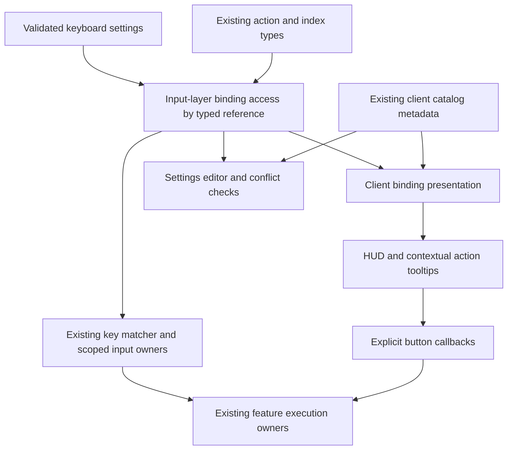

# H3D Client Binding Identity and Presentation Plan

## Context and boundaries

**Goal:** Give existing client keyboard actions one typed binding identity and lookup path, so Settings, input resolution, HUD hints, and contextual controls agree after remapping.

Status: all five phases implemented and verified on 2026-10-09 under the user’s explicit implementation instruction. Required checks and focused browser probes pass. The broader HUD suite has an independently reproduced baseline failure, documented below. Visual acceptance remains user-owned.

The immediate trigger was missing shortcut hints on the selected-entity HUD. The initial tooltip fix passed configured Interact/Examine bindings into that component and used the existing formatter. The implementation now replaces that manual configuration-path lookup across existing consumers with typed references and catalog presentation.

In scope:

- Every binding family in `ClientKeyboardConfiguration`: character movement, named client shortcuts, spell tabs/cells/caster, combat breakpoints/heights, action-bar focus/cells/commands.
- Typed binding references and the existing settings catalog, including Select self and all targeting shortcuts.
- Shared lookup for settings editing, runtime matching, full shortcut descriptions, and compact hints.
- Existing presentation consumers and scoped keyboard consumers, including Examine in vendor, trade, and housing interactions.
- Focused tests and browser harness evidence for the composition, not merely isolated helpers.

Out of scope:

- A command bus, handler registration, a universal execution registry, or changes to keyboard arbitration.
- New shortcuts for party invite, friends, ignore, allegiance, split, or panel toggles.
- Adding a Select self button to the character HUD. Select self currently has Settings and keyboard consumers.
- Changing held-input behavior, selection policy, target capture, gameplay commands, or server protocol.
- Changing persisted keyboard settings, introducing migrations, or refactoring Explorer fly/pointer policy.
- Moving frontend action presentation into shared Rust crates.

The existing social-action feature is committed as `587030f0`. Preserve the authorized uncommitted tooltip work while replacing its raw binding lookup during the catalog cutover. Leave unrelated ACE submodule changes alone.

## Ground truth and neighborhood

Paths below are relative to `apps/holtburger-3d/` unless stated otherwise.

| Layer                       | Ground truth                                                                                                         | Current responsibility                                                      |
| --------------------------- | -------------------------------------------------------------------------------------------------------------------- | --------------------------------------------------------------------------- |
| Frontend input contract     | `src/lib/input/input-contract.ts`, `input-defaults.ts`                                                               | Binding families, finite indices, key/code and modifier semantics, defaults |
| Frontend input resolution   | `src/lib/input/app-input.ts`, `input-context.ts`                                                                     | Matching configured bindings; character contexts; named and indexed lookup  |
| Frontend keyboard ownership | `src/lib/input/keyboard-input-policy.ts`, `app-input-policy-context.ts`                                              | Scope priority, focus, held-input cancellation, contextual Escape           |
| Frontend settings           | `src/client/client-input-settings.ts`, `client-binding-catalog.ts`, `ClientSettingsPanel.svelte`                     | Validated configuration, editor rows, labels, accessors, conflicts          |
| Frontend presentation       | `src/lib/input/input-presentation.ts`                                                                                | Full descriptions, modifier vocabulary, compact hints                       |
| Frontend composition        | `src/client/ClientApp.svelte`, `ClientWorldView.svelte`, `client-input-context.ts`                                   | Accepted configuration, input replacement, controls and feature wiring      |
| Frontend behavior           | `client-selection-input.ts`, `client-entity-selection.ts`, `client-spell-bar-input.ts`, `client-combat-bar-input.ts` | Targeting lifetimes and scoped command execution                            |

The reference authority for this refactor is the existing frontend contracts and observable behavior. It adds no game semantics that require a new ACE or retail interpretation. If implementation proposes changing game behavior, stop and establish that separate requirement from the project references.

### Consumer inventory

| Family                                      | Existing consumers to inspect/migrate                                                                                                    | Behavior to preserve                                                                                                                      |
| ------------------------------------------- | ---------------------------------------------------------------------------------------------------------------------------------------- | ----------------------------------------------------------------------------------------------------------------------------------------- |
| Select self and target cycling              | `ClientSettingsPanel.svelte`, `client-selection-input.ts`, `client-entity-selection.ts`                                                  | Select authoritative local identity without scene residency; short press cycles, hold acquires nearest; interruption cancels delayed work |
| Interact and Examine                        | `ClientApp.svelte`, `ClientSelectedEntityHud.svelte`                                                                                     | Capture current selection on activation; Interact may display as Trade                                                                    |
| Contextual Examine                          | `ClientVendorWindow.svelte`, `ClientTradeWindow.svelte`, `ClientHouseCrystalWindow.svelte`; inventory/item consumers found during census | Resolve the relevant offer, trade cell, or requirement source rather than blindly using world selection                                   |
| Combat toggle, auto-run, give, precise jump | `ClientApp.svelte`, `ClientShortcutDock.svelte`, owning controllers                                                                      | Existing gameplay admission and repeat policy                                                                                             |
| Chat and cancel                             | `ClientChat.svelte`, `ClientActionBar.svelte`, selection and interaction owners                                                          | Scope priority, contextual cancellation, and native editor behavior                                                                       |
| Spell bindings                              | `ClientSpellBar.svelte`, `client-spell-bar-input.ts`, `AppInput`                                                                         | Tabs, cell addresses, caster action, magic scope, configured alternatives                                                                 |
| Combat bindings                             | `ClientCombatBar.svelte`, `client-combat-bar-input.ts`, `AppInput`                                                                       | Physical-combat scope, indexed height/breakpoint meanings                                                                                 |
| Action-bar bindings                         | `ClientActionBar.svelte`, `ClientActionBars.svelte`, `AppInput`                                                                          | Focus sequence differs from stable bar identity; focused cell address differs from its bound item                                         |
| Movement                                    | Character contexts, Settings, client composition                                                                                         | Press/release transitions and cancellation stay with their existing contexts                                                              |

Use `rg` to complete the inventory before editing. Search both matching and presentation: `shortcut(`, `formatInputBindings`, `compactInputHint`, direct binding-path indexing, and settings row `read`/`write` accessors. Include `ActionCell.svelte` and `SpellCell.svelte` as prepared-display consumers, plus harness consumers and tests. Record intentional direct accesses: whole-group context installation, schema construction, defaults, and non-binding policies such as the alternate modifier need not become individual lookups.

## Constraints, data distribution, and concessions

### Required contracts

1. Input resolution and displayed hints read the same accepted configuration. Preserve `ClientApp.changeInput`: validate, cancel held keyboard work, replace runtime bindings, publish accepted settings.
2. Preserve physical `code` versus layout-resolved `key`, exact versus omitted modifier constraints, ordered alternatives, and explicitly empty binding lists.
3. Keep typed finite indices from the existing contract. The reference discriminant selects the address family and its permitted index range. Existing numeric unions overlap; do not claim nominal separation or add branded index types solely for this refactor.
4. Preserve persisted configuration keys and structure. Catalog identities are references to those fields, not a second store or new persistence format.
5. Keep matching/access helpers in the existing app-local input layer. That layer must not import Settings, Svelte components, feature controllers, or frontend action metadata.
6. Keep labels, settings grouping, tooltip policy, and conflict presentation in the client frontend layer. Core/world retain their existing game responsibilities.
7. Keep execution, target capture, availability, asynchronous retirement, repeat rules, and keyboard admission with existing owners.
8. Preserve compact HUD layout, accessible action names, popup behavior, and current pointer-versus-keyboard ownership policy.

### Actual shapes

The input map is a small finite set of named shortcuts and bounded indexed families. There are currently 79 keyboard catalog addresses: 8 character actions, 17 client shortcuts, 21 spell addresses, 8 combat addresses, and 25 action-bar addresses. Derive coverage from the existing action/index collections rather than hard-coding that count in tests. No plugin discovery or dynamic handler registry is required. Configuration changes are cold UI events; they are independent of scene cadence. Bound items and spells can change independently of the key used to activate their slot.

### Accepted concessions

- A supported binding with an empty list displays `Unbound`; an action without shortcut support has no binding reference and no invented hint.
- Spell tabs may contain more than ten cells (`SpellCellAddress.slot` is a general number). Only the first ten cells have shortcut references. Preserve the existing range-to-numbered-index check before lookup; overflow cells retain `shortcut: null`, not `Unbound`, a wrapped index, or an error.
- Contextual labels remain local. Trade uses the Interact binding; examining an offer and examining world selection share a binding but retain separate target preparation.
- Catalog lookup describes configured bindings, not an assertion that they are currently executable. The existing scope owner decides admission.
- Existing conflict contexts remain a settings overlap model. They are not a complete runtime scope registry: contextual Examine consumers exist beyond the listed game contexts. Preserve current conflict behavior in this refactor and document any discrepancy found by the census rather than replacing scope routing with metadata.
- No new tooltip must be attached indiscriminately to every item cell. Improve existing action affordances; preserve primary item descriptions and only advertise Examine where that input path actually works.
- Visual acceptance belongs to the user. Browser probes verify DOM, callbacks, hints, and keyboard behavior without performing visual acceptance.

### Implemented configuration and ownership paths

- Presentation receives accepted `ClientApp.userSettings.input` through `ClientWorldView`. Bar, dock, selected HUD, vendor, and trade owners take the complete cold keyboard configuration and platform. Leaf `SpellCell` and `ActionCell` contracts remain narrow prepared-display values.
- Runtime `AppInput` uses the same pure accessor for individual addresses. Character contexts still install the full character map; action-bar alternate modifiers, fixed pointer mappings, and Explorer fly maps remain bulk/control-policy accesses.
- Selection retains default-prevented and IME admission, repeat consumption, short-press/release cycling, timed nearest acquisition, modifier interruption, and external-selection cancellation. Select self uses authoritative local identity independently of rendered presentation.
- Spell input retains caster-before-tab-before-cell matching and magic/game scope admission. Combat retains height-before-breakpoint matching and physical-combat admission. Both execution owners suppress repeats and IME composition. Action bars retain scoped focus, transient navigation, and separate content identities.
- Vendor and trade Examine handlers capture their offer/queue/partner cell; housing captures the first owned source for its requirement. Fixed native Enter purchase/quantity controls are not configurable bindings and remain local.
- Settings preserves physical-key witnesses, proposal-before-conflict validation, alternative deduplication, remove-one, restore-one, restore-all, and selective conflict replacement.

## North stars

1. Reuse and strengthen the existing catalog; retire superseded accessors rather than building a second action list.
2. One reference chooses a binding address. Settings, matching, and presentation use that address without reconstructing configuration paths.
3. Separate binding identity from command payload, selected target, and bound content.
4. Prepare display facts once for a control and share them between direct buttons and menu rows.
5. Use pure functions over the accepted configuration. Add no retained hint cache, subscription bus, or mutable binding copy.
6. Keep existing feature ownership legible. A catalog entry does not own a controller lifetime.

## Intended contracts and flow

Use a discriminated binding reference with the existing action/index types. The following is illustrative, not permission to create duplicate index enums:

```ts
type ClientBindingReference =
  | { readonly kind: "client"; readonly action: ClientShortcut }
  | { readonly kind: "character"; readonly action: CharacterAction }
  | { readonly kind: "spellTab"; readonly index: InputDigitIndex }
  | { readonly kind: "spellCell"; readonly index: InputDigitIndex }
  | { readonly kind: "spellCaster" }
  | { readonly kind: "combatHeight"; readonly index: CombatHeightIndex }
  | { readonly kind: "combatBreakpoint"; readonly index: CombatBreakpointIndex }
  | { readonly kind: "actionBarFocus"; readonly index: InputDigitIndex }
  | { readonly kind: "actionBarCell"; readonly index: InputDigitIndex }
  | { readonly kind: "actionBarCommand"; readonly action: ActionBarCommand };
```

Use the existing command union, or derive it from `ACTION_BAR_COMMANDS`; do not add an independent list. The input contract owns references and pure read/replace operations. Implementation may colocate these in a focused `src/lib/input/client-keyboard-bindings.ts` if that keeps `input-contract.ts` readable.

The client catalog owns one definition per supported reference: stable typed row identity, standard label, editor group, and existing conflict contexts. Derive row identity from the reference; do not maintain both independently. Replace the per-row `read`/`write` closures with shared reference access where they express the same configuration operation. Settings and conflict code consume those common operations. Missing internal catalog definitions fail loudly; do not return empty bindings for an invalid reference. Keep the existing stable row-id strings used for keyed Settings rows and diagnostic lookup, but strengthen their type and derive them from references. Use one exhaustive identity conversion; never compare freshly allocated reference objects by object identity in a lookup map.

Presentation consumes a catalog reference, current accepted settings, and platform. Provide a small composite shortcut result using the existing `SpellCell` shape (`hint: string | null`, `description: string`); its consumers are the compact marker and accessible/full tooltip. Read bindings once when preparing that result. Other clients of the pure read accessor may format individual captured binding pills without going through whole-action presentation. It produces the existing full description and compact hint. Contextual controls supply their local label when constructing a tooltip. Standard controls can use the catalog label. Return only facts with a named consumer; avoid an expansive action-view object containing unrelated icon, eligibility, target, pending state, or dispatch fields.



Do not make `AppInput` import the client catalog. Its existing methods can delegate address lookup to the input-layer accessor and continue applying existing matching/priority behavior. Do not make a lookup method on the imperative `AppInput` object the sole source for reactive markup: configuration replacement alone does not invalidate Svelte expressions. Keep accepted settings as the current reactive input to presentation. The concrete migration is to pass the complete cold `ClientKeyboardConfiguration` to the existing bar/dock/selected-HUD owners that perform catalog lookup, with the existing explicit platform prop. `ClientSpellBar` and `ClientCombatBar` currently receive group slices, the selected HUD receives a client slice, and the dock receives one binding list: replace those prop types and their `ClientWorldView`, showcase, and probe call sites together. `ClientActionBar` already receives the complete keyboard configuration. Do not synthesize a full configuration by filling missing groups from defaults, add a second settings context, or retain both old and new props. Leaf cells continue receiving prepared descriptions/hints and acquire no configuration dependency.

For selected-entity actions, use prepared titles derived from references for Interact and Examine. Direct buttons and popup rows read those titles. Social actions remain local descriptors without a keyboard reference. A required title on the prepared bound-control path should prevent another bound action from silently dropping its hint. Do not turn the generic `PopupMenu` into a client input consumer.

## Phased implementation

### Phase 1: Inventory and typed input access

- [x] Complete the consumer census above, including all named actions such as Select self and all indexed families.
- [x] Record each consumer's binding address, configuration producer, target owner, and scope/repeat/hold behavior.
- [x] Define the typed reference in the app-local input contract using existing action/index types.
- [x] Implement pure binding read and immutable replacement operations against `ClientKeyboardConfiguration`.
- [x] Derive stable catalog row identities from references without parsing arbitrary strings into unchecked references. Make identity conversion and read/replace switches exhaustive; out-of-range external values remain rejected at existing validation boundaries.
- [x] Add focused tests for every address family, empty lists, preservation of untouched fields, and ordered key/code alternatives.

**Acceptance:** all existing configurable keyboard addresses are representable; out-of-range indices and mismatched reference field shapes are rejected by types; read/write round trips preserve the persisted shape. New helpers have real callers in Phase 2, not indefinite parallel residency.

### Phase 2: Catalog and Settings cutover

- [x] Refactor `client-binding-catalog.ts` so definitions carry typed references and reuse input-layer accessors.
- [x] Retain one metadata source for labels, grouping, and conflict contexts; derive editor rows and lookup from it. Test catalog completeness against the independently enumerated contract addresses, as well as uniqueness. The current test loops over existing rows and therefore cannot detect an omitted definition.
- [x] Migrate `ClientSettingsPanel.svelte`, conflict replacement, and their tests from per-row closures to shared access. Include capture deduplication, candidate-proposal conflict checks, conflict-dialog pills, remove-one-alternative, restore-one-row, restore-all, and `replaceDialogConflict`. Preserve the physical-key witness used for mixed key/code conflicts and the current proposal-before-conflict ordering.
- [x] Add client presentation lookup using existing `formatInputBindings` and `compactInputHint` implementations.
- [x] Keep input settings validation and saved data unchanged.
- [x] Delete superseded row accessors and loose identity reconstruction in touched consumers.

**Acceptance:** changing a binding through Settings is visible through the catalog lookup for the same reference. Conflict replacement removes only overlapping alternatives under the existing conflict policy. Catalog coverage includes Select self and every indexed entry.

### Phase 3: Steering and runtime lookup cutover

- [x] Review the inventory against the new contracts before broad migration. Dry-run Select self, contextual Examine, held target cycling, and a focused action-bar cell.
- [x] Confirm that input-layer imports remain independent of client metadata and feature controllers.
- [x] Migrate individual address lookup in `AppInput` to the common accessor while preserving its public behavior where useful.
- [x] Inspect selection, chat, gameplay, spell, combat, action-bar, vendor, trade, and housing input consumers. Remove duplicated lookup where it remains outside the owner.
- [x] Preserve intentional bulk-map installation into character contexts and all independently owned input lifetimes.
- [x] Keep target switches, hold timers, repeat handling, IME checks, and keyboard priority in the existing execution owners.

**Acceptance:** a remapped reference resolves through the same input accessor used by Settings/presentation. Select self still selects the local identity without a rendered entity. Target cycling retains short-press, hold, release, interruption, and external-selection cancellation behavior. Contextual Examine still captures each surface's own target.

### Phase 4: Presentation consumer migration

- [x] Replace raw configuration-path lookup in `ClientSelectedEntityHud.svelte`, `ClientShortcutDock.svelte`, `ClientSpellBar.svelte`, `ClientCombatBar.svelte`, and `ClientActionBar.svelte`. Cut over sliced props and all immediate production/harness callers to the complete accepted settings contract in the same phase.
- [x] Prepare Interact/Trade and Examine titles from their binding references; direct and menu presentation share the same prepared title.
- [x] Census existing Examine action affordances in vendor, trade, housing, and inventory. The vendor/trade/housing handlers already call `AppInput.shortcut("examine", ...)`. The implementation census additionally found literal `E or right-click to inspect` hints in vendor offers, vendor queue cells, and trade cells. These existing hints now use catalog presentation with complete accepted settings and platform props. Housing retains its existing item description; no new hint policy was added.
- [x] Include Select self in catalog presentation tests; add no new character HUD button.
- [x] Keep action-bar focus sequence and cell shortcut addresses separate from stable bar IDs and bound item/spell identities. Preserve overflow spell cells without binding references, including the equipped caster's separate reference and absence of a numbered address.
- [x] Update harness/showcase consumers to supply the final contracts, eliminating temporary tooltip-only wiring where superseded.

**Acceptance:** every existing shortcut hint uses catalog-backed presentation. Configured alternatives, platform names, compact hints, empty bindings, and contextual Trade labels agree. Actions without supported shortcuts acquire no artificial hint or settings row.

### Phase 5: Composition verification and cleanup

- [x] Exercise remapping through the real Settings capture/conflict workflow and accepted configuration replacement, then compare editor display, direct tooltip, popup tooltip, and keyboard execution for the same reference. The old key must stop activating the action and the new key must reach its actual feature owner; assigning the fixture's binding list directly is not sufficient.
- [x] Add focused browser evidence for selected actions, Select self, contextual Examine, and existing indexed hint consumers, reusing their harness owners. Extend `client-targeting-probe.ts` to retain its `AppInput` instance and replace its configuration instead of constructing an inaccessible default instance. Its existing self-binding scenario can prove remapped self selection with `presentation: () => null`.
- [x] Verify that input replacement cancels pending targeting presses before new bindings execute, and that held/repeated input follows existing policy. First repair the relevant diagnostic composition: `ClientHudHarness.onInputChange` currently only replaces `AppInput` and publishes settings; unlike production `ClientApp.changeInput`, it neither validates nor calls `keyboard.cancel` nor replaces installed character bindings. Mirror the production sequence in the fixture and bind cancellation to the actual selection/character owners used by the scenario. Prove cancellation before replacement and publication, then prove neither delayed timers nor old key releases select a target after remapping. Source-review the production callback alongside fixture evidence; do not claim the synthetic fixture mounts the production `ClientApp`.
- [x] Search for remaining raw per-address lookup and local hint reconstruction. Document intentional bulk/configuration accesses rather than blindly replacing all property access.
- [x] Remove dead helpers, aliases, duplicate row closures, stale names, and tests that preserve the superseded design.
- [x] Compare significant production lines added and removed. Each new accessor or presentation field needs a named runtime consumer; avoid a framework for optional future actions.
- [x] Run a code-quality review over the accumulated diff, its callers, and reset/error seams.

**Acceptance:** the final design has one binding-address implementation and one client metadata catalog, with existing feature owners intact. No new cache, handler registration, event bus, compatibility alias, or production diagnostic path remains.

## Validation and risks

Use existing manifest scripts from `apps/holtburger-3d/`: `npm run check`, `npm run lint:ts`, `npm run lint:dead`, and `npm run format:check`. Run focused tests with `npm run test:ts -- ...` against binding catalog, input context, selection input, and changed presentation helpers. Test behavior and wiring; never copy mutable tuning values into assertions.

Use `npm run harness:browser -- --client-selected-actions` for the focused selected HUD path. Inspect available keyboard, party, vendor, trade, and other targeted harness modes before choosing composition probes. The existing `--client-keyboard` mode proves keyboard ownership, not the complete Settings capture/remap workflow; extend a focused binding-catalog scenario rather than assuming that mode covers remapping. `--client-trade` and `--client-housing` are available; there is no dedicated vendor flag in the current runner, so expose the existing vendor probe through a focused mode if contextual coverage requires it. Add a focused mode if necessary; do not run the interactive TUI or depend on unchecked-in assets for retained tests. Loopback access may require sandbox escalation.

The full `--client-hud` suite is not green: both the final implementation and isolated baseline fail at the same stale theme-startup settings fixture. The earlier spell-search fixture failure was corrected without changing production semantics. The evidence below accounts for both failures; focused probes expose this work’s results without suppressing other suites’ errors.

| Risk                                                           | Mitigation                                                                                                |
| -------------------------------------------------------------- | --------------------------------------------------------------------------------------------------------- |
| Central catalog grows into an execution bus                    | Keep runtime controllers and their lifetimes out of definitions; review imports and contract fields       |
| Runtime bindings update but hints remain stale                 | Exercise actual accepted-settings replacement; avoid lookup from nonreactive mutable state alone          |
| Contextual Examine starts using world selection                | Verify each surface's target source through its existing controller/callback                              |
| Stable content identity becomes confused with shortcut address | Keep bar sequence, slot index, entity GUID, and bound content in their existing separate domains          |
| Conflict metadata becomes mistaken for scope permission        | Preserve keyboard policy as authority; describe conflict contexts honestly                                |
| Refactor changes saved settings or key semantics               | Preserve schemas and shape; test key/code, exact/wildcard modifiers, alternatives, and empty bindings     |
| Unification creates more plumbing than it removes              | Reuse catalog generation and formatters; remove per-row closures and raw lookup paths during each cutover |

## Definition of done

- [x] Every existing client binding family has a typed reference and catalog coverage.
- [x] Settings, runtime lookup, and presentation share binding access without a second mutable store.
- [x] Select self and targeting behavior remain intact; no new UI operation was silently added.
- [x] Existing shortcut-bearing controls consume catalog presentation, including contextual Examine and indexed controls.
- [x] Remapping, empty bindings, platform formatting, target capture, and scope/hold cancellation have composition evidence.
- [x] Required checks pass; any broader harness failure is reproduced and explicitly accounted for.
- [x] Cleanup and accumulated code-quality review are complete. Visual acceptance remains user-owned.

## Decisions and open questions

- Chosen: strengthen the existing binding catalog and input contract; retain explicit feature execution. A dispatch bus requires a separate demonstrated requirement.
- Chosen: retain saved configuration shape and current runtime policy. The cutover removes code duplication, not public game behavior.
- Chosen: full consumer census precedes migration, rather than treating the selected HUD as the whole architecture.
- Confirmed by source dry-run: complete settings flow only widens cold configuration props at existing bar/control owners; leaf cells keep their narrow prepared-display contracts. No new reactive settings store is required.
- Confirmed during implementation: contextual Examine handlers share runtime lookup; vendor/trade literal E hints also needed migration. Overflow spell cells intentionally do not have a keyboard reference and retain their shortcut-free presentation.
- Confirmed by source dry-run: catalog completeness needs an independent address universe, and remap cancellation evidence requires correcting the diagnostic composition before relying on it.
- No blocking product decision remains for this scope. If implementation reveals a need for new shortcuts, new controls, new execution authority, or changed conflict semantics, record that finding and seek steering before expanding the plan.

## Implementation evidence and review

- `client-keyboard-bindings.ts` owns typed references, stable identity conversion, ordered binding reads, and immutable replacement. The three finite switches are exhaustive; runtime matching imports no client metadata or controllers.
- Catalog coverage is checked independently against the persisted keyboard address universe, including Select self and every indexed entry. Generated catalog rows and group collections retain read-only public contracts.
- Final focused input/catalog/selection/bar-input tests: 87 tests across 10 files passed. Final `npm run check`, `lint:ts`, `lint:dead`, and `format:check` passed.
- `--client-bindings` passed real Settings capture, conflict replacement, deduplication, restore controls, reactive direct/popup titles, item-use dispatch, old-key retirement, remapped Select self without presentation, and pending-hold cancellation.
- `--client-binding-controls` passed remapped action focus/cell hints, spell tab/cell/caster execution, overflow cells without hints, combat controls, and vendor Examine through the contextual offer owner. This focused mode includes the Settings composition and its explicit item fixture setup. The temporary overlapping shortcut-bars mode was removed.
- Focused trade and housing runs passed remapped Examine target capture (partner cell and requirement source respectively), alongside their retained regression scenarios.
- The uniform spell-search corpus formerly included the authored Vitae fixture (different name and school), contradicting the probe’s even/odd distribution assertions. The diagnostic corpus now excludes that special record and adds another generic even record; production spell semantics are unchanged.
- An isolated HEAD baseline, with only that spell corpus correction and its own dependency cache, reached the full suite’s startup-theme scenario. It failed because the diagnostic settings bridge still returned the obsolete `{kind: "missing"}` response rather than the current sections contract. The production settings decoder and startup code are unchanged by this work. The final implementation run failed at the same `parseUserSettingsLoad` error and themed-lifecycle assertion (`client-theme-probe.mjs:220`). This is a reproduced broader harness limitation, not a binding cutover regression.
- The earlier standalone shortcut-bars attempt failed on a tab-click layout assertion. The isolated full baseline passed the corresponding spell-bar phase with the original implementation. The incomplete standalone setup was removed; dedicated indexed-remap coverage exercises this change directly without retaining that temporary route.
- Code-quality review covered typed lookup and Settings callers, cold presentation props, leaf-cell seams, runtime priority, cancellation/replacement, contextual target capture, and all production/harness callers. It tightened generated row immutability and removed temporary redundant diagnostic routing. No execution bus, mutable hint store, handler registration, or settings migration was introduced.
- Significant production footprint: 312 tracked lines added and 223 removed, plus the 185-line pure input accessor file (net +274 lines). The cost is exhaustive address/identity operations and actual caller migration; per-row read/write closures were removed. Tests, harnesses, and this plan are excluded.

## Final commit review

- Verdict: ready within the reviewed app-local binding scope; no blocking design findings.
- Reviewed seams: typed input access and runtime matching; Settings proposals, conflicts, and restores; accepted `ClientApp.changeInput` replacement and publication; `ClientWorldView` configuration props into bars, dock, selected HUD, vendor, and trade; prepared values into `ActionCell` and `SpellCell`; contextual Examine targets; selected action callbacks and popup anchor lifetime; diagnostic composition and cleanup. Shared Rust and unrelated ACE changes are outside this review.
- The address union and three exhaustive operations preserve the existing saved configuration without a mutable lookup store. Per-row accessor closures are retired. Bulk character/fly installation and controller-owned execution remain separate because they have distinct lifetime and policy responsibilities.
- Follow-up HUD refinements put shortcut descriptions directly in dropdown labels, keep icon-button tooltips, and remove the nested action wrapper so the shared HUD group owns one backdrop. The no-action name stays in the center grid column.
- Current type checks and focused selected-action/remapping browser probes pass. The known full HUD theme-startup fixture failure remains reproduced on the baseline; this review does not claim full-suite or visual acceptance.
