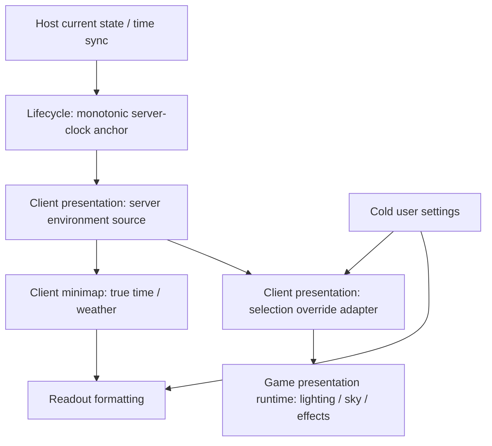

# Client environment readout and local overrides

Status: implemented and visually approved by the user. Code-quality review
completed on 2026-10-10; one startup clock-retention finding was fixed.
Feature-specific verification passed. The broader HUD Trade regression remains
unresolved; the user subsequently requested review and commit.

## Context and boundaries

Show true Dereth time and weather beneath the client minimap while allowing
user-scoped time and weather overrides for local world presentation.

In scope:

- A second minimap readout row containing time and a weather icon.
- A persisted 12-hour/24-hour preference and fixed in-game time/weather overrides.
- Explicit separation of synchronized server environment facts from the
  environment presented locally.
- Clock advancement between synchronization messages, settings startup/live
  application, icon accessibility, and footer-aware client minimap placement.

Out of scope: computer-local wall time, timezone controls, advancing custom
clocks, weather simulation, server environment override protocol support,
shared Rust API changes, Explorer UX changes, and visual acceptance by the agent.

"Local time override" means a fixed locally selected Dereth time. Server is the
default for both overrides. The minimap always reports the synchronized server
environment, including while indoors and while weather rendering is disabled.

## Ground truth and existing patterns

Paths below are repository-relative.

| Source                                                                                                                                                        | Evidence or responsibility                                                                                                                                     |
| ------------------------------------------------------------------------------------------------------------------------------------------------------------- | -------------------------------------------------------------------------------------------------------------------------------------------------------------- |
| `apps/holtburger-3d/src/client/client-lifecycle-session.ts`                                                                                                   | Receives current state and `client-server-time-updated`; owns the receipt-anchored advancing clock and host observation lifetime.                              |
| `crates/holtburger-world/src/state/types.rs`, `set_server_time_sync`, `current_server_time`                                                                   | Existing shared semantics: advance synchronized time by elapsed monotonic time. No changes planned here.                                                       |
| `ACE/Source/ACE.Server/Network/NetworkSession.cs:31`                                                                                                          | Normal TimeSync interval is 20 seconds; packet-only UI updates would visibly step.                                                                             |
| `apps/holtburger-3d/src/client/{client-presentation-session.ts,client-environment.ts}`                                                                        | Maps synchronized portal-year time into region calendar day/fraction, then refreshes the server source and applies the presentation source at bounded cadence. |
| `apps/holtburger-3d/src/lib/assets/active-region-source.ts`                                                                                                   | Typed calendar, sky groups, and region record provenance available in the browser.                                                                             |
| `apps/holtburger-3d/src/lib/game/environment/scene-environment.ts`                                                                                            | Owns day-group hashing, authored tick sampling, lighting, fog, and sky resolution. Day-group selection helper is currently private.                            |
| `acclient-eor-source/acclient.c:291131`, `SkyDesc::CalcPresentDayGroup`                                                                                       | Retail's deterministic calendar-to-day-group selection; retain this algorithm.                                                                                 |
| `ACE/Source/ACE.DatLoader/Entity/DayGroup.cs`; `ACViewer/ACViewer/Entity/DayGroup.cs`                                                                         | Day-group fields and ACViewer's explicit interpretation of `DayName` as weather.                                                                               |
| `acclient-eor-source/acclient.c:442780`, `GameTime::GetDateTimeString`                                                                                        | Retail displays named periods of the day. Numeric hours are a frontend display convention, not a copied retail clock format.                                   |
| `apps/holtburger-3d/src/explorer/ExplorerWorldPanel.svelte`                                                                                                   | Existing authored time and sky-group controls; reuse the underlying resolver rather than importing Explorer control policy.                                    |
| `apps/holtburger-3d/src/lib/game/runtime/game-presentation-runtime.ts`, `setSceneEnvironment`, `render`                                                       | Environment replacement already affects sky scripts, particles, and audio as well as rendering.                                                                |
| `apps/holtburger-3d/src/client/client-settings-{contract,sections,defaults,transport,persistence}.ts`; `apps/holtburger-3d/electron/client-settings-store.ts` | Strict, independently versioned settings sections, generic load/save bridge, and debounced patches.                                                            |
| `apps/holtburger-3d/src/client/ClientApp.svelte`                                                                                                              | Live setters plus untracked startup snapshots for cold preferences; settings must not own presentation construction.                                           |
| `apps/holtburger-3d/src/app/Minimap.svelte`; `apps/holtburger-3d/src/client/{ClientWorldView.svelte,client-hud-layout.ts}`                                    | Shared minimap, coordinate readout, client composition, and square placement/gesture persistence.                                                              |
| `docs/lighting.md`                                                                                                                                            | Supporting explanation and previous content census; code and decoded content remain ground truth.                                                              |

Constraints and concessions:

- Authored weather is an entire sky preset, including lighting, celestial objects,
  fog, and sky-driven effects. This feature will select that preset wholesale.
  It will not splice precipitation from one group into another group's lighting.
- Multiple authored groups may share a weather name. Keep their distinct identity;
  show friendly variant labels rather than collapsing them by name.
- A missing server clock or missing sky is a valid unavailable state. Never label
  it midnight or clear through a fallback.
- Unknown weather names receive a neutral icon and the exact authored tooltip.
  Do not infer weather by substring matching or add unsupported snow/storm types.
- Overrides are local presentation policy and can affect sky-driven ambience.
  They never affect simulation, movement, deadlines, commands, or host time.

## North stars

1. Derive true environment facts once in the server source; wrap that source at
   the presentation boundary when overrides are used.
2. Inject `serverEnvironmentSource` into the readout and
   `presentationEnvironmentSource` into rendering. Consumers do not inspect
   override modes or select between environments themselves.
3. Keep the change in the h3d frontend layers. Host observation belongs to the
   lifecycle session; visual override policy belongs to client presentation;
   formatting, icons, and placement belong to UI.
4. Reuse authored selection/resolution and existing settings/HUD paths. Keep
   override decisions inside one small adapter, with no parallel reconciliation
   paths or independently retained server/presentation environment fields.
5. Keep frame-rate data imperative. The readout samples at a bounded display
   cadence; settings remain cold reactive state.

## Contracts and flow

Implemented settings shapes (strict Zod schemas and inferred types;
comment new types and fields):

```ts
// Independent user sections, leaving existing ui/fonts values intact.
interface EnvironmentUserSections {
  clockFormat: "12-hour" | "24-hour";
  environmentOverrides: {
    time: { kind: "server" } | { kind: "fixed"; minuteOfDay: number }; // integer in [0, 1439]
    weather:
      | { kind: "server" }
      | {
          kind: "preset";
          sourceRecordId: string;
          sourceVersion: number;
          dayGroupIndex: number;
          dayGroupName: string;
        };
  };
}
```

Every persisted preset field is consumed when matching the saved choice against
the active region: record/version scope, index lookup, and exact name check.
These checks prevent accidentally applying an index to different region content;
they do not pretend provenance is a content checksum. A mismatched saved choice
is visibly unavailable, is retained for repair/reset, and is not silently
replaced or rewritten. Render the server environment while explicitly reporting
that the preset cannot be applied. Validated live selections cannot reach this
case. Reuse the existing diagnostic/toast path and deduplicate the report.

Use 24-hour as the explicit first-run default. Users can restore server time/weather with their existing controls and select
the default clock format with its checkbox. No inactive fixed-time value or cached weather
label survives when its mode becomes server; settings remain a composite union.



The lifecycle session retains a single nullable `{ serverTime, receivedAtMs }`
anchor. Establish it on actual current-state/time-sync receipt, not when a
presentation owner eventually starts. Add an imperative read accepting a
monotonic timestamp; it returns synchronized time plus elapsed seconds, or null.
Keep existing wire/current-state numeric fields at the boundary; consumers do
not rebuild anchors from them. Clear the anchor on session teardown/reset.
Reception anchoring has the same transport-delay limitation as the existing
observation; this task adds no latency correction scheme.

Use a narrow app-local source contract: an imperative `read()` returns a
nullable coherent sample containing the calendar selection and its resolved
environment. The selection is consumed by the override adapter; the resolved
environment supplies weather metadata to the HUD and renderer input. Start with
plain functions/closures in `client-environment.ts`, rather than a service or
class hierarchy. The source also projects the HUD's day fraction and weather
identity/name/icon classification once per sample; the HUD never reclassifies
weather or reads renderer state.

The server source owns one bounded sample, produced from the lifecycle clock
and immutable active region. Client presentation refreshes it from its existing
frame driver before rendering and before early returns that only hold entity
realization. Start with a named 250 ms environment interval; compare against
the active region's authored sky/light ticks during verification and tighten if
required. Both consumers read that same sample, so neither independently
resolves the calendar or sky. Synchronization and initialization refresh the
source immediately when content is available. No extra animation loop or
per-frame reactive environment publication is needed.

At composition, bind the minimap directly to `serverEnvironmentSource`. Bind
rendering to `presentationEnvironmentSource`, obtained by wrapping the server
source with the validated override configuration. With both modes set to server,
use the server source itself. The runtime always receives the same resolved
environment type and has no override-specific branch.

The adapter reads the underlying sample, substitutes configured `timeOfDay`
and/or `dayGroupOverride` in its selection, and resolves that selection through
the existing environment resolver. It preserves the server `dayIndex`. Never
patch already resolved lighting, fog, sky objects, or effects. Fixed time never
changes the server calendar day or weather hash. Time and weather substitutions
are independent small operations inside the adapter; avoid a four-way mode
switch. The adapter owns no clock, subscription, or separate environment state.

Settings updates replace the adapter configuration/binding and immediately
apply its read to the runtime. This is a cold composition change, not a new
rendering lifecycle. It does not invalidate or rewrite the server sample, and
clock-format changes affect only the readout. Override application occurs once
per environment update or settings change; do not resolve it on every render
frame. The runtime's existing retained environment remains its rendering input;
do not add another presentation-environment cache to the client session.

A null source sample represents a missing clock; nullable weather represents
unavailable authored sky. The adapter propagates unavailability. Settings get
a separate cold preset catalog when the active content owner is installed; do
not put source samples or resolved sky in Svelte state at producer cadence.
Sources are tied to the lifecycle session and active-content owner and are
discarded on replacement/destruction. No consumer-specific environment reset
state machine is introduced.

Format numeric time by flooring normalized day fraction to a minute of a
24-hour display day. This is an explicit UI convention. Cross-check the authored
calendar's named periods before claiming exact named-period correspondence.
12-hour formatting handles midnight/noon with AM/PM; no timezone or JavaScript
`Date` conversion. Fixed-time inputs use the same minute/format helper.

## Phased implementation

### Phase 1: Prove content choices and establish contracts

- [x] Enumerate actual active-region sky groups: index, exact name, sky keyframes,
      weather-object properties and gfx/script identities. Use the content decoder
      or browser harness; a temporary focused debug-harness probe is permitted
      during implementation. Do not change the retail decompile or retain tests
      requiring untracked DAT assets.
- [x] Record the verified names and deliberate icon mapping in the app-local
      environment module. Unknown names use the neutral case. Identify whole-preset
      differences and duplicate names before adding choices to Settings.
- [x] Add `client-environment.ts` for the narrow server-source/sample contract,
      selection override adapter, preset matching, catalog construction, and
      readout projection; add focused colocated pure tests. Keep the adapter
      stateless and colocate related contracts instead of adding service layers.
- [x] Add the two independent sections in settings contract/sections/defaults.
      Schema dependencies used by Electron must use Node-resolvable `.js` imports;
      do not import browser runtime modules into the settings schema.
- [x] Cover absent-section defaults, malformed values, bounded fixed minutes,
      persistence round trips, and survival of existing font/graphics preferences.

Acceptance: choices reflect decoded authored content; contracts have named
consumers; existing settings load without migration or loss; no shared-crate
policy added. Decoded region census and settings persistence checks passed.

### Phase 2: Compose the server source and presentation adapter

- [x] Add the receipt-owned clock anchor/read to `client-lifecycle-session.ts`,
      with tests for sparse sync, late presentation initialization, correction,
      unavailable clock, and teardown. Inject timestamps into pure clock logic.
- [x] Replace `#applyServerEnvironment` in `client-presentation-session.ts` with
      one source refresh/application path. The server source owns calendar/sky
      derivation and the renderer reads its presentation source without mode
      checks. Remove the obsolete comment implying weather/player preferences
      are entirely absent.
- [x] Compose the presentation source by wrapping the server source's selection;
      delegate directly for server-only settings. Keep all override branching
      in the adapter and preset validation at the cold configuration boundary.
- [x] Add a typed override setter that retains configuration before async owner
      creation, replaces the presentation binding and applies it immediately
      when available, and never recreates the owner. Initialization uses the
      same binding/application path.
- [x] Bind the readout exclusively to the server source; expose the cold preset
      catalog separately. Discard source bindings on owner/session destruction.
- [x] Wire `ClientApp.svelte` startup through `untrack` and live changes through
      its existing validated `changeUserSection`/persistence path. Do not read
      overrides reactively inside the resource-construction effect.
- [x] Test all four server/fixed-time and server/preset-weather combinations,
      server day rollover during overrides, mismatch reporting, reset, startup races,
      and absence of owner reconstruction on edits.

Acceptance: renderer environment follows overrides and the server readout does
not; server time advances between messages; fixed time leaves date unchanged;
no override changes gameplay or feeds back into lifecycle/host facts. The client
session has no independently retained server/presentation environment pair,
and neither consuming layer branches on override configuration.

### Phase 3: Settings controls and minimap footer

- [x] Add the clock-format and presentation-override controls to the existing
      Settings UI tab via `ClientSettingsPanel.svelte`, `ClientWorldView.svelte`, and
      `ClientApp.svelte`. Use current controls/styles and keyboard policy.
- [x] Use checkbox controls for clock format and server/fixed-time mode, a
      minute-precision fixed-time slider with a formatted readout, and
      server/authored-preset weather choices. Give duplicate names
      readable variant labels. Disable preset selection when no catalog is available.
- [x] Keep the weather-effects toggle independent. Per UI review, no override
      disclaimer or time/weather reset button is displayed.
- [x] Add an optional Svelte footer snippet to shared `Minimap.svelte`, beneath
      its existing coordinate span, in a single stacked footer container.
- [x] Add `ClientMinimapEnvironment.svelte` and a small pure formatter. Pull the
      server source's readout no faster than the named display interval (initially 250 ms),
      publish only display values that changed, and cancel polling on unmount.
      Configuration changes refresh immediately without rebuilding presentation.
- [x] Author static SVG files under `src/assets/icons/` using the existing import
      pipeline. Provide exact weather text as tooltip/accessible label. Show `—`
      for unavailable time, with a neutral unavailable-weather icon and label.
- [x] Update client minimap placement and drag/resize persistence together to
      reserve the full measured footer footprint. Resolve the disc against a
      height-reduced viewport, using that same viewport when capturing anchors;
      a narrow client placement wrapper also constrains centered footer overhang
      horizontally. Observe footer size for font changes; preserve saved disc
      diameter and offsets, and shrink the disc only when viewport space requires it.
      Explorer supplies no client readout. Handle viewports too small for disc plus
      footer as explicitly constrained layout, not negative available dimensions.

Acceptance: readout follows the minimap and stays reachable at viewport edges;
format changes are immediate; Explorer's coordinate-only footer still works;
tooltips/accessibility work without blocking scene pointer input. Reserve pointer
input only where needed for tooltip behavior; keep unused footer area transparent
to scene interaction.

### Phase 4: Integration verification and cleanup

- [x] Run focused Vitest cases through `npm run test:ts -- <files>`, then
      `npm run check`, `npm run lint:ts`, `npm run lint:dead`, and
      `npm run format:check` from `apps/holtburger-3d`.
- [x] Run `npm run build:electron:main` to exercise emitted settings imports
      and its existing runtime check; run affected Electron settings-store tests.
- [x] Exercise the browser harness with deterministic server-clock observations,
      authored preset fixtures, overrides and the actual client readout. Verify DOM
      text/labels and geometry, effective runtime environment, script reconciliation,
      and absence of browser errors. Explorer-only time/group query parameters do
      not prove this client composition; extend the harness narrowly if necessary.
- [x] Verify content-backed rendering/effects for at least clear and rainy
      presets using the canonical `npm run harness:browser -- ...` path. Any temporary
      asset-backed tests are removed; synthetic invariant tests remain.
- [x] Remove redundant resolver calls, stale environment terminology/comments,
      temporary diagnostics, and unnecessary fields. Sweep renamed selection type
      vocabulary if a rename is warranted; a rename is not needed just for this task.
- [x] Review the diff for UI-only ownership and settings lifecycle dependencies.
      Leave visual acceptance to the user; no TUI launch. Staging and commit were
      subsequently authorized after the user approved the UI.

Acceptance: required checks pass; the direct server-source readout and adapted
rendering remain distinguishable under real browser execution; no vestigial
application path remains.

## Integration scenarios and expected results

| Scenario                                      | Minimap                                                    | Local presentation                                                 |
| --------------------------------------------- | ---------------------------------------------------------- | ------------------------------------------------------------------ |
| Defaults                                      | Server time/weather                                        | Same server environment                                            |
| Fixed noon, server rainy day                  | Advancing true time and rain icon                          | Noon in server-selected rainy group                                |
| Server time, clear preset                     | Advancing true time and server rain icon                   | Clear preset at true time                                          |
| Both overrides                                | Advancing true time and server weather                     | Selected preset at fixed time                                      |
| Server midnight during both overrides         | New server day/weather                                     | Fixed time/preset; server date advances internally                 |
| Disable weather effects                       | True weather remains reported                              | Existing rendering/effect toggle suppresses weather                |
| Enter an interior                             | True regional time/weather remains reported                | Existing interior render policy applies                            |
| Change format                                 | Same facts, new text                                       | No environment change                                              |
| Sparse sync / slow content startup            | Clock anchored at observation keeps advancing              | Same advancing baseline before overrides                           |
| Missing clock                                 | Unavailable readout                                        | Retain existing startup environment; do not fabricate server facts |
| Invalid saved preset for active content       | True server facts                                          | Explicit warning; server presentation until repaired               |
| Reset overrides                               | Unchanged true facts                                       | Returns to current server environment immediately                  |
| Small viewport / changed font / bottom anchor | Both footer rows remain within usable bounds when feasible | No renderer-owner restart                                          |

## Risks, trade-offs, and decisions

- Whole sky presets are the narrow supported mechanism. The weather control
  must explain that lighting changes too; independent precipitation would be a
  different feature requiring proof of authored compatibility.
- A Rainy day group can contain time-windowed objects. The icon describes the
  authored weather preset, not a per-frame assertion that rain is visibly falling.
  Keep the exact authored name available to avoid overstating the classification.
- A receipt clock is synchronized extrapolation, not a new authoritative clock.
  Future server corrections are accepted; no smoothing or computer-time fallback.
- Footer sizing touches both placement resolution and gesture anchoring.
  Fixing CSS alone would leave bottom anchoring and resized saved layouts wrong.
- Adding fields to the existing strict `ui` section would reject older font
  settings. Independent sections avoid migration and preserve the existing model.
- Keep automatic day-group selection in the environment resolver. Prefer reading
  its existing resolved sky metadata over exporting hashing or duplicating it.
  If unusable sky keyframes yield null, report weather unavailable.
- Adapt the selection before resolution. Wrapping or patching only the resolved
  environment would leave lighting, fog, celestial objects, and sky effects out
  of agreement. The source sample retains the selection precisely for this
  adapter consumer. Consumers get explicit source bindings, not override flags.
- The server source retains one coherent bounded sample. The adapter has no
  independently retained state; the runtime already retains its applied input.
  Do not grow this into multiple caches, synchronization paths, or mode-specific
  branches in the minimap, runtime, or renderer.
- Expected growth is a few hundred lines of runtime/UI code plus focused tests
  and SVG assets. Reuse the generic settings transport, resolver, and runtime
  setter; do not add a new environment service, event bus, or override renderer.

## Implementation evidence and course corrections

- UI refinement requested after the initial implementation: the UI tab now uses
  the existing `ui-disclosure`, `ui-disclosure-section`, and `ui-disclosure-body`
  styling for Time and weather, Fonts, Scaling, and HUD layout subsections.
  All start expanded. Binary clock-format and fixed-time choices use the same native
  checkbox markup as the existing Settings controls; fixed time uses a native slider spanning minutes 0 through 1439
  with step 1, plus a formatted label and accessible value text. Weather retains
  its multi-choice preset selector. Removed hour/minute choice arrays and the
  unused hour-format helper. No new styling or persisted fields were added. A subsequent UI review removed
  redundant status labels, the override disclaimer, and the time/weather reset
  button. Error status for an unavailable saved preset remains visible.
  The updated environment browser probe checks subsection order, checkbox types,
  slider bounds/step, formatted minute values, and server-source isolation;
  the Settings-tab keyboard probe also passed. Current refinement logs are
  `/tmp/holtburger-environment-ui-{check,lint,dead,format,tests,browser,tabs}.txt`.

- Decoded active region `0x13000000`, version 3: 20 usable groups, comprising
  6 Sunny, 3 Clear, 3 Cloudy, and 8 Rainy variants. All have sky keyframes;
  weather-property objects occur in Rainy groups. The census included object
  properties, gfx/script IDs, and time windows. Its temporary Rust harness was
  removed; no permanent test depends on local DAT assets.
- The authored day lasts 7620 real seconds, with calendar offset 3600 seconds.
  Darktide, Dawnsong, Midsong, and Evensong start at fractions 0, .25, .5, and .75.
  Numeric hours remain an explicit display convention. Sky/light ticks are
  approximately .8/15 seconds; the .25-second source cadence is finer than both.
- The lifecycle's public stale numeric clock field was removed. Current-state
  and sync wire observations still retain their numeric fields, while app
  consumers use `readServerTime`. The source owns one coherent sample;
  the adapter has no retained sample and settings edits do not refresh server facts.
- Renamed `ExplorerEnvironmentSelection` to `SceneEnvironmentSelection` and
  migrated all consumers, including Explorer controls and diagnostic reports.
  The selection contract now accurately describes its mode-independent role.
- Footer measurement carries width and height together. Client placement reserves
  vertical space and constrains horizontal overhang without increasing the saved
  disc diameter. Drag/resize capture uses the same height-reduced viewport.
  A footer wider than the viewport is centered as a constrained layout;
  a viewport shorter than its footer cannot guarantee complete visibility.
- Browser execution exposed floating-point subtraction placing an exact minute
  just below its boundary. Formatting corrects only machine-precision error;
  a regression also proves ordinary values below the boundary still floor.
- Focused Vitest verification: 160 tests across environment, lifecycle,
  presentation, layout, settings contract/store, inspection, and resolver;
  another 8 settings transport/persistence tests passed. These cover all override
  combinations, rollover, sparse sync and correction, pending/live settings,
  owner stability, unavailable facts, stale preset validation, and older profiles.
- `npm run check` passed with zero Svelte errors/warnings; `lint:ts`, `lint:dead`,
  `format:check`, and `git diff --check` passed. `build:electron:main` passed,
  including verification of the emitted settings imports. No Rust production
  files changed, so Rust compilation/clippy was not a feature acceptance check.
- `npm run harness:browser -- --client-environment` passed at normal and
  480-by-360 viewports using production settings/readout components and a
  deterministic synthetic region. The probe checks format changes, overrides,
  true server rollover, unavailable facts, and horizontal/vertical footer bounds
  at minimum disc size with enlarged text. Both runs reported no browser errors.
- Settings-tab browser keyboard verification passed. Content-backed Explorer
  rendering at landblock DA55, time fraction .5, groups 3 (Rainy) and 8 (Clear)
  became ready with no page-console errors; active sky-script counts were 3 and 1.
  These runs prove authored preset/effects resolution, while the client fixture
  and presentation-session tests prove source binding and runtime application.
  Headless audio-device rejection prevents claiming audible acceptance.
- The existing adjacent `client-binding-probe.ts` needed formatter-only changes
  for the repository format check. No behavioral changes were made there.
- Reviewed lifecycle receipt/reset, asynchronous presentation startup/teardown,
  source-to-adapter-to-runtime application, settings persistence/startup/live
  wiring, shared minimap composition, and client placement/gesture consumers.
  No new shared-crate policy, environment event bus, renderer override mode,
  or independently synchronized presentation cache was introduced.
- The user approved the final UI with "lgtm" after refining the controls.
  The review surface includes icon readability/tooltip, both clock formats,
  local overrides while the HUD reports server facts, and minimap drag/resize
  near viewport edges with preferred fonts. No agent visual acceptance was done;
  no TUI launch was performed. The user subsequently authorized a commit.

### Unresolved broader regression

An additional `npm run harness:browser -- --client-hud` run stopped at
`client-trade-probe.mjs:134`: "Trade Examine did not capture the focused partner
cell". The first run included a source hot reload; a clean run passed Trade and
then exposed an obsolete font-control selector. That selector counted all UI-tab
selects as font controls, so it was narrowed to labeled font selects in
`client-hud-probe.mjs`; formatting and lint passed. A subsequent clean full run
again stopped at the Trade assertion before reaching the revised font check.

The Trade cause is unproven; no Trade production code was changed. This is not
reported as a pre-existing defect or dismissed as flaky. The full suite does not
provide passing gesture-regression evidence. Feature-specific source/control,
formatting, rollover, unavailable-state and footer-geometry probes remain green.
The font-selector correction has not yet completed a passing full-suite run.
Logs are in `/tmp/holtburger-client-environment-hud-browser{,-clean,-final}.txt`.
The user approved the UI and subsequently requested a code-quality review and
commit. Preserve this broader verification gap as follow-up; its cause has not
been established and no Trade fix is included in the feature.

## Final code-quality review

Verdict: ready within the reviewed feature scope, with the bounded full-HUD
regression limitation above. Review baseline is the accumulated worktree diff
against HEAD, including new files and renamed callers; ACE submodule changes
are unrelated and excluded.

One confirmed finding was fixed: `ClientLifecycleSession.start` installed time
listeners before requesting current state, but its failure cleanup left the new
clock anchor readable. A sync followed by a rejected snapshot request reproduced
this with an advancing time from the failed attempt. Startup and failure cleanup
now clear the anchor. A focused regression first failed on the old behavior,
then verified clock unavailability after failure and fresh time after retry.

Seams reviewed: host current-state/time receipt through lifecycle clock reads;
clock and active-region content through coherent source sampling and preset
validation; adapter selection through resolver and runtime application; settings
schemas through Electron persistence and startup/live UI application; readout
through minimap composition and measured footer geometry through placement and
anchor capture. Cancellation, unavailable facts, stale content, settings edits,
owner teardown, and startup retry were traced. Existing scene selection and
runtime setters are reused; no mode-specific renderer or shared Rust policy was
added. Explorer callers changed only for the mode-neutral selection type name.

The server sample, the UI display snapshot, and the runtime's applied input have
different consumers and cadences; their separate retention is justified. The
adapter retains only cold configuration. Weather classification remains with the
source, while icon artwork and numeric formatting remain with the UI. Preset
identity checks remain at cold binding rather than repeated per frame. No further
service, general clock abstraction, or duplicate environment cache is warranted.

Additional cleanup corrected stale visual-acceptance/status claims in this plan
and removed obsolete reset-policy wording after the reset control was deleted.
The unchanged Trade production path, complete real-server gameplay, and audible
output were not established by this review. Passing focused tests and browser
probes do not establish a passing full HUD suite.

## Definition of done

- [x] Minimap displays true synchronized Dereth time in the selected format and
      an authored-weather icon/name beneath coordinates.
- [x] Persisted local time/weather overrides affect presentation only, including
      across startup, synchronization, owner replacement, and server day rollover.
- [x] Existing settings remain intact; invalid content choices are surfaced.
- [x] Sparse synchronization does not freeze the clock between packets.
- [ ] Footer layout handles dragging, resizing, font changes, and viewport edges.
      Geometry/font checks passed; complete gesture regression remains unproven.
- [ ] Automated checks and browser runtime evidence satisfy Phase 4.
      Feature-specific checks passed; broader HUD regression remains unresolved.
- [x] User performs visual acceptance ("lgtm"); commit subsequently authorized.

## Open questions and explicit defaults

Feature policy decisions are settled. Defaults are
24-hour format, server-following environment, and fixed in-game time for a local
time override. Authored preset names/icon coverage and calendar-period alignment were verified
from decoded content. The remaining verification gap is the broader HUD regression failure
documented above. Its cause has not been established.
