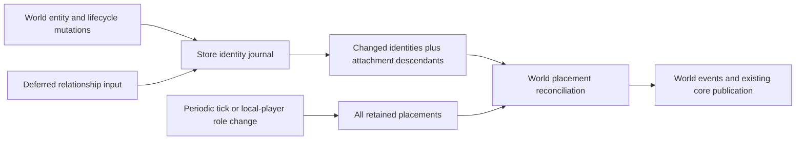

# Holtburger 3D Combat Physics Performance Investigation

Date: 2026-10-20, US Eastern time. Some diagnostic timestamps fall on 2026-10-21 UTC.
Updated: 2026-10-21, including the unattended second-scene capture and offline replay fixture.

Status: **The matched delivered-development five-pair performance gate passes: 28.81% less
combined message/physics work, with every candidate physics p95 below every baseline p95.
Architecture, controlled correctness and final host quality checks pass. Combat diagnostics are
complete; engineering handoff is ready. Representative original-fight coverage, live cadence under
that load, and the user's movement-feel acceptance remain open. Fixture development remains frozen.**

A headless capture/replay fixture supports warmed baseline and exploratory measurements for a
second scene. It provides a repeatable input workload; deterministic movement equivalence remains
outside its present guarantees.

## Execution contract and progress

This section is the working contract for the continuing performance effort. Update it after every
milestone with the change, evidence, result, remaining uncertainty, and next action. The historical
captures below remain evidence; completed checkboxes require the stated verification.

**Objective:** remove workload-induced movement slowdown by simplifying the complete client update
pipeline while preserving proven Asheron's Call movement and collision behavior. Engineering
completion and the user's final movement-feel acceptance are separate milestones.

### Scope and design constraints

- Review core input scheduling, derived publication, and time admission together with world scene
  preparation, character movement, collision queries, reconciliation, and accepted-state commit.
  Content owns immutable reference-data assembly; world owns physical meaning and accepted changes;
  core owns orchestration/projection; frontend presentation and control policy remain app-local.
- Prefer deleting, unifying, or avoiding repeated work before introducing caches, workers, or new
  abstractions. Replacing the collision solver is an evidence-driven design decision, not a required
  deliverable. Preserve the distinction between character-controller needs and general rigid-body
  simulation.
- Verify behavior-sensitive decisions against ACE, ACViewer, and the retail client decompile as
  applicable. Do not edit the retail decompile. Keep deliberate retail compatibility differences
  documented using the repository's marker convention.
- Use the existing unattended character/scene access and diagnostic harnesses. Keep raw scene data
  private. Existing fixture capture supports stationary observation; unsupported movement/combat
  inputs must become explicit, validated fixture inputs before being used as replay evidence.
- Keep debug-build performance as the primary acceptance surface. Record build flags, logging,
  content, machine load, and workload counts; a release build is supplemental evidence.
- Preserve unrelated work, including the existing ACE/ACViewer changes. Do not run the TUI or perform
  visual acceptance on the user's behalf. Local checkpoint commits are authorized; publishing
  branches or rewriting unrelated history is outside this effort.

### Definition of done

- [x] **Architecture:** trace one complete ordinary update and representative reset/correction
  paths, identify each layer's contracts, and document which mechanisms are retained, unified,
  removed, or replaced and why. Address timestep/overload behavior explicitly.
- [x] **Correctness:** add controlled-time movement scenarios that compare requested and accepted
  movement, contacts/support, corrections, and lifecycle/discontinuity outcomes. Equivalent entity
  counts and authoritative end positions alone are insufficient. Keep retained regression tests
  independent of uncommitted runtime assets; production-content checks remain diagnostics.
- [x] **Performance:** reduce combined message-handling and physics work by at least **25%** against
  a new controlled baseline of the current checkpoint, without worsening p95 active physics work
  beyond measured baseline variability. Compare the sum of the two non-overlapping work totals for
  the same input trace; do not add nested phase timings or pacing waits. Use at least five paired
  measured runs per version after explicit warmup, alternating version order, with the same fixture,
  content, build/logging settings, and workload/outcome checks. Preserve individual runs and p95s;
  do not select the fastest run or relabel the earlier noisy captures as this baseline.
- [ ] **Heavy-workload coverage:** exercise the supplied second scene and a movement/combat stress
  workload representative of the original slowdown. Record movers, projectiles, geometry, and
  requested movement so a smaller or less active population cannot satisfy the performance target.
  The current stationary replay is useful coverage, not proof of the original fight's resolution.
- [ ] **Live cadence:** verify at least **99%** summed admitted/elapsed simulation time over a
  representative **60-second** heavy live workload, with startup excluded and population/settings
  retained. Check tick intervals and input/accepted movement alongside admission. A changed cap,
  recorded-interval replay, or a quiet scene alone cannot satisfy this criterion.
- [x] **Quality and delivery:** remove superseded paths/vocabulary, review final ownership and
  invalidation obligations, pass relevant correctness tests, Clippy with warnings treated as errors,
  formatting/build checks, and update this document with reproducible evidence and remaining risks.
- [ ] **User acceptance:** the user confirms normal movement in the original heavy fight and any
  representative alternate scene. Report engineering readiness separately while this is pending;
  do not claim the user-facing issue is closed without that confirmation.

The numeric performance and cadence thresholds are acceptance targets, not established feasibility
claims. If evidence shows a target cannot be reached or verified within the available workload,
record the precise constraint and remaining options. Complete independent work and leave the
criterion open; do not silently lower targets or mark partial improvement as completion.

### Final engineering handoff audit

The authorized independently verifiable engineering work is complete at game/manifest source
`a52fbe29d`. Final audit on 2026-10-21 confirmed the current source still matches that checkpoint,
the normal debug host matches its recorded executable hash, every local document link resolves,
and the independent performance auditor still validates all ten reports and their provenance.

| Requirement | Evidence and disposition |
| --- | --- |
| Architecture | Complete: ordinary/reset/correction ownership and overload behavior reviewed; retained character-controller design and removed duplication documented below. |
| Controlled correctness | Complete: 996 world / 682 core tests, including independently bounded wall travel, support, correction, lifecycle, accepted paths and input handoff. |
| Offline performance | Complete: matched original-source five-pair gate, 28.81% less combined work; every candidate physics p95 below every baseline p95. |
| Quality and delivery | Complete: source review, 375 host tests, fixture/default all-target Clippy with warnings denied, formatting, normal debug build and client/Explorer sidecar smoke. |
| Representative heavy workload | Pending: available alternate windows contain about 94 movers versus about 153 in the original capture. |
| Cadence in that workload | Pending: alternate observations reach 99.87% / 99.93% admission over 65 s; original-workload cadence remains unverified. |
| User movement acceptance | Pending: requires the user's experience in the original heavy scene and representative alternate scene. |

The original debug endpoint at `127.0.0.1:9222` returned connection refused during the final audit.
The original live scene is therefore unavailable through the supplied endpoint. The goal explicitly
allows unavailable live validation and user acceptance to remain pending; the three unchecked
acceptance items stay open. Engineering handoff is complete and the movement issue remains open.

The normal development launch rebuilds the sidecar. Restart the usual `dev:client` launch before
checking movement in the original heavy scene. If slow motion remains, use that reproduction's
elapsed/admitted time, requested/accepted movement and CPU costs to select the next production
change. The 1/30-second single-step admission policy is unchanged, so renewed overruns can still
discard simulation time. Combat-driver or fixture refinement is not a prerequisite for feedback.

### Milestones and current progress

| Phase | State | Deliverable / next verification |
| --- | --- | --- |
| 0. Preserve evidence and checkpoint | Complete | Historical captures, geometry results, local raw fixture, and recovery references retained. |
| 1. Establish the controlled workload | Complete for the stationary replay; live qualification open | Original and candidate retain activation at input 14, 1,506 active ticks, 5,741 messages and peak population 286. The delivered-profile five-pair gate is valid and passes at 28.81%. Representative combat remains a separate open requirement. |
| 2. Define behavior and ownership | Complete for the defined architecture/correctness deliverables | Ordinary/reset/correction contracts and retained/unified/removed mechanisms audited below. Asset-free controlled drive, wall, return, support, reset, publication and handoff cases satisfy the scenario requirement. Representative live stress and rollout acceptance remain separate open gates. |
| 3. Simplify core orchestration/publication | Retained candidate verified offline | Control handoff fixed; metadata reuse and structural simplifications retained. Delivered-profile comparison gives 28.81% less combined work, with every candidate p95 below every baseline p95. Publication ownership experiment rejected and removed. |
| 4. Simplify world movement preparation | Retained candidate verified offline | Deferred/streamed support footprint, borrowed BSP/static selections and prepared-body ownership retained; unsuccessful traversal/query experiments removed. Full delivered-profile work/p95 gate passes. |
| 5. Verify overload and live movement | Available alternate observations complete; original-scene acceptance pending | Final normal-host windows admit 99.87% / 99.93% over 65 s; the latest records 444 accepted player paths. About 94 movers is below the original 153, so representative cadence and user movement acceptance remain open. Combat diagnostics are complete. |
| 6. Clean up and hand off | Engineering quality checks complete; live acceptance open | Source review, 996 world / 682 core / 375 host tests, fixture/default Clippy with warnings denied, formatting, normal debug host build and client/Explorer sidecar smoke pass. Combat diagnostics are complete. Engineering handoff is ready; representative original-scene cadence and user acceptance remain open. |

Completed foundations:

- [x] Localized significant slow motion to host overruns plus discarded simulation time.
- [x] Added opt-in host/core/world phase attribution and retained sanitized capture summaries.
- [x] Implemented and checked conservative static sweep rejection and outdoor-entry indexing;
  measured a 37.6% median reduction on the focused geometry trajectory benchmark.
- [x] Captured the supplied alternate scene and verified three server-free paced input replays.
- [x] Recorded the replay's limits: asynchronous startup, missing displacement oracle, and fixed
  recorded intervals that cannot demonstrate restored live cadence.

**Fixture freeze / action threshold:** the existing replay and asset-free correctness suites are
sufficient to judge bounded code changes. Keep the fixture and combat drivers frozen. Add diagnostic
code only to explain a reproduced production movement defect or measured CPU bottleneck. Judge
progress by production movement and CPU cost; attack acceptance is supporting evidence. Heavy
combat qualification and movement-feel checks remain final acceptance requirements; they do not
block independent engineering work.

**Next action:** hand off the current build for movement verification in the original heavy scene.
Reopen implementation only from a reproduced movement problem or measured production cost.
Combat-stimulus/readiness investigation is closed. The original objective is movement slowdown
under load; successful melee or magic attacks are not solver-design milestones. Fixture or driver
refinement is not a prerequisite for this handoff. Keep unavailable original-scene validation and
user movement-feel acceptance explicitly pending.

Normal host integration checks pass for the final source. The unchanged five-pair original-source
comparison completed and independently audited **35,681.50 → 25,402.41 ms**, **28.81% less combined work**, in the
matched delivered development profile. All ten workload/content checks pass. Candidate physics
p95s span **17.478–17.805 ms**, baseline **21.229–22.107 ms**; every candidate is below every
baseline. The offline work/p95 gate is satisfied; representative combat and movement feel are not.
[Complete comparison and independent audit](evidence/h3d-combat-physics-2026-10-20/alternating-acceptance-delivered-profile-a52fbe29d.json).

Do not expand the fixture or pursue melee readiness. The read-only inspector proves the character
has a wand equipped; ACE rejects melee with a caster (`Player_Combat.cs:811–819`). The rejected
requests explain a diagnostic limitation; they do not identify a new performance bottleneck.

The earlier **all-unoptimized** comparison at `114754c4f` remains preserved: **23.46%**, below
25%. It used a different compiler configuration and predates the support-streaming change.
The final delivered-profile comparison uses Parry/Glam level 3 on both original and candidate,
with workspace code at level 0. Do not add the separate 6.13% compiler experiment to source gains.
The original code baseline, frozen input and numeric gates are unchanged.

**Publication ownership experiment — rejected:** checkpoint `bca04e327` consumed before-views
and moved metadata rather than cloning. All 682 core tests and Clippy passed, but two alternating
pairs produced **26,806.51 → 26,987.89 ms** median combined work (**0.68% higher**). Paired changes
were 1.40% worse and 0.04% better; p95s were mixed. All four workload/content checks passed. Restore
both core files exactly to `4261f574d`; retain every report in
[the rejection evidence](evidence/h3d-combat-physics-2026-10-20/publication-owned-metadata-rejected.json).
Do not spend further effort on this publication branch.

**Solver support ownership — retained after final offline comparison:** support queries already defer footprint work until plane
admission. Consume transformed BSP vertices directly during the single edge walk, replacing the
intermediate vector. Preserve authored edge order, closing edge, degenerate-edge handling and
nearest-feature ties. Terrain and existing controlled footing tests use the same iterator contract.
No contact/support threshold, BSP traversal, geometry residency or replay input changes.
All 996 world and 682 core tests pass, including face/slope/edge/corner footing, triangle seams,
stair entry, low ceilings, hard-body support, corrected travel and lifecycle cases. Existing tests
were retained; only the test helper adapts to the iterator contract. World/core/harness all-target
Clippy passes with warnings denied. Two alternating pairs reduce median combined work
**27,006.67 → 26,553.23 ms (1.68%)**; paired gains are **3.31% / 0.05%**. Every workload/content
check passes. Candidate p95s **18.645 / 18.764 ms** are slightly higher than baseline
**18.439 / 18.573 ms**; no marginal tail improvement is claimed. This removes one allocation and
intermediate storage per admitted BSP support face, with no retained bookkeeping. The unchanged
overall original-source work/p95 gate subsequently passed at 28.81%; representative live
coverage remains open.
[All four reports and independent audit](evidence/h3d-combat-physics-2026-10-20/streamed-support-footprint-a52fbe29d.json).

At each phase boundary, reassess the remaining plan against new evidence and update ordering or
scope with the reason. This is a review checkpoint, not an automatic request for user confirmation.
Keep feasible independent work moving when a live workload or final human acceptance is unavailable.

### Git checkpoints and rollback policy

- Starting parent: `e74faf3bd3b3cb25806ef4f9be4ed15b5c336f41` on `3d-next`.
- Working branch: `work/h3d-physics-performance`.
- Fixed starting checkpoint: `safety/h3d-physics-start-20261021`, containing the profiling,
  initial geometry optimizations, runtime fixture, evidence summaries, and this execution contract.
  The reference is created at the checkpoint commit; keep it fixed during subsequent experiments.
- Existing ACE/ACViewer working-tree changes and the ACE gitlink change are excluded from the
  checkpoint. Raw captures and credentials remain ignored local files. Git preserves their source
  consumers and sanitized provenance, not the private runtime assets themselves.
- Make small, attributable commits at meaningful milestones, recording the commit and validation
  in the progress ledger below. Preserve a working checkpoint before a risky experiment; branch
  from it when alternative designs need independent comparison.
- Prefer reverting the specific experiment commit(s) or returning an isolated experiment worktree
  to its checkpoint. Inspect the current diff first. Avoid whole-tree hard resets, broad cleans,
  and stashing unrelated changes as a shortcut. A rollback must preserve unrelated work and the
  evidence needed to explain why the experiment was rejected.

| Milestone | Git reference | Evidence / outcome |
| --- | --- | --- |
| Streamed support footprint | `a52fbe29d` | Retained: two marginal pairs reduce work 1.68%, with slightly higher marginal p95s. Full delivered-profile gate subsequently passes at 28.81% with every candidate p95 below every original baseline p95. 996 world / 682 core tests and Clippy pass. |
| Current delivered-profile acceptance | Candidate `a52fbe29d` vs original `9cb7ba24e` plus matched diagnostics | Independently audited five-pair gate passes: 35,681.50 → 25,402.41 ms, 28.81% less combined work. All ten reports valid; every candidate p95 below every baseline p95. Compiler settings match on both sides. |
| Historical all-unoptimized acceptance | Candidate `114754c4f` vs original `9cb7ba24e` plus matched diagnostics | Valid ten-report all-unoptimized comparison: 23.46% combined-work reduction, below 25%. Every candidate p95 is below every baseline p95. Preserve all reports; this historical configuration misses its target. |
| Input/combat handoff | `114754c4f` | Unit regression failed before the fix and all 682 core tests pass after it, including held/released/expired/reacquired input. Live desired targets now survive to manual takeover; 99.95% admission in the smaller alternate scene. Later equipped-wand inspection explains rejection of this melee stimulus. |
| Development collision/math dependencies | `bbc9d4b6d`, retained at `d29dbef8b` | Two alternating configuration pairs, identical game source: 6.13% less median work, lower p95s in both pairs. Retain Parry/Glam level 3 with workspace debugging. This intentionally different-build comparison is excluded from source acceptance. |
| Borrowed static selections | `02cde557e`, retained at `04ef2e3e9` | Remove the second selection vector and duplicate geometry lookup across six query consumers. Two marginal pairs reduce combined work 2.29%; no consistent marginal p95 claim. 996 world / 681 core tests and Clippy pass. |
| Prepared-body ownership | `02bdbe098`, retained at `86a984c4b` | Move prepared mobile bodies into publication and remove the actuator pose copy. Two marginal pairs reduce work 2.07%, lower p95 in both pairs; 996 world / 681 core tests and Clippy pass. |
| Unchanged semantic collection | Experiment `86a984c4b`, reverted at `353f9c9df` | Reject: 0.45% higher median work with both pair directions worse. Preserve all reports; restore publisher exactly to the retained body-reuse checkpoint. |
| Initial investigation and fixture checkpoint | `safety/h3d-physics-start-20261021` | Verification and benchmark sections below; controlled optimization baseline still pending. |
| Controlled replay measurement tooling | `9cb7ba24e` | Explicit warmup and JSON reports added; five measured baseline runs completed with zero population mismatches and 1,500 active-start steps each. |
| Alternating acceptance comparison | Candidate `bc9e77f6e` vs baseline `9cb7ba24e` | Five pairs, explicit warmup each invocation; 36,275.49 → 27,773.18 ms median combined work (23.44%). All workload checks pass; every candidate p95 is below every baseline p95. Work target fails and remains open. |
| Ordered publication merge | Experiment `82b66cfa5`, subsequently reverted | Rejected: two alternating exploratory pairs give 27,820.23 → 27,861.62 ms median work (0.15% higher), with conflicting paired directions. All workload checks and 678 pre-rollback core tests pass; no map-removal benefit demonstrated. |
| Initial-hit and cylinder-side query reductions | `76095ab5b` / `e88219341`, rolled back after corrected measurement | Rejected: two alternating pairs versus qualified `e767b02e8` produce +1.79% / -2.02% work reductions and a 0.09% higher median. Every workload check passes. Preserve source/artifacts; remove both query branches and their new test. |
| Matched replay readiness qualification | Candidate `e767b02e8`; original `9cb7ba24e` plus diagnostic-only patch | Both versions under normal/single-CPU scheduling activate at input 14 with 1,506 active ticks; messages 5,741, physics 1,519, peak 286, population mismatches zero. Candidate 681 / baseline 679 core tests and Clippy pass. Matched five-pair comparison is valid; work gate still fails at 23.09%. |
| Frame-local metadata reuse | Experiment `e647d2437` | Exploratory combined medians improve 0.90% with conflicting pair directions; matched phase attribution reduces after-projection/diff mean 1.312 → 0.716 ms (45.46%). Retain for five-pair final verification. All workload checks, 996 world / 679 core tests, and broad Clippy pass. |
| Metadata-reuse five-pair attempt | Source `e647d2437`; ten reports retained | Invalid for acceptance: pair 1 candidate has 1,499 activated ticks, expected 1,500. Raw combined medians 35,690.98 → 27,365.60 ms (23.33%) also miss the target. All candidate p95s are below every baseline p95; no sample was replaced or dropped. |
| Deferred ancestry tracking | `bc9e77f6e`; patch/binary hashes in evidence | Retained for alternating measurement: median 27,431.13 ms (25.26% exploratory reduction); 995 world / 677 core tests and Clippy pass. Narrow threshold margin remains unaccepted. |
| Borrowed BSP candidates | `72c2e844a`; patch/binary hashes in evidence | Retained: median 28,331.40 ms (22.80% exploratory reduction); 995 world / 677 core tests and Clippy pass. Post-journal sampling does not support insertion as the dominant physics cost. |
| Bounded message placement | `78cd7cd40`; patch/binary hashes in evidence | Retained for paired verification: message work about halved, combined median 29,806.10 ms (18.79% below baseline). Physics work/p95 rose vs preceding exploration; 995 world / 677 core tests and broad Clippy pass. |
| Deferred support footprint | `faa72f340`; exact patch/binary hashes in evidence | Retained for paired verification: exploratory median 31,024.50 ms, 15.47% below baseline; 994 world / 677 core tests and Clippy pass. |
| Borrowed-incarnation visibility | `8bfd690ce`; exact patch/binary hashes in evidence | Retained for paired verification: exploratory median 32,071.31 ms, 12.61% below baseline. 994 world / 677 core tests and Clippy pass. |
| Controlled obstruction/correction and CPU attribution | `f1c54bfef`; profile hashes in evidence | Strengthen wall/path/support/reset and return-after-residency tests without production changes; 994 world tests and Clippy pass. Full CPU stacks identify placement/visibility and BSP preparation targets. |
| Direct storage membership | `c20bc9830`; binary/patch hashes in evidence | Retained for paired verification: exploratory combined median 33,167.17 ms, 9.63% below baseline; 994 world / 677 core tests pass. |
| Query-local traversal reuse | Private patch based on `9111877f1`, hashes in evidence | Rejected: median 34,558.39 ms vs burden-only 34,594.76 ms; no demonstrated benefit for added contracts. 994 world / 677 core tests passed before rollback. |
| Burden membership and controlled movement boundaries | `9111877f1`; source patch and binary hashes retained below | Remove repeated inventory traversals without retained caches; exploratory median work down 5.74%; 993 world and 677 core tests pass. Retained for further paired verification; final performance gate remains open. |

Future ledger rows must name the hypothesis, measured outcome, validation, and whether the change
was retained or reverted. Failed experiments remain useful evidence and should not disappear from
the investigation narrative when their code is rolled back.

The client slowed substantially at outdoor landblock `0x4ce1ffff`, especially during combat. The
user reported 200–300 FPS in other locations, drops below 60 FPS when fighting here, and movement
that felt like walking through molasses. Investigation separated presentation throughput from
authoritative simulation progress: the Rust host exceeded its physics budget, while a time clamp
discarded part of each delayed interval. The character could therefore move slowly even while the
frontend rendered around 100 FPS.

The dominant measured cost was geometry work for moving bodies. Two optimizations now reject
unreachable static shapes before exact collision queries and precompute which interior cells have
outdoor portals. A repeated production-content trajectory benchmark took approximately 38% less
time with an identical landing result. That result concerns collision prediction, not measured
combat FPS or a confirmed resolution of the movement slowdown. The subsequent live capture below
shows that the broader runtime pipeline still exceeds its available budget under heavier load.

## Current architecture and controlled-correctness review

**Verdict:** the architecture trace and controlled-scenario deliverables are complete for the
retained orchestration at `114754c4f`, extended by the bounded support-footprint change at
`a52fbe29d`. The reviewed optimizations and control handoff are ready within that source scope.
This does not approve heavy-fight behavior or rollout. The matched delivered-profile performance
comparison passes at 28.81%; the earlier all-unoptimized comparison remains preserved separately.
Host tests/build/smoke were repeated successfully after the support change; representative
combat and user movement acceptance remain pending. No general rigid-body solver replacement
is justified by the current measurements.

The ordinary path is now explicit: session delivers ordered packets; world accepts authoritative
entity/storage/lifecycle changes; core accepts queued movement and expiry, prepares combat policy
and publishes movement; core/world advance authored and physical state; world commits checked
mobile results and contact lifetimes; core emits complete accepted paths and current runtime
levels; host/frontend present those products. Local activation retires movement/combat/camera
state and invalidates asynchronous collision work under a new generation. Ordinary confirmation,
correction snap, checked recovery and discontinuity retain distinct world outcomes and core path
kinds. The detailed trace and modern-controller comparison below remain the supporting map.

| Mechanism and layer | Final disposition and contract |
| --- | --- |
| World storage/burden | Retain accepted ancestry as ownership authority. Direct membership avoids enumerating unrelated items; one local membership set per burden query preserves ordered floating-point summation and pending descriptions. No retained burden cache. |
| World placement discovery | Replace full message-wide reconciliation with manager-owned conservative mutation identities plus a locally derived descendant closure. Mutable access and lifecycle deletion record invalidation; player replacement and periodic world maintenance still reconcile all identities. The underlying entity map is private. |
| World static query preparation | Borrow BSP polygons and selected collider geometry from their owning products; resolve geometry once at selection. Shadow IDs still own ordering/deduplication and retail building-shell policy. Stream transformed support footprints only after plane admission, without intermediate vertex storage. These borrow/deferral changes add no persistent cache. |
| World contact transaction | Move prepared mobile-body snapshots into final publication; preserve fixed authored hard-target placement before mobile sweeps. Mobile results publish together after acceptance, while checked recovery remains a distinct later disposition. Fixed-placement and mobile-commit stages have different boundaries. |
| World physical response | Retain swept hard movement, support/stairs, bounded mobile separation, projectile handling and clipped residual overlap. Existing per-step bounds and sleeping-body obstacle participation remain. Rejected query branches are absent from production source. |
| Core movement/combat orchestration | Accept external input and pulse expiry before pursuit policy. Carry prior manual ownership and explicit-stop decisions in one consumed transient product, then reduce derived pursuit and publish in the same tick. No persistent handoff flag or second command queue. |
| Core dynamic publication | Retain full before views and accepted paths. Reuse only metadata proved unchanged by the entity-journal boundary and catalog identities; runtime placement/playback are projected afresh. Mutation, consumed journals and catalog replacement force full projection. No persistent last-published-view cache. |
| Core/content handoff | Retain immutable content products and generation/currentness checks. Replay-only waiting uses the normal publication path; live callers remain nonblocking. Diagnostic wait time is separately reported in both comparison versions. |
| Build and diagnostics | Retain optimized development Parry/Glam with workspace debugging defaults. Record the compiler benefit separately. Capture/replay and live stimulus remain diagnostic tools; a live attack-readiness failure is not a passing combat workload. |

The timestep decision is explicit: retain the 1/30 s solver-step bound and current single-step
host admission while validating the retained workload reductions. Sustained overruns still discard
simulation time. This remains an unresolved heavy-load/rollout risk, not evidence of normal
movement in the original fight. Retail's elapsed-time subdivision is documented below; no cap-only
fix, speculative catch-up state or unvalidated larger physics step has been introduced.

Controlled correctness was checked against assertions, not just test totals. In
[scene tests](../../crates/holtburger-world/src/spatial/scene.rs),
`controlled_collection_drive_obstruction_and_reset_preserve_accepted_movement_boundaries` compares
each requested step with committed displacement/path/contact, independently bounds wall travel by
wall plane and body radius, and checks that teleport retires motor/correction state and changes
path origin. `controlled_physical_return_preserves_wall_clipping_and_resumes_after_residency_change`
keeps a pending ordinary correction hard-clipped, then resumes swept return after geometry
replacement without a new packet or recovery teleport. Core tests separately cover return-to-origin
routes, membership-only updates, zero-duration correction publication, attachment/incarnation
changes, pending/consumed mutation journals and catalog replacement. The new runtime handoff case
covers held, released, expired and reacquired control. These retained tests use numeric geometry
and explicit clocks, not installed client archives.

Relevant suites passed: **996 world tests** and **682 fixture-enabled core tests**; core also passes
under the explicit all-unoptimized comparison settings. These tests satisfy the controlled-scenario
requirement. They do not replace the separately required representative fight, live cadence,
frontend/host integration checks or user acceptance.

The incremental support review at `a52fbe29d` traced both producers (placed BSP vertices and
terrain triangles) through the shared footprint consumer. Plane and minimum-vertex admission
remain; each authored vertex transforms once, the final edge closes to the stored first vertex,
and nearest-feature ties retain edge order. Iterator state lives only for that query. There is no
new retained representation, cache, invalidation event or world/host contract. Existing face,
slope, seam, corner, stair, ceiling and support-lifecycle assertions pass in the 996 world / 682
core suites. The marginal p95 increase is retained as a measured limitation; the full original-source
p95 gate subsequently passed. Consumed mutation journals and replaced immutable catalogs continue
to force full metadata projection; the rejected publication-ownership path is absent.

## Scene and measurement conditions

| Setting | Recorded condition |
| --- | --- |
| Location | Outdoor `0x4ce1ffff` |
| CPU | AMD Ryzen 9 5900X 12-Core Processor, x86_64 Linux |
| Client | Electron client launched with `--debug`; CDP port 9222 |
| Rust host | `target/debug/holtburger-3d-host` |
| Initial viewport | CSS and drawing buffer both 1845 × 1071 |
| Operator | User controlled movement and combat; diagnostic probes did not drive the character |
| Detailed contact capture | 624 active-world ticks; mean 282.5 known entities, 104.4 movers, 8.2 projectiles |

Scene interest radii, full graphics settings, and GPU identity were not retained for this
investigation. These timings describe this workload and machine rather than a general frame budget.
The user's usual 200–300 FPS was a reported comparison, not a separately captured baseline here.

The original measurements used uncommitted instrumentation and optimization changes above
`e74faf3bd3b3cb25806ef4f9be4ed15b5c336f41`; that parent alone does not reproduce either measured
binary. The starting checkpoint now retains the accumulated source and evidence; the benchmark
artifacts retain their measured binary hashes and stage-specific differences.

## Presentation measurements and initial leads

The first CDP capture showed approximately 9.6 FPS because the window lacked focus. The frontend
intentionally limits presentation to about 10 FPS in
[presentation-frame-loop.ts](../../apps/holtburger-3d/src/app/presentation-frame-loop.ts).
After the user focused H3D, a capture with CPU/GPU profiling disabled delivered 684 frames in
5.51 seconds, approximately 124 FPS. Its frame interval was at most 13.9 ms for 95% of samples and
27.8 ms at worst. Synchronous game-frame CPU work averaged approximately 5.1 ms.

During the first combat investigation, a separate capture with profiling disabled delivered
838 game frames in 8.51 seconds, approximately 98 FPS, with a worst observed animation-frame
interval of 34.8 ms. The displayed smoothed FPS also dipped to 56 during a profiled combat capture.
Those observations support reduced throughput and stalls; they do not establish a sustained
sub-60 average throughout the fight.

Renderer profiling measured GPU passes totaling approximately 1.1 ms. This is the sum of the
instrumented GPU spans, not complete GPU wall time. CPU samples included entity presentation,
spatial bounds, minimap work, nearby reconciliation, and host-message handling. Those were useful
leads, but the later host measurements localized the dominant movement problem more directly.

Several diagnostic limits mattered:

- The FPS display smooths its observations and takes time to recover after refocusing. Actual frame
  counts and focus state were checked separately. Its uncapped estimate is not delivered FPS.
- One later unprofiled observation window lost focus; its game-frame count was not treated as a
  focused combat measurement.
- A suspected stale-source mismatch proved to be TypeScript versus compiled JavaScript line
  numbering. Loaded source inspected through CDP matched the particle implementation on disk.
- Native `perf` sampling of the Rust host was denied by OS permissions, including a retry using
  `cpu-clock:u`. Explicit phase timings supplied the host attribution instead.

## Why movement slowed in real time

The core client schedules physics every 30 ms and uses Tokio's missed-tick `Skip` policy. It passes
actual elapsed time into simulation. Simulation then calls `admit_physical_duration`, which admits
at most `1 / 30` second, approximately 33.3 ms, and discards the rest.

These are two different constants: a 30 ms scheduler period is approximately 33.3 updates per
second, whereas the maximum admitted interval is 33.3 ms, equivalent to 30 updates per second.

Relevant code:

- [Core runtime scheduling and elapsed time](../../crates/holtburger-core/src/client/runtime.rs)
- [Simulation time admission](../../crates/holtburger-core/src/client/simulation.rs)
- [Maximum admitted physical duration](../../crates/holtburger-world/src/spatial/mobile_contact.rs)

An initial direct observation received only 121 presentation ticks in approximately seven seconds,
with a mean arrival gap of 57.9 ms and a maximum gap of 101.9 ms. The published durations also
showed delayed host intervals, so this was more than frontend delivery jitter. With only 121
updates, the maximum admitted simulation duration was about 4.03 seconds: at most 58% of the
seven seconds of real time.

Later host logs measured admission directly. In the detailed 624-tick capture, mean elapsed time
was 46.177 ms and mean admitted time was 32.749 ms. The ratio of summed admitted time to summed
elapsed time was **70.92%**. This is a simulation-time ratio, not a direct measurement of walking
speed: collisions, control state, and corrections can also affect displacement.

Sustained overload therefore creates real slow motion. Increasing the clamp would change collision
integration behavior while leaving the expensive work in place. The optimizations retain the
existing time-admission and overload policies.

## Host and contact attribution

Opt-in probes first separated input, movement, world updates, collision-content readiness,
simulation, entity projection, camera solving, and event enqueueing. Host-adapter probes separately
measured event projection, output-queue waits, MessagePack encoding, and pipe writes.

The first active-world host capture contained 582 ticks. Mean host tick work was 38.66 ms, with
28.19 ms attributed to simulation. Physical contacts accounted for 25.41 ms, approximately 90% of
the inner simulation duration. Mean tick interval was 48.34 ms. Event forwarding and pipe output
were small costs in that capture. A debug host process was also observed consuming roughly one
CPU core; release mode was not used as a substitute for investigating the work.

The next probe split contacts into scene preparation/publication, integration/reporting, and the
integration phases. The complete sanitized summary for this pre-optimization capture is retained
in [contact-summary.json](evidence/h3d-combat-physics-2026-10-20/contact-summary.json).

| Boundary or phase | Mean ms | 95th percentile ms |
| --- | ---: | ---: |
| Entire host physics tick | 36.408 | 42.832 |
| Inner simulation | 26.111 | 31.706 |
| Physical contacts including client consequences | 23.425 | 28.559 |
| Scene contact collection | 22.771 | 27.807 |
| Contact integration | 18.154 | 22.721 |
| Mobile movement sweeps | **11.515** | **15.324** |
| Support checks and hard-body movement | **3.606** | **4.520** |
| Correction sweeps | 1.202 | 2.587 |
| Collision reporting | 0.937 | 1.205 |
| Final support confirmation | 0.711 | 0.935 |
| Projectile processing and result construction | 0.609 | 0.912 |
| Crowd admission | 0.089 | 0.119 |
| Crowd candidate selection | 0.079 | 0.100 |
| Crowd separation response | 0.104 | 0.141 |

The boundaries are nested; their totals must not be added together. Percentiles belong to each
phase independently. The retained summary also includes medians, maxima, workload counts, and a
hash of the original log. Phase clocks measure elapsed wall time, including waits and scheduling;
enabled probes also incur formatting and logging overhead.

There were only 9.1 candidate crowd pairs per tick on average. Admission, pair selection, and
separation together averaged approximately 0.27 ms. In this scene, optimizing the pair loop would
address much less work than the geometry-query path.

The mobile movement bucket includes translation, optional stair/edge navigation, support settling,
and orientation clearance. It should not be interpreted as triangle/BSP intersection time alone.

## Implemented optimizations and ownership

### Reject static shapes outside the swept volume

The static collision index selects shapes through 24-metre outdoor cells and reached interior
domains. A selected shape can share a coarse cell with the mover while remaining far outside its
short movement path. Previously it could still enter the exact shape/BSP query.

[Static sphere sweeps](../../crates/holtburger-world/src/spatial/collision/static_sphere_sweep.rs)
now reject those shapes using their existing conservative bounds and a sphere containing the
entire nominal swept volume. The bound uses the original displacement and full body radius. Its
center is reanchored before adding half the displacement so distant request coordinates do not
round away short local movement. Terrain selection reuses the query's derived radius.

This belongs to the **world collision-query layer**. The exact solver, hit ordering, contact band,
and accepted-path coverage checks remain responsible for possible collisions. This is a query
selection optimization, not a change to authored collision behavior.

### Assemble outdoor entry candidates once

Outdoor traversal repeatedly scanned all interior cell volumes to discover which ones contained
an outdoor portal. Some paths also transformed start and end points into cells that had no outdoor
portal and therefore could not contribute an entry transition.

[LandblockColliders](../../crates/holtburger-content/src/object_collision.rs) now computes an
assembly-order index of outdoor entry volumes when collision content is constructed. Absorption
of another assembly offsets and carries those indices together with the cell volumes. Duplicate
selectors and assembly order are preserved.

[World traversal](../../crates/holtburger-world/src/spatial/collision.rs) consumes that list for
outdoor placement, outdoor portal crossings, and static part-box entry checks. It still applies
the existing exact portal, containment, and reach rules. Interior traversal and recovery searches
that require all cells retain the complete volume collection.

The derived static reference data belongs to the **content layer**; query interpretation remains
in **world**. No explorer or TUI policy moved into a shared simulation contract.

## Benchmark comparison

The existing `precise_jump_benchmark` exercised canonical production content from the same
landblock. Its center asset contained 160 static colliders and 71 interior cells. The benchmark
loaded its normal collision neighborhood, resolved the start/target surfaces, and evaluated a
complete trajectory with a 60-tick horizon. The trajectory landed after 55 solver ticks.

```bash
cargo run -p holtburger-debug-harness --bin precise_jump_benchmark -- \
  --landblock 0x4ce1ffff \
  --start 118,42,100 --target 120,42,100 --resolve-ground \
  --iterations 100 --ticks 60
```

Five separate processes per version each performed the harness warmup followed by 100 timed
evaluations. Before/after process order alternated between repetitions. Measurements used debug
binaries and the same content, arguments, and machine.

| Version | Median ms per complete prediction | Minimum ms | Maximum ms |
| --- | ---: | ---: | ---: |
| Before both optimizations | 8.350 | 8.056 | 8.657 |
| After both optimizations | 5.212 | 5.073 | 5.437 |

The median reduction was **37.6%**, rounded to 38% in discussion. These are whole 55-step prediction
evaluations, not individual host ticks. All ten runs produced the same landing point
`(120.034004, 42.000626, 63.502235)`, normal `(-0.07179582, 0.50257075, 0.8615498)`, outdoor committed
cell, target match, and accepted segment count.

[geometry-benchmark.json](evidence/h3d-combat-physics-2026-10-20/geometry-benchmark.json) retains
the individual results, configuration, binary hashes, and measurement-stage provenance. The paired
optimized binary preceded the final distant-frame midpoint arithmetic hardening; this benchmark
uses the owner as its request anchor. Final collision regression tests passed after that hardening.

This benchmark proves a reduction for a focused production-content query workload. It does not
measure the complete combat population, frontend FPS, or post-change simulation-time admission.

## Verification

The optimization checks passed:

- 14 content collision tests, including outdoor entry ordering, duplicate selectors, assembly
  absorption, and empty collections.
- 90 collision tests, including a new differential comparison against exhaustive exact shape
  queries across balls, cylinders, BSP geometry, scales, rotations, and neighboring/distant frames.
- 166 contact-related tests covering crowd response, stair travel, slopes, portals, collision
  reporting, and related world semantics. These filters overlap some collision coverage.
- Clippy for content, world, core, and the 3D host, with warnings treated as errors; formatting and
  `git diff --check`; successful debug host build.

Earlier instrumentation verification also passed the existing core simulation/runtime and host
lifecycle/protocol tests and the sidecar smoke check with logging enabled. A deterministic
101-body synthetic workload produced identical movement, collision-work, and penetration outputs
with phase profiling enabled and disabled. Disabled contact profiling emitted no phase records.

No new retained test depends on installed client archives. The production-content benchmark is an
explicit diagnostic run. Visual acceptance remains with the user. Those initial checks preceded the
checkpoint commits; the existing ACE and ACViewer submodule changes were left untouched.

## Post-optimization live capture

After restarting with the optimized debug host, the user repeated movement and combat in the
problem scene. The user reported noticeable improvement but still significant movement slowdown.
The fresh log spans `2026-10-21T03:41:07Z`–`03:41:49Z`, including startup, and contains 686 completed
active-world host ticks and 687 inner simulation samples. The final inner sample has no completed
outer tick record. Sanitized measurements and the source-log hash are retained in
[post-optimization-contact-summary.json](evidence/h3d-combat-physics-2026-10-20/post-optimization-contact-summary.json).

Across the active simulation samples, admitted time was **75.32% of elapsed time**. Mean host tick
work was 33.43 ms, with a mean interval of 42.82 ms; their respective 95th percentiles were 43.57 ms
and 70.95 ms. Population increased during the capture. The following means compare the first
five-second active window with the heaviest five-second window, starting about 20 seconds later.
Logger timestamps define these windows; they do not independently identify walking/combat boundaries.

| Measurement | Early window | Heaviest window |
| --- | ---: | ---: |
| Completed host ticks | 134 | 92 |
| Known entities | 241.4 | 385.3 |
| Movers | 92.7 | 153.4 |
| Projectiles | 0 | 12.8 |
| Host physics work | 21.89 ms | 41.82 ms |
| Host physics interval | 30.25 ms | 54.09 ms |
| Admitted / elapsed simulation time | 98.62% | **61.62%** |
| Network batch work | 3.35 ms | 11.19 ms |
| Mobile movement sweeps | 3.43 ms | 10.10 ms |
| Support checks and hard-body movement | 2.82 ms | 4.52 ms |
| Crowd separation response | 0.07 ms | 0.17 ms |

In the heavy window, before/after dynamic entity projection and comparison together cost another
5.21 ms per physics tick. Network processing ran 95 batches alongside 92 physics ticks. Network
batch time is separate from physics work; contact phases are nested inside physics work.

The fresh workload had more movers than the retained pre-optimization capture, so the live logs
do not establish a controlled before/after speedup. No fresh delivered-FPS or GPU measurement was
collected. The time-admission measurements do establish continued simulation slowdown. They do
not exclude additional movement rejection from contacts or corrections; displacement and accepted
movement still need separate attribution if symptoms remain after restoring cadence.

## Pipeline contract review: 2026-10-21

The ordinary path crosses several layers before and after collision integration:

| Boundary | Owner and contract | Review finding |
| --- | --- | --- |
| Receive and sequence | Session reassembles transport messages; core additionally orders character GameEvents before mutation. | Preserve both ordering domains. The 8 ms network batch budget is checked after complete received event lists. |
| Apply server facts | World handlers update entity/storage/placement authority and return typed world events. | The original boundary seeded and reconciled all placements around every message. The current experiment seeds pending identities and reconciles changed identities plus descendants; periodic maintenance remains full. |
| Project message effects | Core consumes world events, reconciles client behaviors, and publishes entity/dynamic changes. | Semantic publication runs after ordinary messages; some world events also trigger full dynamic upserts or snapshots. |
| Prepare authority step | Core samples elapsed time, applies queued controls, advances movement commands, runs world maintenance, and installs matching content completions. | World maintenance scans placement/visibility state; collision preparation remains generation-gated. Content loading cannot be replaced with guessed availability. |
| Admit and advance motion | Core admits a bounded interval before world-authored cursors and physical inputs advance. | Lost time affects motion as well as collision integration. A larger cap alone changes this contract. |
| Solve physical bodies | World prepares bodies/targets, refreshes support, advances hard targets, samples yielding intent, performs movement sweeps, bounded crowd response, correction sweeps, and support confirmation. | This is a character-controller/contact pipeline with projectile handling. Hard geometry has final authority; residual crowd overlap is deliberately allowed after clipped separation. |
| Commit accepted state | World publishes accepted body states, paths, report lifetimes, and checked recovery dispositions. | A recovery replaces the ordinary movement outcome. Attempted topology and accepted path coverage remain different facts. |
| Publish/present | Core projects dynamic state before/after, pairs accepted paths with changes, solves camera, and emits one presentation update; host serializes; frontend presents. | Full before/after view projection rediscovering changes is outside the solver and independently measurable. |

Source seams inspected: [world message entry](../../crates/holtburger-world/src/state/types.rs),
[placement lifecycle](../../crates/holtburger-world/src/state/attachment_lifecycle.rs),
[core runtime](../../crates/holtburger-core/src/client/runtime.rs),
[core simulation](../../crates/holtburger-core/src/client/simulation.rs),
[collision preparation](../../crates/holtburger-core/src/client/collision.rs),
[contact collection](../../crates/holtburger-world/src/spatial/scene/contact_collection.rs), and
[dynamic projection](../../crates/holtburger-core/src/client/dynamic_entity_view.rs).

The reset/correction path has distinct contracts. A local teleport or forced-position sequence
selects a discontinuous world pose effect; ordinary authority confirmation does not directly
replace simulated movement. Core retires the movement epoch, invalidates collision preparation,
resets camera state, and gates solving behind world activation and the current generation.
Remote updates select interpolation, bounded ordinary snap, or discontinuous reset according to
their sequence/recovery state. World contact recovery can replace an integrated outcome with a
recovered placement. Preserve those distinctions through publication; a single endpoint is not
an adequate replacement for their path/discontinuity contracts. See
[world pose mutations](../../crates/holtburger-world/src/state/mutations.rs),
[core authority handling](../../crates/holtburger-core/src/client/messages.rs), and
[world activation](../../crates/holtburger-core/src/client/mod.rs).

An additional structural cost surfaced in the cross-layer review:
[player burden](../../crates/holtburger-world/src/context.rs) iterates the inventory and calls
`is_in_player_inventory` for nested-item parents, which starts another complete inventory query.
For WorldState that query also walks accepted storage ancestry. This makes repeated burden
resolution quadratic in inventory size rather than merely a collision-population issue. Jump
capabilities resolve burden through run rate and again through jump height; core also resolves
jump capabilities when publishing the charge-duration UI field. Exact contribution remains to be
measured. The narrow first experiment resolves membership once within each burden query, retaining
iteration/summation order, unknown-description behavior, and container aggregate semantics. No
retained cache or invalidation scheme is needed. ACE's
[container inventory loading](../../ACE/Source/ACE.Server/WorldObjects/Container.cs) explicitly adds
each side container's aggregate burden including its children, which explains the existing
double-count prevention rule being preserved.

This is a source-backed ownership review, not final approval of all subsystem contracts. Controlled
movement/reset scenarios, measured acceptance, and final cleanup remain required. The next
implementation choice follows measurements, rather than a requirement to replace geometry math.

## First goal experiment: inventory membership in burden resolution

The world-owned burden query now materializes the current inventory once and builds a local
membership set for parent checks. It preserves the original iteration/summation order, requires
descriptions for nested items before reporting known burden, and retains aggregate-container
double-count prevention. The set has no retained lifetime or invalidation contract. This removes
the nested inventory traversal without changing burden values, movement equations, collision
participation, input scheduling, or publication timing.

An untimed full warmup followed by two exploratory measured runs produced:

| Measurement | Controlled baseline (five runs) | Burden experiment (two runs) |
| --- | ---: | ---: |
| Median combined message/physics work | 36,700.96 ms | 34,594.76 ms |
| Individual experiment work totals | See retained baseline evidence | 34,050.08 / 35,139.44 ms |
| Active physics p95 | 22.750–23.218 ms | 21.453 / 22.080 ms |
| Active-start steps per run | 1,500 | 1,500 |
| Entity-count mismatches per run | 0 | 0 |

The exploratory median reduction is **5.74%**. Baseline and experiment were measured sequentially,
not as five alternating pairs; this is directional evidence and does not satisfy the 25% target
or final measurement protocol. Raw runs, exact experiment binary, and the context source patch
remain private under `caps/runtime-fixtures/2026-10-21-4ae1/burden-membership/`. Sanitized individual
reports and hashes are retained in
[burden-membership-exploratory.json](evidence/h3d-combat-physics-2026-10-20/burden-membership-exploratory.json).

The new simulated-player audit confirms that paced replay is not bitwise deterministic: final
runtime positions vary by millimetres even among baseline runs. Authoritative final positions
remain fixed. Do not use exact equality of paced final runtime poses as a collision correctness
oracle or explain away larger differences without controlled investigation.

Two new world-context tests preserve pending nested-description and partial-view parent semantics;
existing nested-container burden/run-rate coverage also passes. A new asset-free
`controlled_collection_drive_and_reset_preserve_accepted_movement_boundaries` scenario in
[scene tests](../../crates/holtburger-world/src/spatial/scene.rs) drives a grounded body with an
explicit clock/quantum and checks requested displacement, committed displacement, published path,
and contact state at every step. It then installs a pending ordinary correction and a discontinuous
reset, verifying that old motor motion, correction state, and path origin do not leak into the new
epoch. This is a bounded movement contract check; broader obstruction, portal, correction, and
crowd scenarios remain part of the outstanding oracle work.

Verification for this experiment: **993 world tests and 677 core tests passed**, including the
new collection scenario and runtime-fixture tests. World/core Clippy across all targets with the
runtime-fixture feature passed with warnings treated as errors. Formatting and whitespace checks
passed. The change is retained for subsequent comparisons; no heavy live-cadence or user-feel
resolution is claimed.

## Query-local traversal experiment: rejected after measurement

The dynamic-publication seam review confirmed that full before/after comparison protects more than
pose: animation playback, authored physics flags, contact, sampling state, and spatial membership
can change inside simulation, and simulation consequences can themselves emit dynamic upserts.
A persistent last-published-view cache would need explicit handling for those mid-step publications
and lifecycle resets. No such cache was added. The rejected experiment instead retained
already-computed traversal data at the world query layer, with no cross-tick invalidation lifetime.

Candidate sphere queries already infer initial placement and directed center crossings for the
attempted segment. A private `PreparedSphereTraversal` carried the exact request, candidate
membership, initial placement, crossings, and terminal traversal cell into hit/acceptance finishing.
The request and its preparation travel together, preventing callers from pairing unrelated geometry
with a retained traversal. Attempted candidate reach still does not certify accepted placement.

When the accepted fraction is exactly one and the request began from a retained EnvCell, preparation
and ordinary path traversal have identical inputs and start semantics. That case reuses the
computed initial placement and crossings, resolves endpoint containment/recovery afresh, appends
the accepted endpoint, and runs the existing coverage validation. Clipped paths retain fresh
traversal of their shorter segment. Outdoor-start queries retain their distinct acquisition path.
Static, hard-entity, camera, and solid-recovery queries share the same finishing contract.

An initial prototype treated an unfinished crossing prefix as a complete placed path; four existing
no-crossing/recovery tests caught its nonempty-path invariant violation. The final preparation type
stores initial placement and crossing components explicitly, with no completed-path claim. The
prototype failure was corrected before performance measurement or checkpointing.

The experimental **994-test world suite** passed, including a new **1,728-case** exact differential check
against the public fresh path-traversal API. The corpus includes clipped and full travel, stationary
requests, direct/coincident outdoor portals, invalid-start recovery, multiple sphere radii, and
neighboring/distant anchor frames. World/core Clippy across all targets with runtime-fixture enabled
also passed with warnings treated as errors; **677 core tests** passed.

One warmup followed by two measured replays produced combined message/physics work of
**34,901.54 ms** and **34,215.24 ms**, median **34,558.39 ms**. The burden-only experiment
median was **34,594.76 ms**: the apparent **0.105%** difference is far smaller than the observed
run-to-run spread. Active physics p95 was **21.835 ms** and **21.416 ms**; workload counts stayed
at 5,741 messages, 1,519 physics steps, 1,500 active-start steps, peak 286 entities, and zero
population mismatches. These sequential exploratory samples do not establish a small gain.

**Decision: revert the traversal experiment and its implementation-specific differential test.**
The extra preparation representation and retained-cell/full-fraction branch are not justified by
the measured result. The private source patch and executable remain available for reproduction;
[sanitized evidence](evidence/h3d-combat-physics-2026-10-20/prepared-traversal-exploratory.json)
records hashes, individual results, and limitations. This removes the experiment only; the burden
optimization and prior geometry optimizations remain. No final performance or cadence gate is met.

## Character-controller architecture comparison

Primary references consulted 2026-10-21: [PhysX 5.6.1 character controllers](https://nvidia-omniverse.github.io/PhysX/physx/5.6.1/docs/CharacterControllers.html),
[Jolt CharacterVirtual 5.3.0](https://jrouwe.github.io/JoltPhysicsDocs/5.3.0/class_character_virtual.html),
and [Jolt's architecture documentation](https://github.com/jrouwe/JoltPhysics/blob/master/Docs/Architecture.md).
These are the specific references reviewed, not a claim that these are the newest library releases.

PhysX documents a specialized kinematic collide-and-slide controller, separate overlap recovery,
precise sweeps, slope/stair policy, and explicit update ordering. Its geometry cache has an explicit
invalidation obligation when objects change. Jolt distinguishes a constrained rigid-body character
from a query-driven virtual controller; the latter permits game-specific update placement but has
ordering tradeoffs. CharacterVirtual composes ordinary update, floor attachment, and stairs, exposes
contact refresh after teleport, and groups contact-lifetime callbacks across multiple operations.

**Assessment from our source review:** the present world solver belongs to this specialized
character-controller family. It is not obsolete merely because it does not implement a general
rigid-body constraint solver. This comparison establishes architectural resemblance, not numerical
parity, implementation quality, or adequate performance.

| Concern | Current owning layer and evidence | Engineering decision / unresolved friction |
| --- | --- | --- |
| Swept travel and bounded continuation | World: `mobile_contact/step.rs` integrates prepared actuation, sweeps hard geometry, and bounds slide continuation; `step/stairs.rs` owns support/navigation alternatives. | Retain this family of mechanisms. Prove requested/accepted motion and query cost before replacing it. |
| Ground, teleports, and contact lifetimes | World: scene collection prepares support, commits accepted paths, publishes collision reports, and retires reconciliation on discontinuities. Core supplies input and consumes outcomes. | Keep recovery, ordinary travel, and zero-time corrections distinct. Expand controlled obstruction/correction scenarios; endpoint equality alone is inadequate. |
| Spatial preparation | Content owns immutable geometry; world owns membership, query admission, hard-target BVH, and accepted placement. | Retain these ownership boundaries. Reject unmeasured extra preparation contracts, as in the traversal experiment. A retained geometry cache would require measured need and explicit scene-revision invalidation. |
| Update ordering and overload | Core owns scheduling, content polling, simulation consequences, dynamic publication, and camera advancement. World admits a bounded interval. | These are system-level decisions outside a standalone controller. Current overruns discard simulation time; controller resemblance cannot justify that movement slowdown. Resolve workload cost and explicit overload policy together. |

The highest-confidence simplifications so far remove redundant discovery around the solver rather
than replace its contact mathematics. Core's repeated full projection and world's repeated placement
resolution remain open structural costs. Existing support reuse and sleeping-body contact participation
must survive any redesign. This comparison does not establish a case for solver replacement or an additional caching layer.

## Storage membership experiment: retained for paired verification

A new phase-attributed replay of the retained burden checkpoint completed with 1,497 populated
physics samples. Mean work was **19.333 ms** per populated tick: **2.015 ms** world lifecycle,
**1.207 ms** before projection, **1.538 ms** after projection/diff, and **13.357 ms** simulation.
Within contact integration, support/hard movement averaged **2.531 ms** and mobile movement sweeps
**3.770 ms**. This run enabled phase logging and used no explicit warmup; it identifies where work
occurs and is not an acceptance comparison. [Phase evidence](evidence/h3d-combat-physics-2026-10-20/burden-phase-attribution.json)
records build provenance and sample counts. Its population filter excludes physics records with
zero advancing bodies; this is a different sample definition from controlled active-start counts.

The source review found another full-inventory enumeration in `retention_snapshot`: every queried
item calls the blanket extension's inventory-membership predicate. Enumeration scans accepted
storage identities and checks each ancestry until the requested item is found. Storage already owns
an exact per-item ancestry query, `owned_by`, used by that same enumeration. For a single membership
request, enumerating other items adds work without establishing another fact.

The experiment moves `is_in_player_inventory` from the blanket extension into the existing
`WorldContext` contract. Its default preserves enumeration-based read-model semantics; WorldState
uses `StorageState::owned_by` directly. The owning world layer thus answers its own accepted-storage
question in ancestry depth rather than scanning unrelated items. No persistent cache, invalidation
state, new trait, or frontend policy is introduced. Callers import the owning trait where required.
The earlier local burden-membership set stays because a generic read model can supply partial
inventory membership and because burden needs a complete ordered traversal regardless.

A new asset-free scenario checks membership against both explicit expected sets and enumeration
through nested missing descriptions, equipment awaiting a mask, stale description arrival, ancestor
transfer, direct child transfer, withdrawal, and loss of player identity. All **994 world tests** and
**677 core tests** pass. CLI all-target compilation passes; world/core/CLI Clippy across all targets
with runtime-fixture enabled passes with warnings treated as errors. Formatting and whitespace
checks pass.

One explicit warmup and two measured replays produced combined work of **32,988.67 ms** and
**33,345.67 ms**, median **33,167.17 ms**. This is **4.13%** below the burden-only exploratory
median and **9.63%** below the controlled starting baseline. Active physics p95 was **20.293 ms**
and **20.883 ms**. Both runs retained 5,741 messages, 1,519 physics steps, 1,500 active-start steps,
peak 286 entities, and zero population mismatches. Authoritative final poses matched; simulated
poses still show the millimetre-scale variability already present in the baseline.

**Decision: retain for paired verification.** The direct owner query removes unrelated enumeration
without adding retained state, and both exploratory samples are below the burden-only samples.
These sequential two-run results do not meet the five alternating-pair requirement or the 25%
performance target. [Sanitized evidence](evidence/h3d-combat-physics-2026-10-20/storage-membership-exploratory.json)
retains individual reports, binary/patch hashes, and limitations. No live-cadence or user-feel
resolution is claimed.

## Controlled obstruction/correction checks and CPU attribution

The asset-free collection drive/reset scenario now includes a known vertical wall. Each admitted
interval uses the same `CONTACT_INTERVAL` for integration and the supplied clock. Its independent
position bound is the wall plane minus the actual movement-sphere radius, rather than another solver
result. Every drive step checks requested travel against the analytically clipped endpoint,
accepted displacement against the published root change, path endpoints against those roots, and
continued grounded contact. The corpus must reach and stay clipped at the wall. Teleport afterward
must clear motor continuation and pending ordinary correction and begin the next path at the new
origin. This test passed without production behavior changes.

The previous blocked-return test has been rewritten around controlled admitted intervals. A server
reference beyond a wall remains pending while accepted path endpoints and displacement agree with
the collision-limited body. Replacing residency with the unobstructed floor must let that same
reference resume swept return and settle within `RETAIL_INTERPOLATION_TARGET_THRESHOLD_M`, without
a new packet or a recovery placement. It also retains grounded support throughout. These scenarios
extend the movement oracle; they do not establish original-scene contact equivalence or live time
admission. The full **994 world tests**, world all-target Clippy with warnings as errors, formatting,
and whitespace checks pass. This milestone changes retained tests only.

To avoid choosing more low-contribution targets, the preserved `c20bc9830` fixture executable was
sampled with the installed gperftools library at 100 Hz. Default stack unwinding recovered only
1.134 frames per sample on average; selecting its `libunwind` implementation recovered **42.34**.
The useful capture contains **4,136 CPU samples**. Kernel perf sampling was unavailable; no host
configuration was changed. The temporary profiler is loaded into this diagnostic process only and
introduces no repository dependency or client feature.

| Inclusive operation | Share of sampled CPU | Implication |
| --- | --- | --- |
| World `resolve_scene_placement` | 12.19% | Review repeated graph/visibility discovery, including calls from lifecycle and core projection. |
| Core `current_dynamic_entity_views` | 9.28% | Full projection remains substantial; preserve motion/physics semantics while looking for shared authoritative facts. |
| World `visit_polygon_leaves` | 10.54% | Review the immutable BSP query representation and placed polygon preparation; broadphase rejection alone does not remove this work. |
| World `placed_supports` | 8.34% | Nested within the query work above; inspect repeated ID lookups and geometry transforms, not only collision passes. |
| World `resolve_self_jump_capabilities` | 0.53% | Further narrowing this query is not justified as the primary target in this workload. |

**These inclusive percentages overlap and must not be added.** The recording includes cold bootstrap,
worker activity, sampler overhead, and a world-test build overlapping its beginning. It identifies
call paths rather than supplying acceptance timing or a steady-state physics-only percentage.
[Sanitized CPU evidence](evidence/h3d-combat-physics-2026-10-20/storage-membership-cpu-attribution.json)
retains the source/binary/library/profile hashes, individual sampled operations, limitations, and
next hypotheses. Raw profiles, mappings, reports, and the parser stay in the ignored private fixture
area for reproduction.

## Borrowed-incarnation visibility experiment: retained for paired verification

The placement/visibility CPU stacks led to a repeated-read finding in the owning world layer.
For each attachment-chain endpoint, `resolve_scene_placement` fetched the entity, then
`is_entity_client_visible` fetched it again, then `current_instance_delete_requested` fetched it a
third time to inspect its instance sequence. Visible-entity lookup repeated the same discovery;
visible iteration also looked up records it already held.

The experiment centralizes the deletion test for an already borrowed retained entity in
`instance_delete_applies`. GUID-facing queries still fetch their requested identity once; placement
resolution and filtered lookup/iteration use the entity already supplied by their owning store.
The request is checked against that incarnation's actual sequence. Missing entities, unconditional
deletes, future-instance deletes, and stale deletes keep their existing meaning. No last-published
view, memoization, or graph-invalidation state is introduced. The core projection contract stays intact.

The full **994 world tests** and **677 core tests** pass, including existing current/future/stale
delete, visible iteration, attachment-cycle and missing-root coverage. World/core all-target Clippy
with runtime-fixture and warnings as errors passes; the replay harness builds. One explicit warmup followed by two exploratory
runs produced combined work of **32,124.76 ms** and **32,017.85 ms**, median **32,071.31 ms**.
This is **3.30%** below the direct-storage experiment and **12.61%** below the controlled starting
baseline. Active physics p95 was **20.756 ms** and **20.628 ms**. Both runs retained 5,741 messages,
1,519 physics steps, 1,500 active-start steps, peak 286 entities, and zero population mismatches.

**Decision: retain for paired verification.** The source change removes two unnecessary lookups
from each ancestry endpoint without adding retained state, and both exploratory samples improved
on the preceding experiment. [Sanitized results](evidence/h3d-combat-physics-2026-10-20/borrowed-visibility-exploratory.json)
retain individual reports and source/binary hashes. Sequential two-sample comparison is still not
final acceptance; the 25% target, alternating pairs, heavy stress coverage, and live cadence remain open.

The next geometry source review also found that `placed_supports` transforms and allocates polygon
vertices before `support_on_polygon` rejects unsuitable plane normals or unreachable plane heights.
A possible follow-up is to admit the plane before materializing its footprint, preserving the exact
normal/height arithmetic and performing each derived check once. This is a source-backed hypothesis,
not an implemented or measured optimization. A more extensive compiled BSP representation must
justify its API and memory cost before being introduced.

## Deferred support footprint experiment: retained for paired verification

`placed_supports` previously transformed every visited polygon vertex and allocated a vector before
its common support predicate rejected downward/vertical normals or plane heights outside the query's
rise/drop envelope. The world query now accepts a local `FnOnce` that supplies polygon vertices only
after the existing plane checks pass. BSP vertices are transformed on demand; terrain returns a
borrowed slice and adds no new allocation. The existing `ShapeSupport` result still carries the one
computed height and footprint. No prepared-state type, cache, invalidation contract, extra threshold,
or alternate numerical predicate is introduced.

The same normal/height/footprint arithmetic and accepted outputs remain; only pure geometry
materialization is deferred. The full **994 world tests** and **677 core tests** pass, including
footing seams/corners/slopes, stair entry and ceiling clearance, terrain recovery, hard-entity support,
and the controlled drive/wall/reset and blocked-return/residency scenarios. World/core all-target
Clippy with runtime-fixture and warnings as errors, formatting/whitespace checks, and harness build
pass. One explicit warmup and two exploratory measurements produced combined work of
**31,257.17 ms** and **30,791.83 ms**, median **31,024.50 ms**: **3.26%** below the borrowed-visibility
experiment and **15.47%** below the controlled starting baseline. Active physics p95 was **19.698 ms**
and **19.804 ms**. Both runs retain 5,741 messages, 1,519 physics steps, 1,500 active-start steps,
peak 286 entities, and zero population mismatches.

**Decision: retain for paired verification.** [Sanitized evidence](evidence/h3d-combat-physics-2026-10-20/deferred-support-vertices-exploratory.json)
retains reports and binary/patch hashes. Two sequential samples are exploratory and do not meet the
final acceptance gate. The larger remaining message/lifecycle issue is broader than this geometry
ordering change: full scene-placement scans run after every message. A bounded replacement would
need an authoritative mutation record and attachment dependency closure. The raw entity map is
currently public, so mutation capture cannot be reliable until that bypass is removed. Time-based
pending relationships and periodic world maintenance must continue to run; a core view cache does
not address these ownership requirements. No such mutation/reconciliation refactor is implemented
at this checkpoint.

## Bounded message placement experiment: retained for paired verification

The world message boundary now selects placement work from a store-owned identity journal rather
than resolving every retained entity after every packet. EntityManager's raw map is private;
insertions, removals, and mutable access record conservative invalidation. The existing deletion
owner also records lifecycle-only visibility changes. Baseline seeding inspects pending identities,
so data inserted through non-network world APIs retains the same observation baseline semantics.
Four core population-count reads use the public `len` query instead of the former raw map.

After ordinary handlers and deferred relationship input finish, the world moves the journal into
`ScenePlacementScope::ChangedEntities`. A query-local parent-to-children graph expands that set to
all current attachment descendants. Removed identities retire their old placement baseline. Selected
entities retain the original store iteration order, and the same placement/body/event publication
loop runs. A message that changes the local-player role uses `All`. Periodic world maintenance also
uses `All`, retaining its full body-readiness, eviction, relationship, and visibility work.



The first prototype recorded changes only during message handling. Source review showed that this
missed public world API changes between packets. Before measurement, it was replaced by the current
always-recording journal; the typed reconciliation scope owns its set, with no active-recorder mode
or cross-method start/finish obligation. A strengthened future-parent regression replaces a parent
through a public world API, sends an unrelated packet, and requires the new incarnation and queued
attachment to publish before any periodic tick. A new two-level chain regression covers root motion,
reparenting, deletion, and prevention of stale-link revival after recreation.

Tradeoffs are explicit: mutable borrows with no actual field change can schedule extra work, and
selection still scans current attachment edges when the journal is nonempty. Rebuilding the small
dependency map locally avoids a second retained graph and its update obligations. Reconciliation's
own derived child-pose writes can conservatively schedule that child for the next boundary. Core's
full before/after dynamic views remain unchanged. Standalone out-of-band body readiness continues
through periodic maintenance; unrelated packets no longer rediscover all body work incidentally.
No timestep, scheduling budget, physics participation policy, wire input, or content setting changes.

Verification: **995 world tests** and **677 core tests** pass. Clippy across all targets for world,
core, CLI, the 3D host, and debug harness passes with runtime-fixture enabled for core and warnings
treated as errors; the replay executable builds. Formatting and whitespace checks pass. The exact
binary and seven-file patch are preserved privately. One warmup and two exploratory measured
replays produced combined work of **29,647.12 ms** and **29,965.08 ms**, median **29,806.10 ms**:
**3.93%** below the preceding support-preparation experiment and **18.79%** below the controlled
starting baseline. Both runs retain 5,741 messages, 1,519 physics steps, 1,500 active-start steps,
peak 286 entities, and zero population mismatches.

Message work was **2,309.71 / 2,307.56 ms**, versus **4,635.25 / 4,636.26 ms** in the preceding
experiment. Physics work was **27,337.40 / 27,657.52 ms**, higher than that experiment's
**26,621.91 / 26,155.57 ms**. Active physics p95 likewise rose to **20.372 / 20.823 ms** from
**19.698 / 19.804 ms**, while remaining below the controlled starting baseline's **22.750–23.218 ms**.
The journal adds work to mutable access; these sequential samples do not isolate its contribution
from run-to-run variability. Record the tradeoff rather than calling the total reduction a universal
per-tick improvement. The paired p95 gate and representative heavy-workload checks remain required.

**Decision: retain for paired verification.** The message reduction is material and the mutation
boundary is explicit, but further per-tick attribution is justified before final acceptance.
[Sanitized evidence](evidence/h3d-combat-physics-2026-10-20/bounded-placement-reconciliation-exploratory.json)
retains individual reports, hashes, validation, and limits. The 25% target and final alternating
comparison remain open.

## Post-journal attribution and borrowed BSP candidates: retained for paired verification

A fresh userspace CPU capture of the preserved `78cd7cd40` executable completed without a compiler
running concurrently from this agent. Its **3,598 samples** recovered a mean **42.54 frames** per
stack. Inclusive shares were **8.95%** for full core dynamic views, **5.06%** for world placement
resolution, **3.72%** for placement reconciliation, **1.00%** for message dependency selection,
**8.98%** for BSP polygon traversal, and **6.23%** for placed support queries. These shares overlap.
Direct `EntityManager::get_mut` appeared in one sample (**0.028%**); no direct `record_mutation`
frame was sampled. All BTreeSet insertion across the program, including placement-cycle tracking,
accounted for **0.917%**. Sampling resolution does not prove small functions free, but this evidence
does not support journal insertion as the dominant explanation for the higher exploratory physics
work. That timing difference remains unresolved by these sequential runs.

[Sanitized attribution](evidence/h3d-combat-physics-2026-10-20/bounded-placement-cpu-attribution.json)
records operation shares and provenance. The profile includes cold bootstrap, workers, sampler
overhead, and wall-clock effects; it is not an acceptance timing comparison. Raw data and the
parser remain in the private ignored fixture area.

The next source-backed experiment addresses repeated polygon resolution in world sweeps. Previously,
`visit_polygon_leaves` resolved each leaf reference through the polygon map merely to collect IDs;
after sorting/deduplicating, the cast consumer looked up those IDs again. The new shared traversal
primitive visits authored IDs. Sweep candidates deduplicate IDs first and lazily resolve each
eligible polygon once, returning borrowed geometry directly to casting. No extra geometry vector,
retained cache, content representation, or coordinate arithmetic changes. Contacts/support use a
wrapper that preserves their original leaf order and observation multiplicity; they do not acquire
the sweep-only deduplication policy. Stable sweep order still follows sorted authored IDs, and
ineligible unresolved polygons remain omitted as before.

The full **995 world tests** and **677 core tests** pass. World/core all-target Clippy with
runtime-fixture and warnings as errors, formatting/whitespace checks, and harness build pass.
The exact two-file patch and executable are preserved privately. One explicit warmup followed by
two exploratory measurements produced combined work of **28,581.03 ms** and **28,081.77 ms**,
median **28,331.40 ms**: **4.95%** below the bounded-placement experiment and **22.80%** below the
controlled starting baseline. Physics work was **26,346.12 / 25,887.84 ms**; active physics p95 was
**19.731 / 19.323 ms**. Both runs retained 5,741 messages, 1,519 physics steps, 1,500 active-start
steps, peak 286 entities, and zero population mismatches.

**Decision: retain for paired verification.** The borrowed proof removes repeated discovery without
adding retained state. [Sanitized evidence](evidence/h3d-combat-physics-2026-10-20/borrowed-polygon-candidates-exploratory.json)
retains reports, hashes, and limitations. This remains short of the 25% target, and two sequential
samples do not satisfy the final alternating comparison. Lower physics work here also does not
retroactively explain the earlier experiment's variation.

The next source review found that placement resolution inserts every queried GUID into its cycle
set before learning whether it has an attachment. Only a followed attachment can revisit an endpoint;
ordinary independent, missing, and deleted endpoints do not need that allocation. Deferring cycle
tracking until following a relationship can remove work without a new state lifetime. This is a
source-backed follow-up hypothesis, not yet an implemented result.

## Deferred ancestry tracking: retained for paired verification

Placement resolution now inserts into its visited set only when following an attachment link.
Independent, missing, and deleted endpoints return before allocating ancestry storage. A repeated
endpoint in the immutable query graph necessarily still has its attachment; attached cycles keep
the same child/ancestor error. This moves the existing proof to the branch that needs it without
adding state, caches, thresholds, or public API. The full **995 world tests** and **677 core tests**,
world/core all-target Clippy with runtime-fixture and warnings as errors, formatting/whitespace
checks, and harness build pass.

One explicit warmup and two exploratory measurements produced combined work of **27,256.85 ms**
and **27,605.40 ms**, median **27,431.13 ms**: **3.18%** below borrowed BSP candidates and **25.26%**
below the controlled starting baseline. Active physics p95 was **18.835 / 19.217 ms**. Both retain
5,741 messages, 1,519 physics steps, 1,500 active-start steps, peak 286 entities, and zero population
mismatches. [Sanitized results](evidence/h3d-combat-physics-2026-10-20/deferred-ancestry-tracking-exploratory.json)
retain reports and hashes.

**Decision: retain for the required alternating comparison.** The exploratory median crosses the
25% target by a small margin; this is not acceptance. Five alternating baseline/candidate pairs
with explicit warmup per invocation will test whether that gain survives current machine conditions.
The original exact baseline executable is preserved; no compiler or other benchmark will be run by
this agent during that comparison. Representative heavy-workload, live-cadence, and user acceptance
remain separate open gates regardless of this result.

## Alternating acceptance comparison: completed, work target not met

Candidate `bc9e77f6e` was compared with the exact preserved baseline executable from
`9cb7ba24e`, rather than with the older sequential baseline timings alone. Each invocation performs
one full explicit warmup followed by one measured replay. Five pairs alternate order:
**baseline/candidate, candidate/baseline, baseline/candidate, candidate/baseline,
baseline/candidate**. Both use `RUST_LOG=warn`, the unchanged fixture, and the same explicit content
root. The mounted `assets.hba` is **634,425,693 bytes**, SHA-256
`20fa252ad80b4daf314fd098d1f48a386ce6a8f326b4007f3f33561c38be75b7`.

The private `caps/runtime-fixtures/2026-10-21-4ae1/paired-acceptance/` directory retains the runner,
metadata, individual stdout/stderr, validation issues, progress, and eventual aggregate summary.
Metadata records both binary hashes, fixture/content hashes, toolchain, Cargo.lock hash, CPU model,
order, and per-invocation load samples. No compiler or other benchmark from this agent runs during
the comparison. Content provenance is checked again at completion. Workload validation retains
all reports and flags mismatches; failed samples are not silently discarded or rerun.

The comparison completed at **2026-10-21 06:44:33 UTC**. All ten measured invocations completed
successfully with the expected 5,741 messages, 1,519 physics steps, 1,500 active-start steps, peak
population 286, zero population mismatches, and unchanged authoritative final player position.
The content provenance check passed. Individual reports, load samples, hashes, and aggregate results
are retained in [paired evidence](evidence/h3d-combat-physics-2026-10-20/alternating-acceptance-bc9e77f6e.json).

| Pair | Baseline combined ms | Candidate combined ms | Paired reduction | Baseline active p95 ms | Candidate active p95 ms |
| --- | ---: | ---: | ---: | ---: | ---: |
| 1 | 35,361.90 | 27,451.27 | 22.37% | 22.205 | 18.837 |
| 2 | 36,339.96 | 28,561.93 | 21.40% | 22.505 | 19.976 |
| 3 | 36,275.49 | 28,610.40 | 21.13% | 22.716 | 19.972 |
| 4 | 35,711.98 | 27,773.18 | 22.23% | 22.752 | 19.724 |
| 5 | 36,333.46 | 27,733.41 | 23.67% | 22.564 | 18.990 |

The independently recomputed per-version medians are **36,275.49 ms** and **27,773.18 ms**:
**23.44%** less combined message/physics work. Every candidate p95 is below the minimum baseline
p95, so the p95 condition passes without relying on the runner's median-plus-range allowance.
The work condition fails: the 25% threshold for this comparison is **27,206.62 ms**, approximately
**566.56 ms** below the candidate median across the entire replay. No sample was discarded or retried.

**Decision: retain the measured simplifications and keep the performance gate open.** The faster
fresh baseline removes the earlier sequential exploratory margin. Do not reinterpret that older
25.26% result as acceptance. Investigate repeated core publication work next. The stationary replay
still cannot establish heavy live cadence, complete movement/contact equivalence, or original
combat movement resolution.

## Movement-query action: initial-hit early termination

The user requested a course correction: enough fixture refinement; act on the existing evidence.
The replay and its workload checks are frozen. The initial live profile already locates 7.433 ms
in mobile sweeps and 2.612 ms in support/hard movement; combat qualification stays open but does
not block source optimization or existing controlled behavior checks.

The first world-query change extends an existing triangle-level rule to the whole candidate
search: time zero is the smallest admissible collision time and equal times preserve the first
selected blocker. After a terrain or resident collider supplies that result, skip remaining static
candidates and water checks; after a world/hard-entity result reaches zero, skip later hard targets.
Shared collider queries also avoid work when their caller already has an initial blocker. Candidate
domains are resolved first and accepted-path finishing still validates coverage. There are no new
caches, contracts, metrics, admission settings, or fixture formats. The source change adds 23 lines.

Existing **996 world** and **681 core** tests, all-target world/core/harness Clippy with warnings
denied, the fixture binary build, formatting and whitespace checks pass. Measurement against the
frozen trace initially ran at checkpoint `76095ab5b` against the saved `b3edc9c96` executable.
That comparison was stopped: the saved baseline does not contain the claimed optimized core, so
it cannot measure the marginal effect. Retain the interrupted samples without a speedup claim.
The qualified `e767b02e8` executable remains the correct saved optimized baseline for marginal
experiments; the original acceptance baseline is unchanged. Private outputs and exact patch/binary hashes are in
`caps/runtime-fixtures/2026-10-21-4ae1/initial-hit-termination/`. Keep every sample and the unchanged
full-trace, population, activation and outcome checks. This is an optimization hypothesis, not an
established speedup; preserve original `9cb7ba24e` plus matched diagnostic tooling for the unchanged
overall acceptance gate. No compiler, profiler, or other benchmark runs during measurement.

### Cylinder-side sweeps: remove iterative geometry where a circle is sufficient

The next source change handles a cylinder-side sweep as a horizontal ball/circle pairing when both
sphere-center endpoints remain within the cylinder's height. That interval is convex, so the center
stays within the height throughout the chord. Initial contacts have already been handled; a first
entry is radial and cannot be a cap/rim entry. Keep the already-admitted sphere radius rather than
shrinking the contact band twice. Paths outside that proven condition retain the existing cylinder
solver and cap handling. Contact reporting already uses the same geometric reduction.

A new analytic check covers vertical travel, offset side impact, uniform scale and a different
request anchor. All **997 world** and **681 core** tests, all-target world/core/harness Clippy with warnings
denied, normal fixture build, formatting and whitespace checks pass. Fresh normal world/core
libraries and the saved executable contain the retained mutation-journal/metadata mechanisms.
Two alternating marginal pairs compared checkpoint `e88219341` (initial-hit early termination
plus cylinder-side reduction) with qualified `e767b02e8`, preserving the same full trace, warmup,
population/activation/outcome checks and warning logging. Private runner, patch, binaries and
reports remain in `caps/runtime-fixtures/2026-10-21-4ae1/cylinder-side-reduction/`. Both executables
contain the retained mutation journal and metadata mechanisms. No compiler, profiler or other
benchmark ran during measurement.

The pair work reductions are **+1.7868%** and **-2.0217%**. Combined-work medians are
**28,251.361 → 28,277.080 ms**, or **0.0910% higher**. All four reports retain 5,741 messages,
1,519 physics inputs, 1,506 active ticks, identical activation history, peak 286, zero population
mismatches, and the existing outcome checks. This does not demonstrate a repeatable end-to-end
benefit. Both source changes and their new analytic test are **rolled back**, restoring the query
file exactly to `e767b02e8`; retain the exact patches, binary hashes and [all corrected reports](evidence/h3d-combat-physics-2026-10-20/query-reductions-e88219341-rejected.json).
The original 25% acceptance target and baseline do not move. The restored implementation passes
996 world tests; final core/Clippy/build checks for the rollback are in progress. Do not add these
branches back based on the first pair alone. This adds no cache, fixture variant, solver role or timing policy.

### Build-artifact attribution correction

A binary-symbol audit found that the saved live-harness `b3edc9c96` executable lacks
`EntityManager::take_mutations`, `EntityManager::unchanged_since`, and dynamic metadata-reuse
symbols. Both the preserved qualified `e767b02e8` executable and the freshly rebuilt `76095ab5b`
query candidate contain them. Sharing one Cargo output directory across the isolated original
baseline and main checkout allowed a stale linked artifact to be reused. Exact older linked core
revision is not established by the symbol audit alone; its missing mechanisms are enough to
invalidate attribution to the claimed optimized source.

The interrupted marginal baseline measured 35,344.305 ms versus candidate 27,798.674 ms. **Do not
claim that difference for early termination**: it mixes earlier retained optimizations. Its next
offline replay child was terminated deliberately; preserve the partial samples and failure state.
The earlier valid five-pair original-baseline comparison used the correct preserved executable
and remains valid at 23.09%. See [artifact audit and retained interrupted samples](evidence/h3d-combat-physics-2026-10-20/build-artifact-attribution-correction.json).

The 93.30% live observation and failed combat activation remain facts about the saved executable,
not evidence of the optimized core's cadence. Its report now carries that explicit qualification.
Future builds from another checkout must use their own Cargo target directory; main `target/`
belongs only to the main checkout. The current geometry changes force fresh normal world/core
library builds, and the saved benchmark executables receive the retained-symbol check before use.
This corrects build provenance while keeping the fixture, numeric gates, and workload unchanged.

### Prepared contact bodies: transfer ownership into publication

Source review found a broader duplication at the world-owned contact transaction. Input capture
clones each body into a private prepared snapshot. After solving, publication clones the canonical
body a second time, then copies collision poses out of a separate `CollectionActuator` field.
The solver had already used those exact poses from the prepared body.

The new change consumes the prepared snapshots in stable body order and moves each matching body
into accepted-state publication. Solver updates are an ordered subset of the snapshots; one
forward iterator matches them without another map or sorting pass. The canonical body remains
untouched and supplies the original endpoint/path provenance until the existing atomic commit.
Keep explicit before/after player copies for recovery/contact decisions. Input preparation's
velocity/wake changes are overwritten by accepted physical state and final settling, while its
collision poses remain on the same body, eliminating the pose clone and actuator field.

This changes ownership within the existing transaction, not solving, reporting, coverage, recovery,
input sampling, scheduling or fixture behavior. The net source change removes two lines and one
field. All **996 world** and **681 core** tests, broad all-target Clippy with warnings denied,
normal fixture build, formatting and whitespace checks pass. The completed two alternating
marginal pairs at checkpoint `02bdbe098` compare only this ownership change against qualified
`e767b02e8`; the query experiments were fully removed. Baseline median combined work was
**28,595.82 ms**, candidate **28,005.08 ms**: **2.07% lower**, with paired reductions of
**2.49%** and **1.64%**. Candidate active-physics p95s were **19.221 / 19.514 ms**, baseline
**19.945 / 19.701 ms**. Every candidate p95 was below every baseline p95.

All four reports preserve 5,741 messages, 1,519 physics inputs, 1,506 active ticks, activation at
input 14, peak population 286, zero population mismatches, content identity and existing final
placement checks. Each invocation used one explicit warmup and one measured full replay, with
warning logging and no concurrent compiler, profiler or benchmark. Retain the simpler ownership
change and measured marginal benefit. These two pairs do not establish the overall 25% acceptance
gate or live movement recovery. Private runner, patch, executables and reports remain under
`caps/runtime-fixtures/2026-10-21-4ae1/prepared-body-reuse/`; all four sanitized reports and an
independent median audit are in [retained experiment evidence](evidence/h3d-combat-physics-2026-10-20/prepared-body-reuse-02bdbe098-retained.json).

### Delivered development configuration: five-pair original-source gate passed

The full five-pair comparison against candidate `a52fbe29d` completed at
**2026-10-21T16:20:14Z**, process exit 0. Original source is still `9cb7ba24e` plus the matched
diagnostic patch. Both use dependency level 3 and workspace level 0. All ten reports retain the
same input, activation, population and content checks. Median combined work is
**35,681.496 → 25,402.405 ms**, **28.8079% lower**. Paired reductions are
**28.98%, 26.99%, 29.47%, 27.74%, 26.72%**; acceptance uses the ratio of combined medians,
not a selected pair. Candidate physics p95s **17.519 / 17.526 / 17.478 / 17.805 / 17.760 ms**
are all below every baseline p95 **22.107 / 21.229 / 21.930 / 22.081 / 21.774 ms**.

An independent auditor recomputes every combined total, median and p95 gate, verifies alternating
order and all workload checks, and rehashes both binaries, input, content, Cargo.lock and diagnostic
patch. Current game/manifest source still matches `a52fbe29d`. The offline performance checkbox
is satisfied. This is a stationary alternate-scene result, not proof of representative heavy live
combat or restored movement feel. All reports, runner, immutable binaries and audit remain private
under `caps/runtime-fixtures/2026-10-21-4ae1/paired-acceptance-delivered-development-profile/`;
[sanitized complete evidence](evidence/h3d-combat-physics-2026-10-20/alternating-acceptance-delivered-profile-a52fbe29d.json)
retains the ten reports and attribution.

The all-unoptimized result above remains a valid **23.46%** miss. The delivered development profile
was already changed to optimized Parry/Glam before that result. To assess source changes in this
actual configuration, preserve the same original `9cb7ba24e` source plus the byte-identical
readiness diagnostic patch, and compile it with Parry/Glam level 3 while all workspace code stays
at level 0. Both original and candidate must use those settings. This is a different compiler
configuration, not a different original code baseline or a lower target; neither compare unlike
builds nor add the 6.13% compiler speedup to source savings.

Built the original in unique target directory
`/tmp/h3d-original-baseline-fast-dependencies-target-20261021`, never the main target. Its **679 core**
and **990 world** tests pass in that configuration. The preserved executable SHA-256 is
`142dd389cf5560e81e1ba33230893e137aaab3384a3198e2e4dfb1bc56ac5ab5`; retained optimization/control
symbols are absent, as expected for the original source. Exact patch, source/build command and
binary attribution are private in `caps/runtime-fixtures/2026-10-21-4ae1/original-baseline-dev-physics-dependencies/`.
The five-pair measurement above uses that exact preserved executable. The earlier all-unoptimized
failure remains preserved; no compiler-only percentage was added to source savings.

### Host integration checks after retained changes

These checks were repeated successfully against final game source `a52fbe29d` after support
streaming. [Final-source quality evidence](evidence/h3d-combat-physics-2026-10-20/final-source-quality-a52fbe29d.json)
records commands, scope and normal-host binary identity. A read-only authenticated host session
also completed startup using the existing collision-backed camera/world-reveal sequence, read the
3,659 known spell IDs and their references, and disconnected cleanly. The initial temporary driver
omitted that camera prerequisite and timed out; its failed artifacts remain preserved.

All-target Clippy across world, core, the 3D host and the TUI passes with warnings denied and
without the fixture feature. The **375 host tests** pass. The normal debug sidecar builds, and
`HOLTBURGER_HOST_BIN=/home/cluracan/code/holtburger/target/debug/holtburger-3d-host npm run --prefix apps/holtburger-3d smoke:sidecar`
passes client and Explorer mode admission/status plus clean shutdown against an empty content
repository. No game socket or rendered visual acceptance is involved. The TUI was compiled for
linting, not run. These checks cover the shared API cutovers and ordinary host composition; live
combat/readiness, representative original-fight workload and user movement acceptance remain open.

### Final-source same-build comparison: explicitly exclude dependency optimization

Candidate `114754c4f` has now also passed **682 core tests** and the fixture build with explicit
Cargo overrides `profile.dev.package.parry3d.opt-level=0` and
`profile.dev.package.glam.opt-level=0`. This matches the original all-unoptimized baseline despite
the new development defaults. Preserved candidate SHA-256 is
`dc1865991e0e6df0a41445028a06ed036c134d35b5416946681e26f68dcbf642`; normal dependency-optimized
build was restored and matches the saved live-run executable. This prevents a compiler-setting
benefit from satisfying the source-performance target.

Run the same five alternating pairs, one explicit full warmup and one measured full replay per
invocation, warning logging, identical content, activation history and workload/outcome checks.
Keep all individual reports and the unchanged combined-work/p95 criteria. No compiler, profiler,
live diagnostic or other benchmark runs during measurement. Private runner, copied executable and
build-command/source provenance are in
`caps/runtime-fixtures/2026-10-21-4ae1/paired-acceptance-control-handoff-114754c4f-all-unoptimized/`.
The completed comparison is valid: baseline combined-work median **36,614.27 ms**, candidate
**28,023.24 ms**, a **23.46%** reduction. The work criterion **fails**; p95 **passes**, with every
candidate p95 (**18.151–20.280 ms**) below every baseline p95 (**22.478–25.724 ms**). All ten reports
preserve full messages/physics/activation/population checks, content and existing placement checks.
Paired reductions range **21.98–27.58%**; do not substitute their median or select passing pairs to
replace the predeclared ratio of combined-work medians.

[Full all-unoptimized acceptance evidence](evidence/h3d-combat-physics-2026-10-20/alternating-acceptance-control-handoff-114754c4f-all-unoptimized.json)
contains all ten samples, build attribution and independent median/p95 audit. The original source
baseline is unchanged. Do not add marginal or compiler percentages. A further comparison of the
actual delivered development profile must build the same original source with matching Parry/Glam
settings on both sides; the compiler speedup itself cannot count toward the source criterion.

### Combat handoff: accept queued movement before pursuit policy

A concrete core ordering defect survived the performance changes: `ReleaseManual` is queued, but
`BeginCombatEngagement` establishes desired combat immediately. The next authority tick previously
ran `prepare_combat_movement` before reducing the queued release, so it cancelled the new melee
engagement using the old manual owner. An asset-free runtime regression reproduced this exactly:
with release queued, desired target became `None` instead of remaining the requested target.
This proves the handoff defect, not every cause of the earlier live attack-activation failures.

Core now accepts external movement input and expires pulses before combat preparation. A transient,
single-use `PreparedMovementTick` retains the prior manual-owner and explicit-stop decisions until
movement publication. Combat policy then derives pursuit, and movement reduces those controller
commands before publishing in the same tick. Carry the stop decision through both reductions so
an explicit stop retains its notification and a later server directive can still supersede it.
No new retained controller fields, world-layer policy, queue, fixture format, clock or solver rule.
Standalone movement tests use a test-only helper that runs the same two production stages.

The regression now covers held input, queued release, pulse expiry and release/reacquisition:
melee survives only after manual control actually ends. All **682 fixture-enabled core tests**,
all-target core/harness Clippy with warnings denied, formatting/whitespace checks and normal
binary build pass. Existing live-stimulus validation and original same-build performance comparison
remain pending. The production change adds about 40 lines for the explicit input/policy/publication
boundary; a transient value preserves wire-stop behavior without new state invalidation obligations.

### Development dependency compilation: separate configuration experiment

Before this candidate, the workspace had no development package overrides: Parry and Glam used
the same unoptimized profile as our game code. Both are consumed by the measured world/core
collision path. The bounded build candidate sets `profile.dev.package.parry3d.opt-level = 3` and the same setting for
Glam. Workspace code remains unoptimized; development debug information, assertions and overflow
checks retain their existing defaults. Distribution/profiling profiles are unchanged.

This changes compilation, not solver equations or clock policy. Its tradeoffs are a longer first
dependency build and less convenient stepping inside those optimized libraries. Validate the
existing world/core suites and measure using the unchanged fixture. Attribute this experiment
separately from source simplification: comparisons across different compilation settings cannot
satisfy the original source-performance gate. Preserve the saved all-unoptimized `02cde557e`
executable for that original five-pair comparison against `9cb7ba24e` plus matched diagnostics.
All **996 world** and **681 fixture-enabled core** tests, formatting and whitespace checks
pass under the new dependency settings. All-target world/core/harness Clippy with warnings denied
and the normal fixture build also pass. Two alternating configuration pairs measured median
combined work **27,880.14 → 26,170.11 ms**, **6.13% lower**, with paired reductions of **10.03%**
and **2.22%**. Candidate active-physics p95s were **17.314 / 18.774 ms**, baseline **19.366 /
19.240 ms**: lower in both pairs. Retain the configuration with its debugging tradeoff. All four
workload/content checks passed with the frozen input and matching activation history.

[Dependency configuration evidence](evidence/h3d-combat-physics-2026-10-20/dev-physics-dependencies-bbc9d4b6d-retained.json)
contains all reports, separate compiler settings, byte hashes and independent median audit.
Private binaries, exact Cargo patch, runner and raw reports remain in
`caps/runtime-fixtures/2026-10-21-4ae1/dev-physics-dependencies-bbc9d4b6d/`. These numbers are not
added to source speedups or used to pass the original same-build performance criterion.

### Static candidate selection: stream already-resolved borrowed geometry

The qualified live profile directs work toward movement sweeps. Source review found a shared
static-query duplication: shadow selection already produces ordered, deduplicated collider IDs;
scene selection resolves their geometry to compute the building-shell leaf policy, collects a
second vector, and every query consumer looks up the same geometry again. The candidate turns
that second stage into a borrowing iterator and includes the already-resolved collider in its
selection product. Grounded obstruction, support, overlap, swept movement, surface ray and solid
recovery consumers read that borrowed geometry directly.

Shadow selection still owns its original ordering/deduplication. The same source geometry and
retail building-shell center-solid policy are used; no candidate pruning, narrow-phase math,
coverage, path construction, clock or fixture changes. The selector and six consumers cut over
together; the existing membership/policy test compares the same ordered identities and policy.
The source change removes 16 lines overall, including the smaller test representation. All
**996 world tests** and **681 fixture-enabled core tests**, formatting/whitespace checks, and
all-target world/core/harness Clippy with warnings denied, and the normal binary build pass.
Two alternating pairs against `02bdbe098` measured **28,240.02 → 27,592.01 ms** median combined
work: **2.29% lower**, with paired reductions of **1.51%** and **3.10%**. All workload/content
checks passed. Candidate p95s were **19.613 / 19.394 ms**, baseline **20.086 / 19.301 ms**;
the reverse pair is slightly worse, within the observed baseline spread, so there is no claim of
consistent marginal p95 improvement. Retain the smaller ownership change and combined-work
benefit. This is not the original-baseline acceptance comparison; do not add marginal percentages.

All four reports and an independent median audit are in [retained borrowing evidence](evidence/h3d-combat-physics-2026-10-20/borrowed-collider-selection-02cde557e-retained.json).
Private runner, executable, patch and raw reports remain in
`caps/runtime-fixtures/2026-10-21-4ae1/borrowed-collider-selection-02cde557e/`. The original
acceptance baseline, compiler configuration, input trace and solver behavior did not change.

### Unchanged semantic publication: rejected after marginal measurement

The core entity-fact publisher already retains accepted records and tracks dirty identities. It
nevertheless resolves projectile supply and enters collection after every message and physics
input, including turns with no semantic change. The bounded candidate returns an empty delta
when dirty identities and accepted storage changes are empty and player identity, trade revision
and container access match their published values. It adds no state or new publication boundary.

Source proof: `SetStackSize` and public/private property handlers emit `PropertiesUpdated`;
creation, replacement and identification are also observed by `EntityFactsPublication::observe`.
Equipment mutations, roster coverage, withdrawal and reset populate `StorageState::changed`.
Player identity is checked directly; corpse-session history explicitly invalidates affected IDs.
These cover projectile supply's inputs (equipment masks/coverage, description, consumption policy
and count) and the publisher's existing silent transitions. Existing behavior tests exercise
appraisal, count changes, equipment removal, storage ancestry, access and session history.

Both normal **676 core tests** and fixture-enabled **681 core tests**, formatting/whitespace,
all-target core/harness Clippy with warnings denied, and normal fixture build passed. Two
alternating marginal pairs against retained prepared-body checkpoint `02bdbe098` then measured
**28,348.54 → 28,476.94 ms** median combined work: **0.45% higher**. Paired regressions were
**0.74%** and **0.17%**. Candidate p95s were lower, but there was no combined-work benefit to
justify the added branch on every publication. Reject the candidate and restore the publisher
exactly to `02bdbe098`. All workload/content checks passed; this was not an acceptance comparison.
Keep all four reports and the independent audit in [rejected experiment evidence](evidence/h3d-combat-physics-2026-10-20/unchanged-publication-86a984c4b-rejected.json).
The raw reports, runner, executable and exact patch remain private under
`caps/runtime-fixtures/2026-10-21-4ae1/unchanged-publication-86a984c4b/`. No fixture or acceptance
baseline changed.

## Next investigation targets: the complete update pipeline

### Snapshot reuse constraints from source review

The core publication boundary in `advance_physics_tick` captures full dynamic views after world
maintenance and collision-content updates, then captures them again after simulation, event
handling, combat, and supply hydration. The diff compares complete views, guards entity generations,
and preserves accepted physical paths even when a path returns to its initial pose. Replacing this
with a pose-only comparison would lose legitimate contact, sampling, membership, animation, and
physics changes.

Metadata is not immutable throughout that interval. For example,
`WorldState::apply_authored_motion_physics` can change effective ethereal state through
`EntityManager::get_mut` while animation advances. Separately, message handling takes the store's
mutation journal and full placement reconciliation clears it. Therefore, absence from the pending
journal cannot by itself prove that metadata is unchanged since an earlier snapshot: an intervening
world boundary may have consumed that evidence.

A possible next experiment is frame-local metadata reuse with an explicit world-owned validity
contract, while freshly projecting runtime placement, contact, participation, and playback. Its
proof obligations include metadata changes, journal consumption, incarnation replacement,
attachment visibility, and full accepted paths. The subsequent frame-local experiment below
addresses these validity obligations without a persistent publication cache. The completed alternating benchmark used unchanged source
throughout all ten invocations; only investigation documentation changed during measurement.

### Ordered publication merge: rejected after exploratory measurement

Before introducing metadata validity state, the experiment targeted a narrower preparation step in
core's `dynamic_entity_tick_batch`: the retained code allocates and populates a GUID hash map from the entire
before snapshot on every tick, then probes it for every after view. Both live collections are
already projected in GUID order. Experiment `82b66cfa5` normalized both input vectors in place and walked
the two ordered populations together. Explicit normalization keeps the boundary safe for unordered
captured inputs; sorting an already ordered live vector requires only a linear scan.

Full before/after projection, complete view equality, generation guards, accepted paths, contact and
membership updates, and batch construction remained intact. No persistent cache, mutation contract,
time-admission change, or renderer change was added. The tradeoff was two in-place ordering passes
and merge control flow in exchange for removing the per-tick map allocation and hashing. The
larger metadata-reuse proposal remains unimplemented.

All **678 core tests** passed before rollback, including an asset-free population-transition scenario covering
unordered inputs, removal, arrival, replacement generation, changed metadata, and an unchanged
survivor. Existing motion/contact/path tests remained applicable. Core all-target Clippy with
`runtime-fixture` and `-D warnings`, formatting, and whitespace checks passed. The preserved
pre-experiment executable and rebuilt candidate ran two alternating exploratory pairs, each
invocation using a full warmup before its measured replay:

| Pair | Previous candidate combined ms | Merge candidate combined ms | Reduction |
| --- | ---: | ---: | ---: |
| 1 | 27,979.00 | 28,141.09 | -0.58% |
| 2 | 27,661.46 | 27,582.14 | 0.29% |

The medians are **27,820.23 ms** and **27,861.62 ms**, respectively: **0.15% more work**, with
opposite paired directions. All workload checks and content provenance passed. Individual p95s
were 19.586/19.543 ms before and 19.753/19.259 ms with the merge; these samples do not establish
a consistent p95 improvement either. See [rejected experiment evidence](evidence/h3d-combat-physics-2026-10-20/ordered-publication-merge-rejected.json).

**Decision: reject.** Removing the map did not demonstrate a repeatable benefit for the added
sorting/merge control flow. The production file is restored byte-for-byte to `da14a4972`, including
removal of the experiment's specific test. The commit, private executable/patch, and
sanitized reports are retained for reproducibility. The retained core implementation remains the one verified
by 677 tests before this experiment; no behavior or scheduling change survives. This exploration
does not replace the five-pair final gate, whose 23.44% result remains the accepted measurement of
the retained candidate. Investigate the larger full-projection cost next.

### Frame-local metadata reuse: phase benefit retained, acceptance pending readiness qualification

The core tick now captures its full before views together with an opaque world entity-journal
boundary and strong handles to the immutable motion/type catalogs. At the after boundary, core
reuses a captured entity's metadata only when both catalog identities are unchanged and the world
store proves the entity untouched through the same unconsumed journal. Otherwise it performs the
existing full projection. Full snapshots, message upserts, and lifecycle publications still use
full projection. New identities have no tick history and remain the responsibility of those
lifecycle publications, as in the previous diff.

World owns the proof: its existing identity journal is now paired with a shared boundary identity.
Taking or clearing pending identities detaches that boundary if a reader still holds it. Thus an
empty journal after reconciliation cannot make stale metadata appear valid. The shared identity
also distinguishes replacement stores without a counter rollover or per-entity revision map.
Normal consumption with no outstanding reader does not allocate a new boundary. Retained catalog
handles similarly make copy-on-write replacement observable and prevent address reuse during the
comparison. These handles and the before views live only through one tick publication.

Core still resolves attachment/visibility and reads the canonical body's placement, contact,
sampling mode, spatial membership, physical participation, and current playback at the after
boundary. A single runtime-projection conversion now serves both full and refreshed views.
An unchanged runtime level needs no after-view metadata clone; a changed level clones the captured
metadata and installs all fresh runtime fields. Complete equality, generation guards, correction
classification, intermediate physical paths, and the original matching map remain in the batch
stage. A path that returns to its initial pose still produces an advance when its accepted route
traversed intermediate geometry. Publication samples its host clock after refreshing and comparing
the after boundary; controlled-clock tests retain their explicit timestamps. No timestep,
collision algorithm, or frontend policy changes.

The cost is an explicit validity contract and per-tick shared handles in exchange for avoiding
repeated metadata queries and unnecessary name/appearance clones. Unlike the rejected map-removal
experiment, this targets the full-projection work identified in CPU attribution. Benefit remains
unproven; reject or simplify the mechanism if measurements do not justify it.

Verification so far: **996 world tests** and **679 core tests** pass. New asset-free cases cover
pending and consumed mutation evidence, store identity, metadata plus authored ethereal changes,
and motion-catalog replacement without an entity write. Existing contact and movement-route tests
now explicitly exercise reuse with an untouched journal, including complete intermediate path
publication and missing-outcome failure. The core batch API was cut over to the typed before
boundary; no second publication implementation was retained. Broad all-target Clippy across world,
core, CLI, 3D host and harness, formatting, and whitespace checks pass on the final implementation.
The debug fixture executable builds successfully. Two alternating exploratory pairs against
preserved candidate `bc9e77f6e`, each invocation following a full warmup, completed successfully:

| Pair | Previous candidate combined ms | Metadata-reuse combined ms | Reduction | Previous p95 ms | Reuse p95 ms |
| --- | ---: | ---: | ---: | ---: | ---: |
| 1 | 27,555.44 | 27,696.75 | -0.51% | 19.205 | 18.997 |
| 2 | 28,673.58 | 28,024.03 | 2.27% | 19.924 | 19.574 |

All workload and content checks pass. The per-version medians are **28,114.51 ms** and
**27,860.39 ms**: **0.90% lower**, but the conflicting paired directions do not establish a
repeatable total-work benefit. See [individual reports and provenance](evidence/h3d-combat-physics-2026-10-20/frame-local-metadata-reuse-exploratory.json).
Matched saved-executable runs with core runtime phase logging then separated publication work
from the complete physics total. Each had one full warmup and one measured replay. Select physics
records that actually emitted the nested simulation scope: **1,501** per executable, including
the activation-completion tick. This differs deliberately from the report's **1,500** ticks that
started already activated. Both reports retain all expected workload counts with no population
mismatches. See [phase attribution](evidence/h3d-combat-physics-2026-10-20/frame-local-metadata-reuse-phase-attribution.json).

| Mean phase per simulated tick | Previous candidate ms | Metadata reuse ms |
| --- | ---: | ---: |
| Before projection | 1.030 | 1.062 |
| After projection and diff | 1.312 | 0.716 |
| Simulation | 12.185 | 12.088 |
| World maintenance | 1.393 | 1.381 |

Mean after-projection/diff cost falls **45.46%**, approximately **895.28 ms** across the measured
simulated ticks. The before boundary adds **48.38 ms**. This is material evidence that the intended
publication work was removed, even though two ordinary paired runs did not establish a repeatable
complete-work gain. Logging-enabled diagnostic totals are not acceptance timings, and one measured
run per executable cannot establish the final gate. No compiler or other benchmark ran from this
agent during attribution.

**Decision: retain provisionally for final verification.** Run five alternating warmed pairs against
the exact original `9cb7ba24e` baseline, using the unchanged trace/content/logging/build settings and
all workload/outcome checks. Preserve every sample and leave the 25% gate open until that comparison
finishes. Heavy/live validation and user acceptance remain separate open requirements.

The five-pair attempt began **2026-10-21 07:34:23 UTC** and completed **07:51:05 UTC**. Its private runner, provenance, progress,
individual reports and stderr are in
`caps/runtime-fixtures/2026-10-21-4ae1/paired-acceptance-e647d2437/`.
The candidate binary SHA-256 is
`e9821e05f8206a0dff0e22a3a1a7d67bf348729eed1fe4c9b1c1be923947e840`; the exact original
baseline binary remains unchanged. Source files were verified identical to `e647d2437` before
starting; later changes so far are documentation/evidence only. Every invocation performs one
full warmup and one measured replay, with order A/B, B/A, A/B, B/A, A/B. The runner restores
`RUST_LOG=warn`, excludes sampling-profiler variables, rechecks content provenance, retains all
samples and validation issues, and refuses to overwrite an earlier comparison. No compiler or
other benchmark from this agent ran during this comparison.

| Pair | Baseline combined ms | Candidate combined ms | Candidate activated ticks |
| --- | ---: | ---: | ---: |
| 1 | 35,522.06 | 26,411.50 | **1,499: failed workload check** |
| 2 | 35,690.98 | 27,736.10 | 1,500 |
| 3 | 36,682.54 | 26,906.86 | 1,500 |
| 4 | 35,934.09 | 27,365.60 | 1,500 |
| 5 | 35,126.12 | 27,388.93 | 1,500 |

All ten processes exited successfully and content provenance stayed unchanged. The independently
recomputed raw medians are **35,690.98 ms** and **27,365.60 ms**, a **23.33%** reduction that misses
25% even before qualification. Every candidate p95 (17.9997–18.9854 ms) is below every baseline p95
(21.6052–22.9851 ms). However, the first candidate fails the required activated-tick check, so this
comparison is **invalid for acceptance**. Do not discard that sample, normalize it after the fact,
or relabel the four remaining pairs as a passing comparison. See [all individual reports](evidence/h3d-combat-physics-2026-10-20/alternating-acceptance-e647d2437-invalid.json).

### Replay readiness qualification: activation-history diagnostics

The current fixture records ordered messages, time samples, selection, and physics intervals;
it does not record content-worker completion boundaries. Core collision classification, scene
loading and body preparation run on asynchronous blocking workers, and activation depends on
their accepted results alongside containment/presentation prerequisites. Warming decoded content
does not make worker delivery deterministic. The failed report retains only an active-tick total,
so it cannot prove whether the lost active entry was delayed startup or a later interruption.
Startup variability is consistent with the earlier replay limitations; the exact failed transition
cannot be reconstructed from that aggregate alone.

Future reports now include `activation_boundaries`: the first physics-entry state and subsequent
changes, each with a one-based physics input index and active/inactive state. This distinguishes
equal totals with different lifecycle histories without allocating a record for every stable tick.
The structured qualification test exercises precisely that distinction. Capture inputs, recorded
intervals, production activation policy, workload requirements, and acceptance thresholds remain
unchanged. Diagnose the actual boundaries before choosing readiness controls. Any changed fixture
execution contract must be applied equally to the original performance baseline and candidate;
do not move the baseline to an optimized checkpoint or quietly exclude failing work.

#### Scheduling diagnosis and replay-only completion barrier

The completed `d30b198c0` diagnostic ran one full warmup and one measured replay under normal
scheduling, then the same executable restricted to one CPU. Only the runner and its children had
changed affinity. Normal scheduling first entered an active physics input at **20** (1,500 active
ticks); single-CPU scheduling did so at **23** (1,497). Both had only the initial inactive-to-active
transition, 5,741 messages, 1,519 physics inputs, peak population 286, and no population mismatches.
These runs demonstrate startup delivery variability, not the exact cause of the historical failed
sample. See [individual diagnostic reports](evidence/h3d-combat-physics-2026-10-20/replay-readiness-scheduling-d30b198c0.json).

The fixture execution change now awaits current collision-content workers at the existing
collision-publication stage and drains successor jobs before continuing that physics input.
Publication uses the existing generation, revision, identity, and demand checks. This is diagnostic
replay behavior behind `runtime-fixture`; capture and live scheduling retain nonblocking polling.
No intervals, inputs, simulation caps, admission policy, or activation prerequisites change.

`content_readiness_wait_ms` reports time spent awaiting workers separately. Physics work excludes
that wait but includes publication; dispatch lateness still includes elapsed wall time. Worker CPU
work remains outside the core work total, as it was in the original asynchronous replay. This is
an explicit execution-contract change: the original performance source must receive the same
barrier and timing/report changes before a new comparison. Do not compare its old binary against
the new candidate or count startup removal as an optimization. Require matching activation
histories and no reduction from the original 1,500 active ticks. The 25% target remains unchanged.

An asset-free contract test verifies local-body publication, classification-to-scene successor
loading, and an idle barrier that neither reloads content nor adds worker wait. All **681 core
tests**, core/harness all-target Clippy with warnings denied, normal core compilation without the
fixture feature, formatting, and whitespace checks pass.

Candidate checkpoint `e767b02e8` passed the scheduling qualification: both conditions first entered
active physics at input **14**, with **1,506 active ticks**, the same single activation transition,
5,741 messages, 1,519 physics inputs, peak population 286, and zero population mismatches. Reported
content waits were 1,553.92 ms normal and 1,480.03 ms single CPU. These waits are retained explicitly;
no performance claim compares the old asynchronous baseline against this changed execution.
See [both barrier diagnostic reports](evidence/h3d-combat-physics-2026-10-20/replay-readiness-barrier-e767b02e8.json).

The isolated baseline checkout is rooted at original source `9cb7ba24e` and receives only the
completion barrier, feature-gated runtime argument, wait accounting, and activation-history
reporting/tests. Preserve its original entity-map access spelling rather than backporting the
later map encapsulation. The exact applied diagnostic patch and SHA-256 are retained privately
alongside build provenance. The baseline debug build, **679 core tests**, and core/harness
all-target Clippy with warnings denied pass. Both baseline scheduling conditions also activate at
input **14** with **1,506 active ticks**, 5,741 messages, 1,519 physics inputs, peak 286, and zero
population mismatches. Both histories match the candidate exactly; content waits are 1,566.45 ms
normal and 1,374.24 ms single CPU. See [baseline qualification and provenance](evidence/h3d-combat-physics-2026-10-20/replay-readiness-original-baseline-e767b02e8.json).
The replay implementations match exactly
after normalizing only the entity-map length spelling; their normalized hash is retained with the
patch provenance. Both versions must match the new full trace with at least the original active
workload. Other clock use and asynchronous systems remain: this barrier alone does not establish
deterministic simulation or live cadence.

#### Matched five-pair comparison: completed, work gate not met

The completed comparison uses original performance source `9cb7ba24e` plus only diagnostic tooling
against candidate `e767b02e8`. The baseline diagnostic patch SHA-256 is
`8bd001321bf099c36702b45067fda506bfbeccfed9da68a47bd81c2b09e5cf08`; its private provenance includes
the exact patch, normalized replay-source equivalence, toolchain, lockfile, and binary hashes.
Performance code was not rebaselined to an optimized checkpoint.

Private runner and outputs:
`caps/runtime-fixtures/2026-10-21-4ae1/paired-acceptance-e767b02e8-barrier/`.
It executes five alternating pairs with one full warmup and one measured replay per invocation,
using the same full fixture/content, dev/debug profile and warning logging. Every report must
retain all 5,741 messages, 1,519 physics inputs, 1,506 active ticks, peak population 286, zero
population mismatches, and the exact qualified activation history. Existing authoritative end
position and runtime-placement checks remain; these do not replace controlled movement/contact
oracles. Keep all individual reports, flag mismatches rather than replacing samples, retain worker
wait separately, and audit the original 25% combined-work and p95 gates after the runner completes.
No compiler, profiler, or other benchmark was run by this agent during the comparison. Only
harness source and documentation were edited while preserved executables ran.

All ten reports pass: complete trace and identical activation history, 1,506 active ticks, zero
population mismatches, and unchanged content. An independent audit recomputes medians directly
from the two non-overlapping work totals in every report. Median combined work is **36,326.90 →
27,939.80 ms**, a **23.0879% reduction**. The original 25% work gate fails. Candidate active p95s
range **18.445–19.371 ms**, below every baseline p95 (**22.341–22.949 ms**), so the p95 gate passes.
No sample was dropped, replaced, or selected for acceptance. The complete result and provenance
are in [all ten reports and independent audit](evidence/h3d-combat-physics-2026-10-20/alternating-acceptance-e767b02e8-barrier.json).
This valid comparison replaces neither the retained earlier evidence nor the still-open heavy
combat, live cadence, controlled movement, architecture/quality and user acceptance obligations.

### Heavy-workload harness gaps confirmed from source

The stationary `runtime_scene_fixture` capture records only inbound messages, time samples,
selection, and physics boundaries. `RuntimeFixtureCapture::record_command` explicitly rejects `DriveSelf`,
engagement, and attack commands. The existing `live_player_action_probe` exercises an emote's
return to steady playback and a combat-stance transition; it does not attack enemies or measure
simulation admission. Neither of those existing modes supplies the original heavy combat workload.

A new live-only `runtime_scene_fixture stress` mode now uses that same production client builder
and shares the existing unambiguous character-entry path. It does not add control variants to the
stationary fixture or change replay serialization. After five seconds of active-world settlement,
it alternates one second of walking forward, one second of backstep, and eight seconds of melee
engagement. A nearest visible known mob within 32 m is selected using producer classification and
placement; the production attack owner retains final availability, stance, pursuit, and wire policy.
Manual input cancels melee, so the phases explicitly release manual ownership before engagement.
The controller observes current elapsed phase after delays rather than replaying missed stimuli.

Newline JSON records retain exact command-enqueue edges, accepted attack-owner states, producer
and receiver times, player pose/contact/sampling and full accepted paths with correction provenance.
Both ordinary presentation batches and standalone correction batches are observed. A narrow mirror
retains only placement, incarnation, producer class and visibility, avoiding animation/appearance
clones. Zero-health targets are scoped to their observed incarnation; stale removals cannot retire
a replacement. Stream lag, discontinuity, lifecycle exit, or observed local death fails the window.
All error paths retire controls and disconnect, with a bounded abort if the runtime cannot stop.

The default 65-second window leaves boundary margin for an audit of at least 60 seconds; argument
duration alone is not proof. The required existing core/contact profiles supply actual admission,
mover/projectile and contact census. `H3D_STRESS_WINDOW` stderr markers bound the audit window;
omit boundary-straddling simulation data and require at least 60 seconds of retained elapsed time.
Published dynamic interval duration is elapsed presentation time, not admitted simulation time;
requested controls and geometric accepted paths do not alone quantify lost locomotion distance.
Prepared content/hash provenance and accepted residency IDs remain necessary to qualify geometry.
Two asset-free tests cover target eligibility/incarnation handling and delayed phase selection.
The fixture binary builds, both harness tests pass, core/harness checks remain green, and harness
all-target Clippy with warnings denied, formatting, and whitespace checks pass. The initial live
result and its qualification failure are recorded below.

#### First live stress window: admission shortfall, combat qualification failed

**Source-attribution correction:** the saved harness executable lacks retained core optimization
symbols after shared-target build reuse. The following observations are retained for that actual
artifact; they are not an optimized-candidate cadence result. See the build-artifact audit above.

Checkpoint `b3edc9c96` ran with the supplied development account, actual content and normal
asynchronous production execution. Raw events/profiles and the exact binary/runner are private in
`caps/runtime-fixtures/2026-10-21-4ae1/live-stress-b3edc9c96/` (credentials absent from arguments and
metadata). Five seconds of settlement preceded a 65.000 s observation. The first boundary-straddling
simulation record was excluded; the remaining **2,029 intervals total 64,932.443 ms elapsed and
60,580.184 ms admitted**, or **93.2973%**. This misses the unchanged 99% target.

All 2,030 player path publications were integrated, grounded, and retained cell `0x4ae10032`.
Their geometric length sums to **20.775 m**, including support/contact adjustments; it is not pure
requested locomotion distance. Fourteen melee engagement requests produced **no observed active
attack-owner state**. The probe exited with an explicit failure rather than treating requests or
observation duration as combat success. See [failed qualification and retained evidence hashes](evidence/h3d-combat-physics-2026-10-20/live-stress-b3edc9c96-incomplete.json).

Existing contact-integration records report mean **115.76 bodies, 99.16 movers, 15.29 projectiles**
and maxima **128 / 103 / 27**. These are the profiler's admitted role counts, not newly inferred
movement categories. Preserve their individual scope/record counts; initialization can also emit
integration records, so do not assume one-to-one identity with physics/simulation records. The
original heavier capture averaged about 153 movers. This alternate workload is useful evidence of
remaining time loss but does not establish representative original-fight resolution.

Live phase means locate remaining work: core physics **26.468 ms**, simulation **19.029 ms**;
world contact integration **12.901 ms**, including mobile movement sweeps **7.433 ms**, support/hard
movement **2.612 ms**, correction sweeps **1.319 ms**, and support confirmation **0.526 ms**.
Core before/after projection/diff average **1.309 / 1.691 ms**, world maintenance **2.030 ms**, and
entity-facts/supply **1.155 ms**. These nested means overlap and are attribution, not additive
end-to-end savings or a replacement for the matched benchmark.

The current observer retained only a coarse active flag and desired target, so it cannot locate
all attack-readiness failures. Add full owner state, stance and server/client action feedback
before attributing the missing activation to equipment, range, resources, or controller behavior.
One concrete ordering seam needs controlled verification: core calls `prepare_combat_movement`
before `movement.tick`; `DriveSelf(ReleaseManual)` is queued, while `BeginCombatEngagement` updates
the attack owner immediately. `prepare_combat_movement` cancels melee when the still-current
manual owner is active. The first engagement in each scripted phase was immediately retired,
consistent with that seam; later requests still failed to become active, so it cannot explain the
entire result. Preserve command order and test this boundary before choosing a core fix or a
harness handoff acknowledgement. No solver or scheduling policy changed for this run.

The public command surface already has typed `DriveSelf(PlayerDriveIntent)` and
`BeginCombatEngagement { target, profile }` operations. A diagnostic can use those production
controllers; it need not invent a second movement or attack implementation. Before using such
inputs as replay evidence, explicitly encode and validate the admitted input subset, preserve
dispatch order and held-input duration, and reject unsupported control variants. Live-only
cadence diagnostics do not require extending replay serialization.

Workload qualification must remain separate from login success or elapsed observation time.
Retain population, active movers, projectiles, geometry identity/readiness, requested controls,
accepted paths/displacement and contacts, and summed admitted/elapsed time after startup.
The scene `contact_collection` profile reports body/outcome/report-touch counts. Its nested
`contact_integration` profile already reports **bodies, movers, projectiles, candidate pairs, and
updates** using the actual `PreparedContactRole` classification in
`spatial/mobile_contact/step.rs`. Reuse those counts; do not add a second mover/projectile classifier.
A mover here is an admitted contact role, not proof of a nonzero requested drive or accepted travel.
The core simulation profile supplies elapsed/admitted intervals and advanced bodies. Pair these
records with requested controls and the existing accepted path/displacement/contact outcomes;
advanced bodies and collection outcomes cannot stand in for that requested-versus-accepted audit.
No new live workload or admission result is claimed by this source review.

The evidence supports reviewing the system across layers before replacing the collision solver.
The following are investigation targets, not implemented refactors.

1. **Core orchestration: bound message work and avoid repeated derived publication.**
   [Network batching](../../crates/holtburger-core/src/client/runtime.rs) has an 8 ms budget, but
   checks it only after processing a packet's complete event list. A large packet can overrun it.
   [Message handling](../../crates/holtburger-core/src/client/messages.rs) also calls
   `publish_entity_facts` after ordinary message handling.
   [Fact collection](../../crates/holtburger-core/src/client/entity_facts.rs) already tracks dirty
   state, but still derives projectile supply during collection. Measure calls and invalidations
   before choosing a batching boundary; preserve message order and intermediate semantic effects.
   Separately, [dynamic publication](../../crates/holtburger-core/src/client/dynamic_entity_view.rs)
   projects full before/after collections and builds a map to find differences. Investigate
   consuming authoritative changes produced by the world update instead. This is core projection
   work; authoritative change ownership belongs in world.
2. **World collision queries: prepare once within an explicit movement transaction.**
   [Static sweep preparation](../../crates/holtburger-world/src/spatial/collision/static_sphere_sweep.rs)
   traverses attempted movement topology; accepted-path finishing performs additional traversal.
   Investigate sharing validated query preparation across movement, support, and commit. Attempted
   coverage and the clipped accepted path have different meanings: reusing one as the other could
   admit invalid portal transitions or collision coverage. The measured 10.10 ms movement and
   4.52 ms support/hard-movement buckets justify this investigation, but do not quantify how much
   duplicate traversal can be removed.
3. **World scene preparation: distinguish bodies that advance from bodies that remain obstacles.**
   [Contact collection](../../crates/holtburger-world/src/spatial/scene/contact_collection.rs)
   refreshes placement across the physical population before activity classification and prepares
   snapshots/publication around integration. Review which work needs fresh inputs each tick and
   which can follow explicit invalidation. Sleeping bodies still participate as obstacles, and
   support or authored-pose changes can invalidate apparently stationary state. Removing their
   collision participation would change behavior; removing proven redundant preparation may not.

The architectural direction to evaluate is: core admits ordered input and elapsed time; world
prepares a coherent collision view, solves movement, and commits accepted changes; core projects
those changes; the frontend interpolates presentation. Each boundary needs a clear owner and
contract. This may simplify the accumulated solver orchestration without replacing proven geometry
math. Reuse and invalidation also introduce state and correctness obligations, so deletion and
unification should precede new caches or abstractions.

Review **core/world overload policy** alongside those targets. The current clamp silently loses
simulation time under sustained overruns. Catch-up work or larger integration steps each have
different stability and latency costs; neither is an established fix here. Keep elapsed, admitted,
and discarded time observable, and require an explicit policy rather than changing the cap alone.

Retail source supplies a useful boundary check: `CPhysicsObj::update_object` at
`acclient.c:311147-311219` consumes elapsed time up to a two-second discontinuity cutoff,
subdividing by `MAX_QUANTUM_97`; initialization at `acclient.c:748924-748930` sets the minimum
quantum to 1/30 s and maximum to 1/5 s. The decompile's loop condition is imperfect, but the
subtraction, accumulated physics clock and repeated internal-update calls establish subdivision;
they do not establish a 1/30 s elapsed-time discard policy. Our 1/30 s maximum is our collection
stability contract, not a retail requirement. Retain the bounded solver contract while evaluating
host catch-up; retail's larger maximum does not prove our crowd/force solver can take larger steps.

### Readiness diagnosis: incompatible melee stimulus with equipped caster

The fixed handoff left a concrete acceptance failure: desired melee survived, but no attack
became active. Checkpoint `4261f574d` extended the existing live diagnostic records with accepted combat
mode (including mode-only updates), actual control state and current published target root pose.
This separates charging/waiting from activation and permits inspection of mode acknowledgement
and target height/layout. No guessed cylinder admission or frontend-derived permission is added.
The core state type is serialized by a local diagnostic adapter rather than gaining a public wire
contract. An unobserved mode stays explicitly absent.

This does not reopen fixture development: stationary replay inputs/format, bootstrap barrier,
control stimuli, target selection and acceptance criteria are unchanged. The additional records
answer the specific unresolved readiness question exposed by the corrected handoff. Existing
probe behavior tests (**2**), Clippy with warnings denied, normal build and formatting pass.
The resulting window correctly failed qualification: all seven accepted modes were `NonCombat`.
The existing read-only equipment inspector then found an equipped caster. ACE explicitly rejects
melee with a caster (`Player_Combat.cs:811–819`), so this stimulus cannot qualify combat for the
supplied character. Stop pursuing melee readiness; use its supported combat setup when final live
qualification is performed. This is not evidence of a solver or combat-mode decoding defect.
[Sanitized mode/equipment evidence](evidence/h3d-combat-physics-2026-10-20/live-readiness-equipped-caster-4261f574d.json).

The completed temporary host observation used existing command APIs; no fixture or production
API extension was made. Two 65-second windows report **99.87% / 99.93%** admitted/elapsed time.
The latest observer records **444 accepted player paths**. Server outcomes confirm actual spell
requests were processed. These observations still contain only about **94 movers**, versus about
**153** in the original fight, and cannot establish restored original-scene movement. The first
observer missed the combined presentation stream; its absent path records are an observation gap.
[Both completed windows and limitations](evidence/h3d-combat-physics-2026-10-20/completed-alternate-host-observations-a52fbe29d.json)
are retained. This diagnostic workstream is closed; further casting/readiness work is outside the
remaining movement-performance investigation unless a reproduced production defect requires it.

### Live handoff validation: desired combat survives; later equipment inspection explains rejection

Ran the unchanged live stimulus against fresh `114754c4f`, with retained optimization and new
`MovementSystem::prepare_tick` symbols verified. This development build includes optimized Parry
and Glam. All **2,167** observed player paths were integrated and grounded across outdoor land
cells `0x4AE10031/32`. After excluding the first straddling simulation interval, **2,166** intervals
sum to **64,979.992 ms elapsed / 64,946.363 ms admitted**, or **99.95%**.

The handoff fix is corroborated in the live control stream: there are **seven engagement requests**,
one per combat phase, and all six completed phases retain the desired target for about eight
seconds until the next manual phase. The final phase ends with the observation window. Earlier
first-request retirement is gone. The attack owner still never becomes active, so the probe
correctly exits with failure and combat readiness remains unresolved; do not conflate a desired
engagement with a sent attack.

This window averaged **102.80 bodies / 93.69 movers / 8.03 projectiles**, below the original fight's
roughly 153 movers / 13 projectiles. Mean host physics work was **17.65 ms** and interval **30.00 ms**.
Different live populations, geometry and controls prevent treating this as a controlled speedup
comparison or representative heavy-fight acceptance. Geometric player path length includes support
and contact adjustments; it is not proof of requested locomotion speed. User acceptance stays open.

[Post-handoff live evidence](evidence/h3d-combat-physics-2026-10-20/live-stress-control-handoff-114754c4f-incomplete.json)
retains attribution, population, stimulus, path and request-retirement summaries, all phase means
and raw hashes. Private artifacts and the reproducible `audit.py` are in
`caps/runtime-fixtures/2026-10-21-4ae1/live-stress-control-handoff-114754c4f/`.

### Qualified retained-source live window: alternate-scene cadence, combat still pending

After reverting the publication shortcut, ran the existing stimulus with the saved `02bdbe098`
executable. Its SHA-256 matched the prepared-body experiment; retained core optimization symbols
were present, and current crates/apps source matched that checkpoint. No compiler, replay or
profiler ran concurrently. This resolves attribution for this new run; it does not turn the older
source-unqualified live observation into a valid comparison baseline.

The 65.008 s window contained **2,162 retained simulation intervals** after excluding the first
straddling interval: **64,980.884 ms elapsed / 64,564.894 ms admitted**, or **99.36%**. Mean host
interval was **30.05 ms**, physics work **25.33 ms**, and network batch work **2.51 ms**.
The contact population averaged **113.53 bodies / 96.44 movers / 15.82 projectiles**. All **2,163**
observed player paths were integrated and grounded in outdoor land cell `0x4AE10032`; geometric
path length includes support/contact adjustments and is not a locomotion-speed oracle.

The numeric cadence threshold is met in this alternate-scene window. The probe still correctly
exits with failure because none of its **14** engagement requests reached active combat. Together
with the lower mover population than the original fight, this leaves representative heavy-fight
coverage and its cadence gate open. User movement feel also remains pending. No cap or scheduling
policy was changed to obtain this result.

The fresh profile puts **8.96 ms/tick** in mobile movement sweeps, **2.20 ms** in support/hard
movement and **1.63 ms** in correction sweeps. Semantic facts cost **0.18 ms/tick**, before projection
**1.23 ms**, and after projection/diff **0.81 ms**. These are nested phase means, not additive
independent savings. Prioritize world collision movement over further small semantic-publication
branches. Keep scene geometry, requested controls and accepted-path observations with the evidence;
do not label this stationary-replay proof or claim the original fight is resolved.

[Sanitized live evidence](evidence/h3d-combat-physics-2026-10-20/live-stress-02bdbe098-qualified-cadence.json)
retains executable/content attribution, all phase means, admission sums, stimulus and path summaries,
and raw hashes. Private raw artifacts remain in
`caps/runtime-fixtures/2026-10-21-4ae1/live-stress-02bdbe098-qualified/`.

## Unattended runtime fixture: second scene, 2026-10-21

The user supplied the `.dev.env` account for unattended investigation. A new
[runtime_scene_fixture harness](../../crates/holtburger-debug-harness/src/bin/runtime_scene_fixture.rs)
logged in, selected the account's only active character, observed the activated world for 45
seconds, and disconnected. It sent no movement or combat commands; ordinary core-generated
protocol actions still ran. The observed player cell was **`0x4AE1003A`**, rather than the earlier
outdoor `0x4CE1FFFF`. The user confirmed that this different scene was intended and should also
be heavy.

The fixture contains 46.689 seconds of dispatch history including entry: **5,741 incoming
messages, 1,519 physics steps, four server-time samples, and one character-selection command**.
Capture reached 286 known entities and 125 advancing bodies. Mean active physics work was
22.13 ms at a 30.08 ms interval; admitted simulation time was 98.57% of elapsed time. This
stationary workload did not reproduce the earlier fight's severe time loss. Build/test activity
also overlapped capture, so these figures are diagnostic rather than controlled performance claims.

The raw fixture and logs are private local artifacts under the already ignored
`caps/runtime-fixtures/2026-10-21-4ae1/` directory. The fixture is `scene.msgpack`; files use owner-only
permissions. Login commands/passwords and outbound transport packets are not recorded. Incoming
messages can contain account, character, inventory, and chat metadata, so the fixture is not added
to repository evidence. A sanitized
[runtime-fixture-4ae1-summary.json](evidence/h3d-combat-physics-2026-10-20/runtime-fixture-4ae1-summary.json)
retains hashes, input counts, phase statistics, replay reports, and limitations.

Replay needs installed content but **no server, credentials, or operator**. The harness now supports
explicit untimed warmups and emits one JSON result per measured run, including p95 active physics
work, dispatch lateness, and both authoritative and simulated final player positions:

```bash
cargo run -p holtburger-debug-harness --features runtime-fixture \
  --bin runtime_scene_fixture -- replay \
  --input caps/runtime-fixtures/2026-10-21-4ae1/scene.msgpack --warmups 1 --repeats 5
```

Live capture uses `capture --output NEW_PRIVATE_FILE --seconds 45` and the existing probe environment
variables `HOLTBURGER_PROBE_ACCOUNT` and `HOLTBURGER_PROBE_PASSWORD`. The initial launcher read
`ACCOUNT`/`PASSWORD` from `apps/holtburger-3d/.dev.env` into those variables without printing them or
putting them in process arguments. An explicit `--character GUID` is required when multiple active
characters exist. Existing output files are never overwritten.

### Controlled checkpoint baseline

The goal's first measurement pass completed one untimed full replay followed by five measured
replays with phase profiling disabled (`RUST_LOG=warn`). No compiler or other benchmark ran in this
agent during measurement; unrelated host activity cannot be excluded. The new reporting fields
and explicit warmup are diagnostic changes over `5ba500669`, not production algorithm changes.
The exact binary, reporting-only source patch, raw results, and stderr are retained privately under
`caps/runtime-fixtures/2026-10-21-4ae1/controlled-baseline/`. Sanitized individual reports and hashes
are retained in [controlled-baseline-4ae1.json](evidence/h3d-combat-physics-2026-10-20/controlled-baseline-4ae1.json).

All five runs replayed 5,741 messages and 1,519 physics steps with 1,500 steps beginning in an
activated world, peak population 286, and zero pre-step population mismatches. Combined message
and physics work had a median of **36,700.96 ms** (range **36,646.16–37,224.07 ms**) per complete
replay. Active physics p95 ranged **22.750–23.218 ms**. Work totals exclude pacing waits and bootstrap;
they are summed non-overlapping message and physics boundaries. The 25% target corresponds to
at most **27,525.72 ms** against this median, subject to the required paired final comparison.

These runs establish baseline variability for this fixture; they are not an alternating
before/after comparison. Startup is not included in active-step p95. Raw stderr includes existing
dynamic-upsert warnings for pending/unregistered entities; logging settings must stay matched
during comparisons. A simulated final player pose is now reported separately from authority, but
final poses still do not establish full movement/contact equivalence.

### Replay implementation and initial measured repeatability

The opt-in core `runtime-fixture` feature records dispatch order and offsets in memory, avoiding
synchronous fixture writes in measured updates. Physics records also retain the actual interval
passed to time admission and the pre-step entity count. Unsupported control commands fail capture
instead of silently producing an incomplete trace.

The production physics branch was extracted into `advance_physics_tick` in
[core runtime](../../crates/holtburger-core/src/client/runtime.rs). Live scheduling and replay both
call that same implementation; the extracted body preserves its existing operations and ordering.
[RuntimeFixture](../../crates/holtburger-core/src/client/runtime_fixture.rs) replays messages through
production message handling and runs physics at the recorded input offsets with recorded intervals.
Outgoing packets go to Session's existing in-memory transport. No new simulation algorithm,
scheduling policy, or publication redesign was introduced. Ordinary clients do not enable the
capture feature.

Three offline replays completed, each with fresh core state. The harness shares its content decode
cache across runs, so these are sequential runs with warming content, not independent cold starts:

| Measurement | Run 1 | Run 2 | Run 3 |
| --- | ---: | ---: | ---: |
| Incoming messages | 5,741 | 5,741 | 5,741 |
| Physics steps | 1,519 | 1,519 | 1,519 |
| Steps beginning in an activated world | 1,496 | 1,500 | 1,500 |
| Pre-step entity-count mismatches against capture | **0** | **0** | **0** |
| Peak entity count | 286 | 286 | 286 |
| Cumulative message handling | 5.69 s | 5.68 s | 5.99 s |
| Cumulative physics work, including startup | 32.12 s | 32.25 s | 35.02 s |
| Maximum physics work per step | 32.59 ms | 27.67 ms | 44.38 ms |

Pacing waits are excluded from work totals. Final authoritative player position matched across all
three runs; that is not an audit of simulated displacement or contact results. Activation differed
by four ticks because asynchronous content preparation still uses real workers and clocks.

This is a **paced workload replay**, not a deterministic state snapshot or correctness oracle.
Renderer work, frontend camera activity, host forwarding, socket receive/reliability, and periodic
connection/idle maintenance are outside the replay. Preserving recorded intervals also preserves
their time-admission ratio: reduced replay work cannot itself demonstrate restored live cadence.
Use it to compare message/physics costs and population, then validate cadence in a subsequent live
capture. A movement regression oracle still needs requested/accepted displacement and contact
outcomes under controlled simulation time.

Verification passed three capture-contract tests, seven existing core runtime tests, five existing
simulation tests, normal core compilation without the feature, and harness Clippy with warnings
treated as errors. The runtime network test needed loopback socket permission after sandbox denial.
Formatting and whitespace checks passed. Visual acceptance was not performed.

## Instrumentation and follow-up validation

The logging-free optional clock primitive lives in
[common](../../crates/holtburger-common/src/time/phase_profile.rs). Core's
[runtime profiler](../../crates/holtburger-core/src/client/runtime_profile.rs) and world's
[contact profiler](../../crates/holtburger-world/src/spatial/contact_profile.rs) own their phase
names and output. No timing fields were added to authoritative world state or host wire products.
Disabled probes allocate no timing state and perform no profiling clock reads.

Restart the client with the same connection arguments and these diagnostic settings. This example
shows the profiling flags; keep the usual connection arguments after `--debug` as needed.

```bash
RUST_LOG='warn,holtburger_core::client::runtime_profile=debug,holtburger_world::spatial::contact_profile=debug' \
HOLTBURGER_ELECTRON_REMOTE_DEBUGGING_PORT=9222 \
npm run --prefix apps/holtburger-3d/ dev:client -- --debug \
  2>/tmp/h3d-host-profile.log
```

The assignment can be inline; `export` is unnecessary. An optional
`holtburger_3d_host::event_profile=debug` filter restores event projection, encoding, and pipe-write
timings, but those were inexpensive in the earlier capture. Host diagnostics use stderr so stdout
remains available for the MessagePack protocol.

The requested post-optimization fight has now been captured above. For subsequent changes, compare
against both retained captures using elapsed/admitted time, tick work and interval, geometry costs,
network work, and mover/projectile counts. Measure delivered frame intervals with sampling profilers
off and record movement observations separately in open space and amid enemies. Match scene
interest and presentation settings; differences between fights are not controlled speedups.

Acceptance remains open: sustain simulation cadence under the heavy combat workload and remove
the reported slow motion. If time admission recovers but movement still slows, measure requested
versus accepted displacement and correction/contact causes. The retained orchestration, placement,
query-preparation and ownership changes are recorded in the progress ledger. Scheduling and the elapsed-time discard policy remain unchanged; representative
heavy-fight cadence and user movement-feel acceptance remain pending.
