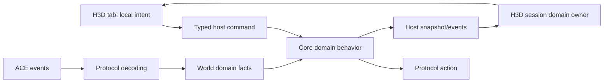

# H3D social panel

Status: Party implemented and awaiting manual gate 1. Shared state, wire commands, host/session contracts, and Social window are wired and verified. Friends, Ignores, and Allegiance have not started.

## Goal and boundaries

Implement a floating Social window with Party, Allegiance, Friends, and Ignores tabs, using retail game semantics with modern presentation and straightforward, honest synchronization.

Implement one tab as a complete domain slice at a time. After its automated checks pass, stop for the user's manual acceptance. Do not begin the next slice until the user accepts or supplies corrections. Visual acceptance belongs to the user.

In scope:

- Party management: roster names/levels/leader, sharing and openness status, create/invite/dismiss/promote/leave/disband, and relevant character preferences.
- Friends: initial list and live updates, add/remove, presence, start tell, search/filter, and appear offline.
- Ignores: add/remove account or character squelches, defaulting new ignores to account scope; preserve existing category/global filtering facts.
- Allegiance: local monarch/patron/self/direct-vassal relationships, swear/break/dismiss, presence, rank/counts, and server-reported XP facts.
- Necessary protocol, world, core, host, frontend, and focused diagnostic support.

Out of scope:

- Party vital bars or a combat party HUD. The HUD is a follow-up consumer of the same shared fellowship state.
- Full allegiance roster discovery, officer administration, custom officer titles, names/MOTD administration, locks/approved vassals, bans, chat moderation, and hometown/house actions.
- XP rates, historical accounting, or synthesized allegiance age/time data.
- Bulk friend deletion through the remove-all opcode; ACE currently provides no list reconciliation for it.
- New advanced per-category/global squelch editing UI. Decode and retain those facts, disclose existing restrictions honestly, and avoid overwriting them when applying basic actions.
- Generic social transaction/sync frameworks, speculative caches, event journals, automatic mutation retries, or new dependencies without a demonstrated need.
- Broad TUI changes. Update shared API consumers only if necessary for a clean cutover; never run the interactive TUI for diagnostics.

The Party shortcut becomes the Social window entry. The active tab, row selection, search terms, layout, and local confirmation policy belong to H3D. Persist window placement through the existing HUD settings mechanism. Keep active tab and search session-local initially; additional preference persistence has no demonstrated requirement.

## Ground truth and current implementation

Paths are relative to the repository root. Reference line numbers describe the investigated revision and may move during implementation.

| Source | What it establishes |
| --- | --- |
| `crates/holtburger-protocol/src/opcodes.rs:426` | Existing swear/break and fellowship opcodes; missing social opcodes are mostly commented entries. |
| `crates/holtburger-protocol/src/messages/fellowship/{actions,events}.rs` | Existing fellowship serialization and packet fixtures. |
| `crates/holtburger-world/src/state/fellowship.rs`, `src/handlers/fellowship.rs` | Retained fellowship state and event reduction; current successor assignment guesses from GUID-sorted members. |
| `crates/holtburger-core/src/client/{commands,types,mod}.rs` | Existing party commands, fellowship events/current-state publication, character options, swear/break, and server confirmations. |
| `apps/holtburger-cli/src/pages/game/domains/party.rs`, `src/update/world.rs` | Existing TUI consumer and update subscription; useful precedent for the later HUD, not H3D UX policy. |
| `apps/holtburger-3d/host/src/{client_projection,client_runtime,protocol}.rs` | Mode-specific host boundary; currently no social state/management surface beyond neighboring chat/confirmation support. |
| `apps/holtburger-3d/src/client/ClientShortcutDock.svelte` | Party shortcut is currently a stub. |
| `acclient-eor-source/acclient.c:193928` | Retail party management actions, leader handoff before leave, openness, and disband. |
| `acclient-eor-source/acclient.c:192507`, `:195072` | Retail fellowship/allegiance visibility requests. |
| `acclient-eor-source/acclient.c:196463`, `:194622` | Retail allegiance swear/break/kick; direct-vassal dismissal uses ordinary break-allegiance. |
| `acclient-eor-source/acclient.c:192395`, `:462243` | Friend update variants, including silent removal type 3, and complete friend record decoding. |
| `acclient-eor-source/acclient.c:191069` | Retail squelch panel supports character/account add/remove. |
| `acclient-eor-source/acclient.c:678831`, `:679166`, `:453995` | Squelch category bitset, counted-word serialization, and account-scope flag. |
| `ACE/Source/ACE.Server/WorldObjects/Player_Fellowship.cs`, `Entity/Fellowship.cs` | Fellowship permissions, capacity, sharing, locks, authoritative leadership changes, and visibility-gated vital updates. |
| `ACE/Source/ACE.Server/Network/GameEvent/Events/GameEventFriendsListUpdate.cs` | Full/add/remove/presence payload; ACE sends nested social lists empty but the decoder must consume them correctly. |
| `ACE/Source/ACE.Server/WorldObjects/Player_Character.cs:141`, `:203` | Friend mutation handling and remove-all's missing update. |
| `ACE/Source/ACE.Server/WorldObjects/Player_Networking.cs:115`, `:218` | Squelch may arrive early; ACE omits an empty squelch DB at login; friends get an initial full list. |
| `ACE/Source/ACE.Server/WorldObjects/Managers/SquelchManager.cs` | Character/category versus account/all-category behavior, mutations, and replacement DB publication. |
| `ACE/Source/ACE.Server/Network/Structure/{SquelchDB,SquelchInfo}.cs` | Account entries normally travel in the character table with an account flag; ACE leaves the account-name table empty. |
| `ACE/Source/ACE.Server/Network/Structure/Allegiance{Profile,Hierarchy,Data}.cs` | Partial relationship tree, versioned/flagged payload, counts, presence, and XP fields. |
| `ACE/Source/ACE.Server/WorldObjects/Player_Allegiance.cs:170`, `:914` | Break targets a patron or direct vassal; profile lookup for another member requires elevated authority. |
| `ACE/Source/ACE.Server/Network/GameAction/Actions/GameActionAllegianceUpdateRequest.cs` | ACE sends a profile and completion even though it reads but does not use the panel-open flag. |
| `crates/holtburger-core/src/client/commands.rs:77`, `ACE/Source/ACE.Server/Network/GameAction/Actions/GameActionSetSingleCharacterOption.cs` | Options are mirrored locally after transport acceptance; ACE does not echo a preference acknowledgement. |
| `crates/holtburger-core/src/client/messages.rs:113`, `:308`, `src/client/mod.rs:361`, `:774` | Initial-entry reset/admission and replacement snapshot seams; fellowship is currently emitted separately, not included in `ClientApplicationSnapshot`. |
| `apps/holtburger-3d/src/client/ClientWorldView.svelte:1133`, `client-settings-contract.ts:56`, `client-hud-layout.ts:269`, `client-ui-defaults.ts:94` | Actual system-window render location and placement schema/default integration. |
| `apps/holtburger-3d/src/client/ClientChat.svelte:42`, `client-lifecycle-session.ts:863`, `host/src/client_runtime.rs:951` | Chat composer has local draft ownership; H3D sends local speech only. Core already supports `ClientCommand::Tell`. |
| `ACE/Source/ACE.Server/Network/GameEvent/Events/GameEventFellowshipFullUpdate.cs:62`, `Entity/Fellowship.cs:165` | Full updates hardcode the loot field; recruitment updates can pass XP sharing into the loot argument. This field is not reliable evidence of effective loot permission on ACE. |
| `ACE/Source/ACE.Server/WorldObjects/Player_Allegiance.cs:455`, `acclient-eor-source/acclient.c:669414` | Allegiance presence notifications depend on `ShowAllegianceLogons`; abort payload is one error-type `u32` after the opcode. |

ACE defines the server contract; the retail decompile resolves client behavior and ambiguous representation. Do not modify the decompile. Prove uncertain payloads/semantics before implementing them. Annotate observable retail quirks/divergences according to repository conventions when applicable.

## North stars

1. Authoritative social membership exists independently of scene visibility and mounted tabs.
2. Preserve shared information needed by richer future consumers; keep presentation policy local.
3. Reuse and clean up the fellowship path before adding a parallel party model.
4. Prefer explicit desired values over commands that toggle stale displayed state.
5. Social membership optimism changes presentation, never authoritative facts. Existing locally mirrored character preferences are a separate contract, not acknowledged server facts.
6. Command dispatch is not server acceptance. Current-state evidence is not perfect request correlation.
7. Use the smallest domain controller supported by actual protocol behavior. Stronger transactional machinery requires a demonstrated failure it solves.
8. Every retained field, pending flag, identity, and metric must have a named consumer.

## Ownership and contracts

| Layer | Owns | Must not own |
| --- | --- | --- |
| Protocol | Wire action/event types, flags, counts, version branches, deterministic serialization | UX defaults, permissions inferred from display, sync scheduling |
| World | Fellowship/allegiance/friend/squelch facts, snapshot/delta reducers, relationship and shared eligibility semantics | Tabs, optimistic rows, search, layout |
| Core | Reusable commands, necessary refresh/subscription coordination, current-state publication, meaningful dispatch/refusal feedback | Explorer/UI interaction policy or a universal social transaction framework |
| H3D host | Narrow typed commands and domain projections, initial snapshot and incremental event transport | Duplicate authority or re-derived relationship rules |
| H3D frontend | Session-lifetime domain presentation owners, pending intent, sorting/filtering, dialogs, tab demand | Fabricated server success or world-state mutation |

Use one focused domain module per tab where it improves locality. Prefer extracting existing social command branches from `client/commands.rs` into a focused module over growing that dispatcher. Do not rename public Party vocabulary merely to mirror the wire's Fellowship vocabulary; choose names appropriate to the layer and keep them consistent.

The owner survives tab unmounts. Include each implemented domain in `ClientApplicationSnapshot`, the host `ClientCurrentState`, and its strict frontend schema. Extend incremental events alongside these replacement fields. Do not rely on fellowship's current sibling event to reconstruct the replacement baseline. Update existing snapshot literals/fixtures and immediate TUI consumers in the same slice rather than introducing a second H3D-owned authority.

Reset social facts at initial character entry in `begin_world_entry_transition`, before accepting its initial social packets, and retire them on character selection/disconnect. Clear relevant frontend owners on the matching character lifecycle edges. Do not reset at `PlayerDescription` or `PlayerCreate`: ACE sends friends alongside description and before create, and squelch can arrive early. Repeated descriptions, event-loss recovery, and portal travel must not erase membership. Extend the existing incoming-message admission pattern to ignore social replies outside an entering/in-world character lifetime. Do not key social retirement to `world_generation`, which also changes for portals. Existing session/character lifecycle is enough; same-character delayed wire replies cannot be perfectly attributed and are an accepted limitation.

Party management consumes cold roster/status facts. Keep raw vital updates in the imperative session owner so the management component does not rerender at vital cadence. The future combat HUD can pull a bounded display snapshot from that same owner. Do not discard vitals from the shared fellowship representation.

## Sync and optimistic UX: lessons from housing, with limits

Reference `crates/holtburger-core/src/client/housing_management.rs`, `housing_queries.rs`, and `apps/holtburger-3d/src/client/client-housing-management-state.ts` plus their focused tests.

- Preserve the distinction between retained social facts, requested presentation, host queue acceptance, and command dispatch. The host command promise can resolve after enqueueing core work; it is not a wire-send receipt. Housing's `Requested` receipt intentionally does not claim permission success. Reuse existing core feedback for downstream failure; add a narrow local result only if the UI has a concrete consumer for it.
- Freeze destructive confirmation targets and reject stale character/domain context when answering. Do not silently retarget a confirmation to a newly selected player.
- Match local asynchronous completions to the operation that produced them. An older failure must not roll back a newer intent.
- Retain accepted facts while refreshing. Unknown and empty are different when the protocol/lifecycle can establish that distinction.
- Keep operation ownership independent of panel lifetime. Reopening a tab recovers the current state and any useful pending presentation.
- Release duplicate-click guards on dispatch failure; do not show a success toast merely because the host promise resolved.
- Never retry mutations automatically. Bounded reads are allowed only when a supported read path and demonstrated need exist.
- Housing's two delayed reads address its persistence behavior. Do not copy those delays or schedules into social domains without evidence.
- Request IDs and epochs are local safeguards, not wire acknowledgements. Do not parse ordinary chat into transactional receipts or wait for airtight causal proof.
- Avoid copying housing's inventory/busy locks into social commands. Serialize only conflicting work whose ambiguity matters; do not block unrelated tabs or gameplay.

| Action family | Proposed presentation | Settlement evidence |
| --- | --- | --- |
| Party openness | Display explicit requested value with pending indication | Fellowship state update; no mutation acknowledgement is implied |
| Character preference | Guard local invocation, then display the existing core-mirrored option | Core options publication after transport acceptance; later description restores the server baseline |
| Add friend / ignore | Pending row distinguishable from a confirmed record | Friend add delta / squelch DB replacement |
| Remove friend / ignore | Keep row as removing instead of instantly claiming removal | Removal delta / replacement DB |
| Promote / leave / disband / break relationship | Pending action while retaining current relationship facts | Authoritative roster/profile change |
| Invite / swear request | Indicate request sent; do not remain locked awaiting another player's decision | Existing server feedback/confirmation and later relationship updates |

Use lightweight bounded pending presentation where needed. Missing evidence means uncertainty, not success, failure, or cancellation. One local timer per domain owner is sufficient if needed: clear its pending overlay at expiry, keep the latest facts, and show neutral missing-update feedback. Do not add timers/receipts to core merely to drive that presentation. Do not attach an uncorrelated generic error to a particular request. Opening another tab does not reset the timer; character retirement does.

Do not wait for an option echo: `set_character_option` already mirrors the value in world after sending. Preserve that established behavior for sharing/ignore-request/appear-offline preferences and expose a narrow social-preference projection from the existing option masks. No broad option-authority refactor is part of this feature. Do not label a locally mirrored preference as server-confirmed or show a server-success toast.

Friends and squelch have no supported explicit refresh request in this scope. A current-state request recovers core's retained facts, not a fresh server list. On missing mutation updates, release the optimistic overlay without automatic resubmission, pretend refreshes, or waiting forever. Allegiance has an actual refresh request; serialize outstanding profile reads with a simple bounded core query owner. Do not add revision counters or journals to solve theoretical ordering races.

## Phase 1: Party and Social window shell

Deliverables:

- Reuse `messages/fellowship`, world fellowship state/handler, and existing core party commands.
- Add `FellowshipChangeOpenness` (C2S `0x0291`, explicit boolean), plus a core disband action using existing `FellowshipQuit.disband = true`.
- Remove guessed authoritative successor assignment on departure. Model temporarily unknown leadership honestly if an update gap requires it; consume the server's full update. Preserve the TUI consumer through the clean contract change.
- Represent unknown leadership explicitly in the shared type, including the existing partial-member-before-full-snapshot case. Sweep leader consumers in core, scripting, and CLI; replace successor-guess tests with server-authority behavior tests. Do not retain `Guid::NULL` as a supposed leader or add duplicate `isLeader` flags.
- Establish the narrow H3D social projection/command route across host `client_projection.rs`, `client_runtime.rs`, and `protocol.rs`; frontend contract and lifecycle session; app window/dock/layout integration.
- Add `ClientSocialPanel.svelte` and a focused Party component/owner. File names may follow neighboring conventions; avoid creating generic scaffolding for unimplemented domains. Other tabs are clearly unavailable until their slices land.
- Render the window in `ClientWorldView.svelte`; keep session-lifetime owners in the existing `ClientApp.svelte` composition. Add `social` to the system-panel union, map the existing party glyph explicitly, and extend HUD placement schema/default/reset/recovery helpers. Do not assume panel names and icon names match. Retain existing saved layouts by letting the established missing-placement normalization supply the new default.
- Render member names, levels, leader, fellowship name, open/closed/locked status, and effective server-reported XP sharing. No vital bars. Keep the raw loot field but omit an effective loot-permission claim: ACE full updates hardcode it and incremental updates can be inconsistent. The local next-fellowship loot preference remains useful and must be labeled as such.
- Expose create, dismiss member, promote, leave, disband, and openness in Party. Put invitation on the selected-entity HUD as an icon button, visible only for an eligible player when party permissions and capacity allow. Reuse server confirmation dialogs. Label the party name in a structured summary; put the name-sorted roster in a titled subsection.
- Create Party opens a modal for the name plus XP/luminance and loot settings. Seed its draft from retained character preferences; Cancel leaves them unchanged. Queue changed creation preferences before create, since ACE samples the leader's loot preference at creation. Show current XP sharing and openness only with an active party. Keep the character-level ignore-invitations preference visible whether or not a party is active. Reuse shared tabs/button/input styling and the modal shell. Reuse the existing mirrored-option behavior rather than promise an acknowledgement.
- Keep invitations GUID-based and honest about target availability; do not invent remote recruitment by name.
- Leaving has no confirmation step. A leader with other members opens the shared modal to choose a successor, then queues promotion followed by leave. Members and sole leaders leave directly. Retire the draft when the opening character, leadership, or roster changes; do not claim promote-plus-leave is atomic.
- While the Party tab is visible, use the existing update subscription to obtain a full snapshot and receive updates; disable when leaving it. Its vitals still go to the imperative owner, not the management markup. ACE returns no full response if there is no fellowship, so do not start an indefinite loading spinner for an empty party. The later HUD extends the frontend demand expression to `partyTabVisible || partyHudVisible`; no registry is needed now. Reapply active demand after returning to in-world if a transition prevented dispatch.

Automated acceptance:

- Packet tests cover openness and both quit/disband payloads.
- World/core tests establish authoritative leadership changes, roster updates, and clean character retirement without a fabricated successor.
- Host/frontend tests cover initial recovery, close/reopen, stale local completion, and duplicate dispatch prevention.
- Replacement-state recovery works without a preceding fellowship event. Option changes settle without a server echo. Entry reset precedes social packet hydration and portal transitions retain state.
- Nonvisual browser/runtime verification exercises host/session/component lifetime boundaries.

Manual gate 1:

- Open Create Party; verify name/settings focus, Cancel without preference changes, and creation with the chosen sharing settings. Recruit; accept/decline an invitation with a second character.
- Verify leader versus member controls, open fellowship recruitment, locked restrictions, sharing labels, promotion, leave, and disband.
- Verify close/reopen and portal travel retain correct state; the tab contains no combat vital view.
- Record user acceptance/corrections below, then resteer Friends before continuing.

## Phase 2: Friends

Deliverables:

- Add C2S `AddFriend 0x0018` (name), `RemoveFriend 0x0017` (GUID), and S2C `FriendsListUpdate 0x0021`.
- Decode complete friend records, including appear-offline and nested GUID lists, without assuming ACE's empty nested lists are the only legal payload.
- Implement full replacement, add, remove, presence update, and retail silent-removal type 3 semantics. Preserve wire facts; retain only runtime fields with named consumers.
- Add world friend state/reducer and core commands/publication, then extend the existing typed H3D route and session owner.
- Render online-first/name sorting, text search, online-only filter, add/remove, and start tell. H3D currently exposes local speech only: add a typed recipient/message host route to existing `ClientCommand::Tell`, and a small local composer request to focus/prepopulate a tell draft in `ClientChat.svelte`. Keep composer intent app-local; do not build slash-command parsing or a conversation subsystem. Starting a tell must not immediately send anything or overwrite a nonempty draft without an explicit user choice.
- Expose appear offline through the existing character-option command and locally mirrored options. This is a server-backed preference, not a local settings-store preference and not proof the server acknowledged it.
- Do not use the obsolete `FriendsOld` message as a refresh workaround or implement unconfirmed bulk clearing.

Automated acceptance:

- Full/delta packet fixtures and malformed count/truncation coverage follow repository protocol conventions.
- Reducer tests cover full-empty replacement, updates without duplicates, removal/presence, early initial state, and character switch.
- Presentation tests cover pending add/remove, refusal/dispatch failure, stale completion, and opening after initial delivery.
- Cover login list delivery before `PlayerCreate`, a transport-accepted option without an echo, and the tell route/composer handoff independently of local speech.
- Nonvisual runtime verification covers command/event routing and tab remounts.

Manual gate 2:

- Add an existing online/offline character; verify unknown/duplicate/self requests produce honest feedback.
- Verify presence changes and appear-offline behavior with another client.
- Remove, filter, start tell, close/reopen, portal, and switch character.
- Accept or correct the slice, then resteer Ignores.

## Phase 3: Ignores (squelch)

Deliverables:

- Add C2S `ModifyCharacterSquelch 0x0058` and `ModifyAccountSquelch 0x0059`; decode S2C `SetSquelchDB 0x01F4`.
- Character action carries desired enable, GUID/name, and one message-category ID; account action carries desired enable and a character name identifying the target account.
- Decode both hash tables, counted bitset words, names, account flags, and globals. Preserve unknown bits/word detail; do not flatten the words into independent filters or blindly treat the first word as the complete mask.
- Add world replacement-state handling and core basic commands/publication, then the H3D owner and tab.
- Default add scope to Entire account; offer This character only. Account squelches affect all target-account characters and all supported categories. The list belongs to the current player character, not all of that player's account characters.
- Keep scope labels clear; display existing partial/category/global restrictions without turning them into ordinary all-message ignores. Remove basic entries with the appropriate scope/action.
- The character table can merge an account flag onto an existing character restriction for the same GUID. Treat it as one disclosed record, not proof that one scope supersedes the other. If needed show both scopes; removing the account restriction may reveal a retained character restriction in the next DB. Remove only the explicitly chosen scope and reconcile from that replacement rather than deleting both locally.
- Account removal uses the server-provided representative character name; expose refusal rather than guessing another account identity if it cannot resolve.
- Initialize an empty squelch state once at initial character entry; accept any early replacement immediately. Do not derive emptiness from lack of a reply or initialize again on description/create/in-world reveal. A core snapshot after event loss preserves the latest DB rather than restoring the entry default.
- Global mutation `0x005B` and advanced editing are deferred because the initial tab has no consumer for them. Preserve globals in decoding/state and make their presence visible.
- Reuse server filtering. Do not add a second client chat-filter authority without a proven uncovered behavior.

Automated acceptance:

- Fixtures cover empty/populated tables, account flags, multiword categories, globals, and truncation.
- Tests cover early DB delivery, absent empty-login DB, complete replacement, overlapping account/character entries where representable, and character reset.
- Presentation tests cover pending operations, scope-correct removal, unsolicited replacement, remount, and dispatch failure.
- Runtime verification covers command/event delivery without requiring production assets in retained tests.

Manual gate 3:

- Account-ignore one character and verify another character on that target account is blocked.
- Character-ignore and verify another target-account character remains allowed.
- Remove each scope; verify delivery resumes and entries survive relog on the owning character.
- Verify another local character does not inherit the first character's list.
- Inspect existing category/global entries if available; the UI must not mislabel or erase them.
- Accept or correct the slice, then resteer Allegiance.

## Phase 4: Allegiance baseline

Deliverables:

- Add C2S `AllegianceUpdateRequest 0x001F`; decode S2C `AllegianceUpdate 0x0020`, update-done `0x01C8` (error code), login notification `0x027A` (GUID and boolean), and update-aborted `0x0003` (one error-type `u32`, proven at retail `acclient.c:669414`).
- Decode profile totals, versioned hierarchy, parent links, and flagged node sections. Consume all metadata without inventing meaningful values for ACE's blanked fields.
- Add world allegiance state/reduction, core refresh/publication, and H3D projection/owner/tab.
- Interpret the payload as monarch/patron/self/direct-vassal context, not a complete member roster. Do not conflate total descendants with direct vassals.
- Presence notifications can mention undisclosed members: update known profile nodes only, without creating nameless roster entries or a speculative full-roster cache. ACE sends notifications only when `ShowAllegianceLogons` is enabled; expose that existing preference alongside the tab, and state that presence reflects the last snapshot/update when disabled. Do not secretly enable it.
- Render relationship context, ranks, levels/presence where supplied, counts, and server-reported cached/contributed XP. Preserve gender/heritage where needed for later title lookup; numeric rank is sufficient initially.
- Expose selected-character swear, break from patron, and dismiss direct vassal through existing swear/break commands. Both patron break and direct-vassal dismissal use `BreakAllegiance 0x001E`; no broader boot/admin opcode is required.
- Reuse server swear confirmation; add app-local review for destructive relationship actions, bound to the reviewed target and current relationship.
- Refresh on tab entry/manual request and consume unsolicited profile/presence updates. Handle completion/refusal honestly; do not assume ACE maintains retail's visibility subscription behavior.
- Retain the last profile while a read is pending. Only initial query, explicit refresh, or an observed direct-relationship change needs a read; no periodic XP polling. Close does not issue an extra request: ACE ignores the panel flag and responds even to `false`. Accept unsolicited profiles as current facts; completion releases the read guard, not a mutation transaction. On deadline, retain facts and report that refresh did not complete.
- Display XP as reported totals. ACE caps node cached/contributed XP at `u32::MAX` and leaves relationship age/time fields unimplemented; do not present exact unlimited lifetime totals or XP rates.
- Do not add privileged `AllegianceInfoRequest 0x027B`/response `0x027C` to discover a full roster. No initial consumer needs them.

Automated acceptance:

- Fixtures cover no allegiance, self as monarch, patron equal to monarch, distinct patron, direct vassals, flags/version branches used by the target protocol, and truncation.
- Tests cover profile replacement, presence, relationship invalidation, refresh completion/error, portal retention, and character retirement.
- Presentation tests establish partial-tree/count labeling, stale destructive confirmation retirement, and pending versus authoritative relationships.
- Runtime verification exercises the complete typed command/event route.

Manual gate 4:

- Swear with a second character; verify accept/decline and relationship updates.
- Break from patron and dismiss a direct vassal; check both affected clients.
- Verify monarch/patron/self/vassal layouts, presence, counts, and XP against server evidence.
- Verify refresh, close/reopen, portal travel, and character switching.
- Accept or correct the slice before final cleanup.

## Verification and cleanup

At each gate, run checks appropriate to the touched code. Do not run builds/tests merely to validate this planning document.

- Rust: targeted protocol/world/core/host tests; `cargo fmt --all -- --check`; `cargo clippy -p holtburger-protocol -p holtburger-world -p holtburger-core -p holtburger-3d-host --all-targets -- -D warnings`. Include affected additional consumers when APIs change.
- H3D: manifest scripts `npm run check`, `npm run test:ts -- <focused files>`, `npm run lint:ts`, `npm run lint:dead`, and `npm run format:check` from `apps/holtburger-3d` as applicable.
- Use `npm run harness:browser -- ...` or an existing focused noninteractive host/client probe for runtime boundaries. Adapt diagnostics only as needed. Do not perform visual acceptance or run the TUI; provide the user concrete manual scenarios.
- Keep checked-in tests independent of untracked production assets. Live multiplayer diagnostics can use `crates/holtburger-debug-harness` and local ACE; report exact unavailable prerequisites rather than claiming live acceptance.

Final cleanup phase:

- Remove superseded party paths, stale stub vocabulary, temporary probes, and brittle tests introduced or exposed by the cutover.
- Check snapshot and incremental contracts agree for all four domains and every new field has a consumer.
- Check no domain owner is destroyed by payload changes or tied to tab mounting.
- Confirm the management tab never subscribes reactively to raw vital cadence.
- Reassess any duplicated helpers: extract only proven shared primitives, not a generic state machine.
- Complete targeted correctness and code-quality review, including retail markers when observable behavior changed.
- Update this working plan's implementation/check/gate record. Do not stage or commit unless asked.

## Risks and deliberate concessions

| Risk or limitation | Decision |
| --- | --- |
| Wire updates lack our local request IDs | Guard local work by existing character/domain identity; avoid causal claims and invented acknowledgements. |
| Error chat is not structured mutation confirmation | Use existing feedback; do not scrape text or promise transactional rollback. |
| Empty squelch state can be represented by no packet | Establish a login default from the server lifecycle and preserve early received data. |
| Party leader changes can arrive after departure | Retain honest unknown/pending leadership rather than choose a successor in world. |
| Roster rows may have no visible scene entity | Keep social records; enable world interactions only from independently established target eligibility. |
| Party HUD follows soon | Preserve vitals and shared state; add only the subscription coordination needed by current consumers. |
| ACE suppresses allegiance administration metadata | Keep the baseline to relationships/XP; do not synthesize a management dashboard. |
| Existing category squelches exceed initial UI | Preserve/disclose them; defer editing controls and unused mutation APIs. |

## Definition of done

- [ ] All four slices expose functional UI, commands, incoming state, and current-state recovery.
- [ ] Each slice has passed its automated checks and explicit user manual acceptance gate.
- [ ] Party management contains no member vital view; shared state remains suitable for the follow-up HUD.
- [ ] Ignores defaults to account scope and accurately distinguishes target scope from local ownership.
- [ ] Allegiance displays a partial relationship view and honest XP facts with no administration expansion.
- [ ] Membership/list optimism never mutates authoritative facts; existing locally mirrored preferences remain explicitly distinct from acknowledged facts. Host queue acceptance is never presented as server acceptance.
- [ ] Pending UI is bounded, stale local work cannot affect a different character/domain, and closing tabs does not lose sync.
- [ ] No generic transaction framework, automatic mutation retry, unused metrics, or unsupported guarantees were added.
- [ ] Relevant lint/type/test/runtime checks pass and cleanup/review is complete.

## Decisions and acceptance record

Established decisions: Party -> Friends -> Ignores -> Allegiance; management-only Party; account-default ignores with character alternative; narrow allegiance relationships/XP; domain-specific sync; lightweight optimism; user gates after every tab.

Source review resolved option acknowledgement/effects, the replacement-snapshot seam, early social initialization, H3D tell exposure, overlapping ignore scopes, and allegiance presence/abort behavior. The narrow fixes are included in their phases. No blocking product question remains. This is a source-level execution audit, not evidence that the proposed implementation has passed runtime checks; those remain per-slice requirements.

| Milestone | Implementation/checks | User acceptance/corrections |
| --- | --- | --- |
| Party | Implemented; automated checks, nonvisual browser verification, and scoped code-quality review passed. See evidence below. | Accepted 2026-10-07 |
| Friends | Not started | Pending |
| Ignores | Not started | Pending |
| Allegiance | Not started | Pending |
| Cleanup/review | Not started | Pending |

### Party acceptance and code-quality review (2026-10-07)

Verdict: ready within the Party and requested shared-UI scope, with no blocking findings. The user accepted Party before this review. Friends, Ignores, and Allegiance remain unimplemented; this checkpoint does not claim the overall Social feature is complete.

The review baseline is HEAD and the accumulated tracked/untracked implementation. Seam coverage includes fellowship wire actions and ACE handlers, world hydration/departure, core command dispatch and replacement/character lifetime, host action/event/current-state adapters, strict frontend decoding, session ownership, Party drafts and destructive review, selected-player HUD recruitment, notifications, CLI/scripting leadership consumers, and the immediate shared tabs/dialog/keyboard-policy callers. Existing socket transport, general renderer behavior, and future Social domains were not independently audited.

Consolidation is justified by existing consumers: `UiTabs` replaces three independent tab-navigation implementations, `UiDialog` reuses message-dialog focus/chrome, the backdrop action unifies cancellation gestures across native and panel-scoped prompts, and shared list/facts styles migrate both Housing and Party. Keyboard ownership remains app-local under its existing owner. Housing and Party sync retain different implementations because their server response and identity guarantees differ; no generic mutation framework is warranted. Party's authoritative roster, locally mirrored preferences, and bounded presentation intent retain distinct meanings. Leadership handoff and creation preparation deliberately promise ordering only.

Lifecycle maintenance was traced through roster/leader changes, modal cancellation, window unmount/remount, portal travel, character retirement, delayed dispatch completion, and replacement recovery. A misplaced chat-method comment was corrected at the session seam. The pre-existing ACE submodule files are excluded from the commit. Small CLI/scripting housing repairs are included because the affected consumers otherwise failed to compile, as recorded in the initial implementation evidence.

Fresh verification passed: 75 focused frontend tests, type checks with zero Svelte warnings, ESLint, Knip, affected-crate Clippy, Rust formatting, 16 protocol fellowship tests, five world fellowship tests, three host Party tests, and the core character-lifetime recovery test. Real Chrome Party checks pass, including twelve backdrop variants; focused keyboard-policy and Settings-tabs suites also pass. Earlier full-suite evidence and the unrelated full-HUD spell-search failure remain recorded below. Verification is nonvisual and synthetic, not live multiplayer acceptance.

### Party implementation evidence (2026-10-06)

- Social shortcut/window, management controls, creation preferences, explicit handoff, destructive review, and session-owned bounded pending presentation are implemented. Future tabs remain unavailable.
- Replacement snapshots now include fellowship facts. Shared leadership is optional until established by the server; CLI/scripting consumers were updated. Vitals remain retained imperatively and are excluded from management display snapshots.
- Wire fixtures cover both values of openness and quit/disband. World tests cover partial hydration, departure with unknown leadership, and the subsequent server successor. Core tests cover replacement recovery, initial-entry reset, portal retention, retirement, and late-reply admission.
- H3D type checks, ESLint, Knip, Prettier, Rust formatting, and affected-crate Clippy pass. The full frontend suite passes: 345 files / 2,839 tests with four workers. The first unrestricted parallel run hit two renderer timeouts; both passed independently and in the bounded-worker full run.
- Rust suites passed: protocol 282, world 944, core 603, and host 359 tests at the initial broad checkpoints. Subsequently added focused checks pass for core character lifetime, updated world leadership, three host party projection/action tests, and eight frontend owner tests including dispatch failure and stale completion. Socket-dependent core tests required loopback permission; their initial sandbox failures were socket creation denials.
- `npm run harness:browser -- --client-party` passed in real Chrome with synthetic facts: one openness dispatch, queue acceptance stays pending, authoritative settlement while unmounted, two mounts with retained state, and demand sequence `[true, false, true, false]`. This is nonvisual browser evidence, not live multiplayer or visual acceptance.
- Source/contract review covered wire -> world -> core snapshot/event -> host -> strict session decoder -> owner -> component, along with retirement and delayed handoff completion. Existing character-preference mirroring remains unchanged in meaning. No automatic retries or transactional receipt machinery were introduced.
- Verification exposed pre-existing housing busy-operation omissions in scripting/CLI plus a missing housing field in a CLI snapshot fixture. These were verified against HEAD and repaired narrowly so affected consumers compile.

Next action: Party gate 1 is accepted as of 2026-10-07. Complete the requested review/commit checkpoint before starting Friends.

### Party UX correction (2026-10-06)

User steering: reuse UI components/styles and replace inline retail-like creation with Create Party -> name/settings modal. Social uses the existing `ui-tabs`, `ui-tab`, `ui-button`, and `ui-input` theme classes. `UiDialog.svelte` now owns the shared modal chrome, keyboard/focus lifetime, backdrop policy, and action layout for party creation and existing message/confirmation dialogs. No creation-only preferences remain in the active-party tab; the empty state shows the Create Party entry, and the active state keeps current sharing/openness. The character-level invitation preference remains visible in both states.

Creation drafts do not change character preferences until submitted. The session owner queues changed XP/loot preferences before create and retains the existing pending/lifecycle guards; this is ordered dispatch, not an atomic mutation guarantee. The updated browser probe verifies modal focus/cancel, blank-name admission, sharing command order, shared tab styling, and authoritative membership settlement.

Correction verification: 16 focused party-owner/dialog tests passed; the updated Party browser probe passed with three mounts, modal focus/cancel, four ordered action dispatches, and no browser exceptions. The existing housing browser suite also passed with the shared dialog shell. Frontend lint/dead-code checks pass; the type/format checks are recorded with the gate evidence.

Manual gate 1 remains pending after this correction. Friends has not started.

Party styling correction: remove the horizontal tab-strip divider from the shared `ui-tabs` baseline and retire World's redundant override. Promote Housing's borderless fieldset reset into `ui-fieldset`, used by housing management, Social invitations, and party creation. Place the empty-party Create Party button in the existing action row so it keeps the standard content-sized button treatment. Visual acceptance remains with the user.

Social's outer wrapper also uses the existing `ui-body` class, giving the tabs and their content the shared panel inset on all four sides. The gap below the tab strip remains separate from that outer padding.

Tab reuse consolidation: Social, Settings, World, and house crystal information now use app-local `UiTabs.svelte`. It owns tab markup, roving focus, arrow-key wrapping, Home/End navigation, skipping disabled tabs, equal-width buttons, and the shared gap below the strip. Selection and panel content lifetimes remain feature-owned. All four use one outer `ui-body` inset; Settings' additional scroll padding and World's nested housing padding are removed. World continues to retain its hidden map canvas. The reuse convention is recorded in the frontend instructions. Manual Party acceptance remains pending.

Broader runtime verification exposed a dialog teardown error: a nullable parent value could reach a mounted `ClientMessageDialog` through nested snippets before removal. App and harness now render the optional presentation as a zero-or-one-item collection, so a retiring dialog retains a non-null item until teardown. The HUD action-bar probe also contained assertions for an SVG outline no longer present in the checked-in asset; those obsolete assertions were removed while retaining actual theme geometry, color, and filter checks.

Consolidation runtime evidence: `--client-party`, `--client-housing`, `--client-world-map`, and the focused `--client-settings-tabs` browser suites pass. Social skips unavailable domains; Settings verifies arrow wrapping, Home/End selection and focus, and native Tab handling. World verifies canvas/content retention across tab switching and dialog teardown during housing actions. The Settings check is reused by the full HUD suite and can now run independently. The broader `--client-hud` run passed the repaired action-bar probe but stopped at `Name terms did not intersect` in the unchanged spell-search probe before reaching Settings. That failure remains outside this consolidation; the full HUD suite is not claimed to pass.

Final consolidation checks: frontend type checks (zero Svelte warnings), ESLint, Knip, formatting of touched frontend files, and `git diff --check` pass. Visual acceptance remains with the user; Friends has not started.

Further presentation correction: remove the redundant empty-party sentence and Housing's "Your home" heading, including its unused layout styles. Invitations uses a native disclosure subsection, expanded initially and present with or without a party. Housing's subsection header/body spacing is promoted into shared `ui-disclosure-section` and `ui-disclosure-body` classes, with both Housing and Social migrated to those styles.

Correction verification: Party, housing crystal, and World/Housing browser suites pass. Frontend type checks, ESLint, touched-file formatting, and whitespace checks pass. Visual acceptance remains pending.

Roster correction: member rows display name, level, and leadership as plain content, with labeled crown/dismiss icon buttons for eligible members when the player is leader. Roster selection and the detached member action buttons are removed. Dismissal retains the existing confirmation path. Housing's inset surface and rows are shared as `ui-inset` and `ui-list-row`; both roster and housing guest lists use `ui-scroll-list`, capped by the shared `--ui-list-max-height` (240px default). Compact row icon styling is shared with Settings. The Party browser probe now exercises a nine-member scrolling roster, exact promotion targeting, dismissal review/cancellation, pending authority, and removal of management controls after a leadership update.

Roster verification: updated Party, World/Housing, and focused Settings browser checks pass, along with frontend type checks, ESLint, Knip, touched-file formatting (including the new SVG assets), and whitespace checks. Manual Party acceptance remains pending.

Permission presentation correction: hide disband and roster administration from nonleaders; show openness only to the leader of an unlocked party. Show HUD recruitment only for eligible selected players and leaders/open-party members with available capacity, using ACE's nine-member limit. Leaving remains available to members. Permission-eligible controls remain visible but disabled while a request or confirmation is pending. Missing/invalid invite targets hide the HUD action; a leader chooses a successor in the exit modal. Locking does not universally forbid recruitment: `Player_Fellowship.cs:86-108` admits leader/open-party requests and `Entity/Fellowship.cs:81-100` allows eligible recently departed members to rejoin; that server-controlled path remains available when capacity permits. Browser scenarios cover full rosters, closed/open member roles, locked parties, unknown leadership, and pending promotion.

Permission correction verification: the expanded Party browser suite, frontend type checks (zero Svelte warnings), ESLint, Knip, formatting, and whitespace checks pass. Visual/manual Party acceptance remains pending.

Leader presentation correction: replace the roster's textual leader suffix with the existing crown icon beside the member name. Its accessible label and tooltip identify the party leader. The marker follows server leadership updates; pending promotion does not move it optimistically. The browser probe checks both states.

Tab overflow correction: Social now fills its constrained window body with a fixed tab strip and a scrollable Party content area. Its content grid keeps controls at their natural size instead of shrinking them to fit; the capped roster retains its own scrollbar. World's existing tab/body sizing is promoted into `ui-tabbed-panel`, shared by both panels. The Party browser fixture now mounts inside a constrained, clipping container at the Social minimum dimensions and verifies that scrolling reaches Invitations while the tabs remain stationary.

Overflow verification: constrained Party and World/Housing browser suites pass, alongside frontend type checks (zero Svelte warnings), ESLint, touched-file formatting, and whitespace checks. Manual Party acceptance remains pending.

Party exit and selected-entity correction: leaving no longer opens a confirmation. Members and sole leaders leave directly; leaders with other members use `ClientPartyLeaveDialog` and the existing `UiDialog` focus/cancellation behavior to choose a successor, then queue promotion and leave. The draft retires on character, leadership, or roster changes. The tab now has a labeled structured summary and a name-sorted Roster disclosure using the shared capped inset list. Housing's aligned facts rows are promoted to `ui-facts` and used by both panels. Recruitment moves to a selected-player HUD icon, gated by the party owner and fresh selection facts, and remains usable with Social closed. Trade uses an SVG icon through the existing HUD icon component and retains its interaction route.

Verification for this correction: 19 focused Party/dialog tests pass; type checking, ESLint, dead-code checks, and scoped formatting pass. Browser Party checks cover cancellation/focus, stale handoff retirement without dispatch, ordered handoff, direct member exit, sorted roster, labeled summary, capped scrolling, HUD permission gating, and invitation with Social closed (nine submitted actions). Trade and World/Housing browser probes pass. A Party run interrupted by source hot reload failed its exact command count; a stable rerun passed. Visual acceptance remains the user's manual Party gate; other domains remain deferred.

Invitation feedback correction: after invitation submission completes, the party owner publishes “Party invitation sent.” through the app's existing status toast path. This reports submission, not recipient acceptance. Dispatch failure keeps warning feedback and suppresses the sent notice; character retirement suppresses late completion notices. The Party browser probe verifies exactly one invitation notice with Social closed, and focused owner tests cover delayed dispatch, failure, and retirement.

Modal backdrop policy correction: `UiDialog` defaults to outside-click cancellation. Messages and ordinary/local/server confirmations now cancel or decline through their existing callbacks, with an explicit exception while a server confirmation answer is submitting. The common `dismissDialogOnBackdrop` action also handles quantity and keybinding panel overlays and Explorer texture inspection without changing their layout or focus ownership. Party creation and handoff inherit the shell default. The gesture requires both press and click on the backdrop and resets on pointer cancellation, preserving control drags. Browser verification covers twelve variants across the six dialog surfaces, including the submission exception, ordinary/typed questions, quantity purposes, and keybinding conflicts. Visual Party acceptance remains the user's gate.

Keyboard ownership correction: the app-level `KeyboardInputPolicy` now prevents pointer clicks on ordinary buttons, tabs, toggles, ranges, and disclosures from acquiring keyboard ownership even beneath a `nativeControls` scope. Native-control registration continues to support deliberate keyboard traversal; editors and selects acquire input as before, and modals retain their explicit ownership. Label activation resolves the associated input, and icon children resolve the enclosing button. The pointer focus identity expires after browser click defaults, so later deliberate focus is unaffected. Clicking nearby controls preserves an already active editor, including Chat drafts; clicking a mouse control after native button traversal returns to game input. Social's empty panel-wide keyboard scope is removed. The focused `--client-keyboard` browser harness covers held movement, native gestures, editing, Tab/button activation, later programmatic focus, Chat, and modal restoration independently of the full HUD suite. Settings-tabs and Party browser probes pass; other Social domains remain behind the user's Party acceptance gate.
