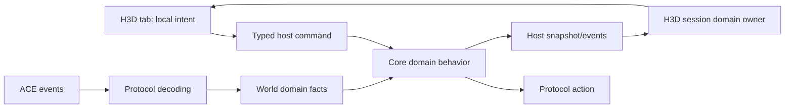

# H3D social panel

Status: Party, Friends, and Ignores accepted. Ignores and the shared window/tab consolidation passed scoped code-quality review and automated verification. Allegiance has not started.

## Goal and boundaries

Implement a floating Social window with Party, Allegiance, Friends, and Ignores tabs, using retail game semantics with modern presentation and straightforward, honest synchronization.

Implement one tab as a complete domain slice at a time. After its automated checks pass, stop for the user's manual acceptance. Do not begin the next slice until the user accepts or supplies corrections. Visual acceptance belongs to the user.

In scope:

- Party management: roster names/levels/leader, sharing and openness status, create/invite/dismiss/promote/leave/disband, and relevant character preferences.
- Friends: initial list and live updates, add/remove, presence, a disabled Tell affordance, search/filter, and appear offline.
- Ignores: add/remove account or character squelches, defaulting new ignores to account scope; preserve existing category/global filtering facts.
- Allegiance: local monarch/patron/self/direct-vassal relationships, swear/break/dismiss, presence, rank/counts, and server-reported XP facts.
- Necessary protocol, world, core, host, frontend, and focused diagnostic support.

Out of scope:

- Party vital bars or a combat party HUD. The HUD is a follow-up consumer of the same shared fellowship state.
- Full allegiance roster discovery, officer administration, custom officer titles, names/MOTD administration, locks/approved vassals, bans, chat moderation, and hometown/house actions.
- XP rates, historical accounting, or synthesized allegiance age/time data.
- Bulk friend deletion through the remove-all opcode; ACE currently provides no list reconciliation for it.
- New advanced per-category/global squelch editing UI. Decode and retain those facts, disclose existing restrictions honestly, and avoid overwriting them when applying basic actions.
- Generic social transaction/sync frameworks, speculative caches, event journals, automatic mutation retries, or new dependencies without a demonstrated need.
- Broad TUI changes. Update shared API consumers only if necessary for a clean cutover; never run the interactive TUI for diagnostics.

The Party shortcut becomes the Social window entry. The active tab, row selection, search terms, layout, and local confirmation policy belong to H3D. Persist window placement through the existing HUD settings mechanism. Keep active tab and search session-local initially; additional preference persistence has no demonstrated requirement.

## Ground truth and current implementation

Paths are relative to the repository root. Reference line numbers describe the investigated revision and may move during implementation.

| Source | What it establishes |
| --- | --- |
| `crates/holtburger-protocol/src/opcodes.rs:426` | Existing swear/break and fellowship opcodes; missing social opcodes are mostly commented entries. |
| `crates/holtburger-protocol/src/messages/fellowship/{actions,events}.rs` | Existing fellowship serialization and packet fixtures. |
| `crates/holtburger-world/src/state/fellowship.rs`, `src/handlers/fellowship.rs` | Retained fellowship state and event reduction; current successor assignment guesses from GUID-sorted members. |
| `crates/holtburger-core/src/client/{commands,types,mod}.rs` | Existing party commands, fellowship events/current-state publication, character options, swear/break, and server confirmations. |
| `apps/holtburger-cli/src/pages/game/domains/party.rs`, `src/update/world.rs` | Existing TUI consumer and update subscription; useful precedent for the later HUD, not H3D UX policy. |
| `apps/holtburger-3d/host/src/{client_projection,client_runtime,protocol}.rs` | Mode-specific host boundary; currently no social state/management surface beyond neighboring chat/confirmation support. |
| `apps/holtburger-3d/src/client/ClientShortcutDock.svelte` | Party shortcut is currently a stub. |
| `acclient-eor-source/acclient.c:193928` | Retail party management actions, leader handoff before leave, openness, and disband. |
| `acclient-eor-source/acclient.c:192507`, `:195072` | Retail fellowship/allegiance visibility requests. |
| `acclient-eor-source/acclient.c:196463`, `:194622` | Retail allegiance swear/break/kick; direct-vassal dismissal uses ordinary break-allegiance. |
| `acclient-eor-source/acclient.c:192395`, `:462243` | Friend update variants, including silent removal type 3, and complete friend record decoding. |
| `acclient-eor-source/acclient.c:191069` | Retail squelch panel supports character/account add/remove. |
| `acclient-eor-source/acclient.c:678831`, `:679166`, `:453995` | Squelch category bitset, counted-word serialization, and account-scope flag. |
| `ACE/Source/ACE.Server/WorldObjects/Player_Fellowship.cs`, `Entity/Fellowship.cs` | Fellowship permissions, capacity, sharing, locks, authoritative leadership changes, and visibility-gated vital updates. |
| `ACE/Source/ACE.Server/Network/GameEvent/Events/GameEventFriendsListUpdate.cs` | Full/add/remove/presence payload; ACE sends nested social lists empty but the decoder must consume them correctly. |
| `ACE/Source/ACE.Server/WorldObjects/Player_Character.cs:141`, `:203` | Friend mutation handling and remove-all's missing update. |
| `ACE/Source/ACE.Server/WorldObjects/Player_Networking.cs:115`, `:218` | Squelch may arrive early; ACE omits an empty squelch DB at login; friends get an initial full list. |
| `ACE/Source/ACE.Server/WorldObjects/Managers/SquelchManager.cs` | Character/category versus account/all-category behavior, mutations, and replacement DB publication. |
| `ACE/Source/ACE.Server/Network/Structure/{SquelchDB,SquelchInfo}.cs` | Account entries normally travel in the character table with an account flag; ACE leaves the account-name table empty. |
| `ACE/Source/ACE.Server/Network/Structure/Allegiance{Profile,Hierarchy,Data}.cs` | Partial relationship tree, versioned/flagged payload, counts, presence, and XP fields. |
| `ACE/Source/ACE.Server/WorldObjects/Player_Allegiance.cs:170`, `:914` | Break targets a patron or direct vassal; profile lookup for another member requires elevated authority. |
| `ACE/Source/ACE.Server/Network/GameAction/Actions/GameActionAllegianceUpdateRequest.cs` | ACE sends a profile and completion even though it reads but does not use the panel-open flag. |
| `crates/holtburger-core/src/client/commands.rs:77`, `ACE/Source/ACE.Server/Network/GameAction/Actions/GameActionSetSingleCharacterOption.cs` | Options are mirrored locally after transport acceptance; ACE does not echo a preference acknowledgement. |
| `crates/holtburger-core/src/client/messages.rs:113`, `:308`, `src/client/mod.rs:361`, `:774` | Initial-entry reset/admission and replacement snapshot seams; fellowship is currently emitted separately, not included in `ClientApplicationSnapshot`. |
| `apps/holtburger-3d/src/client/ClientWorldView.svelte:1133`, `client-settings-contract.ts:56`, `client-hud-layout.ts:269`, `client-ui-defaults.ts:94` | Actual system-window render location and placement schema/default integration. |
| `apps/holtburger-3d/src/client/ClientChat.svelte:42`, `client-lifecycle-session.ts:863`, `host/src/client_runtime.rs:951` | Chat composer has local draft ownership; H3D sends local speech only. Core already supports `ClientCommand::Tell`. |
| `ACE/Source/ACE.Server/Network/GameEvent/Events/GameEventFellowshipFullUpdate.cs:62`, `Entity/Fellowship.cs:165` | Full updates hardcode the loot field; recruitment updates can pass XP sharing into the loot argument. This field is not reliable evidence of effective loot permission on ACE. |
| `ACE/Source/ACE.Server/WorldObjects/Player_Allegiance.cs:455`, `acclient-eor-source/acclient.c:669414` | Allegiance presence notifications depend on `ShowAllegianceLogons`; abort payload is one error-type `u32` after the opcode. |

ACE defines the server contract; the retail decompile resolves client behavior and ambiguous representation. Do not modify the decompile. Prove uncertain payloads/semantics before implementing them. Annotate observable retail quirks/divergences according to repository conventions when applicable.

## North stars

1. Authoritative social membership exists independently of scene visibility and mounted tabs.
2. Preserve shared information needed by richer future consumers; keep presentation policy local.
3. Reuse and clean up the fellowship path before adding a parallel party model.
4. Prefer explicit desired values over commands that toggle stale displayed state.
5. Social membership optimism changes presentation, never authoritative facts. Existing locally mirrored character preferences are a separate contract, not acknowledged server facts.
6. Command dispatch is not server acceptance. Current-state evidence is not perfect request correlation.
7. Use the smallest domain controller supported by actual protocol behavior. Stronger transactional machinery requires a demonstrated failure it solves.
8. Every retained field, pending flag, identity, and metric must have a named consumer.

## Ownership and contracts

| Layer | Owns | Must not own |
| --- | --- | --- |
| Protocol | Wire action/event types, flags, counts, version branches, deterministic serialization | UX defaults, permissions inferred from display, sync scheduling |
| World | Fellowship/allegiance/friend/squelch facts, snapshot/delta reducers, relationship and shared eligibility semantics | Tabs, optimistic rows, search, layout |
| Core | Reusable commands, necessary refresh/subscription coordination, current-state publication, meaningful dispatch/refusal feedback | Explorer/UI interaction policy or a universal social transaction framework |
| H3D host | Narrow typed commands and domain projections, initial snapshot and incremental event transport | Duplicate authority or re-derived relationship rules |
| H3D frontend | Session-lifetime domain presentation owners, pending intent, sorting/filtering, dialogs, tab demand | Fabricated server success or world-state mutation |

Implement each new tab as a focused domain across the owning layers. Central command/message dispatchers route to domain methods; they do not acquire domain reconciliation, pending-action policy, or substantial command implementations. Lifecycle entry points delegate domain reset and replacement recovery. Keep genuinely shared envelopes and composition at their existing boundaries. Do not rename public Party vocabulary merely to mirror the wire's Fellowship vocabulary; choose names appropriate to the layer and keep them consistent.

### Domain size and shared systems

The existing core client, command/message dispatchers, and H3D lifecycle session are already large integration modules. This policy applies to Party, Friends, Ignores, and Allegiance: shared domain facts and reusable behaviors have focused owners, while frontends own their interaction policy. New slices must not become collections of embedded behaviors in integration files. Establish these boundaries within Social without requiring a wholesale refactor of unrelated client domains.

| Domain | World-owned facts/semantics | Core-owned reusable behavior | H3D-owned presentation |
| --- | --- | --- | --- |
| Party | Existing fellowship roster, leadership, and actor capabilities | Party commands and update demand handling | Existing pending actions, creation/handoff dialogs, management tab, and selected-entity invitation |
| Friends | Records and full/delta/presence reconciliation | Add/remove commands and state publication | Pending rows, search/filter/sort, and disabled Tell affordance |
| Ignores | Squelch replacement state, scope/category/global facts | Scope-specific mutations and state publication | Scope choice, restriction disclosure, and pending add/remove |
| Allegiance | Partial relationship profile, presence, and shared relationship eligibility | Swear/break commands, state publication, and bounded profile-read coordination | Relationship/XP presentation, refresh affordance, and destructive review |

Use focused domain modules in world, core, and the host, with dedicated frontend contracts/owners/components where behavior warrants them. A module need not become a stateful system object: Party and Friends can use retained world state plus focused core methods; Allegiance has a concrete need for a bounded query owner. Shared option mutation stays on the existing character-option path. No aggregate Social owner should absorb the four domains' state machines.

Friends is the next concrete application of these boundaries:

| Layer / proposed location | Responsibility and integration seam |
| --- | --- |
| World `state/friends.rs` and `handlers/friends.rs` | Retained friend records and full/delta/presence reconciliation. World owns authoritative reconciliation; core coordinates character-lifetime reset. |
| Core `client/friends.rs` | Reusable add/remove behavior and state publication. Existing dispatchers delegate; snapshot envelopes reference the domain state. |
| H3D host `client_friends.rs` | Narrow typed projection/action adapter, used by both replacement and incremental paths. No replicated friend rules. |
| H3D `client-friends-contract.ts`, `client-friends-state.ts`, and a Friends tab component | Strict contract and a session-lifetime domain owner for the retained projection, pending presentation, filtering, and actions. The component uses existing shared UI primitives. |
| H3D lifecycle session and app composition | Bind transport, forward updates, and delegate recovery/retirement to the Friends owner. Avoid a second retained friend list or inline Friends mutation policy in the session. |

Names may follow immediate repository conventions; responsibility boundaries are required. The frontend projection is a read model of world facts, not another authority. Give the owner narrow typed command callbacks and update/reset entry points; do not make it depend on the entire lifecycle session. Tell composition and chat modes are deferred; the Friends button is disabled until that broader design is implemented.

A shared Friends domain is justified by reusable state and commands even before the TUI exposes friend controls. A stateful core controller is not currently justified: Friends has no supported refresh/subscription coordination to own. Add one only if implementation uncovers a concrete shared behavior requiring it. Do not introduce a generic Social system, plugin registry, or transaction framework. Apply the same ownership checks at every tab gate while allowing different internal shapes for different wire behavior.

The owner survives tab unmounts. Include each implemented domain in `ClientApplicationSnapshot`, the host `ClientCurrentState`, and its strict frontend schema. Extend incremental events alongside these replacement fields. Do not rely on fellowship's current sibling event to reconstruct the replacement baseline. Update existing snapshot literals/fixtures and immediate TUI consumers in the same slice rather than introducing a second H3D-owned authority.

Reset social facts at initial character entry in `begin_world_entry_transition`, before accepting its initial social packets, and retire them on character selection/disconnect. Clear relevant frontend owners on the matching character lifecycle edges. Do not reset at `PlayerDescription` or `PlayerCreate`: ACE sends friends alongside description and before create, and squelch can arrive early. Repeated descriptions, event-loss recovery, and portal travel must not erase membership. Extend the existing incoming-message admission pattern to ignore social replies outside an entering/in-world character lifetime. Do not key social retirement to `world_generation`, which also changes for portals. Existing session/character lifecycle is enough; same-character delayed wire replies cannot be perfectly attributed and are an accepted limitation.

Party management consumes cold roster/status facts. Keep raw vital updates in the imperative session owner so the management component does not rerender at vital cadence. The future combat HUD can pull a bounded display snapshot from that same owner. Do not discard vitals from the shared fellowship representation.

## Sync and optimistic UX: lessons from housing, with limits

Reference `crates/holtburger-core/src/client/housing_management.rs`, `housing_queries.rs`, and `apps/holtburger-3d/src/client/client-housing-management-state.ts` plus their focused tests.

- Preserve the distinction between retained social facts, requested presentation, host queue acceptance, and command dispatch. The host command promise can resolve after enqueueing core work; it is not a wire-send receipt. Housing's `Requested` receipt intentionally does not claim permission success. Reuse existing core feedback for downstream failure; add a narrow local result only if the UI has a concrete consumer for it.
- Freeze destructive confirmation targets and reject stale character/domain context when answering. Do not silently retarget a confirmation to a newly selected player.
- Match local asynchronous completions to the operation that produced them. An older failure must not roll back a newer intent.
- Retain accepted facts while refreshing. Unknown and empty are different when the protocol/lifecycle can establish that distinction.
- Keep operation ownership independent of panel lifetime. Reopening a tab recovers the current state and any useful pending presentation.
- Release duplicate-click guards on dispatch failure; do not show a success toast merely because the host promise resolved.
- Never retry mutations automatically. Bounded reads are allowed only when a supported read path and demonstrated need exist.
- Housing's two delayed reads address its persistence behavior. Do not copy those delays or schedules into social domains without evidence.
- Request IDs and epochs are local safeguards, not wire acknowledgements. Do not parse ordinary chat into transactional receipts or wait for airtight causal proof.
- Avoid copying housing's inventory/busy locks into social commands. Serialize only conflicting work whose ambiguity matters; do not block unrelated tabs or gameplay.

| Action family | Proposed presentation | Settlement evidence |
| --- | --- | --- |
| Party openness | Display explicit requested value with pending indication | Fellowship state update; no mutation acknowledgement is implied |
| Character preference | Guard local invocation, then display the existing core-mirrored option | Core options publication after transport acceptance; later description restores the server baseline |
| Add friend / ignore | Pending row distinguishable from a confirmed record | Friend add delta / squelch DB replacement |
| Remove friend / ignore | Keep row as removing instead of instantly claiming removal | Removal delta / replacement DB |
| Promote / leave / disband / break relationship | Pending action while retaining current relationship facts | Authoritative roster/profile change |
| Invite / swear request | Indicate request sent; do not remain locked awaiting another player's decision | Existing server feedback/confirmation and later relationship updates |

Use lightweight bounded pending presentation where needed. Missing evidence means uncertainty, not success, failure, or cancellation. One local timer per domain owner is sufficient if needed: clear its pending overlay at expiry, keep the latest facts, and show neutral missing-update feedback. Do not add timers/receipts to core merely to drive that presentation. Do not attach an uncorrelated generic error to a particular request. Opening another tab does not reset the timer; character retirement does.

Do not wait for an option echo: `set_character_option` already mirrors the value in world after sending. Preserve that established behavior for sharing/ignore-request/appear-offline preferences and expose a narrow social-preference projection from the existing option masks. No broad option-authority refactor is part of this feature. Do not label a locally mirrored preference as server-confirmed or show a server-success toast.

Friends and squelch have no supported explicit refresh request in this scope. A current-state request recovers core's retained facts, not a fresh server list. On missing mutation updates, release the optimistic overlay without automatic resubmission, pretend refreshes, or waiting forever. Allegiance has an actual refresh request; serialize outstanding profile reads with a simple bounded core query owner. Do not add revision counters or journals to solve theoretical ordering races.

## Phase 1: Party and Social window shell

Deliverables:

- Reuse `messages/fellowship`, world fellowship state/handler, and existing core party commands.
- Add `FellowshipChangeOpenness` (C2S `0x0291`, explicit boolean), plus a core disband action using existing `FellowshipQuit.disband = true`.
- Remove guessed authoritative successor assignment on departure. Model temporarily unknown leadership honestly if an update gap requires it; consume the server's full update. Preserve the TUI consumer through the clean contract change.
- Represent unknown leadership explicitly in the shared type, including the existing partial-member-before-full-snapshot case. Sweep leader consumers in core, scripting, and CLI; replace successor-guess tests with server-authority behavior tests. Do not retain `Guid::NULL` as a supposed leader or add duplicate `isLeader` flags.
- Establish the narrow H3D social projection/command route across host `client_projection.rs`, `client_runtime.rs`, and `protocol.rs`; frontend contract and lifecycle session; app window/dock/layout integration.
- Add `ClientSocialPanel.svelte` and a focused Party component/owner. File names may follow neighboring conventions; avoid creating generic scaffolding for unimplemented domains. Other tabs are clearly unavailable until their slices land.
- Render the window in `ClientWorldView.svelte`; keep session-lifetime owners in the existing `ClientApp.svelte` composition. Add `social` to the system-panel union, map the existing party glyph explicitly, and extend HUD placement schema/default/reset/recovery helpers. Do not assume panel names and icon names match. Retain existing saved layouts by letting the established missing-placement normalization supply the new default.
- Render member names, levels, leader, fellowship name, open/closed/locked status, and effective server-reported XP sharing. No vital bars. Keep the raw loot field but omit an effective loot-permission claim: ACE full updates hardcode it and incremental updates can be inconsistent. The local next-fellowship loot preference remains useful and must be labeled as such.
- Expose create, dismiss member, promote, leave, disband, and openness in Party. Put invitation on the selected-entity HUD as an icon button, visible only for an eligible player when party permissions and capacity allow. Reuse server confirmation dialogs. Label the party name in a structured summary; put the name-sorted roster in a titled subsection.
- Create Party opens a modal for the name plus XP/luminance and loot settings. Seed its draft from retained character preferences; Cancel leaves them unchanged. Queue changed creation preferences before create, since ACE samples the leader's loot preference at creation. Show current XP sharing and openness only with an active party. Keep the character-level ignore-invitations preference visible whether or not a party is active. Reuse shared tabs/button/input styling and the modal shell. Reuse the existing mirrored-option behavior rather than promise an acknowledgement.
- Keep invitations GUID-based and honest about target availability; do not invent remote recruitment by name.
- Leaving has no confirmation step. A leader with other members opens the shared modal to choose a successor, then queues promotion followed by leave. Members and sole leaders leave directly. Retire the draft when the opening character, leadership, or roster changes; do not claim promote-plus-leave is atomic.
- While the Party tab is visible, use the existing update subscription to obtain a full snapshot and receive updates; disable when leaving it. Its vitals still go to the imperative owner, not the management markup. ACE returns no full response if there is no fellowship, so do not start an indefinite loading spinner for an empty party. The later HUD extends the frontend demand expression to `partyTabVisible || partyHudVisible`; no registry is needed now. Reapply active demand after returning to in-world if a transition prevented dispatch.

Automated acceptance:

- Packet tests cover openness and both quit/disband payloads.
- World/core tests establish authoritative leadership changes, roster updates, and clean character retirement without a fabricated successor.
- Host/frontend tests cover initial recovery, close/reopen, stale local completion, and duplicate dispatch prevention.
- Replacement-state recovery works without a preceding fellowship event. Option changes settle without a server echo. Entry reset precedes social packet hydration and portal transitions retain state.
- Nonvisual browser/runtime verification exercises host/session/component lifetime boundaries.

Manual gate 1:

- Open Create Party; verify name/settings focus, Cancel without preference changes, and creation with the chosen sharing settings. Recruit; accept/decline an invitation with a second character.
- Verify leader versus member controls, open fellowship recruitment, locked restrictions, sharing labels, promotion, leave, and disband.
- Verify close/reopen and portal travel retain correct state; the tab contains no combat vital view.
- Record user acceptance/corrections below, then resteer Friends before continuing.

## Phase 2: Friends

Deliverables:

- Add C2S `AddFriend 0x0018` (name), `RemoveFriend 0x0017` (GUID), and S2C `FriendsListUpdate 0x0021`.
- Decode complete friend records, including appear-offline and nested GUID lists, without assuming ACE's empty nested lists are the only legal payload.
- Implement full replacement, add, remove, presence update, and retail silent-removal type 3 semantics. Preserve wire facts; retain only runtime fields with named consumers.
- Add world friend state/reducer and a focused core Friends command/publication module, then the typed host adapter and H3D Friends owner described above. Keep central dispatchers and lifecycle code to routing/composition; colocate Friends behavior and focused tests with its domain. Any touched existing Friends path must cut over to the same owner.
- Render online-first/name sorting, text search, online-only filter, add/remove, and a disabled Tell icon button. Use compact online/offline icons with accessible labels/tooltips and right-aligned row actions. Chat modes and tell composition are deferred; do not add a Friends-specific composer or unused H3D tell route.
- Expose appear offline through the existing character-option command and locally mirrored options. This is a server-backed preference, not a local settings-store preference and not proof the server acknowledged it.
- Do not use the obsolete `FriendsOld` message as a refresh workaround or implement unconfirmed bulk clearing.
- Missing mutation evidence quietly retires the pending row without a success claim or sync warning. Server chat already reports ordinary refusals. Only an actual dispatch failure produces a concise local action error; diagnostic detail stays in developer logging.

Automated acceptance:

- Full/delta packet fixtures and malformed count/truncation coverage follow repository protocol conventions.
- Reducer tests cover full-empty replacement, updates without duplicates, removal/presence, early initial state, and character switch.
- Presentation tests cover pending add/remove, refusal/dispatch failure, stale completion, and opening after initial delivery.
- Cover login list delivery before `PlayerCreate`, a transport-accepted option without an echo, and retained Friends projection ownership.
- Nonvisual runtime verification covers command/event routing and tab remounts.
- Review ownership before gate 2: one world reconciliation path, one frontend projection owner, shared core command behavior, and matching replacement/incremental adapters. Friends sorting/pending logic lives outside the lifecycle session and reconciliation lives outside central dispatchers. Exercise recovery and retirement through these delegation seams. Confirm the tab reuses shared tabs, dialogs, buttons, subsections, inset lists, and scrolling styles.

Manual gate 2:

- Add an existing online/offline character; verify unknown/duplicate/self requests produce honest feedback.
- Verify presence changes and appear-offline behavior with another client.
- Remove, filter, inspect presence icons and the disabled Tell affordance, close/reopen, portal, and switch character.
- Accept or correct the slice, then resteer Ignores.

## Phase 3: Ignores (squelch)

Deliverables:

- Add C2S `ModifyCharacterSquelch 0x0058` and `ModifyAccountSquelch 0x0059`; decode S2C `SetSquelchDB 0x01F4`.
- Character action carries desired enable, GUID/name, and one message-category ID; account action carries desired enable and a character name identifying the target account.
- Decode both hash tables, counted bitset words, names, account flags, and globals. Preserve unknown bits/word detail; do not flatten the words into independent filters or blindly treat the first word as the complete mask.
- Add focused world squelch state/handler and core squelch command/publication modules, then a typed host adapter and dedicated H3D contract/owner/tab. Central dispatchers and lifecycle entry points delegate. The frontend owner retains the projection and pending intent; the lifecycle session does not keep a second squelch DB. No core refresh controller is needed for this replacement-only protocol.
- Provide explicit Ignore account and Ignore character buttons beside one character-name draft; account is first and remains the Enter-key default. Account squelches affect all target-account characters and all supported categories. The list belongs to the current player character, not all of that player's account characters.
- Keep scope labels clear; display existing partial/category/global restrictions without turning them into ordinary all-message ignores. Remove basic entries with the appropriate scope/action.
- The character table can merge an account flag onto an existing character restriction for the same GUID. Treat it as one disclosed record, not proof that one scope supersedes the other. If needed show both scopes; removing the account restriction may reveal a retained character restriction in the next DB. Remove only the explicitly chosen scope and reconcile from that replacement rather than deleting both locally.
- Account removal uses the server-provided representative character name; expose refusal rather than guessing another account identity if it cannot resolve.
- Initialize an empty squelch state once at initial character entry; accept any early replacement immediately. Do not derive emptiness from lack of a reply or initialize again on description/create/in-world reveal. A core snapshot after event loss preserves the latest DB rather than restoring the entry default.
- Global mutation `0x005B` and advanced editing are deferred because the initial tab has no consumer for them. Preserve globals in decoding/state and make their presence visible.
- Reuse server filtering. Do not add a second client chat-filter authority without a proven uncovered behavior.

Automated acceptance:

- Fixtures cover empty/populated tables, account flags, multiword categories, globals, and truncation.
- Tests cover early DB delivery, absent empty-login DB, complete replacement, overlapping account/character entries where representable, and character reset.
- Presentation tests cover pending operations, scope-correct removal, unsolicited replacement, remount, and dispatch failure.
- Runtime verification covers command/event delivery without requiring production assets in retained tests.
- Apply the domain ownership review from gate 2 to squelch replacement, scope-specific commands, recovery/retirement, and pending presentation. Verify scope/category semantics have one shared owner and UI primitives/styles are reused.

Manual gate 3:

- Account-ignore one character and verify another character on that target account is blocked.
- Character-ignore and verify another target-account character remains allowed.
- Remove each scope; verify delivery resumes and entries survive relog on the owning character.
- Verify another local character does not inherit the first character's list.
- Inspect existing category/global entries if available; the UI must not mislabel or erase them.
- Accept or correct the slice, then resteer Allegiance.

## Phase 4: Allegiance baseline

Deliverables:

- Add C2S `AllegianceUpdateRequest 0x001F`; decode S2C `AllegianceUpdate 0x0020`, update-done `0x01C8` (error code), login notification `0x027A` (GUID and boolean), and update-aborted `0x0003` (one error-type `u32`, proven at retail `acclient.c:669414`).
- Decode profile totals, versioned hierarchy, parent links, and flagged node sections. Consume all metadata without inventing meaningful values for ACE's blanked fields.
- Add focused world allegiance state/handler and core allegiance command/publication modules, with a bounded profile-query owner for the supported refresh path. Route existing swear/break behavior through the same domain methods. Add a typed host adapter and dedicated H3D contract/owner/tab; central dispatchers and lifecycle code delegate rather than holding relationship or query logic. Keep the authoritative profile in world and frontend review/pending policy in H3D.
- Interpret the payload as monarch/patron/self/direct-vassal context, not a complete member roster. Do not conflate total descendants with direct vassals.
- Presence notifications can mention undisclosed members: update known profile nodes only, without creating nameless roster entries or a speculative full-roster cache. ACE sends notifications only when `ShowAllegianceLogons` is enabled; expose that existing preference alongside the tab, and state that presence reflects the last snapshot/update when disabled. Do not secretly enable it.
- Render relationship context, ranks, levels/presence where supplied, counts, and server-reported cached/contributed XP. Preserve gender/heritage where needed for later title lookup; numeric rank is sufficient initially.
- Expose selected-character swear, break from patron, and dismiss direct vassal through existing swear/break commands. Both patron break and direct-vassal dismissal use `BreakAllegiance 0x001E`; no broader boot/admin opcode is required.
- Reuse server swear confirmation; add app-local review for destructive relationship actions, bound to the reviewed target and current relationship.
- Refresh on tab entry/manual request and consume unsolicited profile/presence updates. Handle completion/refusal honestly; do not assume ACE maintains retail's visibility subscription behavior.
- Retain the last profile while a read is pending. Only initial query, explicit refresh, or an observed direct-relationship change needs a read; no periodic XP polling. Close does not issue an extra request: ACE ignores the panel flag and responds even to `false`. Accept unsolicited profiles as current facts; completion releases the read guard, not a mutation transaction. On deadline, retain facts and report that refresh did not complete.
- Display XP as reported totals. ACE caps node cached/contributed XP at `u32::MAX` and leaves relationship age/time fields unimplemented; do not present exact unlimited lifetime totals or XP rates.
- Do not add privileged `AllegianceInfoRequest 0x027B`/response `0x027C` to discover a full roster. No initial consumer needs them.

Automated acceptance:

- Fixtures cover no allegiance, self as monarch, patron equal to monarch, distinct patron, direct vassals, flags/version branches used by the target protocol, and truncation.
- Tests cover profile replacement, presence, relationship invalidation, refresh completion/error, portal retention, and character retirement.
- Presentation tests establish partial-tree/count labeling, stale destructive confirmation retirement, and pending versus authoritative relationships.
- Runtime verification exercises the complete typed command/event route.
- Apply the domain ownership review from prior gates to profile/presence reduction, relationship eligibility, query completion/deadline, and frontend review. Confirm the core query owner does not acquire UI pending policy or claim mutation acknowledgement.

Manual gate 4:

- Swear with a second character; verify accept/decline and relationship updates.
- Break from patron and dismiss a direct vassal; check both affected clients.
- Verify monarch/patron/self/vassal layouts, presence, counts, and XP against server evidence.
- Verify refresh, close/reopen, portal travel, and character switching.
- Accept or correct the slice before final cleanup.

## Verification and cleanup

At each gate, run checks appropriate to the touched code. Do not run builds/tests merely to validate this planning document.

- Rust: targeted protocol/world/core/host tests; `cargo fmt --all -- --check`; `cargo clippy -p holtburger-protocol -p holtburger-world -p holtburger-core -p holtburger-3d-host --all-targets -- -D warnings`. Include affected additional consumers when APIs change.
- H3D: manifest scripts `npm run check`, `npm run test:ts -- <focused files>`, `npm run lint:ts`, `npm run lint:dead`, and `npm run format:check` from `apps/holtburger-3d` as applicable.
- Use `npm run harness:browser -- ...` or an existing focused noninteractive host/client probe for runtime boundaries. Adapt diagnostics only as needed. Do not perform visual acceptance or run the TUI; provide the user concrete manual scenarios.
- Keep checked-in tests independent of untracked production assets. Live multiplayer diagnostics can use `crates/holtburger-debug-harness` and local ACE; report exact unavailable prerequisites rather than claiming live acceptance.

Final cleanup phase:

- Remove superseded party paths, stale stub vocabulary, temporary probes, and brittle tests introduced or exposed by the cutover.
- Check snapshot and incremental contracts agree for all four domains and every new field has a consumer.
- Check no domain owner is destroyed by payload changes or tied to tab mounting.
- Confirm the management tab never subscribes reactively to raw vital cadence.
- Reassess any duplicated helpers: extract only proven shared primitives, not a generic state machine.
- Audit all four Social domains against the ownership table. Party already has focused world semantics and frontend interaction policy; extract its remaining substantial core command implementations from `client/commands.rs` into a focused Party module, preserving command behavior and leaving dispatcher delegation. Remove any duplicate paths exposed by that move. Review lifecycle-session domain retention/composition across all four tabs; consolidate only concrete duplicate ownership or policy, without rebuilding unrelated session infrastructure.
- Complete targeted correctness and code-quality review, including retail markers when observable behavior changed.
- Update this working plan's implementation/check/gate record. Do not stage or commit unless asked.

## Risks and deliberate concessions

| Risk or limitation | Decision |
| --- | --- |
| Wire updates lack our local request IDs | Guard local work by existing character/domain identity; avoid causal claims and invented acknowledgements. |
| Error chat is not structured mutation confirmation | Use existing feedback; do not scrape text or promise transactional rollback. |
| Empty squelch state can be represented by no packet | Establish a login default from the server lifecycle and preserve early received data. |
| Party leader changes can arrive after departure | Retain honest unknown/pending leadership rather than choose a successor in world. |
| Roster rows may have no visible scene entity | Keep social records; enable world interactions only from independently established target eligibility. |
| Party HUD follows soon | Preserve vitals and shared state; add only the subscription coordination needed by current consumers. |
| ACE suppresses allegiance administration metadata | Keep the baseline to relationships/XP; do not synthesize a management dashboard. |
| Existing category squelches exceed initial UI | Preserve/disclose them; defer editing controls and unused mutation APIs. |
| Central client/session modules accumulate unrelated domain behavior | Require focused owners across all four Social domains; central code delegates. Review each tab gate and clean up Party's remaining core command placement without expanding into a general client refactor. |

## Definition of done

- [ ] All four slices expose functional UI, commands, incoming state, and current-state recovery.
- [ ] Each slice has passed its automated checks and explicit user manual acceptance gate.
- [ ] Party management contains no member vital view; shared state remains suitable for the follow-up HUD.
- [x] Ignores defaults to account scope and accurately distinguishes target scope from local ownership.
- [ ] Allegiance displays a partial relationship view and honest XP facts with no administration expansion.
- [ ] Membership/list optimism never mutates authoritative facts; existing locally mirrored preferences remain explicitly distinct from acknowledged facts. Host queue acceptance is never presented as server acceptance.
- [ ] Pending UI is bounded, stale local work cannot affect a different character/domain, and closing tabs does not lose sync.
- [ ] No generic transaction framework, automatic mutation retry, unused metrics, or unsupported guarantees were added.
- [ ] Relevant lint/type/test/runtime checks pass and cleanup/review is complete.

## Decisions and acceptance record

Established decisions: Party -> Friends -> Ignores -> Allegiance; management-only Party; account-default ignores with character alternative; narrow allegiance relationships/XP; domain-specific sync; lightweight optimism; user gates after every tab.

Source review resolved option acknowledgement/effects, the replacement-snapshot seam, early social initialization, the existing shared Tell capability, overlapping ignore scopes, and allegiance presence/abort behavior. The narrow fixes are included in their phases. No blocking product question remains. This is a source-level execution audit, not evidence that the proposed implementation has passed runtime checks; those remain per-slice requirements.

| Milestone | Implementation/checks | User acceptance/corrections |
| --- | --- | --- |
| Party | Implemented; automated checks, nonvisual browser verification, and scoped code-quality review passed. See evidence below. | Accepted 2026-10-07 |
| Friends | Implemented; focused automated checks, nonvisual browser verification, and scoped ownership/code-quality review passed. | Accepted 2026-10-07 |
| Ignores | Implemented; automated checks, nonvisual browser verification, and scoped code-quality review passed. | Accepted 2026-10-07 |
| Allegiance | Not started | Pending |
| Cleanup/review | Not started | Pending |

### Party acceptance and code-quality review (2026-10-07)

Verdict: ready within the Party and requested shared-UI scope, with no blocking findings. The user accepted Party before this review. Friends, Ignores, and Allegiance remain unimplemented; this checkpoint does not claim the overall Social feature is complete.

The review baseline is HEAD and the accumulated tracked/untracked implementation. Seam coverage includes fellowship wire actions and ACE handlers, world hydration/departure, core command dispatch and replacement/character lifetime, host action/event/current-state adapters, strict frontend decoding, session ownership, Party drafts and destructive review, selected-player HUD recruitment, notifications, CLI/scripting leadership consumers, and the immediate shared tabs/dialog/keyboard-policy callers. Existing socket transport, general renderer behavior, and future Social domains were not independently audited.

Consolidation is justified by existing consumers: `UiTabs` replaces three independent tab-navigation implementations, `UiDialog` reuses message-dialog focus/chrome, the backdrop action unifies cancellation gestures across native and panel-scoped prompts, and shared list/facts styles migrate both Housing and Party. Keyboard ownership remains app-local under its existing owner. Housing and Party sync retain different implementations because their server response and identity guarantees differ; no generic mutation framework is warranted. Party's authoritative roster, locally mirrored preferences, and bounded presentation intent retain distinct meanings. Leadership handoff and creation preparation deliberately promise ordering only.

Lifecycle maintenance was traced through roster/leader changes, modal cancellation, window unmount/remount, portal travel, character retirement, delayed dispatch completion, and replacement recovery. A misplaced chat-method comment was corrected at the session seam. The pre-existing ACE submodule files are excluded from the commit. Small CLI/scripting housing repairs are included because the affected consumers otherwise failed to compile, as recorded in the initial implementation evidence.

Fresh verification passed: 75 focused frontend tests, type checks with zero Svelte warnings, ESLint, Knip, affected-crate Clippy, Rust formatting, 16 protocol fellowship tests, five world fellowship tests, three host Party tests, and the core character-lifetime recovery test. Real Chrome Party checks pass, including twelve backdrop variants; focused keyboard-policy and Settings-tabs suites also pass. Earlier full-suite evidence and the unrelated full-HUD spell-search failure remain recorded below. Verification is nonvisual and synthetic, not live multiplayer acceptance.

### Friends implementation and scoped review (2026-10-07)

Initial implementation checkpoint (before the corrections and acceptance below): Friends was ready for manual gate 2. Added add/remove wire actions and full/delta/presence decoding, including retail silent removal and both nested GUID lists. Protocol retains the complete record; the runtime list retains identity, name, and server-reported presence because those have current consumers. World owns reconciliation, a focused core Friends module owns commands/publication/reset, and a typed host adapter projects the same records for replacement and incremental delivery. Existing TUI consumers compile against the extended shared contracts; new TUI friend controls are outside this slice.

The H3D Friends owner retains the projection, filters, and one bounded pending intent with a narrow injected command callback. The lifecycle session forwards events and delegates recovery/retirement without retaining a second list. Queue acceptance does not change membership; missing updates release presentation after a deadline without retries or a fabricated refresh. Early entry, portal retention, character retirement, stale asynchronous failures, and mirrored appear-offline preferences have focused coverage. The tab reuses shared tabs, controls, disclosure sections, inset lists, scrolling, and icons.

The initial checkpoint included a tell composer/route, subsequently removed at the user’s request. The Tell button now remains disabled; chat-mode design is outside this Social slice. Existing shared core Tell behavior remains available to its prior consumers.

Initial review verdict (before Tell removal): ready within the Friends slice and immediate caller scope relative to `8ed3fe2e`. Reviewed ACE/retail wire and mutation sources, protocol action/event envelopes, world reduction, core dispatch/admission/snapshot/reset, host replacement/incremental/preferences/action routes, strict frontend contracts, Friends owner/component, Social navigation, and chat draft handoff. Socket transport, general renderer behavior, live multiplayer, and later Social domains were not independently audited. The review removed a duplicated list-height setting, fixed pointer availability on tell recipient controls, corrected stale method documentation, and removed a Party browser assertion that assumed every other Social tab remained unavailable. Different Party/Friends pending and update-demand behavior remains local rather than introducing a generic controller. Party's remaining core command placement is still an explicit final-cleanup item.

Verification at the initial checkpoint: 69 focused frontend tests across Friends, lifecycle, host contracts, and Party; seven targeted Rust tests across protocol, world, core, and host; frontend type checks with zero Svelte errors/warnings; ESLint, Knip, scoped formatting; affected-crate Clippy and Rust formatting. Real Chrome Friends verification passes for mounting/remounting, add settlement while unmounted, search, pending removal, tell focus, both cancellation and explicit nonempty-draft handoff, recipient pointer controls, and typed Tell dispatch. The existing Party Chrome suite also passes, including its demand lifecycle and twelve backdrop variants. Browser evidence uses synthetic server facts and is nonvisual. No live multiplayer or visual acceptance is claimed. No commit was requested for this slice.

### Friends pending-row correction (2026-10-07)

User live review exposed a confirmed `+Holtfighter` row alongside pending `holtfighter`. Settlement was event-driven, but compared display names without ACE's leading-plus lookup alias (`PlayerManager.cs:521`), so the pending row timed out despite successful addition. The frontend presentation matcher now ignores leading plus signs and case on both names; this does not alter server facts or outbound intent. Timeout/dispatch feedback clears on subsequent facts and expires after a bounded display duration, reusing the domain's one timer. New requests and character retirement cancel the old timer.

Verification at that checkpoint: 48 focused Friends/lifecycle tests, frontend type checks with zero Svelte diagnostics, ESLint, formatting, and the nonvisual Chrome Friends probe passed. The browser fixture submits `Cara` and receives `+Cara`, then verifies no pending row remains after remount. Gate 2 remains pending.

Subsequent user steering removes sync details from player-facing feedback. An unresolved pending row now clears quietly at its deadline; server chat remains responsible for ordinary refusals. Actual dispatch failures show a concise action error and keep technical details in developer logging. The extra feedback expiry timer/constant and its superseded timeout-feedback test were removed. Name-alias settlement remains event-driven and unchanged.

### Friends scope and row correction (2026-10-07)

User steering defers tell composition until chat modes are designed. Removed the H3D tell command route, composer recipient state/modal, app callbacks, and their harness checks; restored the prior chat implementation. Friends retains a disabled Tell icon button. Online/offline indicators are independent SVG assets rendered through the shared icon component, with filled/hollow shapes, semantic colors, tooltips, and accessible labels. Names and presence occupy one compact row with actions aligned to the trailing edge. Gate 2 remains pending.

### Friends acceptance and final code-quality review (2026-10-07)

The user accepted Friends gate 2 and requested review and commit. Verdict: ready within the accumulated Friends implementation and immediate caller scope, relative to `8ed3fe2e`; no blocking code findings. The review corrected current plan status, clarified that core coordinates character retirement, marked superseded Tell evidence as historical, and removed a stale runtime comment advertising tell recipient selection.

Reviewed seams: ACE add/remove handlers, list serialization and name lookup; retail update kinds; protocol action/event registration, bounded decoding and complete nested records; world reconciliation; core admission, commands, publication, initial entry and retirement; host actions and matching replacement/incremental/preferences projections; stdio envelopes and frontend transport registration/strict decoding; lifecycle routing; Friends owner, component, Social navigation and app composition; their focused tests and browser harness. Existing socket sequencing, general rendering, live multiplayer, and later Social domains were not independently audited. Visual acceptance belongs to the user.

Maintenance traces covered early delivery before player establishment, portal travel, replacement recovery, tab unmount/remount, character retirement, stale command failures, server-resolved name aliases, and missing mutation evidence. Protocol keeps unused legacy record fields losslessly; runtime retains only consumed identity/name/presence facts. Locally mirrored options remain distinct from membership evidence and server acknowledgement. Queue acceptance does not insert/remove friends; the one deadline releases pending presentation quietly and never retries.

Consolidation pass: Friends uses existing character-option mutation, strict transport contracts, shared tabs, disclosure sections, inset/capped lists, controls and icon rendering. Its event-driven list and pending owner remain separate from Party's update-demand/vital cadence and Housing's query/management behavior: a generic social controller or mutation framework would erase real timing and authority differences. Central integration modules contain routing and lifecycle handoffs; shared behavior stays in the focused world/core domain modules. Tell composition and the H3D route are removed; only the disabled button and pre-existing shared core command remain. Party's previously scheduled command-module cleanup remains bounded follow-up.

Verification: 70 focused frontend tests across Friends, lifecycle, host contracts and Party passed. Type checks, ESLint, Knip, affected-crate Clippy, Rust formatting and the nonvisual Friends browser probe passed after the final UX correction. Seven targeted Rust tests across protocol, world, core and host passed, as did the full frontend format check, Rust formatting and whitespace checks.

### Shared Party capability review (2026-10-07)

Verdict: ready within the capability consolidation and immediate caller scope, relative to
`4a6a5557`. World owns stateless actor permissions and member-management checks; core owns
commands and character lifetime; TUI and H3D retain their own interaction policy. Recruitment
capacity moved out of frontend production code. Locked rejoin eligibility and recipient
restrictions remain server-owned; no new synchronization or transaction controller is justified.

Reviewed seams: ACE fellowship rules, world full/partial/departure updates, core roster events
and replacement snapshots, early entry/PlayerCreate/retirement, both host projection paths,
strict frontend schemas and retained session state, Party owner/actions/dialog retirement,
Social control visibility, selected-entity recruitment, and TUI member verbs/event handling.
Socket transport, general rendering, other Social domains, and live multiplayer behavior remain
outside this review. A capacity or permission rule change now has one production owner; the
frontend adds availability and target-identity checks rather than reconstructing those rules.

Three bounded issues were fixed: the browser fixture replicated Rust permission policy through
an unchecked payload cast; dismissal looked up and checked the same member twice; and an early
Party update could retain disabled permissions after PlayerCreate established the actor. Browser
scenarios now supply explicit typed permissions, member actions use one checked lookup, and
PlayerCreate republishes retained Party facts. A protocol-message regression proves that early
unknown-actor facts become actionable without another server Party packet.

Verification passed: 56 focused frontend tests; 47 targeted Rust tests across world, host, CLI,
and core; frontend type/lint/dead-code checks; affected-crate Clippy and formatting; and the
nonvisual Chrome Party suite with synthetic facts. No visual acceptance was performed.

### Party implementation evidence (2026-10-06)

- Social shortcut/window, management controls, creation preferences, explicit handoff, destructive review, and session-owned bounded pending presentation are implemented. Future tabs remain unavailable.
- Replacement snapshots now include fellowship facts. Shared leadership is optional until established by the server; CLI/scripting consumers were updated. Vitals remain retained imperatively and are excluded from management display snapshots.
- Wire fixtures cover both values of openness and quit/disband. World tests cover partial hydration, departure with unknown leadership, and the subsequent server successor. Core tests cover replacement recovery, initial-entry reset, portal retention, retirement, and late-reply admission.
- H3D type checks, ESLint, Knip, Prettier, Rust formatting, and affected-crate Clippy pass. The full frontend suite passes: 345 files / 2,839 tests with four workers. The first unrestricted parallel run hit two renderer timeouts; both passed independently and in the bounded-worker full run.
- Rust suites passed: protocol 282, world 944, core 603, and host 359 tests at the initial broad checkpoints. Subsequently added focused checks pass for core character lifetime, updated world leadership, three host party projection/action tests, and eight frontend owner tests including dispatch failure and stale completion. Socket-dependent core tests required loopback permission; their initial sandbox failures were socket creation denials.
- `npm run harness:browser -- --client-party` passed in real Chrome with synthetic facts: one openness dispatch, queue acceptance stays pending, authoritative settlement while unmounted, two mounts with retained state, and demand sequence `[true, false, true, false]`. This is nonvisual browser evidence, not live multiplayer or visual acceptance.
- Source/contract review covered wire -> world -> core snapshot/event -> host -> strict session decoder -> owner -> component, along with retirement and delayed handoff completion. Existing character-preference mirroring remains unchanged in meaning. No automatic retries or transactional receipt machinery were introduced.
- Verification exposed pre-existing housing busy-operation omissions in scripting/CLI plus a missing housing field in a CLI snapshot fixture. These were verified against HEAD and repaired narrowly so affected consumers compile.

Next implementation slice: Ignores (Phase 3), following the same focused domain ownership and manual acceptance policy. Friends gate 2 is accepted; this review/commit turn does not start the next slice.

### Party UX correction (2026-10-06)

User steering: reuse UI components/styles and replace inline retail-like creation with Create Party -> name/settings modal. Social uses the existing `ui-tabs`, `ui-tab`, `ui-button`, and `ui-input` theme classes. `UiDialog.svelte` now owns the shared modal chrome, keyboard/focus lifetime, backdrop policy, and action layout for party creation and existing message/confirmation dialogs. No creation-only preferences remain in the active-party tab; the empty state shows the Create Party entry, and the active state keeps current sharing/openness. The character-level invitation preference remains visible in both states.

Creation drafts do not change character preferences until submitted. The session owner queues changed XP/loot preferences before create and retains the existing pending/lifecycle guards; this is ordered dispatch, not an atomic mutation guarantee. The updated browser probe verifies modal focus/cancel, blank-name admission, sharing command order, shared tab styling, and authoritative membership settlement.

Correction verification: 16 focused party-owner/dialog tests passed; the updated Party browser probe passed with three mounts, modal focus/cancel, four ordered action dispatches, and no browser exceptions. The existing housing browser suite also passed with the shared dialog shell. Frontend lint/dead-code checks pass; the type/format checks are recorded with the gate evidence.

Manual gate 1 remains pending after this correction. Friends has not started.

Party styling correction: remove the horizontal tab-strip divider from the shared `ui-tabs` baseline and retire World's redundant override. Promote Housing's borderless fieldset reset into `ui-fieldset`, used by housing management, Social invitations, and party creation. Place the empty-party Create Party button in the existing action row so it keeps the standard content-sized button treatment. Visual acceptance remains with the user.

Social's outer wrapper also uses the existing `ui-body` class, giving the tabs and their content the shared panel inset on all four sides. The gap below the tab strip remains separate from that outer padding.

Tab reuse consolidation: Social, Settings, World, and house crystal information now use app-local `UiTabs.svelte`. It owns tab markup, roving focus, arrow-key wrapping, Home/End navigation, skipping disabled tabs, equal-width buttons, and the shared gap below the strip. Selection and panel content lifetimes remain feature-owned. All four use one outer `ui-body` inset; Settings' additional scroll padding and World's nested housing padding are removed. World continues to retain its hidden map canvas. The reuse convention is recorded in the frontend instructions. Manual Party acceptance remains pending.

Broader runtime verification exposed a dialog teardown error: a nullable parent value could reach a mounted `ClientMessageDialog` through nested snippets before removal. App and harness now render the optional presentation as a zero-or-one-item collection, so a retiring dialog retains a non-null item until teardown. The HUD action-bar probe also contained assertions for an SVG outline no longer present in the checked-in asset; those obsolete assertions were removed while retaining actual theme geometry, color, and filter checks.

Consolidation runtime evidence: `--client-party`, `--client-housing`, `--client-world-map`, and the focused `--client-settings-tabs` browser suites pass. Social skips unavailable domains; Settings verifies arrow wrapping, Home/End selection and focus, and native Tab handling. World verifies canvas/content retention across tab switching and dialog teardown during housing actions. The Settings check is reused by the full HUD suite and can now run independently. The broader `--client-hud` run passed the repaired action-bar probe but stopped at `Name terms did not intersect` in the unchanged spell-search probe before reaching Settings. That failure remains outside this consolidation; the full HUD suite is not claimed to pass.

Final consolidation checks: frontend type checks (zero Svelte warnings), ESLint, Knip, formatting of touched frontend files, and `git diff --check` pass. Visual acceptance remains with the user; Friends has not started.

Further presentation correction: remove the redundant empty-party sentence and Housing's "Your home" heading, including its unused layout styles. Invitations uses a native disclosure subsection, expanded initially and present with or without a party. Housing's subsection header/body spacing is promoted into shared `ui-disclosure-section` and `ui-disclosure-body` classes, with both Housing and Social migrated to those styles.

Correction verification: Party, housing crystal, and World/Housing browser suites pass. Frontend type checks, ESLint, touched-file formatting, and whitespace checks pass. Visual acceptance remains pending.

Roster correction: member rows display name, level, and leadership as plain content, with labeled crown/dismiss icon buttons for eligible members when the player is leader. Roster selection and the detached member action buttons are removed. Dismissal retains the existing confirmation path. Housing's inset surface and rows are shared as `ui-inset` and `ui-list-row`; both roster and housing guest lists use `ui-scroll-list`, capped by the shared `--ui-list-max-height` (240px default). Compact row icon styling is shared with Settings. The Party browser probe now exercises a nine-member scrolling roster, exact promotion targeting, dismissal review/cancellation, pending authority, and removal of management controls after a leadership update.

Roster verification: updated Party, World/Housing, and focused Settings browser checks pass, along with frontend type checks, ESLint, Knip, touched-file formatting (including the new SVG assets), and whitespace checks. Manual Party acceptance remains pending.

Permission presentation correction: hide disband and roster administration from nonleaders; show openness only to the leader of an unlocked party. Show HUD recruitment only for eligible selected players and leaders/open-party members with available capacity, using ACE's nine-member limit. Leaving remains available to members. Permission-eligible controls remain visible but disabled while a request or confirmation is pending. Missing/invalid invite targets hide the HUD action; a leader chooses a successor in the exit modal. Locking does not universally forbid recruitment: `Player_Fellowship.cs:86-108` admits leader/open-party requests and `Entity/Fellowship.cs:81-100` allows eligible recently departed members to rejoin; that server-controlled path remains available when capacity permits. Browser scenarios cover full rosters, closed/open member roles, locked parties, unknown leadership, and pending promotion.

Permission correction verification: the expanded Party browser suite, frontend type checks (zero Svelte warnings), ESLint, Knip, formatting, and whitespace checks pass. Visual/manual Party acceptance remains pending.

Leader presentation correction: replace the roster's textual leader suffix with the existing crown icon beside the member name. Its accessible label and tooltip identify the party leader. The marker follows server leadership updates; pending promotion does not move it optimistically. The browser probe checks both states.

Tab overflow correction: Social now fills its constrained window body with a fixed tab strip and a scrollable Party content area. Its content grid keeps controls at their natural size instead of shrinking them to fit; the capped roster retains its own scrollbar. World's existing tab/body sizing is promoted into `ui-tabbed-panel`, shared by both panels. The Party browser fixture now mounts inside a constrained, clipping container at the Social minimum dimensions and verifies that scrolling reaches Invitations while the tabs remain stationary.

Overflow verification: constrained Party and World/Housing browser suites pass, alongside frontend type checks (zero Svelte warnings), ESLint, touched-file formatting, and whitespace checks. Manual Party acceptance remains pending.

Party exit and selected-entity correction: leaving no longer opens a confirmation. Members and sole leaders leave directly; leaders with other members use `ClientPartyLeaveDialog` and the existing `UiDialog` focus/cancellation behavior to choose a successor, then queue promotion and leave. The draft retires on character, leadership, or roster changes. The tab now has a labeled structured summary and a name-sorted Roster disclosure using the shared capped inset list. Housing's aligned facts rows are promoted to `ui-facts` and used by both panels. Recruitment moves to a selected-player HUD icon, gated by the party owner and fresh selection facts, and remains usable with Social closed. Trade uses an SVG icon through the existing HUD icon component and retains its interaction route.

Verification for this correction: 19 focused Party/dialog tests pass; type checking, ESLint, dead-code checks, and scoped formatting pass. Browser Party checks cover cancellation/focus, stale handoff retirement without dispatch, ordered handoff, direct member exit, sorted roster, labeled summary, capped scrolling, HUD permission gating, and invitation with Social closed (nine submitted actions). Trade and World/Housing browser probes pass. A Party run interrupted by source hot reload failed its exact command count; a stable rerun passed. Visual acceptance remains the user's manual Party gate; other domains remain deferred.

Invitation feedback correction: after invitation submission completes, the party owner publishes “Party invitation sent.” through the app's existing status toast path. This reports submission, not recipient acceptance. Dispatch failure keeps warning feedback and suppresses the sent notice; character retirement suppresses late completion notices. The Party browser probe verifies exactly one invitation notice with Social closed, and focused owner tests cover delayed dispatch, failure, and retirement.

Modal backdrop policy correction: `UiDialog` defaults to outside-click cancellation. Messages and ordinary/local/server confirmations now cancel or decline through their existing callbacks, with an explicit exception while a server confirmation answer is submitting. The common `dismissDialogOnBackdrop` action also handles quantity and keybinding panel overlays and Explorer texture inspection without changing their layout or focus ownership. Party creation and handoff inherit the shell default. The gesture requires both press and click on the backdrop and resets on pointer cancellation, preserving control drags. Browser verification covers twelve variants across the six dialog surfaces, including the submission exception, ordinary/typed questions, quantity purposes, and keybinding conflicts. Visual Party acceptance remains the user's gate.

Keyboard ownership correction: the app-level `KeyboardInputPolicy` now prevents pointer clicks on ordinary buttons, tabs, toggles, ranges, and disclosures from acquiring keyboard ownership even beneath a `nativeControls` scope. Native-control registration continues to support deliberate keyboard traversal; editors and selects acquire input as before, and modals retain their explicit ownership. Label activation resolves the associated input, and icon children resolve the enclosing button. The pointer focus identity expires after browser click defaults, so later deliberate focus is unaffected. Clicking nearby controls preserves an already active editor, including Chat drafts; clicking a mouse control after native button traversal returns to game input. Social's empty panel-wide keyboard scope is removed. The focused `--client-keyboard` browser harness covers held movement, native gestures, editing, Tab/button activation, later programmatic focus, Chat, and modal restoration independently of the full HUD suite. Settings-tabs and Party browser probes pass; other Social domains remain behind the user's Party acceptance gate.

### Ignores implementation checkpoint (2026-10-07)

The Phase 3 vertical slice is implemented. Manual gate 3 remains pending; Allegiance has not started.

- Protocol adds `ModifyCharacterSquelch 0x0058`, `ModifyAccountSquelch 0x0059`, and replacement `SetSquelchDb 0x01F4`. Both hash tables, bucket headers, counted category words, account flags, names, and globals decode. Wire fixtures retain multiword/unknown category data; world retains records without flattening them.
- `world::state::squelch` owns replacement facts, 128-bit all-channel interpretation, and basic ignore scope classification. `core::client::squelch` owns commands, retained-identity removal, publication, entry initialization, and retirement. Central runtime/command dispatchers only route. H3D's focused host adapter produces the same projection for current-state recovery and events; its session-owned frontend owner retains pending intent and display state without a second session DB.
- New ignores use explicit Ignore account and Ignore character buttons; account remains the Enter-key default. Records are name-sorted and searchable, with trailing remove icons and shared inset/capped lists. Account removal retains any character restriction reported by the next replacement. Partial character filters, global restrictions, and the normally empty legacy account table are disclosed read-only; advanced editing and global mutation remain deferred.
- Pending work settles immediately from current facts, including ACE's leading-plus/case-insensitive name aliases. Missing updates release the overlay quietly after the bounded wait, with no retry, pretend refresh, or player-facing synchronization diagnostics. Actual dispatch failure produces a concise error. Server refusal uses existing server chat. No additional client chat-filter authority was added.
- Source/lifecycle verification found and corrected an early-delivery ordering issue: the session may still hold the previous player GUID when an entering character's replacement arrives. Explicit session retirement resets the owner; subsequent identity establishment only updates context and retires pending intent, preserving the early DB. Portal travel and event-loss recovery retain authoritative facts.
- Friends and Ignores now share the ACE character-name lookup normalization and common shrinkable row content/name/trailing-action styles. Both retain their own reconciliation rules; no generic Social system or transactional mutation framework was introduced.

Review boundary: the accumulated Ignores slice relative to Friends commit `3fe54d30`, including new files, changed fixtures, and touched Friends/UI reuse. Inspected seams include ACE action readers, SquelchDB/SquelchInfo writers, manager resolution/merge/removal/login behavior, retail bitset lookup, protocol envelopes, world replacement/classification, core entry/admission/commands/recovery/retirement, host projection/action/stdio routing, strict frontend contracts/transport/lifecycle, owner settlement, actual Social panel composition, shared styles, and browser probes. General socket sequencing, renderer behavior, and live multi-account delivery remain outside this review; the latter belongs to manual gate 3.

Maintenance traces: account removal must change only its target scope and allow character restrictions to reappear; early replacement must survive later player establishment; a new advanced-category editor would consume retained words and introduce its own explicit actions rather than widen basic all-channel removal. Scope/category decisions remain in world/core; ordering/search and pending presentation remain app-local. Generic pending-action consolidation was considered but left separate: Friends also mirrors preferences, while Ignores confirms scoped replacement facts and protects partial restrictions. The small shared lookup calculation and row presentation were consolidated without coupling those policies.

Verdict: ready within the initial Ignores scope, with no blocking code-quality findings. Manual acceptance remains required before Phase 4.

Verification:

- 149 frontend tests across 11 files passed: Ignores/Friends owners, lifecycle/host contracts, Party owner, and affected dialog/item/presentation/selection/trade/camera snapshot consumers.
- Eight focused Rust tests passed across protocol (3), world (2), core (2), and host (1). Core tests also cover both scope removal paths; the final core rerun passed.
- `npm run check` passed with zero Svelte errors/warnings and all app/node/test/Electron type checks. `npm run lint:ts`, `npm run lint:dead`, and `cargo clippy -p holtburger-3d-host -p holtburger-cli --all-targets -- -D warnings` passed. Both formatting checks and `git diff --check` passed. The existing binrw future-incompatibility notice remains.
- `npm run harness:browser -- --client-squelch --brief` passed: two remounts, three scoped mutations, retained character restriction after account removal, immediate alias settlement, read-only restriction disclosure, and shared scrolling shell. Friends and Party browser probes passed too, including Party's twelve modal-backdrop cases. An initial Ignores probe expected the wrong remount ordering for `+Cara`; its fixture expectation was corrected. A Friends run overlapped formatter-triggered HMR and failed; its clean rerun passed after formatting completed.

Next checkpoint: user manual gate 3. Verify account scope against a second target-account character, character-only scope, removal, owning-character relog persistence, separate lists on another local character, and existing partial/global restrictions when available. Live filtering/persistence and visual acceptance have not been claimed. Changes remain uncommitted; Allegiance has not started.

### Ignores actions and Social retention correction (2026-10-07)

User correction replaces the scope selector/Add Ignore flow with a character-name input and two compact actions: Ignore account and Ignore character. Form submission/Enter chooses account; the character button submits that explicit scope directly. The host/shared commands are unchanged.

Social now uses the existing `ClientHudWindow.visible` retained-window policy already used by World. `ClientWorldView` mounts Social on first activation and subsequently hides it rather than destroying it. Social retains its tab contents with hidden/inert panels, preserving selected tab, outer and nested scrolling, name drafts, and disclosure state across close/reopen and tab switches. Retention is local to the current world presentation, not new persisted account settings. Hidden windows release input through the shared shell, stop Party update demand and display polling, and dismiss local Party modal drafts.

The browser Ignores probe now exercises both add buttons and the actual WorldView Social launcher/close/reopen composition, including both scroll containers, draft retention, and disclosure retention. The HUD harness supplies real Social domain owners instead of null stubs. The Party probe checks for inline creation inputs within the Party tab rather than counting editors in retained hidden tabs. Verification passed: 29 focused owner tests; full app/node/test/Electron type checks with zero Svelte errors/warnings; TypeScript/dead-code lint; formatting and whitespace checks; and Ignores, Friends, and Party browser probes. Ignores now verifies four mutations (both add scopes and both remove scopes) plus actual window tab/outer-scroll/list-scroll/draft/disclosure retention. Party demand transitions and twelve modal-backdrop cases pass after scoping the probe assertion to Party. User manual gate 3 still applies.

### Shared window and tab lifetime checkpoint (2026-10-07)

First-open retention now belongs to `ClientHudWindow`, in the H3D frontend UI layer. A declared window with `visible={false}` does not mount its content until first opening; closing subsequently hides and makes the retained window inert, releases Escape/input ownership, and cancels active pointer gestures. Already-open callers render immediately so existing mount-time DOM consumers retain their initialization ordering. World and Social now declare their shells consistently without per-window mounted-once flags. Domain identity keys still retire content when its map source or Social owner is replaced.

`ClientWorldPanel` now owns map/tab content and resources, while its parent owns the window shell. This keeps canvas initialization inside the shell's lazy child lifetime. Both production and the isolated map harness use that composition. World continues to stop its draw cadence while hidden; Social stops Party display polling and update demand, and dismisses transient Party dialogs. Authoritative state owners remain outside the presentation lifetime.

New app-local `UiTabPanel` consolidates accessible tab-panel links, hidden/inert retained content, shrinkable sizing, and default scrolling. Social and World use it together with `UiTabs` and one outer `ui-body` inset. Canvas and nested scroll layouts opt out of default scrolling and retain their feature-specific layout. Feature owners still own selection, commands, and resource visibility; no generic window manager or shared Rust UX system was added. Other existing ordinary panels retain their current caller lifetimes in this focused migration; new retained windows follow the documented shell composition. Trade/vendor/inspection lifetimes remain tied to their domain identities.

Verification: full app/node/test/Electron checks passed with zero Svelte errors/warnings, TypeScript/dead-code lint passed, formatting and whitespace checks passed, and 44 existing input-policy/layout tests passed. Focused browser suites passed for Social/Ignores (first-open laziness, tab/outer-scroll/list-scroll/draft/disclosure retention), World (zero map opens before activation, one source opening retained through close/reopen, Housing state/actions), Party (update demand and twelve modal-backdrop cases), and keyboard ownership/restoration. Visual acceptance remains with the user. Manual Ignores gate 3 remains pending; Allegiance has not started. Changes remain uncommitted.

### Ignores acceptance and final code-quality review (2026-10-07)

The user accepted Ignores and requested review/commit. Gate 3 is accepted; Allegiance remains unstarted.

Review baseline: Friends commit `3fe54d30`. Reviewed the accumulated Ignores implementation, both explicit add actions and right alignment, shared Friends/Ignores row styles and name normalization, retained Social state, and shared window/tab lifetime consolidation. Included all new files, current-state fixture migrations, production callers, and browser harness consumers. ACE submodule diagnostics are unrelated and excluded from the commit.

Verdict: ready within this scope, with no blocking code-quality findings. Protocol retains both tables and category words; world owns category coverage and basic removal eligibility; core owns admission, commands, and publication; the host has one projection shared by events and recovery; the frontend owner manages pending intent without optimistic authoritative changes. Central modules only route these focused behaviors. Reviewed command success/refusal, scope overlap, early hydration, portal retention, event-loss recovery, character retirement, and stale dispatch completion. Server refusal remains ordinary server chat; missing evidence quietly releases pending presentation and does not retry.

Consolidation review: common ACE name normalization and compact row styling have two current consumers and one app-local implementation. Friends and Ignores reconciliation remain separate because mirrored preferences and scoped replacement evidence have different guarantees. `ClientHudWindow` owns first-open retention and input/gesture release; `UiTabPanel` owns retained tab semantics and scrolling. World and Social supply visibility and keep resource work with their feature owners. Interaction windows still retire on domain identity, and other ordinary panels have not been migrated in this focused change. No global window manager, universal Social controller, or transactional mutation framework is needed.

Maintenance traces covered account removal revealing a partial character restriction, early DB delivery before local player establishment, reopening with preserved nested scroll/drafts/disclosures, and a new category editor consuming retained shared facts instead of reinterpreting masks in H3D. Seam coverage includes ACE readers/writers/manager/login, protocol envelopes, world reduction/classification, core routing/entry/retirement, host action/projection/stdio, transport schemas, lifecycle recovery, frontend reconciliation, actual panel composition, and map harness composition. General transport sequencing, full renderer behavior, and independent live multi-account persistence experiments remain outside this review; user acceptance is recorded without claiming those experiments were performed by the agent.

Final verification is recorded in the commit: focused Rust squelch tests, 143 affected frontend tests, app/node/test/Electron type checks, TypeScript/dead-code lint, Rust clippy, formatting/whitespace checks, and the Ignores browser probe. The preceding shared-window checkpoint also passed 44 input/layout tests and World/Party/keyboard browser suites. Next planned slice is the narrow Allegiance baseline, under its own acceptance gate.
