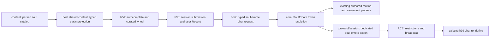

# h3d soul-emote chat and wheel plan

Status: implementation, automated verification, and code-quality review complete. User approved the feature for commit.

## Shared correction and execution checkpoint

The initial local-ACE probe exposed a preexisting defect: Wave worked, but Bow terminated the session with `local transient motion could not enter authored playback`. [Initial evidence](evidence/soul-emote-ux-2026-10-20.json) is retained as a reproduction record. The user authorized the clean shared fix after investigation and scope review.

Root cause: all soul emotes entered an action-only local API. Catalog census found 36 substate poses among 74 poses (137 of 309 aliases), including 14 of the 30 curated wheel choices. Shared command metadata already distinguishes these classes; the frontend and soul-emote handler must not choose their playback route.

The body runtime now admits local commands and retains their playback order. World owns classification, action queueing versus substate selection, advancement, and source replacement. Core submits commands and publishes movement packets. Consecutive pending commands are preserved instead of overwriting one slot. The receive-path audit also proved ACE can broadcast substate command-list entries without a forward field; world packet normalization now retains their state with the same freshness/autonomous filtering as action edges.

Current verification (see [corrected execution evidence](evidence/soul-emote-ux-2026-10-20-verified.json)):

- Local action/pose selection, retained advancement, action return to pose, manual interruption, replacement, and the action queue limit have focused synthetic tests.
- The full Rust library suites pass: 375 host, 100 content, 674 core, and 989 world tests, including the receive-path extension, queue-overflow feedback, and explicit pose interruption.
- Local ACE now verifies Wave, Bow, uppercase `WAVESTATE`, mixed speech, gag rejection after queue acknowledgment, and successful restoration of chat privileges. The original session-termination blocker is resolved.
- The full TypeScript suite passed (373 files / 3,322 tests), followed by 33 focused composition/catalog tests after final cleanup and the additional Recent-bound test. The wheel retains the registered keyboard surface while native modal focus moves through child buttons. The final complete HUD browser probe passed, including keyboard and pointer completion, IME, caret replacement, partial queue failure, modal/lifecycle cancellation, repeated-key suppression, and held-input retirement.
- Final type/Svelte checks, ESLint, dead-code checks, touched-package Clippy with warnings denied, Rust formatting, frontend build, and release host build pass. Vite reports its bundle-size advisory. No TUI launch or agent visual acceptance pass has been performed.


## Final architecture review

The shared API now describes a local authored command instead of falsely promising an action. Its owning world body runtime selects the command class and keeps the retained order. Core handles submission order and packet publication; the soul-emote command handler contains no action-versus-pose routing. The obsolete action-only constructor and transient-only naming were removed from the replaced path.

The frontend uses one typed request and one frontend composer with session-scoped submission and user-scoped Recent. Static catalog projection and validation are independent of world event cadence. Wheel category policy, friendly labels, editor syntax, and history remain in h3d; the host cache is shared with bootstrap without requiring unrelated bootstrap tables. Native-modal child focus needed a bounded correction in the existing keyboard owner, rather than a wheel-specific parallel listener.

Accepted costs: the feature adds a wheel, editor completion state, and reusable automated probes. Multiple queued gestures are deliberately non-atomic. Recent acknowledges queueing only. The shared motion correction increases scope because the live blocker affected nearly half the catalog. No favorites, radial framework, or second playback engine was introduced. Recent now persists through the existing user settings section.

## Goal and boundaries

Make soul emotes easy to discover and execute through retail-style chat syntax and a curated, categorized HUD wheel, using one execution path.

In scope:

- Asterisk chat syntax, including multiword aliases, plus full-catalog autocomplete.
- A curated two-level wheel: five social categories and Recent, with six choices per subwheel at most.
- A HUD shortcut and configurable keyboard activation; click or keyboard confirmation executes a leaf.
- User-profile Recent containing the last six distinct poses successfully queued through either entry point, shared across characters and servers and retained across restarts.
- Typed catalog access and submission through the existing host boundary; focused corrections needed for catalog lookup and motion dispatch.
- Automated unit, contract, browser-interaction, and focused live execution verification.

Out of scope: favorites, pinning, user-defined categories, exposing every emote in categories, gamepad controls, animation previews, automatic target-facing, targeted emotes, a universal stop-emote command, and a general radial-menu framework. No changes to the retail decompile. No TUI launch. Visual acceptance belongs to the user.

## Ground truth and evidence

Paths below are repository-relative. Source code and mounted content take precedence over older docs.

| Source | Finding / implementation consequence |
| --- | --- |
| `crates/holtburger-dat/src/file_type/chat_pose_table.rs`, `ACViewer/ACViewer/FileTypes/ChatPoseTable.cs` | Table `0x0E000007` contains alias-to-pose and pose-to-self/broadcast-text maps; no categories. |
| `crates/holtburger-content/src/soul_emote.rs`, `repository.rs::read_soul_emote_catalog` | Existing static catalog owner and parsed representation. Reuse it. Initial alias lookup was exact-case; corrected in Phase 1. |
| `acclient-eor-source/acclient.c:394841` (`InqChatPoseCommand`) | Retail alias lookup uses a case-insensitive string key. |
| `acclient-eor-source/acclient.c:406578` (`Pose`) | Resolves pose, initiates motion, broadcasts the authored phrase, and presents self text. |
| `acclient-eor-source/acclient.c:407072-407192` (`RemoveTextBetween`, `PublicChat`, `DoSay`) | Retail scans local speech for paired `*…*` and `<…>` spans, executes recognized poses, removes successful spans, and sends trimmed remaining speech only when nonempty. Support asterisks here; angle-bracket syntax is outside this feature. |
| `acclient-eor-source/acclient.c:683022` (`string2command`) | Motion name lookup uses `strnicmp`; catalog capitalization must not suppress animation. |
| `ACE/Source/ACE.Server/Entity/SoulEmote.cs` | Lists motion identities and documented input aliases. Useful cross-check; mounted DAT supplies actual strings. |
| `ACE/Source/ACE.Server/Network/GameAction/Actions/GameActionSoulEmote.cs`, `WorldObjects/Player.cs::HandleActionSoulEmote` | Dedicated `0x01E1` action carries a phrase; server owns gag/Olthoi restrictions, local rebroadcast, and `OnTalk`. Do not route through plain `/emote` or a selected chat channel. |
| `crates/holtburger-core/src/client/commands.rs::handle_chat_command`, `soul_emote_motion.rs` | `ClientCommand::SoulEmote(token)` resolves text and queues local motion plus dedicated network action. Current `%p` expansion is `their`; reuse existing output rather than introducing frontend formatting. |
| `crates/holtburger-core/src/client/movement/system.rs::enqueue_authored_motion`, `execute_authored_motion_at` | Existing authored playback and movement packet path. The wheel must not send animation or movement packets itself. |
| `apps/holtburger-3d/host/src/shared_host_content.rs` | Owns repository and cached parsed `WorldBootstrap`, including soul-emote catalog; existing shared-content dispatcher is the static query precedent. |
| `apps/holtburger-3d/host/src/client_runtime.rs::ClientChatRequest`, `src/client/client-host-contract.ts` | Outgoing chat supports speech/tell/channel/free-text emote, but no soul-emote request yet. |
| `src/client/client-chat-compose.ts`, `ClientChat.svelte`, `client-chat-composer.svelte.ts`, `ClientApp.svelte::sendChat` within h3d | Existing destination resolution, editor/history ownership, guarded session submission. Acknowledgment means queued, not server acceptance. |
| h3d `src/app/PopupMenu.svelte`, `UiDialog.svelte`, `dialog-backdrop-dismiss.ts` | Existing transient keyboard scopes, top-layer surfaces, consumed outside dismissal, and modal focus restoration. PopupMenu supports list/grid and checked submenus; it is not a radial command menu. |
| h3d `src/lib/input/keyboard-input-policy.ts`, `viewport-input-gate.ts` | Existing owners of keyboard admission, cancellation, modal input blocking, and held-key retirement. Releasing a viewport blocker never resumes stale held input. |
| h3d `src/client/ClientShortcutDock.svelte`, `client-binding-catalog.ts`, `src/lib/input/input-contract.ts`, `input-defaults.ts` | Existing HUD shortcut layout and editable binding vocabulary. Add a semantic action, not a parallel key listener. |

### Catalog census performed now

Ran successfully:

```sh
cargo run --offline -q -p holtburger-tools --bin soul-emotes -- dats/assets.hba --limit 1000
```

- Mounted archive: **309 aliases, 74 poses**. Alias strings have no surrounding asterisks; the editor owns delimiters. Do not follow the delimiter-bearing example in the decoder unit test as the runtime catalog shape.
- All 30 curated aliases below exist and resolve to their expected poses.
- Six authored pose spellings miss the current exact-case motion match: `CLAPHANDSSTATE`, `SCRATCHHEADSTATE`, `SHAKEFISTSTATE`, `SNOWANGELSTATE`, `WARMHANDS`, `WAVESTATE`. All six have existing case-insensitive equivalents in the mapper; no new motion IDs are needed.
- Catalogs do not author wheel categories. Membership, friendly labels, preferred aliases, and ordering belong to h3d.
- Do not retain tests dependent on `dats/assets.hba`; use synthetic checked-in fixtures for permanent tests. The command above is an investigation/reproduction aid, not a CI prerequisite.

## Product contract

### Curated wheel

Clockwise root order is Greetings, Reactions, Signals, Attitude, Relax & play, Recent. Category membership and leaf order are explicit app-local data. This table gives preferred aliases; display labels use normal capitalization, with “Farewell” for `be seeing you` and “Drudge dance” for `drudge dance`.

| Category | Preferred aliases, in order |
| --- | --- |
| Greetings | `wave`, `bow`, `curtsey`, `salute`, `blow kiss`, `be seeing you` |
| Reactions | `laugh`, `cheer`, `clap`, `cry`, `shrug`, `smack head` |
| Signals | `nod`, `shake head`, `beckon`, `point`, `shoo`, `surrender` |
| Attitude | `cross arms`, `shake fist`, `mock`, `plead`, `tap foot`, `talk to hand` |
| Relax & play | `sit`, `lean`, `meditate`, `read`, `drudge dance`, `ymca` |
| Recent | Last six distinct queued poses; any catalog pose may appear, including chat-only choices. |

Behavior:

- The HUD button opens a click-controlled overlay. Holding the rebindable “Open emotes” action opens the same fixed-center overlay; releasing that physical key dismisses without selecting, even if modifiers changed. Choose a default chord through the existing overlap checker, and document it in help; do not invent a second binding mechanism.
- Each category replaces the root at the same center. No concentric rings, third level, paging, or category overflow.
- Show the current section as a compact passive readout using the FPS HUD background; leave the surrounding center empty. Escape returns to root from a subwheel; Escape at root closes. Backdrop click closes and is consumed. Window blur, hidden document, modal takeover, disconnect, character change, world reveal transition, and unmount close the transient wheel.
- Wedges show their friendly names; native hover tooltips expose the preferred `*alias*`. The center contains only a compact passive section label, using the same shared readout background as the FPS counter. Authored text remains available in chat completion details; no wheel prose or animation preview.
- Hover never executes. Clicking or pressing Enter/Space on a leaf closes the wheel and submits once. Repeated keydown cannot duplicate execution. The opening click/key must not select a leaf.
- Use a coherent menu keyboard model: arrows or WASD cycle enabled wedges in visual order; Enter/Space enters a category or executes; Home/End select first/last; Escape backs out. Provide accessible names and active-item semantics. No initial leaf activation.
- No movement, world selection, camera gesture, attack, cast, charged-jump release, or auto-run resurrection while the wheel owns input. Opening cancels existing gestures/held controls through the existing policy. Closing requires fresh gameplay input.
- Keep root/category positions stable, including when content is unavailable. Disable a missing curated item with a specific diagnostic; do not substitute a different alias/pose. A missing whole catalog is an actionable load error. Recent is disabled when empty; fewer than six entries do not fabricate placeholders.
- Clamp/scale the wheel to the viewport and theme font metrics while retaining readable labels and useful hit areas. A pure resize can close and reopen later, following PopupMenu's cancellation precedent.
- Wheel is a transient interaction, not a retained HUD window, saved panel, or Explorer tool. The shortcut belongs in the existing dock; its sizing must include the new item.

### Chat syntax and autocomplete

- A standalone recognized `*alias*` is a soul-emote intent regardless of the selected destination; that destination remains selected afterward. Match aliases case-insensitively and retain canonical catalog identity. Support multiword aliases.
- In local speech, including explicit `/say`, recognize embedded paired spans: `Hello *wave*` executes Wave and sends `Hello`. Scan recognized spans left-to-right, then send trimmed remaining speech if any. Unknown or unclosed spans remain literal speech, matching retail's successful-removal rule. Do not turn ordinary asterisk text into an unknown-command error.
- Explicit tell/channel/free-text `/emote` bodies remain literal. A standalone unprefixed emote can override the destination picker, but `/tell Bob, *wave*` remains a tell. This keeps command routing explicit and avoids accidental public gestures from private prose.
- This release implements asterisks only. Do not silently add retail's angle-bracket form, interpret `/wave`, or turn asterisks into free-text `/emote`.
- Autocomplete uses the full catalog when the caret is in an eligible asterisk span. Search aliases, group results by resolved pose, and preserve matching aliases for discoverability. One pose gets one visible suggestion, with deterministic ordering and a deterministic preferred alias for non-curated poses.
- Selecting a suggestion replaces only the active span with a completed `*alias*`; it does not submit. Arrow keys navigate visible suggestions before sent-history recall; Tab accepts; Escape dismisses suggestions before cancelling chat. Enter with suggestions open accepts the highlighted suggestion; a later Enter submits. Preserve IME composition and native editing/caret selection.
- Show “Emote · Local” for standalone gestures; mixed local speech keeps a Local indication with emote context. Never imply that a gesture goes to General or a tell recipient. Session changes retire pending suggestions/submissions and preserve existing composer-generation guards.
- No optimistic chat echo added by this feature: keep existing received soul-emote rendering and server-error handling. Do not manufacture a second self line alongside the rebroadcast.

### Recent semantics

- One app-local composer records both chat and wheel submissions in user-profile settings. Character/session replacement, disconnect, and app restart preserve Recent. When the catalog loads, discard unknown IDs, deduplicate by stable pose ID, and bound the list using the configured Recent limit.
- Record after successful host queue acknowledgment, never on hover, completion selection, receipt of another player's emote, or rejected invocation. Server rejection may still follow; Recent records attempted usage, not server-confirmed playback.
- Deduplicate by case-insensitive canonical pose identity, not the alias typed; preserve authored spelling for display and execution. Move a repeated pose to the front. Bound history with one named tuning value, initially six; tests derive configurable limits rather than freezing today's value.
- A queued completion from an old session cannot affect the new session. Capture the session generation before awaiting and check it afterward.

## Architecture and north stars

1. Keep authoritative lookup and execution in their existing shared owners. Keep wheel membership, editor grammar, favorites-free history, and input policy inside h3d.
2. One catalog, one resolution meaning, one submission path. Neither Svelte nor the host adapter invents motion IDs, broadcast text, or server permissions.
3. Reuse simple structures first. Extend the existing typed chat union with `{ kind: "soul-emote", token }`; avoid an unrelated emote RPC or generic command bus.
4. Resolve each catalog fact at the owning layer and project it losslessly. Do not make each frontend re-derive alias equivalence and canonical pose identity.
5. Preserve cold UI ownership. Geometry can be CSS-positioned buttons; update highlights only when the active wedge changes. No cursor-rate payloads in Svelte `$state`.
6. Aim for a few focused app modules and one wheel component, not a radial framework. A general action registry, shared category system, or separate persistent store is unjustified. Recent uses one independently saved section in the existing user settings contract.



Static projection: return canonical pose identity, aliases with original spelling, and optional authored self/broadcast text, grouped by pose at the content layer. The named consumers are autocomplete (aliases), wheel/Recent (identity and labels), and autocomplete details (self/broadcast text). Do not add unused motion availability flags, duplicated formatted text, or metrics. The static query and bootstrap share one lazily cached catalog; it must not reconstruct disk discovery in `core` or request live world state.

For embedded speech, extend compose resolution to a nonempty ordered submission sequence. Keep this app-local; submit ordinary typed requests through the existing session method. Do not add transport-level batching. Resolve and validate the entire composition before dispatch. Stop on invocation failure; report partial queueing explicitly, retire the submitted draft from automatic replay, and never automatically resend already queued gestures. This sequence is not atomic and does not promise that multiple motions play fully before the next begins.

Wheel shell: a feature-local native dialog uses `keyboard.modal`, `dialog-backdrop-dismiss`, existing theme tokens, and one cancellation callback. The initial `UiDialog` implementation showed rectangular buttons inside a framed rectangular modal; user visual review rejected that as not a wheel. The corrected HUD has annular wedge hit areas and a circular center Back/Close hub, with transparent space around it. `UiDialog`'s header/body frame cannot express that silhouette without adding wheel-specific variants or overriding its shell. No generic radial-menu framework was added.

## Implementation phases

### Phase 1 — Catalog and typed execution foundation

- [x] Make shared alias and motion-name lookup honor retail's case-insensitive matching without destroying original strings. Canonical pose equivalence belongs to content; motion ID resolution belongs to core. Handle normalized collisions deterministically or fail with a precise content error; do not silently overwrite.
- [x] Add a pose-grouped static projection in `holtburger-content`, and expose it through h3d `host/src/shared_host_content.rs` and a typed frontend content adapter, following `src/app/spell-references.ts` and existing host transport registration/allowlists.
- [x] Extend Rust `ClientChatRequest`, TS `client-host-contract.ts`, session submission validation, and boundary tests with the token-bearing soul-emote variant. Forward to existing `ClientCommand::SoulEmote`.
- [x] Add focused synthetic tests for mixed-case aliases, uppercase authored poses, multiple aliases per pose, unknown aliases, collision handling, and dedicated soul-emote mapping. Keep wire payload construction in core.

Acceptance: a typed `wave` request reaches the existing core path; unknown aliases produce explicit existing core feedback; full-catalog projection preserves original strings and canonical identity; all six observed uppercase names resolve to the already-known motion IDs. Existing chat variants retain their contracts.

### Phase 2 — Chat and shared session usage

- [x] Add a small pure soul-emote composition/autocomplete module under `src/client/`; extend `client-chat-compose.ts` to distinguish standalone gestures, mixed local speech, literal routed messages, and ordered submissions.
- [x] Add one session-scoped usage/submission owner shared by chat and the future wheel. Keep `ClientApp` as composition glue; preserve composer generation and existing error surfaces.
- [x] Implement autocomplete in `ClientChat.svelte`, retaining native editor behavior, sent-history recall, and destination labels. Add `/help` documentation in `client-command-help.ts`.
- [x] Test standalone destination override, explicit routing, embedded multiword/case-insensitive tokens, unknown/unclosed spans, multiple spans, no empty speech request, generation changes, invocation failure, partial queueing, and alias-deduplicated Recent.
- [x] Verify browser caret replacement, IME-safe submission, suggestion keyboard precedence, focus restoration, and old-session completion rejection with synthetic catalog content.

Acceptance: `*wave*` and local `Hello *wave*` work through the same typed path; `/tell Bob, *wave*` stays literal; autocomplete discovers chat-only poses; recent usage changes only after successful queue acknowledgment. Errors cannot cause silent automatic duplicate submission.

### Phase 3 — Curated wheel and HUD integration

- [x] Add app-local curated definitions matching the table, one pure navigation/history model, and `ClientEmoteWheel.svelte`. Resolve preferred aliases against the mounted catalog while building a subwheel; permanent tests use synthetic content.
- [x] Add an Emotes action to `ClientShortcutDock.svelte`, its shared sizing list, and icon vocabulary. Keep static artwork under `src/assets/icons/`; reuse common control/theme styles.
- [x] Add “Open emotes” to the semantic shortcut vocabulary, binding defaults, binding catalog/settings, and conflict contexts. Inspect actual overlap results before choosing the default chord; no hard-coded alternate listener.
- [x] Wire open/close and submission through existing app input/modal ownership. Close on lifecycle loss and ensure held controls and pointer gestures retire without release-triggered gameplay actions.
- [x] Implement root/subwheel replacement, compact passive section label, hover text, keyboard navigation, single leaf execution, consumed outside dismissal, and empty Recent behavior.

Acceptance: six stable root wedges, at most six leaves per category, exactly the agreed curated membership, full-catalog Recent, no third level. HUD and configured shortcut open the same owner. Pointer or keyboard activation queues once; dismissal and focus changes never execute a gesture or leak a click into the world.

### Phase 4 — Integration verification and cleanup

- [x] Extend the existing browser harness/client UI probes with synthetic catalog and invocation spies. Check editor and modal coexistence, focused action bars, repeated keys, outside clicks, resizing, blur, disconnect, and character replacement. Assert canceled held movement/jump/camera input needs a fresh press.
- [x] Use a focused live probe/harness against ACE to verify one action emote, one pose/state emote, one uppercase catalog pose, and mixed speech. Capture motion packet/local authored playback and dedicated broadcast evidence. Test gag errors without claiming queue acknowledgment proves server acceptance. Do not launch the TUI.
- [x] Live prerequisites were available; the final release-host probe completed. The initial failure is retained separately from the corrected verification evidence.
- [x] Remove duplicate alias parsing/lookup, placeholder paths, stale vocabulary, unused fields, temporary asset-dependent tests, and any input listeners made redundant by the ownership integration. Update only durable docs actually affected; old plans need no retroactive maintenance.
- [x] Inspect the final diff and line-count impact. Keep the static catalog/query path, session usage owner, and wheel interaction responsibilities narrow; collapse helpers used only to pass data through.
- [x] Run appropriate focused Rust tests and `cargo clippy` for touched packages with `--all-targets -- -D warnings`; run h3d `npm run check`, `npm run test:ts -- <focused files>`, `npm run lint:ts`, `npm run lint:dead`, and `npm run build`. Use package scripts for host checks (`check:rust`, `lint:rust`); check formatting for touched files through repository tooling. Fix all relevant diagnostics.
- [x] Hand visual acceptance to the user: label readability, hit areas, wheel placement, themed contrast, and actual social usefulness of the curated choices. No agent visual acceptance pass unless requested.

Acceptance: automated interaction and execution evidence is recorded; checks pass; no runtime-asset-dependent permanent tests; no duplicate execution mechanisms, unused abstractions, or leftover favorites vocabulary. Any unavailable live validation is explicitly outstanding.

## Risks and concessions

- **Queued versus accepted:** host success only acknowledges enqueue. Recent intentionally records usage attempts; server feedback remains authoritative.
- **Animation semantics:** the initially action-only local API was a verified blocker for 36 poses. The user approved a shared correction: world owns command classification and retained playback, core owns ordered movement publication, and the soul-emote handler remains class-agnostic. Local and received substate commands now retain their forward state. This expands shared implementation scope without adding frontend animation policy. A stop-emote UI remains out of scope.
- **Content differences:** runtime catalogs can differ. Disable missing curated entries with diagnostics; autocomplete and Recent remain catalog-derived. No embedded full production catalog or fallback invented motions.
- **Partial composition:** ordered frontend submissions are not atomic. Validation precedes dispatch, invocation failures stop the sequence, and feedback identifies what queued without automatic replay.
- **UI ownership:** modal blocking is intentional while choosing an emote. This cancels held gameplay input; it does not pause the server or make the player safe.
- **Scope/line count:** shared changes include catalog canonical resolution/projection, motion-name correction, and the explicitly authorized class-aware local/received command correction. Categories, history, wheel controls, and autocomplete remain app-local. The accumulated change adds roughly 2,400 net source/test/probe lines, including about 870 lines of new test fixtures and browser/live probes. This is more than the initial UX-only estimate because the execution defect crossed core and world; no general radial framework or parallel motion runtime was introduced.

## Definition of done and open questions

- [x] Full catalog is discoverable via asterisk autocomplete; curated wheel exposes only the agreed socially useful subset.
- [x] Chat and wheel share typed execution and persisted user-profile Recent, with no favorites.
- [x] Case-insensitive retail lookup works for real authored spellings; protocol text/motion decisions remain shared-runtime-owned.
- [x] Focus, cancellation, lifecycle, stale completions, and partial failures have automated evidence.
- [x] Relevant compile, tests, lint, build, and browser checks pass; live execution evidence and user visual acceptance are separately identified.

No product question blocks implementation. The default hold key is T; final wheel presentation remains subject to user visual acceptance. User visual acceptance may adjust labels or curated membership without changing the architecture.

## User visual handoff

Hold **T** (rebindable) to keep the wheel open, or click the Emotes dock button. Release T to dismiss; click, Space, or Enter confirms a selection. Check root/subwheel placement, label readability and contrast in your theme, useful hit areas, the compact section label, and whether these curated choices cover ordinary social exchanges. Try `*wave*`, `*bow*`, and `Hello *wave*`; autocomplete accepts with Tab, Enter, or click before submission. Recent is shared across chat and the wheel. User visual acceptance has not been performed.

Browser verification caveat: two earlier complete runs stopped at an item-use cursor assertion. An isolated HEAD checkout and the final implementation both passed the complete suite. The intermittent assertion's cause is unproven; it was not dismissed as preexisting or repaired by an unrelated production change. A parallel comparison also caused a Vite dependency-cache startup conflict; final successful comparison runs were serial. Temporary cursor diagnostics were removed. No emote assertion remains failing.

## Wheel presentation correction after user review

The initial button-ring presentation was rejected in the supplied screenshot. The revised component removes rectangular dialog chrome, clips each native button to an annular segment, and positions its label within that hit area. The center is one circular Back/Close control carrying the current category and authored text preview. Wedges and hub share a square viewport-constrained footprint; the backdrop uses lighter dimming. Existing modal and keyboard owners remain responsible for input and cancellation. Transparent gaps and space outside the circle dismiss without choosing a gesture.

Verification adds browser hit tests for circular bounds, clickable outer arcs, center ownership, and dead space between segments. No agent visual acceptance pass is performed; final appearance remains for user review. The activation default is **T**.

Correction verification completed: full HUD browser suite passed, including the new annular hit tests and T activation; type/Svelte checks, ESLint, build, touched formatting, and whitespace checks passed. User visual acceptance remains pending.

## Hold interaction and glass styling after second user review

User review supersedes the original hold/release non-goal: keyboard activation is now hold-to-open, release-to-dismiss. Confirmation still requires click, Space, or Enter. The HUD button remains click-open. Existing scope-local arrow/Home/End navigation, Back/Escape, and interruption cancellation remain. The input policy owns a disposable observation of the opening physical key's release, so modal admission can cancel held game controls without losing the wheel's dismissal edge. Closing/selection retires that observation; it cannot close a later interaction or trigger a game release.

The radial boundaries are parallel offsets at a fixed width rather than fixed-angle cuts. Wedges and the center use shared HUD glass tint/filter tokens, replacing orange button chrome. Highlighted enabled wedges animate a small scale increase and reduce backing opacity; reduced-motion preferences remove animation. The existing combat gauge consumes the same renamed glass tokens without changing its backing values. No additional global key listener or generic radial framework is introduced.

Focused release-lifetime tests pass alongside the emote/help tests (59 tests). Browser verification exercises hold/release, modifier changes, taps, repeat quarantine, constant gap width at two ring radii, and translucent filtered backing; final results are recorded in the evidence artifact. Visual appearance remains for user acceptance.

Hold/glass verification complete: the focused `--client-keyboard --brief` browser suite passed, including emote hold/release, physical-key release with changed modifiers, Enter/Space confirmation, constant-width gap measurements, translucent filtering, and existing input ownership checks. The broader HUD run completed these checks, then hit the previously recorded intermittent item-use cursor assertion. The exact distinction is retained in the evidence artifact. No agent visual acceptance pass was performed.

## Compact presentation after user review

Wheel diameter reduced from 34rem to 24rem (about half the screen area), with a smaller center. The center is compact: a passive Emotes label at root, and category/Back in subwheels. Removed authored-text previews, duplicate highlighted labels, and navigation instructions from the wheel; aliases remain in native tooltips and rich discovery stays in chat autocomplete. The now-unused held-mode presentation prop was removed. Hold/release, selection, frosted styling, and parallel wedge gaps remain.

Compact revision verification: focused keyboard/emote browser suite, type/Svelte checks, ESLint, build, formatting, and whitespace checks passed. User visual acceptance remains pending.

## Passive root center

The root center is now noninteractive and only reads “Emotes.” Subwheel centers retain Back. Release of the held activation key, Escape, or outside clicks still dismiss. The Back button uses the wheel’s visual focus treatment rather than Chromium’s default white focus outline. Browser checks cover root-center clicks preserving the wheel and Back returning to root.

## WASD navigation

W/A navigate like Up/Left; S/D like Down/Right. Letter matching is case-insensitive. All navigation uses the same enabled-entry traversal and scope-local input consumption, preserving arrow controls and preventing character movement while choosing an emote. Browser checks compare each WASD key against its arrow equivalent and inspect all movement axes while keys are held.

WASD verification: focused keyboard/emote browser suite, type/Svelte checks, ESLint, build, and whitespace checks passed.

## Empty center with FPS-style section label

User review removes the remaining Back button and circular center backing. Both root and subwheels now show only a compact passive section label through the existing `ui-readout` style used by `ClientFpsCounter`. Removed the center's button markup, circular border, glass backing, focus/hover styles, and extra action text. Releasing/repressing the hold key is the quick return path; existing Escape behavior remains. Browser checks verify label clicks do not select or navigate.

Section-readout verification: focused keyboard/emote browser suite, type/Svelte checks, ESLint, build, and whitespace checks passed. User visual acceptance remains pending.

## Transparent radial backdrop

Removed viewport dimming from the emote wheel through its local shared-backdrop background override. Native modality, gameplay input blocking, outside dismissal, and frosted wedge backings remain. Other dialogs retain their existing backdrop styling.

## Dropdown completion styling

Chat emote suggestions now use flat dropdown rows instead of button chrome. The existing PopupMenu row recipe was promoted to shared `ui-menu-item` styling and both real consumers use it, including selected/disabled theme states. Completions retain editor focus and pointer/keyboard acceptance, with pointer hover updating the active option. Feature CSS owns only the two-line text layout; popup padding and row presentation share the existing menu tokens.

Dropdown styling verification: focused keyboard/chat browser suite, type/Svelte checks, ESLint, build, formatting, and whitespace checks passed. User visual acceptance remains pending.


## Command completion extension

The h3d chat layer now owns a common completion result: display label, detail, stable choice identity, replacement text, and editor range. The command catalog supplies supported names, explicit aliases, descriptions, and fixed invocations to both help and completion. The emote catalog supplies gesture suggestions through the same result. ClientChat retains editor focus, caret replacement, IME handling, dismissal, and keyboard navigation; no completion UI or frontend control policy moved into shared Rust crates.

Typing `/` or `@` discovers commands independently of emote availability. Matching is case-insensitive and grouped by command. Acceptance preserves the prefix, existing argument body, and surrounding text, and never submits. Fixed invocations such as `/house recall` are offered before arguments exist. Dynamic argument completion is outside this extension. Execution and validation continue through the existing handlers; discovery metadata does not introduce another command dispatcher.

Verification: 374 frontend test files / 3,343 tests pass. Focused native-browser checks cover command Tab/Enter/pointer acceptance, arrow navigation, alias/prefix preservation, editor focus, and non-submission, alongside existing chat/emote/input-policy checks. Type/Svelte checks, ESLint, unused-code lint, build, touched formatting, and whitespace checks pass. Browser results are retained in the evidence artifact; visual acceptance remains with the user.


## Persisted user Recent

Recent is now a versioned user settings section, shared across characters and servers on the local profile. ClientChatComposer receives the loaded IDs and publishes changed history to ClientApp's existing settings writer; that writer retains coalescing, shutdown flushing, and save-failure feedback. Character-session reset clears session chat state without clearing Recent. Catalog admission removes missing IDs and duplicates while preserving order and applying the configured limit. Cleanup is written back only when the list changes. No timestamps, counters, favorites, separate storage path, or shared Rust changes were added.

Verification covers actual settings-file save/reload, missing older sections, composer recreation, stale catalog entries, deduplication, configured bounds, and rejected/stale queue attempts. The native-browser probe recreates the composer from synthetic user settings and verifies restored Recent, alongside existing chat and wheel interaction checks. Visual acceptance remains with the user.


## Wheel appearance tokens

Themes can now override the wheel's appearance without changing component CSS:

| Token | Default |
| --- | --- |
| `--ui-emote-wheel-size` | `24rem`, clamped to the available viewport |
| `--ui-emote-wheel-highlight-background` | Local HUD glass mixed with 45% transparency |
| `--ui-emote-wheel-highlight-scale` | `1.025` |
| `--ui-emote-wheel-transition-duration` | `160ms` |

The optional highlighted background is resolved at the wedge so scoped HUD glass overrides remain effective. Existing palette, font, and HUD glass tokens still supply the other appearance values. Ring geometry stays component-owned. Reduced-motion preferences continue to disable animation and growth. Browser verification applies scoped token overrides and checks computed width, highlighted background, scale, and transition duration; it does not perform visual acceptance.

Appearance-token verification passed: scoped browser overrides, existing keyboard/chat/wheel checks, type/Svelte checks, ESLint, build, formatting, and whitespace checks.


## Final code-quality review

Verdict: ready within the reviewed scope after bounded cleanup. Review baseline is the accumulated feature diff against HEAD, including new files; preexisting ACE/ACViewer worktree changes are excluded.

Contract coverage:

- Static content: DAT table -> case-insensitive content catalog -> host cached reference query -> frontend validated alias/pose indexes. Authored spelling and optional text survive projection; categories remain frontend policy.
- Submission: composition -> typed single/batched requests -> composer -> app session -> Rust host -> core handler. Reviewed all-action validation before enqueue, partial queue failure, stale generation handling, queue acknowledgment semantics, and Recent updates. Batch sends remain intentionally non-atomic.
- Motion: core ordered command staging -> world admission -> body runtime -> simulation and playback projection. Reviewed action/pose classification, bounded action queues, local cursor ownership, autonomous-echo filtering, remote substate command admission, manual/explicit-stop replacement, and server-directed replacement. Existing TUI command consumers use the same core API; the TUI was compiled, not launched.
- Input: binding catalog -> keyboard activation -> native modal scope -> physical release registration and disposal. Reviewed editor/IME ownership, focus transfers, repeat suppression, and cancellation on release, replacement, resize, blur, and lifecycle changes.
- Presentation/settings: shared PopupMenu/completion row styles, wheel/readout/HUD glass consumers, wheel token overrides, startup settings -> composer -> user section writer -> disk persistence and shutdown flushing.

Fixed review findings: the network rejection contract still described invalid substate speeds as transient-action failures, so the source/rejection vocabulary and consumers now consistently describe motion commands. Removed the obsolete single-request composer wrapper, retained only the production batch API, and removed a test-only retained error count while preserving partial progress and the original error cause. Kept the internal world admission outcome crate-private. Corrected remaining character-session wording around persisted Recent.

Consolidation choices: shared menu styling and command discovery metadata have real consumers and remain app-local; action-class decisions stay in world. Execution-specific command validation remains with its existing handlers rather than introducing a command-dispatch framework. The separate content cache avoids requiring unrelated bootstrap tables for static discovery. Persistent user history and session chat state deliberately keep different reset lifetimes. No new caching, general radial framework, or production diagnostic API was added during review.

Verification: 3,347 frontend tests; 375 host, 100 content, 674 core, and 989 world library tests; native browser keyboard/chat/wheel/theme checks; type/Svelte checks; frontend build; ESLint/Knip; Rust formatting; and Clippy with warnings denied across content/world/core/host/tools/TUI. Seven core tests initially failed at socket creation under sandbox network restrictions; rerunning core/world with loopback access passed. Earlier live ACE evidence remains the execution reference; this review did not rerun live administrative probes or perform visual acceptance. Other unrelated subsystems and exhaustive emote/stance combinations are outside this review.
