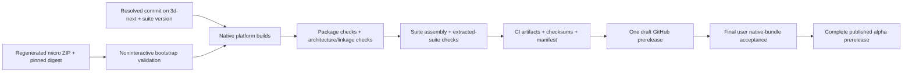

# Alpha release from `3d-next`

Status: the nine-asset alpha.3 draft at `e705767e4` is verified on 26.08 and awaits user native acceptance and publication. The revised CI split is implemented in the worktree; hosted acceptance of that split remains outstanding. The last observed CI-policy run at `1c5f06760` passed all native jobs; its sandbox job was still provisioning when observation stopped. That follow-up run is not a prerequisite for accepting the existing candidate. The steering section below governs future CI work and supersedes earlier requirements to run the complete release workflow on branch pushes or rebuild candidates at tags.

## Steering: shorten feedback and publish existing artifacts

The user resumed implementation after the scope revisions below. Preserve the distinction between implementation checks and the one intentional hosted candidate acceptance run. Preserve the current alpha.3 draft, source, tags, and all nine verified assets. Its final manual acceptance can proceed independently of these CI improvements. Historical phases and execution notes below describe the implementation already performed; their old trigger and validation placement is superseded here.

### Goal, evidence, and ownership

The release system should provide fast development feedback, build a requested candidate once, and publish accepted bytes without compiling again. Scope is CI orchestration and build-environment provisioning under `.github/`, with corresponding release instructions in `docs/ALPHA_RELEASING.md`; no application or shared-crate architecture changes are needed.

- At the `1c5f06760` baseline, `.github/workflows/alpha-release.yml` starts native builds and both Flatpaks on every `3d-next` push/PR and again for alpha tags. `suite-flatpak` depends on the entire native matrix; each Flatpak job provisions separately, and the TUI job recompiles Linux binaries.
- The saved successful alpha.3 Flatpak log records 95.4 MB of apt downloads taking 33 minutes 1 second. Installed-app verification took approximately 24 seconds. Prioritize provisioning and duplicate work over removing inexpensive checks.
- Saved native logs show npm and Rust cache restores. A restored dependency cache does not mean production executables or installed OS dependencies are reused. Flatpak action caching covers `.flatpak-builder`, not our preceding apt/runtime installation.
- Current source references: `.github/scripts/alpha_release.py` for identity, assembly, receipts and staging; `.github/flatpak/verify-installed` for installed smoke; existing recipes for runtime and sandbox policy.
- External references: [hosted runner lifecycle](https://docs.github.com/en/actions/concepts/runners/github-hosted-runners), [custom VM images and eligibility](https://docs.github.com/en/actions/how-tos/manage-runners/larger-runners/use-custom-images), [Flatpak action cache and execution options](https://github.com/flatpak/flatpak-github-actions), [Rust cache behavior](https://github.com/Swatinem/rust-cache).

### Intended execution model

| Lane | Trigger and responsibility | Required evidence |
| --- | --- | --- |
| Commit validation | Relevant pushes/PRs; run shared quality checks on Linux only. Documentation-only changes skip builds. | Formatting, lint/type checks and appropriate unit tests; no Windows/macOS jobs, routine release packaging or Flatpak provisioning. |
| Candidate | Explicit candidate request for an exact commit. Linux, Windows x64 and Apple Silicon build in parallel; both Flatpaks consume the same Linux outputs and share one Ubuntu tooling/runtime installation. | Production build, package identity/layout/architecture/notices/content checks, sidecar/bootstrap smoke, and focused native/sandbox launch and access checks. Windows/macOS do not repeat the shared unit suite. |
| Publication | After explicit acceptance, publish the existing complete draft through GitHub's release UI or existing tooling. | Exact source/tag/version, complete inventory and checksum agreement; publish existing bytes and verify public downloads. No builds, dependency setup, or new promotion workflow. |

Platform investigations are ad hoc targeted work when an actual OS issue arises. Do not build a generic dispatch interface or configurable investigation matrix.

Target service times: warm commit validation under 10 minutes, warm complete candidate under 20 minutes, and publication under 2 minutes. These are initial measurement targets, not demonstrated guarantees; report cold-start and warm timings separately. Never hide a failed or incomplete check to meet a target.

### Phase S1: Separate triggers and remove duplicated builds

Deliverables: simplify `.github/workflows/alpha-release.yml` and its release-tool entry points as needed; update `docs/ALPHA_RELEASING.md`. Prefer existing jobs and tooling over a new orchestration framework.

- [x] Separate commit validation from explicit candidate packaging. Normal pushes/PRs run Linux-only shared quality checks. Reserve Windows x64 and Apple Silicon runners for explicit candidate builds or explicit platform investigations; no automatic native OS test matrix on ordinary commits.
- [x] On Windows/macOS candidates, build and inspect the actual native package and run focused startup/private-host/content smoke checks. Do not repeat shared unit suites or the prior four-library/nine-frontend-file selection as a blanket candidate requirement. Retain useful platform contract tests for explicit investigations and run portable coverage in Linux validation where applicable. Keep native packaging on native runners; cross-compilation infrastructure is outside scope.
- [x] Use simple documentation-only exclusions without leaving required status checks permanently pending. Treat workflow, lockfile, build-script, recipe, and packaging-tool changes as relevant inputs. Do not build dependency-aware package/test selection.
- [x] Resolve the actual explicit-trigger mechanism against GitHub's default-branch workflow requirements before implementing it. Use an available dispatch entry point or an explicit tag route; do not assume UI dispatch on `3d-next` works. If tags request candidates, publication must reuse that candidate rather than trigger another build.
- [x] Separate the Linux native job from other matrix completion so Flatpak work waits only for Linux artifacts. Keep all three native platforms required for the complete candidate.
- [x] Reuse Linux TUI and bootstrap outputs for the TUI Flatpak. Package both Flatpaks in one provisioned job/environment, preserving their distinct inventories, installed receipts and app IDs. Do not rebuild the app or Rust binaries in that job.
- [x] Reuse candidate diagnostic outputs where useful instead of repeating npm installation/Electron compilation solely to supply probes. Keep diagnostics private and out of public bundles.
- [x] Keep formatting, lint, shared test suites and exhaustive theme/font/recovery regression coverage in validation; record successful validation for the exact candidate source before it is eligible for publication. Keep inexpensive package smoke on each actual shipped native artifact and sandbox access/launch smoke on the actual Flatpaks. Remove redundant exhaustive executions from candidate packaging, not coverage from the project.

Acceptance: trigger/job graph inspection and targeted workflow/tool checks prove ordinary commits schedule Linux validation only and explicit candidates include all three native platforms. No generic investigation interface is introduced. Do not launch a full release merely to validate YAML or selectors.

### Phase S2: Reduce setup on the existing Ubuntu runners

Keep the existing headless GitHub-hosted Ubuntu runners. Building Flatpaks needs command-line tools and the SDK/runtime; installed Electron checks additionally need Xvfb, D-Bus and portal services. These dependencies do not require a desktop distribution or full desktop installation. Fedora/GNOME build stacks, custom container images, custom VM images, self-hosted runners and runner orchestration are outside this implementation scope.

- [x] Install the required tooling and selected runtime once in the combined Flatpak job. Reuse that installation for both bundles and installed smoke checks; retain the proven display/D-Bus activation order.
- [ ] Consolidate jobs and retain existing caches first. Add a Flatpak download/runtime cache only if measured setup cost still warrants it. Verify supported paths, permissions, cache size and restore cost before adding a cache; do not blindly archive the whole system installation. A miss follows the normal installation path and remains observable.
- [x] Inspect the slow apt step's package list and download source. Reduce unnecessary packages/recommendations where safe and address a demonstrated mirror/download issue narrowly. Preserve the services needed by existing sandbox checks.
- [ ] Key any added caches by runtime, architecture and relevant provisioning inputs. Preserve the portable archive's Ubuntu 22.04 compatibility baseline independently of the Ubuntu 24.04 Flatpak job.
- [ ] Inspect existing cache restore/save logs only as needed to explain a measured bottleneck. Do not add a cache service or broad cache-audit project. Do not treat a dependency cache as an accepted release artifact or rely on a cache hit for correctness.
- [x] Commit the locally generated, reviewed Rust/native notices HTML plus its generated input/output digest record. Committed and pushed as `b86732ac5`; the HTML matches the verified alpha.3 notices. Regenerate when Cargo manifests/lockfile, notice policy/original texts, or generator change. Keep Electron/Chromium/font notices in their existing package paths.
- [x] Replace candidate-time `cargo-about` installation and notice generation with a Python-only freshness check and packaging of that committed file. The check must detect changed relevant inputs and altered/missing output, with a clear local regeneration command. Include it in ordinary Linux validation; no network/license scan or tool compilation is needed in CI. Reuse existing generation and rendering logic rather than introducing a license service or second generator.

Acceptance: Flatpaks wait only for Linux output, reuse its production binaries, and share one tooling/runtime installation on existing Ubuntu infrastructure. CI checks and copies committed notices without installing or running cargo-about; relevant-input and output tampering/staleness checks are exercised locally. Any new cache has demonstrated reuse and correct miss behavior; report remaining setup cost honestly. Installed smoke passes with existing candidate inputs. A new runner/image platform is not required to finish this phase.

### Phase S3: Validate, simplify publication, and clean up

- [ ] Review GitHub's existing step timings and record a short before/after comparison of the longest dependency chain. Distinguish cold setup from warm runs where evidence is available; do not add a latency-reporting system or launch extra runs just to fill a benchmark table.
- [ ] If setup exceeds 5 minutes or a candidate approaches 20 minutes, identify the responsible step and reassess before another expensive attempt. Do not cancel a progressing job merely to retrieve logs; do not keep polling without a decision to make.
- [ ] Make at most one intentional end-to-end candidate acceptance run after targeted checks pass. An infrastructure-only retry should reuse successful artifacts/jobs wherever possible. Further full attempts require a concrete diagnosed failure and stated reason.
- [ ] Review the discovered tag-cache limitation with the user before selecting another candidate: unique alpha tags cannot restore caches from `3d-next` or previous tags. Only the current ref and default-branch caches are eligible. This run missed both npm and Rust caches, so a repeatably warm candidate path is not established. Prefer deciding whether to enable candidate execution on the existing branch over adding runner/cache infrastructure; do not silently change default-branch workflows or move existing tags. See [GitHub cache restrictions](https://docs.github.com/en/actions/reference/workflows-and-actions/dependency-caching#restrictions-for-accessing-a-cache).

- [x] Restructure the existing release workflow's triggers, dependencies and duplicate work; reuse `.github/scripts/alpha_release.py` draft assembly/upload and identity/checksum validation. Reuse does not mean preserving the current slow job graph.
- [x] Stage the complete candidate in a draft release using existing tooling. After acceptance, use GitHub's existing Publish release action or equivalent existing command to publish that draft. Document source/tag/version and checksum checks before publication and the public download check afterward. No new publication workflow, promotion framework, artifact registry, or generic candidate-selection interface is needed.
- [x] Keep candidate bytes in the existing draft through manual acceptance. Never substitute latest-branch outputs or silently rebuild missing assets; a replacement candidate requires an explicit request. Do not build a new retention-management mechanism.
- [x] Retain complete-inventory, no-retail-data, source/version, notices and checksum gates. A failed target may leave inspectable draft artifacts but cannot be represented as a complete publishable candidate. Keep the short installed Flatpak smoke as a candidate gate.
- [x] Remove obsolete automatic-release triggers and duplicate setup/build/probe paths; align comments, job names, instructions and this plan with the final lifecycle. Preserve the independent main TUI nightly.
- [x] Review the documented publication steps against the existing draft/manifest without publishing. The current alpha.3 can still be published through its existing accepted path; adopting the restructured workflow must not force a replacement build.

Acceptance: one intentional end-to-end acceptance run follows targeted checks; further full attempts have a diagnosed reason. Final documentation states how to request and inspect a candidate and publish its existing draft without compilation or provisioning. Existing candidate identity/inventory/checksum checks remain intact. Record timings and remaining bottlenecks honestly; if setup remains too slow, report the limitation before separately scoping new infrastructure. User native acceptance remains at the final handoff. No new cache services, runner platforms, promotion systems, application features or release formats enter scope.

## Goal and boundaries

Publish a reproducible alpha suite from one identified `3d-next` commit as GitHub Release assets, containing the TUI, h3d, and the tools and resources needed to use them.

The user authorized implementation and subsequent commits/pushes. Prior drafts/tags remain intact. The current supported-runtime candidate is `alpha-20261027-e705767e4` (`0.1.0-alpha.3`); the later CI-only policy commits preserve its exact bytes and source identity. Final publication waits for user native-bundle acceptance and explicit publication authorization.

### Accepted scope

- Ship the TUI as `holtburger-cli`, h3d as a complete Electron application with its private Rust host, `dat2hba`, and `dat-tool`.
- Keep Explorer available through an explicit `explorer` argument in the same h3d application.
- Make client mode the default h3d entry. Continue requiring connection/account arguments; no graphical login flow or launcher is needed.
- Align h3d short flags with TUI: `-p` means port and `-P` means password. Keep `--port` and `--password`.
- Ship `fighter.js`, `mage.js`, `mage.data.json`, and `mage.data.bin`. The script-derived data is approved for distribution.
- Ship a regenerated micro HBA for TUI, including the standalone micro download. Preserve the TUI-only Flatpak artifact.
- Add a Linux x86-64 full-suite Flatpak containing h3d/explicit Explorer, the private host and Electron resources, TUI, both required tools, the approved scripts/derived data, micro HBA, quickstart, build identity, and notices. Publish it alongside the native suites and TUI-only Flatpak.
- Keep h3d's runtime UI resources, themes, fonts, branding, licenses, and third-party notices in its application package.
- Supply a quickstart, checksums, release identity, and a platform/dependency limitations statement.
- Publish the alpha as a separate prerelease channel. Preserve the existing `main` TUI nightly.
- Use one inexpensive asset-presence check to distinguish unsuitable small HBA content for h3d. The selected sentinel is `eor/portal:0x0500000C`.
- Unify suite version maintenance and make versions and source revisions agree across builds and release assets.

### Exclusions and concessions

- Do not distribute full retail DATs, full HBAs, `weenies.hwc`, local settings, credentials, runtime caches, or captured live-session data.
- Do not ship optional specialized tools (`export-weenie-catalog`, `survey-weenie-catalog`, `soul-emotes`, `weenie-resists`) or debug-harness binaries.
- Do not add HBA profile metadata, change the archive version, or build a completeness validator. Passing the sentinel check is a suitability heuristic; later resource failures remain ordinary visible errors.
- Do not add a login UI, separate launcher, updater, or installer formats beyond the native archives and agreed Flatpaks. Unsigned application archives are acceptable for alpha.
- Do not change the retail decompile. No gameplay or rendering feature work is needed for this release.
- Do not run the interactive TUI for diagnostics. Use focused noninteractive probes and package inspection. Visual acceptance belongs to the user.
- The user cannot verify native release bundles until the end. Phases 1–7 must progress using automated evidence without requiring user installation or launch checks. Final native acceptance uses the complete staged release artifacts immediately before publication.
- Packaged builds may be distributed as experimental on platforms without interactive verification. Build/package evidence must not be described as verified gameplay support.
- Existing small/full archives retain their current format. Existing malformed-archive and mixed-family behavior is not relaxed to make discovery appear successful.
- Reproducibility means pinned source, content, dependencies, and build instructions for this alpha; byte-identical rebuilds across independent runs are not an acceptance requirement.

## Ground truth and evidence

Paths below are relative to the repository root. Code takes precedence where existing documentation is stale.

| Source | What it owns / why it matters |
| --- | --- |
| `.github/workflows/nightly.yml` | Working `main` nightly; TUI archives, scripts, micro download, Flatpak, and GitHub publication. |
| `.github/workflows/release.yml`, `Cargo.toml` | Generated cargo-dist workflow, version-shaped tag trigger, distribution targets, and workspace version. |
| `.github/workflows/holtburger-3d-portability.yml` | Native Electron packaging, host smoke, package inspection, theme checks, and ZIP round-trip checks. Currently branch-scoped and diagnostic only. |
| `.github/workflows/rust-ci.yml` | Existing Rust checks; branch filters currently omit `3d-next`. |
| `.github/scripts/fetch_micro_hba.sh` | Downloads a mutable external micro archive. Checks only that `assets.hba` exists. |
| `apps/holtburger-3d/package.json`, `apps/holtburger-3d/forge.config.cjs` | Build scripts, Electron resources, package version, runtime dependency pruning, and ZIP maker. |
| `apps/holtburger-3d/electron/main.ts`, `apps/holtburger-3d/electron/client-launch.ts`, `apps/holtburger-3d/scripts/entry-paths.mjs` | Entry choice, connection parsing, private host launch, and packaged content root. |
| `apps/holtburger-3d/electron/content-startup.ts`, `apps/holtburger-3d/electron/content-preference-store.ts` | Saved selections, explicit overrides, automatic discovery, asset picker, and recovery. |
| `crates/holtburger-content/src/repository.rs`, `crates/holtburger-content/src/repository/mounting.rs` | Shared installation paths, archive family selection, resource-index access, and candidate iteration. |
| `crates/holtburger-dat/src/manifest.rs`, `apps/holtburger-tools/src/dat2hba.rs` | Full/pruned/micro filtering and conversion. |
| `crates/holtburger-core/src/client/builder.rs::load_assets` | Current TUI bootstrap requirements. |
| `apps/holtburger-cli/src/bin/tui.rs`, `apps/holtburger-cli/src/scripting.rs` | TUI content entry and script/config/data lookup. |
| `apps/holtburger-cli/build.rs`, `apps/holtburger-cli/src/version.rs` | TUI display currently prefers build override/CI hash/Git hash rather than package SemVer. |
| `apps/holtburger-3d/scripts/app-build.ts`, `apps/holtburger-3d/src/app/app-build.ts` | h3d package version, Git revision, and modified status. Host handshake separately uses `CARGO_PKG_VERSION`. |
| `apps/holtburger-3d/scripts/verify-electron-package.mjs`, `apps/holtburger-3d/scripts/verify-electron-archive.mjs` | Existing resource, license, executable-permission, and macOS framework-symlink checks. |
| `apps/holtburger-cli/dist/`, `release-test/` | Existing TUI Flatpak and manual release test environment; the latter does not establish h3d desktop compatibility. |

### Findings that affect implementation

1. The published `nightly` release was updated on 2026-10-26. Its micro ZIP was read into memory and matched local `dats/micro.zip` byte-for-byte: 344,010 bytes, containing only five HBA records. It has skill/spell/XP/character-generation tables and the retired `holtburger/core:0x4D4F544B` baked-motion resource. It cannot satisfy current TUI bootstrap.
2. Current micro generation retains raw motion content and several newer tables, but omits `SecondaryAttributeTable::FILE_ID` (`0x0E000003`), which `ClientBuilder::load_assets` requires. Fixing the filter and regenerating are both necessary.
3. Local full `dats/assets.hba` contains the unpruned surface-texture sentinel `eor/portal:0x0500000C`. Both smaller profile filters exclude that resource type. The published micro archive lacks the sentinel.
4. Shared discovery returns the first mountable selection. Only absent/empty candidates are skipped. A sentinel check after discovery returns would be too late to try another candidate.
5. Directory mounting chooses HBA over DAT when both exist. Keep that family rule: do not mount retail DATs underneath a micro archive to hide missing content.
6. TUI content defaults include working-directory-relative `./dats`; scripts default to `scripts`. h3d's packaged portable root is `dirname(process.execPath)/dats`, followed by Holtburger's platform data directory. On macOS that executable directory is inside the `.app`, not beside it. Neither path searches arbitrary retail installations.
7. The local Linux package passed `npm run check:package`. Its ZIP records executable modes for the shell and host. It is approximately 129 MiB compressed and 316 MiB unpacked. Its ASAR had no DAT/HBA/HWC payload, but includes diagnostic HTML entries and source maps.
8. The local packaged Rust host requires `GLIBC_2.43` symbols (`acosf`, `atan2f`). Electron's executable has a much older glibc requirement. Build and inspect the entire suite in the selected release environment; do not promote local binaries.
9. Nightly installs matrix Rust targets but invokes Cargo without `--target`; both macOS rows use the same runner label. Archive labels do not establish executable architecture.
10. Most Rust packages inherit workspace version `0.1.0`; tools and the weenie-catalog crate hardcode it. Electron separately owns `0.1.0` in its manifest and lockfile. Protocol, archive, catalog, and settings schema versions are separate compatibility contracts.

Previously inspected public references:

- [Existing nightly release](https://github.com/merklejerk/holtburger/releases/tag/nightly).
- [GitHub workflow events](https://docs.github.com/en/actions/reference/workflows-and-actions/events-that-trigger-workflows): default-branch restrictions matter for scheduled/manual-dispatch workflow installation.
- [GitHub release management](https://docs.github.com/en/repositories/releasing-projects-on-github/managing-releases-in-a-repository): draft/prerelease publication behavior. Recheck repository settings before implementing publication.

Full-suite Flatpak packaging references (2026-10-27):

- [Flatpak Electron guide](https://docs.flatpak.org/en/latest/electron.html): Electron BaseApp, Zypak launch integration, and app packaging.
- [Flatpak sandbox permissions](https://docs.flatpak.org/en/latest/sandbox-permissions.html): filesystem, display/GPU/audio/network access and portal boundaries.
- Existing `electron/main.ts` owns `hostBinaryPath`, packaged host spawn, sandboxed renderer settings, and the directory picker. Packaging wrappers must preserve those app-layer contracts; they do not belong in shared Rust crates.

## Design principles and ownership

1. One source commit, suite version, and micro artifact digest per release. Every matrix job consumes that same resolved identity.
2. Use the existing Forge packaging and verification paths. Build once, inspect, archive, and publish those bytes; do not rebuild between package inspection and publication.
3. Keep release assembly in repository tooling/CI. Keep CLI and Electron launch policy in their apps. No release orchestration belongs in `core` or `world`.
4. `dat` owns profile filtering and archive decoding. `content` owns installation paths, archive mounting, and indexed resource facts. h3d owns its one-sentinel admission decision.
5. Do not duplicate discovery rules in Electron or make shared content know about h3d's chosen sentinel. A small caller-supplied admission predicate in existing discovery is sufficient; no policy framework is needed.
6. Keep h3d's bundled host private, version-matched, and executable in the native application layout.
7. TUI bundled resources must remain discoverable from another working directory. User script overrides and explicit content paths retain priority.
8. Prefer exact inventories over globs and exact asset digests over moving downloads. Do not add abstractions or metrics without a named consumer.
9. Keep each milestone reviewable. Replace obsolete flags/examples/tests as part of each change rather than retaining parallel interfaces.

## Release shape and contracts

### Download inventory

| Asset | Contents / purpose |
| --- | --- |
| `holtburger-alpha-<version>-<rust-target>.zip` on Windows/macOS; `.tar.gz` on Linux | Complete suite for that architecture. |
| `holtburger-cli-<version>-x86_64.flatpak` | TUI only, including the same micro HBA and scripts. |
| `holtburger-alpha-<version>-x86_64.flatpak` | Complete Linux suite, including h3d/Explorer, TUI, both tools, scripts/derived data, micro, identity, quickstart, and notices. Required in the expanded scope. |
| `holtburger-micro-<version>.zip` | Standalone regenerated micro archive; ZIP root contains `assets.hba`. |
| `SHA256SUMS` | Digests of downloadable suite, Flatpak, micro, and release manifest assets. |
| `release-manifest.json` | Exact version, source commit, micro digest, per-platform build environment and executable architectures, verification status, and asset filenames. Used for support and publication validation. |

Suite contents:

```text
holtburger-alpha-<version>-<target>/
  holtburger-cli[.exe]
  dat2hba[.exe]
  dat-tool[.exe]
  dats/assets.hba                 # regenerated micro, for TUI
  scripts/fighter.js
  scripts/mage.js
  scripts/mage.data.json
  scripts/mage.data.bin
  h3d/                           # intact native Forge package
    ... Electron files / holtburger-3d.app on macOS ...
  QUICKSTART.md
  LICENSE.md
  THIRD_PARTY_NOTICES...          # actual notices required by shipped components
  build-info.json                # version, source commit, target, micro digest
```

Do not flatten Electron resources or dereference macOS framework symlinks. The root micro archive is not copied into h3d's resources or presented as 3D content. Do not stage the development `dats/` directory wholesale.

The final release manifest records platform verification evidence; per-suite build info supplies identity offline. Checksums exclude `SHA256SUMS` itself. Build info does not attempt to hash its enclosing archive.

### Source-to-publication lifecycle



### h3d content admission

```text
CLI override or saved selection -> mount -> sentinel in repository index?
  yes -> existing bootstrap and runtime
  no  -> existing recoverable asset-setup path with an actionable diagnostic

automatic portable candidate -> mount -> sentinel present?
  no  -> try platform-data candidate
  yes -> existing bootstrap and runtime

automatic candidates exhausted -> asset setup / choose retail installation
malformed archive or access failure -> visible error; do not silently search past it
```

Apply the same inexpensive indexed sentinel check to selected content regardless of container format; a complete retail portal mount exposes the same resource key. This avoids adding archive-profile or frontend-specific format contracts. A mixed HBA/DAT directory retains HBA-first selection; if that selected family lacks the sentinel, reject the selection rather than silently combining families.

An explicit override is never replaced by automatic search. A saved unsuitable selection is handled through existing recovery, not silently forgotten. Automatic search remains bounded; no registry/cross-disk retail installation scanner is in scope.

## Phased implementation

Checked tasks have implementation or local evidence recorded below. Baseline application behavior retains its recorded evidence; release-assembly and candidate gates are reopened for the full-suite Flatpak addition and its new complete candidate. Unchecked tasks remain outstanding. At each milestone record commands, results, source commit, and any course correction in this document.

### Phase 1: Establish artifact prerequisites and platform matrix

Deliverables: agreed matrix and Linux baseline; a concrete route to supply regenerated micro content; alpha tag ownership and CI trigger design.

- [x] Target Linux x86-64, Windows x86-64, and macOS arm64. Per the user’s scope correction, Intel macOS is excluded from alpha, nightly, and cargo-dist releases going forward.
- [x] Start Linux portability work with the existing h3d probe's `ubuntu-22.04` baseline, subject to confirming current dependency builds. Document any evidence requiring a newer baseline before accepting it.
- [x] Locate the user's retail portal and English localization DATs for local micro generation. Include other DAT roles only where the corrected micro manifest needs them. Existing full HBA alone is not an input supported by `dat2hba`; do not invent a new conversion mode to avoid identifying the real source files.
- [x] Choose a pinned, downloadable location for the approved regenerated micro ZIP and record its SHA-256 in a repository release-content descriptor. Keep it separate from the existing main-nightly mutable URL. The descriptor needs only the URL and expected digest; provenance can be recorded in release notes.
- [x] Define the one-time handoff to that location after Phase 2: manual content-asset upload if necessary. Public build runners receive only the micro artifact, never retail DATs/full HBAs. Verify content before uploading; do not publish the stale current archive as a placeholder.
- [x] Reserve alpha tags such as `alpha-20261026-<shortsha>`, deliberately outside the cargo-dist SemVer-shaped tag pattern. Suite SemVer remains `0.1.0-alpha.1` or the selected successor; publication validates it against manifests, not by parsing the dated tag as SemVer.
- [x] Use alpha tag pushes as the initial publication trigger so a new default-branch workflow installation is not a prerequisite. Verify the tag commit is reachable from `3d-next`; always build the tag's exact commit, never the later branch head.
- [x] Keep a nonpublishing push/PR verification route for `3d-next`. A later scheduled or UI-dispatched channel is separate work requiring the appropriate default-branch workflow installation.

Acceptance: each platform has an honest runner/architecture plan; the retail-to-micro handoff has a usable source and destination; alpha tags cannot also invoke cargo-dist. Unresolved prerequisite questions are recorded before build/publication work proceeds.

### Phase 2: Repair and deliver the micro artifact

Primary files: `crates/holtburger-dat/src/manifest.rs`, its tests, `apps/holtburger-tools/src/dat2hba.rs`, `.github/scripts/fetch_micro_hba.sh` or a narrow alpha-specific consumer, and a focused probe in `crates/holtburger-debug-harness`.

- [x] Add `SecondaryAttributeTable::FILE_ID` to micro retention. Audit the concrete `ClientBuilder::load_assets` readers and character-generation needs against current micro rules; add only missing required inputs.
- [x] Preserve the existing raw-motion pruning contract. Do not restore baked motion or bypass bootstrap errors with synthetic defaults.
- [x] Add synthetic unit coverage showing required table retention and surface-texture exclusion for both small profiles. Use runtime constants for table IDs. Host admission tests use the host-owned sentinel; lower-level `dat` tests must not import the app or create a dependency cycle. Avoid runtime-asset-dependent permanent tests.
- [x] Provide a focused noninteractive diagnostic that mounts a supplied HBA and executes production `ClientBuilder::load_assets`, plus the TUI character-generation reader. It must not open a socket or start the TUI. Retain it as harness tooling, not a suite binary.
- [x] Generate a fresh micro ZIP with corrected `dat2hba --profile micro` from identified retail inputs, then run the diagnostic against it. Record generator commit, digest, size, namespace inventory, and bootstrap result.
- [x] Inspect its contents and confirm it lacks the sentinel and visual resource classes excluded by the micro manifest. Stage only `assets.hba` into the micro ZIP.
- [x] Complete the Phase 1 content-asset handoff and pin the URL/digest. Fetch into a clean staging directory, fail on HTTP errors/digest mismatch/unexpected ZIP entries, and validate the fetched bytes through the same bootstrap diagnostic.
- [x] Use this exact artifact for all suite archives, the standalone micro asset, and both Flatpaks. Do not replace the main nightly's input implicitly.

Acceptance: current bootstrap and character-generation reads succeed with the regenerated micro artifact; the existing published five-record micro fails the probe as expected during investigation; every alpha consumer verifies and uses the same digest. Do not retain a permanent test tied to the old downloadable artifact.

### Phase 3: Make application launch and resource lookup release-ready

Primary files: `apps/holtburger-3d/electron/main.ts`, `electron/client-launch.ts`, `scripts/entry-paths.mjs`, their tests and consumers; `apps/holtburger-3d/host/src/protocol.rs`; shared content discovery; TUI content and scripting entry points.

- [x] Change default entry selection to client and remove redundant Explorer fallbacks in the same cutover. Keep explicit `client` accepted and explicit `explorer` functional. Fix positional entry detection to distinguish both short and long flags: the current `!startsWith("--")` would mistakenly treat an initial `-a` as an entry name.
- [x] Swap h3d short port/password aliases. Sweep dev wrappers, probes, fixtures, tests, docs, and surviving examples. Do not keep ambiguous compatibility aliases. Long options retain current meaning; ACE `--port` remains distinct from Vite's dev-server port.
- [x] Test omitted entry with supplied account, including an initial short flag (`-a account -p 9000 -P password`), explicit client, explicit Explorer, both short and long connection flags, missing account, and credential removal from renderer URLs. Missing account remains a clear CLI startup error.
- [x] Define one documented h3d-host sentinel key for `eor/portal:0x0500000C`. Query existing resource metadata without decoding the texture or scanning content payloads.
- [x] Extend existing content candidate iteration with one caller-supplied admission predicate; keep the sentinel and its diagnostic in the h3d host. Preserve absence/empty skipping and error handling for malformed/unreadable archives. Route normal and diagnostic host entry points through consistent admission.
- [x] Integrate explicit/saved rejection with the existing typed content-setup failure and recovery mechanism. Exhausted automatic candidates must explain that a full archive or retail installation is required, without changing the native folder-selection flow.
- [x] Use small synthetic repositories to cover unsuitable first candidate followed by suitable candidate, exhaustion, explicit/saved rejection, valid HBA/DAT selection, and corruption remaining visible. The tests prove admission/lifecycle behavior, not archive completeness.
- [x] Give TUI a portable executable-relative `dats` fallback. Compute the executable directory in the TUI app and pass the portable location into shared discovery; do not teach shared content about executable layout. Preserve ordering: explicit `--dats`, `HOLTBURGER_DATS`, existing working-directory `dats`, executable-adjacent `dats`, platform data directory. Deduplicate identical paths.
- [x] Give bundled TUI scripts an executable-adjacent read fallback using the existing local/system script lookup. Keep `SCRIPT_DIR`, local overrides, and `SCRIPT_BUNDLE_DIR` precedence; script configuration remains associated with the writable local script directory. Do not make changing the current directory or writing into an installed bundle a startup requirement.
- [x] Leave h3d's automatic search bounded to existing roots. Document that the suite's TUI micro is not a 3D installation, including macOS's app-internal executable directory.

Acceptance: synthetic tests establish candidate continuation, recovery, and argument semantics. TUI content and bundled script/sidecar resolution works from an unrelated directory without launching the TUI. Existing explicit paths, local script overrides, and Flatpak environment overrides retain precedence.

### Phase 4: Unify version and source identity

Primary files: workspace/package Cargo manifests, Cargo lockfile, Electron package/lockfile, CLI build/version code, h3d build metadata, and one repository version-maintenance script.

- [x] Make tools and weenie-catalog inherit the workspace package version.
- [x] Add one documented version-bump command taking an explicit SemVer. Update the root Cargo version, Electron package version, and both lockfiles using appropriate package-manager tooling. Do not bump unrelated script-authoring package versions or dependencies.
- [x] Add a read-only consistency check for CI and local preflight. Reject invalid versions and mismatches; do not silently rewrite manifests in the release job.
- [x] Have TUI display suite version plus source revision. Preserve a deliberate development identity without allowing a CI event SHA to substitute for the checked-out source revision.
- [x] Reuse h3d's existing version/revision display and host package version. Capture identity from the resolved checkout once; pass the actual source revision explicitly where CI environment fallbacks could diverge.
- [x] Ensure cached Cargo builds invalidate build metadata when its revision/version inputs change. Capture clean/modified status before staging release outputs; do not mark every release modified because its own staging directory is untracked.
- [x] Leave `PROTOCOL_VERSION`, `HBA_VERSION`, catalog versions, and persisted settings versions unchanged unless a separate compatibility change requires them.

Acceptance: one version command updates all suite version owners and lockfiles; read-only checking catches a deliberately mismatched manifest; CLI display, Electron package/display, host handshake, build info, and release manifest agree. Full source SHA is available for support, even if UI labels abbreviate it.

### Phase 5: Steering checkpoint before CI/publication

- [x] Reassess actual micro size, bootstrap evidence, path changes, native runner availability, and dependency baselines.
- [x] Verify the regenerated micro is available by pinned digest without giving retail assets to public CI.
- [x] Walk the three-platform package flow using final output paths. Resolve `target/<triple>/release` versus Forge's current hardcoded `target/release` before implementing assembly.
- [x] Confirm scope remains CLI-driven startup, one sentinel, no HBA format change, no optional tools, and no updater/launcher.
- [x] Update remaining phases for findings. Raise any platform reduction or baseline increase as a concrete tradeoff before proceeding.
- [x] Use CI and noninteractive evidence for this checkpoint; user native-bundle verification is deferred to the final release handoff and is not a prerequisite here.

Acceptance: remaining packaging and publication work has no unresolved source-asset, target-path, identity, or trigger collision assumptions.

### Phase 6: Build and verify native suites

Primary files: the alpha workflow, reusable build/assembly helpers under `.github/scripts/`, Forge config/package scripts, suite validator, and TUI Flatpak recipe.

- [x] Adapt the existing portability jobs instead of duplicating their checks. Run a nonpublishing check path for `3d-next`; require Rust formatting/tests/clippy with warnings denied and app checks/lint/tests as applicable.
- [x] Pin the validated runner labels, Rust toolchain, Node version, and package-manager lockfiles used by release builds. Build with Cargo `--locked` and `npm ci`.
- [x] Resolve the source commit once and use it across every job. Confirm it belongs to `3d-next`; fetch enough history for that check. A branch advancing during the run must not change any artifact.
- [x] Build only `tui`, `dat2hba`, `dat-tool`, and `holtburger-3d-host` for the matrix target. Do not use a release `--workspace` build that compiles all diagnostic binaries.
- [x] Make the Cargo target triple explicit and make Forge consume that exact host path. Use native target runners, or implement a single target-aware host-path contract; do not let `npm run package` rebuild a different host implicitly.
- [x] Make Electron platform/architecture explicit and compare Rust and Electron executable architectures to the artifact label. Preserve Forge's private-sidecar exclusion from cargo-dist.
- [x] Inspect Rust and Electron dynamic dependencies and glibc/symbol requirements on Linux. Record the oldest validated runtime environment; verify no library is unresolved there. Use corresponding executable/dependency inspection on Windows/macOS.
- [x] Run existing sidecar protocol smoke, package inspection, theme/font runtime checks, and archive checks. Update content-startup fixtures to satisfy the new sentinel gate before later bootstrap failures are exercised; do not allow the new early rejection to make recovery tests hollow.
- [x] Exercise default client startup with CLI arguments through a noninteractive probe. Use explicit Explorer for content-only checks where no ACE connection should be attempted. No interactive TUI execution or agent visual acceptance.
- [x] Assemble the exact suite inventory above. Require both tools; remove best-effort copies and broad script globs. Include required notices and the user quickstart.
- [x] Preserve the TUI Flatpak's separate writable local scripts and bundled scripts, with the same micro digest. Run a no-network bootstrap/load probe inside its runtime rather than relying only on a successful Flatpak build.
- [x] Validate the final suite after extraction, not only the nested Forge package. Reuse the existing package inspector on extracted h3d and check native symlinks/modes, expected files, micro digest, build identity, and script sidecar pairs.
- [x] Inspect the shipped inventory for unintended local files and full content. Permit Electron's own `icudtl.dat` and runtime blobs; a blanket ban on every `.dat` filename is incorrect. Validate the exact permitted micro archive rather than assuming any `.hba` is safe.
- [x] Generate final filenames, per-suite build info, global release manifest, and checksums from inspected bytes. Store candidate artifacts in CI without publishing for build-verification runs.

Acceptance: every included platform has a correctly identified archive that passes final extraction inspection and relevant noninteractive runtime checks. Flatpak and standalone micro match suite content. No unchecked copy, missing file, target mismatch, or local full-data dependency can pass the workflow.

### Phase 6A: Add the full-suite Flatpak

Deliverables: a suite-owned recipe and launch wrapper/desktop metadata under `.github/flatpak/`, alpha CI integration, complete manifest/checksum coverage, and installed-runtime evidence. Implementation, local/hosted installed-runtime checks, and the new complete draft are verified. The approved 26.08 migration requires a replacement candidate; final user checks remain pending. The existing TUI recipe remains independently usable by `main` nightly.

- [x] Establish a distinct application ID, `io.github.merklejerk.holtburger-alpha`, so installation does not replace the TUI-only app or reuse its settings namespace. Limit this new artifact to Linux x86-64; no new native targets or Flathub publication are required.
- [x] Start with the existing freedesktop 24.08 runtime baseline and prove compatibility of the actual Electron version and all suite binaries. Evaluate the standard Electron BaseApp/Zypak integration described by Flatpak's Electron guide. Pin any additional build inputs and include their original notices. Do not assume that copying the portable archive alone provides a functioning Electron sandbox; retain the sandbox rather than passing `--no-sandbox`.
- [x] Reuse the inspected Linux suite from the same workflow/source as the packaging input when runtime compatibility is proven. Preserve the intact Forge package/private host, exact executable inventory, scripts/sidecars, micro, docs, notices, and build info. If compatibility requires a runtime-specific build, record that evidence and build the same resolved source/locked inputs; do not change portable Linux's baseline implicitly.
- [x] Install TUI and both tools as invocable commands and keep the complete Electron application in its own installation directory. Make h3d the default Flatpak command through a narrow wrapper that forwards arguments unchanged. Keep explicit `explorer` and CLI account/connection requirements; add no launcher or login flow.
- [x] Preserve TUI's writable local scripts/preferences and read-only bundled scripts/data using the existing environment contract. h3d continues to require user-supplied retail content and its existing sentinel admission. Keep micro separate from h3d content; the current host adapter already removes inherited `HOLTBURGER_DATS` before launching its private host.
- [ ] Prove and document the display, GPU, audio, network, and portal permissions actually required. Test saved retail-directory/full-HBA selection and access from the private Rust host after restarting the installed app. Verify the picker/portal behavior; document explicit per-invocation filesystem grants for CLI content paths and conversion/inspection input/output directories where needed. Do not solve access by defaulting to unrestricted host filesystem access or redesigning content discovery.
- [x] Add the full-suite Flatpak to `.github/workflows/alpha-release.yml`, `.github/scripts/alpha_release.py` aggregation/staging, and release contract tests. Require both Flatpaks in the complete release inventory, validate their source/version/content/notice identities, and hash both in the global manifest and SHA256SUMS. The expanded release has nine public assets (three native suites, two Flatpaks, micro ZIP, notices, manifest, checksums).
- [x] Install the built Flatpak in CI and run noninteractive production bootstrap, private-host smoke, existing theme/font/content-recovery probes through the installed launch path, and safe `--help` checks for both tools. Verify installed resource/identity/notice digests and permissions. Use synthetic content fixtures for recovery; never upload full retail data or run interactive TUI. Add focused tests only for new packaging/launch contracts.
- [x] Update quickstart/releasing docs with full-suite install and invocation commands: default h3d client, explicit Explorer, `--command=holtburger-cli`, `--command=dat2hba`, and `--command=dat-tool`. Explain retail-data/input/output access, sandbox-owned settings/cache/scripts, graphics/audio requirements, and how the two Flatpaks differ.
- [x] Reassess the candidate after installed-runtime evidence. Produce a new source-specific tag and complete draft containing the expanded inventory; do not move the existing tag or attach a different-commit Flatpak to the current eight-asset candidate. Defer user native/visual verification until that new complete draft exists, then include full-suite Flatpak launch, retail access, graphics/audio/input, TUI, and tools in the final checklist.

Acceptance: installing the full-suite Flatpak provides every required suite component and preserves the default-client/explicit-Explorer contract, usable sandbox/content access, exact identity and notices, and approved content. Its installed-runtime checks pass, it appears in the new draft's nine-asset manifest/checksums, and final user acceptance remains a separate last gate.

### Phase 7: Cleanup, documentation, and candidate review

- [x] Write durable quickstart content covering native executable paths on all OSes, long-form connection arguments, explicit Explorer, user-supplied retail data, and the TUI micro/full distinction.
- [x] Document macOS CLI invocation of the executable inside `.app`, unsigned-app limitations, and verified platform prerequisites. Do not imply double-clicking without credentials enters a game.
- [x] Describe user data, caches, script overrides, and writable script preferences. Do not ship live credentials or personalized configuration examples.
- [x] Sweep outdated h3d short flags, Explorer-default claims, and release descriptions only in active code/docs touched by this change. Historical inactive plans do not need rewriting.
- [x] Decide whether to omit diagnostic HTML entries from release Vite inputs; do so only if cleanly separable from existing verification. Source maps can remain in alpha. Neither is a reason to delay shipping.
- [x] Remove obsolete staging helpers, duplicate packaging paths, dead tests, and any temporary asset-dependent tests. Keep useful probes in diagnostics tooling.
- [x] Review the complete diff for crate/app boundary violations, unnecessary type fields, fallbacks, line-count growth, and accidental scope expansion.
- [x] Run the required checks once against the final candidate commit. Rebuild only when changes invalidate prior evidence. Prepare a short final native-bundle checklist covering extraction, OS launch, CLI arguments, content selection, and basic client use; do not require the user to execute it in this phase.

Acceptance: candidate artifacts and quickstart are concrete and reviewable; cleanup is complete; remaining platform limitations are accurately documented. No implementation work remains concealed behind a future launcher or unperformed asset generation. User native-bundle acceptance remains pending until the complete draft release is available.

### Phase 8: Publish and verify the first alpha

- [x] Once execution/publication is authorized, create the selected non-SemVer-shaped alpha tag at the verified commit. Do not stage or commit changes without an explicit request.
- [x] The tag workflow runs all required validation and creates a draft prerelease only for its exact source commit. Use this as the authoritative candidate run rather than first waiting for an identical branch build and then rebuilding at a tag. Keep write permissions limited to publishing jobs; PR jobs must not publish.
- [x] Upload the complete suite matrix, both Flatpaks, standalone micro ZIP, manifest, and checksum file to that draft. Verify the expected asset inventory and checksums/identity before handing it to the user. Keep the release unpublished at this point.
- [ ] At this final handoff, provide the draft release link, exact candidate commit/version, checksums, known limitations, and the native-bundle checklist. The user verifies the platforms available to them now; record results and any unverified platforms separately from CI evidence. No earlier phase depends on these manual checks.
- [ ] If native acceptance exposes a defect, fix it and produce a new identified candidate. Repeat affected automated checks and user checks against the replacement artifacts; do not silently substitute bytes already tested by the user.
- [ ] Publish after final user acceptance and publication authorization. Promote the exact staged bytes that were tested; the publication step must not rebuild them. Platforms unavailable to the user retain explicit experimental/unverified status rather than invented acceptance evidence.
- [x] On reruns, validate tag/source identity and reuse matching draft artifacts or fail clearly on conflicting content. Do not silently move tags or overwrite an already published alpha with different bytes.
- [ ] Mark the release as a prerelease and avoid changing stable/latest-channel intent. Keep `nightly` and its main-branch workflow independent.
- [ ] Fetch representative published assets and verify hashes against the uploaded checksum manifest; compare the release's actual asset list with the expected matrix. Inspect a published suite's extracted layout using the same validator.
- [ ] Verify the release points to the intended source commit and that the cargo-dist workflow did not race to publish another release for the same tag.
- [ ] Record the release URL, commit, version, micro digest, CI run, verification results, and remaining limitations here. Ship build instructions/source reference alongside the binaries and retain component notices.

Acceptance: a public GitHub prerelease contains the complete agreed artifact set for one source commit, downloadable bytes match checksums, and the existing TUI nightly remains intact.

## Validation map

| Concern | Evidence required |
| --- | --- |
| Micro retention | Synthetic manifest tests using real table constants; generated artifact passes production bootstrap and character-generation reads. |
| h3d gate | Synthetic content tests for sentinel present/absent, candidate continuation, explicit/saved recovery, and visible corruption. |
| CLI contract | Default entry and explicit modes; short/long flags; missing account; credentials absent from renderer URLs. |
| Portable TUI | Injected directory tests from an unrelated working directory for content, scripts, sidecars, and override precedence; no interactive client run. |
| Version identity | Consistency checker, CLI build output, h3d metadata, host handshake, and manifest all identify the same version/commit. |
| Rust quality | `cargo fmt --all --check`; affected package tests and `cargo clippy ... --all-targets -- -D warnings`; extend existing workspace gates where appropriate. |
| Frontend quality | Existing `npm run check`, `npm run lint:ts`, `npm run test:ts`, `npm run check:branding`; other established lint gates as needed by touched code. |
| Package runtime | Existing smoke/content/theme checks adjusted for client-default and sentinel admission; no asset-free test accidentally claims real-content success. |
| Native portability | Target inspection plus native runner/runtime dependency checks for shell, host, and tools throughout implementation; user-owned native/visual acceptance only at the final draft-release handoff. |
| Full-suite Flatpak | Installed app provides the complete suite, sandboxed Electron/private-host execution, bootstrap/recovery/theme/font probes, tool help, writable-state isolation, retail/tool path access, and identity/resource/notice digest checks. |
| Final download | Extracted suite and native package validation, symlink/mode checks, micro digest, exact inventory, and checksum round trip after publication. |

## Risks and mitigations

| Risk | Mitigation / accepted limit |
| --- | --- |
| Micro generation has no accessible retail source inputs | Resolve paths before implementation depends on an artifact; do not send full data to public CI. |
| Old main-nightly micro is reused accidentally | Separate alpha content descriptor with digest and production bootstrap validation. |
| Sentinel is treated as completeness certification | Name it as a cheap h3d admission check; preserve normal runtime failures. No format change or content census. |
| New gate stops recovery probes at the wrong stage | Include the sentinel in minimal synthetic fixtures intended to test later failures. |
| Micro masks retail DATs in one directory | Preserve family selection, isolate TUI data, reject unsuitable h3d selection with guidance. |
| Local binaries accidentally enter release | Build in pinned native CI environments; inspect linkage/architecture and accept only outputs tied to the resolved commit. |
| Host-path change is defeated by npm's implicit Cargo rebuild | Establish one target-aware host selection and build once before Forge packages it. |
| CI event SHA differs from checkout | Resolve and distribute checked-out commit identity explicitly; validate tag, manifest, and embedded labels. |
| Two release workflows react to alpha tag | Use a disjoint tag namespace and verify the trigger behavior before publishing. |
| Tag-push workflow bypasses default-branch dispatch assumptions | Start with explicit alpha tag pushes; later UI/schedule support is optional follow-up. |
| Signing/desktop behavior differs across OSes | State unsigned/experimental status and record actual native verification. Do not disable Electron sandboxing to make tests pass. |
| Electron or its private host fails inside Flatpak | Prove the installed launch path with the supported Electron/Flatpak sandbox integration, runtime dependency checks, and existing recovery probes before staging. |
| Flatpak picker paths or tool input/output paths are inaccessible | Verify portal grants persist to the private host and across restarts; document narrow CLI filesystem grants. Keep full data out of the package. |
| New Flatpak is appended to an older-source candidate | Require a new complete source-specific candidate with both Flatpaks in its manifest/checksums; preserve existing tagged bytes. |
| User native-bundle checks are unavailable during implementation | Progress using CI/noninteractive evidence; stage the complete draft release before the final manual handoff, then publish those exact tested bytes. |
| Packaging effort grows into product feature work | Keep launcher/login/updater, completeness validation, optional tools, and extra formats excluded. |

## Definition of done

- [x] Agreed suite binaries/resources, both Flatpaks, and standalone micro are present as GitHub Release assets.
- [x] Corrected micro artifact initializes current TUI content and is shared by digest across consumers.
- [x] h3d defaults to client, retains explicit Explorer, and uses TUI-compatible port/password flags.
- [x] h3d uses the sentinel for admission without archive format changes or a thorough content validator.
- [x] Portable TUI resource lookup works independently of the invocation directory.
- [x] Suite version and exact source commit agree across package metadata, displayed identities, tags, and manifests.
- [x] Platform labels match executable architectures; Linux dependencies and baseline are verified.
- [x] Required formatting, tests, lint/clippy, package checks, and extracted-suite checks pass without ignored warnings.
- [ ] No full retail assets, optional tools, private data, or local caches are in the published inventory.
- [x] Quickstart and release notes explain CLI launch, retail-data selection, unsigned status, and platform verification limits.
- [ ] Published assets pass checksum verification; the existing main nightly remains operational.
- [ ] Final user native-bundle/visual acceptance and any unverified platforms are recorded without overstating support; published bytes match the accepted candidate.

- [ ] Full-suite Flatpak installed-runtime checks and final user acceptance cover h3d/Explorer, TUI, tools, retail-data access, and sandbox-owned writable state.

## Open execution questions

These do not block writing the plan; resolve them at the named phase before dependent work.

1. **Resolved micro:** Regenerated approved micro from the local retail portal/localization DATs; the descriptor pins the public content-only release by asset URL and digest. Full retail inputs remain local.
2. **Resolved scope:** macOS targets Apple Silicon only. Intel macOS is excluded by the user’s explicit direction; release completeness requires the three supported targets.
3. **Resolved version:** The original candidate used `0.1.0-alpha.1`; the expanded candidate uses `0.1.0-alpha.2`, managed by `release_version.py` across Cargo/npm and both lockfiles.
4. **Phase 8, final handoff:** Which platforms can the user exercise interactively? Their native-bundle checks are unavailable before this point. Publish truthful experimental status for the rest; do not manufacture acceptance evidence.
5. **Resolved implementation gap:** Rust notices now use pinned cargo-about, checksum-verified upstream clarifications, a bounded metadata-only exception, and a pinned native-library appendix. Generation and hosted packaging passed across all three native targets and both Flatpaks.

6. **Resolved runtime:** The user approved upgrading both alpha Flatpaks to 26.08. The full-suite recipe owns that selection, consumed by the generated TUI alpha recipe, both CI installation steps, installed verification, and release aggregation. Preserve main nightly independence and prior draft bytes. The new candidate must pass 26.08 compatibility and hosted gates before final user acceptance.

## Decisions and execution journal

- **2026-10-26, planning:** Accepted one-sentinel admission; rejected HBA metadata/version changes and exhaustive checks.
- **2026-10-26, planning:** CLI-only connection setup remains intentional; a separate launcher is future work. Default h3d client startup without account arguments is expected to fail clearly.
- **2026-10-26, planning:** Micro HBA and existing script-derived data are approved bundle content. Specialized tools and full retail content are excluded.
- **2026-10-26, planning:** h3d adopts TUI short flags (`-p` port, `-P` password) with a clean cutover.
- **2026-10-26, planning:** Preserve TUI Flatpak and standalone micro downloads. Keep alpha publication separate from the existing main nightly and cargo-dist tag namespace.
- **2026-10-26, user clarification:** Native release-bundle verification is possible only at the end. Complete implementation, automated checks, and draft artifact assembly first; final user acceptance precedes publication of those same bytes.
- **Implementation:** Active. Remaining unchecked items require the final local audit, hosted CI evidence, or final user acceptance.

### Local implementation evidence (2026-10-26)

- Retail inputs located at `/home/cluracan/data/ace/Dats/client_portal.dat` and `client_local_English.dat`. No full data was copied into release staging.
- Native runner contract: `ubuntu-22.04`/Linux x64, `windows-2022`/Windows x64, and `macos-14`/arm64. The original Intel macOS target was subsequently removed by user direction; it is not a release prerequisite.
- Corrected micro: 8,446 records (8,445 portal, one language); HBA 2,762,679 bytes, deterministic ZIP 1,546,684 bytes. SHA-256 `df24573f24e4ca46398041ab70c9188825ad6a82e5db229c4146fe8d757aa098`. Production bootstrap and CharGen load passed with 13 heritage groups. Old micro fails at missing `0x0E000003`.
- Generator was built from the current worktree based on `06e2a97af1cc193f7886033826e6f13dd47925a3` with the micro-filter correction; no generator commit has been created. Input is staged in unpublished content draft release ID `424889586`, asset ID `679860746`; `.github/alpha-content.json` pins its API URL/digest. The actual CI download helper fetched and verified it successfully.
- Chosen suite version: `0.1.0-alpha.1`. Version command and consistency check succeeded; Cargo.lock changed only workspace package versions, npm lockfile only root version entries.
- DAT/content library tests: 132 and 134 passed. Initial focused h3d content-admission tests passed; argument tests passed (61 tests). Full h3d TypeScript checks/lint passed; 415 files / 3,823 tests passed after release identity/handshake changes.
- Synthetic HBA and DAT fixtures now include an authored sentinel so sidecar/recovery probes reach their intended later failures. Four sidecar mode/family combinations passed. Automated Electron recovery passed both modes; it will be repeated with default-client launch and the final targeted host. No screenshots or user visual acceptance were performed.
- Affected Rust clippy checks passed with warnings denied, including the bootstrap harness. Full native unit tests are in progress: a socket-binding test required unsandboxed loopback access after a sandbox EPERM.
- Release tooling unit tests passed (8); new alpha workflow passes actionlint. Local explicit-target suite build is in progress; V8 archive download required network access after sandbox DNS failure.
- The alpha workflow only stages a complete draft on alpha tags. There is no automatic final publication; exact staged bytes are reserved for the user's final verification.

### Final local checks and stop point (2026-10-26)

- Explicit-target builds of all four suite executables and the bootstrap probe succeeded. The TUI compiler output reports `0.1.0-alpha.1 (06e2a97a)`; the TUI itself was not launched.
- Native Rust unit tests passed with loopback permitted: host library 392 tests, TUI library 324 tests, and TUI binary parser/bootstrap tests 16 tests, plus other selected targets. The added local/bundled script-path assertions also passed their focused test after the final cleanup edit.
- Target-aware Forge packaging succeeded. A local Linux suite was assembled and inspected both before and after extraction: approximately 157 MiB compressed. It remains a modified-worktree diagnostic candidate, not a publishable release.
- The extracted suite passed the real automated packaged Electron content-recovery probe in Explorer and default client mode, including persisted failure, next-launch setup, override isolation, reset, and bounded shutdown. No native user acceptance or visual review has occurred.
- Release-tool unit tests passed (10), including matching-draft reruns, refusal to alter published releases, and conflicting-asset refusal. Actionlint passed. Rust formatting and version consistency checks passed. Hosted matrix/Flatpak verification is still unperformed.
- **Major gap:** The assembly currently includes application, Electron/Chromium, and font notices but lacks a complete Rust dependency notice bundle. Metadata inspection found 422 external packages in the suite dependency/build graph; 26 have no root standalone license/notice file. Copying those files alone is insufficient.
- Tried the standard generator `cargo-about` 0.9.3, installed under `/tmp` only. A locked Linux TUI report with `--fail` succeeded but assigned generic MIT text containing `Copyright (c) <year> <copyright holders>` to `v8`, `deno_core`, and `binrw`. The report/config remain ignored local diagnostics; they were not shipped or accepted as resolved notices. Generated report: `.holtburger-local/alpha-rust-licenses.json`.
- Proposed refinement: a dedicated notice-generation task using upstream texts pinned to dependency revisions, with validation against placeholders and explicit handling of native libraries embedded by Rust crates. Cover the complete suite graph and include the resulting notices in archives and Flatpak. This is a required artifact gap, not a request for user native testing or a claim about legal compatibility.
- Stopped at this gap as requested. No application alpha tag, source commit/push, or published application release was created. Only the previously verified micro input is stored in an unpublished content draft. GitHub-native matrix runs will also require a committed/pushed source revision after the remaining implementation is ready; standing instructions prohibit creating commits without a request.

- Final handoff checks: 83 focused entry/connection/handshake TypeScript tests passed; local/bundled script-path regression passed; version consistency, actionlint, and all 10 release-tool unit tests passed. No application release was published.

### Notice completion and resumed implementation (2026-10-26)

- The earlier stop overclassified a tractable implementation task as a blocker. Work resumed without requiring user native testing or an additional product decision.
- Added `generate_notices.py` using cargo-about 0.9.3 and `.github/about.toml` across all four target graphs. The resolved report has 403 packages and 133 license-text groups. Upstream clarifications use exact hashes; original combined AWS-LC notices remain intact. Apache-first selection uses declared SPDX alternatives rather than fabricating missing MIT attributions.
- `deno_core_icudata` 0.74.0 has no standalone notice in its published crate or pinned repository. The generator explicitly labels its declared MIT text as metadata-sourced, omits only the canonical placeholder attribution, and never invents ownership/year. Unexpected leading template attributions fail generation; license-appendix examples are preserved.
- Vendored 29 original V8/native-library notice files with pinned URLs, hashes, and explicit encodings in `.github/native-notices.json`. The data crate's ICU bytes match the pinned ICU `common/icudtl.dat` Git blob `331d2f39dc500327bf138b4f3f1e5105da384932`; provenance is retained in that descriptor. Native package-version drift requires notice review.
- Real notice generation passed, producing a roughly 940 KiB HTML artifact. Suites include it at their root; metadata and final aggregation validate its hash. The workflow generates it once, shares it across consumers, and stages it as a separate reviewable release asset.
- Alpha Flatpak uses a generated JSON extension of the shared recipe, preserving main-nightly inputs. Local Flatpak assembly succeeded; runtime `sha256sum` proved the installed notice and micro HBA exactly match approved inputs, without launching TUI. The production-bootstrap runtime probe still needs the Ubuntu 22.04 hosted build: locally linked binaries require a newer glibc than the Flatpak runtime.
- Release tooling now passes 17 unit tests, including notice-text preservation, HTML escaping, bounded metadata handling, native digest/version drift, complete matrix aggregation, and shared-notice identity. Actionlint, version consistency, and diff whitespace checks passed.
- HEAD advanced independently to `e510835a8aab44ca0650cb16e3dec13fa5eececc`. Suite verification correctly rejected the earlier renderer revision; Rust binaries and renderer were rebuilt and Forge repackaged against the current checkout. This remains a modified-worktree diagnostic candidate, not publishable bytes.
- The rebuilt Linux suite passed final extraction inspection and the automated packaged content-recovery probe in both Explorer and default client modes. Final review removed inaccurate crates.io links for unpublished workspace packages from the generated notices; the final notice artifact was regenerated and affected package assembly repeated. No visual acceptance was performed.
- Remaining gates: committed/pushed source for hosted matrix and Flatpak bootstrap evidence, complete staged application draft, then final user native acceptance and publication authorization. No application commit, push, tag, or published release has been created by this work.

- **User authorization:** Commit and push the completed release implementation to `3d-next` for hosted verification. Final publication and native acceptance remain separate gates.

### First hosted run and content access correction

- Committed the implementation as `b11505d72819502e2703409231522c71bb211552` and pushed `3d-next`. Hosted run `40428975869` passed source/version identity, all 17 release-tool tests, formatting, and notice generation/upload.
- Native/Flatpak consumers failed before compilation: GitHub returned HTTP 403 for the draft micro asset using read-only `GITHUB_TOKEN`. Local testing with a maintainer token had not proved CI's narrower access.
- Published the already approved, bootstrap-verified micro ZIP as the non-latest, content-only prerelease `content-alpha-df24573f24e4ca46`. The asset ID and digest are unchanged. An anonymous API download retrieved 1,546,684 bytes and matched the pinned SHA-256. This avoids granting release-write permissions to build/PR jobs; application publication remains gated on final user native acceptance.

### Hosted portability corrections

- Run `40429568319` proved read-only micro access on all four native targets and Flatpak. Linux and Apple Silicon Rust tests passed; Linux warnings-denied clippy passed before its release build.
- Flatpak assembly failed with `bwrap: execvp appstream-compose: No such file or directory`. Ubuntu 22.04 provides builder 1.2.2, while the 24.08 SDK provides `appstreamcli`. Move only the Flatpak job to Ubuntu 24.04 (builder 1.4.2). The SDK's glibc is 2.40; its installed bootstrap probe remains the compatibility gate. Portable Linux retains Ubuntu 22.04. References: [Ubuntu package](https://packages.ubuntu.com/noble/flatpak-builder), [builder release notes](https://github.com/flatpak/flatpak-builder/blob/1.4.2/NEWS).
- Windows passed 388 host tests but failed four catalog/world-map replacement cases with OS error 5 while readers retained open destination handles. Existing production paths use `tempfile::persist`, whose Windows implementation calls `MoveFileExW` without Rust's modern rename fallback. Rust 1.95 `std::fs::rename` includes `FileRenameInfoEx`/POSIX replacement semantics. Publication now uses that standard primitive, preserving normal temporary-file attributes, failure cleanup, pre-publication sync, and existing receipt/read lifetimes. Native Windows verification remains required; tests are not skipped or weakened.

- Local confirmation of the replacement change: catalog library 22 tests, all nine world-map tests, and the exact host catalog regression passed. Catalog/host all-targets clippy passed with warnings denied. The corrections are committed as `b58596dc6`; the current run is allowed to finish before the next push to retain further native evidence.
- Apple Silicon passed Rust tests, release build/bootstrap, and frontend checks. Forge built the `.app`, but package inspection failed because Electron's original `LICENSE` and `LICENSES.chromium.html` sit outside its distribution `.app` and were not retained inside the packaged resources. Add those exact installed Electron notice files to macOS `extraResource`; keep the required-file verification intact. Native verification remains pending.

### Verified fixes and probe corrections

- Run `40431534955` passed the complete Flatpak job on Ubuntu 24.04, including installed-runtime production bootstrap (13 heritage groups), installed micro/notice digest checks, and artifact upload. Native Windows passed all selected Rust tests, including the previously failing live-reader replacement cases and catalog writer tests, then built release binaries/bootstrap successfully.
- Windows frontend tests then found four POSIX-only expected path strings across `client-user-data.test.ts` and `entry-paths.test.ts`. Production uses native `node:path` correctly. Test fixtures now use native absolute paths and expected separators while retaining the profile isolation, invoking-directory resolution, and renderer argument privacy assertions.
- Linux's packaged content-recovery probe failed in a quit/debugger race after theme/font probes passed. Six normal local repetitions passed; deliberately delaying only delivery of the CDP quit reply reproduced the same `CDP connection failed` error during Explorer close. After correction, the identical delayed-reply case passed both Explorer and default client recovery flows. Shutdown now awaits the process independently, requires its exact exit code/no signal, and permits only typed CDP connection closure during quit; browser-command/page errors remain failures. Added failure context and typed transport unit coverage.
- The first macOS notice copy correction was based on an unverified NPM distribution path and failed in CI. Downloaded the exact official Electron 44.0.0 macOS arm64 ZIP and built a minimal, unlaunched package with the locked packager. Both original notices are at the distribution/package root. Forge's ZIP maker includes only the `.app`, so the final hook moves those original files into app resources immediately after extraction, retaining both suite and standalone ZIP coverage. Static packaging with the actual hook preserved both notice files byte-for-byte; no native execution or visual acceptance was claimed.
- Packaged recovery probes now use Electron's standard `--user-data-dir` switch to isolate their native profile on every OS. Confirmed the override in Electron 44's `PreSandboxStartup` source; no app-specific profile override or production feature was added. The full local packaged probe passed with that profile and the deliberately delayed quit reply.
- Focused CDP/path/profile tests passed (54), frontend type checks and lint passed, and the macOS hook was exercised against the actual distribution. Hosted macOS runtime probes, final Windows frontend/package checks, and the final matrix remain pending.

### Canonical-path probe correction

- Run `40433826207` passed the updated Linux suite end to end, including corrected shutdown ordering and final extraction checks. Apple Silicon passed package inspection, original Electron notice presence, sidecar smoke, and theme/font probes; its recovery probe then failed the active asset label assertion.
- Reproduced that exact label failure locally by placing the probe's temporary directory under a symlink. The native host intentionally publishes a canonical content location, while the probe compared it with its original alias. The probe now validates real filesystem identity against its fixture (using native path primitives) and checks rendered/saved locations against the host-owned canonical spelling. Persisted selection identity remains explicitly checked; assertions are retained.
- The complete packaged recovery probe passed both modes with a symlinked temporary root and deliberately delayed quit reply together. Frontend lint passed. No application behavior changed for this correction; native verification of the updated probe remains pending.

- Windows passed all 415 frontend test files (3,822 tests passed; one existing platform-specific skip), then its byte-for-byte branding check reported the generated SVG as stale. A fresh temporary Git checkout with `core.autocrlf=true` reproduced conversion of all three generated SVGs to CRLF. Explicit per-file LF attributes preserve their original bytes; a second fresh-checkout experiment verified that behavior. Hash-pinned original native notices also disable text conversion, preserving both UTF-8 and Windows-1252 bytes across checkouts.
- Removed the mutable pending-native-acceptance string from the immutable release manifest. Manual acceptance results are owned by release notes, so promoting accepted artifact bytes cannot leave a permanently stale pending claim inside their manifest. All 17 release-tool tests passed after this cleanup.

### Windows ASAR inspection correction

- Run `40436340251` passed shared checks, Flatpak, and the full Linux suite on `fe1e0cfff`. Windows passed frontend/branding checks, confirming the generated SVG LF policy, and Forge produced its native package. Inspection then found an existing ASAR entry in the normalized inventory but failed to extract it using a POSIX-style path.
- The locked ASAR implementation splits lookup directories on the host separator. Reproduced the exact lookup failure against a real packaged ASAR index under Node's Windows path semantics; native normalization resolves the same existing entry. The inspector now normalizes paths once at its extraction boundary, covering required files, build metadata, and font-byte checks. Local package inspection and frontend lint passed.
- Apple Silicon reached successful native package, sidecar, theme/font, content-recovery, and extracted-suite checks with the canonical-path probe; final cache/job completion is being observed before the next push. Intel macOS remains in its native release build.

### Intel macOS exhaustive-test budget

- Run `40436340251` completed: Flatpak, Linux x64, and Apple Silicon passed all gates. Intel macOS passed affected Rust tests and release/bootstrap builds, then two exhaustive seeded renderer tests exceeded Vitest's default five-second timeout (5.8 and 6.3 seconds); neither reported an assertion mismatch. The remaining 413 frontend files passed.
- Give only those two exhaustive tests a 30-second budget, preserving every seeded case and assertion and the default timeout for other tests. Both files passed locally (10 tests); native verification remains pending. Windows ASAR normalization is ready in `fcc90d679` and will ship in the same next branch push.

### Platform scope correction

- The user explicitly removed Intel macOS from the plan and future releases. The active matrix is Linux x86-64, Windows x86-64, and macOS Apple Silicon. Removed the Intel row from the shared alpha contract (which also controls manifest completeness), notice target graphs, legacy nightly matrix, and cargo-dist configuration; updated download/releasing docs.
- Historical Intel investigation above is superseded. Reverted the two Intel-only exhaustive-test timeout changes; supported-platform checks retain the original defaults and full seeded case counts. Current Windows evidence will be collected before the next push, but Intel no longer gates the candidate.

### Windows theme-probe cleanup ownership

- Run `40439544821` passed Linux, Apple Silicon, and Flatpak. Windows passed Rust/frontend/branding, native package inspection (confirming ASAR normalization), and sidecar smoke. Both development and built-file theme assertions passed, but the diagnostic process attempted to remove its own still-open Chromium profile database, received `EBUSY`, then repeated cleanup in its catch path and timed out.
- The parent Node probe now creates the temporary directory, passes it explicitly, and removes it after the Electron child closes. Cleanup uses the existing bounded filesystem retry pattern; errors still fail the probe. The child reports its assertion result and exits without deleting its live profile. The complete local theme probe, actual temporary-directory removal, Electron build/type checks, and frontend lint passed; native Windows confirmation remains pending.

### Supported-platform verification on `7ef77b941`

- Run `40441886095` completed all native jobs successfully: Linux x86-64 (`121984318174`), Windows x86-64 (`121984318222`), and macOS Apple Silicon (`121984318152`). Each passed affected Rust tests, frontend checks, native packaging/sidecar smoke, theme/font and packaged content-recovery probes, extraction inspection, and artifact upload. Linux also passed warnings-denied clippy and unresolved-library checks on Ubuntu 22.04. Windows passed 415 frontend files (3,822 tests, one existing platform-specific skip), then both Explorer and implicit-client recovery.
- This verifies the Windows ASAR and profile-cleanup fixes on Windows. Native labels, executable headers, packaged host identity, scripts, approved micro digest, notices, and extracted inventory were enforced by the assembly verifier. No interactive TUI or user visual acceptance was performed.
- Run `40441886095` is fully green, including Flatpak’s installed-runtime bootstrap, pinned micro/notices checks, artifact upload, and successful cache completion. Global manifest/checksums, alpha tag, draft staging, and final user acceptance remain pending.

### Final documentation audit

- Added the missing source/build reference to the bundled quickstart: use its full `build-info.json` commit, then the checked-in alpha workflow and releasing guide for pinned tools, native commands, system packages, content inputs, and notice generation. This documentation-only correction and the evidence/checklist updates will be committed before selecting the candidate tag. Application code is unchanged from the fully green `7ef77b941` run; the new commit still requires its own release identity and validation.

### Final draft and native handoff (2026-10-27)

- Candidate version: `0.1.0-alpha.1`; source `f6d69fc1d7cfd99e2b448f264fbc3bc93e426727`; tag `alpha-20261027-f6d69fc1d`. Branch run `40444064218` passed the complete three-native-target/Flatpak matrix before tagging. Tag run `40445457806` repeated and passed those gates; only the Alpha Release Candidate workflow was triggered for the tag.
- Draft: https://github.com/merklejerk/holtburger/releases/tag/untagged-6f80e0969341efe37a40 (release ID `425023413`). It remains an unpublished prerelease at the exact source commit. Contains eight assets: Linux x86-64, Windows x86-64, Apple Silicon suites; TUI Flatpak; standalone micro ZIP; notices HTML; release manifest; SHA256SUMS. Intel macOS is excluded.
- First staging attempt created the correct empty draft, then its immediate list query did not return it. A staging-only retry reused that draft and the original inspected artifacts successfully; no binary rebuild or tag change. Run attempt 2 is green. This records the observed API/list visibility behavior rather than presuming a cause.
- Checked the complete remote asset inventory/digests against `release-manifest.json` and `SHA256SUMS`, including source/version/target/micro/notice identity. Downloaded the actual draft Linux suite, manifest, checksum file, and notices and verified each SHA-256. Extracted the downloaded Linux suite and ran the production release validator successfully (native headers, package/host identity, scripts, resources, notices, symlinks, and exact inventory). No screenshots or interactive TUI/native acceptance were performed.
- SHA256SUMS file SHA-256: `bfff2650e6404bcd6ca20be294fc91147efedb4debf32f4c92161096492be15d`. Micro ZIP remains `df24573f24e4ca46398041ab70c9188825ad6a82e5db229c4146fe8d757aa098`; notices HTML `5e4b42a13fe211b9ccb19410a48826d93f015492f3ee0f25f66caa2122fb7183`.
- Final handoff is now ready: user verifies checksum/native extraction, terminal TUI launch including another working directory, implicit h3d client with CLI account/connection arguments and retail data selection, basic gameplay/input/audio/window behavior, and explicit Explorer on available platforms. Record actual platforms/results in draft notes. Unsigned OS launch behavior and untested platforms remain experimental. Stop here for the user's eyes; publication and post-publication verification remain outstanding. Promote these exact bytes only after acceptance and explicit publication authorization.
- This final evidence update remains outside the tagged source; no candidate source identity or release artifact was changed to record its own verification.

### Full-suite Flatpak scope expansion (2026-10-27)

- User requested adding a Flatpak version of the complete `holtburger-alpha` bundle. This supersedes the earlier h3d-Flatpak exclusion. Preserve the TUI-only Flatpak and add a separate full-suite Linux x86-64 artifact/application identity.
- Added Phase 6A covering Electron sandbox/runtime integration, private-host execution, retail-data and tool filesystem access, resource/state separation, installed-runtime validation, notices, CI/manifest/checksum integration, documentation, and a new complete nine-asset candidate. Existing native platform coverage and the no-login/no-launcher/no-full-retail-data constraints remain in force.
- This change updates scope only. No full-suite Flatpak has been implemented or built; the current unpublished eight-asset draft remains the original candidate and does not satisfy the expanded release inventory. Native user checks remain deferred to the final complete-candidate handoff.

### Full-suite Flatpak local implementation and feasibility

- Inspected the official Electron BaseApp 24.08 recipe/commit and the actual 24.08 runtime. The existing native Electron binary and private Rust host resolve their libraries there. Zypak upstream explicitly supports packaging without BaseApp; use only Zypak rather than copying BaseApp's unused extra desktop libraries. Pin the same `ded79a2f8a509adc21834b95a9892073d4a91fdc` helper revision and its recorded nickle submodule `0ac7f5dbf659caa8d1d45cb57e942f2bc565da1e`.
- Added `.github/flatpak/` recipe, sandbox launch wrapper, desktop metadata/icon integration, and exact helper source/license inputs. The suite is copied intact into `/app/lib/holtburger`; TUI/tools are command links and h3d is the default through Zypak. Existing micro/script environment contracts are preserved. Checked readable micro data, read-only bundled scripts, and a distinct writable script directory without launching TUI.
- Built and installed an initial prototype and the production recipe locally using the already inspected `f6d69fc1d` Linux suite as diagnostic input. Both tool help commands passed. The existing automated content recovery probe passed default client and Explorer through the installed wrapper, including saved state, retry/reset, override isolation, and bounded exit. Local tests used the available Wayland display; no screenshots or visual acceptance. CI still needs its Xvfb launch and portal/path checks.
- The probe's isolated XDG data directory initially hid the user Flatpak installation; set `FLATPAK_USER_DIR` to the actual installation for diagnostics. Forcing X11 while only the Wayland/fallback-X11 manifest sockets were granted failed as expected; the normal declared Wayland launch passed. Keep native display selection and document explicit test overrides rather than adding product fallback policy.
- The pinned helper's make rules advertised a nonexistent second dependency-file target. A configuration-only adjustment was incorrect; replaced it with a tiny source patch that leaves dependency files compiler-generated and tracks only the actual object target. The final production build had no warnings or errors and retained strict C++ warnings. Native suite files disable debug extraction so their inspected bytes remain unchanged; only the newly built helper is stripped.
- Added `suite-flatpak-manifest` and `record-suite-flatpak` commands to existing release tooling. Recipe materialization rejects wrong platform/source/version or modified native inputs and resolves all local inputs, including helper patches. Installed verification compares every native suite entry and file/link against its source, plus wrapper, tool commands, original helper notices, executable architecture, app ID, and runtime; records the actual bundle digest and provenance. The exported/installed production-recipe prototype passed this byte-for-byte check and repeated both-mode recovery. It is local diagnostic evidence, not a publishable expanded candidate.
- Vendored both original helper notice texts with pinned source URLs/digests and verified their presence in regenerated common notice HTML. Aligned the Electron desktop filename with the new app ID and added an actual-package metadata check; the prior package correctly fails that new check. A fresh native package is required for the new candidate. Corrected the TUI AppStream license identifier to its Cargo owner; the full-suite metadata follows the Electron manifest. No dependency versions were changed.
- Release-tool tests: 20 passed, including new candidate identity, relocated helper input, and installed-file tamper refusals. Frontend lint, metadata ownership checks, version consistency, and diff whitespace checks passed. Remaining work: CI/manifest integration, installed bootstrap/theme/font and filesystem/portal probes, durable launch/access docs, final code review, then a new complete nine-asset candidate and final user acceptance.

### Full-suite Flatpak integration and installed probes

- Integrated the full-suite job with the verified Linux archive and a private CI bootstrap executable. Neither the probe nor diagnostic launchers enter the public artifact inventory. Both Flatpaks now carry installed-byte/source/content/notice receipts; aggregation requires all nine assets. The TUI-only nightly recipe remains independently usable.
- Installed full-suite probes passed locally: production bootstrap, both tool help commands, private-host smoke, read-only bundled resources and writable local scripts, document-portal content recovery in client and Explorer, eight base fonts, four bundled theme images, and custom theme/font replacement. The actual document-portal tool probe converted and exported synthetic DAT data through Unicode/space-containing paths, verified read-only input and an explicit writable output grant, and compared authored palette bytes. FileChooser portal version was 4, above Electron's required 3. No interactive TUI or visual acceptance was performed.
- Portal paths canonicalize inside the app namespace as `/run/flatpak/doc/...`; the outside runner cannot resolve those paths. The recovery probe now compares identity using `realpath` inside the target sandbox while retaining saved-path/footer assertions. A shared renderer harness supplies the packaged theme/image checks for native packages and Flatpak.
- Common notices include the original pinned Zypak and nickle licenses. Quickstart and release notes now distinguish the two Flatpaks, CLI filesystem grants, portal access, isolated settings/scripts, and default h3d invocation. The installed local app is an explicitly modified diagnostic build, not a release candidate.
- Fixed draft staging to consume the GitHub create response directly after verifying the remote tag's exact source. A regression test reproduces the observed missing-new-draft list response without retrying a binary build. Existing-draft reuse and upload validation remain in place.
- Release tooling/notices: 23 tests passed; workflow actionlint, frontend type checks, ESLint, dead-code checks, changed-file formatting, and diff whitespace checks passed. Hosted verification remains required. Bumped the centrally owned suite version and both lockfiles to `0.1.0-alpha.2`; dependency versions are unchanged.
- The next candidate uses one authoritative tag workflow with all required gates. Cancel an overlapping identical branch run rather than paying for the complete native matrix twice. Preserve the old tag/draft and stage a new complete nine-asset draft before requesting the user's native checks.

### Candidate concurrency-test correction

- Tagged source `984b05985` as `alpha-20261027-984b05985` and started run `40457122441`; canceled its identical branch run. Plan/notices gates passed. The TUI Flatpak passed build, installed bootstrap, exact binary/content/notice receipt validation, and upload. The original draft remains untouched.
- Linux stopped in `content_assets::tests::coalesced_decode_failures_retain_resource_identity_for_each_waiter`: 728 core tests passed, but the expected one read was two. Inspection shows `tokio::join!` does not guarantee overlapping requests: a fast `spawn_blocking` decode can finish before the second future is polled. The loader coalesces in-flight requests, not sequential failed requests. The unmodified test passed 500 isolated local runs; this does not erase the confirmed hosted failure.
- Corrected only the test fixture: hold its single worker permit, poll both load futures pending, then release the permit and await both. Retain the exact one-read and typed-resource-identity assertions. No runtime behavior or public API changed. All 729 core library tests and warnings-denied all-targets core clippy passed; the corrected test passed 500 repeated runs. A replacement source-specific tag is required; preserve the failed tag rather than moving it. Version remains `0.1.0-alpha.2`, which has not been staged or published.

### Hosted full-suite Flatpak session ordering

- Run `40457944193` on tagged source `e7a2368e623dc76660b4d7c73376a06afcfe9a18` passed plan/notices, TUI Flatpak, and every Linux/Windows/Apple Silicon native gate, including the new actual-package theme/font checks. The full-suite Flatpak built and installed successfully; its production bootstrap loaded 13 heritage groups, both tool commands and resource/script permissions passed, and private-host smoke passed both modes with DAT/HBA fixtures.
- The portal gate then failed with GTK `cannot open display` and no FileChooser interface. The workflow started D-Bus before Xvfb, so activated portal services inherited no display. Reverse the wrappers: `xvfb-run --auto-servernum dbus-run-session -- ...`. This gives the bus and its activated services the same virtual display as the app while retaining one session for every probe. No app permissions, recipe, runtime code, or assertions changed. Actionlint, all 23 release/notices tests, and whitespace checks passed.
- This was a CI setup mistake, not a reason to waive the portal check. The next source-specific candidate must pass the full pipeline before the nine-asset draft can be staged. Preserve the previous tags and original eight-asset draft.

### Expanded candidate draft and round-trip verification (2026-10-27)

- Candidate `0.1.0-alpha.2`, source `4e9f81ca91fabec7d5eea70e6090024487342d75`, tag `alpha-20261027-4e9f81ca9`. Run `40461087883` is green. All three native targets and TUI Flatpak passed on attempt 1. Full-suite Flatpak and staging passed on the targeted attempt 2; successful native jobs were retained, not rebuilt.
- The first full-suite setup attempt downloaded 100 MB from Ubuntu's package mirror in 13min49s. Cancellation completed while the install was progressing; stopping it was premature. The log exposed the mirror delay and the runtime EOL notice. Retried only the full-suite job and downstream staging at the same source; no source/tag or native artifact changes. This retry cleared setup quickly.
- Corrected-session hosted probes passed production bootstrap (13 heritage groups), private-host smoke in both modes with DAT/HBA fixtures, resource/script permissions, both tool commands, FileChooser v3, read-only document-portal input and explicit conversion/export output grants, both-mode content recovery, eight base fonts, four bundled images, and custom font/theme replacement. Installed-copy verification passed before upload. No interactive TUI or visual/gameplay acceptance was performed.
- Draft: https://github.com/merklejerk/holtburger/releases/tag/untagged-d18a09dd64fac8c22b89 (ID `425131143`), unpublished prerelease at the exact source. Nine assets: three native suites, full-suite Flatpak, TUI-only Flatpak, standalone micro ZIP, notices HTML, manifest, and SHA256SUMS. Draft creation/staging succeeded using the create response directly. The original tag/draft remains intact.
- Verified all nine remote digests against the manifest/checksums, exact source/version/architectures, both Flatpak receipts, and shared approved micro/notice identities. Downloaded the actual draft full-suite Flatpak, manifest, checksums, and notices and verified their hashes. The inspected CI Linux archive matches its release digest.
- Replaced the task's modified local prototype with the actual downloaded Flatpak, preserving user data. Every installed suite file/link matches the verified Linux input; its complete installed receipt equals the release-manifest entry. The exact candidate bootstrap probe loaded all 13 heritage groups from installed micro content. The installed local app is now the actual unmodified candidate.
- Full-suite Flatpak SHA-256: `73a51ed47822962db5e2fc3125b015d77877cda81e05fabb64799d0963143871`. SHA256SUMS file SHA-256: `5b25c93b7f937a4568af879a30ce667696cf6ac061cc7d19c1a4f4117eb23ace`. Notices HTML: `df6cff53ad469edafdf9d47ad38aef22fd4def03357e9b13cef931d985040b82`. Micro ZIP remains `df24573f24e4ca46398041ab70c9188825ad6a82e5db229c4146fe8d757aa098`.
- Both alpha Flatpaks inherit the now-EOL 24.08 runtime. Upstream's final 24.08 release directs migration to 25.08 or 26.08; its current table supports 26.08 through September 2028. A runtime-choice question is pending. Preserve this verified baseline draft while that is resolved; upgrading requires a newly identified candidate and affected compatibility checks.
- Final native/visual checklist remains in `docs/ALPHA_RELEASING.md`: checksum/extraction, terminal TUI and alternate working directory, implicit h3d client with connection arguments and retail selection, explicit Explorer, basic gameplay/input/audio/window behavior, and full Flatpak retail selection across restarts plus TUI/tool grants. Record actual available platforms/results separately from CI. Publish only after acceptance and explicit authorization, promoting the exact accepted bytes.
- This handoff evidence update remains outside the tagged source; it changes no candidate artifact or tag.

### Approved 26.08 runtime migration

- User explicitly approved upgrading both alpha Flatpaks. Preserve the verified alpha.2 draft and select a new alpha.3 candidate after local compatibility checks. The full-suite recipe owns runtime/SDK selection; the generated TUI alpha recipe, installed TUI validator, both alpha CI installation steps, and aggregation consume that policy. Main nightly's independent TUI recipe/workflow remain unchanged.
- Verified actual Flathub 26.08 refs: Platform `df26daaf9d07610b4a72cc4585566194051275ac68396597b06474396f66427c`, SDK `a1b744b072d9f55d061e35382547ae80dad8d92abecc1da7dc1818de2daabfd3`, reported version 26.08.4. Installed both in the local user installation for preflight.
- Built the verified alpha.2 Linux input diagnostically on 26.08. The newer SDK compiler diagnosed an upstream `FlagOrBool` copy-constructor typo (`other.value` vs declared `value_`). Added a one-line source patch while retaining compiler warnings as errors and the existing exact helper commit/licenses. The helper then compiled without warnings/errors. AppStream's SDK tool emitted an optional OpenSlide plugin-load warning; icon export and build succeeded, and no compiler check was suppressed.
- Full installed 26.08 preflight passed bootstrap (13 heritage groups), tool commands, both-mode DAT/HBA private-host smoke, read-only portal input and explicit writable tool output, palette conversion/export identity, both-mode content recovery, eight base fonts, four bundled images, and custom theme/font reload. TUI shared libraries resolve inside 26.08; interactive TUI and visual/gameplay acceptance remain user-owned.
- Release tooling/notices: 23 tests and actionlint passed. Aggregation now rejects a receipt on a different runtime, preventing mixed-runtime alpha assets. Hosted validation and the new source-specific nine-asset draft remain pending.

- Exported the actual 26.08 diagnostic bundle and passed the production installed-copy verifier: every native input file/link, wrapper/tool entry, original helper notice, architecture, runtime, and bundle receipt matched. This preflight uses the prior clean Linux input and local packaging edits; it is not the new publishable candidate.
- Bumped the centrally managed suite version to `0.1.0-alpha.3`; Cargo/npm manifests and both lockfiles agree, with only workspace package versions changed. All 23 release/notices tests, actionlint, version consistency, and whitespace checks passed. The next authoritative tag run must produce the complete nine-asset replacement draft before user native checks.

### Approved test-scope split

- User requested shared tests once and fewer native test packages/targets. Linux now runs the six affected library targets, TUI CLI unit tests, and the converter library/CLI tests. Windows/macOS use four explicitly selected library targets instead of six packages with `--all-targets`; they do not build DAT/core unit-test targets or diagnostic-binary tests. Runtime dependencies still compile as required by Cargo.
- Added a CI-owned selector runner for content mounting, catalog I/O, TUI script-file lookup/persistence, and host catalog/map caches. Each selector must match at least one test. The same runner selects nine frontend filesystem/path/launch/settings/theme files and refuses missing files. Full frontend tests, type checks, and lint run once on Linux; all targets keep branding generation.
- Moved cheap frontend checks before Rust compilation. All targets retain native builds, bootstrap, architecture/inventory inspection, private-host smoke, and packaged client/Explorer recovery. Packaged asset smoke defaults to eight base fonts/four bundled images. Full custom-theme/font reload is explicit on Linux and inside Flatpak, whose profile access is a separate sandbox contract.
- Local verification: all 40 selected Rust tests (10 content, 3 catalog, 9 CLI, 18 host), all 128 frontend OS tests across nine files, six converter library tests, and four converter CLI tests passed. Both packaged asset/full modes passed against the actual alpha.3 Linux suite. Frontend lint/formatting, 23 release/notices tests, workflow actionlint, and whitespace checks passed. The refactored full-mode probe also passed inside the installed 26.08 sandbox; hosted Windows/macOS confirmation is pending.
- Keep the already-running alpha.3 candidate at `e705767e4`: its completed native checks are a superset of the new policy. Test-policy changes apply to subsequent workflow runs; no tag or candidate bytes are rewritten, and no application version bump is needed solely for CI selection changes.

### Alpha.3 draft round-trip evidence

- Draft: https://github.com/merklejerk/holtburger/releases/tag/untagged-03ab7b235a53b942ba1d (ID `425534183`), unpublished prerelease. Version `0.1.0-alpha.3`, source `e705767e4ade1939cefeea25d39c9213a6caf766`, tag `alpha-20261027-e705767e4`; workflow run `40507606518`. It contains the complete nine-asset inventory. Native targets and the TUI Flatpak passed; the full-suite build/probes advanced into staging. The final overall workflow status is being observed.
- Verified all nine remote digests against the manifest/checksums, both 26.08 runtime receipts, exact source/version and supported architectures, shared approved micro and notices, and the Linux archive's match with its inspected CI input. Downloaded both actual Flatpaks, manifest, checksum file, and notices and verified all five hashes.
- Installed the actual full-suite draft and compared every file/link with the native input. Imported the TUI bundle into an isolated OSTree inspection tree without installing/shadowing the user's TUI app. Both production receipt verifiers equal their release-manifest records on 26.08. Exact candidate bootstrap loaded all 13 heritage groups from installed micro; no interactive TUI or visual/gameplay acceptance was performed.
- Full-suite Flatpak SHA-256: `90b27faf1a1d7766bf6cec8b203f4338ed42e9aaf16b96c62b2f947ad42f0bfb`. TUI Flatpak: `4f2c506ecb8c749731184f215932a79377b1ab10643cf52f3f97ab31ecf87e84`. SHA256SUMS file: `745431e5c355b21d9b4c71df4835a0f389b36a039e92ea2030786b5c390a5604`. Notices: `105e866c112b91ef0d016a5c8a8fc7a190a59a21a43b670e32e2427f448d824c`.
- Preserve this candidate while validating the subsequent CI-only test-policy commit. Its prior checks are a superset, so no application-version bump, retagging, or replacement of already verified bytes is required for the test selection change. Final user native checks and explicit publication authorization remain the last gates.

- The target audit also found two DAT integration tests that silently succeed without untracked retail assets. Removed those targets and their unused shared wrapper under the project test policy. The retained synthetic DAT/HBA parity and mounting suite passed all ten tests. The explicit opt-in provider benchmark remains separate from release tests.
- The alpha.3 tag workflow completed successfully. The separate CI-policy branch run is being validated; the nine candidate assets remain unchanged at source `e705767e4`.

- Hosted source `a891f2a1b` passed the selected Rust/frontend suites and new packaged-asset/recovery probes on Windows and Apple Silicon, and the full Linux checks. Windows frontend OS tests took 3s. Its sequential per-package Rust gate took 6m48s, versus 6m17s in the earlier broad run; that measurement does not establish a Rust speedup.
- Batch all four library test targets into a single Cargo build/list/run configuration so dependency features resolve once, while retaining every nonempty selector check and the same 40 tests. The combined runner passed all 40 locally. Native revalidation uses the final runner configuration; no change to release candidate source or bytes.

### Final native confirmation of the narrower suites

- Commit `1c5f067603f4c099f4b7f119e7fe2418b767f332`, workflow `40521945836`: all three native jobs passed. Linux ran shared correctness, warnings-denied lint, full themes, packaging, and recovery. Windows/macOS ran the batched four-library selection and nine frontend files, then branding, native build/bootstrap, package inspection, sidecar, packaged asset smoke/recovery, and extraction checks.
- Both native OS logs list 10 content, 3 catalog, 9 CLI, and 18 host tests. macOS passed all 128 frontend tests; Windows passed 127 with the existing Unix-permission-only test skipped. Both actual package probes report eight fonts, four bundled images, `coverage: assets`, and no custom reload. Linux retains full coverage, and Flatpak full coverage remains explicit for sandbox filesystem access.
- Observed final-run Windows gate timings: frontend 4s, batched Rust compilation/tests 3m03s. The previous broad gate was 2m01s frontend and 6m17s Rust; runner/cache variation means these are measured run comparisons, not guaranteed savings. Native release compilation and runtime/tool downloads remain separate costs.
- The final CI-policy sandbox job is still installing dependencies. Its native checks are complete; the alpha.3 tag workflow itself is already fully green and all nine draft bytes remain verified. No further source changes are planned before final sandbox confirmation and user handoff.

### CI simplification implementation and targeted evidence

- Resumed implementation follows the three steering phases. `alpha-checks.yml` is Linux-only on branch/PR events, with a prose-only classifier and a final status that handles skipped compilation. `alpha-release.yml` is tag-only and calls the same checks for the candidate source. `alpha-native.yml` owns native packaging, called separately for Linux and Windows/Apple Silicon so Flatpaks wait only for Linux. The former OS selector runner was removed; underlying app/crate tests remain.
- Both Flatpaks now share an Ubuntu 24.04 tooling/runtime installation, use separate builder state/repositories/cache keys, and consume the inspected Linux archive. No Rust compilation occurs in the Flatpak job. Private compiled Electron imports and bootstrap come from Linux artifacts. Review found that those JavaScript imports still need production dependencies: the Flatpak job uses locked `npm ci --omit=dev --ignore-scripts`, not a full Electron/build-tool install.
- Narrow provisioning change: replace only the Azure Ubuntu mirror URL implicated by the saved 33-minute stalled download; retain normal Ubuntu sources and package verification. Install required builder helpers, Xvfb authentication and portal services explicitly with `--no-install-recommends`. No new runtime-cache mechanism: the measured runtime installation was already under a minute; consolidation/mirror/package reduction come first. Hosted provisioning behavior is not yet verified.
- Targeted evidence: actionlint passed all three workflow files; all 23 release/notices tests passed; suite version consistency and whitespace checks passed. A temporary Git fixture exercised prose push/PR skips, tag validation, shipped quickstart changes, source addition/deletion and new-branch behavior.
- An isolated temporary app installed only four production JavaScript packages offline in approximately 0.4 seconds and imported the actual compiled probe modules. Against the existing verified alpha.3 Linux binaries, all four sidecar mode/archive cases passed, followed by client/Explorer persisted-failure/retry/reset/close checks and eight fonts/four images. The local machine lacks Xvfb; the successful package probe used the existing display with local socket permission. This proves the dependency handoff, not fresh hosted Ubuntu provisioning. No interactive TUI or visual acceptance was performed.
- Remaining: one intentional hosted acceptance run, actual timing comparison, user native acceptance and publication. The current alpha.3 draft and all its bytes remain unchanged; no hosted run or publication has been initiated by this implementation pass.
- Automatic approval review rejected the staging/commit command before execution because repository instructions require an explicit commit request. No files were staged or committed, and no push/tag/CI action occurred. The user subsequently explicitly authorized commit/push and one source-specific acceptance tag; local implementation and targeted verification are complete.
- The approved commit `65c97e182f7c9f14130f5dd30117b96cfeceeccd` was pushed with one acceptance tag `alpha-20261027-65c97e182`; candidate run `40533377371` is in progress. Its completed plan log shows cargo-about compilation taking 1m56s and generation approximately 50s. The user steered notice generation to a locally generated, reviewed and committed artifact with cheap CI freshness verification. This follow-up does not cancel, restart or retag the running candidate and does not require another full candidate run automatically.
- Local checked-in notice follow-up: regenerated with pinned cargo-about 0.9.3 and original checksum-verified upstream clarifications. The HTML digest is `105e866c112b91ef0d016a5c8a8fc7a190a59a21a43b670e32e2427f448d824c`, identical to the verified alpha.3 draft. The generated adjacent record fingerprints Cargo root/member manifests and lockfile, project license, notice config/manifest/native files and generator, plus the HTML output. Python-only `check` runs in both branch validation and candidate planning; candidate notice upload uses the committed HTML. All 27 tooling tests, actionlint, version/freshness and whitespace checks passed. New tests cover changed graph/notice inputs, altered output, missing record and ordinary source changes that should not invalidate notices. Initial sandboxed generation failed on unavailable network access and was rejected by the existing template-attribution checks; the successful local run used network permission without relaxing validation.
- Notice follow-up `b86732ac58fe20011cec38a73919d35533330af0` is committed/pushed; branch-only validation run `40535227686` passed its change/tool/version/freshness job and is running Linux quality. No replacement candidate tag was created.
- Acceptance run `40533377371` passed Linux validation (3,823 frontend tests, selected Rust suites, warnings-denied lint, exhaustive themes) and Linux/Apple Silicon native packaging. Windows production checks passed and its cache post-step is finishing at the last observation. Flatpak provisioning took approximately 58 seconds, with only 7 MB of apt package downloads versus the prior 95 MB/33-minute apt download. The job then failed before either Flatpak build because `prepare-suite-flatpak` invokes package inspection, which imports the dev dependency `@electron/asar`. The production-only npm installation omitted it. The earlier isolated probe test did not exercise that inspector.
- Narrow correction: use locked `npm ci --ignore-scripts` in the Flatpak job. This includes package-inspector dependencies while skipping Electron's binary installation and all app/probe builds. In an isolated temporary app, the offline install completed in about three seconds; Electron's downloaded binary was absent. Actual package inspection, four sidecar cases, both-mode content recovery, eight fonts and four images then passed against existing alpha.3 Linux bytes. The temporary fixture also needed the checked-in `public/fonts` tree, present in real CI checkout. No package validation was removed. This correction has not been exercised by a new hosted candidate; no tag was moved or replacement candidate initiated.
- Acceptance run `40533377371` is terminal: all three native package jobs and Linux validation succeeded; Flatpak failed at the diagnosed missing inspector dependency; staging was skipped. From the first job at 15:40:54 UTC to terminal staging at 15:57:00 UTC was 16m06s, but this is not a successful complete-candidate timing because neither Flatpak was built. The existing verified alpha.3 draft remains intact. Automatic approval review rejected staging/committing the narrow inspector fix as requiring a fresh explicit commit request. Its workflow/documentation changes remain unstaged; user authorization for commit/push with tags unchanged has been requested. The b86732ac5 Linux-only validation remained live at the last observation, in selected Rust tests; no job was cancelled or restarted.
- Subsequent observation: notice follow-up run `40535227686` completed successfully, including all Linux quality checks and the final `Alpha validation` status. Its completed changes-job log verifies all 27 tooling tests, version consistency and the actual committed-notices check; that check took approximately 65 ms (15:52:16.932–15:52:16.997 UTC), with no generator installation or license-source network access. No additional runs were started. The inspector correction remains unstaged pending the separately requested explicit commit/push authorization.
