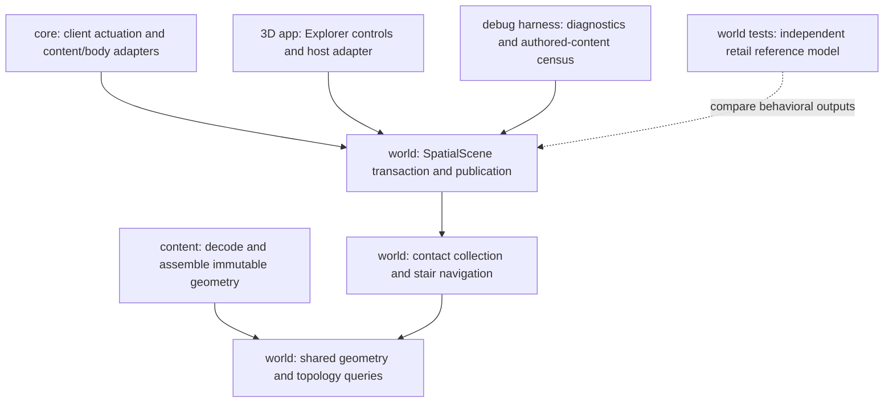

# Movement solver cutover and stair compatibility

Status: Complete within the measured envelope below. Ordinary authored walking and running pass; deferred and unresolved compatibility differences remain explicitly recorded.

Survey date: 2026-10-22. Repository HEAD: `491122c7080d078ab9ae1f3e7026decf1a835795`.

This is an active working plan. Update findings, decisions, experiments, and phase
completion here as work proceeds. The user authorized implementation on 2026-10-22,
with instructions to stop for major blockers, gaps, or decisions requiring their eyes.

## Goal and boundaries

Make runtime movement, diagnostic replays, and behavioral compatibility tests use
one movement implementation, then fix the stair-to-building crossing at 12.9S,
58.9W with a measured compatibility envelope.

In scope:

- Survey and remove obsolete grounded and free-sphere **movement** implementations
  after replacing their useful diagnostic and test consumers.
- Preserve live shared contracts, collision queries, and stationary camera settlement.
- Repair the active solver's stair admission and correction accounting using
  independent retail/ACE evidence.
- Establish generated differential cases and an authored-content census/replay
  workflow that identifies affected geometry and unresolved disagreements.
- Update surviving APIs, configuration, tests, comments, and architecture vocabulary
  affected by the cutover.

Out of scope:

- A general rewrite of collision, reconciliation, cameras, crowd response, or animation.
- Reproducing the entire retail transition architecture or claiming universal retail parity.
- Raising the global step limit as a workaround or adding a building-specific exception.
- UI changes, visual acceptance, TUI execution, changes to the retail decompile,
  commits, or staging. Visual acceptance remains with the user.
- Retrofitting unrelated inactive plans. The existing physics worksheet is historical
  context; this document owns this investigation.

## Survey findings

Findings below distinguish observed behavior from implementation proposals.

| ID | Finding | Evidence and consequence |
| --- | --- | --- |
| F01 | Runtime movement uses the contact collection, not `solve_grounded`. | `core/src/client/simulation.rs:527` and the Explorer host's `host_simulation_runtime.rs:468` call `SpatialScene::advance_dynamic_entity_collection`. Scene publication delegates to `advance_body_contact_collection`; `physical_body.rs:1018` also routes mobile single-body ticks through the contact collection. |
| F02 | `solve_grounded` has no runtime client callers in this repository. | Calls occur in `collision_scene_probe.rs`, its own unit tests, and grounded/landing/volume differential suites. It is still publicly exported from `spatial.rs` and `lib.rs`. `world/ARCHITECTURE.md:162` explicitly describes it as a standalone diagnostic primitive: this retention was documented, but it creates a second behavioral implementation. |
| F03 | `solve_free_sphere` likewise has no runtime callers in the surveyed tree. | Calls occur in `collision_scene_probe.rs`, its unit tests, and `collision_pose_tests.rs`. This is a second cutover candidate. The architecture text claiming registered physical-fly bodies call it is inconsistent with current call sites. |
| F04 | The free-sphere module contains live camera settlement and recovery. | `core/src/kinematic_boom.rs` calls `settle_free_sphere_with_policy`. Its placement/recovery helpers and `FreeSphereState` must survive. Deleting `free_sphere.rs` wholesale would break a live runtime consumer. |
| F05 | The grounded module mixes live contracts and obsolete execution machinery. | `GroundState`, `GroundSupport`, sphere contracts, `GroundedConfig`, `EdgeProtection`, and retail threshold constants are used by the active runtime. `GroundedBody`, request/outcome/budget machinery, `SettlePermission`, and `GroundState::settle_permission` belong to the obsolete path, subject to a final symbol sweep after consumer replacement. |
| F06 | Some compatibility tests cover obsolete execution; others remain directly useful. | Grounded differential tests call old private solver helpers and `solve_grounded`. Landing threshold oracles are independent arithmetic, but their scenario runner calls the old solver. Volume contact/support tests exercise shared queries; their body-driving helper calls the old solver. Rewrite by behavioral responsibility rather than deleting or mechanically migrating entire suites. |
| F07 | The active solver reproduces the reported crossing failure. | Temporary replay through `SpatialScene::advance_dynamic_entity_collection` stalls at approximately `(155.99902, 71.52020, 37.76087)` in owner `0x356FFFFF`, at requested planar speeds 1, 4, and 8 m/s. See the evidence below. |
| F08 | Normal-speed and slow-speed failures occur at different stages of one stair maneuver. | At 4 and 8 m/s, lift/forward clearance and a reachable floor settle are proved, but `stairs.rs:660-664` rejects total ascent. At 1 m/s, the bounded lift leaves the floor above the downward support search; descending toward the old ramp is blocked by the building edge. Removing only the final cap does not fix both. |
| F09 | Retail's relevant polygon correction admits a different envelope. | Retail StepUp operates from its attempted check position. `CPolygon::adjust_sphere_to_plane` bounds `walk_interp`, including values down to `-0.5`; the initial unit-interpolation arithmetic can admit correction beyond the nominal step amount. This is not permission to replace all admission logic with `height * 1.5`: intersection, traversal, support selection, state, and placement validation also participate. |
| F10 | Legacy budget fields leak into live body profiles. | `GroundedConfig`'s substep distance/count and contact-pass count are read by the old solver and otherwise initialized/validated; the active contact step has its own bounded travel/contact policy. Free-sphere settlement still consumes contact-pass and separation policy. Audit fields individually during cutover rather than carrying validation-only knobs forward. |
| F11 | There is already substantial active-path regression coverage. | `scene/physical_body_tests/contact_step_tests.rs` and `footing_tests.rs` exercise stairs, clearance, support recovery, portals, crowd behavior, and motion provenance. Their presence does not establish retail parity, but a new reference suite should complement them rather than duplicate their infrastructure. |
| F12 | Existing support semantics deliberately diverge from retail in adjacent areas. | `bsp_query.rs:557` documents the full-radius horizontal footprint; `mobile_contact/step/stairs.rs:282` documents swept upward recovery versus retail terrain grounding. Broader comparisons must identify these known divergences explicitly instead of treating every difference as a new stair defect or normalizing it away. |

The survey searched Rust call sites under `apps/` and `crates/`. Public exports
remain available to unknown external consumers; project policy favors a clean
cutover over preserving those unproven consumers.

Initial test inventory, measured as `#[test]` attributes rather than coverage:

| File under `world/src/spatial/` | Count | Disposition to assess |
| --- | ---: | --- |
| `grounded.rs` | 31 | Retain behavior through current-runtime cases; delete old solver implementation tests. |
| `free_sphere.rs` | 26 | Separate movement cases from live settlement/recovery cases. |
| `grounded_retail_differential.rs` | 12 | Preserve independently sourced reference decisions; replace old helper/solver consumers. |
| `grounded_landing_retail_differential.rs` | 13 | Preserve threshold/response reference and move scenarios onto current execution. |
| `volume_retail_differential.rs` | 8 | Preserve shared query checks and replace its body-driving helper. |
| `scene/physical_body_tests/contact_step_tests.rs` | 68 | Active-path baseline and reusable scenarios. |
| `scene/physical_body_tests/footing_tests.rs` | 24 | Active support/clearance baseline and reusable scenarios. |

Counts are a navigation aid, not a requirement to preserve test count or legacy APIs.

The [per-test disposition inventory](evidence/movement-solver-cutover/test-inventory.json)
records all 90 pre-cutover tests, with retention, replacement, consolidation, or
obsolete-contract deletion rationale. Entries still requiring replacement assertion
verification remain explicitly pending; an inventory row is not evidence that the
replacement has passed.

## Reported scene and experimental evidence

### Authored facts

- Owner: `0x356FFFFF`; stair SetupModel: `0x020004DE`.
- Stair collision parts: `0x01000E2D`, `0x01000E30`, `0x01000E2B`.
- Building GfxObj: `0x01003482`, placed at `(156, 84, 36)` with identity rotation.
- Entrance EnvCell: `0x356F0101`; environment: `0x0D0005B3`, selector `1`.
- The stair collision surfaces are ramps, despite the stepped visual appearance.
- The upper stair ramp ends at `Y=72`, `Z=37.855`. Building-front wall polygon
  `163` lies at `Y=72`, spanning `Z=37.4..38.4`; landing polygon `183` starts
  there at `Z=38.4`, continuing to `Y=72.538`. The interior floor continues
  northward at the same height. There is no 0.538 m hole between stair and floor.
- The authored endpoint-to-floor rise is `0.545 m`. A radius-bearing character
  meets the wall before its root reaches the ramp endpoint.
- The inspected character setup `0x02001A9C` has step-up `0.6`, step-down `1.5`,
  and the human sphere pair: centers `Z=0.475` and `1.35`, radius `0.48` each.
- Initial passive live pose: outdoor cell `0x356F0033`, root approximately
  `(155.9990234, 69.7710648, 36.361557)`, identity rotation, scale one.

### Active-path replay

The temporary harness loads canonical content/collision assembly, registers one
dynamic character with the human movement spheres and no peer targets, settles
for ten 1/30-second ticks, then requests northward planar drive. It calls
`SpatialScene::advance_dynamic_entity_collection` so accepted pose, support,
velocity, and membership publish through the current runtime path.

| Requested planar speed | Step setting | Result |
| ---: | ---: | --- |
| 1 m/s | Authored 0.6 m | Stalls at the building-front contact. |
| 4 m/s | Authored 0.6 m | Stalls at the same contact. |
| 8 m/s | Authored 0.6 m | Stalls at the same contact. |
| 1 m/s | Diagnostic override 0.65 m | Crosses onto the entrance floor and into the entrance cell. |
| 4 m/s | Diagnostic override 0.65 m | Crosses onto the entrance floor and into the entrance cell. |

At the settled stall, a reconstructed 4 m/s stair transaction gives:

| Stage | Observation |
| --- | --- |
| Start root | `Y=71.52020`, `Z=37.760868` |
| Requested support-tangent travel | `dY=0.08130082`, `dZ=0.065040655` |
| Lift by 0.6 m | Neither movement sphere hits an obstruction. |
| Forward from raised pose | Neither sphere hits an obstruction. Root reaches `Z=38.425907`. |
| Floor support | Walkable normal `(0,0,1)`; downward correction `-0.020904541`. |
| Descent clearance | Desired settle fraction `0.0348409`; earliest lower-sphere obstruction is later, at `0.3894742`. Upper sphere unobstructed. |
| Supported destination | Root `Z=38.405003`, including the authored sphere's 0.005 m root clearance. |
| Final cap | Total rise `0.6441345` exceeds `0.6005`, so the complete maneuver is discarded. |
| Correction from attempted destination | `0.57909393`, with initial retail interpolation about `0.0348435`. |

At 1 m/s, tangent travel contributes only `0.016260164` m of rise. The required
floor correction from the attempted destination is about `0.62787247`, giving
initial retail interpolation about `-0.0464541`, inside the cited arithmetic
bound. Our raised candidate remains below flat-floor tangency, so its downward
search excludes that floor and the route fails before the final total-rise cap.

These observations establish current rejection points and a useful counterfactual.
They do **not** establish that a complete replacement maneuver matches retail.
The 0.65 m override is diagnostic evidence, not the selected production fix.

### Evidence provenance and limitations

- Passive login inspected the exact character pose; no live drive or teleport was submitted.
- Earlier runs of `collision_scene_probe` used the obsolete grounded solver. Those
  results corroborated the symptom but are not evidence of active runtime parity.
- The final temporary replay used existing debug libraries linked from the local
  build. Phase 1 must rerun a fresh Cargo-built diagnostic before accepting a new baseline.
- The temporary character omits unrelated gameplay and peer-target behavior. It
  proves the static navigation failure, not every property of the live session.
- Scratch artifacts are currently under `/tmp/holt-stair-probe/`: `probe.rs`,
  `build.py`, `scene-1-0.6.log`, `scene-4-0.6.log`, `scene-8-0.6.log`,
  `scene-1-0.65.log`, and `scene-4-0.65.log`. They are disposable; the parameters
  and results above must remain sufficient to reconstruct the experiment.
- No source tests or lint suite were run for this survey. No visual acceptance
  was performed. Production files were not changed.
- Initial workspace state included ACE's untracked `SyntheticProtocolTests.cs`
  and ACViewer's untracked `ACE.worktrees/`. Surveyed ACE physics reference files
  were unmodified. Preserve all pre-existing work.

## Ground truth and ownership

Reference paths below are relative to the repository root. Line numbers are
survey anchors; symbols and citations should be refreshed during implementation.

| Source | Purpose |
| --- | --- |
| `ACE/Source/ACE.Server/Physics/Transition.cs:708,744` | StepDown/StepUp state, attempted position, rollback, and placement validation. |
| `ACE/Source/ACE.Server/Physics/BSP/BSPTree.cs:131,324,361` | Polygon collision dispatch, walkable adjustment, lower/upper sphere roles. |
| `ACE/Source/ACE.Server/Physics/BSP/BSPLeaf.cs` and `BSPNode.cs` | Traversal and walkable winner selection/order. |
| `ACE/Source/ACE.Server/Physics/Polygon.cs:73` | Sphere-to-plane correction and interpolation bound. |
| `acclient-eor-source/acclient.c:301308,301457,301490` | Retail transition/step transactions and state-dependent allowances. |
| `acclient-eor-source/acclient.c:344680,345595,346249,349100` | Correction arithmetic, finite polygon intersection, step-down query, walkable leaf traversal. |
| `acclient-eor-source/acclient.c:304140` | Step height derived from setup and vertical scale. |
| `crates/holtburger-world/src/spatial/mobile_contact/step.rs` and `step/stairs.rs` | Current navigation, swept clearance, support/edge rollback, and motion segments. |
| `crates/holtburger-world/src/spatial/scene/contact_collection.rs` | Current runtime transaction and publication. |
| `crates/holtburger-world/src/spatial/collision/static_sphere_sweep.rs`, `bsp_query.rs`, `volume_query.rs` | Shared collision queries and existing deliberate compatibility differences. |
| `crates/holtburger-core/src/physical_body_definition.rs` | Content/body profile adapter; this setup's constants currently agree, but broad body preparation fidelity needs its own evidence. |
| `crates/holtburger-debug-harness/src/bin/collision_scene_probe.rs` | Existing diagnostic assembly, provenance, neighborhood loading, and obsolete replay consumers. |
| `crates/holtburger-debug-harness/src/bin/env_cell_owner_extent_census.rs` | Existing authored-content enumeration pattern. |

ACE is the project reference for protocol/data and readable physics corroboration;
retail client behavior is checked against the decompile. A Rust transliteration
is a reference model, not execution of the retail binary. Disagreements between
references must be investigated, not resolved by assuming our current output is correct.

Layer boundaries:



The diagnostic harness may own experiment selection, sweeps of parameters, and
reports. It must consume runtime behavior rather than implement another movement
policy. Reference logic belongs in tests or diagnostic-only code and must not
share production decision helpers. Shared authored input fixtures are appropriate.

## Design constraints and north stars

- One production movement path for clients, Explorer, prediction, and diagnostic
  routes. Keep the valid distinction between movement and stationary placement.
- Compute candidate travel and correction once at the navigation owner. Consumers
  read the accepted path/support rather than re-deriving those decisions.
- Seek reachable support from the attempted destination and evaluate the actual
  correction under reference-proved rules. This is a design direction, not a
  pre-approved blanket multiplier or an implementation selected before the oracle.
- Both spheres retain hard clearance constraints; only the lower sphere supplies
  support and committed-cell ownership. Preserve topology, explicit missing
  coverage, and transactional rollback of rejected candidates.
- Stair correction is geometry, not launch/continuation velocity. Keep accepted
  travel, adjustment, impact, locomotion, and collision-report meanings intact.
- Preserve independent response behavior for airborne bodies, slopes, launches,
  sledding, hard entity supports, and protected edges unless evidence requires a
  named compatibility decision in this scope.
- Delete old execution paths, unused knobs, misleading metrics, and stale vocabulary
  instead of retaining adapters for tests. Expected overall direction is fewer
  production lines; additional lines must buy reference fidelity or meaningful validation.
- Never use the old solver as the expected-output oracle for the active solver.
- New retained tests use checked-in synthetic geometry and runtime constants for
  production settings. Independently cited retail constants remain independent in
  the reference model so a shared wrong value cannot manufacture agreement.
- A retained retail quirk/divergence needs the project's marker, retail citation,
  consequence of correcting it, and a measured census defining the blast radius.

## Phased work

### Phase 1 — Establish the current-runtime diagnostic and coverage map

- [x] Reproduce F07–F08 with fresh Cargo-built code and the canonical content path.
- [x] Replace grounded and physical-flight route execution in
  `collision_scene_probe.rs` with current scene/contact APIs. Preserve useful
  collider provenance, portal routes, sphere-role comparisons, and scene coverage.
- [x] Report only observations produced by current contracts. Remove legacy
  substep/contact-pass metrics rather than synthesizing substitutes with the same names.
- [x] Inventory every test case and oracle dependency in F06. Classify each as a
  shared query check, independent reference check, active behavior scenario to
  retain, or obsolete implementation/budget test to delete.
- [x] Record the affected-symbol and configuration-field consumer lists. Include
  `collision_pose_tests.rs`, `motion/actuation.rs`, both public export facades,
  body-profile tests, and the architecture statements identified above.

Acceptance: the repository diagnostic reproduces the same active failure and
supports reusable grounded/flight routes without either obsolete movement entry
point. The coverage map names a destination or deletion rationale for every old
behavioral case; a lower count is acceptable when cases are redundant or hollow.

### Phase 2 — Complete the movement cutover without changing stair behavior

- [x] Separate live ground state/configuration/sphere contracts from obsolete
  grounded execution. Choose one focused module name that describes those live
  contracts; avoid a compatibility wrapper around `grounded.rs`.
- [x] Rewrite useful old body scenarios against the current scene/contact path.
  Preserve independent reference formulas that are actually verified from source;
  remove tests tied to old private helpers rather than exporting those helpers.
- [x] Delete `solve_grounded`, old context/request/outcome/budget types, exclusive
  helpers, `SettlePermission`, and `GroundState::settle_permission` when unreferenced.
- [x] Delete free-sphere movement execution and exclusive request/outcome/budget
  types. Preserve stationary settlement, its camera query abstraction, solid
  recovery, and their valid tests. Remove `close_partial_motion` if both obsolete
  movement consumers are gone.
- [x] Simplify live config contracts after the field census. Preserve settings
  consumed by settlement; do not retain fields used only by construction validation
  or tests. Update named profile consumers and comments in the same cutover.
- [x] Remove obsolete public exports and misleading runtime documentation/comments.

Acceptance: no old movement symbols remain in source or current architecture
documentation; both camera settlement and the canonical movement diagnostic work;
the active stair reproduction still fails in its documented way. Replaced tests
assert useful current contracts and do not encode the reported bug as correctness.
If a useful old assertion exposes another active-path disagreement, reduce and
record it in the diagnostic baseline rather than weakening the assertion or
retaining the old solver. Its permanent behavioral regression belongs with the
corresponding proved correction. Each cutover milestone must compile, and test
failures must have an explicit disposition before advancing.

### Phase 3 — Build an independent reference and measure the baseline

- [x] Audit the relevant StepUp path and implement a bounded independent reference, including attempted pose,
  object state, finite polygon intersection, `walk_interp`, traversal/winner
  order, primary/upper roles, placement validation, and rollback. Check ACE and
  retail citations for every reference decision. The final evidence section defines the reference envelope and omitted whole-transition state; do not extend the old approximate
  step-down helper and call it a complete oracle.
- [x] Validate the reference at threshold boundaries and source-derived hand cases.
  Keep its arithmetic/branching separate from production navigation and support
  helpers. Report branch/input coverage and any intentionally omitted retail state.
- [x] Create deterministic synthetic comparisons for ramp-to-platform joins,
  positive/negative seams, real risers, overlapping planes, thin faces, corners,
  low ceilings, and floor/wall geometry split across objects and cells.
- [x] Sweep slow-to-running movement, approach directions, tick phases, sphere
  offsets/radii and relevant scales, support/landing states, and exact threshold
  neighbors. Use a documented bounded grid plus deterministic targeted boundary
  cases; avoid an unbounded Cartesian product.
- [x] Compare acceptance, accepted destination/path clearance, selected support,
  membership, rollback, and velocity consequences. Declare tolerances from
  source/numerical contracts; keep real policy differences visible.
- [x] Build the authored-content candidate census in the debug harness. Enumerate
  unique decoded assets efficiently, but retain placement transforms, cross-object
  adjacency, neighboring owners, and portal topology when identifying transitions.
  Asset-level deduplication alone cannot census a stair attached to another object.
- [x] Record content identity, candidate-generation rules, geometry/body envelopes,
  scanned/eligible/excluded/unavailable counts, deduplication rules, baseline
  disagreements, and reduced reproducers. State which content classes are not covered.

Acceptance: the reference produces a source-audited verdict for the reported scene;
the active baseline disagreements are reproducible and categorized. If the
reference rejects a crossing that the user can make in retail, investigate the
reference and captured state before selecting a fix; never tune the oracle to
admit the desired result. The report has a denominator and explicit exclusions.
It does not claim every world pose was tested.
Keep diagnostics capable of reporting known baseline mismatches without making
retained unit tests assert obsolete production behavior.

### Steering checkpoint — Select the smallest proved correction

- [x] Review results, independently check the reference's strongest assumptions,
  and update findings before selecting production code changes.
- [x] Determine whether candidate-relative correction plus reference-proved slack
  is sufficient, or whether finite-footprint/support ordering also changes the
  result. Current full-radius footing and upward recovery are known independent
  differences; do not silently fold their redesign into this fix.
- [x] Choose one replacement stair transaction. Specify candidate state, correction
  admission, clearance path, final support, and rollback ownership. Define exactly
  how remaining ordinary travel differs from geometric adjustment.
- [x] Reassess line count and runtime query cost. Reuse current transaction/cursor
  machinery where sound; avoid an alternate solver or a configurable legacy mode.
- [x] If complete compatibility requires changing unrelated footprint, topology,
  response, or camera contracts, document the new evidence and obtain scope steering
  before proceeding. Routine internal implementation choices need no new approval
  once implementation has been authorized.

Acceptance: one concrete design addresses both F08 rejection stages, preserves
the declared hard-clearance guarantees, and has testable outcomes for every changed
behavior class. Record the chosen design and rejected alternatives below.

### Phase 4 — Implement the stair correction in the current solver

- [x] Replace admission/accounting inside the current navigation layer, principally
  `mobile_contact/step/stairs.rs`, with the selected transaction. Do not add policy
  to core body preparation, content decoding, or the app host.
- [x] Retain authored step values and distinct walking/landing behavior. Do not
  encode this scene's 0.65 m diagnostic setting as a production constant.
- [x] Verify full-body swept clearance and final support using current topology
  contracts. Rejected maneuvers restore all state and cannot consume momentum or
  publish a partial lift.
- [x] Add the reduced synthetic regression for this exact ramp/wall/platform
  arrangement and the two failure stages, plus any new disagreements from Phase 3.
- [x] Run active motion/footing, upper-clearance, portal, edge, hard-support,
  launch, response, reconciliation, and accepted-path/report regression checks
  selected by the coverage map. Expand testing when changes/failures justify it.

Acceptance: the real-scene replay crosses at the ordinary walking/running inputs
using the authored profile; the synthetic 1 m/s input is characterized separately; expected blocked cases remain blocked; support, cell ownership,
and accepted motion remain coherent. Relevant synthetic differential cases match
the agreed reference envelope or have individually justified compatibility markers.

### Phase 5 — Prove the affected-content envelope and clean up

- [x] Rerun exactly the baseline census/replay workload against the changed solver;
  separate fixes, regressions, intentional differences, and unavailable coverage.
- [x] Replay every discovered disagreement or explicitly retain it as unresolved.
  Reduce new failures into synthetic fixtures instead of checking in tests that
  require local runtime assets.
- [x] Publish the measured blast radius beside any retained retail marker. A
  sampled replay must remain described as sampled; unknown/excluded cases are not passes.
- [x] Verify camera stationary settlement/solid recovery and active physical-flight
  behavior after removal of the old free-sphere movement implementation.
- [x] Sweep removed symbols, old metric names, comments, current architecture docs,
  and test-only APIs. Keep temporary investigative instrumentation out of runtime
  contracts; retain useful diagnostic-only controls in the harness.
- [x] Record net production/test/diagnostic line changes and justify new abstractions.
- [x] Run formatting, relevant tests, and clippy with warnings denied. Record exact
  commands/results here. No visual acceptance or TUI run is required by this plan.

Acceptance: one movement implementation serves runtime and diagnostics; useful
reference tests exercise that implementation; the stair issue is resolved inside
a measured envelope; no obsolete solver-specific API/configuration remains.

## Validation commands and evidence reporting

Use Cargo and existing package scripts. After cutover, refresh test filters to
their final module names rather than preserving obsolete modules for command stability.

```sh
cargo test -p holtburger-world
cargo test -p holtburger-core
cargo test -p holtburger-debug-harness --bin collision_scene_probe
cargo check -p holtburger-3d-host
cargo clippy -p holtburger-world -p holtburger-core -p holtburger-debug-harness -p holtburger-3d-host --all-targets -- -D warnings
cargo fmt --all -- --check
```

Characterization/replay uses a fresh build, for example:

```sh
cargo run -p holtburger-debug-harness --bin collision_scene_probe -- \
  --landblock 0x356fffff \
  --grounded-start 155.9990234,69.7710648,36.361557 \
  --grounded-drive 0,4 --grounded-settle-ticks 10 --grounded-ticks 150
```

Following Phase 1, that command runs the current scene/contact solver. Run the equivalent 1 and 8 m/s cases as well. Add explicit
diagnostic arguments for census/reference modes when designed; do not pretend those
commands exist yet. The synthetic suite is the retained CI gate; authored-content
replays are explicit external-content experiments with recorded content provenance.
Final diagnostic commands and artifacts are listed below.

## Risks and mitigations

| Risk | Mitigation |
| --- | --- |
| A translated reference shares our misunderstanding. | Independent decision code; cited hand cases; ACE/decompile cross-check; source audit of complete relevant branches before selecting the fix. |
| A simple 1.5 multiplier over-admits ledges. | Model finite intersection, state, interpolation history, and placement checks; include rejection boundaries and tall-wall controls. |
| Cleanup erases real coverage or live placement recovery. | Per-case/per-symbol inventory, current-path replacements, and explicit camera-settlement gates before deleting the old movement code. |
| Census misses cross-object or portal joins. | Retain instance adjacency/topology and neighboring owners; report candidate-generation exclusions and sampled dimensions. |
| Known footprint differences obscure stair parity. | Classify them separately and preserve scoped disagreement records; obtain steering for a broader policy rewrite. |
| A passing static case changes motion or reporting. | Check accepted path, support, velocity, cell membership, and rollback through the scene publication boundary. |
| Excessive combinatorial cost or extra hot-path queries. | Boundary-focused deterministic matrices, decoded-asset reuse, reduced reproducers, and measurement of the selected transaction's query cost. |
| Scratch evidence disappears. | Reproduction facts are embedded above; establish a canonical fresh-build replay before relying on later experiments. |

## Definition of done

- [x] The reported ordinary walking/running crossing succeeds using authored settings at the declared speeds; the synthetic slow attempt remains separately classified.
- [x] Ordinary-running accounting and ordinary-walking reach failures have a proved resolution; the synthetic 1 m/s finite-face rejection remains separately classified.
- [x] Runtime and diagnostic movement use the same execution path.
- [x] Obsolete movement implementations and exclusive APIs/configuration/vocabulary are removed.
- [x] Shared ground contracts and live stationary camera recovery remain correctly owned.
- [x] Independent compatibility tests compare the active path against cited reference behavior.
- [x] Authored-content evidence reports its denominator, exclusions, disagreements, and exact workload.
- [x] No retained tests require untracked runtime assets; no unresolved mismatch is silently counted as a pass.
- [x] Relevant tests, formatting, compilation, and clippy pass; results are recorded.
- [x] Current architecture docs match the final code and compatibility decisions.

## Open questions and decision log

Questions to resolve through evidence, not user preference:

1. Does the complete retail polygon StepUp transaction admit this fixture across
   all tested body states, approaches, and slow speeds once traversal and final
   placement validation are included?
2. Which independently useful old tests cover current queries, and which encode
   behavior that should be replaced rather than preserved?
3. What authored-content candidate envelope is feasible to enumerate completely,
   and which dimensions require a declared sample? Derive the workload from the
   asset census before promising global coverage.
4. Do existing full-radius support/recovery divergences materially affect the
   affected-content results? If so, separate their consequences from this step fix.
5. Which live profile fields and query helpers remain after both movement cutovers?

| Date | Decision or course correction | Status |
| --- | --- | --- |
| 2026-10-22 | Expand the investigation into a solver/caller/test survey and this plan; do not implement production changes during planning. | User-directed. |
| 2026-10-22 | Treat 0.65 m as a counterfactual experiment, not a proposed global limit. | Established. |
| 2026-10-22 | Treat candidate-relative correction and retail slack as a design direction pending a complete independent reference and census. | Selected: finite candidate-relative polygon correction; see final evidence. |
| 2026-10-22 | Include obsolete free-sphere movement in the cutover inventory; preserve live camera settlement. | Completed; stationary settlement preserved. |

Implementation was authorized on 2026-10-22. The chosen transaction, census, final
validation, and explicit limits are recorded in the final execution evidence below.


## Execution evidence — Phase 1

- `cargo test -p holtburger-world`: **997 passed**, no failures (baseline before
  deleting any solver; `/tmp/holt-stair-probe/world-before-cutover.log`).
- `cargo test -p holtburger-debug-harness --bin collision_scene_probe`: **3 passed**.
- `cargo clippy -p holtburger-debug-harness --bin collision_scene_probe -- -D warnings`:
  passed after the diagnostic conversion.
- Fresh `cargo run` of the documented 4 m/s stair route reproduces final root
  `(155.999023,71.520203,37.760868)` and zero retained velocity after 150 driven
  ticks. Output: `/tmp/holt-stair-probe/current-baseline-4.log`.
- DA55 cell `0xDA550100`, portal 1: current flight and grounded-pair routes enter
  `0xDA550103` and reverse outdoors. No invalid starts or rejected traces in either
  route. Flight vertical drift is zero. Output:
  `/tmp/holt-stair-probe/current-da55-portals.log`.
- The current path can infer building entry at a fresh outdoor query's initial
  point (`CollisionScene::transit_motion_path` documents this). The old diagnostic
  incorrectly demanded unchanged initial cell ownership. It now records that
  event as a zero-time placement transition and still rejects recovery paths.
  Production topology behavior was not changed.
- `movement_probe` keeps the complete published `SpatialBody` across ticks and
  delegates actuation, collision, support, membership, and accepted root path to
  `SpatialScene::advance_dynamic_entity_collection`. There are no old solve calls
  in the collision probe. Legacy constraint/substep/pass output was removed.
- Source consumer inventory: `GroundedConfig` substep distance/count/pass fields
  have no active navigation reader; remove their initialization/validation/tests
  with the old solver. `FreeSphereConfig` contact-pass and separation values also
  feed live camera settlement through conversion; separate those settings rather
  than deleting them with obsolete flight movement. Camera collision-pose tests
  contain one obsolete movement block alongside live query/settlement assertions.
- Fresh canonical commands at 1 and 8 m/s also reproduce the same stall; outputs
  are `/tmp/holt-stair-probe/current-baseline-1.log` and `current-baseline-8.log`.


## Historical checkpoint — Phase 2 and required steering

At this earlier checkpoint, implementation stopped at the user's requested
major-gap boundary. The subsequent steering decision and completed cutover are
recorded below; production stair/actuation behavior remains unchanged.

Completed preparation:

- Extracted live grounded contracts into `spatial/grounded_types.rs`; the current
  runtime imports these directly while the old solver remains a separate consumer.
- Added synthetic current-scene fixtures retaining the complete published body,
  authored input, physical vectors, and retail default response coefficients.
  Outdoor fixtures now construct an actual outdoor cell through
  `WorldPosition::from_outdoor_frame`; the old runner tolerated a `0xFFFF` owner
  pose and a contradictory separate `cell: None` field.
- Replaced the volume suite's old driver with current scene execution. All eight
  volume tests pass, including the four retargeted movement scenarios.
- Retargeted all six landing scenarios to the current scene. Their walking source
  is now supplied through `PhysicalReferenceInput::body(Some(offset))` alongside
  `GroundedBodyActuation::coast`, rather than approximated by controller drive.
- The seven independent threshold/transient tests remain separate from those
  complete movement scenarios. The migrated fixtures use the retail default
  elasticity; a temporary zero-elasticity experiment did not eliminate the
  disagreements and is not retained.

### F13 — Authored walking persists as airborne physical momentum

Confirmed current-runtime gap requiring scope steering:

- Synthetic scene: plateau at `Z=60`, crest at `X=96`, steep descent eastward;
  owner `0xE63EFFFF`, start `(90,48,60.2)`, settle 30 ticks, then authored eastward
  translation equivalent to 4 m/s, with initially zero physical velocity and no launch.
- At the first observed unsupported pose, root
  `(96.53323,48,60.005)` in cell `0xE63E0023`, ground is `Airborne`, but retained
  horizontal velocity is `(4,0)`. This fails the existing source-cited expected
  result `(0,0)` even when source translation uses the authored-input boundary.
- Production chain: `physical_body.rs:443-455` translates authored offset velocity
  into `GroundedSupportedMotion::Driven` and enables direct character drive;
  `mobile_contact/step.rs:254-274` writes that drive into physical continuation.
  Once unsupported, the ballistic branch preserves the resulting horizontal speed.
- Retail `UpdatePositionInternal` (`acclient.c:308266-308306`) composes the animation
  offset and zeroes its translation without `OnWalkable`; `UpdatePhysicsInternal`
  (`:306094-306172`) integrates a separate `m_velocityVector`. Measured accepted
  movement is `cached_velocity` (`:310875-310927`), not a replacement for physical
  velocity. The cited retail paths do not grant animation-derived horizontal momentum
  merely because the character walked over an edge.
- Reproducer:

```sh
cargo test -p holtburger-world crest_walk_off_drops_authored_translation_before_landing_on_slide -- --nocapture
```

The necessary design review concerns authored grounded displacement versus
physical/controller continuation, its interaction with support/airborne transitions,
collision, accepted motion, and launch semantics. A stair-budget-only edit cannot
resolve that distinction. Do not weaken the regression, preserve the old driver,
or add an unsupported-velocity-zeroing patch: existing real physical momentum
must survive when it should.

Proposed scope extension, **not yet authorized**: add a prerequisite phase to
source-audit and restore independent grounded authored travel and physical
continuation, using the same contact pipeline. Prove the distinction with source-only
walking off support, independently seeded physical momentum, mixed source/physical
travel, wall/ceiling contact, support changes, and explicit launch. Then resume the
legacy cutover and stair reference/census phases. Keep the fix in the shared world
actuation/navigation layer; frontend input policy and animation asset decoding
remain outside this work.

The alternative is to record F13 as a separate issue and explicitly narrow the
cutover's compatibility claim while continuing the originally planned stair work.
That choice needs the user's judgment because the plan called for useful existing
behavioral regressions to exercise the active path without concealing disagreements.

### F14 — Curved-flank landing scenario also disagrees

`ball_flank_lands_sliding_and_descends_to_walkable_ground` now executes the current
solver and does not observe retained `Sliding` state. The old test asserted that
state from a driver without complete physical response. The independent threshold
oracle does not establish the full curved landing/restitution trajectory; this
is an unresolved scenario/reference disagreement, not yet a diagnosed production
defect. Its assertions remain visible for audit rather than being weakened.

Validation at the stop point:

- `cargo test -p holtburger-world`: **995 passed, 2 failed**, zero ignored.
  The only failures are F13 and F14 in the retargeted landing scenarios.
- `cargo test -p holtburger-world landing_retail_differential`: **11 passed,
  2 failed** (same two cases).
- `cargo test -p holtburger-world spatial::volume_query::retail_differential`:
  **8 passed**.
- Full-world output: `/tmp/holt-stair-probe/world-during-cutover.log`; landing-only
  output: `/tmp/holt-stair-probe/landing-current-migration.log`.
- No compatibility expectation has been changed to make the current output pass.
  Both failures are deliberately retained at this scope checkpoint. The remaining
  old differential tests and legacy implementations are still present.


### Steering decision — continue the original stair scope

The user authorized continuation after reviewing the edge guard's relevance. F13's
fixture explicitly selects `EdgeProtection::None`. With creature protection, the
active navigation path saves supported footing, rejects unsupported departure, and
clears velocity when a timed move is held (`mobile_contact/step.rs`,
`advance_hard_motion`; `step/stairs.rs`, `ProtectedFooting`). Thus F13 alone does not
establish a reachable ordinary-player defect. Runtime policy follows the entity's
`edge_slide` physics flag; no live character policy has been verified for this
particular discrepancy.

Decision: defer authored/physical motion separation, continue the originally
authorized solver cutover and stair correction, and narrow compatibility claims
accordingly. Do not add a blanket airborne-velocity reset. F13 remains an explicit
unguarded diagnostic; F14 remains a full-trajectory/reference disagreement, not a
proved stair defect. Neither is a passing compatibility case. Retain independently
runnable diagnostic assertions with named exclusions from the default test gate;
record their results separately. Permanent regression gates belong with the
corresponding proved correction.


## Execution evidence — completed Phase 2

- Removed the obsolete grounded and free-sphere movement implementations and their
  public request/outcome/budget/permission contracts. `grounded_types.rs` owns the
  surviving shared geometry, support, and response contracts at the world layer.
- Removed the grounded-only substep/pass settings. Retained `separation_epsilon`,
  which active stair admission actually reads. Free-flight movement no longer
  accepts validation-only response settings. Stationary camera settlement keeps
  its own `FreeSphereSettleConfig`, solid recovery, and tests.
- Preserved Explorer's existing eight-meter input envelope as an app-owned constant
  instead of deriving frontend policy from obsolete shared solver budgets. No
  browser/renderer behavior was introduced; host tests exercise that adapter.
- Removed the exclusively legacy `environment_steps` profiling counter and its CSV
  column rather than emitting a permanently zero observation.
- Reparented the source-cited reference suites under `spatial`; nine retained
  grounded query/scenario cases, twelve flight scenarios, and seven new/retained
  grounded movement gates execute the current scene path. Updated the per-test
  inventory with exact destinations and explicit unresolved diagnostic dispositions.
- New `grounded_movement_tests.rs` retains zero gravity, airborne gravity, finite-wall
  release, divergent wall travel, primary-sphere water policy, upper-wall clearance,
  and physical slope momentum. Legacy substep schedules and private aggregate
  contact metrics are not retained as behavioral requirements.
- Old portal fixture correction: a room occupying `X >= 10` must exit toward the
  negative plane side. The old endpoint-placement runner ignored the backwards
  portal direction; current movement checks directed crossings. Current flight
  now proves entry and subsequent linked-cell exit using a valid fixture.
- Water boundary assertion correction: swept motion stops exactly at `X=192`,
  normalized as the eastern owner's `X=0`, with zero normal velocity. The removed
  overlap/separation solver nudged the root west of the boundary. The retained
  gate checks stopping, not that obsolete separation offset.

Validation:

- `cargo test -p holtburger-world`: **966 passed, 0 failed, 3 ignored**. The ignored
  diagnostics are F13, F14, and F15, each with a named reason; none is counted as
  retail parity. Output: `/tmp/holt-stair-probe/world-after-cutover.log`.
- `cargo test -p holtburger-core -p holtburger-3d-host --lib`: **688 core and 375 host
  tests passed**. The first sandboxed run rejected local UDP socket binds in seven
  core fixtures; the authorized unsandboxed run passed all of them. Output:
  `/tmp/holt-stair-probe/core-host-after-cutover.log`.
- `cargo check -p holtburger-world -p holtburger-core -p holtburger-debug-harness
  -p holtburger-3d-host --tests`: passed.
- `cargo clippy -p holtburger-world -p holtburger-core -p holtburger-debug-harness
  -p holtburger-3d-host --all-targets --features
  holtburger-debug-harness/physics-profiling -- -D warnings`: passed.
- Collision-probe CLI tests: **3 passed**. New independent admission-probe tests:
  **3 passed**, covering interpolation boundary, finite intersection disk, and the
  captured building-floor attempts. Output:
  `/tmp/holt-stair-probe/harness-cutover-tests.log`.
- No production stair or authored/physical actuation correction has been made.

### F15 — Upper polygon back-face diagnostic

Retargeting the old upper-sphere wall test exposed a separate disagreement: the
active sweep passes through a single authored wall polygon from its back face,
while the old obstruction solver blocked it. The forward-face variant, lower-only
control, support ownership, and retreat gates pass. Retail has explicit negative
polygon routing (`acclient.c:346486-346510` and `CTransition::transitional_insert`),
but the complete subsequent transition has not been audited here. Do not infer a
full crossing verdict from that branch alone. The independently runnable
`grounded_movement_tests::upper_polygon_back_face_blocks_and_releases_on_retreat`
is explicitly ignored pending that audit. This is outside the front-face stair
admission correction, not an invitation to rewrite contact response in this plan.

## Execution evidence — Phase 3 finite-face checkpoint

### F16 — The slow attempt fails before retail height interpolation

Historical checkpoint: later source audits and the ordinary-gait resolution below
supersede this section's pending implementation status and original reference omissions.

Added `stair_reference_probe`, a harness-only independent transliteration of:

- `CTransition::step_up` and `step_down`'s incoming attempted position and initial
  interpolation (`acclient.c:301457-301486`, `:301310-301352`);
- BSP node bounding-sphere, splitting-plane, and leaf polygon traversal
  (`:348532-348567`, `:349100-349129`), corroborated by ACE's corresponding methods;
- strict `walkable_hits_sphere` slope admission (`:345595-345620`), finite polygon
  intersection (`:345135-345254`, corroborating the decompile's undefined flags
  against ACE `Polygon.cs:331-385`), and stateful plane adjustment
  (`:344680-344737`, ACE `Polygon.cs:73-99`).

This is **per-collider BSP admission**, not the complete transition oracle promised
by Phase 3. It explicitly excludes unaudited portal-node dispatch and nonuniform
sphere transforms, does not reconstruct retail object/cell visitation and retries,
and does not issue final placement/rollback verdicts. Selected polygons are not
reported as successful retail crossings. It loads canonical placed geometry rather
than an infinite-plane approximation and reports archive revision stamps, placed
collider denominator, and exclusions.

Using the captured blocking root `(155.9990234,71.520203,37.760868)` and the active
attempted tangent displacements at each drive speed:

| Drive | Attempted lower center Y/Z | BSP admission result |
| --- | --- | --- |
| 1 m/s | `71.540527 / 38.252129` | No candidate; zero exclusions. |
| 4 m/s | `71.601501 / 38.300907` | Building collider 24, polygon 183; correction `+0.579094`, root Z `38.405003`. |
| 8 m/s | `71.682808 / 38.365948` | Same floor; correction `+0.514053`, root Z `38.405003`. |

For the 1 m/s attempt, the plane cuts the lower sphere into an intersection disk
of about **0.45645 m** horizontal radius. Its center is **0.45947 m** south of the
floor's edge: about **3 mm** short of intersection. The retail finite-face predicate
rejects it before `walk_interp` or correction-height slack can participate. The
0.65 m counterfactual experiments bypassed this distinction by lifting into a
larger horizontal footprint; they were never proof of retail admission.

At 4 m/s, the independent result corroborates candidate-relative accounting: its
`0.579094 m` correction is within the authored `0.6 m` despite total ascent from
the previous root being `0.644135 m`. The active cap currently rejects that valid
candidate. This does not justify blanket slack for every shape or permit skipping
finite intersection and final placement.

Reproduction (repeat with `0,0.08130082,0.065040655` and
`0,0.16260164,0.13008131` for the other attempted travels):

```sh
cargo run -p holtburger-debug-harness --bin stair_reference_probe -- \
  --travel 0,0.020325204,0.016260164
```

Machine-readable captures are retained in
`evidence/movement-solver-cutover/step-admission-{1,4,8}.json`.
The finite-face synthetic case embeds the measured polygon and attempted centers;
it requires no local runtime assets.

**Steering boundary:** the plan initially required all three active replay speeds
to cross. F16 shows that the 1 m/s attempted state is not admitted by retail's
polygon rule, while the user's retail report did not specify this synthetic slow
input or attempted state. This is not evidence that a real retail character cannot
cross slowly: retail's preceding motion, tick phase, and transition state have not
been reproduced. Do not tune a purported oracle or raise a height limit to force
that result. Establish the intended slow-speed requirement and complete the
preceding-state/placement audit before selecting the final stair transaction.
The user was asked whether their retail crossing also included very slow movement;
that answer remains pending. Production correction and the global authored-content
census remain incomplete.

### Cutover quality review

Reviewed shared body-definition producers and immediate consumers (core profiles,
scene scaling/reconfiguration, Explorer flight adapter), the diagnostic scene
publication boundary, camera stationary queries, and removed solver metrics.
The surviving distinction between stationary camera placement and ordinary movement
has live consumers and remains justified. Independent retail arithmetic stays in
harness/test code; it is not a second production movement path. Source references
and runtime diagnostic outcomes remain distinct. No visual acceptance or TUI run
was performed, and no commit or staging occurred. Existing ACE/ACViewer worktree
changes remain untouched.

Final checkpoint verification:

- Fresh post-removal 4 m/s replay still stalls at the original root and zero retained
  velocity (`/tmp/holt-stair-probe/after-cutover-baseline-4.log`). The cutover did not
  accidentally fix or change the reported stair behavior.
- Fresh DA55 portal flight and paired-grounded routes enter `0100`, continue into
  `0103`, and reverse outdoors, with no invalid starts or rejected traces
  (`/tmp/holt-stair-probe/after-cutover-da55-portals.log`).
- Final world and both focused harness suites pass at the counts above. Clippy also
  passes with the profiling feature enabled after adding the admission diagnostic.
  `cargo fmt --all -- --check` and `git diff --check` pass.
- Accumulated source diff under `apps`/`crates`, including new untracked Rust files:
  2,270 added and 5,424 removed lines, **net −3,154**. This is a physical-line count,
  not a performance claim. New code consists of retained current-scene fixtures,
  live shared contracts formerly embedded in the removed solver, and harness-only
  independent admission evidence. Docs/evidence and existing submodule changes are
  excluded from that source count.


### Steering resolution — ordinary walking/running

The user clarified that their retail observation was ordinary walking/running, not
our synthetic 1 m/s drive. Resume the original stair work: require the reported
ordinary-speed crossings, preserve the 1 m/s attempted-state result as a separate
finding, and do not force that finite-face rejection into a passing retail verdict.
F16 is resolved as a requirement clarification, not a reason to expand scope or
increase the global lift. Full placement, bounded synthetic comparisons, and the
authored-content workload remain required before declaring the plan complete.


## Final execution evidence — ordinary gait fix and measured compatibility

### Selected transaction and layer ownership

The final implementation lives in world spatial navigation and collision queries.
Core, content decoding and the app host do not choose a larger step value.

1. On a blocked, supported walking attempt, compute the uncorrected attempted
   lower-sphere position, including ordinary support-tangent movement. Resolve
   its candidate cell membership using the existing transit query.
2. Query world and eligible hard-peer support through the same shape dispatch.
   A BSP face must intersect the actual attempted sphere, have a strictly
   walkable normal, and satisfy polygon interpolation admission. The initial
   `walk_interp` is one and the admitted interval is `[-0.5, 1)`
   (`acclient.c:301310-301352,301457-301486,344680-344737,345595-345620`).
   Terrain and volume support retain their existing bounded-column limits; the
   polygon allowance is not a global step multiplier.
3. Select the highest admissible support, which supplies the required geometric
   correction and its source/feature. Sweep both body spheres up by that
   correction, then through the ordinary requested travel. Either obstruction
   rejects the whole private candidate. Commit pose, membership, support and
   accepted motion together only after both legs succeed.
4. Publish the lift as adjustment and the requested movement as timed travel.
   No launch velocity is created. The old fixed up/forward/down stair alternative
   and its double-charged total-ascent cap are replaced, rather than retained as
   another solver or a fallback mode. Ordinary descent still uses the existing
   full-body settle path.

`SupportProbe` is an internal collision-query admission type, shared by world and
hard-peer shape dispatch. It does not add app policy, persistent state, public
configuration, or a second movement implementation. Ordinary footing retains its
previous floating-point operation order, avoiding unrelated resting-pose changes.
The stair path replaces a downward sweep with a candidate query and prior-cell
transit; no performance improvement is claimed without timing.

The compatibility setting formerly named `separation_epsilon` is now
`minimum_stair_rise`: its surviving consumer rejects negligible net stair ascent,
not generic contact separation. Stationary camera settlement retains its own
separation setting and live execution path.

### Why the first correction was insufficient

Deleting only the total-ascent cap fixed synthetic 4/8 m/s routes and actual
running, but **all 36 authored walking phases still stalled**. This was an
incomplete implementation, not evidence that walking should reject the lift.

Standard character motion table `0x09000001`, default style `0x8000003D`, selects
WalkForward clip `0x03000003`, frames 0–35 at 66.9 fps. Its root track yields about
**2.601668 m/s**. RunForward at rate one yields 4 m/s in this workload. Synthetic
4/8 m/s drives were not substitutes for checking those actual sources.

At the measured blocking pose, the ordinary walking attempt needs a floor
correction of **0.60182953 m**, slightly more than the authored 0.6 m search amount.
The independent polygon search admits it with `walk_interp = -0.00304759`.
Building collider 24, polygon 183 is the unique candidate; the independently
translated BSP placement check is clear for both movement spheres under both
center-check policies, with no unresolved nearby shape or terrain checks.
See [walking admission](evidence/movement-solver-cutover/step-admission-walk.json).

The production candidate-sized lift fixes walking as well as running. The actual
animation root-motion replay, through `PhysicalBodyInput` and the current scene
transaction, crosses in **36/36 walk phases and 36/36 run phases**, using the
unchanged authored body profile. The pure 1 m/s drive still stalls at the original
lip; its attempted sphere does not intersect the finite floor. That result is
retained separately and is not a claim about every possible slow retail approach.

### Reference envelope and remaining distinctions

The reference independently translates source BSP traversal, authored polygon
order and interpolation history, strict walkable allowance, finite intersection,
and lower/upper final placement. ACE corroborates the decompile's ambiguous flags.
Source-derived tests exercise interpolation threshold neighbors, previous
interpolation, polygon-order history, slope threshold neighbors, the measured
finite-face rejection, and independent upper-sphere placement. Production tests
cover finite admission and the interpolation boundary independently of scene assets.

The reported scene has one eligible floor and unambiguous final placement. This
is sufficient evidence for the selected correction. The reference does **not**
reconstruct global retail cell/object visitation, retry history, all collision
responses or a complete multi-tick retail trajectory. Source audit of those
boundaries is distinguished from executable coverage. Nonuniform reference sphere
transforms and unaudited nonpolygon/terrain placements report unresolved. A target
polygon alone is never labeled a complete retail crossing verdict.

F12's full-radius standing/upward recovery remains unchanged. F13's unguarded
walking departure, F14's curved-flank landing and F15's upper polygon back-face
response remain deferred as previously steered. Their three executable diagnostics
are ignored with explicit reasons; they are not included among passing parity cases.

### Generated comparison

The `stair-joins-v2` workload runs 6,912 cases for each of five strata: unit body,
0.5 scale, 1.5 scale, 0.8 radius and 1.2 radius. Its serialized grid includes source
slopes 0/0.5/0.8; floor deltas 0.3/0.6/0.795/0.9; seams -0.05/0/+0.05; speeds
1/2/4/8; three approach retreats; two angles; lower-only/pair; low-ceiling control;
and center/finite-side-edge approaches. Geometry, sphere offsets and authored step
settings scale together; the radius strata vary radius independently. Existing
active tests separately cover landing, portals/cells, hard peers, corners and
upper constraints. The source reference's overlap/order cases are separate from
this single-target grid.

Comparison tolerance is the existing contact epsilon, 0.0002 m. Both versions
start from identical prepared poses in every row.

| Stratum | Cases | Changed endpoints | New clear-reference endpoint matches | Changed existing footprint differences |
| --- | ---: | ---: | ---: | ---: |
| Unit | 6,912 | 880 | 880 | 0 |
| Small | 6,912 | 880 | 880 | 0 |
| Large | 6,912 | 880 | 880 | 0 |
| Narrow | 6,912 | 528 | 512 | 16 |
| Wide | 6,912 | 1,108 | 1,108 | 0 |
| Total | 34,560 | 4,276 | 4,260 | 16 |

Of 6,208 reference-clear targets, endpoint matches rise from 1,796 to 6,056;
**zero previous matches regress**. The remaining 152 have unchanged production
results: both versions acquire the same flat floor but travel less horizontally
than the supplied reference endpoint. They remain unresolved full-trajectory
comparisons, not parity passes. All 152 before/after inputs are retained.

The 16 changed narrow-body differences begin with a rejected finite target, yet
both old and new versions acquire that same floor through existing full-radius
recovery. Only horizontal travel/continuation differs. They are retained as F12
comparisons, not new height-admission successes. None of the changed cases ends
at a reference-blocked target. The grid includes 2,752 initially unsupported seeds;
those are outside grounded parity and are explicitly counted.

The baseline was the post-cutover active implementation with its original stair
transaction, not the removed solver. Baseline executables were copied before
changing admission; no runtime legacy switch or temporary source mutation remains.
The summary records executable and raw-capture hashes, current source hashes,
parameters and exact retained counterexamples.

### Authored-content census and replay

Mounted content: `assets.hba`, 634,425,693 bytes, recorded modification stamp in
[the machine-readable summary](evidence/movement-solver-cutover/compatibility-summary.json).
The shallow metadata census visits **65,025** indexed owners: 1,639 outdoor owners
with buildings, 6,979 building instances, 42,942 explicit instances; 1,720 dungeon
owners are excluded from geometry-owner selection. This is not an exhaustive
geometry or movement census.

The deterministic geometry sample selects 16 owners, including `0x356F` and the
`0xDA55` portal control, with canonical 3×3 collision neighborhoods. It finds 5,327
candidate source edges, 1,975 with cross-placement and 1,429 with cross-cell targets.
Neighbor assembly installs 13,365 colliders across neighborhoods; that count is not
unique global geometry. No cross-owner candidate occurs in this sample, despite
including neighboring target geometry. No cross-owner transition coverage is claimed.

Twelve source edges per owner, each at speeds 1/4/8 for 45 driven ticks after
support preparation, yield **576 identical before/after routes** with no query
coverage errors. Eight final poses change: seven in the reported owner, one in
`0x3A0B`. All eight improve forward progress; none introduces an overlapping
endpoint. Four are the original stair joins; the remaining four are retained with
full source/target placement identities in the evidence. This is bounded replay,
not a guarantee for all poses or dynamic peers.

Fifteen seeds are initially unsupported and 24 begin with measured overlap.
Baseline final placement reports 54 overlapping endpoints; corrected reports 50,
with **zero newly overlapping endpoints**. Existing overlaps are retained as
placement-query/seed discrepancies, not silently passed. One changed endpoint
retains about 0.000205 m measured depth versus 0.000203 m before; both exceed the
strict contact epsilon by floating-point-scale amounts and remain explicitly
classified. Other existing deeper overlaps likewise remain in the full evidence.

The selected DA55 portal route still enters `0100`, continues into `0103`, and
returns outdoors for physical flight and paired grounded movement, with zero
invalid starts or rejected traces. The broader default DA55 diagnostic also ran;
its other invalid-start counts are not presented as passing portal coverage.

### Evidence and reproduction

The evidence directory retains:

- `compatibility-summary.json`: source/capture identities, all denominators,
  exclusions, dimensions, changed native routes and artifact hashes.
- `synthetic-changes.jsonl.gz`: all 4,276 changed inputs and both outcomes.
- `synthetic-reference-differences.jsonl.gz`: all 152 unchanged endpoint differences.
- `authored-before-after.jsonl.gz`: complete 593-record paired native captures,
  including census/owner rows and all 576 routes.
- `authored-gaits.jsonl.gz`: workload plus all 72 actual-gait routes.
- `step-admission-{1,4,8,walk}.json`: finite BSP selection and final placement audit.
- Compressed final test, lint and selected portal logs. `gzip -dc` reads each
  compressed artifact; no retained CI test needs untracked runtime content.

Reproduce the external-content workloads after a normal Cargo build:

```sh
cargo run -p holtburger-debug-harness --bin authored_stair_replay
cargo run -p holtburger-debug-harness --bin stair_compatibility_probe -- --label corrected
cargo run -p holtburger-debug-harness --bin stair_content_census -- \
  --label corrected --owner-limit 16 --routes-per-owner 12 --ticks 45
cargo run -p holtburger-debug-harness --bin stair_reference_probe -- \
  --travel 0,0.05287943544194,0.042303547703135005
cargo run -p holtburger-debug-harness --bin collision_scene_probe -- \
  --landblock 0xda55ffff --portal-cell 0xda550100 --portal-index 1
```

For the other grid strata, pass `--scale 0.5`, `--scale 1.5`,
`--radius-factor 0.8`, or `--radius-factor 1.2`; do not change both dimensions unless
intentionally defining a different workload. `--label` changes provenance only.

### Final checks and quality review

- `cargo test -p holtburger-world -p holtburger-debug-harness --lib`:
  **968 world + 7 independent reference tests pass**, three deferred diagnostics ignored.
- `cargo test -p holtburger-core -p holtburger-3d-host --lib`:
  **688 core + 375 host tests pass**. Core UDP session tests require loopback
  sockets and were run outside the restricted sandbox after its earlier denial.
- `cargo test -p holtburger-debug-harness --bin collision_scene_probe`: **3 pass**.
- `cargo clippy -p holtburger-world -p holtburger-core -p holtburger-debug-harness
  -p holtburger-3d-host --all-targets --features holtburger-world/physics-profiling
  -- -D warnings`: passes.
- Formatting and diff whitespace checks pass. No TUI, visual acceptance, commit,
  staging or changes to the retail decompile occurred. Preexisting ACE/ACViewer
  changes remain untouched.

The final review traced body-definition producers, core/host adapters, stationary
camera queries, query shape dispatch, world/hard support fan-in, private stair
clearance, accepted motion publication and diagnostic consumers. The distinction
between stationary placement and ordinary movement has live consumers. Independent
reference arithmetic stays in the harness. No new persistent state or app-owned
shared behavior was introduced. Remaining reference omissions and baseline
mismatches above limit the verdict; passing test counts do not erase them.

The survey questions are resolved within this envelope: ordinary gait correction
is source-admitted; useful tests now drive the current solver; exhaustive shallow
owner enumeration is separated from sampled geometry; F12 differences are retained;
and surviving configuration fields have named runtime consumers. The bounded
full-trajectory differences remain follow-up findings, not hidden completion claims.

Final Rust source accounting under `apps/` and `crates/`, including new files:
4,071 additions and 5,565 deletions, **net −1,494 physical lines**. The retained
harness programs own independent reference arithmetic, phase replay, generated
comparisons and the placement-aware census; their common movement/bootstrap work
is shared in `movement_probe`. This is a maintenance/size accounting, not a speed
claim. Temporary source patches and solver modes were not retained.


## Post-acceptance code quality review

Verdict: **ready within the measured scope**. The user confirmed ordinary stairs
look correct in-game and requested review and commit. Review baseline is the full
worktree change against `491122c7080d078ab9ae1f3e7026decf1a835795`, including new
harness code, deleted solvers, tests, adapters, documentation and retained evidence.
Existing ACE/ACViewer work is excluded from the commit.

Two findings were addressed:

1. Internal support admission had two independent limit owners: `SupportRequest`
   and a separately passed `SupportProbe`. They agreed at current callers, but a
   future change could validate one envelope and query another. `SupportQuery`
   now combines an existing `PlacementRequest` with one `SupportProbe`; the public
   column request converts once. World and hard-peer consumers receive the same
   composite query. The duplicated-argument helper is removed. Public footing
   callers and geometry arithmetic are unchanged.
2. Migrated movement fixtures checked only that one outcome existed. A recovered
   placement could therefore masquerade as an ordinary movement tick. They now
   require exactly one `Integrated` outcome, matching the diagnostic harness's
   existing rejection of relocations. This strengthens test provenance without
   adding production recovery logic or a test-only runtime API.

Seams reviewed:

| Boundary | Guarantee checked | Remaining limit |
| --- | --- | --- |
| Core body profiles → world definitions → host adapters | Live sphere geometry and response survive obsolete budget removal; Explorer input limits remain app-owned. | Unknown external API consumers are intentionally unsupported by this clean cutover. |
| Support request → world/hard-peer shape dispatch → private stair cursor | One admission owner; candidate source/feature retained; both spheres and membership commit only after clearance. | Existing standing footprint and recovery differences remain documented. |
| Current contact transaction → body/path publication → diagnostics/viewer traces | Diagnostics retain scene-published state and committed path endpoints; coverage/relocation failures are explicit. | No dynamic peer census or full retail transition oracle. |
| Stationary camera query → settlement/solid recovery | Live stationary behavior remains separate from ordinary movement; animated geometry/query tests survive. | No visual camera acceptance performed by the assistant. |
| Reference/census producers → evidence reports | Denominators, unavailable/excluded states and unresolved differences remain visible; source identity is retained. | Samples and per-collider reference decisions do not establish universal parity. |

The consolidation pass deliberately retains independent source arithmetic in the
harness and separates stationary camera placement from ordinary movement: those
have different contracts and live consumers. A future step-height change now has
one internal admission value to update, with no parallel distance arguments.
No remaining blocking design finding was established in the reviewed boundary.

Verification after review:

- 968 world, 7 independent reference and 3 collision-probe tests pass; the same
  three previously deferred diagnostics remain ignored.
- Clippy across world/core/harness/host, all targets, profiling enabled, passes
  with warnings denied; formatting and whitespace checks pass.
- All 34,560 generated outcomes, 576 authored routes and 72 actual-gait routes
  are exactly identical to their pre-review captures (provenance labels excluded).
- The previous 688 core and 375 host passing suites remain recorded; the internal
  query refactor does not change their public contracts. Core/host compile again
  as part of all-target clippy.
- Final Rust accounting is 4,101 additions and 5,576 deletions, net **−1,475**
  physical lines, including retained new files. The small review increase makes
  admission ownership explicit and strengthens fixture outcome checking.

The machine-readable summary retains the pre-review source hashes and adds final
review source/capture identities and the review validation log.
