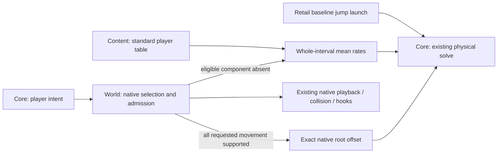

# Playable-body motion fallback

Status: complete. Rate-based revision, cleanup, and automated verification completed on 2026-10-25. Visual acceptance remains with the user.

## Context and boundaries

Goal: keep valid local movement and jumping functional when a playable body lacks matching animation.

In scope: missing Ready/Falling presentation, native-first local walk/run/sidestep/turn movement,
explicit missing-versus-prohibited admission, and retail baseline jump launch shared by ordinary
and precise jumps. World owns movement source selection; core consumes its physical interval;
app playback and collision poses remain native.

Out of scope: donor part-pose retargeting, donor gameplay hooks/actions, remote fallback, archive
corruption recovery, inventing gameplay stats, and bodies without a usable native table/default pose.

## Ground truth and existing patterns

Reference sources:

- `acclient-eor-source/acclient.c:324297-324330`: current-style then default-style substate lookup and state admission.
- `acclient-eor-source/acclient.c:330233-330290,330390-330453`: interpreted selection reports failure; support presentation attempts `Falling` without making failure terminal.
- `acclient-eor-source/acclient.c:329842-329907,330067-330100`: baseline planar state velocity, run-rate cap, and leave-ground velocity.
- `acclient-eor-source/acclient.c:308282-308292`: supported authored translation and object scale; unsupported translation is suppressed while rotation remains.
- `acclient-eor-source/acclient.c:314107-314135`: part updates cover the available prefix, not a requirement for identical part counts.
- `ACE/Source/ACE.Server/Physics/Animation/MotionTable.cs`: `GetObjectSequence`, `is_allowed`, modifier and link lookup.
- `ACE/Source/ACE.Server/Physics/Animation/MotionInterp.cs`: `apply_interpreted_movement`, `get_state_velocity`, `get_leave_ground_velocity`.

Implementation touch points:

- Content layer: `crates/holtburger-content/src/motion_sequence.rs`, `repository.rs`, and `collision_pose.rs`. The complete catalog already contains the donor; core must not discover files or mount archives.
- World layer: `crates/holtburger-world/src/motion/{selection,registry,sequence,state}.rs`, `state/{motion_resolution,self_movement}.rs`, and `spatial/dead_reckoning.rs`.
- Core layer: `crates/holtburger-core/src/client/movement/system.rs`, `simulation.rs`, `character_{axes,kinematics,jump}.rs`, `precise_jump*.rs`, and capability publication in `client/mod.rs`.
- App boundary: `apps/holtburger-3d/host/src/client_projection.rs` and the existing browser harness only as needed to verify production outputs. `animation/animation-playback.ts` already supports prefix part coverage.
- Existing patterns: `MotionSelectionOutcome::Unmodelled`, per-channel selection diagnostics, separate ordinary/locomotion playback, `gate_authored_offset`, and the collision solver's existing authored-offset input.

Evidence gathered on 2026-10-25 by a read-only in-memory decoder of `dats/assets.hba` (resolved to `/home/cluracan/code/holtburger/dats/assets.hba`):

| Observation | Result |
| --- | --- |
| Motion tables decoded, including complete record consumption | 436 |
| Default-style `Ready` cycle present | 376 tables |
| Default-style `Falling` cycle present | 94 tables |
| Default-style walk/run cycles present | 286 tables each |
| Nondefault style entries with `Falling` absent locally but present in the table default style | 84 entries |
| Nondefault style entries with the equivalent `Ready` fallback | 0 entries |

These are presence counts, not a census of playable bodies or successfully admitted transitions.

The reported table `0x0900000C` has default style `0x8000003D`, native `Ready` animation `0x03000016`, walk/run animation `0x03000015` at 30/45 fps, native turning, and no `Falling` cycle. These clips have 25 parts. Standard player clips have 34 parts; its `Falling` clip `0x030004A9` has no root position frames or explicit row velocity/omega. The mob therefore already has physical movement content; missing airborne presentation does not require donating locomotion.

Retail/ACE state velocity uses walk 3.12, run 4.0, and sidestep 1.25 before rate adjustments and the run-speed cap. Before this change, jump launch read body-derived walk/run rates and required turn kinematics through `SelfJumpCapabilities.movement`. Grounded authored travel and jump launch must not be conflated. Donor root-motion averages also need not equal these constants.

## North stars and accepted concessions

- Missing presentation is nonfatal; valid physical actions remain available.
- Exact native root motion remains the normal path.
- If any eligible requested movement component is absent, use rates for the **whole physical
  interval**: native mean rates for supported components, standard player-table mean rates for
  missing ones. Do not combine stale native root displacement with fallback displacement.
- This intentionally smooths the stride of supported components during a mixed fallback interval.
  It does not preserve donor frame phase. The player donor's walk/run roots are effectively
  constant-speed; its sidestep is variable. Jump launch retains retail's separate baseline.
- Native animation, collision poses, and hooks continue on the existing native cursor. There is
  no donor cursor, root-only sequence node, pose override cursor, or donor hook suppression.
- Missing and prohibited differ. Never borrow around state restrictions, death, action ownership,
  or contact rules. Native zero-rate holds and legitimate zero motion are not absence.
- Derive selection facts once in the native selector; keep row references transient. Retain only
  existing channel diagnostics and physical ownership needed by the runtime.

## Flow and contracts

Native selection reports the selected row, already-active no-op, missing content, or state
prohibition internally. Public native selection keeps its existing API. Local rate resolution uses
those results, so it does not independently repeat admission. Missing canonical components may
read the standard player's default-style cycle or styled/unstyled modifier. Prohibited components
receive no donor contribution. Cycle rates include explicit motion-data vectors and mean signed root
travel, weighted by each clip's actual duration; modifiers contribute explicit vectors only; zero-rate clips hold their root motion. Native
full vectors are retained, rather than assuming all translation points along one axis.

The selected interval enters the existing support/scale gate and collision solve once. Contact
continues to suppress unsupported translation. Ready without animation suppresses retained travel;
Falling without animation leaves physical jump integration running. Neither condition borrows a
human pose. Table rebinding resets native runtime state through its existing lifetime.

## Implementation phases

### 1. Simplify native selection and rate reduction

- [x] Remove donor-aware sequence selection, donor provenance, root-only nodes, and pose override.
- [x] Give native selection a private detailed result that distinguishes missing from prohibited
  and carries the selected native row.
- [x] Add a stateless mean-rate reducer with signed traversal, per-clip duration, and explicit rates.
- [x] Keep controller rate summaries consistent without imposing donor playback on native APIs.

Acceptance: native selection tests retain behavior; targeted rate tests cover mixed FPS, reverse,
zero holds, and explicit plus root motion.

### 2. Resolve and apply one physical source

- [x] Resolve local fallback from actual native selection; use whole-interval rates only when
  an eligible requested component is absent. The baseline supplies missing rates where available;
  absent baseline content leaves that component unavailable rather than retaining stale travel.
- [x] Retain the existing native cursor for presentation, collision, and hooks.
- [x] Preserve Ready/Falling nonfatal handling, action/death/contact arbitration, stop, rebind,
  and independent baseline jump launch already implemented.

Acceptance: synthetic tests cover supported native stride, fallback averaging, mixed channels,
reverse/rate changes, missing donor, state restriction, native hooks/poses, stop, and rebind.

### 3. Reassess, verify, and clean up

- [x] Review the final design for any accidental second interpreter or retained donor clock.
- [x] Rewrite obsolete exact-donor-phase tests around rate semantics; keep physical jump tests.
- [x] Update architecture documentation and archive/browser probes to describe the final behavior.
- [x] Run world/core/host tests, clippy with warnings denied, formatting, relevant frontend checks,
  and archive-backed replay through the production output. Visual acceptance belongs to the user.
- [x] Remove stale symbols, comments, tests, and plan claims from the superseded design.

Acceptance: checks pass; donor clips/hooks never enter a native body; fallback motion remains
finite across the catalog; missing Falling completes a physical jump and landing.

## Risks and mitigations

- Native modifier admission depends on the actual active cycle. Preserve that exact native rule;
  default-style destination lookup must not silently broaden it.
- Dual-class commands can have both cycle and modifier routes. A prohibited cycle plus a missing
  modifier remains prohibited; it must not become permission to borrow.
- Averaged root turns lose stride detail and curved-path fidelity. This is an accepted compatibility
  approximation only while missing components require fallback; supported native travel stays exact.
- Missing archive rows and corrupt referenced assets are different. This change handles coverage
  gaps, with explicit diagnostics; integrity handling remains unchanged.

## Definition of done

All phase acceptance criteria pass; plan and architecture docs describe the implemented behavior;
there is one native playback owner per existing track and one physical source per interval;
automated evidence is reported with practical limits. The user separately authorized a final
quality review and commit after implementation.

## Decisions and course corrections

The first implementation preserved exact donor root traversal. Review found that it required a
physical donor sequence plus a separate native pose cursor and source-sensitive selection/hook
rules. The user approved replacing that machinery with rate-based whole-interval actuation.
This revision retains the nonfatal presentation fix and retail jump correction, and explicitly
accepts averaged stride during fallback.

## Open questions

None requiring user input. Stop and flag any major gap exposed during implementation.

## Verification and final review

- Final Rust suite: 1,006 world, 729 core, and 384 host tests passed (2,119 total);
  three existing world tests remain ignored. Includes physical jump ascent/landing without
  Falling, mixed fallback movement, native stride recovery, holds, signed rates, mixed-FPS
  averaging, explicit plus root rates, full root revolutions, restrictions, hooks, stop, and rebind.
- Clippy passed for world/core/host/debug-harness with all targets and warnings denied.
- Formatting and diff whitespace checks passed.
- Mounted-content probe: 436 tables and 7,848 intervals, finite movement and native-only
  animation/hook/collision-pose identities. Output: `/tmp/playable-motion-rate-probe.log`.
- Real Male Tusker (WCID 11) browser replay completed six motion levels, including fresh model
  realization during Falling; all capture results present, browser console messages empty.
  Evidence: `/tmp/playable-motion-rate-browser.log`. Screenshots were not visually inspected.
- Existing frontend verification from this implementation remains applicable: Svelte check and
  TypeScript lint passed, along with 58 relevant animation tests; the rate revision changes no
  frontend behavior or contracts.
- Socket-dependent host tests required execution outside the filesystem/network sandbox; final
  authorized run passed. Final suite: `/tmp/holtburger-rate-tests-final.log`; clippy:
  `/tmp/holtburger-rate-clippy-final.log`.

Final review traced native selection through local rates, existing support/scale/collision gating,
pose/hook publication, and stop/rebind. Donor-aware selector plumbing and all sequence/pose-clock
additions are removed; `sequence.rs` is unchanged from the baseline. No new retained fallback
clock, frontend policy flag, or solver mode remains. Stance lookup now resolves native table
identity directly, avoiding rate sampling when only the style is needed. Remaining intentional
concession: mixed fallback movement averages stride and root curvature; fully supported native
movement retains exact traversal. The subsequent quality review and its corrections are recorded below.

## Pre-commit code-quality review

Verdict: ready within the reviewed scope after two demonstrated defects were corrected.

- **Action admission versus presentation coverage:** the shared latest channel result let missing
  Falling cancel an active native Windup on the next interval. A failing test reproduced the loss
  of the active action. Ordinary selection now retains its result for action admission and packet
  diagnostics; the existing locomotion track owns its coverage result for local diagnostics.
  Ready/Falling coverage gaps preserve native action hooks and exact completion. These are results
  of independent playback tracks, not a new playback clock or a recomputed admission check.
- **Cycle versus modifier semantics:** the selected-row contract erased its execution role, so
  fallback reduction sampled clips on native modifiers even though native playback combines only
  their explicit vectors. A failing fixture doubled forward displacement during mixed movement.
  `MotionRow` now carries the chosen cycle/modifier role into both physical rate reduction and
  capability summaries; neither consumer repeats lookup to recover it. Native modifier semantics
  are confirmed by ACE `MotionTable.GetObjectSequence` and `combine_motion`.
- Browser sample evidence now says `captured`, rather than implying that nonempty PNG data proves
  the correctness of the displayed pose. Visual acceptance stays with the user.
- Retail state-velocity constants use velocity names; new test imports are at module scope.

Seam coverage: reviewed all changed and new files against HEAD, including native selection and
rate lookup, ordinary/manual/remote receipt and drive callers, stop/rebind/reset ownership,
world-to-core physical actuation/support/scale gating, ordinary and precise jump launch,
capability publication, Explorer possession adaptation, native animation/collision/hook outputs,
browser sample replay, content survey, and the diagnostic roster compile fixes. No live ACE
session or visual acceptance was performed. Exact native traversal and averaged mixed fallback
remain intentionally distinct; complete-table/default-pose absence and corrupt archives remain
outside this change.

Post-review verification: 1,008 world, 729 core, and 384 host tests passed (2,121 total; three
existing ignores); clippy passed across world/core/host/debug-harness with all targets and warnings
denied; frontend checks and lint passed with zero Svelte diagnostics. The real-content survey again
passed 436 tables and 7,848 intervals. Evidence: `/tmp/holtburger-quality-tests.log`,
`/tmp/holtburger-quality-clippy.log`, `/tmp/holtburger-quality-content.log`, and
`/tmp/holtburger-quality-browser.log`. No unresolved findings remain within this review boundary.
