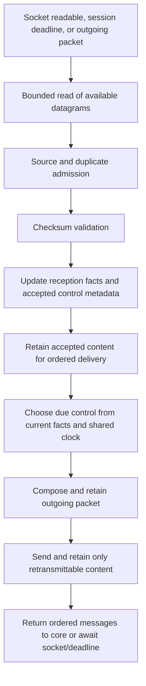

# Retail Transport Reliability Plan

Status: complete; implementation, validation, and completion audit finished on 2026-10-28.

## Context and Boundaries

### Goal

Match retail's coordinated receive, acknowledgement, and retransmission behavior so ordinary UDP
reordering does not produce unnecessary recovery requests or server-forced logouts.

### In Scope

- Refactor reliability ownership in `holtburger-session`: reception facts, control scheduling,
  ordered delivery, retransmission caching, and cancellation-safe pending sends.
- Read available datagrams within a bounded budget before scheduling recovery controls.
- Derive outgoing ACKs and resend requests from one retail-backed scheduling policy, including
  ACKs attached to game packets.
- Remove known encrypted duplicates before checksum-key search, without bypassing validation for
  new packets or suppressing legitimate unsequenced control traffic.
- Preserve original sequence/key identity when retransmitting, while stripping disposable
  optional headers from cached content.
- Answer requests for unavailable client packets with the appropriate rejection control.
- Remove the ineffective character-selection wait that currently prevents the borrowed session
  from receiving while it waits for that same session's sequence to advance.
- Move core's disconnect packet allocation into the session send owner; core retains the decision
  to disconnect and the resulting lifecycle transition.
- Replace tests that encode the old immediate-control behavior with deterministic behavioral
  coverage; update affected transport documentation.

### Out of Scope

- Changes to h3d rendering, presentation, enchantments, movement, or world semantics.
- A rewrite of fragment queues, game-event ordering, congestion control, or outbound game-message
  batching. Preserve the current ordered message API to core.
- Wholesale replacement of ISAAC or adoption of retail's sequence/key bookkeeping without ACE
  compatibility evidence.
- Server-specific hostname checks, recovery modes, magic grace periods, or changes to the remote
  server. The existing local ACE and retail decompile remain unmodified production references.
- A guarantee that an arbitrarily reordered UDP stream cannot trigger the remote fork's logout
  rule. Faithful scheduling reduces unnecessary requests; it cannot control server processing.
- Committing raw captures, account information, or tests that depend on untracked runtime assets.

Implementation was explicitly authorized after planning and the call-path walkthrough.
Enchantment classification is separate work and is outside this implementation.

## Ground Truth

### Retail References

Paths below are relative to the repository root. Line numbers refer to the inspected decompile;
verify the named function if the reference snapshot changes.

| Reference | Established behavior |
| --- | --- |
| `acclient-eor-source/acclient.c:354039`, `SharedNet::UseTime` | Calls `ReadAndProcessPackets` before `ProcessConnections`. |
| `acclient-eor-source/acclient.c:354061`, `SharedNet::ReadAndProcessPackets` | Reads until the socket has no data or its processing time budget expires. |
| `acclient-eor-source/acclient.c:353289`, `SharedNet::ProcessNewestSeqNum` | Tracks the highest observed sequence and registers holes separately. |
| `acclient-eor-source/acclient.c:356012`, `SharedNet::ProcessNewSeqNum` | An old encrypted sequence must still be missing to enter checksum-key processing; otherwise it is discarded. |
| `acclient-eor-source/acclient.c:356070`, `SharedNet::ProcessPacket` | Validates accepted packet contents; failed encrypted validation restores recovery eligibility. |
| `acclient-eor-source/acclient.c:356159`, `SharedNet::ProcessConnection`; `:356827`, client connection processing | Chooses NAK scheduling while holes remain and PAK scheduling when the missing list is empty. |
| `acclient-eor-source/acclient.c:355374`, `SharedNet::EnqueuePak` | Schedules a normal ACK after at least 2 seconds since the shared control timestamp; advances that timestamp when scheduled. |
| `acclient-eor-source/acclient.c:355416`, `SharedNet::EnqueueNaks` | Reads the current missing list after more than 0.6 seconds since the same timestamp; advances it when scheduled. |
| `acclient-eor-source/acclient.c:360215`, `ReceiverData::SharedInit` | Initializes the control timestamp at connection initialization. |
| `acclient-eor-source/acclient.c:360338`, `ReceiverData::GetNaks` | Caps the returned outgoing count at 114, despite a 115-element buffer/traversal bound. Verify the count actually serialized rather than copying the buffer size. |
| `acclient-eor-source/acclient.c:356127`, `SharedNet::HandleEmptyAck` | Removes rejected IDs from the missing list; rejection is not itself a disconnect. |
| `acclient-eor-source/acclient.c:358738`, `FlowQueue::EnqueueOptionalHeader`; `:358800`, coalescing implementation | Scheduled controls can join an outgoing packet subject to header compatibility and capacity. They are not attached indiscriminately to every game packet. |
| `acclient-eor-source/acclient.h:5820`, `OptionalHeaderFlags` | ACK and sequence-list headers can be disposable; exclusivity, priority, and piggyback preference are distinct properties. |
| `acclient-eor-source/acclient.c:362032`, `SentPacketStore::AddSentPacket`; `:360673`, `NetPacket::RemoveDisposableOptionalHeaders` | Strips disposable headers before retaining reliable content for retransmission. |
| `acclient-eor-source/acclient.c:358525`, `FlowQueue::DequeueAck`; `:359571`, retransmission path | Rebuilds changed cached content with the original packet sequence and saved crypto key. |
| `acclient-eor-source/acclient.c:362149`, `SentPacketStore::Flush` | Acknowledgement eviction uses wrap-aware ordering and retains the acknowledged boundary packet. |
| `acclient-eor-source/acclient.c:359526`, `FlowQueue::TransmitNaks` | Generates rejection controls for requested packets that cannot be supplied. |

The 0.6-second rule is an interval since a prior control update, not a guaranteed 600 ms grace
period for each newly observed gap. Do not substitute that interpretation during implementation.

### Server References

- `ACE/Source/ACE.Server/Network/NetworkSession.cs`: cleartext request handling, acknowledgement
  eviction, retransmission, sequencing exceptions for standalone ACKs/NAKs, and rejection packets.
- `ACE/Source/ACE.Server/Network/PacketHeaderOptional.cs`: optional-header order.
- `ACE/Source/ACE.Server/Network/PacketHeaderOptional.cs:50` and
  `NetworkSession.cs:275-490`: rejection lists are read for framing/checksums but not retained or
  used to release server-side C2S holes. Cleartext NAKs have a special processing path; encrypted
  NAKs do not have a corresponding request handler in this implementation.
- `ACE/Source/ACE.Common/Cryptography/CryptoSystem.cs`: existing bounded key-search behavior.
- Public InfiniteLeaftide mirror:
  <https://github.com/hq6/InfiniteLeaftide/blob/975060438fa0f44c4e5aa3f0cdd4adf409184cab/Source/ACE.Server/Network/NetworkSession.cs>.
  This file revision (2025-06-26) forces player logout on a retransmit cache miss and emits the exact
  captured error. The mirror establishes the matching rule, not the live server's deployed commit.

### Existing Owners and Consumers

| Layer / path | Responsibility and planned touch |
| --- | --- |
| Session: `crates/holtburger-session/src/session/receive.rs` | Canonical admission, checksum validation, control metadata, bounded socket reads, and ordered delivery. Collapse duplicate receive branches and the test-only alternate receive path. |
| Session: `session/reliability.rs` | Missing-packet recovery, ACK-driven cache eviction, bounded capacity admission, resend/rejection production, and retransmission rebuilding. |
| Session: `session/send.rs` | Packet construction, due control composition, retained sends, and cache insertion. Remove unconditional ACK injection and per-packet ACK production. |
| Session: `session/types.rs`, `api.rs`, `auth.rs` | Reliability state, initialization, deadlines, and handshake integration. |
| Session: `session/connection_metrics.rs` | Observations consumed by core. Specify admitted-packet counter semantics after early duplicate filtering and derive gap observations from the reception owner. |
| Protocol: `crates/holtburger-protocol/src/crypto.rs`, `messages/transport.rs` | Existing checksum primitives, flag constants, and framing. Avoid moving runtime scheduling into this layer. |
| Core: `crates/holtburger-core/src/client/runtime.rs`, `client/connection.rs` | Bounded network dispatch, `now_or_never` polling, `select!` cancellation, and connection observations. Integration consumers, not the reliability scheduler. |
| Core: `client/character_selection.rs:215` | `select_character` currently sleeps without receiving while exclusively borrowing the session. Remove that timing workaround. |
| Core: `client/commands.rs::disconnect_with_cause` | Replace direct packet-sequence mutation and header construction with the session-owned disconnect send operation. |
| Tests: `crates/holtburger-session/src/session/tests.rs` | Existing scripted transports and wire-building fixtures. Replace fixtures that treat an empty receive queue as an error when testing timers. |
| Documentation: `docs/transport.md`, `crates/holtburger-session/ARCHITECTURE.md` | Durable explanation of the resulting transport contract, replacing inaccurate descriptions in the affected sections. |

### Captured Evidence

Observed on 2026-10-28 UTC against `game.infiniteleaftide.online`; local investigation log was
`/tmp/h3d-logout-repro.log`. This path is temporary and is not a test prerequisite.

At approximately 03:26:11 UTC:

1. The client had processed server packet 10431.
2. Packet 10433 arrived, revealing a hole at 10432.
3. h3d emitted a request for 10432 before attempting the next socket read.
4. The very next inbound packet was original packet 10432; h3d processed it and the buffered 10433.
5. h3d emitted ACKs for 10432 and 10433 and a game packet carrying ACK 10433.
6. Server packet 10434 rejected the request for 10432.
7. Server packet 10435 carried `NetworkSession error: client and server are out of sync`.
8. At approximately 03:26:17 UTC, the server sent `CharacterLogOff`; h3d had not requested logout.

Before the error message, the trace contained 15,540 outbound log entries, including 10,433
standalone ACKs and 5,081 packets containing piggyback ACKs. Both observed cached client
retransmissions retained an ACK. All 47 checksum-failure entries concerned sequences for which
an original packet had already been observed. These are local log observations, not server receipt
counts or proof that every original passed validation.

The forced logout is established. The hypothesis is that the request crossed later ACKs, allowing
the server to evict the requested packet before handling the request. Client logs do not prove the
remote processing order. Tests must reproduce that ordering explicitly rather than promote the
hypothesis into an observed fact.

## North Stars and Invariants

- One session-owned policy produces both standalone and piggyback reliability controls.
- A read pass consumes available datagrams before making a recovery decision. Every attempted
  datagram, including discarded traffic, consumes the receive budget.
- Reception progress and ordered delivery are distinct facts. A highest observed stamp alone
  must never authorize eviction of packets still needed for recovery or delivery.
- A missing ID stops being eligible for a new resend when its valid original or repair arrives.
- Checksum-invalid packets cannot close holes or perform control-metadata side effects.
- Duplicate encrypted packets cannot advance or search the crypto stream a second time.
- Resending content preserves its sequence and original crypto key and never replays disposable
  reliability controls or consumes a new key.
- Recovery retries and ordinary ACKs continue without requiring a subsequent incoming packet.
- Cancellation loses neither accepted datagrams nor pending controls. A partially serviced read
  pass resumes from session-owned state.
- New scheduling code is stateless where possible: explicit `now`, facts in, decision out.
  Mutable state belongs in one small session-owned composite, not independent frontend timers.
- Prefer deleting duplicate paths and stale snapshots over adding another queue or recovery mode.
- Keep existing memory/window safeguards. Any change to their failure policy needs a named
  scenario, source evidence, and a regression test.

## Intended Design

### Ownership and Flow



The diagram describes the steady-state read/schedule cycle, not a mandate to delay an immediate
handshake response, termination control, or server-requested repair until a normal ACK deadline.
Unsequenced controls are admitted independently of game-content ordering.

The existing `pending_server_packets` and `rejected_server_sequences` should supply recovery facts
where possible. Derive the missing IDs in bounded sequence order; add an explicit missing-ID
collection only if the highest-observed/delivery distinction requires information that these
owners cannot represent. Do not keep two independently updated versions of the missing set.

Separate the delivery cursor from the facts needed to decide ACK eligibility. Preserve the current
`recv_message` contract and its message ordering; avoid a second decoded game-event queue.

### Receive Pass Boundaries and Buffer Ownership

The read/schedule cycle cannot be implemented by draining another full batch before returning each
single buffered packet. That admits traffic faster than the current one-packet delivery path can
release it, eventually exhausting a valid receive window even when core is keeping up.

- Use one bounded admission pass, service due controls, then release ready ordered packets without
  repeatedly admitting another full batch between each release. Check due deadlines during release
  so a backlog cannot starve controls. Additional reads consume remaining buffer headroom; they do
  not grant another unbounded batch just because `recv_message` was called again.
- Give accepted-but-undelivered packets an explicit count/byte bound. When it is full and its front
  is ready, prioritize delivery. If a genuine hole blocks it, service recovery and maintain the
  bound. Do not drop already accepted content after acknowledging it.
- Validate the incoming forward sequence span before buffering, independently of whether a resend
  is due. Today the abnormal-window check sits inside `send_request_retransmit`; retaining that
  placement would let the new pacing delay the memory guard. Also bound future rejection stamps.
- Budget the individual raw socket read, not the current `recv_raw_packet_with_addr` loop that can
  consume unlimited wrong-source traffic before returning one packet. Ready polling must never
  await future traffic merely to fill a batch.
- A handshake packet is a read-pass barrier. Stop the pass, process its existing handshake
  handler exactly once, initialize keys and activation-source expectations, then start another pass.
  Otherwise a following encrypted datagram can be dropped before `recv_message` initializes ISAAC.
  Preserve the handshake TimeSync event and the existing delayed activation response.
- Keep transport metadata side effects at admission. Ordered delivery must not apply the same ACK,
  repair request, rejection, or handshake initialization for a second time.

These rules preserve core's existing bounded dispatch: one session receive result does not become
an arbitrarily large collection of packets simply to hide the buffer-growth problem.

The same ingress service must be callable before an outgoing game packet flushes a due normal
control. Core may cancel a receive future and immediately execute a command; recompiling a NAK
from old reception facts without reading already available arrivals would preserve the original
race on this path. Read transport facts only, retain accepted content for later ordered delivery,
and never call core's message handlers from the send path. Handshake transport side effects occur
once at the barrier; retain their TimeSync notification for subsequent `recv_message` delivery
instead of re-running initialization there. No second decoded game-event queue is needed.

### Control Lifecycle

| State / condition | Decision |
| --- | --- |
| Connection initialized | Initialize the shared control timestamp from the session's monotonic clock. |
| Missing IDs remain, elapsed time is not greater than 0.6 seconds | Retain the gap; await socket activity or the next recovery deadline. |
| Missing IDs remain, elapsed time is greater than 0.6 seconds | Compile the current bounded missing list and schedule recovery. |
| No missing IDs remain, elapsed time is less than 2 seconds | No normal ACK is due. |
| No missing IDs remain, elapsed time is at least 2 seconds | Schedule the safe ACK boundary. |
| Control scheduled | Advance the shared timestamp as retail does; retain the pending operation across cancellation. |
| Packet composition/send | Revalidate recovery eligibility before serializing a deferred request. If it became empty, cancel it without sending an empty request. |
| A safe ACK is queued and a later gap appears above its boundary | Keep its boundary frozen or cancel it; never upgrade it to the highest observed stamp across the new hole. A later gap does not itself invalidate an older safe boundary. |
| Server rejects a requested ID | Remove its recovery eligibility and release only the corresponding confirmed delivery hole, preserving received packets that crossed the rejection. |

Controls are optional packet content produced by the scheduler. An ordinary game message neither
automatically creates an ACK nor resets the control clock merely because it was sent. A due ACK
may join a compatible game packet; if there is no such packet it must still be sent independently.

For ACE compatibility, emit resend requests as standalone cleartext controls. ACE's early NAK path
handles only cleartext requests and returns before processing game fragments. Piggybacking a NAK
onto an encrypted game packet would make the request ineffective; putting game fragments onto a
cleartext NAK would make them ignored by that path. This is a named adaptation of retail header
coalescing, not a reason to build a general outbound batching engine. ACK piggybacking remains in
scope because ACE handles it on game packets.

Use the actual serialized retail outgoing list limit, with an independently bounded receive
parser. Do not reduce the parser's accepted capacity simply because retail emits a smaller count.

### Clock and Cancellation Contract

Use a single clock domain for internal session deadlines. The intended choice is
`tokio::time::Instant` for scheduler and pending-control deadlines, with explicit `now` arguments
for decision functions and Tokio's paused clock in async tests. Add the existing Tokio dependency's
`test-util` feature for tests if needed. Keep public `std::time::Instant` traffic observations used
by core as observations; do not compare them against virtual scheduling deadlines.

Keep the scheduler inactive in `Session::new` and initialize it on the first accepted
`ConnectRequest`, corresponding to retail's `ReceiverData::SharedInit` during connect handling
(`acclient.c:357245`). Repeated handshake traffic must not reset an active connection's pacing or
crypto streams. An actual new connection generation resets its own state; character selection on
the existing authenticated transport does not. With today's API, a new generation is a new
`Session`; do not introduce an unused reconnect/reset interface. Add first, duplicate, and
new-session cases.

Migrate the existing handshake deadline together with internal pending-control deadlines. Mixing
paused Tokio time with `std::time::Instant::now()` in readiness checks would make timer tests
misleading or cause busy loops.

Retain outgoing work before an awaited send. Track successful completion without discarding the
operation on `Pending`. Assign new sequence/key material once per retained reliable packet;
re-polling cannot allocate another sequence/key or reapply accepted inbound metadata. A transport
send failure remains an error, not a successful timer update disguised as progress.

Normal controls use the current control-sequence convention; standalone ACKs, resend requests,
and rejection responses must not accidentally allocate encrypted game-packet sequence/key state.
ACE's sequenced incoming rejection packets still need to advance our delivery adapter correctly.

Apply pending-send ownership to ordinary reliable sends as well as controls. Currently
`send_packet_to_addr` constructs bytes and consumes a checksum key before awaiting the socket,
then caches only after success. Retaining only control work would leave a consumed sequence/key
with no cached payload if that ordinary send is cancelled. Route prepared sends through a common
session-owned path and flush earlier prepared reliable packets before later ordinary writes.
Move new reliable packet sequence allocation behind capacity admission, including the disconnect
packet currently constructed and incremented by `core/client/commands.rs::disconnect_with_cause`.
Give core a narrow session-owned disconnect-send operation; keep existing diagnostic/test sequence
reads if useful, but remove production sequence mutation outside the session send owner. Login and
game-message preparation must obey the same allocation ordering where reliable retention applies.

Only successful whole-datagram writes commit byte counters, send observations, and cache retention.
Treat a short write as a transport error; UDP writes are atomic in the production transport.
The test transport must commit no datagram while returning `Pending`, and must be woken when its
read/write gate opens. Repeated polling and cancellation should exercise the same retained work.

At most one unsent normal reliability intent is needed. Do not queue another ACK/request every
time core polls a receive future while the previous write is pending. Recompile unsent requests
from current facts without repeatedly advancing the scheduled-control timestamp. Once serialized,
any update to an unsent reliable packet's disposable headers must preserve its reserved key and
sequence; no second allocation is allowed.

An actual send error is terminal through the existing `Result` path. A cancelled unsent request
may leave the last-scheduled timestamp advanced, matching scheduling-time ownership; it must not
reset the clock on every cancellation or spin on an already elapsed deadline.

### Cache and Duplicate Handling

- Preserve the original packet identity and key needed to rebuild a repair. Store only facts
  consumed by repair construction; do not duplicate semantic payload and complete wire bytes
  unless both have a demonstrated consumer.
- Strip disposable optional headers using the existing optional-header order, then recompute size
  and checksums. Do not remove reliable content when its only optional control is disposable.
- Keep ACK eviction wrap-aware and retain the boundary packet, matching the references. Only ACKs
  release successfully sent reliable content; reaching the configured count must not silently
  evict an unacknowledged original.
- Return bounded rejection lists for uncached requested client packets instead of only warning.
- Standalone disposable controls do not enter the reliable cache. In particular, an ACK with the
  current sequence cannot occupy a missing/evicted cache entry and later masquerade as that
  sequence's original reliable payload.
- Preserve the configured cache bound. Count prepared new reliable packets against admission
  capacity too; otherwise a pending outbox could bypass it. If another reliable original would
  exceed capacity, return an explicit transport error before allocating its sequence/key or sending
  it. Existing core error handling owns termination. Repairs and disposable controls do not reserve
  a new reliable-cache slot and must remain serviceable at capacity. This is a deliberate change
  from the current oldest-entry discard, supported by the loss-of-unacknowledged-content scenario.
- Exercise late repair requests for packets already removed by an ACK. An unavailable sequence
  alone is not evidence of current desynchronization and must not force a local logout: requests
  can cross ACKs in either direction. Return the rejection without substituting another payload.
- Identify already accepted encrypted originals/repairs before key search, including packets still
  buffered for ordered delivery. Plain controls sharing a sequence must still be handled.
- Preserve the existing ACE-compatible key search for new packets and genuine missing repairs.
  Any broader sequence-to-key redesign is a steering decision, not an incidental cleanup.

### Rejection Compatibility Limit

The local ACE source can parse a client rejection list but has no consumer that releases a C2S
hole from it. A retail-format rejection is therefore a protocol response, not proof that ACE can
recover from loss of client content we can no longer supply. Do not fake recovery by advancing
the client's sequence or sending a different payload under the lost identity.

Use standalone cleartext rejection controls at the current control sequence, following retail's
disposable-header send convention, and test their framing without assuming ACE's receive-order
guard will admit them. Keep the server's incoming sequenced rejections distinct from these outgoing
controls. Explicitly diagnose the unavailable client sequence without claiming that ACE released
its hole. Do not introduce cache-miss-triggered logout: a late request can refer to already ACKed
content. The cache admission rule prevents our own capacity policy from creating unrecoverable
loss of an unacknowledged original. A peer with genuinely inconsistent recovery state remains a
compatibility limitation, not a reason to manufacture sequence progress.

### Observation Contract

Early encrypted-duplicate admission conflicts with counting those packets as newly
checksum-accepted traffic. Define `received` counters as sequenced datagrams that pass canonical
admission, including accepted repairs; a discarded encrypted duplicate does not increment them.
Raw byte observations can still record allowed-source datagrams, as they do today. Keep the
existing fields and quality thresholds; update their comments and focused connection tests rather
than adding counters or performing a second crypto search for diagnostics.

Derive recovery eligibility and ACK safety from the same reception facts. Specify `receive_gap`
as a known unresolved transport hole preceding accepted later traffic, even if earlier buffered
content remains ready to deliver. The current next-delivery-only predicate can miss a later hole
during read-ahead; replace it and update the consumer documentation explicitly.

## Phased Implementation

### Phase 1: Lock the Contract and Test Inputs

Deliverables: completed reference decisions in this plan; synthetic transport fixtures in
`session/tests.rs` or a focused colocated test module; relevant manifest test features.

- [x] Verify control initialization/reset and strict versus inclusive timing boundaries.
- [x] Encode the first/duplicate-handshake barrier and the known ACE NAK/rejection limitations
  below; remove source questions already settled by this walkthrough from the implementation gate.
- [x] Pin the public server mirror revision and encode only the matching cache-miss rule in a
  local synthetic peer. Do not require that repository or a live server at test time.
- [x] Verify disposable flags and standalone versus piggyback sequencing for ACK/NAK/rejection.
- [x] Record the emitted list limit and preserve bounded parser acceptance.
- [x] Build a gated scripted transport whose empty receive queue is `Pending`, not an error, and
  whose receive/send readiness can be controlled independently.
- [x] Express the captured packet order as a small synthetic fixture without raw login data.
- [x] Establish tests for the current failure mechanism and the intended timer boundaries.

Acceptance: each scheduling/serialization rule has a source citation and a reachable test input;
the synthetic peer demonstrates the request/ACK race without network access or runtime assets.
Tests expecting corrected behavior may fail until the following implementation phases.

### Phase 2: Canonical Reception and Persistent Recovery State

Deliverables: `receive.rs`, `types.rs`, `api.rs`, and admission tests.

- [x] Collapse the duplicated timer-select and ordinary receive processing into one accepted-packet
  path. Preserve delayed handshake work and source activation behavior.
- [x] Separate socket admission, transport metadata, and ordered content delivery.
- [x] Add bounded ready-datagram draining before reliability-control scheduling; count rejected
  datagrams against the budget and avoid waiting for new traffic merely to finish a batch.
- [x] Introduce the handshake read-pass barrier and bounded admission/delivery alternation. Enforce
  sequence-window and future-rejection bounds before allocation, regardless of timer state.
- [x] Eliminate the alternate test-only raw receive path's checksum/metadata semantics; move its
  tests onto canonical processing and remove unused public entry points where consumers permit.
- [x] Reject already accepted encrypted duplicates before key search. Preserve validation and
  recovery eligibility for corrupt/new/missing packets.
- [x] Keep all consumed-but-not-delivered content session-owned across `select!` cancellation.
- [x] Update admitted-packet counters and the receive-gap observation in their owner; adapt only
  the focused core connection tests whose documented inputs change.

Acceptance: originals and repairs deliver once, in existing order; invalid packets have no ACK/cache
side effects; a cancelled ready drain loses no accepted packet; receive budget tests terminate
under sustained valid or discarded traffic.

### Phase 3: Unified ACK and Recovery Scheduling

Deliverables: `reliability.rs`, `send.rs`, `types.rs`, `api.rs`, `auth.rs`, and timing tests.

- [x] Introduce the shared control clock and explicit scheduling decisions.
- [x] Replace the one-second resend throttle and immediate per-packet ACK queue.
- [x] Remove unconditional ACK injection from `build_packet_bytes`.
- [x] Compose eligible controls at the send boundary, preserving canonical optional-header order
  and packet-size limits. Keep standalone controls available during idle periods.
- [x] Keep NAKs standalone and cleartext for ACE. Freeze a safe queued ACK boundary instead of
  upgrading it through later holes; do not manufacture arbitrary ACKs through a helper bypass.
- [x] Compile/revalidate resend IDs from current recovery facts; cancel obsolete deferred work.
- [x] Select the earliest handshake/control/recovery deadline and service it without needing a
  new inbound packet. Guard strict `> 0.6` against an equal-deadline spin.
- [x] Preserve pending controls, sequence assignment, and key assignment across send cancellation.
- [x] Route ordinary prepared sends through the same retained-send owner, with successful-write
  commit semantics and no duplicate pending normal-control intents.
- [x] Service ready ingress before outgoing control composition too. Retain received content and
  transport notifications for normal receive delivery; execute no core callbacks in send paths.

Acceptance: the captured reorder produces no resend when both datagrams are available in the read
pass; actual loss produces a current request on schedule and retries while idle; normal ACKs obey
the shared clock and gap policy even during frequent outgoing game actions.

Phases 2 through 4 form one rollout unit: reception, control scheduling, retained sends, and cache
admission must agree before use. Do not publish a halfway implementation retaining competing
legacy and new control policies. Compilation checkpoints are useful; a compatibility mode is not.

### Steering Checkpoint: Review the Combined Receive/Send Contract

- [x] Walk the synthetic forced-logout scenario end to end, including cancellation at every await.
- [x] Reassess delivery cursor versus highest-observed state, cache admission/eviction, and plain control
  sequencing against both retail and ACE.
- [x] Verify that ACK-driven retention plus pre-send capacity admission removes the need for a
  cache-miss-triggered terminal policy; test late requests crossing ACK eviction and cache pressure.
- [x] Review the production line-count delta and identify duplicated owners, unnecessary fields,
  and abstractions introduced by the first cut.
- [x] Reconcile remaining work and update decisions below. If a new event-ordering model, crypto
  algorithm, or full outbound batching engine appears necessary, stop and rescope explicitly.

Acceptance: one coherent owner controls ACK/resend production, and no path can manufacture an ACK
merely because a game packet is being built.

### Phase 4: Complete Repairs and Core Integration

Deliverables: cache/retransmission changes in session, focused core changes and integration tests.

- [x] Strip disposable controls from retained repair content and rebuild using the original key.
- [x] Verify acknowledged-boundary retention, wraparound, configured cache overflow, repeated
  repair requests, and bounded rejections for unavailable client packets.
- [x] Replace oldest-entry capacity eviction with explicit admission failure before sequence/key
  allocation or send. Include reserved outbox originals in capacity; repairs and ACKs still work
  at the limit. Cover the existing core error path instead of adding a separate logout mechanism.
- [x] Exclude standalone disposable controls from the reliable cache and cover an ACK sent after
  the corresponding reliable cache entry has been evicted.
- [x] Preserve the received-packet-wins rule for crossed server rejections.
- [x] Remove the `select_character` sleep loop. If source evidence reveals a real handshake
  prerequisite, represent it explicitly rather than replacing the loop with another timed wait.
- [x] Move disconnect packet construction/sequence allocation into the session send owner and
  switch `commands.rs::disconnect_with_cause` to that operation, preserving core lifecycle policy.
- [x] Exercise core's bounded `process_network_batch`, ready polling, character selection, login,
  logout, and disconnect against the canonical session path.
- [x] Remove the public immediate `send_ack`/private `queue_ack` scheduler bypass when unused by
  production; adapt `runtime.rs::network_fixture` to discover its loopback address through a
  normal outgoing session packet. Do not add a new production API solely for the fixture.
- [x] Implement the observation contract above; retain public fields and add no new metric.

Acceptance: repairs never replay stale controls or consume a fresh key; unavailable client packets
produce an explicit response; character selection introduces no unconditional one-second pause;
core can continue physics/command work while session deadlines are pending.

### Phase 5: Cleanup, Documentation, and Validation

Deliverables: final code sweep, durable transport docs, validation record in this plan.

- [x] Remove obsolete timing fields, queue helpers, duplicate receive paths, and old vocabulary.
- [x] Delete and replace tests asserting immediate ACK/resend behavior; retain independent
  correctness coverage for payload hashes, source checks, sequencing, and fragments.
- [x] Document shared timing, gap/ACK interaction, cache semantics, ACE constraints, and retained
  differences from retail in `docs/transport.md` and the session architecture document.
- [x] Correct affected inaccurate descriptions, including claims that all packets allocate a new
  sequence or that payloads use RC4. Do not broaden into unrelated protocol documentation work.
- [x] Add required `RETAIL QUIRK` / `RETAIL DIVERGENCE` markers for intentional differences or
  reproduced defects, with source citation, consequence, and a scoped census/explicit limitation.
- [x] Run required checks below, record outcomes, and report remaining limitations honestly.
- [x] Evaluate whether protocol-only live validation is needed (not needed; see execution record).
  The user owns interactive h3d reproduction and visual acceptance. Never run the TUI.

Acceptance: no dual policy remains, checks pass, and documentation describes the implemented
contract rather than the previous behavior or an assumed perfect network.

## Validation Matrix

| Scenario | Required result |
| --- | --- |
| 10433 and then original 10432 already readable | Both delivered in order; no request for 10432. |
| Gap remains after the bounded drain | Recovery waits for the shared deadline, not a fresh per-gap timeout. |
| Gap fills before a deferred request is serialized | Filled ID absent; an empty request is cancelled. |
| Genuine loss followed by silence | Timer emits and retries recovery without further inbound traffic. |
| Multiple holes; some fill between retries | Each new request lists only current holes within the outgoing limit. |
| Continuous outgoing movement/game actions | No unconditional ACKs; due ACK can piggyback once. |
| No holes and no outgoing game actions | Standalone ACK emitted at the normal deadline. |
| Encrypted duplicate while original is buffered or delivered | No second delivery, metadata side effect, or crypto search/consumption. |
| Corrupt packet in a gap | Hole remains recoverable; subsequent valid original/repair succeeds. |
| Original crosses rejection | Received content wins; earlier unresolved holes are not skipped. |
| Cached client repair originally carrying ACK/NAK | Reliable content/sequence/key preserved; disposable controls absent. |
| Server requests unavailable client packet | Bounded rejection response, not silence or automatic local logout. |
| ACK is pending, then a higher sequence reveals a hole | Never serialize an upgraded ACK across that hole; the old safe boundary remains safe. |
| Many ready datagrams across repeated core receive calls | Delivery drains the admitted backlog; buffer usage stays bounded instead of growing by another batch per returned packet. |
| ConnectRequest followed immediately by encrypted content | Handshake initializes keys/source state before admission of subsequent encrypted traffic; initialization occurs once. |
| Excessive forward stamp or future rejection before the next timer | Admission bound applies immediately, before allocating buffered recovery state. |
| Ordinary encrypted send is Pending and is cancelled | Prepared bytes/key/sequence survive; later ordinary sends cannot overtake or allocate the lost identity again. |
| Core cancels receive, a missing original becomes readable, then core sends a command | Send-path ingress closes the hole before compiling/flushing a NAK; received messages remain available for later core dispatch. |
| Standalone ACK after ACK-driven reliable cache eviction | ACK never becomes a substitute cached payload for that reliable sequence. |
| Reliable cache and reserved outbox originals reach capacity | Another original fails before sequence/key consumption or send; repairs/ACKs remain serviceable and can release capacity. |
| Repair request crosses an ACK that already released its packet | Explicit rejection, no replacement payload, and no cache-miss-triggered local logout. |
| Cleartext NAK with normal game sends queued | Standalone request reaches ACE's cleartext handler; no game content is attached and ignored. |
| ACE receives a client rejection response | Test framing and the actual lack of a hole-release consumer; no claim of recovered C2S delivery. |
| ACK boundary / sequence wrap / cache pressure | Boundary retained; wrap-aware ACK eviction; capacity exhaustion fails before allocation/send instead of discarding unacknowledged content. |
| Cancel during receive, timer wait, or pending send | Retained state resumes without loss, duplicate allocation, or clock reset. |
| Sustained readable socket / invalid-source flood | Bounded processing yields; timers and core work remain serviceable. |
| Handshake activation and character selection | Existing source/port rules survive; no sequence-progress sleep workaround. |

Do not make the synthetic peer more capable than the referenced ACE and call that compatibility.
Test both a retail-capable rejection consumer and ACE's actual lack of such a consumer. The latter
test documents a limitation; it must not assert that rejection heals the peer's C2S delivery gap.

Use pure decision tests with explicit timestamps plus paused-clock async tests. Do not test the
0.6/2-second contract by sleeping in real time. Import runtime constants instead of duplicating
timing values in tests. A small synthetic peer should reproduce the remote cache-miss rule and
deliberately reorder request/ACK processing; it is diagnostic test code, not another server engine.

Required checks, scaled to the final touched targets:

```sh
cargo fmt --all -- --check
cargo test -p holtburger-session
cargo test -p holtburger-core --lib
cargo clippy -p holtburger-session -p holtburger-core -p holtburger-3d-host --all-targets -- -D warnings
git diff --check
```

If other workspace consumers compile against a changed public session API, check those targets
too. Live validation supplements deterministic evidence; a quiet session alone is not proof.

## Risks, Concessions, and Mitigations

| Risk / concession | Mitigation |
| --- | --- |
| Genuine loss recovers later than our current immediate request. | Use retail's coordinated cadence; verify idle retries and measured deadline boundaries. |
| A request already on the wire can still cross an ACK in the network/server. | Avoid needless requests and premature ACKs; do not claim remote processing is controllable. |
| A bounded drain can end before the late packet is read. | Preserve pacing and current-state recompilation; test budget exhaustion as well as same-batch reordering. |
| Frequent game sends bypass scheduler policy. | Remove implicit ACK injection; test at packet-construction and core integration boundaries. |
| Timer cancellation or mixed clocks causes missing retries or busy loops. | One internal clock domain, persistent state, strict-boundary tests, and controlled async cancellation. |
| Reading ahead crosses initialization or exceeds delivery capacity. | Handshake barrier, allocation-time window checks, admission headroom, and backlog-first delivery between passes. |
| A stale ACK boundary is recomputed across a new hole. | Freeze its safe boundary; gate new ACKs on reception facts and test a pending write crossing the gap. |
| Retail-style NAK coalescing is ignored by ACE. | Standalone cleartext NAKs; keep compatible ACK piggybacking. |
| A rejection is mistaken for recoverable client-content loss. | Model ACE's absent consumer honestly; retain unacknowledged content and reject late requests without adding the fork's cache-miss logout behavior. |
| Cache capacity silently destroys reliable content or is bypassed by queued originals. | Fail admission before sequence/key allocation, count reserved originals, and exempt repairs/disposable controls from new slots. |
| Cache cleanup changes checksums or key ownership. | Compare rebuilt payload, flags, size, original key, and peer validation; retain framing tests. |
| Retail's missing-list/key model does not map directly to ACE controls. | Preserve ACE-compatible crypto; test sequenced cleartext rejections and repeated plain control stamps. |
| Existing tests protect the old design. | Replace behavior-specific tests rather than adding compatibility branches to satisfy them. |
| Scope grows into flow control or fragment semantics. | Use the steering checkpoint; preserve the ordered core-facing contract. |

## Definition of Done

- [x] All phases are complete or explicitly rescoped with reasons.
- [x] One source-backed policy owns ACK and resend scheduling across all normal send paths.
- [x] The synthetic captured-reorder case avoids the unnecessary request and forced-logout trigger.
- [x] Genuine loss, silence, duplicates, rejections, cache overflow, and cancellation remain correct.
- [x] Login/character selection work without the ineffective sequence-progress sleep.
- [x] No server-hostname workaround, alternate reliability mode, or new frontend policy exists.
- [x] No runtime assets or private raw captures are required by retained tests.
- [x] Formatting, relevant tests, compilation, Clippy, and diff checks pass.
- [x] Durable docs and intentional retail behavior markers match the final implementation.
- [x] The final report distinguishes deterministic proof, any live observations, and remaining
  server-side uncertainty. Existing unrelated worktree changes are preserved; nothing is staged
  or committed unless requested.

## Decisions and Open Questions

### Established Decisions

- Match the connected reliability policy as a unit; do not add an InfiniteLeaftide-only delay.
- Keep session behavior shared by the TUI and 3D clients, with no h3d-specific transport policy.
- Preserve ordered delivery and bounded work/memory; avoid transplanting retail's architecture.
- Keep the current cryptographic algorithm unless focused tests prove a bookkeeping correction.
- Treat the capture as evidence of a server-initiated logout, not proof of server receive order.
- Initialize pacing on accepted connect setup, not socket construction or character selection;
  handshake processing is a read-pass barrier and duplicate setup must not reset active streams.
- Keep NAKs standalone/cleartext for ACE, and distinguish outbound retail-format rejection controls
  from the sequenced rejection packets ACE emits to clients.
- Bound allocation independently of recovery timers, and alternate admission with delivery rather
  than adding a fresh read batch for each buffered packet returned to core.
- Preserve counter fields while documenting early duplicate filtering and the reception-owned
  meaning of `receive_gap`.
- Preserve the reliable-cache limit with pre-send capacity failure instead of silent eviction of
  unacknowledged content. ACK eviction releases content; cache misses themselves do not log out.

### Resolved Implementation Questions

- Unsent NAK intent is rebuilt from current holes on each write attempt and removed when empty.
  ACK intent freezes its safe boundary. This narrows retail's queued-header snapshot behavior so
  cancellation and send-driven reads cannot emit stale recovery work; focused crossed-read/write
  tests cover the difference.
- `ReceiverData::GetNaks` (`acclient.c:360338`) emits at most 114 IDs. Parser acceptance remains
  bounded at 115; these are distinct contracts.
- The cache retains address and stripped bytes. The original ISAAC key is recoverable from the
  packet checksum and payload hash, so no redundant key field is retained.

No unresolved implementation question requires a product decision.

### Execution Record

- Phases 1–2: pinned the public mirror; introduced a gated, cancellation-safe scripted transport
  and synthetic strict peer. Unified reception into one bounded admission path, with handshake
  barriers, early accepted-duplicate filtering, separate metadata/delivery, and retained events.
- Phase 3: replaced per-packet ACKs and the resend throttle with one connection control clock.
  Normal control intent survives cancellation; NAKs remain standalone cleartext for ACE. Idle
  timers use Tokio time and one timer-wheel tick beyond the strict NAK boundary. Prepared ordinary
  sends also survive cancellation, with sequence, action, fragment, and key identity committed
  before awaiting a write. Socket completion commits cache/counters before the next await.
- Steering review: kept ordered delivery and the existing ACE-compatible crypto search. Removed
  duplicate receive/control bypasses instead of adding another reliability mode. Capacity counts
  unsent reliable reservations; full retention fails explicitly before identity allocation.
  Added a 1,024-packet aggregate outbox bound (twice the existing 512-original cache bound) to
  prevent unlimited repair/rejection accumulation on a blocked socket. No batching engine added.
- Phase 4: stripped disposable repair headers, retained ACK boundary with wrap-aware eviction,
  coalesced repairs, and answered unavailable requests explicitly. Moved disconnect allocation
  into session and removed character selection's ineffective one-second sleep. Core's loopback
  fixture now discovers its address through a normal ping action.
- Phase 5 / quality review: inspected session-to-core dispatch, ready polling, character selection,
  disconnect, metrics, and 3D host compilation seams. Corrected simultaneous read/write priority,
  repeated-handshake successful sequence stamps, action allocation on failed preparation, bounded
  malformed-header arithmetic, mandatory echo response payload/client identity, and cooperative
  yields during sustained send traffic. Removed obsolete APIs and replaced immediate-control tests.
- Scope concession: echo responses now preserve their mandatory payload, but a general retail
  time-sensitive-header refresh mechanism remains outside this reliability change. ACE's absent
  C2S rejection consumer is established from source; tests verify the emitted rejection framing
  and client-side rejection handling, without inventing a server recovery consumer.
- Production size review: Rust files other than the session test module total +157 net lines
  (including core's small test additions). The receive path shrank; retained-send ownership,
  bounded admission, and validation account for the added code. No new production module or metric.
- Disk maintenance: user-requested `cargo clean` removed 204,935 files / 235.3 GiB. Rebuilds use
  `CARGO_PROFILE_DEV_DEBUG=0 CARGO_PROFILE_TEST_DEBUG=0 CARGO_INCREMENTAL=0` to limit artifacts.
- Live validation: no new game login or interactive client was launched. Deterministic strict-peer
  tests reproduce the captured trigger and demonstrate its avoidance; core uses real UDP loopback.
  Additional live harness work was not needed for this implementation. Interactive h3d reproduction
  remains with the user; remote deployment and packet-processing order remain unproven.
- Final validation: all 45 session tests and 730 core library tests passed; session doc tests passed
  (zero examples). Clippy passed for session, core, and 3D host, all targets, with warnings denied.
  CLI and debug-harness compilation passed for all targets. Formatting and `git diff --check`
  passed. Core tests used approved local UDP socket access; no live server connection was made.
  The reduced-artifact rebuild occupies 3.5 GiB, with 215 GiB free at completion.
- Completion audit: all phases landed, no major blocker or unresolved product decision remains.
  Existing unrelated submodule work is preserved.

### Final Code Quality Review

Verdict: ready within the reviewed scope after fixing the confirmed reception/scheduling issue.

- Reviewed the accumulated diff against HEAD, including the new plan, removed APIs, fixtures,
  optional-header parser, cache rebuilding, handshake initialization, and cancellation boundaries.
  Traced session events through core's bounded network dispatch and ready polling, outgoing
  character selection/disconnect calls, and reliability observations. CLI/harness and 3D host
  consumers compile; frontend visual behavior was not reviewed or exercised.
- Confirmed issue: reception used the rounded idle wake deadline to decide whether to drain
  ingress, while scheduling used the exact strict boundary. With earlier content ready, this
  could send an unnecessary NAK during the rounding interval. An already pending blocked NAK
  could similarly bypass ingress when delivery had a ready backlog. Both regression tests failed
  before the fix. Reception now checks pending controls or the scheduler's shared eligibility
  decision before flushing; idle timer rounding remains a separate wake concern.
- Consolidation: one helper now owns scheduling eligibility. Retained wire snapshots remain
  separate from deferred controls because reliable packet/key identity must survive cancellation,
  whereas an unsent recovery list must reflect new reception facts. No new abstraction or state
  was needed. Cache address/bytes remain separate from receive-span facts and core lifecycle.
- Corrected the remaining contradictory checksum descriptions and section numbering in transport
  documentation. Reviewed allocation, write-failure, late rejection, full-cache, and repeated
  handshake paths; no additional confirmed blocker remains.
- Validation after review: 47 session tests, 730 core tests, session doc tests, formatting,
  diff checks, and all-target Clippy for session/core/3D host passed. Rebuilds retain reduced debug
  settings. The user reports no issues in game; that is supporting live feedback, not a measured
  guarantee against every remote packet ordering. Existing ACE rejection and echo-timing
  concessions above remain explicit. Commit authorized after this review.
