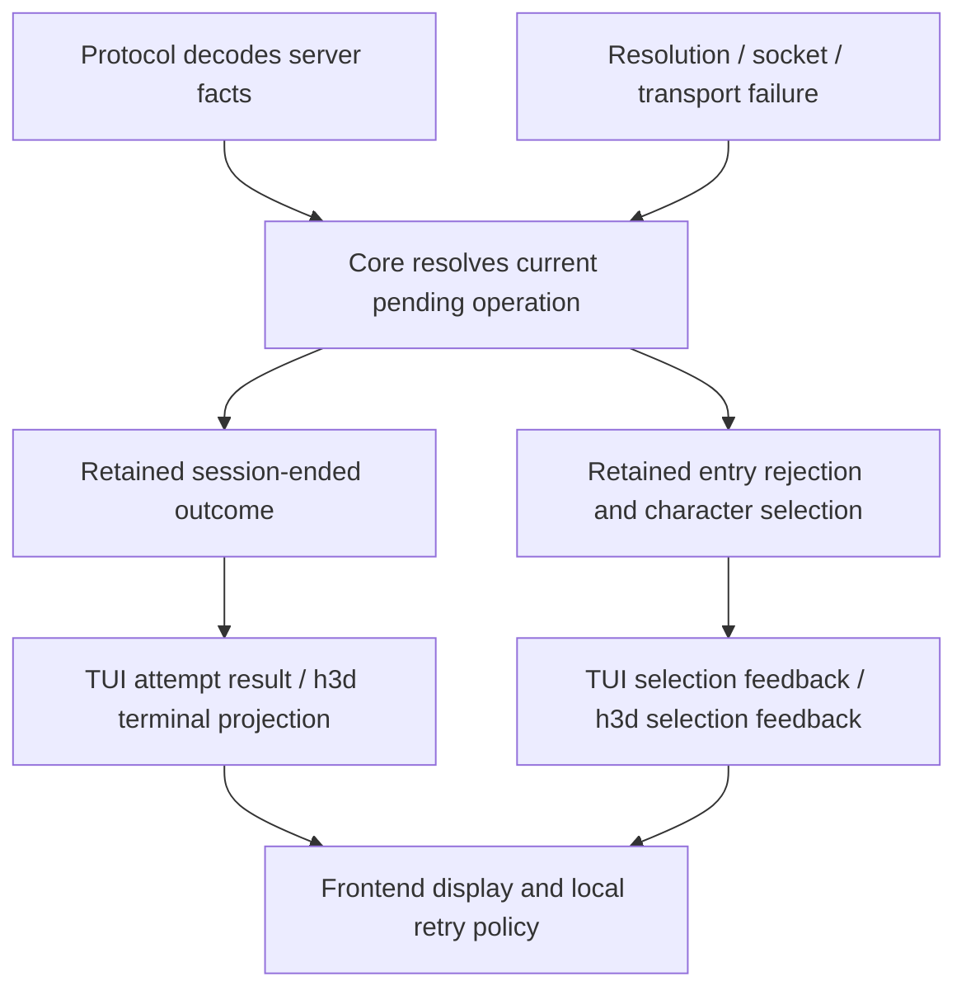

# Rich connection and login failures

Status: implemented and verified. All phases are complete; validation coverage and the pre-existing repository formatting limitation are recorded below.

## Context and boundaries

**Goal:** make connection, authentication, and initial character-entry failures resolve promptly into shared, lossless outcomes that the TUI and h3d can explain consistently.

The successful login packet sequence remains unchanged. The behavioral changes are at failure completion and recovery: stop rejected authentication immediately, retain the reason through shutdown, and restore character selection when entry fails without ending authentication.

In scope:

- Address resolution, socket initialization, login send/receive failures, explicit server rejections, account boots, account bans, and no-response timeouts.
- Initial character-entry rejection and the distinction between a rejected operation and an ended session.
- Shared core contracts, readable explanations, retained state, terminal outcome delivery, and narrow h3d host projection.
- TUI bootstrap retry integration and retirement of each previous attempt before another starts.
- TUI startup/disconnect presentation and h3d loading/ended/character-selection presentation.
- Electron launcher failure presentation and launcher-free exit diagnostics, preserving the current return/quit policy.
- Migration of existing boot/disconnect producers and consumers where they use the replaced paths, including boots after entering the world.
- Focused synthetic tests and behavioral harness verification.

Out of scope:

- Automatic reconnect, new retry scheduling, a new h3d credential editor or in-window login attempt, or changes to credential retention.
- Reordering the successful handshake, redesigning transport reliability, or adding protocol messages the server does not send.
- General gameplay error redesign, character creation/deletion UX redesign, content-loading errors, Explorer UX, and a new global error framework.
- Agent-owned visual acceptance. The user accepts appearance; automated checks establish behavior.

Existing content/startup errors must continue to work through their existing app lifecycle path. Do not relabel every startup error as a connection error.

## Ground truth and current evidence

All paths are relative to the repository root. Code and immediate callers must be rechecked during execution; this plan records a read-only investigation, not empirical runtime verification.

| Layer | Sources and established behavior |
| --- | --- |
| Server authentication | `ACE/Source/ACE.Server/Network/Handlers/AuthenticationHandler.cs`: missing account uses `AccountDoesntExist`; wrong password uses a free-text account boot; concurrent login uses `Logon`; a closed world can use `LogonServerFull` |
| Server early rejection | `ACE/Source/ACE.Server/Network/Managers/NetworkManager.cs`, `SendLoginRequestReject`: sends connection setup before the character error |
| Server wire payloads | `ACE/Source/ACE.Server/Network/GameMessages/Messages/GameMessageCharacterError.cs`, `GameMessageBootAccount.cs`, `GameMessageAccountBanned.cs`; `Network/Enum/CharacterError.cs` |
| Server entry rejection | `ACE/Source/ACE.Server/Network/Handlers/CharacterHandler.cs`, `CharacterEnterWorldRequest` and `CharacterEnterWorld`: several errors return without terminating the authenticated session |
| Server termination | `ACE/Source/ACE.Server/Network/Session.cs`: inspect termination and queued final-message delivery together with authentication handling |
| Retail behavior | `acclient-eor-source/acclient.c:378580` (`Handle_CharacterError`), `:383062` (`Handle_AccountBooted`), `:383120` (`Handle_AccountBanned`): clears pending login flags and interprets ban duration plus optional text; zero/nonpositive duration is presented without an expiry |
| Protocol | `crates/holtburger-protocol/src/errors.rs`, `opcodes.rs`, `messages/misc/types.rs`, `messages/game_message/{mod,pack,unpack}.rs`: character errors carry a raw `u32`; ban opcode is commented out |
| Session | `crates/holtburger-session/src/session/{api,auth,receive}.rs`: socket setup, login send, handshake, transport decode; keep these transport responsibilities here |
| Core | `crates/holtburger-core/src/client/{builder,commands,messages,runtime,lifecycle,types,character_selection,mod}.rs`; `src/errors.rs`: state transitions, snapshots, action results, exit cause and separate string diagnostic |
| TUI | `apps/holtburger-cli/src/bin/tui.rs`: bootstrap classification, retry loop, task completion; `src/update/world.rs`: disconnected status, remembered reason, boot handling; follow the game-page lifecycle consumer too |
| h3d host | `apps/holtburger-3d/host/src/{client_runtime,client_host,client_projection,protocol}.rs`: startup, authority supervision, event draining, terminal projection |
| h3d frontend | `apps/holtburger-3d/src/client/{client-exit-contract,client-host-contract,client-lifecycle-session,client-app-lifecycle,client-loading-page}.ts`, `ClientApp.svelte`: strict decoding, retained session state, page selection, existing controls |
| Native return and launcher | `apps/holtburger-3d/electron/main.ts`, `client-application.ts`, `launcher-store.ts`; `src/launcher/LauncherApp.svelte`: unexpected terminal events call `desktop.back(exit.diagnostic)`; launcher mode retires the attempt and displays the diagnostic in the picker, launcher-free mode quits and reports it |
| TUI selection ownership | `apps/holtburger-cli/src/pages/selection/{state,render,render_widgets}.rs`, `src/update/{world,app_action}.rs`: selection switches to the game page on `EnteringWorld`, while lifecycle roster updates only update a selection page that already exists |
| Existing app lifetime constraints | `docs/plans/holtburger-3d-app-lifecycle-coordination-plan.md` and its implemented source: preserve cancellation and teardown ownership; late terminal details may enrich a stopped page without reopening admission |

Observed structural gaps:

1. `CharacterError::from_repr(...).unwrap_or(CharacterError::None)` discards unknown codes in core.
2. `CharacterError` messages usually become generic action results. Only `Logon` while authenticating explicitly ends authentication in the current handler.
3. Account boot text is retained separately from lifecycle cause. A ban message is not decoded as a supported game message.
4. TUI bootstrap independently decides retryability and can terminate on a generic disconnected event. Its spawned task returns only `Result<()>`, losing access to retained runtime diagnostics.
5. TUI retry/fatal bootstrap returns drop the join handle without awaiting task retirement. Dropping a Tokio join handle alone does not prove retirement; inspect channel-closure and loop behavior before choosing cleanup.
6. h3d projects general action feedback separately from its terminal exit. `client_host.rs` already drains ordered core events before publishing the terminal result; preserve that guarantee.
7. h3d uses broad terminal headings such as “Connection lost,” even when the failure happened during authentication.
8. Electron's automatic return means the h3d ended page is not the sole terminal-error surface. Launcher presentation and launcher-free reporting must receive the shared explanation too.
9. Initial entry starts activation, advances world generation, installs event ordering, and invalidates scene/camera work before sending the entry request. Rejection rollback must retire those effects; clearing a selected character alone is insufficient.
10. `PlayerCreate` can start initial activation whenever `activation` is absent. A guard added only to the late message branch would run after `world.handle_message`, which already admits world facts. Entry admission guards belong before those mutations.
11. A closed core command channel does not end `run`: the receive branch matches `Some(cmd)`, and batch draining treats disconnection like an empty queue. Dropping TUI bootstrap owners can leave the old runtime alive until a later network outcome/timeout.
12. Malformed game messages currently log and return an empty result. Protocol decoder tests alone cannot prove a malformed login rejection produces a prompt user-visible failure.

## North stars and constraints

- Core owns authoritative phase, server interpretation, operation completion, and whether authentication survives. Frontends own controls, layout, and automatic retry policy.
- Decode facts in protocol, keep network mechanics in session, and place reusable failure semantics in core. World/content crates need no new responsibility.
- One authoritative failure value survives event delivery, snapshot refresh, and task completion. Notifications announce state; they are not its only storage.
- Preserve unknown numeric codes and server text. Never infer “wrong password” by parsing boot text; that text is opaque and servers may customize it.
- Do not claim “server full” uniquely means capacity, or that an inactivity timeout proves the server is down.
- Prefer replacing overlapping paths to layering another notification system over `BootAccount`, character action results, and `exit_diagnostic`.
- A specific server rejection must survive subsequent generic disconnect, channel closure, and local cleanup failure. Preserve local cleanup failures separately where the existing app lifecycle already supports them.
- Explicit disconnect and host shutdown remain ordinary terminal outcomes, not fabricated login failures.
- Keep successful connection, character logout, portal activation, and unrelated gameplay errors intact.
- Every new field has an actual consumer. Avoid timestamps, attempt IDs, retry counters, or duplicate phase/disposition flags unless the integration proves a need.

Concessions: without server traffic, we can explain only what the client observed. Unknown codes get a readable message with their raw value. No automatic retry advice is promised for unknown codes or opaque boots. Ban expiry is approximate unless grounded in the received duration and a single owner-computed receipt time; do not invent a permanent-ban flag from an unverified sentinel.

## Contract and flow

The following shapes describe the intended domain, not a required public naming scheme. Finalize names against existing types before implementation.

```text
ConnectionFailure
  context: existing lifecycle context captured before teardown, when a runtime exists
  cause:
    character-error { raw code with known/unknown interpretation }
    account-boot { optional server text }
    account-banned { decoded remaining duration, optional server text }
    inactivity-timeout { observed silence duration }
    local-connection-error { typed operation, diagnostic }

Resolved connection outcome
  session-ended { existing exit cause, failure when applicable }
  entry-rejected { failure; authenticated roster remains usable }
```

Use enums to put variant-specific data together. Keep wire enum values in protocol; core supplies interpretation. Preserve current broad exit causes where they still distinguish shutdown ownership; do not duplicate them with another independent terminal boolean. Internal content/programming failures retain existing error handling rather than becoming a catch-all connection variant.

Retain the existing `#[repr(u32)] CharacterError` known-value enum and raw `u32` in `CharacterErrorData`. The wire payload already preserves raw bits; the actual loss occurs in core conversion. Interpret the value once on entry to core using a core-owned known/unknown representation, preserving unknown values in retained outcomes and affected action results. Consumers read that interpretation rather than reclassifying the raw value. Do not introduce a protocol wrapper, migrate unrelated protocol consumers, or store independently mutable raw and interpreted fields.

Choose these integration boundaries:

- Core snapshots/lifecycle own an optional entry rejection on `CharacterSelection` and a terminal outcome on `Exiting`; populate both in `ClientRuntime::lifecycle()`. The terminal outcome contains the existing exit cause and optional failure, replacing the standalone cause field rather than duplicating it. Snapshot projection and incremental lifecycle projection must carry identical values. Capture existing lifecycle context before teardown; do not create a parallel failure-phase taxonomy or retain a whole roster-bearing lifecycle snapshot merely to select a heading. Reuse the existing lifecycle discriminants needed by actual consumers; setup operations identify pre-runtime failures. Add a narrower context type only if the existing representation cannot serve those consumers without copying unrelated state.
- Keep `ClientRuntime::run() -> Result<()>`. After it finishes, both the TUI task wrapper and h3d supervisor read the retained terminal outcome before dropping the runtime. Task panic has no recoverable runtime value and uses existing runtime-failure reporting. Do not return the whole mutable runtime to the frontend.
- Preserve `ClientRuntimeBuilder::connect`'s existing general error boundary. Wrap resolution/socket errors with a typed core failure implementing `Error` inside the existing error carrier; adapters use its shared `Display` explanation without matching text or extracting unused categories. Bootstrap/configuration errors remain ordinary errors. This avoids changing all builder callers to a new unrelated error enum.
- Implement the shared explanation formatter over structured core facts. TUI calls it directly; h3d host calls it when projecting display text. No frontend reparses that text. Keep the existing h3d `diagnostic` string as the native/launcher consumer's rendered explanation; replace the core's separate mutable diagnostic source. Export additional facts only for named h3d heading, detail, or control consumers. Raw codes and ban values may be included in formatted details without becoming independent IPC fields; the frontend does not need a mirror of core's cause enum.
- Server reply classification owns whether entry is recoverable. The TUI retains its own known-code automatic retry list; do not move that policy into core merely to remove a match statement. Remove only its independent guesses about whether the session has ended.
- Establish a terminal outcome before lifecycle notification or task completion. In h3d, an already-recorded specific failure wins over the current `shutdown_requested` shortcut; ordinary host shutdown applies when no earlier specific failure exists. Keep forwarding drain-before-terminal ordering. Do not publish a second terminal completion event that races the supervisor.

Session setup currently binds an IPv4 UDP socket; it does not establish a TCP-style connection or confirm reachability. Describe socket-open errors honestly. DNS/IPv6 address selection changes are outside this task. Inactivity timeout is not a login deadline: continuing server traffic can keep a pending login alive. Preserve that policy for this change and report it explicitly; a progress deadline would be separate work.

The retained lifecycle/application snapshot contract encodes terminal and recoverable outcomes distinctly. Clear a recoverable rejection when a new entry attempt begins or identity is retired; retain terminal failure through teardown. Do not add parallel mutable “last error” fields to every layer.

Required formatter consumers are TUI startup/disconnect output and h3d host projection, whose text also feeds Electron return/quit and launcher failure output. Core retains raw codes/reasons and ban duration for interpretation and shared formatting; TUI uses interpreted known codes for its local retry policy. h3d receives only the prepared presentation and facts its controls actually use. Frontends must not reconstruct lifecycle semantics from formatted text. For no-expiry/sentinel representations, retain raw ban bits and follow the verified retail interpretation; never discard an unfamiliar high-bit value or advertise a wall-clock expiry without proof. Malformed supported lifecycle replies use the existing operational-failure path with a readable opcode-specific diagnostic; they do not require a dedicated public cause variant.



| Situation | Shared transition | Frontend behavior |
| --- | --- | --- |
| Resolution/socket initialization failure | Failed attempt, even before a runtime exists | Explain failed operation and diagnostic |
| Login send/receive failure | End current session with failure context | Explain connection/login failure |
| Non-success authentication rejection, boot, ban | Retain specific outcome, end authentication immediately | Show reason promptly; no generic timeout replacement |
| Entry rejection proven to preserve session | Cancel pending entry, reset entry flags/activation work as required, restore retained roster | Allow character selection and show rejection |
| Boot/ban while in world | End session with server details | Use existing disconnect/ended surface |
| Inactivity timeout | Retain timeout observation and failed phase, end session | Explain lack of response without claiming a root cause |
| User disconnect / host shutdown | Preserve existing ordinary termination | Existing ordinary end presentation |

Not every `CharacterError` is an authentication failure: `None`, logoff rejection, and character-management responses require contextual handling. Build the phase/code decision table from ACE and existing pending operations before moving branches. Unknown nonzero codes while authentication is pending must resolve the attempt with their raw value; unrelated unknown codes must not arbitrarily terminate an active world session.

Specific decisions established by the walkthrough:

| Context and server message | Resolution and evidence |
| --- | --- |
| Authenticating, known nonzero rejection or unknown nonzero character error | End attempt immediately; retain code. `None` is not a rejection |
| Initial entry before server acceptance, `LogonServerFull`, `EnterGameCharacterNotOwned`, `EnterGameCharacterInWorld`, `EnterGameGeneric`, `EnterGameCouldntPlaceCharacter` | Restore selection: ACE `CharacterHandler` sends these and returns before `InitSessionForWorldLogin` |
| Any live phase, account boot or ban | End session; preserve supplied facts |
| Authenticated session, `Logon` or `ServerCrash1` | End session: ACE uses these for duplicate-account eviction and server shutdown; cover selection, entry, world, portal, and logout rather than fixing only `authenticating == true` |
| Logging out, `Logoff` rejection | Preserve the existing return-to-world behavior; do not turn it into a login failure |
| Character management pending | Keep the management rejection contract and ordinary action feedback; do not replace it with entry rejection |
| Unknown code during initial entry or a code without proven recoverability | Explain it without claiming the authenticated session is safe to reuse. End the attempt when safe continuation cannot be established; unknown world-session feedback alone does not justify disconnect |

Recoverable rollback is limited to a pending initial entry that the server has not accepted. If player establishment or accepted destination work already happened, do not fabricate selection state from a later generic error. Tests must exercise the actual pending-entry substages.

Start rollback by clearing selected core identity and `enter_world_sent`, retiring pending entry activation/event ordering, and publishing a coherent selection baseline with no established local player. Reuse existing retirement/reset primitives; do not send logout to compensate for a request ACE rejected. Trace the work actually started by initial entry and expand cleanup only where a concrete surviving task or state mutation can outlive that retirement. Do not prescribe blanket movement/collision/script/reveal invalidation or add a new rollback coordinator. Prove late `CharacterEnterWorldServerReady`, `PlayerCreate`, and entry-world events cannot revive rejected entry; necessary admission guards belong before world mutation, not just before UI publication. AC's untagged readiness reply cannot acquire correlation from a local attempt counter; rely on session packet ordering and a single pending entry, and document any remaining evidence gap instead of claiming stronger guarantees.

## Phased implementation

### Phase 1 — Complete protocol facts and decision evidence

Deliverables:

- [x] Verify ban string encoding, alignment, optional-tail behavior, duration/sentinel semantics, and malformed-input behavior against ACE writers and retail reader.
- [x] Add `AccountBanned` opcode, payload, message packing/unpacking, and self-contained fixtures/tests in protocol.
- [x] Keep character-error payloads as raw `u32` and add an unknown-value decode/round-trip fixture. Leave the known enum and unrelated protocol consumers unchanged; core interpretation is phase 2 work.
- [x] Enumerate actual authentication and initial entry errors, including successful/no-op values and management/logoff contexts. Record decisions here with source references.

Acceptance: payload round trips and malformed cases pass; unknown codes survive decoding; server behavior table distinguishes termination from operation rejection. A missing optional string is valid; a present truncated string is an error.

### Phase 2 — Resolve and retain outcomes in core

Deliverables:

- [x] Finalize the composite contract in `client/types.rs` or a focused adjacent module; document fields and named consumers.
- [x] Replace core's lossy character-error conversion with a core-owned known/unknown interpretation computed once; carry it through retained outcomes and affected action results. Preserve existing lifecycle context without adding a parallel failure-phase enum.
- [x] Add structured setup-error context at `ClientRuntimeBuilder::connect` for resolution/socket failures without recategorizing bootstrap/content/configuration errors. Before-runtime failures and running-runtime failures must project to the same connection-failure domain; use the narrowest typed boundary compatible with existing callers.
- [x] Centralize explanation formatting in core; include readable known-code messages and explicit unknown-code text. Preserve opaque server reasons without guessing a more specific category.
- [x] Resolve authentication rejection/boot/ban immediately in `messages.rs`; capture failed phase before changing state.
- [x] Handle established-session duplicate-login eviction and server-shutdown codes. Add ban admission to the `LoggingOut` account-message allowlist so a retired-character gap cannot discard it.
- [x] Route a truncated supported character-error/boot/ban reply through the existing operational-failure path with opcode-specific wording. Make this narrow change before the existing log-and-ignore branch; do not add a public malformed-reply category, broaden decoder policy, or expose raw packet dumps to UI.
- [x] Implement contextual entry rejection recovery using the roster already owned by character selection. Clear pending entry and activation, reuse existing retirement primitives, and add further cleanup only for demonstrated surviving work. Prove late messages cannot revive rejected entry.
- [x] Retain outcomes in application state and expose terminal outcome after `run`, replacing the separate connection-specific string path. Ensure timeout and relevant transport/command failures retain context too.
- [x] Cover both receive errors and message-handler send errors (`process_network_batch` currently only categorizes the receive error), plus login-send failures from command dispatch. Keep operational `Err` for diagnostics while retaining the correct failure facts and phase.
- [x] Define specificity precedence and publication ordering once. A later generic disconnect cannot overwrite a server rejection. Avoid duplicate general action feedback for a failure already represented by the new lifecycle outcome.
- [x] Update affected callers/fixtures enough to keep the workspace compiling; complete frontend presentation cutovers in their phases.

Acceptance: direct message tests prove immediate authentication termination, recoverable entry returns to selection, unknown-code preservation, snapshot retention, and ordinary disconnect behavior. Tests cover rejection followed by late success/roster traffic so failed work cannot silently resume.

### Steering checkpoint — Confirm state and lifetime boundaries

- [x] Walk resolution failure, boot during authentication, full/closed world, entry refusal, timeout, and in-world boot through both consumers.
- [x] Confirm the contract carries all required facts without independent copies of phase, terminal state, or retry classification.
- [x] Confirm no protocol wrapper, parallel phase taxonomy, dedicated malformed-reply variant, blanket invalidation mechanism, or unused h3d IPC fields have been introduced.
- [x] Confirm any entry reset follows ACE/retail behavior and does not rebuild logout/portal architecture.
- [x] Reassess line count and scope. Explain additions that are not offset by removal of duplicate handling.
- [x] Resolve material evidence gaps before frontend integration; no user approval gate is implied for routine implementation decisions once implementation is authorized.

### Phase 3 — TUI integration and attempt retirement

Deliverables:

- [x] Replace bootstrap's independent session-termination interpretation with shared resolved outcomes and explanations in `src/bin/tui.rs`; retain frontend-owned retry-code matching.
- [x] Return the retained terminal outcome from the spawned task along with any operational error; handle task/event completion races using the same outcome.
- [x] Make bootstrap outcome finalization asynchronous: a ready outcome transfers the live task; failure/retry drains the retained terminal result or cancels a still-running attempt and awaits retirement. `AbortHandle`/join cancellation can be a narrow task fallback where no graceful terminal result can exist. Task handles must never merely detach, and a completed `JoinHandle` must not be polled twice. Preserve the primary failure when cleanup also fails.
- [x] Keep automatic retry policy local and preserve the existing retry-code set where compatible with proven session semantics. Do not add retries for boots, bans, unknown errors, or arbitrary local failures. Remove the duplicated retry-code interpretation only if core supplies a demonstrated semantic fact rather than TUI policy.
- [x] Migrate `src/update/world.rs` and immediate lifecycle/chat consumers to retained outcomes. Remove hard-coded character-error disconnect guesses and ordering-dependent remembered-message patches superseded by the contract.
- [x] Surface entry rejection while selection remains usable; preserve exit status and existing terminal cleanup behavior.
- [x] Update `src/pages/selection/state.rs` and `src/update/{world,app_action}.rs`: entry currently switches to the game page immediately. On retained rejected-entry lifecycle, reconstruct the selection page from the authoritative roster even when the current page is Game; do not wait for a new server `CharacterList` that ACE does not send. Carry a visible selection error field through the view; logger output alone is insufficient. A shared snapshot restores the same page/error. Consume the CLI character preference only once so recovery cannot auto-submit it again.
- [x] Update the successful-bootstrap task type, in-game task-completion branch, and final terminal-restoration branch together. If final cleanup aborts a task, await its cancellation before returning; preserve terminal restoration before printing errors.

Acceptance: synthetic bootstrap tests cover specific reason versus task/stream completion, successful roster handoff, retry/fatal cleanup, and at most one live attempt. Recovery tests prove selection remains usable after entry refusal. Do not run the interactive TUI.

### Phase 4 — h3d typed projection and presentation

Deliverables:

- [x] Extend `host/src/client_projection.rs`, host startup/supervision, and `protocol.rs` with only the display text and context/control facts required by named h3d consumers. Format raw error codes and ban facts into details where sufficient; do not serialize core's complete failure model. Cover startup failures before core runtime creation.
- [x] Preserve the `client_host.rs` event-drain-before-terminal ordering and existing cancellation/retirement barriers. Specific shared failure survives late shutdown enrichment.
- [x] Update `client-exit-contract.ts`, applicable host/state schemas, `client-lifecycle-session.ts`, and actual Electron/IPC consumers identified by symbol search. Strict schemas and Rust projections cut over together; do not retain permissive legacy alternatives.
- [x] Explicitly include `src/lib/host/host-transport.ts`, `electron/main.ts`, `electron/client-application.ts`, and launcher tests in the consumer audit. Preserve `desktop.back` behavior: launcher mode displays the prepared shared explanation via `LauncherSnapshot.failure`; launcher-free mode reports it and exits unsuccessfully. Do not keep a session window open merely to display a new ended page.
- [x] Select existing loading/ended page headings using the minimum projected context through `client-app-lifecycle.ts` and `ClientApp.svelte`. Use shared explanation/details text; headings/layout remain app-local. Do not rebuild server-code classification in TypeScript.
- [x] Show recoverable entry rejection in the existing selection surface, restore entry admission, and clear rejection on the next submitted entry attempt. h3d uses explicit entry; reset `#entryRequestGuid` through the authoritative selection transition so the same GUID can be submitted again. Test both incremental lifecycle and replacement snapshot paths.
- [x] Reuse existing return-to-launcher/close controls; do not introduce in-window reconnect or credential state.

Acceptance: host/schema tests preserve the shared explanation, including relevant code, server text, and ban information in rendered details, without requiring independent IPC fields for each fact. Lifecycle/session tests cover terminal and recoverable outcomes. A browser harness injects failures through production adapters and asserts visible text, retained details, and control admission. Electron application tests prove automatic launcher return, primary-reason precedence, retirement completion, and launcher-free failure reporting. Extend the existing launcher probe for the changed native-to-launcher boundary using synthetic host failure where feasible; browser-only verification cannot establish native return behavior. No visual judgment or screenshot acceptance by the agent.

### Phase 5 — Cleanup and verification

- [x] Sweep `BootAccount`, connection-specific `exit_diagnostic`, lossy core character-error fallbacks, duplicate rejection/action feedback, bootstrap retry handling, and old disconnect-message patches. Delete only superseded mechanisms; general gameplay action results and unrelated known-enum casts remain.
- [x] Rewrite brittle tests around authoritative outcomes instead of preserving deleted event order or legacy contracts.
- [x] Check that every added contract field has a production consumer, comments explain new invariants, and crate/app ownership remains intact.
- [x] Run focused protocol/core/TUI/host tests, `cargo fmt --all -- --check`, and Clippy with warnings denied for touched crates and targets. Check manifests for existing scripts before selecting commands.
- [x] In h3d, run relevant `npm run test:ts -- ...`, `npm run check`, `npm run lint`, and `npm run format:check` checks. Run the behavioral browser probe through `npm run harness:browser -- ...`.
- [x] Record exact validation results and any external prerequisites. Use synthetic fixtures checked into the repo; do not retain tests requiring untracked DAT/runtime assets.
- [x] Review final diff, update this plan's decisions/status, and summarize remaining risks. Do not stage or commit unless asked.

## Required verification scenarios

| Scenario | Required proof |
| --- | --- |
| Missing/invalid account | Readable coded rejection ends authentication immediately |
| Wrong password / arbitrary boot text | Exact supplied explanation survives; no string-based category inference |
| Concurrent login | Immediate shared rejection; TUI's existing retry policy remains frontend-owned |
| Server full or world closed | Honest wording preserves ambiguity; no capacity-only claim |
| Ban with/without reason and timed/no-expiry representation | Decoder and UI preserve supported facts; malformed tail fails decoding |
| Malformed supported login error payload | Existing operational-failure path explains malformed reply promptly, rather than logging and waiting for timeout |
| Unknown character-error code | Raw value survives protocol/core and appears in shared explanation/details through both presentations; no dedicated h3d raw-code field is required |
| No traffic | Timeout names observed silence and actual phase |
| Resolution/socket/login transport failure | Local operation context is retained without exposing outgoing login payloads or credentials |
| Character in world / ownership / placement rejection | Proven recoverable cases return to selection with coherent entry state |
| Snapshot refresh or missed notification | Retained outcome restores the same explanation |
| Rejection racing task end/disconnect | Specific reason survives, one logical failure presentation |
| Retry/fatal bootstrap cleanup | Previous runtime retires before retry or return |
| Rejected entry after TUI already opened Game | Selection page is rebuilt with roster and visible error without a fresh server roster or repeated CLI auto-entry |
| h3d same-character retry after entry refusal | Incremental and snapshot recovery both clear submission suppression |
| Electron automatic return / launcher-free launch | Shared reason survives native retirement and appears in launcher failure or terminal exit reporting |
| Shutdown flag racing a recorded server failure | Specific server failure remains primary; host shutdown does not erase it |
| Explicit disconnect, logout, portal entry, successful login | Existing successful/ordinary behavior remains coherent |
| Late server outcome during app teardown | Details may enrich presentation; authority/control admission never reopens |

## Risks and mitigations

- **Context-sensitive codes:** a blanket “all character errors disconnect” rule would break live-session operations. Use the source-backed pending-operation decision table.
- **Late entry messages:** resetting a label alone may leave provisional activation alive. Inspect the whole entry handshake, reuse retirement primitives, and test stale completion after rejection. Add cleanup only for demonstrated surviving work; do not invent local correlation for untagged wire replies.
- **Loss during terminal delivery:** TUI consumes task completion and events competitively; h3d has separate ordered forwarding and Electron may start native retirement immediately. Preserve one retained outcome and adapt each existing lifetime mechanism rather than introducing a universal supervisor. `ClientApplication.back` ignores additional calls while retirement is active: preserve the first specific connection reason and keep cleanup diagnostics separate; test that startup-command rejection cannot install a generic reason ahead of the terminal server outcome.
- **Retry policy leakage:** TUI's retry choices are UX. Shared state says what failed and whether the authenticated session survives; frontends decide whether and when to start another attempt.
- **Ban ambiguity:** ACE writes unsigned remaining seconds while retail's reader uses a signed local interpretation. Verify edge/sentinel semantics before choosing types or claiming permanence. Prefer displaying supported duration over inventing a wall-clock expiry.
- **Contract churn:** lossless errors and structured exit payloads affect many exhaustive matches and strict schemas. Use symbol searches and compile checks to find all consumers, including diagnostics/harnesses.
- **Scope expansion:** generic content and renderer errors share startup/ended pages. Integrate connection failures without replacing unrelated failure domains.

## Decisions, course corrections, and open questions

- Successful login packet ordering is unchanged; error resolution and recovery transitions change.
- h3d remains one native connection attempt per launched session. Return to launcher is the existing path to another attempt.
- Preserve automatic return-to-launcher for unexpected terminal events and launcher-free quit/report behavior. The in-window ended page remains useful for existing applicable flows and harnesses; it cannot be the only acceptance surface.
- Keep the TUI's current retry timing and eligible known-code policy unless protocol evidence requires a change. No new global retry policy is proposed.
- Human wording may differ in surrounding UI headings; the underlying explanation and server facts are shared.
- No user decision blocks implementation planning. Protocol edge cases and exact entry cleanup are evidence tasks in phases 1–2, not assumptions to fill in later.
- Use retained lifecycle variants, core-owned lossless character-error interpretation, existing lifecycle context, a shared formatter, typed setup-error context, and existing `run` ownership as described above. Keep h3d projection limited to named presentation/control consumers. During implementation, record final symbol names, verified ban semantics, and any justified changes to retry behavior here.
- YAGNI review removed the prescribed protocol wrapper, parallel nine-phase taxonomy, full-fidelity h3d cause projection, blanket subsystem invalidation, and dedicated malformed-reply variant. Retained outcomes, immediate rejection handling, ban decoding, awaited TUI retirement, selection recovery, and launcher integration remain because each addresses a demonstrated gap.
- The source walkthrough established integration requirements; implementation and runtime evidence are recorded in the execution section below.
- The change spans protocol/core/TUI/host contracts and their fixtures. Additional code is concentrated in shared failure facts/formatting and focused tests/probes; obsolete notification and frontend interpretation paths were removed. No second error bus was introduced.

### Execution evidence and decisions

Implemented ownership and cutovers:

- `ConnectionFailure` captures existing `ClientState` context; `CharacterErrorCode` interprets raw values once in core. `ClientExitOutcome` replaces separate cause/diagnostic bookkeeping. Setup failures use the same typed core explanation inside the existing error carrier; adapters need only `Display`, so no category downcast or string classification was added.
- Ban payload remains raw `u32` plus optional string. Shared formatting follows retail's signed-positive duration check and reports seconds without inventing a calendar expiry. Unknown character codes remain lossless in core and appear numerically in explanations.
- h3d receives selection rejection text and retained terminal diagnostic text. Headings reuse `lastSessionPhase`; no new phase enum or mirrored cause payload crosses IPC. The native supervisor preserves a specific core failure ahead of shutdown flags or generic task errors.
- Entry rollback clears pending identity, the ready-send guard, event ordering, and activation. Existing selection status retirement resets shared transient state. A pre-mutation gate prevents late world traffic from resurrecting a refused entry; no new subsystem invalidation mechanism was required.
- TUI bootstrap finalization cancels and joins a still-running failed task before retry. Task completion retains the core outcome, retirement failures remain visible, and bootstrap can recover its roster from a replacement snapshot. Retry-code policy stays local.
- TUI selection rebuild works from the game page without a new server roster. A later broad roster notification preserves the authoritative entry refusal rather than clearing it. Character preference remains a one-time action.
- Superseded `BootAccount` and producerless `Disconnected` events were removed, with their consumers migrated or deleted. Runtime body views now retire on terminal lifecycle. General character-management/gameplay action results remain.
- Final review restricted connection classification to real network boundaries and recognized malformed lifecycle replies. Other message-handler content/invariant errors retain ordinary runtime-failure handling instead of being mislabeled as connection failures.

Validation:

| Check | Evidence |
| --- | --- |
| Protocol library | 302 tests passed, including ban round trips, absent/empty reasons, truncated tails, and unknown-code preservation |
| Core library | Final 795 tests passed; covers immediate authentication rejection, retained unknown codes, recoverable entry refusal, late traffic, bans in logout gap, malformed replies, in-world eviction, and body-cache retirement |
| TUI | Final 330 library tests and 20 TUI binary tests passed; includes actual game-page-to-selection recovery, roster refusal retention, task cancellation/join, and retry policy |
| h3d Rust host | 397 tests passed after replacing the obsolete disconnected-event test with retained failure precedence coverage |
| TypeScript | All 4,203 tests in 430 files passed with four workers; `npm run check` passed with zero Svelte errors/warnings |
| Lint/build | Affected protocol/core/TUI/host/debug-harness Clippy targets passed with warnings denied; `npm run lint`, frontend build, and Electron main build passed |
| Browser behavior | `npm run harness:browser -- --client-presentation --brief` passed with no browser errors. The added scenario refuses entry, verifies the visible explanation and restored entry admission, then enters successfully. Existing logout/reentry/connection-loss/teardown scenarios also passed |
| Native return | `npm run probe:launcher -- --assets ../../dats --connection-failure-only` passed. A real UDP inactivity timeout retains the shared explanation through automatic native return, renders it in a usable launcher, leaves no sidecar/canvas, and quits cleanly |
| Live ACE | `live_login_probe` observed occupied-account rejection. After the user freed the account, valid authentication succeeded and retired cleanly; one intentionally incorrect password returned ACE's detailed boot explanation. Credentials stayed in environment variables and were redacted from output. No character was selected |
| Formatting | `cargo fmt --all -- --check`, `git diff --check`, and Prettier checks of every changed frontend/script file passed. Full `npm run format:check` reports the unchanged file described below |

Validation limits and course corrections:

- Full repository Prettier checking flags `apps/holtburger-3d/src/harness/browser/client-selected-actions-probe.ts`, which this change does not modify. Its current content was compared byte-for-byte with `HEAD`, and formatting `HEAD` through Prettier also failed. All changed files pass formatting; the unrelated file remains untouched.
- The full launcher UI probe stopped at its existing pre-login profile-selection assertion (`unused server has no remembered profile`), before reaching the changed connection checks. A focused mode was added to the same probe to establish the required native connection-failure boundary without expanding this feature into profile-editor work. Launcher-free failure reporting is covered by Electron application tests.
- The initial fully parallel TypeScript run timed out one unchanged startup test. That test passed in isolation, then the entire suite passed with bounded workers. Socket-opening Rust tests passed after rerunning with local socket access rather than the restricted sandbox.
- The first browser run timed out while compiling its content host; a later run was interrupted by source formatting/HMR. The final settled-source run passed. No visual acceptance checks, interactive TUI runs, or retail decompile changes were performed.

## Final code quality review

Reviewed the accumulated implementation against `HEAD`, including new files, deleted events, all immediate consumers, tests, and probes. The wire layer retains server facts; core owns interpretation and lifecycle resolution; TUI owns retry policy; the h3d host projects presentation data; launcher dismissal remains document-local. The final native exit event owns the terminal diagnostic, so the unused duplicate diagnostic in the h3d lifecycle projection was removed.

Corrected during review:

- Generic teardown outcomes no longer block later specific failure evidence, and later generic shutdown cannot erase that evidence. A regression covers both orders.
- TUI bootstrap preserves ordinary runtime diagnostics when the retained outcome has no connection explanation. Both task-completion paths now use one result classifier, and retirement preserves an existing explanation unless more specific evidence arrives.
- h3d ignores late lifecycle updates and replacement snapshots after final task completion. A regression verifies the retained exit. An old reentry test now models authenticated logout rather than reusing a terminal connection.
- The wrong-password probe now requires an account-boot explanation; inactivity and unrelated character rejections cannot satisfy it. It still treats server text as opaque and does not claim to distinguish administrative boots from password failures.
- Restored the unrelated missing-spell-components TUI test and checked both disconnect quit policies. Malformed-reply handling decodes the opcode once.

Launcher follow-ups place the framed alert beside branding, reuse shared panel/button styles, support dismissal without changing native diagnostic retention, and wrap below branding at narrow widths. Shared boot wording appends ACE's whitespace-prefixed explanation suffix, with a separator for bare custom explanations and no invented credential classification.

Verdict: ready within the reviewed scope after these corrections and the recorded checks. The broad launcher probe and repository formatting limitations above remain bounded validation gaps; no unrelated profile or formatting changes were included.

## Definition of done

- [x] Both frontends explain supported failures with shared facts and readable wording.
- [x] Authentication rejection completes promptly without waiting for inactivity timeout.
- [x] Recoverable entry rejection restores a coherent authenticated selection state.
- [x] Unknown codes, optional reasons, and supported ban information are retained in core and reach both presentations through shared formatting; exported structured fields each have a named consumer.
- [x] Specific failures survive snapshot refresh, task completion, stream closure, and teardown.
- [x] TUI selection recovery works after its early game-page transition; Electron launcher and launcher-free exits retain the shared reason.
- [x] TUI retries never overlap old attempts; h3d preserves existing authority/renderer retirement guarantees.
- [x] Superseded connection-error paths and brittle tests are removed.
- [x] Relevant compilation, formatting, tests, lint, and browser behavioral checks pass, with limitations explicitly recorded.
- [x] No interactive TUI run, retail decompile edits, asset-dependent retained tests, or visual acceptance claims were introduced.
